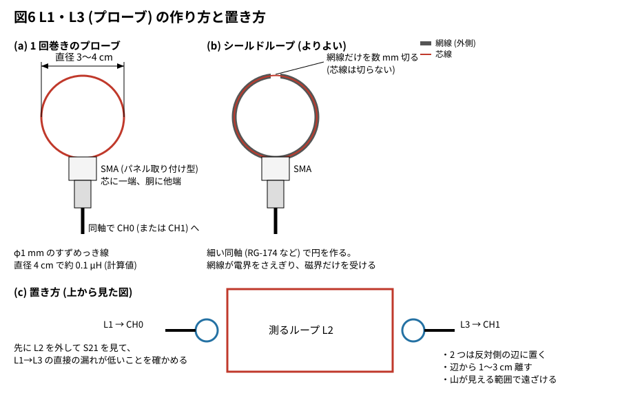

# 11-15 ループアンテナの自己共振を NanoVNA で測る — S11 と S21 の 4 つの読み方

11-14 では、中波帯の微弱電波を何回か巻いた小さなループで受け、tinySA で電界強度を見積もった。
そのループは、自己共振を帯域より十分上に置かないと読みが持ち上がる (11-14 の第 1 部)。
この題では、作ったループの自己共振を NanoVNA で測る。例は 11-14 の図 3 の 6 回巻きのループである。

測るのはループ (アンテナ) そのもので、ブレッドボードに載せる回路が無いので、実体配線図を付けない。
S パラメータを見る題なので、AD3 とオシロの図は使わない (vna の図にする)。

## 測り方

11-14 で置いた浮遊容量 20 pF は目安で、実際の浮遊容量は巻き方と線の引き回しで変わる。作ったループは、
使う前に NanoVNA の S11 (1 ポート) で自己共振を測っておく。

1. 掃引を 100 kHz〜30 MHz にし、ループをつなぐ SMA の口 (変換コネクタの先) で Open・Short・Load を校正する
2. ループの両端を、できるだけ短い線でその口につなぐ。tinySA につなぐときと同じ線・同じ取り回しにする
3. 表示はスミスチャートとリアクタンス X (または |Z|) にする

| 読む所 | 見え方 | 求まるもの |
| --- | --- | --- |
| 低い周波数 (中波帯より下) | X が正で、周波数にほぼ比例して増える | L = X / (2πf) |
| 自己共振 f<sub>SRF</sub> | \|Z\| が山になり、X の符号が + から − に変わる。スミスチャートでは右端の近くで実軸を横切る | f<sub>SRF</sub> |
| 上の 2 つから | — | 浮遊容量 C<sub>s</sub> = 1 / ((2π f<sub>SRF</sub>)² L) |

自己共振の所はインピーダンスが高く |Γ| がほぼ 1 になるので、|Z| の値そのものは粗い。
周波数を読むだけなら十分である。ループはアンテナでもあるので、測るあいだに近くの放送局を
拾って線が揺れることがある。平均を増やすか、揺れの少ない時間に測る。

6 回巻きのループ (11-14 の図 3) を、浮遊容量 20 pF (仮定)・巻き線の抵抗 2 Ω (目安) の模型で計算すると、
NanoVNA の画面は図 1 のようになる (計算値)。

```vna
# NanoVNA の画面 (tommie-fence の vna フェンス)
device: h4
sweep: 100k-10M 401
title: 図1 6 回巻きのループ — 500 kHz の X で L、5.03 MHz で X が + から −
dut:
  - series L 50u esr 2 cp 20p
  - short
traces:
  - S11 smith
  - S11 x
markers:
  - 500k
  - 5.03M
```


| 読み (図 1、計算値) | 値 | 求まるもの |
| --- | --- | --- |
| 印 1: 500 kHz の X | +j158.6 Ω | L = 158.6 / (2π × 500 kHz) ≈ 50.5 µH |
| 印 2: X が符号を変える所 | 約 5.03 MHz | f<sub>SRF</sub> |
| 上の 2 つから | — | C<sub>s</sub> = 1 / ((2π × 5.03 MHz)² × 50.5 µH) ≈ 19.8 pF (仮定の 20 pF に戻る) |

L は f<sub>SRF</sub> より十分低い所で読む。1 MHz で読むと X は 327 Ω で、L は 52 µH と 4 % 大きく出る
(C<sub>s</sub> の分だけ持ち上がる)。f<sub>SRF</sub> の近くで X は ±10 kΩ の枠を超えて切れるが、
読むのは符号の変わる周波数だけである。

**スミスチャートの読み方。** スミスチャートは、インピーダンス Z を 50 Ω で割った値 z を円の中に描く。
左端が短絡 (z = 0)、中央が 50 Ω、右端が開放 (z = ∞)、上半分が誘導性 (X > 0)、下半分が容量性 (X < 0) である。
外周に近いほど損失が小さい (反射がほぼ 1)。図 1 の線は次のように読む。

| 周波数 | 線のいる所 | 意味 |
| --- | --- | --- |
| 100 kHz (始点) | 上半分の左寄り、外周の近く。z ≈ 0.04 + j0.63 (計算値) | ほぼ純粋なコイル。抵抗 2 Ω は 50 Ω に比べて小さい |
| 100 kHz → 5 MHz | 外周に沿って時計回りに上から右へ進む | 周波数とともに X が増え、z が ∞ に近づく |
| 印 1 (500 kHz) | 上半分、j2 と j5 の間。z ≈ 0.04 + j3.17 | X = +158.6 Ω。ここで L を読む |
| 印 2 (5.03 MHz) | 右端の開放の点 (∞) のすぐそば | 自己共振。L と浮遊容量の並列共振で、Z がとても大きくなる |
| 5 MHz → 10 MHz | 右端を越えて下半分へ回り、外周に沿って進む | 自己共振より上では容量性。ループはもうコイルとして働かない |

- **線が外周から離れない**のは、巻き線の抵抗 (2 Ω) が小さいからである。実物で線が内側へ寄っていれば、
  損失が大きい (Q が低い)。巻き線を太くするか、近くの金属から離す
- **線が右端の ∞ を通る所が自己共振**である。リアクタンス X のグラフで符号が変わる所と同じ周波数になる。
  X のグラフは共振の近くで枠の外に出るが、スミスチャートでは無限大も右端の 1 点に収まるので、
  共振の前後のふるまいを 1 枚で見渡せる
- 中波帯 (0.53〜1.6 MHz) では、線は上半分の外周の近く (531 kHz で j3.4、1 MHz で j6.5、1.6 MHz で j11。計算値) にいる。
  ここが右端に近いほど、自己共振が帯域に近く、読みが持ち上がっている

## S11 の位相で読む

スミスチャートや X が表示しにくいときは、S11 の位相 (PHASE) で読む。表示を `S11` の `PHASE` にすると、
自己共振の周波数で位相が 0° を横切る (図 2、計算値)。

```vna
# NanoVNA の画面 (tommie-fence の vna フェンス)
device: h4
sweep: 300k-10M 401
title: 図2 S11 の位相 — 5.03 MHz で 0° を横切る (開放の点)
dut:
  - series L 50u esr 2 cp 20p
  - short
traces:
  - S11 phase
markers:
  - 1M
  - 5.03M
```


| 読み (図 2、計算値) | 値 | 意味 |
| --- | --- | --- |
| 印 1: 1 MHz の位相 | 17.38° | 正。コイルとして働いている (上半分) |
| 印 2: 位相が 0° を横切る所 | 5.030 MHz | f<sub>SRF</sub>。スミスチャートの右端 (開放の点) と同じ |

- **位相 0° は開放の点である。** 反射係数の位相は、短絡で ±180°、開放で 0° になる。
  コイルは周波数とともに短絡の側 (+180° の近く) から上半分を回って開放 (0°) に近づき、
  自己共振を越えると下半分 (負の位相) へ回る。0° を横切る周波数が f<sub>SRF</sub> である
- **LOGMAG (|S11| の dB) はこの用途に向かない。** 損失の小さいループは、短絡に近い低い周波数でも、
  開放に近い自己共振でも、ほとんど全部を反射する。|S11| は 1 MHz で −0.017 dB、5.03 MHz で −0.0007 dB (計算値) で、
  10 dB/目盛の枠ではどちらも上端の 0 dB に張り付き、自己共振の印が見えない。見るのは大きさではなく位相である
- **0° の近くの傾きはゆるい** (3〜7 MHz で約 6° しか動かない、計算値)。位相が 0.1° ぶれるだけで、
  読む周波数は約 70 kHz ずれる。Z がとても大きくなる並列共振では、位相は共振の手前からほぼ 0° に張り付くためである。
  **位相は「どのあたりで共振するか」をつかむのに使い、周波数を詰めるのは X の符号の変わり目か、
  次の S21 で行う**。印を 0° の所へ動かして周波数を読む。
  掃引を 300 kHz から始めたのは、それより低いと位相が左端で急に立ち上がり、0° の付近が平らに潰れるからである

## S21 で直列に挟む

2 ポートで測るなら、ループを CH0 と CH1 の間に直列に入れる (図 3)。3-1 の直列治具と同じつなぎ方である。

```circuit
# 回路図 (tommie-fence の circuit フェンス)
title: 図3 ループを CH0 と CH1 の間に直列に挟む
parts:
  X1:
    type: device
    at: 1,2
    label: NanoVNA
    pins: [CH0, GND]
    turn: mirror
  L1: inductor 5,2 8,2 50u
  C1: capacitor 5,4 8,4 20p
  X2:
    type: device
    at: 12,2
    label: NanoVNA
    pins: [CH1, GND]
  G1: ground 4,5
  G2: ground 11,5
wires:
  - X1.CH0 -| 5,2
  - 5,2 -- 5,4
  - 8,2 -- 8,4
  - 8,2 -| X2.CH1
  - X1.GND -| 4,5
  - X2.GND -| 11,5
notes:
  - text 6.5,1.5: ループ (6 回巻き)
  - text 6.5,5.5: C1 は浮遊容量 (仮定)
```


- L1 と C1 はループそのもの (C1 は巻き線の浮遊容量で、部品として付けるわけではない。20 pF は仮定)
- 校正は、CH0 と CH1 のケーブルの先で SOLT (Open・Short・Load と Through) を行う。
  ループはケーブルの先に、できるだけ短い線でつなぐ

自己共振では L と浮遊容量の並列共振で Z がとても大きくなり、CH0 から CH1 へほとんど通らない。
50 Ω の 2 ポートに直列の Z を入れた通過は |S21| = 2 · 50 / |100 + Z| で、図 4 のように深い谷になる (計算値)。

```vna
# NanoVNA の画面 (tommie-fence の vna フェンス)
device: h4
sweep: 100k-10M 401
title: 図4 ループを直列に挟んだ S21 — 5.03 MHz で深い谷
dut:
  - series L 50u esr 2 cp 20p
traces:
  - S21 logmag
markers:
  - 1M
  - 5.03M
```


| 読み (図 4、計算値) | 値 | 式で確かめる |
| --- | --- | --- |
| 印 1: 1 MHz | −10.70 dB | Z ≈ 327 Ω (ほぼ +jX) で 2 · 50 / \|100 + Z\| |
| 印 2: 5.03 MHz | −79.28 dB | Z ≈ 0.92 MΩ で 100 / 0.92 MΩ ≈ 1.1 × 10⁻⁴ |

- **谷の底が f<sub>SRF</sub> である。** 底の周波数を印で読む。谷の深さは巻き線の損失で決まり、
  実物では NanoVNA の雑音 (−80 dB 前後、目安) に埋もれて底が平らに見えることがある。周波数は谷の両側の形の真ん中で読む
- S11 より谷がはっきり見えるので、読み違えにくい
- **つなぐ線の容量の分だけ低く出る。** 線と治具の容量はループの浮遊容量に並列に足される。
  2 pF 足されると 22 pF になり、f<sub>SRF</sub> は約 4.80 MHz (計算値) まで下がる。線は短くし、
  tinySA につなぐときと同じ取り回しで測る

## S21 でゆるく結合する (ディップメーターと同じ考え)

ループに線をつながずに測ることもできる。CH0 と CH1 の先に 1 回巻きの小さなループ
(直径 3〜4 cm) を 1 つずつ付け、測るループの近くに置く (図 5)。ディップメーターがコイルを
近づけて共振を探すのと同じ考えである。

```circuit
# 回路図 (tommie-fence の circuit フェンス)
title: 図5 小さなループ 2 つで、ゆるく結合する
parts:
  X1:
    type: device
    at: 1,2
    label: NanoVNA
    pins: [CH0, GND]
    turn: mirror
  L1: inductor 5,2 5,4 0.1u
  L2: inductor 8,2 8,4 50u
  C1: capacitor 10,2 10,4 20p
  L3: inductor 13,2 13,4 0.1u
  X2:
    type: device
    at: 16,2
    label: NanoVNA
    pins: [CH1, GND]
  G1: ground 4,5
  G2: ground 5,5
  G3: ground 13,5
  G4: ground 15,5
wires:
  - X1.CH0 -| 5,2
  - X1.GND -| 4,5
  - 5,4 -- 5,5
  - 8,2 -- 10,2
  - 8,4 -- 10,4
  - 13,2 -| X2.CH1
  - 13,4 -- 13,5
  - X2.GND -| 15,5
notes:
  - text 9,1: 測るループ (線でつながない)
  - text 6.5,5.5: 磁気結合
  - text 11.5,5.5: 磁気結合
```


- L1 と L3 が小さなループ、L2 と C1 が測るループ (C1 は浮遊容量、仮定)。L1 と L2、L2 と L3 は
  磁界で結合する。回路図には相互インダクタンスを描けないので、注記で示した
- L1 と L3 を直接近づけると、ループを通らずに CH0 から CH1 へ漏れる。2 つは測るループの向かい側に離して置く

### L1・L3 (プローブ) の作り方

L1 と L3 は同じ物を 2 つ作る。L の値はきっちり合わせなくてよい。プローブの仕事は磁界でゆるく結合する
ことだけなので、直径 2〜4 cm の円なら同じように使える (図 6)。



| 項目 | おすすめ | 理由 |
| --- | --- | --- |
| 形 | 直径 3〜4 cm の 1 回巻きの円 | 1 回巻きの近似式 L ≈ µ0 r (ln(8r/a) − 2) で、直径 4 cm なら約 0.1 µH (計算値) |
| 線 | φ1 mm 前後のすずめっき線 | 手で曲げられて、形が崩れない |
| 端 | SMA (パネル取り付け型) の芯に一端、胴に他端をはんだ付け | NanoVNA に同軸で直につなげる。引き出しが短いので余計な L が乗らない |
| 校正 | Thru は CH0・CH1 のケーブルの先で行う | プローブはケーブルの先に付ける部品として扱う |

| 直径 (φ1 mm 線) | L (計算値) |
| --- | --- |
| 2.5 cm | 約 52 nH |
| 3 cm | 約 66 nH |
| 4 cm | 約 95 nH (≈ 0.1 µH) |

- **シールドループにすると、なおよい。** 素の 1 回巻きは磁界のほかに電界も少し拾う。細い同軸 (RG-174 など) で
  円を作り、円の頂上で外側の網線だけを数 mm 切り離す (芯線は切らない)。網線が電界をさえぎり、磁界だけを
  受けやすくなる。EMC の近傍磁界プローブと同じ作りである
- **置き方。** 2 つのプローブを測るループの反対側の辺に置き、辺から 1〜3 cm 離す。プローブの面は測るループの
  面とそろえる。山が見える範囲でできるだけ遠ざけるほど、共振の引き込み (図 7 の 5.008 MHz と 5.03 MHz の差) が小さい
- **先に床を見る。** 測るループを外して S21 を見て、L1 から L3 へ直接漏れる量が、山より十分低いことを確かめる

測るループが共振する周波数でだけ、CH0 → L2 → CH1 と通るので、S21 は山になる (図 7)。
vna フェンスの模型は結合したコイルを書けないので、図 7 は 0.1 pF の小さな結合で置き換えた**目安の模型**である。
山の高さは結合の強さで決まり、実物では置き方で数十 dB 変わる。

```vna
# NanoVNA の画面 (tommie-fence の vna フェンス)
device: h4
sweep: 4.9M-5.15M 401
title: 図7 ゆるく結合した S21 — 5.01 MHz で山 (目安の模型)
dut:
  - series C 0.1p
  - shunt L 50u esr 2 cp 20p
  - series C 0.1p
traces:
  - S21 logmag
markers:
  - 5.008M
```


| 読み (図 7、目安の模型の計算値) | 値 | 意味 |
| --- | --- | --- |
| 印 1: 山の頂 | 5.008 MHz、−58.25 dB | f<sub>SRF</sub> (結合で 5.03 MHz から 0.4 % 引き込まれた) |

- **結合を弱くするほど、引き込みが小さい。** 同じ模型で結合を 0.5 pF に強めると、山は −31 dB と高くなるが、
  周波数は 4.91 MHz (計算値) まで下がる。小さなループを離していき、**山が雑音からはっきり見える範囲で
  いちばん遠い所**で読む
- 山の外の線は −80 dB の下端に張り付いている。実機では、ここが NanoVNA の雑音の高さになる
- 線をつながないので、つなぐ線の容量が足されない。**使うときのループ (アンテナ) そのものの f<sub>SRF</sub> に
  いちばん近い値**が読める

## どの表示・つなぎ方で読むか

| 表示 / 方法 | 見え方 | 向き不向き |
| --- | --- | --- |
| S11 の LOGMAG | 低い周波数でも自己共振でも 0 dB 近くで平ら | 向かない。印が見えない |
| S11 の X・スミスチャート (図 1) | X の符号が変わる、右端を通る | 向く。1 ポートで手軽 |
| S11 の位相 (図 2) | 位相が 0° を横切る | おおよその位置をつかむのに向く。0° の近くの傾きがゆるく、周波数を詰めるには粗い |
| S21 で直列に挟む (図 3・図 4) | 深い谷 | 谷がはっきりして正確。線の容量の分だけ低く出る |
| S21 でゆるく結合する (図 5〜図 7) | 小さな山 | 線をつながないので、使うときに最も近い。結合は弱く保つ |

まず S11 の位相かスミスチャートで当たりを付け、アンテナとして使う値は、ゆるく結合した S21 で確かめる。

## 巻数ごとの自己共振の目安

計算値 (浮遊容量は仮定) で、自己共振がどこに来るかの目安を示す。

| ループ | L | 浮遊容量 (仮定) | f<sub>SRF</sub> (計算値) | 中波帯の上端 1.6 MHz での読みの持ち上がり |
| --- | --- | --- | --- | --- |
| 1 回巻き | 1.4 µH | 10 pF | 約 43 MHz | ほぼ 0 dB |
| 6 回巻き (11-14 の図 3) | 50 µH | 20 pF | 約 5.0 MHz | 約 +0.9 dB |
| 10 回巻き | 140 µH | 20 pF | 約 3.0 MHz | 約 +3 dB (1 / (1 − (f/f<sub>SRF</sub>)²)) |
| 15 回巻き | 324 µH | 20 pF | 約 2.0 MHz | 帯域の中で効きすぎて、非同調では使えない |

- **非同調で使うループ ((a)・(b))** は、f<sub>SRF</sub> を中波帯の上端の 3 倍 (5 MHz) 以上に置きたい。
  10 回巻きでは届かず、6 回巻きでちょうど届く (浮遊容量 20 pF の仮定で)。浮遊容量は巻き方で変わるので、
  測って届かなければ巻数を減らすか、巻き線の間を空けて容量を減らす。持ち上がりを残すなら、
  上の式で補正する
- **同調ループ ((c))** では、浮遊容量はポリバリコンに並列に足される。15 回巻きで浮遊容量が 20 pF あると、
  バリコンを最小の 30 pF にしても合計 50 pF で、上端は約 1.25 MHz (計算値) までしか届かない。
  測った C<sub>s</sub> を足して、帯域の両端に届くかを先に計算する。届かなければ、巻数を減らして
  固定のコンデンサを切り替え、帯域を 2 つに分けて合わせる (11-14 の図 5 の 11 回巻き + 220 pF)
- コイルの自己共振の測り方そのものは 4-4 と同じである

## 見るべき値

6 回巻きのループの模型 (L 50 µH・浮遊容量 20 pF (仮定)・巻き線の抵抗 2 Ω (目安)) で、図から読む値をまとめる (計算値)。

| 読む所 | 値 | 求まるもの |
| --- | --- | --- |
| 図 1 の印 1: 500 kHz の X | +j158.6 Ω | L ≈ 50.5 µH |
| 図 1 の印 2: X が符号を変える所 | 約 5.03 MHz | f<sub>SRF</sub> |
| 上の 2 つから | — | C<sub>s</sub> ≈ 19.8 pF |
| 図 2 の印 1: 1 MHz の位相 | 17.38° | コイルとして働いている |
| 図 2 の印 2: 位相が 0° を横切る所 | 5.030 MHz | f<sub>SRF</sub> |
| 図 4 の印 1・印 2: 直列に挟んだ S21 | −10.70 dB (1 MHz)・−79.28 dB (5.03 MHz) | 谷の底が f<sub>SRF</sub> |
| 図 7 の印 1: ゆるく結合した S21 の山 | 5.008 MHz、−58.25 dB | f<sub>SRF</sub> (結合で 0.4 % 引き込まれる) |

## LTspice での確かめ

ループの自己共振と S21 の図は `sim/15-loop-self-resonance.cir` (`dut:` の模型を LTspice の AC 解析にかけたもの。共振が鋭い (Q ≈ 8000) ので、読む周波数の点だけを `.ac list` で解いた) で確かめた。
ループの L 50 µH・浮遊容量 20 pF・巻き線の抵抗 2 Ω は本文の目安の値で、実測ではない。

| 項目 | 本文の数字 | LTspice | 判定 |
| --- | --- | --- | --- |
| 図1 の 500 kHz の X | +j158.6 Ω | +j158.64 Ω | 合う |
| 同 1 MHz の X | 327 Ω | 327.1 Ω | 合う |
| 同 531 kHz・1.6 MHz の X (z = X / 50 の j3.4・j11) | j3.4・j11 | 168.7 Ω (j3.37)・559.2 Ω (j11.2) | 合う |
| 自己共振 (X の符号が変わる) | 約 5.03 MHz | 5.030〜5.035 MHz の間 (算術 1 / (2π√(50 µH × 20 pF)) = 5.033 MHz) | 合う |
| 図2 の 1 MHz の位相 / \|S11\| | 17.38° / −0.017 dB | 17.38° / −0.017 dB | 合う |
| 図4 の S21、1 MHz / 5.03 MHz | −10.70 dB / −79.28 dB | −10.70 dB / −79.28 dB | 合う |
| 線の容量 2 pF を足す (22 pF) | S21 の谷が約 4.80 MHz | 4.800 MHz (−80.4 dB) | 合う |
| 図7 (結合 0.1 pF) の山 | 5.008 MHz、−58.25 dB | 5.008 MHz、−58.25 dB | 合う |
| 結合 0.5 pF の山 | 約 −31 dB、4.91 MHz | 4.910 MHz、−32.2 dB (5 kHz 刻み。刻みを 1 kHz にした算術では 4.912 MHz、−31.2 dB) | 合う |

## 出典

自作。ループのインダクタンスの近似式 (1 回巻きの L ≈ µ0 r (ln(8r/a) − 2)) と、LC の並列共振 f = 1 / (2π√(LC)) は、
電磁気学・アンテナ工学の教科書に載る標準的な結果である。

参考: [スミスチャート (Wikipedia)](https://ja.wikipedia.org/wiki/%E3%82%B9%E3%83%9F%E3%82%B9%E3%83%81%E3%83%A3%E3%83%BC%E3%83%88)
