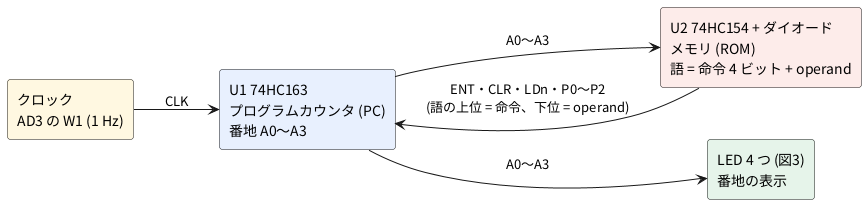

# 1-1 4 ビット CPU のようなもの — カウンタとメモリと命令

4 ビットのカウンタ (74HC163) を**プログラムカウンタ (PC)** にして、その番地を
ダイオードで作った小さな ROM (74HC154 + 1N4148) に送る。ROM が返す 8 ビットの語の
**上位 4 ビットが命令、下位 4 ビットが operand (オペランド、飛び先の番地)** で、
命令は PC 自身の「数える・止まる・0 に戻る・operand の番地へ飛ぶ」を決める。
LED に出る番地が、プログラム `F F F F F B3` の
**0 1 2 3 4 5 の次に 3 へ飛び、3 4 5 3 4 5 … とぐるぐる回る**のを 1 Hz の
ゆっくりしたクロックで目で追う。

**「CPU もどき」と呼ぶのは、演算器 (ALU) もレジスタも無いからだ。**
動くのは番地だけで、CPU の「次にどの番地の命令を取り出すか」を決める部分 (取り出し = フェッチの周期)
だけを部品で組んである。加算器で計算する ALU は [1-2](02-alu-like.md)、フリップフロップで作るレジスタは
[1-3](03-register.md)、その 2 つをこの題の PC と ROM に足して足し算する CPU は [1-4](04-cpu-mimic.md) で扱う。
プログラムカウンタは、この題の 74HC163 が担う。
作者が Logisim-Evolution で作った同名の模型 (2023 年 3 月) の命令表と番地の動きを、
ブレッドボードで組める部品に置き換えたものだ。

## 全体の構成




1. クロックの立ち上がりで U1 が番地 (A0..A3) を進める
2. U2 が番地に対応する行を L にする (アドレス 5 なら Y5)
3. ダイオードのある列は L、無い列は 10 kΩ のプルアップで H になり、これが**語**になる
4. 語の上位の 3 本 (ENT・/CLR・/LD) と下位の 3 本 (P0〜P2) が U1 に戻り、**次のクロックの立ち上がり**で効く

## 命令の表と解読表

命令の符号は**「1 本だけ 0 にする」形**になっている (`F` = 1111 はどれも 0 にしない)。
0 になっている bit がそのまま制御線になるので、**解読のためのゲート IC は要らない**。
ROM の列 (Op0 = ENT、Op1 = /CLR、Op2 = /LD) を U1 のピンへつなぐだけで、
命令の解読が済んでいる。

| 命令 | 符号 (上位 4 bit) | ENT (Op0) | /CLR (Op1) | /LD (Op2) | 次のクロックで |
| --- | --- | --- | --- | --- | --- |
| NEXT | F = 1111 | 1 | 1 | 1 | 番地が 1 増える |
| HALT | E = 1110 | **0** | 1 | 1 | 番地が止まる |
| CLR | D = 1101 | 1 | **0** | 1 | 番地が 0 になる |
| JUMP | B = 1011 | 1 | 1 | **0** | 番地が operand になる |

命令の符号は 8 ビットの語の上位 4 ビットで、この回路はその最上位の 1 ビット (Op3) を使わない。
0 になる bit が 2 本以上の符号でも、U1 は 1 つの動きをする。下の表が解読表 (デコーダの真理値表) の
全部で、Op3 は 0 でも 1 でも同じだ。

| Op2 | Op1 | Op0 | /LD | /CLR | ENT | 次のクロックの動き |
| --- | --- | --- | --- | --- | --- | --- |
| 1 | 1 | 1 | 1 | 1 | 1 | 数える (NEXT、F) |
| 1 | 1 | 0 | 1 | 1 | 0 | 止まる (HALT、E) |
| 1 | 0 | 1 | 1 | 0 | 1 | 0 にする (CLR、D) |
| 1 | 0 | 0 | 1 | 0 | 0 | 0 にする (CLR が ENT に勝つ) |
| 0 | 1 | 1 | 0 | 1 | 1 | operand を読み込む (JUMP、B) |
| 0 | 1 | 0 | 0 | 1 | 0 | operand を読み込む (LD が ENT に勝つ) |
| 0 | 0 | 1 | 0 | 0 | 1 | 0 にする (CLR が LD に勝つ) |
| 0 | 0 | 0 | 0 | 0 | 0 | 0 にする |

優先順位は **/CLR > /LD > ENT > 数える**。74HC163 のデータシートには、クリアは「イネーブルの
レベルに関係なく」次の立ち上がりで 0 にする、ロードも「イネーブルに関係なく」
データを取り込む、と書いてあり、数えるのは ENP と ENT の**両方**が H のときだけだ。
ただし **/CLR と /LD を同時に L にしたときの優先 (CLR が勝つ)** はデータシートの文章に無く、
標準の 74HC163 の動きとして書いた仮定だ (表の最後の 2 行)。この題のプログラムでは使わない。

## プログラム (ROM の中身)

| アドレス | 語 | 命令 | operand | ダイオード (0 の所) |
| --- | --- | --- | --- | --- |
| 0〜4 | `FF` | NEXT | 使わない (F にした) | 無し |
| 5 | `B3` | JUMP 3 | 3 = 0011 | D5 (Op2 = 0)、D6 (operand の bit 2 = 0) |
| 6〜15 | `FF` | NEXT | (この番地には来ない) | 無し |

- **ダイオードのある所が 0、無い所が 1** になる (プルアップ抵抗で H に引かれ、ダイオードが行の L を
  列に伝えて 0 にする)。語は `FF` が「何も書いていない」状態で、これは NEXT だ
- `B3` = 1011 0011。0 の bit は Op2 と、operand の bit 2 と bit 3 だ。operand の bit 3 は
  U1 の PIN 6 (D) を GND につないで**いつも 0**にしたので、ダイオードは Op2 と bit 2 の**2 個で足りる**
- 元の模型の `F1 F2 F3 F4 F5` は、NEXT では使われない operand に 1〜5 が入っているだけだ。
  動きは同じなので、この題では F にした。1〜5 を入れると、ダイオードは全部で 10 個
  (operand の bit 3 も入れる 8 列なら 16 個) に増える
- 命令の bit 3 (Op3) は使わない。**本物の ROM (EEPROM など) に替えるなら、この 2 個のダイオードと
  74HC154 を、8 ビットの ROM 1 個にする**だけで、U1 の周りは同じでよい

## 設計の判断

1. **カウンタは 74HC163 (同期クリア)。** 74HC161 は、ロードは同期 (クロックの立ち上がりで効く) だが
   クリアが**非同期**で、CLR を L にした瞬間に 0 になる。ROM の語で CLR を掛けると、番地が
   変わった直後に自分でクリアされ、その番地が一瞬 (約 0.1 µs) しか出ない。163 なら CLR も JUMP と同じく
   「次の立ち上がり」で効き、**全部の命令が同じタイミング**になる。161 でも動くが、CLR の番地は LED に出ない
2. **メモリはダイオードの ROM。** 74HC154 (4 → 16 のデコーダ、出力が L のとき選ばれた行) の 16 本を
   16 語の行とし、ダイオードと 10 kΩ のプルアップで列を作る。本物の ROM は書き込み器が要る。
   ダイオード ROM は差し替えが「ピンを 1 本抜き差しする」だけで済み、**プログラムを目で読める**。
   メモリを DIP スイッチや SRAM に替える作り方は、[1-6](06-dip-switch-memory.md)・[1-7](07-sram-memory.md) に分けた
3. **クロックは Analog Discovery 3 (AD3) の W1** で 0〜5 V・1 Hz の方形波を出す。部品が増えず、
   周波数を変えるのも W1 の設定だけだ。AD3 が無いときは [回路の本の 10-4](../../01-circuits/10-logic/04-binary-counter.md) の 555 (T ≈ 0.72 秒) の出力 (PIN 3) を
   CLK (U1 の PIN 2) につないでよい
4. **命令の解読にゲートを使わない** (上の表)。符号が「1 本だけ 0」の形だから成り立つ。別の符号なら
   74HC00 や 74HC04 で解読する
5. **表示は A0〜A3 の LED 4 つ。** A3 (アドレス 8 以上) は、このプログラムでは 0 のままで LED は消えたままだ
6. **ブレッドボードは 2 枚に分ける** (実体配線図の節)

## 回路図

回路図は 3 枚に分ける。図1 が PC とクロック、図2 が ROM と命令の線、図3 が表示だ。
**同じ名前の端子 (CLR・P0・P1・P2・ENT・LDn・A0〜A3) は、図をまたいで同じ線**になる。
`n` は負論理 (L で有効) を表し、LDn は /LD のことだ。

```circuit
# 回路図 (tommie-fence の circuit フェンス)
title: 図1 プログラムカウンタ 74HC163 とクロック
parts:
  U1: ic 14,7 74HC163
  P0: port 6,5.5
  P1: port 7,6
  P2: port 8,6.5
  GD: ground 12,7 r90
  VE: vcc 3,7.5 5V
  ENT: port 6,8
  W1: square 4,8.5 4,9.5 l=W1
  GW: ground 4,11.5
  A0: port 20,6
  A1: port 21,6.5
  A2: port 20,7
  A3: port 21,7.5
  VCC: vcc 13.5,3.5 5V
  CLR: port 14,2
  LDn: port 15,3
  G1: ground 14,11
wires:
  - U1.A -| 6,5.5
  - U1.B -| 7,6
  - U1.C -| 8,6.5
  - U1.D -| 12,7
  - U1.ENP -| 3,7.5
  - U1.ENT -| 6,8
  - U1.CLK -| 4,8.5
  - 4,9.5 -- 4,11.5
  - U1.QA -| 20,6
  - U1.QB -| 21,6.5
  - U1.QC -| 20,7
  - U1.QD -| 21,7.5
  - U1.VCC |- 13.5,3.5
  - U1.CLR |- 14,2
  - U1.LOAD |- 15,3
  - U1.GND |- 14,11
notes:
  - text 18,9 small: "RCO (PIN 15) は開放"
  - text 5,10 small: "W1: AD3 の波形発生器"
style:
  grid: on
  pitch: 1.2
```


- U1 (74HC163) は**働きでピンを並べた記号**で描いた。ピンの番号は名前の隣に添えてある
  (`03 A` は PIN 3 が A)。実物の DIP-16 のピンの順とは違うので、組むときは PIN の番号で探す。
  左が入力: PIN 3〜6 が A〜D (P0〜P3、プリセットの入力)、PIN 7 が ENP、PIN 10 が ENT、PIN 2 が CLK。
  右が出力: PIN 14〜11 が QA〜QD (下の桁から A0〜A3)、PIN 15 が RCO (桁上げ)。
  上が電源と制御: PIN 16 が VCC、PIN 1 が /CLR (同期クリア)、PIN 9 が /LOAD。下が PIN 8 (GND)
- **PIN 7 (ENP) は +5 V、PIN 6 (D = P3) は GND にする**。ENP を H にして数える許可を出し、
  P3 を 0 にして飛び先を 0〜7 に限る。PIN 15 (RCO、桁上げの出力) は使わないので開けておく
- W1 は AD3 の波形発生器の出力で、クロック (CLK、PIN 2) をつなぐ。立ち上がりで動く
- CLR・P0〜P2・ENT・LDn は ROM から来る命令の線で、図2 で作る。QA〜QD (= A0〜A3) は図2 (ROM の入力) と図3 (LED) へ行く。
  以下、番地の線は A0〜A3、カウンタの出力のピンは QA〜QD と書く

```circuit
# 回路図 (tommie-fence の circuit フェンス)
title: 図2 メモリ (74HC154 + ダイオード) と命令の線
parts:
  U2: ic 14,8 74HC154
  A0: port 6,7.5
  A1: port 7,8
  A2: port 6,8.5
  A3: port 7,9
  VCC: vcc 14.5,2.5 5V
  GU: ground 14,14
  D5: diode 24,7 24,5
  D6: diode 28,7 28,5
  VCC: vcc 22,4 5V
  R7: resistor 22,5 22,7 10k
  LDn: port 22,13
  VCC: vcc 26,4 5V
  R10: resistor 26,5 26,7 10k
  P2: port 26,13
  VCC: vcc 30,4 5V
  R5: resistor 30,5 30,7 10k
  ENT: port 30,13
  VCC: vcc 32,4 5V
  R6: resistor 32,5 32,7 10k
  CLR: port 32,13
  S1: button 33,9 33,11
  GR: ground 33,11
  VCC: vcc 34,4 5V
  R8: resistor 34,5 34,7 10k
  P0: port 34,13
  VCC: vcc 36,4 5V
  R9: resistor 36,5 36,7 10k
  P1: port 36,13
wires:
  - U2.A0 -| 6,7.5
  - U2.A1 -| 7,8
  - U2.A2 -| 6,8.5
  - U2.A3 -| 7,9
  - U2.VCC |- 14.5,2.5
  - U2.GND |- 14,14
  - U2.E1 |- 14,14
  - U2.E2 |- 14,14
  - U2.Y5 -| 18,7
  - 18,7 -- 18,2 -- 28,2
  - 24,2 -- 24,5
  - 28,2 -- 28,5
  - 24,7 -- 22,7
  - 28,7 -- 26,7
  - 22,4 -- 22,5
  - 22,7 -- 22,13
  - 26,4 -- 26,5
  - 26,7 -- 26,13
  - 30,4 -- 30,5
  - 30,7 -- 30,13
  - 32,4 -- 32,5
  - 32,7 -- 32,9 -- 32,13
  - 32,9 -- 33,9
  - 34,4 -- 34,5
  - 34,7 -- 34,13
  - 36,4 -- 36,5
  - 36,7 -- 36,13
notes:
  - text 20,1 small: "Y5 (PIN 6) だけが、アドレス 5 のとき L になる"
  - text 24,11 small blue center: "D5: 命令 JUMP"
  - text 28,11 small blue center: "D6: P2 を 0 にする"
  - text 17,14 small: "E1・E2 (PIN 18・19) は GND につなぐと常に有効"
style:
  grid: on
  pitch: 1.2
```


- U2 (74HC154) も働きでピンを並べた記号で描いた。左が入力の A0〜A3 (PIN 23〜20)、
  右が出力の Y0〜Y15 (PIN 1〜11 が Y0〜Y10、PIN 13〜17 が Y11〜Y15)、下が GND (PIN 12) と
  E1・E2 (PIN 18・19、イネーブル、**GND につなぐと常に有効**)、上が VCC (PIN 24)。
  選ばれた行だけが L になる
- **アドレス 5 のとき L になるのは Y5 (PIN 6) だけ**。その行に D5 と D6 の 2 個を付ける。ダイオードの向きは、
  カソード (線の入った側) が Y5、アノードが列だ。Y5 が L のとき、D5 が /LD の列を、D6 が P2 の列を、
  約 0.6 V (ダイオードの順方向電圧) まで下げる。ほかの行は H なので、ダイオードは逆向きで何もしない
- 列は 6 本。6 本とも 10 kΩ で +5 V へ引く。列が H のとき 5 V、L のとき約 0.65 V
  (Y5 の L 0.1 V 以下 + ダイオード 0.55 V ほど) で、74HC163 の入力のしきい値 (L は 1.35 V 以下、
  H は 3.15 V 以上、VCC = 4.5 V のとき) から十分に離れている
- **S1 (押しボタン) は CLR の列を GND へ落とす**。CLR は同期クリアなので、S1 を押したまま
  **次のクロックの立ち上がり (最長 1 秒) を待つ**と、番地が 0 になる
- Y0〜Y4、Y6〜Y15 は何もつながずに開けておく (出力のピン)。E1・E2 のような入力のピンは必ず固定する

```circuit
# 回路図 (tommie-fence の circuit フェンス)
title: 図3 アドレスの表示 (LED 4 つ)
parts:
  A0: port 2,2
  R1: resistor 3,2 6,2 820
  D1: led 6,2 9,2 red
  GD1: ground 9,2
  A1: port 2,4
  R2: resistor 3,4 6,4 820
  D2: led 6,4 9,4 red
  GD2: ground 9,4
  A2: port 2,6
  R3: resistor 3,6 6,6 820
  D3: led 6,6 9,6 red
  GD3: ground 9,6
  A3: port 2,8
  R4: resistor 3,8 6,8 820
  D4: led 6,8 9,8 red
  GD4: ground 9,8
wires:
  - 2,2 -- 3,2
  - 2,4 -- 3,4
  - 2,6 -- 3,6
  - 2,8 -- 3,8
style:
  grid: on
  pitch: 1.2
```


- A0〜A3 (U1 の PIN 14〜11) に、820 Ω と赤の LED を 1 つずつつなぐ。**74HC の出力の保証は 4 mA まで**
  (データシートの ±4 mA)。(5 − 1.9 V) ÷ 820 Ω ≒ **3.8 mA** で、この範囲に収まる
  (LED の順方向電圧 1.9 V は仮定)。明るさが足りなければ 680 Ω にしてもよい (約 4.6 mA、保証の外だが
  絶対最大の 25 mA には遠い)
- 1 が点灯、0 が消灯。A0 (LSB) が上、A3 (MSB) が下

## 実体配線図

ブレッドボードは 2 枚に分ける。**基板 1 (half)** に U1・クロック・LED・AD3 を、**基板 2 (full)** に U2・ダイオード・
プルアップ・S1 を組み、間を 12 本のジャンパ線 (信号 10 本 + 電源 2 本) でつなぐ。
full 1 枚の穴の数には入るが、A0〜A3 の 4 本、LED への 4 本、AD3 の探り 4 本、命令の 6 本が
同じブレッドボードの上で重なり、線が追えなくなる。ブレッドボードの順位は half → full → full + half だが、half には収まらず、full 1 枚では図が読めないので、
次の順位 (full を足す) に進めて **half + full** にした。
図4 は、この 2 枚を 1 つの図に縦に並べて見せる (上が基板 1、下が基板 2)。

```breadboard
# ブレッドボードの実体配線図 (tommie-fence の breadboard フェンス)
title: 図4 ブレッドボード 2 枚
sheets:
  - name: 基板1
    board: half
    parts:
      AD:
        type: device
        at: top
        label: Analog Discovery 3
        pins: [V+, GND, W1, DIO4, DIO0, DIO1, DIO2, DIO3]
      UP:
        type: device
        at: top
        label: 基板 2 へ (上)
        pins: [ENT, LDn, A3, A2, A1, A0, GND, +5V]
      DN:
        type: device
        at: bottom
        label: 基板 2 へ (下)
        pins: [CLR, P0, P1, P2]
      U1: dip16 @ e10 74HC163
      R4: resistor e18 g18 820
      D4: led h18(A) h19(K) red i=3.8mA
      R3: resistor e21 g21 820
      D3: led h21(A) h22(K) red i=3.8mA
      R2: resistor e24 g24 820
      D2: led h24(A) h25(K) red i=3.8mA
      R1: resistor e27 g27 820
      D1: led h27(A) h28(K) red i=3.8mA
    wires:
      - AD.V+ -- +t1 red
      - AD.GND -- -t2 black
      - -t1 -- -b1 black
      - +t30 -- +b30 red
      - UP.+5V -- +t29 red
      - UP.GND -- -t28 black
      - a10 -- +t10 red
      - j15 -- -b15 black
      - j16 -- +b16 red
      - j17 -- -b17 black
      - j19 -- -b19 black
      - j22 -- -b22 black
      - j25 -- -b25 black
      - j28 -- -b28 black
      - AD.W1 -- a9 yellow [v40, h81, v66]
      - AD.DIO4 -- b9 orange [v32, h62, v94]
      - c9 -- g9 yellow
      - h9 -- h11 yellow
      - b12 -- b27 green [v-10, h300]
      - b13 -- b24 green
      - c14 -- c21 green
      - d15 -- d18 green
      - AD.DIO0 -- a12 orange [v24, h63, v82]
      - AD.DIO1 -- a13 orange [v16, h45, v90]
      - AD.DIO2 -- a14 orange [v8, h26, v98]
      - AD.DIO3 -- a15 orange [v8, h7, v98]
      - UP.A0 -- a27 blue [v8, h19, v98]
      - UP.A1 -- a24 blue [h-2, v106]
      - UP.A2 -- a21 blue [v8, h-23, v98]
      - UP.A3 -- a18 blue [v16, h-45, v90]
      - UP.ENT -- a16 purple [h-7, v106]
      - UP.LDn -- a17 purple [v8, h-26, v98]
      - DN.CLR -- i10 white [v-8, h5, v-118]
      - DN.P0 -- i12 white [v-8, h5, v-118]
      - DN.P1 -- i13 white [v-8, h5, v-118]
      - DN.P2 -- i14 white [v-8, h-15, v-118]
  - name: 基板2
    board: full
    parts:
      UQ:
        type: device
        at: top
        label: 基板 1 から
        pins: [A0, A1, A2, A3, P2, LDn, ENT, CLR, P1, P0, GND, +5V]
      U2: dip24 @ e3 74HC154
      D6: diode b19(A) b25(K)
      D5: diode d22(A) d25(K)
      R10: resistor e19 g19 10k
      R7: resistor e22 g22 10k
      R5: resistor e28 g28 10k
      R6: resistor e31 g31 10k
      S1: button @ e33
      R9: resistor e37 g37 10k
      R8: resistor e41 g41 10k
    wires:
      - UQ.+5V -- +t61 red
      - UQ.GND -- -t60 black
      - +t62 -- +b62 red
      - -t1 -- -b1 black
      - a3 -- +t3 red
      - a8 -- -t8 black
      - a9 -- -t9 black
      - j14 -- -b14 black
      - UQ.A0 -- a4 blue [v6, h-245, v100]
      - UQ.A1 -- a5 blue [v14, h-265, v92]
      - UQ.A2 -- a6 blue [v22, h-285, v84]
      - UQ.A3 -- a7 blue [v30, h-305, v76]
      - UQ.P2 -- a19 white [v38, h-85, v68]
      - UQ.LDn -- a22 purple [v46, h-65, v60]
      - UQ.ENT -- a28 purple
      - UQ.CLR -- a31 white
      - UQ.P1 -- a37 white
      - UQ.P0 -- a41 white
      - i8 -- i25 orange
      - e25 -- g25 orange
      - j19 -- +b19 red
      - j22 -- +b22 red
      - j28 -- +b28 red
      - j31 -- +b31 red
      - j37 -- +b37 red
      - j41 -- +b41 red
      - j33 -- -b33 black
      - c31 -- c33 gray
```


- 電源 (AD3 の V+ 5 V) は左上の AD3 から基板 1 の上の + レール (1 列) へ、GND は上の − レール (2 列) へ入れる。
  基板 1 の + レールと − レールを右の端 (28〜29 列) から基板 2 へ渡す。**赤は +5 V の線だけ、黒は GND の線だけ**に使った。
  レールが中央で切れているブレッドボードは、中央を + と − の 1 本ずつのジャンパで橋渡しする
- U1 (74HC163) は基板 1 の 10〜17 列、切り欠きが左。PIN 16 (10 列の上) が左上、PIN 1 (10 列の下) が左下。
  PIN 16 を + レールへ、PIN 8 と PIN 6 を − レールへ、PIN 7 を + レールへ落とす (`j15`・`j16`・`j17`)
- AD3 の W1 (黄) は 9 列の上の穴に入れ、溝をまたぐ線 (9 列) と下の線 (h 行) で **PIN 2 (CLK、11 列の下)** へ渡す。
  DIO0〜DIO3 (橙) は A0〜A3 の列 (12〜15 列の上) に、**DIO4 (橙) は W1 と同じ 9 列の上 (`b9`) に当てる** (CLK と同じ線)
- A0〜A3 の LED は U1 の右に、左から A3・A2・A1・A0 の順に並べた (R4・R3・R2・R1 が 18・21・24・27 列。左から読むと 2 進数)。
  緑の線が U1 の出力の列 (12〜15 列) から LED の列へ渡し、抵抗 (820 Ω) は溝をまたいで下の LED (`h` 行) へつながる。LED のピンは隣の列どうし、
  長いピン (アノード) が抵抗側で、短いピン (カソード) の列から黒線で下の − レールへ落とす
- **基板 2 へ渡す線**: 基板 1 の上の箱の A0〜A3・ENT・LDn・+5 V・GND と、下の箱の CLR・P0〜P2 を、基板 2 の「基板 1 から」の
  同じ名前へ 1 本ずつつなぐ (青 = アドレス、紫 = ENT・LDn、白 = CLR・P0〜P2)
- 基板 2 の U2 (74HC154、24 ピン) は 3〜14 列。**幅 0.3 インチの品を選ぶ** (下の部品の節)。PIN 24 (3 列の上) と
  PIN 12 (14 列の下) が電源、PIN 19・18 (8・9 列の上) は − レールへ。A0〜A3 は 4〜7 列の上に入る
- **Y5 は PIN 6 (8 列の下)**。橙の線 (i 行) で 25 列の下へ渡し、溝をまたぐ橙の短い線で 25 列の上へ上げる。
  25 列の上の穴が「行 Y5」で、D5・D6 のカソードがここに入る。D5 (アノードは 22 列の上) と
  D6 (アノードは 19 列の上) は、**カソード (線の入った側) を 25 列に向ける**
- 列の抵抗 (10 kΩ) は、上の穴から溝をまたいで下の穴へ挿し、下の穴から + レールへ赤線を立てる。19 列 = P2、
  22 列 = LDn、28 列 = ENT、31 列 = CLR、37 列 = P1、41 列 = P0。S1 は 33〜35 列で、CLR (31 列) の上と
  灰色の線でつなぎ、下のピンを − レールへ落とす
- **1 つの穴には 1 本だけ**挿している。線が分かれる所は、同じ列の別の穴から出している

### 回路図との対応

| 線の名前 | 回路図 | 基板 1 | 基板 2 |
| --- | --- | --- | --- |
| A0 | U1 QA (PIN 14) → U2 A0 (PIN 23)、R1 | 12 列の上 (U1 PIN 14)、DIO0、R1 は 27 列 | 4 列の上 (U2 PIN 23) |
| A1 | U1 QB (PIN 13) → U2 A1 (PIN 22)、R2 | 13 列の上 (PIN 13)、DIO1、R2 は 24 列 | 5 列の上 (PIN 22) |
| A2 | U1 QC (PIN 12) → U2 A2 (PIN 21)、R3 | 14 列の上 (PIN 12)、DIO2、R3 は 21 列 | 6 列の上 (PIN 21) |
| A3 | U1 QD (PIN 11) → U2 A3 (PIN 20)、R4 | 15 列の上 (PIN 11)、DIO3、R4 は 18 列 | 7 列の上 (PIN 20) |
| CLK | W1 → U1 CLK (PIN 2) | 11 列の下 (PIN 2) | — |
| CLR | U1 CLR (PIN 1)、R6、S1 | 10 列の下 (PIN 1) | 31 列 (R6)、33 列 (S1) |
| P0 / P1 / P2 | U1 A / B / C (PIN 3 / 4 / 5)、R8 / R9 / R10 | 12 / 13 / 14 列の下 | 41 / 37 / 19 列 (P2 は D6 も) |
| ENT | U1 ENT (PIN 10)、R5 | 16 列の上 (PIN 10) | 28 列 (R5) |
| LDn | U1 LOAD (PIN 9)、R7、D5 | 17 列の上 (PIN 9) | 22 列 (R7、D5 のアノード) |
| Y5 | U2 Y5 (PIN 6)、D5・D6 のカソード | — | 8 列の下 (PIN 6) → 25 列 |

`breadboard-fence check` が出したネットリストは、この表のとおりだった (基板 1 の A0 は
`AD.DIO0, UP.A0, U1.QA, R1.1`、基板 2 の Y5 は `U2.Y5, D6.K, D5.K` など。ピンに名前を付けた型番で描いたので、
ネットリストもピンの名前で出る)。回路図の図1〜3 の
ネットリストとも一致する。ブレッドボードでは、回路図の 1 つの線 (たとえば A0) が「U1 の出力の列・LED へ行く列・
AD3 の探り・基板 2 への線」の複数の穴になり、同じ列 (5 穴の組) の別の穴にまとめてある。

### ブレッドボードの限度の確認

ブレッドボードの限度の確認: 電圧は 5 V (12 V 以下)。電流は、LED 4 つが全部点いても 3.8 mA × 4 ≒ 15 mA、
列のプルアップが最大 6 本ぶんで 0.43 mA × 6 ≒ 3 mA、IC の静止電流は数 µA (74HC163 の最大 8 µA、25 °C) で、
**合計は最大でも約 20 mA** (1 穴 200 mA、ブレッドボード全体 500 mA の限度より十分に小さい)。周波数は**1 Hz**で、
ブレッドボードの上に組む回路は 3 MHz 以下の限度に十分収まる。この回路の上限は、ROM の列が H に戻る時間
(10 kΩ のプルアップ × ブレッドボードの浮遊容量 30 pF ≒ 0.3 µs) で決まり、
41 ns (U1 の CLK → Q) + 35 ns (U2 の A → Y) + 300 ns + 34 ns (U1 の入力の準備時間) ≒ 0.41 µs、
つまり**約 2 MHz が上限の見積もり** (実測していない。データシートの最大値による計算)。

## 計器の設定

**計器は Analog Discovery 3 (AD3) 1 台**で、電源 (Supplies)・クロック (Wavegen)・番地の観測 (Logic) の
3 役を兼ねる。AD3 の DIO は 3.3 V の LVCMOS で **5 V まで入れてよく** (入力 H は 2.0 V 以上)、
74HC の 5 V 出力をそのまま受けられる。AD3 の Scope は 2 ch (アナログ) で、番地の 4 本とクロックの合計 5 本は
見られないので、**Logic (ロジックアナライザ、DIO 16 本)** で見る。

| 計器 | 設定 |
| --- | --- |
| Supplies | V+ を 5 V にして Master Enable を入れる (基板 1・基板 2 の + レール) |
| Wavegen | W1: **Square**、Frequency **1 Hz**、Amplitude **2.5 V**、Offset **2.5 V** (0〜5 V)、Symmetry 50 % |
| Logic | **DIO0〜DIO3 = A0〜A3、DIO4 = CLK** (図4 の配線)。DIO0〜DIO3 を束ねたバス「Address」を 16 進で表示すると 0 1 2 3 4 5 3 … と数で読める。Time base **1 s/div** (窓 10 s)、Mode は Screen か Record (遅い信号向け)、Sample rate 1 kHz 以上。Trigger は **DIO4 (CLK) の立ち上がり**。WaveForms の項目の名前は確認していない (機種の説明どおりに選ぶ) |
| 接続 | AD3 の GND を基板 1 の − レールへ。DIO3 は 0 のままで動かない |

始め方: Supplies を入れる → S1 を押す → **W1 のクロックの立ち上がりを 1 回待つ**と LED が全部消える (番地 0)
→ S1 を離す。次の立ち上がりから LED が 0001 → 0010 → 0011 … と進む。
図5 の t = 0 は、S1 を押したまま番地が 0 になる立ち上がりに合わせてある。

## 計器の画面

Logic の画面は、DIO の 0 / 1 を横の線で並べる。図5 は**クロック (CLK) と番地の 4 本 (A0〜A3)、それを束ねたバス Address (16 進)**
の見えるはずの画面だ。t = 0 は S1 を押したまま番地が 0 になる立ち上がりで、CLK の立ち上がりごと (1 s ごと) に
番地が変わる。カーソルは変わり目を避けて **X1 = 5.25 s、X2 = 6.25 s** に置いた (どちらも CLK は H で、番地は変わり目の途中でない)。
A3 は 0 のままだ。

```logic
# ロジックアナライザの画面 (tommie-fence の logic フェンス)
title: 図5 アドレスは 1 s ごとに 0 1 2 3 4 5 3 4 5 3 と進む
device: ad3
time: 1s/div
sample: 1kHz
signals:
  CLK: dio4 clock 1Hz
  A:   dio0..dio3 counter on CLK rising sequence 0 1 2 3 4 5 3 4 5 3
buses:
  Address: A3..A0 hex
cursors: [5.25s, 6.25s]
trigger: CLK rising at 0s
```


アナログの電圧として見たいときは、AD3 の Scope を使う。1+ を CLK の線 (W1 と同じ列)、2+ を U1 の 9 番ピン (/LD) に当て、
1− と 2− は基板 1 の − レール (GND) に挿す。DIO4・DIO5 の線を挿し替えればよい。Logic と同時には使えない。
図6 は t = 0 を左端 (CLK の立ち上がり) に置いた 10 s の画面で、**番地 5 の 1 秒間 (5〜6 s、2 周目は 8〜9 s) だけ /LD が L (0 V) に落ちる**。
そのとき次の立ち上がりで PC が 3 を読み込む。

```scope
# オシロスコープの画面 (tommie-fence の scope フェンス)
title: 図6 /LD (CH2) は番地 5 の間だけ L — CLK (CH1) は 1 Hz
time: 1s/div
trigger: ch1 rising 2.5V at -5div
ch1: {wave: square 1Hz 2.5V offset 2.5V, range: 2V/div, position: 1div}
ch2: {wave: "= 5V - 5V * (step(t - 5s) - step(t - 6s) + step(t - 8s) - step(t - 9s))", range: 2V/div, position: -3div}
cursors: [5.25s, 6.25s]
measure: [vmax, vmin]
```


## 見るべき値

**クロック 1 Hz** で、番地は 1 秒ごとに次の順に動く。t = 0 は番地が 0 になる立ち上がり。LED は A3 A2 A1 A0 の順に並べた 2 進数だ。

| クロックの数 | 図5 の時刻 | 番地 | A2 A1 A0 (LED) | 読んだ語 | 次のクロックで |
| --- | --- | --- | --- | --- | --- |
| 0 | 0〜1 s | 0 | 0 0 0 | `FF` | +1 |
| 1 | 1〜2 s | 1 | 0 0 1 | `FF` | +1 |
| 2 | 2〜3 s | 2 | 0 1 0 | `FF` | +1 |
| 3 | 3〜4 s | 3 | 0 1 1 | `FF` | +1 |
| 4 | 4〜5 s | 4 | 1 0 0 | `FF` | +1 |
| 5 | 5〜6 s | 5 | 1 0 1 | `B3` (JUMP 3) | **3 を読み込む** |
| 6 | 6〜7 s | **3** | 0 1 1 | `FF` | +1 |
| 7 | 7〜8 s | 4 | 1 0 0 | `FF` | +1 |
| 8 | 8〜9 s | 5 | 1 0 1 | `B3` | 3 を読み込む |
| 9 | 9〜10 s | 3 | 0 1 1 | `FF` | +1 |

- 番地は **0 1 2 3 4 5 3 4 5 3 …**。ループ (3 → 4 → 5 → 3) は **3 クロック = 3 秒**で 1 周する
- 図5 の**カーソル**: X1 = 5.25 秒は Address = `0x5` (A2 = 1、A1 = 0、A0 = 1 の 101)、
  X2 = 6.25 秒は Address = `0x3` (A2 = 0、A1 = 1、A0 = 1 の 011)。ΔX = 1.000 秒 (1/ΔX = 1 Hz = クロックの周波数)。
  **JUMP で 5 の次が 6 でなく 3 になる**。どちらのカーソルも CLK は H (1) で、変わり目にかからない
- 図5 の Address の並びは `0x0@0 s 0x1@1 s 0x2@2 s 0x3@3 s 0x4@4 s 0x5@5 s 0x3@6 s 0x4@7 s 0x5@8 s 0x3@9 s`。
  A0・A1・A2 の変わり目は 7・5・4 回、A3 は 0 回 (`logic-fence check` の読み値)。実機では 74HC の H は約 4.9 V、L は約 0 V だが、
  Logic は 0 / 1 で読む
- 番地 5 (`B3`) の間は、/LD (U1 の PIN 9) が L になる。Logic の DIO をもう 1 本 (DIO5) U1 の PIN 9 に当てると、
  番地 5 の 1 秒間だけ L の線が見える
- S1 を押している間は、次のクロックの立ち上がりで番地が 0 になる (最長 1 秒待つ)

| 電圧・電流 (計算値) | 値 |
| --- | --- |
| 列の H / L (10 kΩ プルアップ) | 5 V / 約 0.65 V |
| LED 1 つの電流 | (5 − 1.9) ÷ 820 ≒ 3.8 mA (番地 5 なら 2 つで 7.6 mA) |
| 番地 5 の 2 つの列の電流 | (5 − 0.65) ÷ 10 kΩ ≒ 0.43 mA × 2 |
| 全体 | 最大でも約 20 mA |

### 命令を 1 つ書き換える

ダイオード 1 個のピンを差し替えるだけで、番地 5 の語を書き換えられる。**ダイオードの P2 のピン (D6) はそのまま**にする。
書き換えたら S1 で 0 に戻して見る。

| 書き換え | D5 のアノード (基板 2 の d 行) | 語 | 番地の動き |
| --- | --- | --- | --- |
| 元 (JUMP) | 22 列 (LDn) | `B3` | 0 1 2 3 4 5 3 4 5 3 … |
| **HALT** | 28 列 (ENT) に差し替え | `E3` (1110 0011) | 0 1 2 3 4 5 で**止まる** (LED は 0101 のまま。S1 で再開) |
| **CLR** | 31 列 (CLR) に差し替え | `D3` (1101 0011) | 0 1 2 3 4 5 0 1 2 3 4 5 … (6 秒で 1 周) |

- HALT では、番地 5 の語の ENT (Op0) が L になり、U1 の ENT が L で数えるのをやめる。番地 5 のまま
  同じ語を読み続けるので、動かない
- CLR では、番地 5 の語の /CLR (Op1) が L になり、U1 は次の立ち上がりで 0 になる (同期クリア)。
  番地 5 も LED に 1 秒間出る。**74HC161 に替える**と、クリアが非同期なので番地 5 は約 0.1 µs しか出ず、
  LED は 0 1 2 3 4 0 1 2 3 4 の 5 周期に見える
- JUMP の飛び先を変えるには、operand の bit を 0 にする (P0・P1 の列にダイオードを足す)。
  たとえば `B2` (飛び先 2 = 0010) は、P0 の列にダイオードを足して bit 0 を 0 にする

## メモリの作り方を替える

ここまでのメモリはダイオードの ROM で、番地 5 の語を変えるにはダイオードのピンを差し替えた。
カウンタ・LED・クロック (基板 1、図1・図3・図4) はそのままに、メモリの部分だけを替える作りは別の題に分けた。
[1-6](06-dip-switch-memory.md) は 4 連の DIP スイッチで番地 5 の語を書き換え、[1-7](07-sram-memory.md) は SRAM (AS6C62256) と 74HC245 で 16 番地すべてに語を手で書き込む。

## 部品

電源は AD3 の V+ (5 V)。

| 記号 | 部品 | 値・型番 | 数 |
| --- | --- | --- | --- |
| U1 | 4 ビット同期カウンタ (同期クリア、DIP-16) | 74HC163 | 1 |
| U2 | 4 → 16 デコーダ (DIP-24、**幅 0.3 インチ**) | 74HC154 (CD74HC154EN など。`E` 品は幅 0.6 インチでブレッドボードに載らない) | 1 |
| D5、D6 | 小信号ダイオード | 1N4148 | 2 |
| D1〜D4 | LED 5 mm | 赤 | 4 |
| R1〜R4 | 抵抗 (1/4 W) | 820 Ω | 4 |
| R5〜R10 | 抵抗 (1/4 W) | 10 kΩ | 6 |
| S1 | タクトスイッチ | 6 mm | 1 |
| — | ブレッドボード | half 1 枚、full 1 枚 | 2 |
| — | ジャンパ線 | 赤・黒・各色 | 適宜 |

- 74HC163 と 74HC154 は、DIP の手に入る型番を確認して選ぶ (入手性は確認していない)。
  74HC154 は 24 ピンで、TI の CD74HC154 は `E` が幅 0.6 インチ、`EN` が幅 0.3 インチ
- クロックを AD3 の代わりに 555 で作るときは [回路の本の 10-4](../../01-circuits/10-logic/04-binary-counter.md) の 555 (10 kΩ・47 kΩ・10 µF) を足す

## LTspice での確かめ

カウンタ (74HC163)・ROM (74HC154 + ダイオード) の論理は SPICE の対象外で、本文の真理値表とデータシートの値による。アナログの値だけを `sim/01-cpu-like.cir` で確かめた (LED は V<sub>F</sub> 1.9 V の仮定のモデル、74HC の出力は 5 V とみなした。実測ではない)。

| 項目 | 本文の数字 | LTspice | 判定 |
| --- | --- | --- | --- |
| LED 1 つの電流 (820 Ω) | 約 3.8 mA | 3.78 mA (V<sub>F</sub> 1.90 V) | 合う |
| 680 Ω に替えたとき | 約 4.6 mA | 4.55 mA | 合う |
| 列の L の高さ (Y5 の 0.1 V + ダイオード) | 約 0.65 V | 0.647 V | 合う |
| 列の電流 (L のとき) | 約 0.43 mA | 0.435 mA | 合う |
| 列が 0.65 V から H (3.15 V) に戻る時間 (10 kΩ × 30 pF) | 約 0.3 µs (τ) | 0.26 µs | 合う (本文は τ をそのまま足した保守的な値で、上限 約 2 MHz の見積りは変わらない) |
| 合計の電流 | 最大でも約 20 mA | LED 4 つ 15.1 mA + 列 6 本 2.6 mA + 静止電流 ≒ 18 mA | 合う |

## 出典

自作。74HC163 のピンの並びと同期クリア・ロードの動き・入力のしきい値・静止電流・出力の保証 (±4 mA)・
入力の準備時間 (34 ns、CLR は 32 ns)・伝搬遅延 (CLK → Q が最大 41 ns) は、TI の SN74HC163 データシート (SCLS298D) による。
74HC154 のピンの並びと真理値表・伝搬遅延・出力の保証 (4 mA で VOH 3.98 V 以上・VOL 0.26 V 以下)・絶対最大 (出力 ±25 mA)・
幅 0.6 / 0.3 インチの品種は、TI の CD74HC154 データシート (SCHS152D) による。
AD3 の DIO の電圧 (3.3 V、5 V まで許容、H は 2.0 V 以上) と波形発生器の出力範囲は、Digilent の
Analog Discovery 3 の仕様書による。
