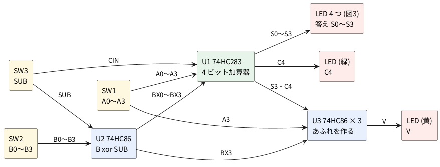

# 1-2 4 ビット ALU もどき — 加算と減算 (2 の補数)

[1-1](01-cpu-like.md) の CPU もどきには、計算する部分 (ALU、算術論理演算装置) が無かった。
この題では、その計算する部分を 4 ビットの加算器 (74HC283) と XOR (74HC86) で組む。
スイッチ 1 つで**足し算と引き算を切り替える**。引き算は「B を反転して 1 を足す」(2 の補数) と
足し算になるので、加算器は 1 個のままでよい。

入力は DIP スイッチで、A (4 ビット)・B (4 ビット)・SUB (0 で加算、1 で減算) を作る。
答え S (4 ビット) と、桁上がり C4・あふれ V を LED に出す。
ここで組んだ加算器は、[1-4](04-cpu-mimic.md) で CPU もどきの「足し算する」部分になる。

## 全体の構成




1. SUB = 0 のとき、U2 は B をそのまま通し (BX = B)、U1 の CIN は 0。U1 は **A + B** を出す
2. SUB = 1 のとき、U2 は B の 4 ビットを全部反転し (BX = B の反転)、U1 の CIN は 1。U1 は **A + (B の反転) + 1 = A − B** を出す
3. U3 の XOR 3 個が、最上位の桁への桁上がり C3 と U1 の C4 を比べて、あふれ V を作る

## 引き算を足し算にする (2 の補数)

4 ビットの数は 0〜15 の 16 通りだ。この 16 通りを −8〜+7 の数に読むのが **2 の補数**で、
最上位のビット (bit 3) が 1 なら負の数とする。

| 4 ビット | 符号なしで読む | 2 の補数で読む |
| --- | --- | --- |
| 0000〜0111 | 0〜7 | 0〜+7 |
| 1000 | 8 | −8 |
| 1110 | 14 | −2 |
| 1111 | 15 | −1 |

B の 4 ビットを全部反転すると、15 − B になる。そこに 1 を足すと 16 − B で、
4 ビットの中では **16 は 0 と同じ**なので、これは −B と同じだ。
だから A − B は A + (B の反転) + 1 で計算できる。

- **B の反転は XOR で作る**。XOR の片方の入力を SUB にすると、SUB = 0 なら B がそのまま、
  SUB = 1 なら B の反転が出る ([回路の本の 10-3](../../01-circuits/10-logic/03-adders.md) の XOR の真理値表)
- **最後の + 1 は CIN に SUB をつないで足す**。74HC283 の CIN (下の桁からの桁上がりの入力) は、
  [回路の本の 10-8](../../01-circuits/10-logic/08-four-bit-adder.md) では GND に固定していた入力だ

例: 5 − 3 は、0101 + 1100 (0011 の反転) + 1 = 1 0010。下の 4 ビットが 0010 = 2 で、
はみ出した 1 が C4 に出る。

## 桁上がり C4 とあふれ V

4 ビットに入りきらない答えは、2 とおりの見方で「はみ出す」。

- **C4 (桁上がり)** は、**符号なしの数**として見たときのはみ出し。足し算では答えが 15 を超えると 1。
  引き算では、**A ≧ B のとき 1、A < B のとき 0** になる (借りが無いとき 1)。引き算で C4 が 0 なら、
  符号なしの答えは負になってしまった、ということだ
- **V (あふれ、オーバーフロー)** は、**2 の補数の数**として見たときのはみ出し。答えが −8〜+7 に入らないと 1。
  たとえば 5 + 3 = 8 は符号なしでは正しい (C4 = 0) が、2 の補数で読むと 1000 = −8 になってしまう。
  このとき V = 1 だ

V は、**最上位の桁に入ってきた桁上がり C3 と、出ていった桁上がり C4 が違うとき 1** になる。
74HC283 は C3 を外に出さないので、U3 の XOR で作り直す。最上位の桁の和は
S3 = A3 ⊕ BX3 ⊕ C3 (⊕ は XOR) なので、C3 = A3 ⊕ BX3 ⊕ S3 と逆算できる。

| U3 のゲート | 入力 | 出力 |
| --- | --- | --- |
| U3A | A3、BX3 | P3 = A3 ⊕ BX3 |
| U3B | P3、S3 | C3 = P3 ⊕ S3 |
| U3C | C3、C4 | **V = C3 ⊕ C4** |

## 設計の判断

1. **加算器は 74HC283 を 1 個。** 引き算のための減算器は作らない。B を XOR で反転し、CIN に 1 を入れるだけで、
   同じ加算器が引き算もする。CPU の ALU が加算器 1 つで足し算と引き算をこなすのと同じ考え方だ
2. **B の反転は 74HC86 (XOR × 4)。** 74HC04 (NOT) で反転すると、足し算のときに反転しない道が別に要り、
   切り替えのセレクタ (74HC157 など) が増える。XOR なら 1 個で「反転する・しない」を SUB で選べる
3. **あふれ V も 74HC86 で作る。** V = (A3 ⊕ S3) と (BX3 ⊕ S3) の AND でも作れるが、AND の IC (74HC08) が 1 個増える。
   C3 ⊕ C4 の形なら XOR 3 個で済み、U3 の 74HC86 が 1 個で足りる (4 個目のゲートは入力を GND に固定する)
4. **入力は 4 連の DIP スイッチ 3 個。** SW1 が A、SW2 が B、SW3 の 1 番が SUB。SW3 の 2〜4 番は使わない。
   スイッチを ON (閉) にすると +5 V につながって 1、OFF (開) なら 10 kΩ のプルダウンで 0 になる
5. **表示は LED 6 つ。** S0〜S3 が赤、C4 が緑、V が黄。74HC の出力から 820 Ω で直接点ける
6. **計器は AD3 1 台。** 電源 (V+ 5 V) と、答えの観測 (Logic) を兼ねる。クロックは無い。
   この回路は組合せ回路 (記憶を持たない) で、スイッチを倒すと約 0.2 µs 以内に答えが変わる

## 回路図

回路図は 3 枚に分ける。図1 が入力と B の反転、図2 が加算器とあふれ、図3 が表示だ。
**同じ名前の端子 (A0〜A3・BX0〜BX3・SUB・S0〜S3・C4・V) は、図をまたいで同じ線**になる。

```circuit
# 回路図 (tommie-fence の circuit フェンス)
title: 図1 入力のスイッチと、B を反転する 74HC86
parts:
  VCC: vcc 2,2 5V
  SA0: switch 2,2 5,2 l=$\mathrm{SW1}_1$
  R1: resistor 5,2 5,3 10k
  G1: ground 5,3
  A0: port 9,2
  VCC: vcc 2,4 5V
  SA1: switch 2,4 5,4 l=$\mathrm{SW1}_2$
  R2: resistor 5,4 5,5 10k
  G2: ground 5,5
  A1: port 9,4
  VCC: vcc 2,6 5V
  SA2: switch 2,6 5,6 l=$\mathrm{SW1}_3$
  R3: resistor 5,6 5,7 10k
  G3: ground 5,7
  A2: port 9,6
  VCC: vcc 2,8 5V
  SA3: switch 2,8 5,8 l=$\mathrm{SW1}_4$
  R4: resistor 5,8 5,9 10k
  G4: ground 5,9
  A3: port 9,8
  VCC: vcc 2,10 5V
  SB0: switch 2,10 5,10 l=$\mathrm{SW2}_1$
  R5: resistor 5,10 5,11 10k
  G5: ground 5,11
  U2A: xor 9,10.2 74HC86
  SUB: port 8,11
  BX0: port 12,10.2
  VCC: vcc 2,12 5V
  SB1: switch 2,12 5,12 l=$\mathrm{SW2}_2$
  R6: resistor 5,12 5,13 10k
  G6: ground 5,13
  U2B: xor 9,12.2 74HC86
  SUB: port 8,13
  BX1: port 12,12.2
  VCC: vcc 2,14 5V
  SB2: switch 2,14 5,14 l=$\mathrm{SW2}_3$
  R7: resistor 5,14 5,15 10k
  G7: ground 5,15
  U2C: xor 9,14.2 74HC86
  SUB: port 8,15
  BX2: port 12,14.2
  VCC: vcc 2,16 5V
  SB3: switch 2,16 5,16 l=$\mathrm{SW2}_4$
  R8: resistor 5,16 5,17 10k
  G8: ground 5,17
  U2D: xor 9,16.2 74HC86
  SUB: port 8,17
  BX3: port 12,16.2
  VCC: vcc 2,18 5V
  SS: switch 2,18 5,18 l=$\mathrm{SW3}_1$
  R9: resistor 5,18 5,19 10k
  G9: ground 5,19
  SUB: port 9,18
wires:
  - 5,2 -- 9,2
  - 5,4 -- 9,4
  - 5,6 -- 9,6
  - 5,8 -- 9,8
  - 5,10 -| U2A.a
  - 8,11 |- U2A.b
  - U2A.out -- 12,10.2
  - 5,12 -| U2B.a
  - 8,13 |- U2B.b
  - U2B.out -- 12,12.2
  - 5,14 -| U2C.a
  - 8,15 |- U2C.b
  - U2C.out -- 12,14.2
  - 5,16 -| U2D.a
  - 8,17 |- U2D.b
  - U2D.out -- 12,16.2
  - 5,18 -- 9,18
style:
  grid: on
  pitch: 1.2
```


- スイッチは DIP スイッチの 1 つ 1 つを別に描いた。`SW1₁` は SW1 の 1 番のスイッチだ。
  各スイッチの片側は +5 V、もう片側の線が入力で、10 kΩ (R1〜R9) で GND へ引く。ON で 1、OFF で 0
- B の 4 本は、U2 (74HC86) の XOR の片方の入力に入る。もう片方の入力はすべて SUB だ。
  XOR の出力 BX0〜BX3 が、SUB = 0 なら B と同じ、SUB = 1 なら B の反転になる
- ゲートの脇の小さな数は 74HC86 のピンの番号だ (U2A は PIN 1・2 → 3、U2D は PIN 12・13 → 11)
- U2 の VCC (PIN 14) と GND (PIN 7) は図に描いていない。PIN 14 を +5 V、PIN 7 を GND につなぐ (図4)

```circuit
# 回路図 (tommie-fence の circuit フェンス)
title: 図2 加算器 74HC283 と、あふれを作る 74HC86
parts:
  U1: ic 10,8 CD74HC283
  VCC: vcc 10,4 5V
  GU: ground 10,12
  A0: port 6,6
  BX0: port 4,6.5
  A1: port 6,7
  BX1: port 4,7.5
  A2: port 6,8
  BX2: port 4,8.5
  A3: port 6,9
  BX3: port 4,9.5
  SUB: port 6,10
  S0: port 14,7
  S1: port 16,7.5
  S2: port 14,8
  S3: port 16,8.5
  C4: port 14,9
  A3: port 3,14
  BX3: port 5,16
  U3A: xor 6,14.2 74HC86
  S3: port 8,16
  U3B: xor 9,14.4 74HC86
  C4: port 11,16
  U3C: xor 12,14.6 74HC86
  V: port 15,14.6
wires:
  - U1.VCC |- 10,4
  - U1.GND |- 10,12
  - U1.A0 -| 6,6
  - U1.B0 -| 4,6.5
  - U1.A1 -| 6,7
  - U1.B1 -| 4,7.5
  - U1.A2 -| 6,8
  - U1.B2 -| 4,8.5
  - U1.A3 -| 6,9
  - U1.B3 -| 4,9.5
  - U1.CIN -| 6,10
  - U1.S0 -| 14,7
  - U1.S1 -| 16,7.5
  - U1.S2 -| 14,8
  - U1.S3 -| 16,8.5
  - U1.COUT -| 14,9
  - 3,14 -| U3A.a
  - 5,16 |- U3A.b
  - U3A.out -| U3B.a
  - 8,16 |- U3B.b
  - U3B.out -| U3C.a
  - 11,16 |- U3C.b
  - U3C.out -- 15,14.6
notes:
  - text 7,13.5 small blue: "P3"
  - text 10,13.5 small blue: "C3"
style:
  grid: on
  pitch: 1.2
```


- U1 (74HC283) は**働きでピンを並べた記号**で描いた。箱の中の `05 A0` は PIN 5 が A0 だ。
  実物の DIP-16 のピンの順とは違うので、組むときは PIN の番号で探す
- **ピンの名前は 0 から数える** (A0〜A3・B0〜B3・S0〜S3・CIN・COUT)。TI の CD74HC283 のデータシートと同じ名前だ。
  [回路の本の 10-8](../../01-circuits/10-logic/08-four-bit-adder.md) の本文は 1 から数える (A1〜A4・Σ1〜Σ4・C0・C4) ので、
  番号が 1 つずれる。この題は図の名前で書き、COUT の線を C4 と呼ぶ
- 左の入力は A と BX が 1 本おきに並ぶ。CIN には SUB が入る。右の出力は S0〜S3 と COUT (= C4)
- U3 (74HC86) の 3 個の XOR は左から右へ、P3 → C3 → V を作る。U3 の 4 個目のゲート (PIN 12・13 → 11) は使わず、
  入力の PIN 12・13 を GND につなぐ (CMOS の入力を開けておかない)。U3 の VCC と GND は U2 と同じ (図4)

```circuit
# 回路図 (tommie-fence の circuit フェンス)
title: 図3 答えの表示 (LED 6 つ)
parts:
  S0: port 2,2
  R10: resistor 3,2 6,2 820
  D1: led 6,2 9,2 red
  GD1: ground 9,2
  S1: port 2,4
  R11: resistor 3,4 6,4 820
  D2: led 6,4 9,4 red
  GD2: ground 9,4
  S2: port 2,6
  R12: resistor 3,6 6,6 820
  D3: led 6,6 9,6 red
  GD3: ground 9,6
  S3: port 2,8
  R13: resistor 3,8 6,8 820
  D4: led 6,8 9,8 red
  GD4: ground 9,8
  C4: port 2,10
  R14: resistor 3,10 6,10 820
  D5: led 6,10 9,10 green
  GD5: ground 9,10
  V: port 2,12
  R15: resistor 3,12 6,12 820
  D6: led 6,12 9,12 yellow
  GD6: ground 9,12
wires:
  - 2,2 -- 3,2
  - 2,4 -- 3,4
  - 2,6 -- 3,6
  - 2,8 -- 3,8
  - 2,10 -- 3,10
  - 2,12 -- 3,12
style:
  grid: on
  pitch: 1.2
```


- S0〜S3・C4・V に、820 Ω と LED を 1 つずつつなぐ。1 が点灯、0 が消灯だ。S0 (LSB) が上、S3 (MSB) が下
- LED の電流は、赤で (5 − 1.9) ÷ 820 ≒ 3.8 mA (順方向電圧 1.9 V は仮定)。緑・黄は順方向電圧が少し高く、3.5 mA ほどになる。
  74HC の出力の保証 (±4 mA で H は 3.98 V 以上、VCC = 4.5 V のとき) の範囲に収まる
- S3 と C4 は、LED のほかに U3 の入力も駆動する。74HC の入力の電流は 1 µA 以下なので、LED の電流だけ見ればよい

## 実体配線図

**ブレッドボードは full 1 枚。** 左から、A・B の DIP スイッチと集合抵抗、U2 (B の反転)、SUB の DIP スイッチ、U1 (加算器)、U3 (あふれ)、LED 6 つの順に置く。
ブレッドボードの順位は half → full だが、IC 3 個 (22 列) と DIP スイッチ 3 個 (12 列) と LED 6 つ (18 列) は half (30 列) に収まらない。

```breadboard
# ブレッドボードの実体配線図 (tommie-fence の breadboard フェンス)
title: 図4 4 ビット ALU もどきをブレッドボードに組む
board: full
parts:
  AD:
    type: device
    at: top
    label: Analog Discovery 3
    pins: [V+, GND, DIO6, DIO3, DIO2, DIO1, DIO0, DIO4, DIO5]
  RN1: sip9 @ a5 l=10k-8 cap=left
  SW1: dip-switch4 @ e6
  SW2: dip-switch4 @ e10
  U2: dip14 @ e14 74HC86
  SW3: dip-switch4 @ e21
  R9: resistor a25 -t25 10k cap=right
  U1: dip16 @ e27 74HC283
  U3: dip14 @ e39 74HC86
  R13: resistor e48 g48 820
  D4: led h48(A) h49(K) red
  R12: resistor e51 g51 820
  D3: led i51(A) i52(K) red
  R11: resistor e54 g54 820
  D2: led h54(A) h55(K) red
  R10: resistor e57 g57 820 cap=right
  D1: led h57(A) h58(K) red
  R14: resistor e59 g59 820 cap=right
  D5: led i59(A) i60(K) green cap=below:0.5,0
  R15: resistor e61 g61 820 cap=right
  D6: led h61(A) h62(K) yellow cap=below:0.2,0
wires:
  - AD.V+ -- +t1 red
  - AD.GND -- -t2 black
  - e5 -- f5 black
  - j5 -- -b5 black
  - j6 -- +b6 red
  - j7 -- +b7 red
  - j8 -- +b8 red
  - j9 -- +b9 red
  - j10 -- +b10 red
  - j11 -- +b11 red
  - j12 -- +b12 red
  - j13 -- +b13 red
  - a14 -- +t14 red
  - j20 -- -b20 black
  - j21 -- +b21 red
  - a27 -- +t27 red
  - j34 -- -b34 black
  - b11 -- b1 green
  - c10 -- c2 green
  - d7 -- d3 blue [v-10]
  - d6 -- d4 blue
  - e1 -- f1 green
  - e2 -- f2 green
  - e3 -- f3 blue
  - e4 -- f4 blue
  - j1 -- i17 green [v-10]
  - i2 -- i14 green
  - h3 -- h29 blue
  - g4 -- g31 blue
  - d8 -- c29 blue [v-10]
  - d9 -- d31 blue
  - b12 -- b19 green
  - c13 -- c16 green
  - a15 -- a18 white
  - c18 -- c25 white
  - b21 -- b25 white
  - AD.DIO6 -- a21 orange
  - e25 -- f25 white
  - i25 -- i18 white
  - j18 -- j15 white
  - j25 -- j33 white
  - c17 -- c32 purple [v-10]
  - b20 -- a28 purple [v-10]
  - i16 -- i32 purple [v-10]
  - j19 -- i28 purple [v-10]
  - i27 -- i26 yellow
  - e26 -- f26 yellow
  - +t63 -- +b63 red
  - -t1 -- -b1 black [h-10]
  - a39 -- +t39 red
  - a40 -- -t40 black
  - a41 -- -t41 black
  - j45 -- -b45 black
  - j49 -- -b49 black
  - j52 -- -b52 black
  - j55 -- -b55 black
  - j58 -- -b58 black
  - j60 -- -b60 black
  - j62 -- -b62 black
  - b26 -- b54 yellow
  - c30 -- d51 yellow [v10]
  - a31 -- a38 blue [v10]
  - e38 -- f38 blue
  - i38 -- i39 blue
  - d32 -- d35 purple
  - e35 -- f35 purple
  - g35 -- g40 purple
  - c33 -- c36 yellow
  - e36 -- f36 yellow
  - j36 -- j43 yellow
  - d36 -- d48 yellow
  - a34 -- a37 brown
  - c37 -- c43 brown
  - a43 -- b59 brown [v10]
  - g41 -- g42 gray
  - a44 -- a46 gray
  - e46 -- f46 gray
  - g44 -- g46 gray
  - c45 -- c61 brown [v-10]
  - h30 -- h47 yellow
  - e47 -- f47 yellow
  - c47 -- c57 yellow
  - AD.DIO3 -- a48 orange
  - AD.DIO2 -- a51 orange
  - AD.DIO1 -- a54 orange
  - AD.DIO0 -- a57 orange
  - AD.DIO4 -- a59 orange
  - AD.DIO5 -- a61 orange
```


- **電源**: AD3 の V+ (5 V、赤) を上の + レールの 1 列に、GND (黒) を上の − レールの 2 列に入れる。
  上と下のレールは、+ どうし (赤) を右の端 (63 列) で、− どうし (黒) を左の端 (1 列) でつなぐ。
  **赤は +5 V の線だけ、黒は GND の線だけ**に使った。レールが中央で切れているブレッドボードは、中央も + と − の 1 本ずつで橋渡しする
- **DIP スイッチ**: SW1 (A) は 6〜9 列、SW2 (B) は 10〜13 列、SW3 (SUB) は 21〜24 列に、溝をまたいで挿す。
  n 番のスイッチは、n 番目の列の溝の上の組と下の組をつなぐ。**下の組を +5 V** (赤の線で下の + レールへ)、**上の組を入力の線**にした
- **プルダウン**: 集合抵抗 RN1 (10 kΩ × 8、共通のピン付き、9 ピン) を a 行の 5〜13 列に挿す。共通のピン (1 番、5 列) は、
  溝をまたぐ短い黒の線で下の組へ渡し、下の − レールへ落とす。残りの 8 本が 6〜13 列 (A0〜A3・B0〜B3) を GND へ引く。
  SUB だけは 10 kΩ の R9 1 本で、25 列の a 行から上の − レールへ引く
- **IC の向き**: 3 個とも切り欠きが左。U2 (74HC86) は 14〜20 列、U1 (74HC283) は 27〜34 列、U3 (74HC86) は 39〜45 列。
  VCC (左上のピン) は上の + レールへ、GND (右下のピン) は下の − レールへ、それぞれ縦 1 本で落とす。U3 の PIN 12・13 (40・41 列の上) も上の − レールへ落とす
- **溝をまたぐ中継**: 行き先のピンが溝の反対側にある線は、IC の無い列で溝をまたぐ短い線 (`e4 -- f4` など) を使って渡す。
  A0・A1・B0・B1 はスイッチの左の 4〜1 列で下の組へ渡し、溝の下の行を右へ走らせる。SUB は 25 列で下の組へ、S1 は 26 列で上の組へ渡す。
  U1 と U3 の間では、BX3 を 35 列、S3 を 36 列、A3 を 38 列で下の組へ渡す (37 列は C4 が a 行から c 行へ乗り換える列)。
  U3 の C3 (PIN 6 → PIN 9) は 46 列、S0 は 47 列で渡す
- **線の道筋**: 線どうしが交差しないように、並んで走る線は行を分け、足りない所は行と行の間 (半穴ずらした道) を通した
- **線の色**: 青 = A、緑 = B、白 = SUB、紫 = BX、黄 = S0〜S3、茶 = C4 と V、灰 = U3 の中 (P3・C3)、橙 = AD3 の DIO
- **LED**: 48・51・54・57・59・61 列に S3・S2・S1・S0・C4・V (C4 と V は列が足りないので 2 列おき)。
  抵抗 (820 Ω) は溝をまたいで上の組 (信号) と下の組 (LED のアノード) をつなぐ。
  LED の長いピン (アノード) が抵抗の側、短いピン (カソード) の列から黒の線で下の − レールへ落とす。AD3 の DIO は LED の列の a 行に入れる。
  LED は左から S3 S2 S1 S0 の順に並べたので、**左の 4 つが 2 進数の答えの読みどおり**になる
- **1 つの穴には 1 本だけ**挿している。線が分かれる所は、同じ列の別の穴から出している

### 回路図との対応

| 線の名前 | 回路図 | ブレッドボード |
| --- | --- | --- |
| A0 / A1 / A2 / A3 | SW1₁〜SW1₄、R1〜R4、U1 A0〜A3 (PIN 5・3・14・12) | 6〜9 列の上、U1 は 31 列の下 (4 列で中継)・29 列の下 (3 列で中継)・29 列の上・31 列の上 |
| A3 (続き) | U3A (PIN 1) | 31 列の上 → 38 列 → 39 列の下 |
| B0〜B3 | SW2₁〜SW2₄、R5〜R8、U2 PIN 1・4・9・12 | 10〜13 列の上 → 14 列の下 (2 列で中継)・17 列の下 (1 列で中継)・19 列の上・16 列の上 |
| SUB | SW3₁、R9、U2 PIN 2・5・10・13、U1 CIN (PIN 7) | 21 列の上 → 25 列 → 15・18 列の上下、33 列の下 |
| BX0 / BX1 / BX2 / BX3 | U2 PIN 3・6・8・11 → U1 B0〜B3 (PIN 6・2・15・11) | 16 列の下 → 32 列の下、19 列の下 → 28 列の下、20 列の上 → 28 列の上、17 列の上 → 32 列の上 |
| BX3 (続き) | U3A (PIN 2) | 32 列の上 → 35 列 → 40 列の下 |
| S0〜S3 | U1 PIN 4・1・13・10、R10〜R13 | 30 列の下 (47 列で上へ)・27 列の下 (26 列で上へ)・30 列の上・33 列の上 → LED の列。S3 は 36 列を経て 43 列の下へも |
| C4 | U1 COUT (PIN 9)、U3C (PIN 10)、R14 | 34 列の上 → 37 列 → 43 列の上、59 列 |
| P3 / C3 | U3 PIN 3 → 4、PIN 6 → 9 | 41 列の下 → 42 列の下、44 列の下 → 46 列 → 44 列の上 |
| V | U3 PIN 8、R15 | 45 列の上 → 61 列 |

`breadboard-fence check` のネットリストは、この表のとおりだった (たとえば SUB の線は
`AD.DIO6, SW3.B1, R9.1, U2.1B, U2.2B, U2.3B, U2.4B, U1.CIN`、BX3 の線は `U2.4Y, U1.B3, U3.1B`)。
このネットリストと、回路図 (図1〜3) の `circuit-fence check` のネットリストを Python で読み、74HC86 と 74HC283 の働きを当てて、
A・B・SUB の 512 通りすべてで S・C4・V が下の「見るべき値」の計算と一致することを確かめた (実機では測っていない)。

### ブレッドボードの限度の確認

電圧は 5 V (12 V 以下)。電流は、LED 6 つが全部点いて 3.8 mA × 6 ≒ 23 mA、閉じたスイッチのプルダウンが最大 9 本で
0.5 mA × 9 ≒ 4.5 mA、IC の静止電流は数 µA で、**合計は最大でも約 28 mA**。
1 穴 200 mA・ブレッドボード全体 500 mA の限度より十分に小さく、AD3 の Supplies が USB 給電で出せる範囲
([回路の本の 10-8](../../01-circuits/10-logic/08-four-bit-adder.md) の 1 レール 50 mA) にも収まる。
周波数は、スイッチを手で倒す速さだけで、クロックは無い。

## 計器の設定

**計器は Analog Discovery 3 (AD3) 1 台**で、電源 (Supplies) と答えの観測 (Logic) を兼ねる。
AD3 の DIO は 3.3 V の LVCMOS で、5 V まで入れてよい (入力 H は 2.0 V 以上)。74HC の 5 V 出力をそのまま受けられる。
答えの 4 本・C4・V・SUB の 7 本を見るので、2 ch の Scope ではなく Logic で見る。
**A と B は DIO につながない** (スイッチの位置で分かる。つなぐと 8 本ぶん配線が増える)。

| 計器 | 設定 |
| --- | --- |
| Supplies | V+ を 5 V にして Master Enable を入れる |
| Logic | **DIO0〜DIO3 = S0〜S3、DIO4 = C4、DIO5 = V、DIO6 = SUB** (図4 の配線)。DIO0〜DIO3 を束ねたバス「S」を 10 進と、2 の補数 (Signed) の 2 とおりで表示する。Time base **1 s/div** (窓 10 s)、Mode は Record (遅い信号向け)、Sample rate 1 kHz。WaveForms の項目の名前は確認していない |
| 接続 | AD3 の GND を上の − レールへ (電源の黒と同じ) |

手順: SW3 の 1 番 (SUB) を OFF、SW1 を 0101 (A = 5)、SW2 を 0011 (B = 3) にしてから Logic を走らせる。
2 秒ごとに、下の表のとおりにスイッチを倒していく。

| 時刻 | A (SW1) | B (SW2) | SUB (SW3 の 1 番) | 計算 |
| --- | --- | --- | --- | --- |
| 0〜2 s | 0101 (5) | 0011 (3) | 0 | 5 + 3 |
| 2〜4 s | 0101 (5) | 0011 (3) | 1 | 5 − 3 |
| 4〜6 s | 0011 (3) | 0101 (5) | 1 | 3 − 5 |
| 6〜8 s | 1100 (12 = −4) | 0100 (4) | 0 | −4 + 4 |
| 8〜10 s | 1000 (8 = −8) | 0001 (1) | 1 | −8 − 1 |

スイッチの並びは、**4 番が最上位のビット** (SW1 の 4 番が A3) だ。人の手では 2 秒きっかりに倒せないので、
図5 の変わり目は目安だ。複数のスイッチを倒す途中は、答えが一時的に別の値になる (図5 には描いていない)。

## 計器の画面

図5 は、上の手順で見えるはずの Logic の画面だ (計算で作った理想の形で、実測ではない)。
バス S を 10 進 (S) と 2 の補数 (Ssigned) の 2 とおりで並べた。カーソルは **X1 = 1 s (5 + 3)**、**X2 = 3 s (5 − 3)** に置いた。

```logic
# ロジックアナライザの画面 (tommie-fence の logic フェンス)
title: 図5 SUB を倒すと 5+3 が 5-3 になる。S と C4・V の並び (計算)
device: ad3
time: 1s/div
sample: 1kHz
signals:
  SUB: dio6 edges 0s=0 2s=1 6s=0 8s=1
  S0: dio0 edges 0s=0 8s=1
  S1: dio1 edges 0s=0 2s=1 6s=0 8s=1
  S2: dio2 edges 0s=0 4s=1 6s=0 8s=1
  S3: dio3 edges 0s=1 2s=0 4s=1 6s=0
  C4: dio4 edges 0s=0 2s=1 4s=0 6s=1
  V: dio5 edges 0s=1 2s=0 8s=1
buses:
  S: S3..S0 dec
  Ssigned: S3..S0 sint
cursors: [1s, 3s]
```


## 見るべき値 (目安)

下の表は、図2 の結線どおりに Python で計算した値だ (A・B・SUB の 512 通りすべてで、
加算・減算の答えと C4・V の定義に一致することを確かめた)。実機では測っていない。

| 時刻 | 計算 | S (2 進) | S (符号なし) | S (2 の補数) | C4 | V | 読み方 |
| --- | --- | --- | --- | --- | --- | --- | --- |
| 0〜2 s | 5 + 3 | 1000 | 8 | −8 | 0 | **1** | 符号なしでは正しい。2 の補数では +8 が入らずあふれる |
| 2〜4 s | 5 − 3 | 0010 | 2 | +2 | **1** | 0 | 正しい。A ≧ B なので C4 = 1 (借りが無い) |
| 4〜6 s | 3 − 5 | 1110 | 14 | −2 | 0 | 0 | 2 の補数で読めば正しい。A < B なので C4 = 0 |
| 6〜8 s | −4 + 4 | 0000 | 0 | 0 | **1** | 0 | 符号なしでは 12 + 4 = 16 で C4 に出る。2 の補数では正しい |
| 8〜10 s | −8 − 1 | 0111 | 7 | +7 | **1** | **1** | −9 は −8〜+7 に入らず、あふれる |

- 図5 の**カーソル**: X1 (1 s) は S = 8 (Ssigned = −8)・C4 = 0・V = 1・SUB = 0。X2 (3 s) は S = 2・C4 = 1・V = 0・SUB = 1。
  **同じ A = 5・B = 3 でも、SUB を倒すだけで足し算から引き算に替わる**
- 図5 の S の並びは `8@0 s 2@2 s 14@4 s 0@6 s 7@8 s`、Ssigned は `-8@0 s 2@2 s -2@4 s 0@6 s 7@8 s` (`logic-fence check` の読み値)
- LED (左から S3 S2 S1 S0、緑 = C4、黄 = V) は、0〜2 s が「赤 1 つ目だけ点灯・緑 消灯・黄 点灯」(1000)、
  2〜4 s が「赤 3 つ目だけ点灯・緑 点灯・黄 消灯」(0010) に見えるはずだ

ほかの組み合わせの例 (どれも計算値):

| A | B | SUB | S | C4 | V | 意味 |
| --- | --- | --- | --- | --- | --- | --- |
| 0111 (7) | 0001 (1) | 0 | 1000 | 0 | 1 | 7 + 1 = 8 は 2 の補数ではあふれる |
| 1001 (9 = −7) | 1001 (9 = −7) | 0 | 0010 | 1 | 1 | 符号なしは 18 で C4、2 の補数は −14 であふれ |
| 0000 (0) | 0000 (0) | 1 | 0000 | 1 | 0 | 0 − 0 = 0。借りが無いので C4 = 1 |

| 電圧・電流・時間 (計算値) | 値 |
| --- | --- |
| LED 1 つの電流 | 赤 (5 − 1.9) ÷ 820 ≒ 3.8 mA (順方向電圧は仮定) |
| 全体の電流 | 最大でも約 28 mA |
| SUB を倒してから V が決まるまで | 74HC86 (20 ns) + 74HC283 の CIN → COUT (49 ns) + 74HC86 (20 ns) ≒ 0.09 µs (データシートの最大、25 °C・4.5 V)。U3 の 3 段を通る A3 → V の道も 0.15 µs ほどで、手で倒す速さに比べて十分に短い |

## 部品

電源は AD3 の V+ (5 V)。

| 記号 | 部品 | 値・型番 | 数 |
| --- | --- | --- | --- |
| U1 | 4 ビット 全加算器 (DIP-16) | 74HC283 (CD74HC283E など) | 1 |
| U2、U3 | 2 入力 XOR × 4 (DIP-14) | 74HC86 (SN74HC86N など) | 2 |
| SW1、SW2、SW3 | 4 連 DIP スイッチ (DIP-8、幅 0.3 インチ) | ピッチ 2.54 mm。n 番が PIN n と PIN 9−n をつなぐ品 | 3 |
| RN1 | 集合抵抗 (SIL 9 ピン、共通付き) | 10 kΩ × 8 (図1 の R1〜R8 を兼ねる) | 1 |
| R9 | 抵抗 (1/4 W) | 10 kΩ | 1 |
| R10〜R15 | 抵抗 (1/4 W) | 820 Ω | 6 |
| D1〜D4 | LED 5 mm | 赤 | 4 |
| D5 | LED 5 mm | 緑 | 1 |
| D6 | LED 5 mm | 黄 | 1 |
| — | ブレッドボード | full 1 枚 | 1 |
| — | ジャンパ線 | 赤・黒・各色 | 適宜 |

- 型番の入手性は確認していない。DIP スイッチ・集合抵抗の品は [1-1](01-cpu-like.md) の DIP スイッチのメモリと同じ

## LTspice での確かめ

加減算 (74HC283・74HC86) の論理は SPICE の対象外で、本文の真理値表とデータシートの値による。電流と遅れの算術を `sim/02-alu-like.cir` の .meas で確かめた (V<sub>F</sub> 1.9 V の仮定。実測ではない)。

| 項目 | 本文の数字 | 算術 | 判定 |
| --- | --- | --- | --- |
| LED 1 つの電流 (820 Ω) | 約 3.8 mA | 3.78 mA | 合う |
| 全体の電流 (LED 6 つ + プルダウン 9 本) | 最大でも約 28 mA | 27.2 mA | 合う |
| SUB → V の遅れ (20 + 49 + 20 ns) | ≒ 0.09 µs | 0.089 µs | 合う |

## 出典

自作。74HC283 のピンの並び (A0〜A3・B0〜B3・S0〜S3・CIN・COUT) と伝搬遅延 (An, Bn → C4 が最大 49 ns、CIN → S3 が最大 58 ns、
25 °C・4.5 V・50 pF) は TI の CD74HC283 データシート (SCHS176E) による。
74HC86 の伝搬遅延 (最大 20 ns、25 °C・4.5 V) と出力の保証 (4 mA で VOL 0.26 V 以下) は TI の SN74HC86 データシート (SCLS100F) による。
74HC の入力のしきい値 (VCC = 4.5 V で H は 3.15 V 以上) は [1-1](01-cpu-like.md) と同じ TI のデータシートの値。
AD3 の DIO の電圧 (3.3 V、5 V まで許容) は Digilent の Analog Discovery 3 の仕様書による。

- [https://www.ti.com/lit/ds/symlink/cd74hc283.pdf](https://www.ti.com/lit/ds/symlink/cd74hc283.pdf)
- [https://www.ti.com/lit/ds/symlink/sn74hc86.pdf](https://www.ti.com/lit/ds/symlink/sn74hc86.pdf)
- 2 の補数とあふれ (V = C3 ⊕ C4) は、計算機の教科書で一般に説明されている考え方で、特定の本から借りていない
- DIP スイッチ・集合抵抗の型番や定格、型番の入手性、WaveForms の Logic の項目の名前は確認していない
