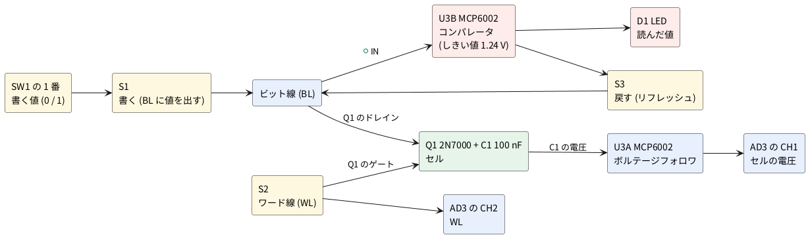

# 1-5 DRAM のセル — 2N7000 1 個とコンデンサ 1 個で 1 ビットを覚え、漏れて消えるのを見る

[1-3](03-register.md) のレジスタは、D フリップフロップが**電源のある限り**値を覚えていた。
パソコンのメインメモリ (DRAM) は、それとは別の覚え方をする。**コンデンサに電荷があるかないか**が 1 ビットで、
コンデンサの前に MOSFET のスイッチを 1 個置いただけの**セル** (1T1C セル) を何十億個も並べてある。
部品が少ないぶん、コンデンサの電荷は漏れて**放っておくと消える**。消える前に読んで書き戻す (**リフレッシュ**) ことで覚え続ける。
"Dynamic" はこの「放っておくと消える」のことだ。

この題では、セルを 2N7000 1 個と 100 nF 1 個で組み、DRAM の 4 つの動きを 1 つずつ目で見る。

1. **書く**: ビット線 (BL) に値を出し、ワード線 (WL) を H にしてスイッチを通し、コンデンサに写す
2. **消える**: WL を L に戻したあと、コンデンサの電圧が漏れでゆっくり下がる (オシロで追う)
3. **読む**: BL を浮かせて WL を H にすると、BL がコンデンサの電圧になる。コンパレータで 1 か 0 に決め、LED に出す
4. **戻す (リフレッシュ)**: 読んだ値をコンパレータの出力から BL に戻し、WL が H の間にコンデンサを満たし直す

[1-6](06-dram-array.md) では、同じセルが 8 個と行の選択回路が 1 つの IC に入った 74HC4051 で 2 ビット × 16 語の配列を組む。

## 全体の構成




| 動き | 押すもの | 何が起きるか |
| --- | --- | --- |
| 書く | S1 を押しながら S2 | BL = SW1 の値 (5 V か 0 V)。WL が H の間に C1 がその電圧になる |
| 消える | 何も押さない | C1 の電荷が Q1 の漏れでゆっくり抜ける。CH1 で下がる様子を見る |
| 読む | S2 だけ | BL が浮いているので、BL = C1 の電圧。U3B が 1.24 V と比べて LED に出す |
| 戻す | S2 を押しながら S3 | U3B の出力 (5 V か 0 V) が BL に戻り、WL が H なので C1 が満たし直される |

## 回路図

回路図は 2 枚。図1 がセルとワード線とセルの電圧を見るフォロワ、図2 がビット線に値を出す側と読む側だ。
**BL (ビット線) は図をまたいで同じ線**になる。

```circuit
# 回路図 (tommie-fence の circuit フェンス)
title: 図1 セル (Q1 と C1)・ワード線 (S2)・セルの電圧を見るフォロワ (U3A)
parts:
  BL: port 10,2
  Q1: nmos-e 10,6 mirror
  C1: capacitor 10,8 10,10 100n
  G1: ground 10,10
  VCC: vcc 15,2 5V
  S2: button 15,2 15,4
  R2: resistor 15,4 15,6 100k
  G2: ground 15,6
  M2: voltmeter 18,4 18,6 l=$\mathrm{CH2}$
  G3: ground 18,6
  U3A: opamp 14,9 +up MCP6002
  M1: voltmeter 18,9 18,11 l=$\mathrm{CH1}$
  G4: ground 18,11
wires:
  - 10,2 -- Q1.D
  - Q1.S -- 10,8
  - 15,4 -- 13,4
  - 13,4 -- 13,6
  - 13,6 -| Q1.G
  - 15,4 -- 18,4
  - 10,8 -- 12,8
  - 12,8 |- U3A.+
  - U3A.out -- 16,9
  - 16,9 -- 16,10.5
  - 16,10.5 -- 12,10.5
  - 12,10.5 |- U3A.-
  - 16,9 -- 18,9
notes:
  - text 8.9,8 small: "セル"
  - text 12.2,4.5 small: "WL"
style:
  grid: on
  pitch: 1.2
```


- **Q1 がスイッチ、C1 が記憶**。Q1 のゲートがワード線 (WL)、ドレインがビット線 (BL)、ソースと C1 の上の端がセルの節点だ。
  実物の DRAM と同じく、N ch の MOSFET をそのままパスゲートに使う
- **S2 を押すと WL が 5 V** になり Q1 が通る。離すと R2 (100 kΩ) が WL を 0 V に落とし、Q1 が切れて C1 が BL から切り離される。CH2 で WL を見る
- **C1 の電圧は直に測れない。** AD3 の入力は 1 MΩ で、100 nF と合わせた時定数は 0.1 秒。測ろうとした瞬間に C1 が空になる。
  そこで U3A (MCP6002) のボルテージフォロワを挟む。MCP6002 の入力バイアス電流は 1 pA (代表、25 °C) で、100 nF を 1 V 下げるのに 10 万秒かかる計算になる。
  「測ることが記憶を壊す」のが DRAM の読み出しそのもので、フォロワはそれを避けるための部品だ。
  LM358 (バイアス 20〜45 nA) や TL072 (±5 V が要る) ではなく、5 V 単電源でレール to レールの MCP6002 を選んだ
- Q1 のゲートが 5 V のとき、セルは **5 V − V<sub>GS</sub> までしか上がらない** (ソースフォロワの動き)。
  V<sub>GS(th)</sub> が 2.1 V (代表) の 2N7000 では約 3.5 V、V<sub>GS(th)</sub> の個体差 (0.8〜3 V) で 2〜4 V に散る。
  **実物の DRAM はワード線を電源より高く昇圧して、この落ちを無くしている**

```circuit
# 回路図 (tommie-fence の circuit フェンス)
title: 図2 ビット線に値を出す (SW1・S1)、読む (U3B)、戻す (S3)
parts:
  BL: port 4,2
  VCC: vcc 2,1 5V
  SD: switch 2,1 2,3 l=$\mathrm{SW1}_1$
  R1: resistor 2,3 2,5 10k
  G1: ground 2,5
  S1: button 2,3 4,3
  VCC: vcc 6,1 5V
  R3: resistor 6,1 6,3 10k
  R4: resistor 6,3 6,5 3.3k
  G2: ground 6,5
  U3B: opamp 9,7 +up MCP6002
  R5: resistor 12,7 12,9 820
  D1: led 12,9 12,11 red
  G3: ground 12,11
  S3: button 14,7 14,9
wires:
  - 4,2 -- 4,3
  - 4,3 -- 4,7
  - 4,7 |- U3B.+
  - 4,7 -- 4,12.5
  - 6,3 -- 7,3
  - 7,3 |- U3B.-
  - U3B.out -- 12,7
  - 12,7 -- 14,7
  - 14,9 -- 14,12.5
  - 14,12.5 -- 4,12.5
notes:
  - text 8.2,3 small: "1.24 V"
  - text 15,8 small: "戻す"
style:
  grid: on
  pitch: 1.2
```


- **書く側**: SW1 の 1 番が ON なら 5 V、OFF なら R1 (10 kΩ) で 0 V。S1 を押している間だけ、その値が BL に出る。
  S1 を離すと BL はどこにもつながらず**浮く**。実物の DRAM でも、読むときのビット線は浮いた (プリチャージした) 状態から始まる
- **読む側**: U3B (MCP6002 の片方) をコンパレータに使う。+IN が BL、−IN が R3・R4 で作った 1.24 V。
  BL が 1.24 V より高ければ出力が 5 V になり、R5 (820 Ω) を通して D1 が点く (= 1)。
  しきい値を電源の半分 (2.5 V) でなく 1.24 V に下げたのは、セルの電圧が最初から 3.5 V ほどしか無く、漏れでさらに下がるからだ
- **戻す側**: S3 を押すと U3B の出力がそのまま BL に戻る。S2 (WL) も押していれば、Q1 を通って C1 が 5 V (または 0 V) に満たし直される。
  **センスアンプの出力をビット線に戻す**、これが DRAM のリフレッシュの中身で、読み出しとリフレッシュは同じ動きだ。
  戻している間は「BL → U3B → BL」の正帰還になるので、1 は 1 に、0 は 0 に押し切られる
- コンパレータに LM393 を使わなかったのは、LM393 の入力の同相範囲が電源 − 1.5 V (3.5 V) までで、
  セルの電圧がそこを超えることがあるから。MCP6002 は入力も出力もレール to レールで、出力が 5 V / 0 V の押し出し型なので、
  戻すときにプルアップ抵抗も要らない

### 実物の DRAM との違い

| | この題 | 実物の DRAM |
| --- | --- | --- |
| セルのコンデンサ | 100 nF | 数十 fF (10<sup>6</sup> 分の 1 以下) |
| ビット線の容量 | 数十 pF (ブレッドボードの配線) | セルの数倍 |
| 読むとき | BL がセルの電圧になる。セルはほとんど減らない | セルの電荷が BL に分けられ、BL は数十 mV しか動かず、**セルの値は壊れる** (必ず書き戻す) |
| センスアンプ | コンパレータ 1 個 | BL 対ごとのラッチ型の差動アンプ |
| ワード線の電圧 | 5 V (セルは 5 − V<sub>GS</sub> まで) | 電源より高く昇圧 |
| 保持時間 | 秒〜数十秒 (見積り。下の「見るべき値」) | 数十 ms (リフレッシュは 64 ms ごと) |

この題では C1 が BL の容量より桁違いに大きいので、読んでも壊れない。実物は逆で、読むと壊れる。
同じ 1T1C の回路でも、容量の比で振る舞いが逆になるところを押さえてほしい。

## 実体配線図

**ブレッドボードは full 1 枚。** 左から、SW1 (DIP スイッチ)、S1、Q1 と C1、S2、U3 (MCP6002)、S3、R5 と D1、R3・R4 の順に置く。
Q1 と S2 は下の組、U3 のフォロワ (A) は下の組、コンパレータ (B) は上の組に来るように挿してある。AD3 は下に置く。

```breadboard
# ブレッドボードの実体配線図 (tommie-fence の breadboard フェンス)
title: 図3 DRAM のセルをブレッドボードに組む
board: full
parts:
  AD:
    type: device
    at: bottom
    label: Analog Discovery 3
    pins: [2+, 2-, 1+, 1-, V+, GND]
  SW1: dip-switch4 @ e2
  R1: resistor a2 -t2 10k
  S1: button @ f7
  Q1: transistor f12(D) f13(G) f14(S) 2N7000
  C1: capacitor j14 -b14 100n
  S2: button @ f16
  R2: resistor j16 -b16 100k
  U3: dip8 @ e21 MCP6002
  S3: button @ f27
  R5: resistor b32 b35 820
  D1: led a35(A) -t35(K) red
  R3: resistor a38 +t38 10k
  R4: resistor c38 c41 3.3k
wires:
  - AD.V+ -- +b45 red
  - AD.GND -- -b46 black
  - +t60 -- +b60 red
  - -t60 -- -b60 black
  - j2 -- +b2 red
  - d2 -- d7 blue
  - g9 -- g12 orange
  - h10 -- h12 orange
  - e10 -- f10 orange
  - c10 -- c24 orange
  - i12 -- i27 orange
  - g13 -- g16 white
  - a16 -- +t16 red
  - h14 -- h23 green
  - a21 -- +t21 red
  - j24 -- -b24 black
  - g21 -- g22 green
  - AD.1+ -- j21 green
  - AD.1- -- -b22 black
  - AD.2+ -- j18 white
  - AD.2- -- -b19 black
  - d23 -- d38 purple
  - a41 -- -t41 black
  - b22 -- b27 yellow
  - c27 -- c32 yellow
```


- **電源**: AD3 の V+ (5 V、赤) を下の + レールの 45 列に、GND (黒) を下の − レールの 46 列に入れる。上と下のレールは右端 (60 列) でつなぐ。
  **赤は +5 V の線だけ、黒は GND の線だけ**に使った
- **SW1** (2〜5 列): 1 番だけ使う。下の組 (`j2`) を +5 V に、上の組 (2 列の上) が書く値で、R1 (10 kΩ) で上の − レールへ落とす
- **S1** (7・9 列): 上の組に SW1 の値 (`d2`〜`d7` の青)、下の組がビット線 (BL)。`g9`〜`g12` の橙で Q1 のドレイン (12 列) へ
- **Q1** は下の組に、平らな面を手前にして**左から D・G・S** (12・13・14 列) になる向きで挿す。
  2N7000 は平らな面を見て左から S・G・D なので、180 度回すとこの並びになる。
  ※ **実物で確かめる: onsemi の 2007 年版の図は S G D、2022 年版の表は D G S で食い違い、表は 2007 年版 (S G D) に従う。実物はテスタで確かめる**
- **C1** は 14 列 (ソース = セルの節点) から下の − レールへ立てる。セルの電圧は `h14`〜`h23` の緑で U3 の VINA+ (23 列) へ
- **S2** (16・18 列): 下の組がワード線 (WL)。`g13`〜`g16` の白で Q1 のゲートへ、R2 (100 kΩ) で下の − レールへ落とす。上の組は `a16` から上の + レールへ (押すと WL が 5 V)。CH2 (2+) は `j18`
- **U3 (MCP6002)** は 21〜24 列。VDD (21 列の上) を上の + レールへ、VSS (24 列の下) を下の − レールへ。
  A 側がフォロワ: VOUTA (21 列の下) と VINA− (22 列の下) を `g21`〜`g22` の緑でつなぎ、CH1 (1+) を `j21` に挿す。
  B 側がコンパレータ: VINB+ (24 列の上) に BL (`c10`〜`c24` の橙)、VINB− (23 列の上) に 1.24 V (`d23`〜`d32` の紫)
- **BL を上の組へ渡す**: 10 列で `h10`〜`h12` の橙と `e10`〜`f10` の溝をまたぐ線で上の組に上げる。10 列の上が BL になり、`c10`〜`c24` で U3 へ
- **S3** (27・29 列): 上の組に U3B の出力 (`b22`〜`b27` の黄)、下の組が BL (`i12`〜`i27` の橙)。押すと出力が BL に戻る
- **R5・D1** (32〜35 列): U3B の出力を `c27`〜`c32` の黄で 32 列へ、R5 (820 Ω) を `b32`〜`b35` に寝かせ、D1 は `a35` から上の − レールへ立てる (長いピン = アノードが 35 列)
- **R3・R4** (38〜41 列): R3 (10 kΩ) を 38 列から上の + レールへ、R4 (3.3 kΩ) を `c38`〜`c41` に寝かせ、`a41` を上の − レールへ。38 列の上が 1.24 V で、`d23`〜`d38` の紫で U3 の VINB− へ
- **線の色**: 橙 = BL、緑 = セルの電圧、白 = WL、青 = 書く値、紫 = 1.24 V、黄 = U3B の出力、赤 = +5 V、黒 = GND

### ブレッドボードの限度の確認

電圧は 5 V。電流は、LED の 3.8 mA、R1・R2 のプルダウン (最大 0.5 mA ずつ)、R3・R4 の 0.38 mA、U3 の静止電流 (0.2 mA 以下) で、**合計は最大でも約 5 mA**。
周波数は、人がボタンを押す速さと、漏れの秒単位の変化だけで、ブレッドボードの 3 MHz の限度に十分収まる。
Q1 のゲートとドレインの間の容量 (C<sub>rss</sub> 数 pF) で WL の立ち上がりがセルに少し乗るが、100 nF に対しては mV 以下で見えない。

## 計器の設定

**計器は Analog Discovery 3 (AD3) 1 台**で、電源 (Supplies) と観測 (Scope) を兼ねる。

| 計器 | 設定 |
| --- | --- |
| Supplies | V+ を 5 V にして Master Enable を入れる |
| Scope | CH1 = セルの電圧 (U3A の出力)、CH2 = WL。**Time 2 s/div**、Mode は Record (20 秒を記録)。CH1 1 V/div、CH2 2 V/div。Trigger は **CH2 の立ち上がり 2.5 V**、位置を左寄り (−4 div) にする。WaveForms の項目の名前は確認していない |
| 接続 | AD3 の GND を下の − レールへ。1− と 2− も − レールへ |

手順 (図4 のとおりに動かすとき):

| 時刻 | すること | 見えるもの |
| --- | --- | --- |
| 準備 | SW1 の 1 番を ON (書く値 = 1) | — |
| 0 s | **S1 を押したまま S2 を 0.5 秒押す** (書く) | CH2 が 5 V の間に CH1 が約 3.5 V に上がる。LED は S2 を押している間だけ点く |
| 0.5〜10 s | 何もしない (消える) | CH1 がゆっくり下がる。目安は 10 秒で 2.6 V (漏れ 10 nA の見積り。実物で合わせる) |
| 10 s | **S2 だけを 0.5 秒押す** (読む) | LED が点く (まだ 1)。CH1 はほとんど変わらない |
| 14 s | **S2 を押したまま S3 を 0.5 秒押す** (戻す) | CH1 が約 3.5 V に戻る |
| そのあと | 何もしないで放っておく | CH1 が下がり続け、1.24 V を切ると S2 を押しても LED が点かなくなる (値が消えた) |

## 計器の画面

図4 は、上の手順で見えるはずの画面だ (漏れを 10 nA (300 MΩ 相当) と置いた計算で、実測ではない)。
カーソルは **X1 = 9.9 s** (読む直前。下がっているがまだ 1) と **X2 = 14.2 s** (戻した直後) に置いた。

```scope
# オシロスコープの画面 (tommie-fence の scope フェンス)
title: 図4 セルの電圧 (CH1) とワード線 (CH2) — 書いて、漏れて、読んで、戻す (計算)
time: 2s/div
trigger: ch2 rising 2.5V at -4div
ch1: {wave: = step(t) * step(14s - t) * 3.55V * exp(-t / 30s) + step(t - 14s) * 3.55V * exp(-(t - 14s) / 30s), range: 1V/div, position: -3div}
ch2: {wave: = 5V * (step(t) * step(0.5s - t) + step(t - 10s) * step(10.5s - t) + step(t - 14s) * step(14.5s - t)), range: 2V/div, position: -3div}
cursors: [9.9s, 14.2s]
measure: [vmax]
notes:
  - text 0.3s 4V: 書く
  - text 10.3s 3.2V: 読む
  - text 14.3s 4V: 戻す
```


## 見るべき値 (目安)

| 項目 | 値 | 根拠 |
| --- | --- | --- |
| 書いた直後のセルの電圧 | **約 3.5 V** (2〜4 V に散る) | 5 V − V<sub>GS</sub>。LTspice (V<sub>GS(th)</sub> 2.14 V のモデル) で 3.55 V |
| 漏れによる下がり方 | **0.1 V/s** (10 nA の見積り)。最悪 10 V/s (1 µA) | I ÷ C。2N7000 の I<sub>DSS</sub> は最大 1 µA (V<sub>DS</sub> = 48 V、25 °C)。室温・3 V では桁違いに小さいはずだが、実測で確かめる |
| 読める時間 (1 と判定できる時間) | 10 nA なら約 30 秒 | 3.5 V から 1.24 V まで。漏れが 10 倍なら 3 秒 |
| コンパレータのしきい値 | 1.24 V | 5 V × 3.3 ÷ (10 + 3.3) |
| LED の電流 | 3.8 mA | (5 − 1.9) ÷ 820。順方向電圧 1.9 V は仮定 |
| フォロワ無しで AD3 を直に当てたときの時定数 | 0.1 s | 1 MΩ × 100 nF |
| 戻すときに C1 を満たし直す時間 | 数十 µs | MCP6002 の出力電流 (数 mA〜20 mA 程度) で 100 nF を 3.5 V 動かす時間 |
| 図4 のカーソル | X1 (9.9 s) 2.55 V、X2 (14.2 s) 3.53 V | `scope-fence check` の読み値 |

- **漏れの値は実物で測る**のがこの題の肝だ。CH1 の傾きから I = C × dV/dt で求める。2N7000 を何本か差し替えると、個体で桁が違うことがある。
  指で Q1 を温めると漏れが増えて速く消える (接合の漏れは 10 °C で約 2 倍)。これが「DRAM は温度でリフレッシュ周期が変わる」の正体だ
- **読んでも壊れない**のは C1 が大きいから (上の表)。壊れるのを見たければ、BL に 10 nF を足してみる。読むたびに 100 nF と 10 nF で電荷を分け合い、セルの電圧が 1 割ずつ減る
- **書く値 = 0** のときは、S1 を押しながら S2 で C1 が 0 V になる。0 の方は漏れても 0 のままで消えない。
  実物の DRAM でも、漏れで消えるのは片方の値だけで、どちらが消えるかはセルの作り (電荷を蓄える側) で決まる
- WL (S2) を押している間は、U3B の +IN と Q1 を通して BL がセルにつながっている。MCP6002 の入力は 1 pA なので、押しっぱなしでも消えない。
  LM393 (25 nA) なら、押している間に 0.25 V/s で減っていく

## 部品

電源は AD3 の V+ (5 V)。

| 記号 | 部品 | 値・型番 | 数 |
| --- | --- | --- | --- |
| Q1 | N ch MOSFET (TO-92) | 2N7000 (BS170 でも同じ。ピンの並びが違う) | 1 |
| C1 | コンデンサ (フィルム) | 100 nF (0.1 µF)。漏れの少ないフィルムかセラミック | 1 |
| U3 | レール to レール オペアンプ (DIP-8、2 回路) | MCP6002 | 1 |
| SW1 | 4 連 DIP スイッチ (DIP-8) | 1 番だけ使う | 1 |
| S1〜S3 | タクトスイッチ | 6 mm | 3 |
| R1、R3 | 抵抗 (1/4 W) | 10 kΩ | 2 |
| R2 | 抵抗 (1/4 W) | 100 kΩ | 1 |
| R4 | 抵抗 (1/4 W) | 3.3 kΩ | 1 |
| R5 | 抵抗 (1/4 W) | 820 Ω | 1 |
| D1 | LED 5 mm | 赤 | 1 |
| — | ブレッドボード | full 1 枚 | 1 |
| — | ジャンパ線 | 赤・黒・各色 | 適宜 |

- C1 を 10 nF にすると消えるのが 10 倍速く (約 3 秒)、1 µF にすると 10 倍遅くなる。漏れの電流は変わらないので、傾きで比べられる
- 型番の入手性は確認していない

## LTspice での確かめ

`sim/05-dram-cell.cir` で、WL に 5 V を 0.5 秒入れて BL の 5 V を書き、セルの電圧の .meas を取った。
2N7000 のモデルは LTspice の付属ライブラリ (standard.mos) に無いので、同じ TO-92 の N ch MOSFET の BS170 のモデル (V<sub>GS(th)</sub> 2.14 V) で代用した。
MOSFET のモデルの漏れは実物より小さすぎるので、漏れは 300 MΩ の抵抗 (3 V で 10 nA) で置いた。これは見積りで、実測で合わせる。

| 項目 | 本文の数字 | LTspice | 判定 |
| --- | --- | --- | --- |
| 書いた直後のセルの電圧 | 約 3.5 V | 3.55 V (0.5 s) | 合う |
| 10 秒後・20 秒後 (漏れ 10 nA) | 2.6 V・1.9 V | 2.59 V・1.86 V | 合う (図4 の線と同じ式) |
| 漏れの傾き (10 nA ÷ 100 nF、1 µA ÷ 100 nF) | 0.1 V/s、10 V/s | 0.1 V/s、10 V/s | 合う |
| しきい値 | 1.24 V | 1.241 V | 合う |
| LED の電流 | 3.8 mA | 3.78 mA | 合う |
| AD3 を直に当てたときの時定数 | 0.1 s | 0.1 s | 合う |

## 出典

自作。1T1C セルの構成、読み出しで値が壊れること、リフレッシュ、ワード線の昇圧、セルの容量 (数十 fF) は
[Dynamic Random Access Memory — Wikipedia](https://ja.wikipedia.org/wiki/Dynamic_Random_Access_Memory) による。
2N7000 の V<sub>GS(th)</sub> (0.8〜3 V、代表 2.1 V) と I<sub>DSS</sub> (最大 1 µA、V<sub>DS</sub> = 48 V) は
[Vishay の 2N7000 / 2N7002 / NDS7002A データシート (70226)](https://www.vishay.com/docs/70226/70226.pdf)、
MCP6002 の入力バイアス電流 (±1 pA 代表) とレール to レールの入出力は
[Microchip の MCP6001/1R/1U/2/4 データシート (DS20001733L)](https://ww1.microchip.com/downloads/en/DeviceDoc/MCP6001-1R-1U-2-4-1-MHz-Low-Power-Op-Amp-DS20001733L.pdf)、
LM393 の入力の同相範囲 (V+ − 1.5 V まで) と入力バイアス電流 (25 nA 代表、250 nA 最大) は
[TI の LM393 データシート (SLCS005)](https://www.ti.com/lit/ds/symlink/lm393.pdf) による。

- 2N7000 のピンの並びは、上の Vishay の資料と onsemi の資料で食い違う (`datasheets.md`)。実物はテスタで確かめる
- 漏れの電流 (10 nA) は見積りで、実測していない
- 型番の入手性、WaveForms の Record の項目の名前は確認していない
