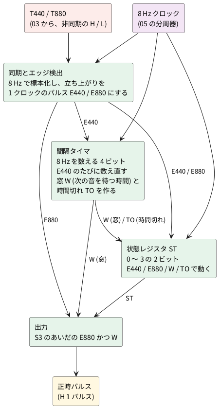
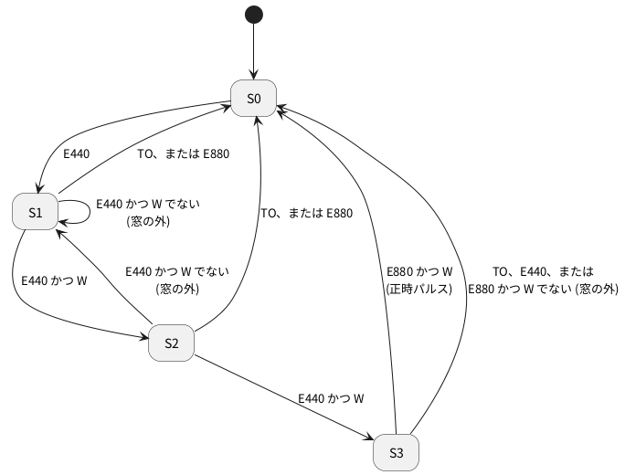

# 2-4 時報の状態遷移 — 440 Hz を 3 回数えて 880 Hz で正時パルス

> [!WARNING]
> **この題の回路は、まだ実際の回路で検証していない。** 回路図は check のネットリストで突き合わせたもので、組んで確かめてはいない (実体配線図は 2-10)。数値 (タイミング) も計算とシミュレーションで作ったもので、正しく動くかどうかは確実ではない。

全体の中の位置は [01-block.md](01-block.md) の ③ 状態遷移。T440 が 1 秒おきに 3 回来たあとに
T880 が来たら、正時パルスを 1 つ出す。

## ブロック図




入力は [03-detect.md](03-detect.md) の T440 と T880。出力は [07-clock.md](07-clock.md) へ行く正時パルス。

図の信号の意味は、次のとおり。

| 信号 | 意味 |
| --- | --- |
| E440 | 440 Hz の音が**始まった**ことを知らせる、1 クロック (0.125 秒) のパルス |
| E880 | 880 Hz の音が**始まった**ことを知らせる、1 クロックのパルス |
| **W (窓)** | **「次の音が来てよい時間」のあいだだけ H になる信号。** 時報の予報音は 1 秒おきなので、前の E440 から約 1 秒 (0.875〜1.125 秒) のあいだだけ H になる。この時間の外に来た音は、時報の順番ではないとみなす |
| TO (時間切れ) | 前の E440 から 1.25 秒ほど待っても次の音が来なかったときに H になる。状態を待機 (S0) に戻す |
| ST (状態) | 0〜3 の数。予報音をここまで何回聞いたか (S0〜S3) を覚えている |

W は、「雑音や別の音を、時報と取り違えない」ための仕組みで、**1 秒の間隔を測る物差し**にあたる。W を H にするのは間隔タイマで、E440 が来るたびに数え直し、数が一定の範囲のときだけ H にする。

## 設計の方針

この回路は、**時間を状態と数に置き換える**。1 秒を測るのに、1 秒の単安定回路を使わず、一定の周期のクロックを数える。

- **クロックは 8 Hz**。05 の時計の分周器 (32.768 kHz ÷ 4096) の途中から取る (CD4040 の Q12)。1 クロックは 0.125 秒
- **T440 と T880 は、クロックと関係なく変わる**。D フリップフロップで 8 Hz に合わせて標本化し、もう 1 段遅らせて、立ち上がりだけを 1 クロックのパルス (E440、E880) にする
- **間隔タイマ**は、8 Hz を数える 4 ビットのカウンタ。E440 が来るたびに**値 2 を読み込む**。次の E440 までの数 (0.125 秒の何個ぶんか) を見る
- **窓 W**: 時報の予報音の間隔は 1 秒 (8 クロック)。標本化で ±1 クロックずれるので、間隔が 7〜9 クロック (0.875〜1.125 秒) のときだけ、順番どおりと認める。タイマの値で言えば 8、9、10 のとき (2 から数え始めるので、判定のゲートが少なくて済む)
- **時間切れ TO**: 数が 11 に達したら (間隔が 10 クロック以上)、順番が崩れたとして、状態を S0 に戻す
- **状態 ST**は、0〜3 の 2 ビット (S0〜S3)

## 状態の動き

| 状態 | 意味 |
| --- | --- |
| S0 | 待機 |
| S1 | 予報音 (440 Hz) を 1 回聞いた |
| S2 | 2 回聞いた |
| S3 | 3 回聞いた。880 Hz を待つ |

| イベント | 条件 | 動作 |
| --- | --- | --- |
| E440 | 状態が S1 か S2 で、**W が H** (窓のうち) | 状態を 1 つ進める。タイマを 2 から数え直す |
| E440 | 状態が S3 | **状態を S0 に戻す** (4 回目の 440 Hz は、時報の順番ではない) |
| E440 | 上以外。つまり、状態が S0、または S1 か S2 で **W が L** (窓の外) | 状態を S1 にする (数え直す)。タイマを 2 から数え直す |
| E880 | 状態が S3 で、**W が H** (窓のうち) | **正時パルスを出す。状態を S0 に戻す** |
| E880 | 上以外。つまり、状態が S3 でない、または **W が L** (窓の外) | 状態を S0 に戻す |
| 時間切れ TO | タイマの数が 11 | 状態を S0 に戻す |
| 電源投入 | — | 状態を S0 にする |

**「窓の外」とは、「W でない」(W の否定、W が L のとき) のことだ。** 状態遷移図では「W でない」と書き、日本語では「窓の外」と呼ぶ。W が H のあいだが「窓のうち」で、それ以外が「窓の外」になる。

| 言い方 | 意味 | W の値 |
| --- | --- | --- |
| 窓のうち (W) | 前の音から約 1 秒 (0.875〜1.125 秒) 後 | H |
| 窓の外 (W でない) | 早すぎる (0.875 秒より前) か、遅すぎる (1.125 秒より後) | L |

窓の外の E440 は、S0 ではなく **S1 (数え直し)** にする。雑音の音が先に来たあとに、本物の時報が続いても拾えるようにするためだ。ただし、S3 に来た E440 は、順番にない音なので S0 に戻す。




## タイミング (設計の計算値)

ふつうの時報を入れたときの様子を、設計から**計算で出した**。440 Hz が 0.04 秒、1.04 秒、2.04 秒に立ち上がり、880 Hz が 3.04 秒に立ち上がる。実機の波形ではない。TM は間隔タイマの数、ST は状態。

```logic
# ロジックアナライザの画面 (tommie-fence の logic フェンス)
title: 図1 440 Hz を 3 回数えて 880 Hz で正時パルスが出る (計算)
device: ad3
window: 4s
sample: 1kHz
signals:
  CLK: dio0 clock 8Hz
  T440: dio1 edges 0s=0 40ms=1 240ms=0 1.04s=1 1.24s=0 2.04s=1 2.24s=0
  T880: dio2 edges 0s=0 3.04s=1
  TM: dio3..dio6 counter on CLK rising sequence 1 2 2 3 4 5 6 7 8 9 2 3 4 5 6 7 8 9 2 3 4 5 6 7 8 9 10 11 12 13 14 15 0
  ST: dio7..dio8 counter on CLK rising sequence 0 0 1 1 1 1 1 1 1 1 2 2 2 2 2 2 2 2 3 3 3 3 3 3 3 3 0 0 0 0 0 0 0
  OUT: dio9 edges 0s=0 3.125s=1 3.25s=0
buses:
  Timer: TM3..TM0 dec
  State: ST1..ST0 dec
cursors: [1.09375s, 3.21875s]
```


- 1 回目の E440 (0.125〜0.25 秒) で ST が 1 になり、タイマが 2 から数え始める。2 回目、3 回目も同じ間隔 (タイマは 9 まで数えて次の E440) で進み、**ST が 3 になる (2.25 秒)**
- カーソル X1 (1.094 秒) は、1 回目と 2 回目の E440 のあいだ (Timer 8、State 1)。X2 (3.219 秒) は、E880 のあいだ (Timer 9、State 3、OUT が H)
- 880 Hz の E880 (3.125〜3.25 秒) が、ST = 3 のあいだ、窓の中 (タイマ 9) で来るので、**OUT に 1 クロック (0.125 秒) のパルスが出て、ST が 0 に戻る (3.25 秒)**

### 順番が崩れたときの動き

正しい時報のほかに、**パルスを出してはいけない場合**の動きも見る。いずれも計算で、実機の波形ではない。

```logic
# ロジックアナライザの画面 (tommie-fence の logic フェンス)
title: 図2 440 Hz が 4 回続くと、4 回目で待機に戻り、正時パルスは出ない (計算)
device: ad3
window: 5s
sample: 1kHz
signals:
  CLK: dio0 clock 8Hz
  T440: dio1 edges 0s=0 40ms=1 240ms=0 1.04s=1 1.24s=0 2.04s=1 2.24s=0 3.04s=1 3.24s=0
  T880: dio2 edges 0s=0 4.04s=1
  TM: dio3..dio6 counter on CLK rising sequence 1 2 2 3 4 5 6 7 8 9 2 3 4 5 6 7 8 9 2 3 4 5 6 7 8 9 2 3 4 5 6 7 8 9 10 11 12 13 14 15 0
  ST: dio7..dio8 counter on CLK rising sequence 0 0 1 1 1 1 1 1 1 1 2 2 2 2 2 2 2 2 3 3 3 3 3 3 3 3 0 0 0 0 0 0 0 0 0 0 0 0 0 0 0
  OUT: dio9 low
buses:
  Timer: TM3..TM0 dec
  State: ST1..ST0 dec
cursors: [3.1875s, 4.1875s]
```


| 見る所 | 読み値 | 意味 |
| --- | --- | --- |
| カーソル X1 (3.1875 秒) | Timer 9、State 3、T440 が H | 4 回目の 440 Hz が来ている。まだ S3 のまま |
| State の変わり目 | 0 → 1 (0.25 秒)、2 (1.25 秒)、3 (2.25 秒)、0 (3.25 秒) | 4 回目の E440 の次のクロックで S0 に戻る |
| カーソル X2 (4.1875 秒) | Timer 9、State 0、T880 が H、OUT 0 | 880 Hz が来たときは S0 なので、パルスは出ない |
| OUT の変わり目 | 0 | 正時パルスは出ない |

```logic
# ロジックアナライザの画面 (tommie-fence の logic フェンス)
title: 図3 2 回目の音が 1.5 秒後に遅れると、時間切れで戻り、数え直しになる (計算)
device: ad3
window: 4.5s
sample: 1kHz
signals:
  CLK: dio0 clock 8Hz
  T440: dio1 edges 0s=0 40ms=1 240ms=0 1.54s=1 1.74s=0 2.54s=1 2.74s=0
  T880: dio2 edges 0s=0 3.54s=1 3.74s=0
  TM: dio3..dio6 counter on CLK rising sequence 1 2 2 3 4 5 6 7 8 9 10 11 12 13 2 3 4 5 6 7 8 9 2 3 4 5 6 7 8 9 10 11 12 13 14 15 0
  ST: dio7..dio8 counter on CLK rising sequence 0 0 1 1 1 1 1 1 1 1 1 1 0 0 1 1 1 1 1 1 1 1 2 2 2 2 2 2 2 2 0 0 0 0 0 0 0
  OUT: dio9 low
buses:
  Timer: TM3..TM0 dec
  State: ST1..ST0 dec
cursors: [1.4375s, 3.6875s]
```


| 見る所 | 読み値 | 意味 |
| --- | --- | --- |
| カーソル X1 (1.4375 秒) | Timer 11、State 1 | 1 回目の音から 11 クロック待った。時間切れ (TO) の瞬間 |
| State の変わり目 | 1 (0.25 秒)、0 (1.5 秒)、1 (1.75 秒)、2 (2.75 秒)、0 (3.75 秒) | 時間切れで S0 に戻り、遅れた音から S1 で数え直す |
| カーソル X2 (3.6875 秒) | Timer 9、State 2、T880 が H、OUT 0 | 数え直しの途中 (S2) で 880 Hz が来たので、パルスは出ない |
| OUT の変わり目 | 0 | 正時パルスは出ない |

この 2 つの動きは、次の「数値シミュレーション」の 4 回の 440 Hz と間隔の長い音の行に対応する。

**注意:** この計算は、T440 が約 0.2 秒 H になると置いている。[03-detect.md](03-detect.md) の計算では、
約 0.1 秒の音で T440 が H になるのは約 0.11 秒で、8 Hz の標本化の周期 (0.125 秒) より短い。
標本化の瞬間が H の外に当たると、音を取りこぼす。03 の R<sub>p</sub> や TH を見直して、H を 0.125 秒より十分長くしてから使う。

## 数値シミュレーション

この設計を、プログラム (Python) で、フリップフロップとカウンタの動きとして模して確かめた。**回路を作って測ったものではない。**

| 確かめたこと | 結果 |
| --- | --- |
| 時報が入る位相をずらして 25 通り (0〜0.125 秒) | すべて、正時パルスが 1 つだけ出る |
| 4 つの立ち上がりが、1 秒の位置から ±30 ms ずれる (4000 回) | 失敗 0 回 |
| 同じ、±100 ms ずれる (4000 回) | 失敗 270 回 (約 6.8 %) |
| 間隔が 0.5、0.6、0.7、1.3、1.5、2 秒の 440 Hz が 3 回、そのあと 880 Hz (各 500 回) | 正時パルスを出さなかった (500 回すべて) |
| 440 Hz が 1 秒おきに **4 回**、そのあと 880 Hz (500 回) | 正時パルスを出さなかった (500 回すべて) |

- 窓は ±1 クロック (±125 ms) までしか許さないので、立ち上がりが ±100 ms 以上ずれると、標本化のずれと合わさって外れることがある
- 放送の時報の間隔は正確に 1 秒なので、通常は受信側の検出の遅れのばらつき (数十 ms) が問題になる

## 回路図

回路は **4 つのユニット**に分ける。1 つのユニットは IC が 4 個以内で、フルサイズのブレッドボード 1 枚に載る大きさにした (ユニバーサル基板の大きさは 2-10 の「実体配線図」に書く)。ユニットの間は、同じ名前の端子どうしを線でつなぐ。

| ユニット | 役目 | IC | 入力 | 出力 |
| --- | --- | --- | --- | --- |
| 1 同期とエッジ検出 | T440・T880 を 8 Hz で標本化し、立ち上がりを 1 クロックのパルスにする | U5・U6 (74HC74)、U7 (74HC04)、U8 (74HC08) | T440、T880、CLK | E440、NE440 (E440 の反転)、E880 |
| 2 間隔タイマと窓 | E440 から次の E440 までを 8 Hz で数え、窓 W と時間切れ TO を作る | U9 (74HC163)、U10 (74HC08)、U11 (74HC02) | NE440、CLK | W、TO |
| 3 状態を動かす条件 | イベントと窓から、状態レジスタへの命令を作る | U12 (74HC86)、U13 (74HC08)、U14 (74HC32)、U15 (74HC02) | QA、QB、S3、W、TO、NE440、E440、E880、PON | LOADN、EN、CLRN |
| 4 状態レジスタと出力 | 状態 ST (QA・QB) を持ち、正時パルス OUT を出す | U16 (74HC163)、U17 (74HC08) | LOADN、EN、CLRN、CLK、E880、W | QA、QB、S3、OUT |

- CLK は 8 Hz のクロック ([05-oscillator.md](05-oscillator.md) で作る)、PON は電源投入のとき H になる信号 ([07-clock.md](07-clock.md) の電源投入のリセット)
- NE440 と LOADN、CLRN は、**L のとき働く**信号 (N は反転の印)
- すべての IC の電源は 5 V。IC の電源のピン (74HC74、74HC08 などの PIN 14、74HC163 の PIN 16) は +5 V、GND のピン (PIN 7、74HC163 の PIN 8) は GND
- ゲートのピンの番号は、74HC74、74HC04、74HC08、74HC86、74HC32、74HC02 の使うゲートの番号を図に書いた (使わないゲートの入力は GND につなぐ)

### ユニット 1: 同期とエッジ検出

```circuit
# 回路図 (tommie-fence の circuit フェンス)
title: 図4 同期とエッジ検出 (ユニット 1)
parts:
  T440: port 2,4
  T880: port 2,10
  CLK: port 2,6
  U5A:
    type: ic3
    at: 7,4
    label: 74HC74
    pins: [D, CLK, Q]
  U5B:
    type: ic3
    at: 15,4
    label: 74HC74
    pins: [D, CLK, Q]
  U6A:
    type: ic3
    at: 7,10
    label: 74HC74
    pins: [D, CLK, Q]
  U6B:
    type: ic3
    at: 15,10
    label: 74HC74
    pins: [D, CLK, Q]
  U7A: not 20,4
  U8A: and 25,4
  U7C: not 30,4
  U7B: not 20,10
  U8B: and 25,10
  E440: port 33,2
  NE440: port 37,4
  E880: port 33,10
wires:
  - 2,4 -- U5A.D
  - U5A.Q -- 11,4 -- U5B.D
  - 11,4 -- 11,2 -- 23,2
  - 23,2 |- U8A.a
  - U5B.Q -- U7A.in
  - U7A.out -| U8A.b
  - U8A.out -- 28,4 -- U7C.in
  - 28,4 -- 28,2 -- 33,2
  - U7C.out -- 37,4
  - 2,10 -- U6A.D
  - U6A.Q -- 11,10 -- U6B.D
  - 11,10 -- 11,8 -- 23,8
  - 23,8 |- U8B.a
  - U6B.Q -- U7B.in
  - U7B.out -| U8B.b
  - U8B.out -- 33,10
  - 2,6 -- 4,6 -- 7,6 -- 15,6
  - U5A.CLK -- 7,6
  - U5B.CLK -- 15,6
  - 4,6 -- 4,12 -- 7,12 -- 15,12
  - U6A.CLK -- 7,12
  - U6B.CLK -- 15,12
notes:
  - text 19.4,3.6 tiny center: "1"
  - text 20.6,3.6 tiny center: "2"
  - text 24.1,3.5 tiny center: "1"
  - text 24.1,4.6 tiny center: "2"
  - text 25.7,3.6 tiny center: "3"
  - text 29.4,3.6 tiny center: "5"
  - text 30.6,3.6 tiny center: "6"
  - text 19.4,9.6 tiny center: "3"
  - text 20.6,9.6 tiny center: "4"
  - text 24.1,9.4 tiny center: "4"
  - text 24.1,10.6 tiny center: "5"
  - text 25.7,9.6 tiny center: "6"
  - text 5.7,3.6 tiny center: "2"
  - text 8.3,3.6 tiny center: "5"
  - text 7.3,4.9 tiny center: "3"
  - text 13.7,3.6 tiny center: "12"
  - text 16.3,3.6 tiny center: "9"
  - text 15.3,4.9 tiny center: "11"
  - text 5.7,9.6 tiny center: "2"
  - text 8.3,9.6 tiny center: "5"
  - text 7.3,10.9 tiny center: "3"
  - text 13.7,9.6 tiny center: "12"
  - text 16.3,9.6 tiny center: "9"
  - text 15.3,10.9 tiny center: "11"
  - text 2,1 small left: 74HC74 は 2 個。PIN 14 は +5V、PIN 7 は GND、PIN 1・4・10・13 は +5V
style:
  pitch: 1
```


- T440 と T880 は、クロックと関係なく変わる。D フリップフロップ 2 段 (U5A→U5B、U6A→U6B) で 8 Hz に合わせ、1 段目の出力 (T4s) と 2 段目の出力 (T4d) の**差**で立ち上がりを見つける
- E440 は T4s かつ「T4d の反転」で、1 クロックの H パルス。NE440 はその反転で、ユニット 2 とユニット 3 が使う

### ユニット 2: 間隔タイマと窓

```circuit
# 回路図 (tommie-fence の circuit フェンス)
title: 図5 間隔タイマと窓 (ユニット 2)
parts:
  NE440: port 3,1
  CLK: port 3,6.5
  U9: ic 10,5 74HC163
  VCC1: vcc 10,2 5V
  GND1: ground 10,8
  U10A: and 20,4
  U11A: nor 26,5
  U10C: and 32,3
  U10B: and 32,7
  W: port 38,7
  TO: port 38,3
wires:
  - 3,1 -| U9.LOAD
  - 3,6.5 |- U9.CLK
  - U9.VCC |- 10,2
  - U9.CLR |- 10,2
  - U9.GND |- 10,8
  - U9.A |- 5,3.5
  - U9.B |- 5,4
  - U9.C |- 5,4.5
  - U9.D |- 5,5
  - U9.ENP |- 5,5.5
  - U9.ENT |- 5,6
  - U9.QA |- U10A.a
  - U9.QB -| U10A.b
  - U10A.out -- 23,4
  - 23,4 -| U11A.a
  - U9.QC |- 24,5 -| U11A.b
  - 23,4 -- 28,4 -- 28,3
  - 28,3 |- U10C.a
  - U9.QD |- 30,5.5
  - 30,5.5 |- U10C.b
  - 30,5.5 |- U10B.a
  - U11A.out -- 28,5 |- U10B.b
  - U10C.out -- 38,3
  - U10B.out -- 38,7
notes:
  - text 4,3.5 tiny right: GND
  - text 4,4 tiny right: +5V
  - text 4,4.5 tiny right: GND
  - text 4,5 tiny right: GND
  - text 4,5.5 tiny right: +5V
  - text 4,6 tiny right: +5V
  - text 3,9 small left: B だけ +5V で、E440 のたびに値 2 を読み込む
  - text 18.9,3.5 tiny center: "1"
  - text 18.9,4.6 tiny center: "2"
  - text 20.7,3.6 tiny center: "3"
  - text 30.9,2.4 tiny center: "9"
  - text 30.9,3.6 tiny center: "10"
  - text 32.7,2.6 tiny center: "8"
  - text 30.9,6.5 tiny center: "4"
  - text 30.9,7.6 tiny center: "5"
  - text 32.7,6.6 tiny center: "6"
  - text 24.9,4.5 tiny center: "2"
  - text 24.9,5.6 tiny center: "3"
  - text 26.7,4.6 tiny center: "1"
style:
  grid: on
  pitch: 1
```


- 74HC163 (U9) は 4 ビットのカウンタ。LOAD は L のとき働く (NE440 を入れる)。**E440 のクロックの立ち上がりで、データ入力 (B = 1、A・C・D = 0、つまり値 2) を読み込む**。ほかのときは 8 Hz を数える
- m = QA かつ QB (U10A)。k = QC も m も 0 (U11A)。**W = QD かつ k** (U10B)。数が 8、9、10 のとき W が H になる
- **TO = m かつ QD** (U10C)。数が 11 になると H になる

### ユニット 3: 状態を動かす条件

```circuit
# 回路図 (tommie-fence の circuit フェンス)
title: 図6 状態を動かす条件 (ユニット 3)
parts:
  W: port 2,1
  QA: port 2,2
  QB: port 2,4
  NE440: port 2,5
  E440: port 2,7
  E880: port 2,10
  TO: port 2,12
  S3: port 2,14
  PON: port 2,17
  U12A: xor 9,3
  U13A: and 18,3
  U14A: or 26,6
  U13B: and 26,8
  U14B: or 9,11
  U13C: and 14,15
  U14C: or 21,13
  U15A: nor 27,17
  LOADN: port 31,6
  EN: port 31,8
  CLRN: port 31,17
wires:
  - 2,2 |- U12A.a
  - 2,4 |- U12A.b
  - U12A.out -- 12,3 -| U13A.b
  - 2,1 -- 15,1 |- U13A.a
  - U13A.out -- 21,3
  - 21,3 |- U14A.b
  - 21,3 |- U13B.b
  - 2,5 |- U14A.a
  - 2,7 -- 6,7
  - 6,7 |- U13B.a
  - 6,7 |- U13C.b
  - 2,10 |- U14B.a
  - 2,12 |- U14B.b
  - U14B.out -| U14C.a
  - 2,14 |- U13C.a
  - U13C.out -- 18,15 |- U14C.b
  - U14C.out -| U15A.a
  - 2,17 |- U15A.b
  - U14A.out -- 31,6
  - U13B.out -- 31,8
  - U15A.out -- 31,17
notes:
  - text 7.8,2.4 tiny center: "1"
  - text 7.8,3.6 tiny center: "2"
  - text 9.7,2.6 tiny center: "3"
  - text 16.9,2.4 tiny center: "1"
  - text 16.9,3.6 tiny center: "2"
  - text 18.7,2.6 tiny center: "3"
  - text 24.9,5.5 tiny center: "1"
  - text 24.9,6.6 tiny center: "2"
  - text 26.7,5.6 tiny center: "3"
  - text 24.9,7.5 tiny center: "4"
  - text 24.9,8.6 tiny center: "5"
  - text 26.7,7.6 tiny center: "6"
  - text 7.8,10.4 tiny center: "4"
  - text 7.8,11.6 tiny center: "5"
  - text 9.7,10.6 tiny center: "6"
  - text 12.8,14.4 tiny center: "9"
  - text 12.8,15.6 tiny center: "10"
  - text 14.7,14.6 tiny center: "8"
  - text 19.9,12.4 tiny center: "9"
  - text 19.9,13.6 tiny center: "10"
  - text 21.7,12.6 tiny center: "8"
  - text 25.9,16.4 tiny center: "2"
  - text 25.9,17.6 tiny center: "3"
  - text 27.7,16.6 tiny center: "1"
  - text 9,19 small left: 74HC86、74HC08、74HC32、74HC02 は PIN 14 が +5V、PIN 7 が GND
style:
  pitch: 1
```


- x = QA と QB が違う (U12A) は、状態が S1 か S2 であること。ADV = W かつ x (U13A) は、「窓のうちで、状態を 1 つ進めてよい」
- LOADN = NE440 または ADV (U14A)。L のとき、状態レジスタに値 1 (S1) を読み込む。E440 で、ADV でないときだけ L になる
- EN = E440 かつ ADV (U13B)。H のとき、状態レジスタを 1 つ進める
- CLRN = NOT (E880 または TO または (S3 かつ E440) または PON)。U14B (E880 または TO)、U13C (S3 かつ E440)、U14C (OR)、U15A (NOR) で作る。L のとき、状態を 0 に戻す。**S3 かつ E440** は、状態が S3 のあいだに来た E440 (4 回目の 440 Hz) で、順番にない音として S0 に戻す

### ユニット 4: 状態レジスタと出力

```circuit
# 回路図 (tommie-fence の circuit フェンス)
title: 図7 状態レジスタと出力 (ユニット 4)
parts:
  LOADN: port 3,1
  CLRN: port 3,2
  EN: port 3,5.5
  CLK: port 3,6.5
  U16: ic 12,5 74HC163
  GND1: ground 12,8
  U17A: and 22,4
  U17B: and 22,7
  U17C: and 32,5
  E880: port 18,7
  W: port 18,8
  OUT: port 38,5
  QA: port 38,2
  QB: port 38,9.5
  S3: port 38,3
wires:
  - 3,1 -| U16.LOAD
  - 3,2 -| U16.CLR
  - U16.VCC |- 5,3
  - U16.GND |- 12,8
  - 3,6.5 -| U16.CLK
  - 3,5.5 -- 7,5.5
  - 7,5.5 |- U16.ENP
  - 7,5.5 |- U16.ENT
  - U16.A |- 5,3.5
  - U16.B |- 5,4
  - U16.C |- 5,4.5
  - U16.D |- 5,5
  - U16.QA |- 16,4
  - 16,4 |- U17A.a
  - 16,4 -- 16,2 -- 38,2
  - U16.QB |- 16,4.5
  - 16,4.5 -| U17A.b
  - 16,4.5 -- 16,9.5 -- 38,9.5
  - 18,7 |- U17B.a
  - 18,8 |- U17B.b
  - U17A.out -- 24,4
  - 24,4 -- 28,4 |- U17C.a
  - 24,4 -- 24,3 -- 38,3
  - U17B.out -- 28,7 |- U17C.b
  - U17C.out -- 38,5
notes:
  - text 4,3.5 tiny right: +5V
  - text 4,4 tiny right: GND
  - text 4,4.5 tiny right: GND
  - text 4,5 tiny right: GND
  - text 4,3 tiny right: +5V
  - text 3,11 small left: 74HC163 は E440 のたびに値 1 (A だけ +5V) を読み込む
  - text 20.9,3.5 tiny center: "1"
  - text 20.9,4.6 tiny center: "2"
  - text 22.7,3.6 tiny center: "3"
  - text 20.9,6.5 tiny center: "4"
  - text 20.9,7.6 tiny center: "5"
  - text 22.7,6.6 tiny center: "6"
  - text 30.9,4.5 tiny center: "9"
  - text 30.9,5.6 tiny center: "10"
  - text 32.7,4.6 tiny center: "8"
  - text 9,10 small left: 74HC08 は PIN 14 が +5V、PIN 7 が GND
style:
  grid: on
  pitch: 1
```


- 74HC163 (U16) は状態 ST の 2 ビット (QA、QB)。CLRN (L で 0 に戻す)、LOADN (L で値 1 を読み込む)、EN (H で 1 つ進める) の順に優先される
- n1 = QA かつ QB (U17A) は「状態が S3」で、S3 としてユニット 3 にも出す。n2 = E880 かつ W (U17B)。**OUT = n1 かつ n2 (U17C)** が、正時パルス (1 クロックの H)
- QA と QB も、ユニット 3 に戻す

## 部品

| 部品 | 個数 | 備考 |
| --- | --- | --- |
| 74HC74 | 2 | U5、U6 (D フリップフロップ 2 回路入り) |
| 74HC04 | 1 | U7 (インバータ 6 回路入りのうち 3 つを使う) |
| 74HC08 | 4 | U8、U10、U13、U17 (2 入力 AND、4 回路入り) |
| 74HC163 | 2 | U9 (間隔タイマ)、U16 (状態) |
| 74HC02 | 2 | U11、U15 (2 入力 NOR、4 回路入り) |
| 74HC86 | 1 | U12 (2 入力 XOR) |
| 74HC32 | 1 | U14 (2 入力 OR) |
| 0.1 µF のセラミックコンデンサ | 13 | IC ごとの電源のそば |
| 10 kΩ の抵抗 (1/4 W)・押しボタン (a 接点) | 各 1 | 試験用 (2-10 の図5)。T880 のプルダウンと、T880 を H にするボタン |

IC は全部で 13 個。ユニットごとに 4 個以内なので、フルサイズのブレッドボード 1 枚に 1 ユニットを載せる。ユニバーサル基板には、ユニットごとに基板の大きさを変えて載せる (2-10 の「実体配線図」)。

## 実体配線図

4 つのユニットの実体配線図 (ブレッドボードとユニバーサル基板) と、Analog Discovery 3 で試験する手順は
[10-state-machine-build.md](10-state-machine-build.md) (2-10) に分けた。
この題は実体配線図・Analog Discovery 3・オシロの図を付けない — 設計 (計算とシミュレーション) の題で、この題では組まない (組んで測るのは 2-10)。

## 見るべき値

図1〜3 の読み値で、設計から出した計算値 (実測ではない)。組んで当てるときの値は 2-10 の「見るべき値」。

| 項目 | 見るべき値 | 根拠 |
| --- | --- | --- |
| クロック | 8 Hz (1 クロック 0.125 秒) | CD4040 の Q12 (32.768 kHz ÷ 4096) |
| 窓 W が H のあいだ | 前の E440 から 0.875〜1.125 秒 (タイマの値 8・9・10) | 7〜9 クロック |
| 時間切れ TO | タイマの値 11 (前の E440 から約 1.25 秒) | 10 クロック |
| 状態 ST が 3 になる時刻 | 2.25 秒 | 図1 |
| 正時パルス OUT | 3.125〜3.25 秒、幅 0.125 秒 (1 クロック) | 図1 |
| 440 Hz が 4 回続いたとき | 4 回目の E440 の次のクロック (3.25 秒) で S0 に戻り、OUT は出ない | 図2 |
| 2 回目の音が 1.5 秒後に遅れたとき | 1.4375 秒で Timer 11 (時間切れ) になり、S0 に戻って数え直す。OUT は出ない | 図3 |

## LTspice での確かめ

状態遷移の回路は論理 (74HC の組合せ) で、SPICE の対象外。本文には数値シミュレーションの表があり、ここでは時間の算術だけを確かめた。

| 項目 | 本文の数字 | 算術 | 判定 |
| --- | --- | --- | --- |
| クロック (CD4040 の Q12) | 8 Hz (0.125 秒) | 32768 / 4096 = 8 Hz | 合う |
| 窓 (7〜9 クロック) | 0.875〜1.125 秒 | 7 × 0.125 = 0.875、9 × 0.125 = 1.125 秒 | 合う |
| 窓のタイマの値 | 8・9・10 | 2 から数え始めて、n クロック後の E440 で値は n + 1 (n = 7〜9) | 合う |
| 時間切れ (タイマが 11) | 約 1.25 秒 | 10 クロック = 1.25 秒 | 合う |
| 標本化の周期 (8 Hz) と T440 の H の長さ (約 0.109 秒) | 0.109 秒 < 0.125 秒 (取りこぼし) | 同じ | 本文の注意のとおり |

## 出典

自作。参考: [時報 (Wikipedia)](https://ja.wikipedia.org/wiki/時報)、[有限オートマトン (Wikipedia)](https://ja.wikipedia.org/wiki/有限オートマトン)、
[TI の SN74HC74 データシート (SCLS094F)](https://www.ti.com/lit/ds/symlink/sn74hc74.pdf)、
[TI の SN74HC163 データシート (SCLS298D)](https://www.ti.com/lit/ds/symlink/sn74hc163.pdf)。
