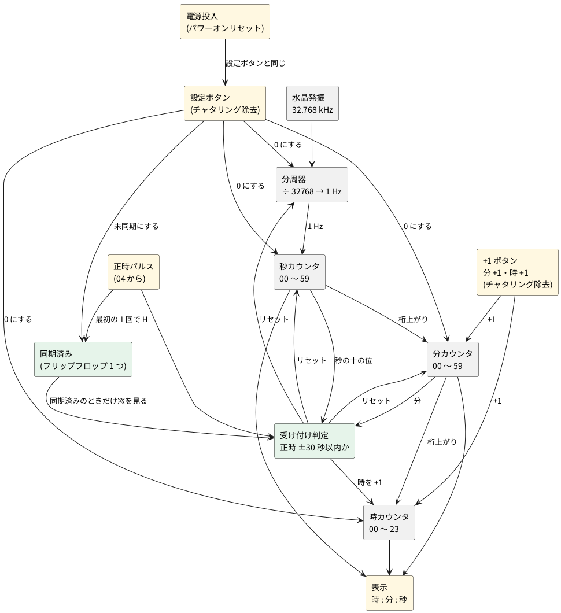

# 2-7 時計 — 32.768 kHz を数えて時分秒を出し、正時パルスで合わせる

> [!WARNING]
> **この題は、まだ実際の回路で検証していない。** 回路図・実体配線図・波形・数値は、設計から計算と見積りで作ったもので、組んで測ったものではない。パワーオンの時間と表示の電流は典型値からの見積りだ。組むときは、ユニットごとに確かめながら進めてほしい。

全体の中の位置は [01-block.md](01-block.md) の ④ 時計。水晶の 32.768 kHz を分周して 1 Hz にし、
時・分・秒を数えて表示する。[04-state-machine.md](04-state-machine.md) の正時パルスが来たら、
時計を正時に合わせる。

> [!NOTE]
> **中級 (大規模) の題。** 使う知識は中級までだが、回路の規模が中級の上限 (1 題で IC 6 個・ブレッドボード full 2 枚まで) を大きく超える
> (IC 31 個、8 ユニット)。**発振と分周 (ユニット 1) を [2-5](05-oscillator.md)、秒 (ユニット 2) を [2-6](06-seconds.md) で先に組んで動かし**、
> この題では残りのユニット (分・時・+1 ボタン・窓判定・同期と設定・表示) を足す。ユニットごとに単独で確かめながら進める。

## ブロック図




## 時刻の初期設定 — 時と分は +1 ボタンで、秒は最初の正時パルスで

時報には時刻の情報が無い (正時を知らせるだけ) ので、**時と分は人が +1 ボタンで合わせる**。
ボタンは「分 +1」と「時 +1」の 2 つで、**押しているあいだ、8 Hz のクロックごとに 1 つずつ進む**。
分を 59 まで進めても約 7.4 秒、時は 23 まで約 2.9 秒だ。秒のボタンは置かない (秒は最初の正時パルスで 0 に合う)。

1. 電源を入れる、または設定ボタンを押すと、時計は **00:00:00** になり、「未同期」の LED が点く。
2. 今の時刻まで、時 +1 と分 +1 を押して進める。分を 59 から 00 に進めると、桁上がりで時も 1 進む
   (普通に時計が進むときと同じ道を通るため)。時を合わせるのは分のあとにするとよい。
3. 最初の正時パルスが来たら、分・秒・分周器を 0 にする。
   **時計の分が 30 以上なら時を +1 する** (正時に最も近い時へ丸める)。分を ±30 分以内に合わせておけば、時報で正しい時になる。
4. 「同期済み」のフリップフロップを 1 にする (LED が消える)。以後は窓が有効になる。

ボタンで合わせた時刻は実際の時刻から数秒〜数十秒ずれる。正時の窓 (次の節) の外のパルスは捨てるので、
窓のままでは同期できないことがある。そこで、**未同期のあいだは窓を見ず、最初の正時パルスを必ず受け付ける**。

| 状態 | 正時パルスの扱い |
| --- | --- |
| 未同期 | 窓を見ずに受け付ける。分・秒・分周器を 0 にし、分が 30 以上なら時を +1。同期済みにする |
| 同期済み | 次の節の窓の中だけ受け付ける |

「分が 30 以上」は、分の十の位 (BCD で 0〜5) が 3 以上かどうかで分かる。
3 = 011、4 = 100、5 = 101 なので、**ビット 2 が 1 か、ビット 1 とビット 0 がどちらも 1** のとき成り立つ。
ビット 1 だけを見ると 2 (010) も入ってしまうので足りない。窓の判定で使う「秒が 30 以上」も同じ作りで、
秒の十の位と分の十の位に、同じ回路を 2 つ置く。

**+1 ボタンは、その桁のイネーブルに OR で足すだけ**で作る (図3)。分の一の位のイネーブルは ENMU (秒からの桁上がり) と
分のボタンの OR (ENM)、時の一の位のイネーブルは、分からの桁上がり CM と時のボタンの OR (CMB) と、正時の +1 (HP) の OR になる。
カウンタはもともと 8 Hz の CLK で動く同期式なので、ボタンが H のあいだはクロックごとに 1 進む。
押した瞬間を 1 回だけ拾う回路 (縁の検出) は要らない。ボタンには設定ボタンと同じく 10 kΩ と 1 µF (10 ms) の
チャタリング除去を付け、シュミットのインバータ (74HC14) で整える。

足す部品は、+1 ボタン 2 個とそのチャタリング除去、OR のゲート、設定ボタン (チャタリング除去つき)、
並列ロードつきのカウンタ (74HC163)、同期済みの 1 ビット (フリップフロップ 1 つ)、
電源投入時に設定ボタンと同じ動きをするパワーオンリセットだ。
カウンタには BCD で数える 74HC160 や 74HC162 もある。ただ、[04-state-machine.md](04-state-machine.md) と同じ 74HC163 なら、
在庫が 1 種類で済み、ピンの名前が回路図と実体配線図に出る。74HC163 は 4 ビットのバイナリなので、
0〜9 と 0〜5 の折り返しは、次の節の「折り返し」のとおり**ロードに 0 を入れて**作る。
カウンタのデータ入力はすべて GND で、読み込むのはいつも 0 だ (時刻をスイッチで読み込む作りより、線が 13 本減る)。
同期するまでは表示の分が不正確なので、「未同期」の LED で知らせる。

RTC の IC (DS3231 など) は使わない。I2C で時刻を読み書きするのにマイコンが要り、
ロジックで時間を扱う練習の意図から外れる。毎正時に合わせ直すので、精度も要らない。

## 正時リセットの決まり

**同期済みのとき**、正時パルスを受け付けるのは、時計の正時の前後 30 秒以内だけ。判定は分と秒の十の位で作り、
秒の一の位は見ない。

秒の十の位は BCD で 0〜5 (000〜101)。**秒が 30 以上かどうかは、十の位が 3 以上かどうか**で、
ビット 2 が 1 か、ビット 1 とビット 0 がどちらも 1 のとき成り立つ。これを X とする。

| パルスのときの時計 | 条件 | 動作 |
| --- | --- | --- |
| 59 分 30 秒以降 | 分が 59 かつ X | 時を +1 し、分・秒・分周器を 0 にする |
| 00 分 29 秒まで | 分が 00 かつ X でない | 時はそのまま、分・秒・分周器を 0 にする |
| 上の外 | — | 何もしない |

時の +1 は 23 時から 0 時へ回る (23 → 00)。判定のゲートは、分の「59」「00」の検出と、
X の判定、AND と OR をあわせて十数個になる (次の「回路図」の図4)。

## 回路の組み立て

### 同期式にする

時計の部分は、**すべてのカウンタとフリップフロップを、8 Hz の CLK の立ち上がりで動かす**。
CLK は2-5 の図1の CD4040B の Q12 で、[04-state-machine.md](04-state-machine.md) の CLK と同じものだ。
1 Hz は、別の信号 TICK で表す。TICK は 8 クロックに 1 回、1 クロックぶんだけ H になる。
各桁は「下の桁が最大の値で、TICK が来た」ときにだけ数える (イネーブルの鎖)。
ゲートの遅れ (数十 ns) は 125 ms に比べて無視できるので、ゲートの出力は次のクロックまでに必ず落ち着く。

### 折り返し

74HC163 は、LOAD が L のときは、イネーブルに関係なく、クロックの立ち上がりでデータ入力を読み込む。
そこで、折り返し (秒の 59 → 00 など) と、リセット (正時と設定) を、**どちらも LOAD で作る**。データ入力はすべて GND で、読み込むのはいつも 0 だ。

- 折り返し: 「その桁が最大で、イネーブルされている」ときに LOAD を L にして 0 を読み込む。
- リセット (正時と設定): 同じ LOAD を RS (ACC または SET) でも L にする。時は SET でだけ 0 にする (正時では 0 にしない)。

### 分周器は止めない

正時パルスで、CD4040B (÷ 4096、8 Hz を出す側) は 0 にしない。止めると CLK が止まり、
[04-state-machine.md](04-state-machine.md) の E880 を消すクロックが来なくなって、正時パルスが出っぱなしになる。
そのかわり、÷ 8 の 74HC163 (U20) だけを RS で 8 に戻す。
合わせる精度は 8 Hz の格子 (± 0.125 秒) になり、これに時報の検出の遅れが加わる。時計としては十分だ。

### ユニット

| ユニット | 図 | 主な IC | 役目 |
| --- | --- | --- | --- |
| 1 発振と分周 | 2-5 の図1 | U18 (CD4069UB)、U19 (CD4040B)、U20 (74HC163)、U46 (74HC02) | 32.768 kHz → 8 Hz の CLK → 1 Hz の TICK |
| 2 秒 | 2-6 の図1 | U21・U22 (74HC163)、U33 (74HC08)、U42 (74HC02) | 秒の一の位 (0〜9) と十の位 (0〜5) |
| 3 分 | 図1 | U23・U24 (74HC163)、U34 (74HC08)、U42 (74HC02) | 分の一の位と十の位 |
| 4 時 | 図2 | U25・U26 (74HC163)、U35・U36 (74HC08)、U40 (74HC32)、U43 (74HC02) | 時の一の位 (0〜9) と十の位 (0〜2)、23 → 00 |
| 5 +1 ボタン | 図3 | U47 (74HC14)、U48 (74HC32)、S1・S2 | 分と時を 1 つずつ進める |
| 6 窓判定 | 図4 | U36・U37 (74HC08)、U38〜U40 (74HC32)、U43 (74HC02) | 正時パルスを受け付けるか、時を +1 するか |
| 7 同期と設定 | 図5 | U41 (74HC32)、U44 (74HC74)、U45 (CD40106B) | 同期済み、設定ボタン、パワーオン |
| 8 表示 | 図6 | U27〜U32 (CD4511B)、D1〜D6 | BCD を 7 セグメントにする (6 桁) |

| ユニット | 組む題 |
| --- | --- |
| 1 発振と分周 | [2-5](05-oscillator.md) の図1・図2 |
| 2 秒 | [2-6](06-seconds.md) の図1〜図3 |
| 3〜8 | この題 |

### 信号の名前

同じ名前の端子どうしは、図が違ってもつながっている。

| 名前 | 意味 |
| --- | --- |
| CLK | 8 Hz のクロック (U19 の Q12)。04 の CLK でもある |
| TICK | 1 秒に 1 回、1 クロックだけ H。U20 の RCO |
| SU0〜SU3、ST0〜ST2 | 秒の一の位、十の位 (QA が最下位。ST3 は使わない) |
| MU0〜MU3、MT0〜MT2 | 分の一の位、十の位 |
| HU0〜HU3、HT0・HT1 | 時の一の位、十の位 |
| ENST、ENMU、ENMT、CM | 桁上がり。秒 → 十の位、秒 → 分の一の位、分の一の位 → 十の位、分 → 時 |
| P | 正時パルス (04 の OUT)。1 クロックだけ H |
| X | 秒が 30 以上 |
| ACC | 正時パルスを受け付ける |
| SY、NSY | 同期済み、未同期 (SY の反転) |
| SET、SETN | 設定中 (ボタンまたは電源投入) が H、その反転 |
| RS | リセット (ACC または SET) |
| LDSU など | 各カウンタの LOAD (L で読み込む) |
| BM、BH | 分 +1、時 +1 のボタン。押しているあいだ H (チャタリング除去のあと) |
| ENM | 分の一の位のイネーブル。ENMU または BM |
| CMB | 時の一の位を進める桁上がり。CM (分からの桁上がり) または BH |

## 回路図

回路は 8 つのユニットに分ける。ユニット 1 は 2-5 の図1、ユニット 2 は 2-6 の図1 にあり、この題ではユニット 3〜8 を図1〜図6 に描く。
ゲートは論理記号で描き、記号のピンに IC のピンの番号 (PIN) を添えた。
IC の電源 (PIN 14 または 16) と GND (PIN 7 または 8) は、図の下の注記か本文に書く。
使わないゲートの入力は GND につなぐ。

### ユニット 3: 分

```circuit
# 回路図 (tommie-fence の circuit フェンス)
title: 図1 分のカウンタ (ユニット 3)
parts:
  U23: ic 12,8 74HC163
  GND4: ground 8.4,6.5 r90
  ENM: port 8.4,8.75
  CLK: port 8.4,9.5
  VCC: vcc 11.5,4.6 5V
  GND1: ground 12,10.6
  MU0: port 31,7
  MU1: port 31,7.5
  MU2: port 31,8
  MU3: port 31,8.5
  U34A: and 20,10.75 74HC08
  U34B: and 26,10.99 74HC08
  ENM: port 22.5,11.23
  U42C: nor 32,11.41 74HC02
  RS: port 30,9.8
  U24: ic 12,19 74HC163
  GND2: ground 8.4,17.5 r90
  ENMT: port 8.4,19.75
  CLK: port 8.4,20.5
  VCC: vcc 11.5,15.6 5V
  GND3: ground 12,21.6
  MT0: port 31,18
  MT1: port 31,18.5
  MT2: port 31,19
  MT3: port 31,19.5
  U34C: and 20,21.75 74HC08
  U34D: and 26,21.99 74HC08
  ENMT: port 22.5,22.23
  U42D: nor 32,22.41 74HC02
  RS: port 30,20.8
  ENMT: port 36,13.5
  CM: port 36,24.5
wires:
  - U23.A -| 9.5,6.5
  - U23.B -| 9.5,7
  - U23.C -| 9.5,7.5
  - U23.D -| 9.5,8
  - 9.5,6.5 -- 9.5,7
  - 9.5,7 -- 9.5,7.5
  - 9.5,7.5 -- 9.5,8
  - 9.5,6.5 -- 8.4,6.5
  - U23.ENP -| 9.5,8.5
  - U23.ENT -| 9.5,9
  - 9.5,8.5 -- 9.5,8.75
  - 9.5,8.75 -- 9.5,9
  - 9.5,8.75 -- 8.4,8.75
  - U23.CLK -| 8.4,9.5
  - 11.5,5.2 -| U23.VCC
  - 12,5.2 -| U23.CLR
  - 11.5,5.2 -- 12,5.2
  - 11.5,5.2 -- 11.5,4.6
  - 12,10.6 -| U23.GND
  - U23.QA -| 14.5,7
  - 14.5,7 -- 31,7
  - U23.QB -| 31,7.5
  - U23.QC -| 31,8
  - U23.QD -| 15.5,8.5
  - 15.5,8.5 -- 31,8.5
  - 15.5,8.5 |- U34A.a
  - 14.5,7 |- U34A.b
  - U34A.out -- 23.5,10.75
  - 23.5,10.75 |- U34B.a
  - 22.5,11.23 |- U34B.b
  - U34B.out -| 29,11.65
  - 29,11.65 |- U42C.b
  - 29,11.65 -- 29,13.5
  - 29,13.5 -- 36,13.5
  - 30,9.8 |- U42C.a
  - U42C.out -| 34,5.7
  - U23.LOAD |- 34,5.7
  - U24.A -| 9.5,17.5
  - U24.B -| 9.5,18
  - U24.C -| 9.5,18.5
  - U24.D -| 9.5,19
  - 9.5,17.5 -- 9.5,18
  - 9.5,18 -- 9.5,18.5
  - 9.5,18.5 -- 9.5,19
  - 9.5,17.5 -- 8.4,17.5
  - U24.ENP -| 9.5,19.5
  - U24.ENT -| 9.5,20
  - 9.5,19.5 -- 9.5,19.75
  - 9.5,19.75 -- 9.5,20
  - 9.5,19.75 -- 8.4,19.75
  - U24.CLK -| 8.4,20.5
  - 11.5,16.2 -| U24.VCC
  - 12,16.2 -| U24.CLR
  - 11.5,16.2 -- 12,16.2
  - 11.5,16.2 -- 11.5,15.6
  - 12,21.6 -| U24.GND
  - U24.QA -| 14.5,18
  - 14.5,18 -- 31,18
  - U24.QB -| 31,18.5
  - U24.QC -| 15.5,19
  - 15.5,19 -- 31,19
  - U24.QD -| 31,19.5
  - 15.5,19 |- U34C.a
  - 14.5,18 |- U34C.b
  - U34C.out -- 23.5,21.75
  - 23.5,21.75 |- U34D.a
  - 22.5,22.23 |- U34D.b
  - U34D.out -| 29,22.65
  - 29,22.65 |- U42D.b
  - 29,22.65 -- 29,24.5
  - 29,24.5 -- 36,24.5
  - 30,20.8 |- U42D.a
  - U42D.out -| 34,16.7
  - U24.LOAD |- 34,16.7
notes:
  # 端子の向き (矢印が信号の流れ。入力は回路へ、出力は端子へ)
  - arrow 8.65,8.75 9.3,8.75 ink
  - arrow 8.65,9.5 9.3,9.5 ink
  - arrow 29.15,7 29.8,7 ink
  - arrow 29.15,7.5 29.8,7.5 ink
  - arrow 29.15,8 29.8,8 ink
  - arrow 29.15,8.5 29.8,8.5 ink
  - arrow 22.75,11.23 23.4,11.23 ink
  - arrow 30,10.05 30,10.7 ink
  - arrow 8.65,19.75 9.3,19.75 ink
  - arrow 8.65,20.5 9.3,20.5 ink
  - arrow 29.15,18 29.8,18 ink
  - arrow 29.15,18.5 29.8,18.5 ink
  - arrow 29.15,19 29.8,19 ink
  - arrow 29.15,19.5 29.8,19.5 ink
  - arrow 22.75,22.23 23.4,22.23 ink
  - arrow 30,21.05 30,21.7 ink
  - arrow 34.15,13.5 34.8,13.5 ink
  - arrow 34.15,24.5 34.8,24.5 ink
  - text 13.5,4.1 small left: U23 74HC163 (分の一の位)
  - text 13.5,15.1 small left: U24 74HC163 (分の十の位)
  - text 22,5.3 tiny left: LDMU
  - text 22,16.3 tiny left: LDMT
  - text 22.5,10.4 tiny left: MU9
  - text 22.5,21.4 tiny left: MT5
  - text 3,27.5 small left: 74HC08・74HC02 は PIN 14 が +5V、PIN 7 が GND
style:
  pitch: 1
```


- 秒とほぼ同じ作りで、イネーブルは ENM (秒からの桁上がり ENMU と、分 +1 のボタンの OR。図3) から始まる。データ入力はすべて GND。
- 一の位 (U23) の出力 MU0〜MU3 を右へ伸ばし、その下の U34A (9 の判定 MU9)・U34B (十の位を進める ENMT)・U42C (LOAD を作る LDMU) へ直接つないだ。LDMU は上を回って U23 の LOAD へ戻る。十の位 (U24・U34C・U34D・U42D) も同じ形で、U34D の出力が時へ行く桁上がり CM。
- U34D の CM (分が 59 で桁上がり) は、時のユニットへ行く。

### ユニット 4: 時

```circuit
# 回路図 (tommie-fence の circuit フェンス)
title: 図2 時のカウンタ (ユニット 4)
parts:
  U40C: or 4.5,8.75 74HC32
  CMB: port 1,7.6
  HP: port 1,9.9
  U25: ic 12,8 74HC163
  GND4: ground 8.4,6.5 r90
  CLK: port 8.4,9.5
  VCC: vcc 11.5,4.6 5V
  GND1: ground 12,10.6
  HU0: port 40,7
  HU1: port 40,7.5
  HU2: port 40,8
  HU3: port 40,8.5
  U35A: and 20,10.75 74HC08
  U35B: and 26,10.99 74HC08
  ENHT: port 35,9.5
  U40D: or 38,11.23 74HC32
  U43A: nor 44,10.99 74HC02
  SET: port 41,9.8
  U35C: and 20,14.5 74HC08
  U35D: and 26,14.74 74HC08
  U36A: and 32,14.98 74HC08
  U43B: nor 44,14.74 74HC02
  SET: port 41.5,13.5
  U26: ic 12,21 74HC163
  GND2: ground 8.4,19.5 r90
  ENHT: port 8.4,21.75
  CLK: port 8.4,22.5
  VCC: vcc 11.5,17.6 5V
  GND3: ground 12,23.6
  HT0: port 40,20
  HT1: port 40,20.5
  HT2: port 40,21
  HT3: port 40,21.5
wires:
  - 1,7.6 |- U40C.a
  - 1,9.9 |- U40C.b
  - U40C.out -- 7,8.75
  - 7,8.75 -- 9.5,8.75
  - U25.ENP -| 9.5,8.5
  - U25.ENT -| 9.5,9
  - 9.5,8.5 -- 9.5,8.75
  - 9.5,8.75 -- 9.5,9
  - 7,8.75 -- 7,12.8
  - 7,12.8 -- 24.5,12.8
  - 24.5,12.8 |- U35B.b
  - 24.5,12.8 -- 30,12.8
  - 30,12.8 |- U36A.b
  - U25.A -| 9.5,6.5
  - U25.B -| 9.5,7
  - U25.C -| 9.5,7.5
  - U25.D -| 9.5,8
  - 9.5,6.5 -- 9.5,7
  - 9.5,7 -- 9.5,7.5
  - 9.5,7.5 -- 9.5,8
  - 9.5,6.5 -- 8.4,6.5
  - U25.CLK -| 8.4,9.5
  - 11.5,5.2 -| U25.VCC
  - 12,5.2 -| U25.CLR
  - 11.5,5.2 -- 12,5.2
  - 11.5,5.2 -- 11.5,4.6
  - 12,10.6 -| U25.GND
  - U25.QA -| 14.5,7
  - 14.5,7 -- 40,7
  - U25.QB -| 16.5,7.5
  - 16.5,7.5 -- 40,7.5
  - U25.QC -| 40,8
  - U25.QD -| 15.5,8.5
  - 15.5,8.5 -- 40,8.5
  - 15.5,8.5 |- U35A.a
  - 14.5,7 -- 14.5,10.99
  - 14.5,10.99 |- U35A.b
  - 14.5,10.99 -- 14.5,14.74
  - 14.5,14.74 |- U35C.b
  - 16.5,7.5 |- U35C.a
  - U35A.out -- 23.5,10.75
  - 23.5,10.75 |- U35B.a
  - U35B.out -- 35,10.99
  - 35,10.99 |- U40D.a
  - 35,10.99 -- 35,9.5
  - U40D.out -- 41.5,11.23
  - 41.5,11.23 |- U43A.b
  - 41,9.8 |- U43A.a
  - U43A.out -| 47,5.7
  - U25.LOAD |- 47,5.7
  - U35C.out -- 23.5,14.5
  - 23.5,14.5 |- U35D.a
  - U35D.out -- 29.5,14.74
  - 29.5,14.74 |- U36A.a
  - U36A.out -- 36.5,14.98
  - 36.5,14.98 |- U40D.b
  - 36.5,14.98 -- 41,14.98
  - 41,14.98 |- U43B.b
  - 41.5,13.5 |- U43B.a
  - U43B.out -| 48,18.7
  - U26.LOAD |- 48,18.7
  - U26.A -| 9.5,19.5
  - U26.B -| 9.5,20
  - U26.C -| 9.5,20.5
  - U26.D -| 9.5,21
  - 9.5,19.5 -- 9.5,20
  - 9.5,20 -- 9.5,20.5
  - 9.5,20.5 -- 9.5,21
  - 9.5,19.5 -- 8.4,19.5
  - U26.ENP -| 9.5,21.5
  - U26.ENT -| 9.5,22
  - 9.5,21.5 -- 9.5,21.75
  - 9.5,21.75 -- 9.5,22
  - 9.5,21.75 -- 8.4,21.75
  - U26.CLK -| 8.4,22.5
  - 11.5,18.2 -| U26.VCC
  - 12,18.2 -| U26.CLR
  - 11.5,18.2 -- 12,18.2
  - 11.5,18.2 -- 11.5,17.6
  - 12,23.6 -| U26.GND
  - U26.QA -| 40,20
  - U26.QB -| 23,20.5
  - 23,20.5 -- 40,20.5
  - 23,20.5 |- U35D.b
  - U26.QC -| 40,21
  - U26.QD -| 40,21.5
notes:
  # 端子の向き (矢印が信号の流れ。入力は回路へ、出力は端子へ)
  - arrow 1,7.81 1,8.46 ink
  - arrow 1,9.69 1,9.04 ink
  - arrow 8.65,9.5 9.3,9.5 ink
  - arrow 38.15,7 38.8,7 ink
  - arrow 38.15,7.5 38.8,7.5 ink
  - arrow 38.15,8 38.8,8 ink
  - arrow 38.15,8.5 38.8,8.5 ink
  - arrow 35,10.94 35,10.29 ink
  - arrow 41,10.05 41,10.7 ink
  - arrow 41.5,13.75 41.5,14.4 ink
  - arrow 8.65,21.75 9.3,21.75 ink
  - arrow 8.65,22.5 9.3,22.5 ink
  - arrow 38.15,20 38.8,20 ink
  - arrow 38.15,20.5 38.8,20.5 ink
  - arrow 38.15,21 38.8,21 ink
  - arrow 38.15,21.5 38.8,21.5 ink
  - text 13.5,4.1 small left: U25 74HC163 (時の一の位)
  - text 13.5,17.1 small left: U26 74HC163 (時の十の位)
  - text 5.5,12.4 tiny left: ENH
  - text 22,10.4 tiny left: HU9
  - text 39.5,10.7 tiny left: O8
  - text 30,5.3 tiny left: LDHU
  - text 22,14.1 tiny left: H3
  - text 28,14.3 tiny left: H23
  - text 34,14.6 tiny left: WH
  - text 30,18.3 tiny left: LDHT
  - text 3,26.5 small left: 74HC08・74HC32・74HC02 は PIN 14 が +5V、PIN 7 が GND
style:
  pitch: 1
```


- 時のイネーブル ENH は、CMB と、正時の +1 (HP) の OR だ (U40C)。CMB は、分の桁上がり CM と時 +1 のボタンの OR (図3)。
- U35A は時の一の位が 9。U35B は、9 で ENH が来たとき (ENHT) で、十の位を 1 つ進める。
- 23 → 00 は、一の位が 3 (U35C)、十の位が 2 (HT1) のとき (U35D)、ENH が来たら (U36A の WH) 両方に 0 を読み込ませる。一の位は 9 からも 0 に戻る (U40D が ENHT と WH の OR)。
- データ入力はすべて GND。

### ユニット 5: +1 ボタン

```circuit
# 回路図 (tommie-fence の circuit フェンス)
title: 図3 分と時の +1 ボタン (ユニット 5)
parts:
  VCC: vcc 6,3.5 5V
  R1: resistor 6,4.5 6,7.5 10k
  S1: button 6,7.5 6,10.5
  GND1: ground 6,10.5
  C3: capacitor 9,7.5 9,10.5 1u
  GND2: ground 9,10.5
  U47A: not 15,7.5 74HC14
  ENMU: port 20,6
  U48A: or 26,6.75 74HC32
  ENM: port 30,6.75
  VCC: vcc 6,13.5 5V
  R2: resistor 6,14.5 6,17.5 10k
  S2: button 6,17.5 6,20.5
  GND3: ground 6,20.5
  C4: capacitor 9,17.5 9,20.5 1u
  GND4: ground 9,20.5
  U47B: not 15,17.5 74HC14
  CM: port 20,16
  U48B: or 26,16.75 74HC32
  CMB: port 30,16.75
wires:
  - 6,3.5 -- 6,4.5
  - 6,7.5 -- 9,7.5
  - 9,7.5 -- 12,7.5
  - 12,7.5 -- U47A.in
  - U47A.out -- 22.5,7.5
  - 22.5,7.5 |- U48A.b
  - 20,6 -- 22.5,6
  - 22.5,6 |- U48A.a
  - U48A.out -- 30,6.75
  - 6,13.5 -- 6,14.5
  - 6,17.5 -- 9,17.5
  - 9,17.5 -- 12,17.5
  - 12,17.5 -- U47B.in
  - U47B.out -- 22.5,17.5
  - 22.5,17.5 |- U48B.b
  - 20,16 -- 22.5,16
  - 22.5,16 |- U48B.a
  - U48B.out -- 30,16.75
notes:
  # 端子の向き (矢印が信号の流れ。入力は回路へ、出力は端子へ)
  - arrow 20.25,6 20.9,6 ink
  - arrow 28.15,6.75 28.8,6.75 ink
  - arrow 20.25,16 20.9,16 ink
  - arrow 28.15,16.75 28.8,16.75 ink
  - text 10,4.6 small left: 分 +1 (押しているあいだ 8 Hz で進む)
  - text 10,14.6 small left: 時 +1
  - text 18,7.1 tiny left: BM
  - text 18,17.1 tiny left: BH
  - text 3,24 small left: 74HC14・74HC32 は PIN 14 が +5V、PIN 7 が GND。使わない入力は GND
style:
  pitch: 1
```


- ボタンは設定ボタン (図5) と同じ作りで、10 kΩ で +5 V に引き上げ、1 µF で 10 ms ほどのチャタリング除去を入れ、
  シュミットのインバータ (U47、74HC14) で整える。押すと BM・BH が H になる。
- U48A は ENM = ENMU または BM、U48B は CMB = CM または BH。ENM は分のカウンタ (図1)、CMB は時のイネーブルを作る U40C (図2。図7 の基板) へ行く。
  時のボタンは CM の側に足す。U40C の出力 ENH は 23 → 00 の判定 (U36A) にも入るので、23 時で押しても 00 に戻る。
- 押しているあいだ、8 Hz のクロックごとに 1 進む。ボタンの跳ねがクロックの立ち上がりにまたがっても、チャタリング除去で 1 つ余分に進むのを防ぐ。
- 74HC14 の使わない 4 回路の入力 (PIN 5・9・11・13) と、74HC32 の使わない 2 回路の入力 (PIN 9・10・12・13) は GND につなぐ。

### ユニット 6: 窓判定

```circuit
# 回路図 (tommie-fence の circuit フェンス)
title: 図4 窓判定 (ユニット 6)
parts:
  U36C: and 8,4 74HC08
  ST1: port 4.5,3.7
  ST0: port 4.5,4.3
  U39C: or 15,3.76 74HC32
  ST2: port 11.5,2.6
  U36D: and 8,8 74HC08
  MT1: port 4.5,7.7
  MT0: port 4.5,8.3
  U40B: or 15,7.76 74HC32
  MT2: port 11.5,6.6
  U36B: and 8,12 74HC08
  MT5: port 4.5,11.7
  MU9: port 4.5,12.3
  U38A: or 8,16 74HC32
  MT2: port 4.5,15.7
  MT1: port 4.5,16.3
  U38B: or 8,19.4 74HC32
  MT0: port 4.5,19.1
  MU3: port 4.5,19.7
  U38C: or 8,22.8 74HC32
  MU2: port 4.5,22.5
  MU1: port 4.5,23.1
  U38D: or 15,17.7 74HC32
  U39A: or 15,23.04 74HC32
  MU0: port 11.5,24.4
  U39B: or 22,20.6 74HC32
  U37A: and 30,9 74HC08
  U43D: nor 30,14 74HC02
  U39D: or 37,11.5 74HC32
  U40A: or 44,11.26 74HC32
  NSY: port 41.5,10
  U37B: and 51,11.02 74HC08
  P: port 48.5,9.8
  U37C: and 58,11.26 74HC08
  ACC: port 62,9.5
  HP: port 62,11.26
wires:
  - 4.5,3.7 |- U36C.a
  - 4.5,4.3 |- U36C.b
  - U36C.out -- 12.5,4
  - 12.5,4 |- U39C.b
  - 11.5,2.6 |- U39C.a
  - 4.5,7.7 |- U36D.a
  - 4.5,8.3 |- U36D.b
  - U36D.out -- 12.5,8
  - 12.5,8 |- U40B.b
  - 11.5,6.6 |- U40B.a
  - 4.5,11.7 |- U36B.a
  - 4.5,12.3 |- U36B.b
  - 4.5,15.7 |- U38A.a
  - 4.5,16.3 |- U38A.b
  - 4.5,19.1 |- U38B.a
  - 4.5,19.7 |- U38B.b
  - 4.5,22.5 |- U38C.a
  - 4.5,23.1 |- U38C.b
  - U38A.out -- 12.5,16
  - 12.5,16 |- U38D.a
  - U38B.out -- 13,19.4
  - 13,19.4 |- U38D.b
  - U38C.out -- 12.5,22.8
  - 12.5,22.8 |- U39A.a
  - 11.5,24.4 |- U39A.b
  - U38D.out -- 19.5,17.7
  - 19.5,17.7 |- U39B.a
  - U39A.out -- 20,23.04
  - 20,23.04 |- U39B.b
  - U39C.out -- 27.5,3.76
  - 27.5,3.76 -- 27.5,9.24
  - 27.5,9.24 |- U37A.b
  - 27.5,9.24 -- 27.5,14.24
  - 27.5,14.24 |- U43D.b
  - U36B.out -- 26,12
  - 26,12 |- U37A.a
  - U39B.out -- 27,20.6
  - 27,20.6 |- U43D.a
  - U37A.out -- 34,9
  - 34,9 |- U39D.a
  - U43D.out -- 34.5,14
  - 34.5,14 |- U39D.b
  - U39D.out -- 41,11.5
  - 41,11.5 |- U40A.b
  - 41.5,10 |- U40A.a
  - U40A.out -- 48,11.26
  - 48,11.26 |- U37B.b
  - 48.5,9.8 |- U37B.a
  - U37B.out -- 54.5,11.02
  - 54.5,11.02 |- U37C.a
  - 54.5,11.02 -- 54.5,9.5
  - 54.5,9.5 -- 62,9.5
  - U40B.out -- 55.5,7.76
  - 55.5,7.76 |- U37C.b
  - U37C.out -- 62,11.26
notes:
  # 端子の向き (矢印が信号の流れ。入力は回路へ、出力は端子へ)
  - arrow 4.75,3.76 5.4,3.76 ink
  - arrow 4.75,4.24 5.4,4.24 ink
  - arrow 11.5,2.82 11.5,3.47 ink
  - arrow 4.75,7.76 5.4,7.76 ink
  - arrow 4.75,8.24 5.4,8.24 ink
  - arrow 11.5,6.82 11.5,7.47 ink
  - arrow 4.75,11.76 5.4,11.76 ink
  - arrow 4.75,12.24 5.4,12.24 ink
  - arrow 4.75,15.76 5.4,15.76 ink
  - arrow 4.75,16.24 5.4,16.24 ink
  - arrow 4.75,19.16 5.4,19.16 ink
  - arrow 4.75,19.64 5.4,19.64 ink
  - arrow 4.75,22.56 5.4,22.56 ink
  - arrow 4.75,23.04 5.4,23.04 ink
  - arrow 11.5,24.15 11.5,23.5 ink
  - arrow 41.5,10.25 41.5,10.9 ink
  - arrow 48.5,10.05 48.5,10.7 ink
  - arrow 60.15,9.5 60.8,9.5 ink
  - arrow 60.15,11.26 60.8,11.26 ink
  - text 16.5,3.1 tiny left: X
  - text 16.5,7.1 tiny left: M30
  - text 9.5,11.4 tiny left: M59
  - text 23.5,20 tiny left: OF
  - text 31.5,8.4 tiny left: W59
  - text 31.5,13.4 tiny left: W00
  - text 38.5,10.9 tiny left: O2
  - text 45.5,11.5 tiny left: O3
  - text 2,1.2 small bold left: 秒・分が 30 以上か、分が 59 か
  - text 2,14.4 small bold left: 分が 00 か (どれか 1 ビットでも 1 なら OF が H)
  - text 29,6.2 small bold left: 窓の判定と時の +1
  - text 3,27 small left: 74HC08・74HC32・74HC02 は PIN 14 が +5V、PIN 7 が GND
style:
  pitch: 1
```


- 左上は「秒が 30 以上か」(U36C・U39C で X)、「分が 30 以上か」(U36D・U40B で M30)、「分が 59 か」(U36B で M59 = MT5 かつ MU9。MT5・MU9 は図1の U34 から来る)。
- 左下は、分の 7 ビットのどれか 1 つでも 1 かどうか (U38A〜U38D・U39A・U39B で OF)。OF が L のときだけ、分は 00。
- 右は、窓の判定。W59 は「59 分かつ X」、W00 は「分が 00 かつ X でない」(NOR)。O2 はその OR、O3 は未同期 (NSY) との OR。ACC = P かつ O3。HP = ACC かつ M30 (分が 30 以上のときだけ時を +1)。
- 未同期なら O3 は 1 になるので、ACC = P で、窓を見ずに受け付ける。

### ユニット 7: 同期と設定

```circuit
# 回路図 (tommie-fence の circuit フェンス)
title: 図5 同期済みと設定 (ユニット 7)
parts:
  VCC: vcc 6,2 5V
  R14: resistor 6,3 6,6 10k
  S14: button 6,6 6,9
  GND1: ground 6,9
  C14: capacitor 9,6 9,9 1u
  GND2: ground 9,9
  U45A: not 15,6 CD40106B
  VCC: vcc 6,11 5V
  R15: resistor 6,12 6,15 100k
  C15: ecap 9,15 9,18 10u
  GND3: ground 9,18
  U45B: not 15,15 CD40106B
  U41C: or 22,6.24 74HC32
  U41B: or 30,6 74HC32
  ACC: port 27,4.6
  RS: port 33,6
  U45C: not 29,9.5 CD40106B
  SET: port 31,12.5
  U41A: or 36,8 74HC32
  ACC: port 32.5,8.24
  U37D: and 42,8.24 74HC08
  U44A:
    type: ic3
    at: 49,8.24
    label: 74HC74
    pins: [D, CLK, Q]
  CLK: port 49,11.74
  U45D: not 56,12 CD40106B
  R23: resistor 59,12 63,12 330
  D7: led 63,12 67,12
  GND4: ground 67,12
  NSY: port 63,14
wires:
  - 6,2 -- 6,3
  - 6,6 -- 9,6
  - 9,6 -- 12,6
  - 12,6 -- U45A.in
  - 6,11 -- 6,12
  - 6,15 -- 9,15
  - 9,15 -- 12,15
  - 12,15 -- U45B.in
  - U45A.out -- 19,6
  - 19,6 |- U41C.a
  - U45B.out -- 19.5,15
  - 19.5,15 |- U41C.b
  - U41C.out -- 26,6.24
  - 26,6.24 |- U41B.b
  - 27,4.6 |- U41B.a
  - U41B.out -- 33,6
  - 26,6.24 -- 26,9.5
  - 26,9.5 |- U45C.in
  - 26,9.5 -- 26,12.5
  - 26,12.5 -- 31,12.5
  - U45C.out -- 40,9.5
  - 40,9.5 |- U37D.b
  - 32.5,8.24 |- U41A.b
  - U41A.out -- 39.5,8
  - 39.5,8 |- U37D.a
  - U37D.out -- 45,8.24
  - 45,8.24 -- U44A.D
  - 49,11.74 -- U44A.CLK
  - U44A.Q -- 53,8.24
  - 53,8.24 -- 53,3.5
  - 53,3.5 -- 34.5,3.5
  - 34.5,3.5 |- U41A.a
  - 53,8.24 -- 53,12
  - 53,12 |- U45D.in
  - U45D.out -- 59,12
  - 59,12 -- 59,14
  - 59,14 -- 63,14
notes:
  # 端子の向き (矢印が信号の流れ。入力は回路へ、出力は端子へ)
  - arrow 27,4.85 27,5.5 ink
  - arrow 31.15,6 31.8,6 ink
  - arrow 29.15,12.5 29.8,12.5 ink
  - arrow 32.75,8.24 33.4,8.24 ink
  - arrow 48.8,11.74 48.6,11.74 ink
  - arrow 61.15,14 61.8,14 ink
  - text 9,3.4 small left: 設定ボタン (押すと H)
  - text 9,12.2 small left: 電源投入 (約 0.9 秒 H)
  - text 16.5,5.4 tiny left: BTN
  - text 16.5,14.4 tiny left: PON
  - text 23.5,5.6 tiny left: SET
  - text 30.5,9 tiny left: SETN
  - text 37.5,7.4 tiny left: SYD1
  - text 43.5,7.6 tiny left: SYD
  - text 50.5,7.6 tiny left: SY
  - text 60,11.2 small left: 未同期の LED
  - text 44,15.5 tiny left: U44A は PIN 2 が D、PIN 3 が CLK、PIN 5 が Q
  - text 3,21 small left: 74HC74 の PIN 1・4・10・13・14 は +5V、PIN 11・12・7 は GND
  - text 3,22.2 small left: 74HC32・74HC08・CD40106B は PIN 14 が +5V、PIN 7 が GND
style:
  pitch: 1
```


- 設定ボタンは、10 kΩ で +5 V に引き上げ、1 µF で 10 ms ほどのチャタリング除去を入れ、シュミットのインバータ (U45A) で BTN にする。押すと BTN が H。
- パワーオンは、100 kΩ と 10 µF (時定数 1 秒) の立ち上がりをシュミットのインバータ (U45B) に通す。電源を入れてから約 0.9 秒、PON が H になる。
- SET = BTN または PON (U41C)。SETN はその反転 (U45C)。RS = ACC または SET (U41B)。
- 同期済み SY は、74HC74 の D フリップフロップ 1 つ。D = (SY または ACC) かつ SETN。正時パルスを受け付けると 1 になり、設定中は 0 に戻る。74HC74 の CLR・PRE は +5 V、使わないほうの D と CLK は GND につなぐ。NSY で赤い LED が点く (未同期)。

### ユニット 8: 表示

```circuit
# 回路図 (tommie-fence の circuit フェンス)
title: 図6 表示 (1 桁ぶん。6 桁とも同じ)
parts:
  U27: ic 13,9 CD4511B
  SU0: port 9.4,8.5
  SU1: port 9.4,9
  SU2: port 9.4,9.5
  SU3: port 9.4,10
  VCC: vcc 12.5,5.4 5V
  GND1: ground 13,12.4
  R16: resistor 20,3 24,3 330
  R17: resistor 20,4.8 24,4.8 330
  R18: resistor 20,6.6 24,6.6 330
  R19: resistor 20,8.5 24,8.5 330
  R20: resistor 20,10.2 24,10.2 330
  R21: resistor 20,12 24,12 330
  R22: resistor 20,13.8 24,13.8 330
  D1: seg7 36,9
  GND2: ground 32.5,11.5
wires:
  - 9.4,8.5 |- U27.INA
  - 9.4,9 |- U27.INB
  - 9.4,9.5 |- U27.INC
  - 9.4,10 |- U27.IND
  - 12.5,6 -| U27.VDD
  - 13,6 -| U27.LT
  - 13.5,6 -| U27.BL
  - 12.5,6 -- 13,6
  - 13,6 -- 13.5,6
  - 12.5,6 -- 12.5,5.4
  - 13,11.8 -| U27.VSS
  - 13.5,11.8 -| U27.LE/STROBE
  - 13,11.8 -- 13.5,11.8
  - 13,11.8 -- 13,12.4
  - U27.Oa -| 16.5,3
  - 16.5,3 -- 20,3
  - 24,3 -| 31.5,7
  - 31.5,7 |- D1.a
  - U27.Ob -| 17,4.8
  - 17,4.8 -- 20,4.8
  - 24,4.8 -| 31,7.5
  - 31,7.5 |- D1.b
  - U27.Oc -| 17.5,6.6
  - 17.5,6.6 -- 20,6.6
  - 24,6.6 -| 30.5,8
  - 30.5,8 |- D1.c
  - U27.Od -| 18,8.5
  - 18,8.5 -- 20,8.5
  - 24,8.5 -- 30,8.5
  - 30,8.5 |- D1.d
  - U27.Oe -| 17.5,10.2
  - 17.5,10.2 -- 20,10.2
  - 24,10.2 -| 28.5,9
  - 28.5,9 |- D1.e
  - U27.Of -| 17,12
  - 17,12 -- 20,12
  - 24,12 -| 29,9.5
  - 29,9.5 |- D1.f
  - U27.Og -| 16.5,13.8
  - 16.5,13.8 -- 20,13.8
  - 24,13.8 -| 29.5,10
  - 29.5,10 |- D1.g
  - 32.5,11 |- D1.COM1
  - 32.5,11.5 |- D1.COM2
  - 32.5,11 -- 32.5,11.5
notes:
  # 端子の向き (矢印が信号の流れ。入力は回路へ、出力は端子へ)
  - arrow 9.65,8.5 10.3,8.5 ink
  - arrow 9.65,9 10.3,9 ink
  - arrow 9.65,9.5 10.3,9.5 ink
  - arrow 9.65,10 10.3,10 ink
  - text 3,17.8 small left: U27 CD4511B。LT・BL を +5V、LE を GND にすると、BCD がそのまま 7 セグの表示になる
  - text 3,19.2 small left: D1 は共通カソードの 7 セグ。R16 から R22 は 330 Ω (上から a から g)
style:
  pitch: 1
```


- CD4511B は BCD を 7 セグメントの信号にする。LT と BL を +5 V、LE を GND にすると、入力がそのまま表示になる。
- 図は秒の一の位 (SU0〜SU3) の例。ほかの 5 桁も同じ回路で、入力だけが下の表のとおり違う。1 セグメントに 330 Ω を直列に入れ、約 9 mA で光らせる。7 セグメントは共通カソード。

| 部品 | 表示する桁 | INA〜IND |
| --- | --- | --- |
| U27 | 秒の一の位 | SU0 SU1 SU2 SU3 |
| U28 | 秒の十の位 | ST0 ST1 ST2 ST3 |
| U29 | 分の一の位 | MU0 MU1 MU2 MU3 |
| U30 | 分の十の位 | MT0 MT1 MT2 MT3 |
| U31 | 時の一の位 | HU0 HU1 HU2 HU3 |
| U32 | 時の十の位 | HT0 HT1 HT2 HT3 |

## 部品表

| 部品 | 個数 | 備考 |
| --- | --- | --- |
| 32.768 kHz 水晶 (X1) | 1 | 負荷容量 12.5 pF を想定 |
| CD4069UB | 1 | U18。UB (バッファなし) を選ぶ。水晶の発振に使う |
| CD4040B | 1 | U19。74HC4040 でもよい |
| 74HC163 | 7 | U20〜U26 |
| CD4511B | 6 | U27〜U32 |
| 74HC08 | 5 | U33〜U37 (2 入力 AND、4 回路入り) |
| 74HC32 | 5 | U38〜U41・U48 (2 入力 OR) |
| 74HC02 | 3 | U42・U43・U46 (2 入力 NOR)。U46 は 1 回路だけ使う |
| 74HC74 | 1 | U44 |
| CD40106B | 1 | U45 (シュミット・インバータ) |
| 74HC14 | 1 | U47 (シュミット・インバータ)。+1 ボタンのチャタリング除去 |
| 7 セグメント LED (共通カソード) | 6 | D1〜D6 |
| タクトスイッチ | 3 | S1 (分 +1)・S2 (時 +1)・S14 (設定ボタン) |
| LED (赤) | 1 | D7 (未同期) |
| 抵抗 10 MΩ | 1 | R<sub>f</sub> |
| 抵抗 270 kΩ | 1 | R<sub>d</sub> |
| 抵抗 100 kΩ | 1 | R15 |
| 抵抗 10 kΩ | 3 | R1・R2・R14 |
| 抵抗 330 Ω | 43 | R23 と、表示の 7 本 × 6 桁 |
| セラミックコンデンサ 18 pF | 2 | C1・C2 (E12) |
| セラミックコンデンサ 1 µF | 3 | C3・C4・C14 |
| 電解コンデンサ 10 µF | 1 | C15 |
| 0.1 µF のセラミックコンデンサ | 31 | IC ごとの電源のそば |

部品の値は E24 (C は E12) にした。抵抗 R16〜R22 は表示の 1 桁ぶんで、6 桁で 42 本になる。

## 実体配線図

ブレッドボードに載せる回路の周波数は、8 Hz のクロックが最高で (発振は 2-5 の基板)、ブレッドボードの目安の 3 MHz 以下に収まる。
電源は 5 V で、電流はロジックの部分で数 mA (見積り)。7 セグメントの表示は 1 桁で最大 60 mA ほど、
6 桁ではブレッドボード全体の目安 500 mA に近くなるので、**表示はブレッドボードの外に別に組む**。

**発振と分周 (ユニット 1) は 2-5 の図2、秒 (ユニット 2) は 2-6 の図2・図3 をそのまま使う。** この題で新しく描くのは、
**窓判定 (図7・図8)**、**同期と設定 (図9)**、**+1 ボタン (図10)** の 4 枚だ。
図9 は IC と部品が 30 列に収まらないので full のブレッドボード、図7・図8 は 3 個ずつに分けて half、図10 も half のブレッドボードにした。
窓判定は 6 個の IC が互いに線でつながり、1 枚に描くと線が重なって追えなくなる。
ブレッドボードとブレッドボードのあいだの線は、「他の基板へ」の箱の端子の名前で渡す (同じ名前どうしをつなぐ)。
各 IC の電源のそばには 0.1 µF を挿す (図には描いていない)。電源と GND は、どの図でも上と下のレールの両方に渡す。
2-5・2-6 の基板の RS は、この題では GND から外して窓判定の RS につなぐ。2-6 のゲートの基板の U42 の C・D の入力も GND から外し、分のカウンタの線をつなぐ。

ブレッドボードの 3 枚のあとに、同じ回路のユニバーサル基板の図 (図7b・図8b・図9b) を足した。
基板は永続的な工作なので、組み上げるなら全体を次のように分けて何枚かの基板にする。
窓判定の 2 枚と同期と設定はこの分け方のまま 1 枚ずつ基板になり、発振と分周は 2-5 の図2b の基板になる。
カウンタ (U21〜U26)・ゲート (U33〜U35・U42)・表示 (U27〜U32) は図に描かず、下の配線表で示す。基板に載せるなら、秒・分・時のカウンタとゲートを 1 ユニットずつ 1 枚、表示を 6 桁で 1 枚にし、基板どうしは信号の名前でつなぐ。
ユニバーサル基板は在庫の順 (5×7 → 7×9 → 9×15 cm) に、配置が収まる最初のものを選んだ。厚みと基材は書いていないので 1.6 mm の FR-4 である。
半田面から見た図ではなく、部品面から見た配置と配線の図で、線は半田面に通す。
使わない出力のピンがつながっていないという検査の知らせは、組み立てとして正しいので止めてある (`style: check: off`)。ネットは、ブレッドボードの図と同じであることを `check` のネットリストで突き合わせた。

### ブレッドボード 2・3: 窓判定

```bread
# ブレッドボードの実体配線図 (tommie-fence の bread フェンス)
title: 図7 窓判定のブレッドボード 1/2 (ユニット 6)
board: half
parts:
  PS:
    type: device
    at: top
    label: 電源 5V
    pins: [+5V, GND]
  XT:
    type: device
    at: top
    label: 他の基板へ (上)
    pins: [MT0, MT1, ST0, ST1, XA, ENHT, O8, CMB, SETN, SYD1, SYD]
  XB:
    type: device
    at: bottom
    label: 他の基板へ (下)
    pins: [H23, ENH, WH, MT5, MU9, NSY, O2, MT2, X, W59, ACC]
  U36: dip14 @ e6 74HC08
  U40: dip14 @ e14 74HC32
  U37: dip14 @ e22 74HC08
wires:
  - PS.+5V -- +t1 red
  - PS.GND -- -t1 black
  - +t2 -- +b2 red
  - -t2 -- -b2 black
  - XT.MT0 -- a7 gray
  - XT.MT1 -- a8 orange
  - XT.ST0 -- a10 yellow
  - XT.ST1 -- a11 green
  - XT.XA -- a12 blue
  - XT.ENHT -- a16 purple
  - XT.O8 -- a17 white
  - XT.CMB -- a19 pink
  - XT.SETN -- a23 brown
  - XT.SYD1 -- a24 gray
  - XT.SYD -- a25 orange
  - XB.H23 -- j6 yellow
  - XB.ENH -- j7 yellow
  - XB.WH -- j8 purple
  - XB.MT5 -- j9 green
  - XB.MU9 -- j10 blue
  - XB.NSY -- j14 purple
  - XB.O2 -- j15 white
  - XB.MT2 -- j17 pink
  - XB.X -- j23 brown
  - XB.W59 -- j24 gray
  - XB.ACC -- j27 orange
  - a6 -- +t6 red
  - a14 -- +t14 red
  - a22 -- +t22 red
  - j12 -- -b12 black
  - j20 -- -b20 black
  - j28 -- -b28 black
  - e29 -- f29 orange
  - e13 -- f13 yellow
  - e21 -- f21 green
  - e5 -- f5 blue
  - e4 -- f4 purple
  - g5 -- g18 blue
  - h11 -- h22 white
  - d4 -- d15 purple
  - d18 -- d28 pink
  - i16 -- i26 brown
  - c13 -- c20 yellow
  - i7 -- i13 yellow
  - c21 -- c26 green
  - c5 -- c9 blue
  - h4 -- h8 purple
  - c27 -- c29 orange
  - g27 -- g29 orange
  - g19 -- g21 green
```


```perfboard
# ユニバーサル基板の実体配線図 (tommie-fence の perfboard フェンス)
title: 図7b 窓判定のユニバーサル基板 1/2 (ユニット 6)
board:
  size: 9x7cm
  silk: board
  h: 1.6mm
  material: FR-4
  slots: on
points:
  MT_0: x16
  MT_1: y16
  ST_0: aa16
  ST_1: ab16
  XA: ac16
  ENHT: o16
  O_8: p16
  CMB: r16
  SETN: d16
  SYD_1: e16
  SYD: f16
  H_23: w13
  ENH: x13
  WH: y13
  MT_5: z13
  MU_9: aa13
  NSY: m13
  O_2: n13
  MT_2: p13
  X: d13
  W_59: e13
  ACC: h13
  VCC: a21
  GND: a8
parts:
  U37: dip14 c16 74HC08
  U40: dip14 m16 74HC32
  U36: dip14 w16 74HC08
wires:
  - i13 -- i8 black
  - s13 -- s8 black
  - ac13 -- ac8 black
  - GND -- i8 black
  - i8 -- s8 black
  - s8 -- ac8 black
  - ac8 -- ad8 black
  - VCC -- c21 red
  - c21 -- c16 red
  - c21 -- m21 red
  - m21 -- w21 red
  - m21 -- m16 red
  - w21 -- w16 red
  - w21 -- ad21 red
  - s16 -- u16 blue
  - u16 -- u12 blue
  - ENH -- x12 blue
  - u12 -- x12 blue
  - l17 -- l10 orange
  - l17 -- n17 orange
  - n17 -- n16 orange
  - WH -- y10 orange
  - l10 -- y10 orange
  - c13 -- c9 green
  - ab13 -- ab9 green
  - c9 -- ab9 green
  - v17 -- z17 purple
  - v17 -- v11 purple
  - z17 -- z16 purple
  - q13 -- q11 purple
  - q11 -- v11 purple
  - g13 -- g12 yellow
  - o13 -- o12 yellow
  - g12 -- o12 yellow
  - h16 -- ACC pink
  - g19 -- t19 brown
  - g19 -- g16 brown
  - t19 -- t12 brown
  - r13 -- r12 brown
  - r12 -- t12 brown
  - i18 -- q18 white
  - i18 -- i16 white
  - q18 -- q16 white
style:
  check: off
notes:
  - mark x16 yellow
  - mark y16 yellow
  - mark aa16 yellow
  - mark ab16 yellow
  - mark ac16 yellow
  - mark o16 yellow
  - mark p16 yellow
  - mark r16 yellow
  - mark d16 yellow
  - mark e16 yellow
  - mark f16 yellow
  - mark w13 yellow
  - mark x13 yellow
  - mark y13 yellow
  - mark z13 yellow
  - mark aa13 yellow
  - mark m13 yellow
  - mark n13 yellow
  - mark p13 yellow
  - mark d13 yellow
  - mark e13 yellow
  - mark h13 yellow
  - parts
```


図7b は、上の図7 と同じ回路をユニバーサル基板に組む図だ。U36・U40・U37 の 3 個を、9×7 cm (31 列 × 26 行) のユニバーサル基板に 1 列に並べた。5×7 cm (24 × 18) には 3 個の IC が横に入らない。7×9 cm の横置きで、上下の電源筋と信号の道が通った。

- 電源 (赤) は上の筋 (21 行)、GND (黒) は下の筋 (8 行) に通し、各 IC の 14 番 (VCC) から上へ、7 番 (GND) から下へ、IC の真横の 1 列で枝を出した。
- IC は左から U37・U40・U36 の順に置いた。U37 の 2Y (6 番) と 3A (9 番) は、半田面で胴の下を通る短い線で結ぶ (同じ IC のピンどうし)。外側で結ぶと、間の 3Y (8 番) の線が必ず跨ぐため。
- 信号どうしの交差が少し残る。この 3 個のピンの並びでは、IC をどう並べ替えても、信号どうしが交わらずには引けない (並べ方を何通りも試して、いちばん少ないものにした)。+ と GND の交差は無い。交差は、半円で跨いだ側を被覆線にする。
- 黄色の丸は、ユニバーサル基板の外へ出る信号のピンだ。そのピンへ直接半田付けして線を出す。信号の名前は次の表のとおり (図の中には名前を書いていない)。ブレッドボードの図の上と下の箱 (他の基板へ) と同じ信号である。
- 使わない出力のピンは、どこにもつながない。

| 信号 | 印を付けたピン |
| --- | --- |
| MT0 | U36 の 13 番 4B |
| MT1 | U36 の 12 番 4A |
| ST0 | U36 の 10 番 3B |
| ST1 | U36 の 9 番 3A |
| XA | U36 の 8 番 3Y |
| ENHT | U40 の 12 番 4A |
| O8 | U40 の 11 番 4Y |
| CMB | U40 の 9 番 3A |
| SETN | U37 の 13 番 4B |
| SYD1 | U37 の 12 番 4A |
| SYD | U37 の 11 番 4Y |
| H23 | U36 の 1 番 1A |
| ENH | U36 の 2 番 1B |
| WH | U36 の 3 番 1Y |
| MT5 | U36 の 4 番 2A |
| MU9 | U36 の 5 番 2B |
| NSY | U40 の 1 番 1A |
| O2 | U40 の 2 番 1B |
| MT2 | U40 の 4 番 2A |
| X | U37 の 2 番 1B |
| W59 | U37 の 3 番 1Y |
| ACC | U37 の 6 番 2Y |

```bread
# ブレッドボードの実体配線図 (tommie-fence の bread フェンス)
title: 図8 窓判定のブレッドボード 2/2 (ユニット 6)
board: half
parts:
  PS:
    type: device
    at: top
    label: 電源 5V
    pins: [+5V, GND]
  XT:
    type: device
    at: top
    label: 他の基板へ (上)
    pins: [MU1, MU2, W59, O2, XA, ST2, X]
  XB:
    type: device
    at: bottom
    label: 他の基板へ (下)
    pins: [MT2, MT1, MT0, MU3, MU0, LDHU, SET, O8, LDHT, WH]
  U38: dip14 @ e6 74HC32
  U39: dip14 @ e14 74HC32
  U43: dip14 @ e22 74HC02
wires:
  - PS.+5V -- +t1 red
  - PS.GND -- -t1 black
  - +t2 -- +b2 red
  - -t2 -- -b2 black
  - XT.MU1 -- a10 orange
  - XT.MU2 -- a11 yellow
  - XT.W59 -- a16 green
  - XT.O2 -- a17 blue
  - XT.XA -- a18 purple
  - XT.ST2 -- a19 white
  - XT.X -- a20 pink
  - XB.MT2 -- j6 pink
  - XB.MT1 -- j7 brown
  - XB.MT0 -- j9 gray
  - XB.MU3 -- j10 orange
  - XB.MU0 -- j15 yellow
  - XB.LDHU -- j22 green
  - XB.SET -- j23 brown
  - XB.O8 -- j24 blue
  - XB.LDHT -- j25 purple
  - XB.WH -- j27 white
  - a6 -- +t6 red
  - a14 -- +t14 red
  - a22 -- +t22 red
  - j12 -- -b12 black
  - j20 -- -b20 black
  - j28 -- -b28 black
  - a27 -- -t27 black
  - a28 -- -t28 black
  - e5 -- f5 orange
  - e13 -- f13 yellow
  - e21 -- f21 green
  - e4 -- f4 blue
  - e29 -- f29 purple
  - g4 -- g17 blue
  - g19 -- g29 purple
  - d12 -- d21 green
  - c15 -- c23 white
  - h14 -- h21 green
  - c7 -- c13 yellow
  - d4 -- d9 blue
  - d25 -- d29 purple
  - b20 -- b24 pink
  - b5 -- b8 orange
  - h5 -- h8 orange
  - h23 -- h26 brown
  - h11 -- h13 yellow
  - i16 -- i18 gray
```


```perfboard
# ユニバーサル基板の実体配線図 (tommie-fence の perfboard フェンス)
title: 図8b 窓判定のユニバーサル基板 2/2 (ユニット 6)
board:
  size: 9x7cm
  silk: board
  h: 1.6mm
  material: FR-4
  slots: on
points:
  MU_1: g16
  MU_2: h16
  W_59: o16
  O_2: p16
  XA: q16
  ST_2: r16
  X: s16
  MT_2: c13
  MT_1: d13
  MT_0: f13
  MU_3: g13
  MU_0: n13
  LDHU: w13
  SET: x13
  O_8: y13
  LDHT: z13
  WH: ab13
  VCC: a21
  GND: a8
parts:
  U38: dip14 c16 74HC32
  U39: dip14 m16 74HC32
  U43: dip14 w16 74HC02
wires:
  - ab16 -- ac16 black
  - ac16 -- ad16 black
  - ad16 -- ad13 black
  - i13 -- i8 black
  - s13 -- s8 black
  - ac13 -- ad13 black
  - ac13 -- ac8 black
  - GND -- i8 black
  - i8 -- s8 black
  - s8 -- ac8 black
  - ac8 -- ad8 black
  - VCC -- c21 red
  - c21 -- c16 red
  - c21 -- m21 red
  - m21 -- w21 red
  - m21 -- m16 red
  - w21 -- w16 red
  - w21 -- ad21 red
  - b17 -- b12 blue
  - b17 -- e17 blue
  - e17 -- e16 blue
  - e13 -- e12 blue
  - b12 -- e12 blue
  - d16 -- d14 orange
  - d14 -- h14 orange
  - h14 -- h13 orange
  - i16 -- k16 green
  - k16 -- k13 green
  - k13 -- m13 green
  - a18 -- a11 purple
  - a18 -- f18 purple
  - f18 -- f16 purple
  - p13 -- p11 purple
  - a11 -- p11 purple
  - o14 -- o13 yellow
  - o14 -- q14 yellow
  - q14 -- q13 yellow
  - z17 -- z16 pink
  - z17 -- ae17 pink
  - ae17 -- ae11 pink
  - r13 -- r11 pink
  - r11 -- ae11 pink
  - s17 -- X brown
  - s17 -- y17 brown
  - y17 -- y16 brown
  - n18 -- n16 white
  - n18 -- x18 white
  - x18 -- x16 white
  - SET -- x12 gray
  - aa13 -- aa12 gray
  - x12 -- aa12 gray
style:
  check: off
notes:
  - mark g16 yellow
  - mark h16 yellow
  - mark o16 yellow
  - mark p16 yellow
  - mark q16 yellow
  - mark r16 yellow
  - mark s16 yellow
  - mark c13 yellow
  - mark d13 yellow
  - mark f13 yellow
  - mark g13 yellow
  - mark n13 yellow
  - mark w13 yellow
  - mark x13 yellow
  - mark y13 yellow
  - mark z13 yellow
  - mark ab13 yellow
  - parts
```


図8b は、上の図8 と同じ回路をユニバーサル基板に組む図だ。U38・U39・U43 の 3 個を、9×7 cm (31 列 × 26 行) のユニバーサル基板に 1 列に並べた。5×7 cm (24 × 18) には 3 個の IC が横に入らない。7×9 cm の横置きで、上下の電源筋と信号の道が通った。

- 電源 (赤) は上の筋 (21 行)、GND (黒) は下の筋 (8 行) に通し、各 IC の 14 番 (VCC) から上へ、7 番 (GND) から下へ、IC の真横の 1 列で枝を出した。
- IC は左から U38・U39・U43 の順に置いた。U38 の 2Y (6 番) と 4B (13 番)、U39 の 1Y (3 番) と 2B (5 番) は、半田面で胴の下を通る短い線で結ぶ (同じ IC のピンどうし)。外側で結ぶと、間のピンの線が必ず跨ぐため。
- U39 と U43 を結ぶ 3 本の線 (2Y と 4A、3Y と 4B、4B と 4Y) は、ピンの並びの順が合わず、交わらずには引けない。信号どうしの交差はそこだけで、ほかに残るのは信号が電源の枝を跨ぐところだ。+ と GND の交差は無い。交差は、半円で跨いだ側を被覆線にする。
- 黄色の丸は、ユニバーサル基板の外へ出る信号のピンだ。そのピンへ直接半田付けして線を出す。信号の名前は次の表のとおり (図の中には名前を書いていない)。ブレッドボードの図の上と下の箱 (他の基板へ) と同じ信号である。
- 使わない出力のピンは、どこにもつながない。

| 信号 | 印を付けたピン |
| --- | --- |
| MU1 | U38 の 10 番 3B |
| MU2 | U38 の 9 番 3A |
| W59 | U39 の 12 番 4A |
| O2 | U39 の 11 番 4Y |
| XA | U39 の 10 番 3B |
| ST2 | U39 の 9 番 3A |
| X | U39 の 8 番 3Y |
| MT2 | U38 の 1 番 1A |
| MT1 | U38 の 2 番 1B |
| MT0 | U38 の 4 番 2A |
| MU3 | U38 の 5 番 2B |
| MU0 | U39 の 2 番 1B |
| LDHU | U43 の 1 |
| SET | U43 の 2 |
| O8 | U43 の 3 |
| LDHT | U43 の 4 |
| WH | U43 の 6 |

- 2 枚で窓判定の 6 個の IC (U36〜U40、U43) を載せる。ユニバーサル基板の外から来る信号 (ST0〜ST2、MT0〜MT2、MU0〜MU3 など) は、上の箱から入れ、出す信号 (ACC、LDHU など) は下の箱へ出す。
- ACC は図7 の基板で作り、図9 の基板 (U41・U44) へ渡す。

### ブレッドボード 4: 同期と設定

```bread
# ブレッドボードの実体配線図 (tommie-fence の bread フェンス)
title: 図9 同期済みと設定のブレッドボード (ユニット 7)
board: full
parts:
  PS:
    type: device
    at: top
    label: 電源 5V
    pins: [+5V, GND]
  XT:
    type: device
    at: top
    label: 他の基板へ (上)
    pins: [NSY]
  XB:
    type: device
    at: bottom
    label: 他の基板へ (下)
    pins: [SET, SETN, ACC, SYD1, RS, SYD, CLK]
  R14: resistor b4 b8 10k
  S14: switch e4 e7
  C14: capacitor/ceramic b10 b12 1u
  R15: resistor b15 b19 100k
  C15: capacitor/electrolytic d15 d18 10u
  U45: dip14 @ e24 CD40106B
  U41: dip14 @ e34 74HC32
  U44: dip14 @ e44 74HC74
wires:
  - PS.+5V -- +t1 red
  - PS.GND -- -t1 black
  - +t2 -- +b2 red
  - -t2 -- -b2 black
  - XT.NSY -- a30 brown
  - XB.SET -- j28 purple
  - XB.SETN -- j29 gray
  - XB.ACC -- j35 pink
  - XB.SYD1 -- j36 orange
  - XB.RS -- j39 yellow
  - XB.SYD -- j45 green
  - XB.CLK -- j46 blue
  - j44 -- +b44 red
  - j47 -- +b47 red
  - a8 -- +t8 red
  - a19 -- +t19 red
  - a24 -- +t24 red
  - a34 -- +t34 red
  - a44 -- +t44 red
  - a45 -- +t45 red
  - a48 -- +t48 red
  - j30 -- -b30 black
  - j40 -- -b40 black
  - j50 -- -b50 black
  - a7 -- -t7 black
  - a12 -- -t12 black
  - a18 -- -t18 black
  - a25 -- -t25 black
  - a27 -- -t27 black
  - a35 -- -t35 black
  - a36 -- -t36 black
  - a46 -- -t46 black
  - a47 -- -t47 black
  - e10 -- f10 orange
  - e31 -- f31 yellow
  - e15 -- f15 green
  - e32 -- f32 blue
  - e41 -- f41 purple
  - e33 -- f33 white
  - g10 -- g24 orange
  - g34 -- g48 white
  - h15 -- h26 green
  - h28 -- h38 purple
  - d31 -- d39 yellow
  - d4 -- d10 orange
  - g25 -- g31 yellow
  - c32 -- c38 blue
  - i27 -- i32 blue
  - b29 -- b33 white
  - i38 -- i41 purple
  - i35 -- i37 pink
  - d40 -- d41 purple
  - i33 -- i34 white
```


```perfboard
# ユニバーサル基板の実体配線図 (tommie-fence の perfboard フェンス)
title: 図9b 同期済みと設定のユニバーサル基板 (ユニット 7)
board:
  size: 15x9cm
  silk: board
  h: 1.6mm
  material: FR-4
  slots: on
points:
  NSY: z21
  SET: x18
  SETN: y18
  ACC: ao18
  SYD_1: ap18
  RS: as18
  SYD: ae18
  CLK: af18
  VCC: a25
  GND: a11
parts:
  R15: resistor c17 c21 100k
  C15: capacitor/electrolytic e17 e14 10u
  R14: resistor i17 i21 10k
  S14: switch k17 k14
  C14: capacitor/ceramic m17 m15 1u
  U45: dip14 t21 CD40106B
  U44: dip14 ad21 74HC74
  U41: dip14 an21 74HC32
wires:
  - ap23 -- aw23 black
  - ap23 -- ap21 black
  - aw23 -- aw11 black
  - u22 -- u21 black
  - u22 -- w22 black
  - w22 -- w21 black
  - w22 -- aa22 black
  - aa22 -- aa18 black
  - af21 -- ag21 black
  - ag21 -- ag20 black
  - ao21 -- ap21 black
  - ag20 -- aj20 black
  - aj20 -- aj18 black
  - z18 -- z11 black
  - z18 -- aa18 black
  - aj18 -- aj11 black
  - at18 -- at11 black
  - m15 -- m14 black
  - e14 -- e11 black
  - k14 -- k11 black
  - k14 -- m14 black
  - GND -- e11 black
  - e11 -- k11 black
  - k11 -- z11 black
  - z11 -- aj11 black
  - aj11 -- at11 black
  - at11 -- aw11 black
  - aw11 -- bb11 black
  - VCC -- c25 red
  - c25 -- c21 red
  - c25 -- i25 red
  - i25 -- i21 red
  - i25 -- t25 red
  - t25 -- t21 red
  - t25 -- ae25 red
  - ae25 -- bb25 red
  - ae25 -- ae22 red
  - ae22 -- ae21 red
  - ae22 -- ah22 red
  - ah22 -- an22 red
  - ah22 -- ah21 red
  - an22 -- an21 red
  - ad21 -- ad18 red
  - ad21 -- ae21 red
  - ae21 -- ae19 red
  - ae19 -- ag19 red
  - ag19 -- ag18 red
  - t18 -- t17 blue
  - i17 -- k17 blue
  - k17 -- m17 blue
  - m17 -- t17 blue
  - v18 -- v12 orange
  - c17 -- e17 orange
  - e17 -- g17 orange
  - g17 -- g12 orange
  - g12 -- v12 orange
  - y23 -- y21 green
  - y23 -- ab23 green
  - ab23 -- ab17 green
  - ah18 -- ah17 green
  - an18 -- an17 green
  - ab17 -- ah17 green
  - ah17 -- an17 green
  - ACC -- ao17 purple
  - aq18 -- aq17 purple
  - ao17 -- aq17 purple
  - at21 -- au21 yellow
  - au21 -- au17 yellow
  - SET -- x16 yellow
  - ar18 -- ar17 yellow
  - ar17 -- ar16 yellow
  - ar17 -- au17 yellow
  - x16 -- ar16 yellow
  - h24 -- as24 pink
  - h24 -- h13 pink
  - as24 -- as21 pink
  - u18 -- u13 pink
  - h13 -- u13 pink
  - ar22 -- av22 brown
  - ar22 -- ar21 brown
  - av22 -- av15 brown
  - w18 -- w15 brown
  - w15 -- av15 brown
style:
  check: off
notes:
  - mark z21 yellow
  - mark x18 yellow
  - mark y18 yellow
  - mark ao18 yellow
  - mark ap18 yellow
  - mark as18 yellow
  - mark ae18 yellow
  - mark af18 yellow
  - parts
```


図9b は、上の図9 と同じ回路をユニバーサル基板に組む図だ。設定ボタンとパワーオンの RC (R14・S14・C14・R15・C15) を左に、U45・U44・U41 を右に、15×9 cm (54 列 × 33 行) のユニバーサル基板に並べた。5×7 cm と 7×9 cm は、部品と IC 3 個で 40 穴ほど要るので収まらない。

- 電源 (赤) は上の縁の筋 (25 行)、GND (黒) は下の縁の筋 (11 行) に通した。各 IC の 14 番 (VCC) から上へ、7 番 (GND) から下へ、IC の真横の 1 列で枝を出す。R14・R15 は上の筋から、S14・C14・C15 は下の筋へ、縦に挿した。
- U44 (74HC74) は、+5 V につなぐピン (1・4・10・13・14 番) と GND につなぐピン (7・11・12 番) が交互に並ぶ。外側で結ぶと + と GND の線が交わるので、1CLR (1 番) と VCC (14 番)、1PRE (4 番) と 2CLR (13 番)、2CLK (11 番) と GND (7 番) は、半田面で胴の下を通る短い線で結んだ (同じ IC のピンどうし)。2D (12 番) と 2CLK は隣のピンどうしを短い線で結ぶ。
- 信号どうしの交差が少し残る (並べ方を何通りも試して、いちばん少ないものにした)。+ と GND の交差は無い。交差は、半円で跨いだ側を被覆線にする。
- 黄色の丸は、ユニバーサル基板の外へ出る信号のピンだ。そのピンへ直接半田付けして線を出す。信号の名前は次の表のとおり (図の中には名前を書いていない)。ブレッドボードの図の上と下の箱 (他の基板へ) と同じ信号である。
- 使わない出力のピンは、どこにもつながない。

| 信号 | 印を付けたピン |
| --- | --- |
| NSY | U45 の 8 番 J |
| SET | U45 の 5 番 C |
| SETN | U45 の 6 番 I |
| ACC | U41 の 2 番 1B |
| SYD1 | U41 の 3 番 1Y |
| RS | U41 の 6 番 2Y |
| SYD | U44 の 2 |
| CLK | U44 の 3 |

- 設定ボタンとパワーオンの RC を左に、IC を右に置いた。PON と BTN はユニバーサル基板の中で U41 に入る。
- 外へ出る信号は、SET (設定中)、SETN、RS、SYD1 (図7 の U37D へ)、NSY (未同期の LED へ)。入るのは ACC、SYD、CLK。

### ブレッドボード 5: +1 ボタン

```breadboard
# ブレッドボードの実体配線図 (tommie-fence の breadboard フェンス)
title: 図10 分と時の +1 ボタンのブレッドボード (ユニット 5)
board: half
parts:
  PS:
    type: device
    at: top
    label: 電源 5V
    pins: [+5V, GND]
  XB:
    type: device
    at: bottom
    label: 他の基板へ (下)
    pins: [ENMU, ENM, CM, CMB]
  S1: button @ f3
  S2: button @ f7
  R1: resistor j3 +b3 10k
  C3: capacitor j5 -b5 1u
  R2: resistor j7 +b7 10k
  C4: capacitor j9 -b9 1u
  U47: dip14 @ e12 74HC14
  U48: dip14 @ e21 74HC32
wires:
  - PS.+5V -- +t1 red
  - PS.GND -- -t1 black
  - +t29 -- +b29 red
  - -t30 -- -b30 black
  - a3 -- -t3 black
  - a7 -- -t7 black
  - a12 -- +t12 red
  - j18 -- -b18 black
  - j16 -- -b16 black
  - a13 -- -t13 black
  - a15 -- -t15 black
  - a17 -- -t17 black
  - a21 -- +t21 red
  - j27 -- -b27 black
  - a22 -- -t22 black
  - a23 -- -t23 black
  - a25 -- -t25 black
  - a26 -- -t26 black
  - h5 -- h12 white
  - i9 -- i14 white
  - g13 -- g22 green
  - h15 -- h25 green
  - XB.ENMU -- j21 orange
  - XB.ENM -- j23 orange
  - XB.CM -- j24 purple
  - XB.CMB -- j26 purple
```


- ボタン S1 (分 +1) と S2 (時 +1) は溝をまたいで挿す。上の組を − レールへ、下の組がボタンの点で、R1・R2 (10 kΩ) で + レールへ引き、C3・C4 (1 µF) を − レールへ。
- ボタンの点を U47 (74HC14) の 1A・2A へ (白)、1Y・2Y を U48 (74HC32) の 1B・2B へ (緑)。
- 下の箱の ENMU (2-6 のゲートの基板から) を U48 の 1A へ、ENM を分のカウンタ (U23・U34) へ。CM (分の U34D から) を 2A へ、CMB を図7 の基板の CMB の端子 (U40 の 3A) へ。
- 使わないゲートの入力は − レールへ (U47 の PIN 5・9・11・13、U48 の PIN 9・10・12・13)。部品が少ないので、ユニバーサル基板にするときも図10 の並びのまま 5×7 cm に移せる (図は描いていない)。

### カウンタと表示は配線表で示す

秒・分・時のカウンタ (U21〜U26) と、そのゲート (U33〜U35、U42)、表示 (U27〜U32) は、同じ形の繰り返しで、
1 桁あたり IC が 2〜3 個、線が 30 本ほど要る。基板 1 枚に 2 桁以上を描くと線が重なって読めないので、
実体配線図は描かず、配線表で示す。**回路図 (2-6 の図1、この題の図1・図2・図6) を、次の表の順に、IC のピンへ線でつなぐ。**

74HC163 のカウンタ。PIN 1 (CLR) と PIN 16 (VCC) は +5 V、PIN 2 (CLK) は CLK、PIN 8 (GND) は GND、PIN 15 (RCO) は使わない (U20 だけ TICK)。
ENP (PIN 7) と ENT (PIN 10) は同じ信号につなぐ。

| 部品 | 桁 | A〜D (PIN 3〜6) | ENP・ENT (PIN 7・10) | LOAD (PIN 9) | QA〜QD (PIN 14〜11) |
| --- | --- | --- | --- | --- | --- |
| U20 | 8 分周 | GND GND GND VCC | VCC | LDD | — — — — |
| U21 | 秒の一の位 | GND GND GND GND | TICK | LDSU | SU0 SU1 SU2 SU3 |
| U22 | 秒の十の位 | GND GND GND GND | ENST | LDST | ST0 ST1 ST2 ST3 |
| U23 | 分の一の位 | GND GND GND GND | ENM | LDMU | MU0 MU1 MU2 MU3 |
| U24 | 分の十の位 | GND GND GND GND | ENMT | LDMT | MT0 MT1 MT2 MT3 |
| U25 | 時の一の位 | GND GND GND GND | ENH | LDHU | HU0 HU1 HU2 HU3 |
| U26 | 時の十の位 | GND GND GND GND | ENHT | LDHT | HT0 HT1 HT2 HT3 |

ゲートの IC (PIN 14 が +5 V、PIN 7 が GND)。使わないゲートの入力は GND につなぐ。

| 部品 | ピン | 式 |
| --- | --- | --- |
| U33A | 1・2 → 3 | SU9 = SU3 かつ SU0 |
| U33B | 4・5 → 6 | ENST = SU9 かつ TICK |
| U33C | 9・10 → 8 | ST5 = ST2 かつ ST0 |
| U33D | 12・13 → 11 | ENMU = ST5 かつ ENST |
| U34A | 1・2 → 3 | MU9 = MU3 かつ MU0 |
| U34B | 4・5 → 6 | ENMT = MU9 かつ ENM |
| U34C | 9・10 → 8 | MT5 = MT2 かつ MT0 |
| U34D | 12・13 → 11 | CM = MT5 かつ ENMT |
| U35A | 1・2 → 3 | HU9 = HU3 かつ HU0 |
| U35B | 4・5 → 6 | ENHT = HU9 かつ ENH |
| U35C | 9・10 → 8 | H3 = HU1 かつ HU0 |
| U35D | 12・13 → 11 | H23 = H3 かつ HT1 |
| U42A | 2・3 → 1 | LDSU = NOR (RS, ENST) |
| U42B | 5・6 → 4 | LDST = NOR (RS, ENMU) |
| U42C | 8・9 → 10 | LDMU = NOR (RS, ENMT) |
| U42D | 11・12 → 13 | LDMT = NOR (RS, CM) |

## 調べる

計器は Analog Discovery 3 (AD3) に決める。ロジックの信号はロジックアナライザ (DIO) で見る。
水晶の発振波形と 8 Hz・TICK は 2-5 の図3・図4、秒の桁上がりは 2-6 の図4 で見た。この題では、全体を組んだときに初めて見える正時のリセットを見る。
次の図は、**設計から計算で出した見えるはずの画面**で、実測ではない。

### 正時パルスでリセットする

```logic
# ロジックアナライザの画面 (tommie-fence の logic フェンス)
title: 図11 正時パルスで分と秒が 0 に戻り、時が +1 になる (計算)
device: ad3
window: 2.5s
sample: 1kHz
signals:
  CLK: dio0 clock 8Hz
  ACC: edges 0s=0 0.5s=1 0.625s=0
  TICK: edges 0s=0 0.125s=1 0.25s=0 1.5s=1 1.625s=0
  SU: dio1..dio4 counter on CLK rising sequence 4 4 5 5 5 0 0 0 0 0 0 0 0 1 1 1 1 1 1 1 1
  ST: dio5..dio7 counter on CLK rising sequence 4 4 4 4 4 0 0 0 0 0 0 0 0 0 0 0 0 0 0 0 0
  MU: dio8..dio11 counter on CLK rising sequence 9 9 9 9 9 0 0 0 0 0 0 0 0 0 0 0 0 0 0 0 0
  HU0: edges 0s=0 0.625s=1
buses:
  Sec1: SU3..SU0 dec
  Sec10: ST2..ST0 dec
  Min1: MU3..MU0 dec
cursors: [0.5625s, 1.5625s]
```


| 見る所 | 見るべき値 | check の読み値 |
| --- | --- | --- |
| カーソル X1 (562.5 ms、ACC が H のとき) | 10 時 59 分 45 秒のまま | Sec1 5、Sec10 4、Min1 9、HU0 0 |
| カーソル X2 (1.563 s、リセットの 1 秒後の TICK) | 分・秒が 0、時の一の位が 1 になる | Sec1 0、Sec10 0、Min1 0、HU0 1、TICK 1 |
| 秒の一の位の並び | 4 → 5 → 0 (625 ms) → 1 (1.625 s) | 4@0、5@250 ms、0@625 ms、1@1625 ms |
| ΔX | リセットから次の TICK まで 1 秒 | 1.000 s (1.000 Hz) |

- ACC が H だった 1 クロックのあと、0.625 s の立ち上がりで、秒・分が 0 になり、÷ 8 が 8 を読み込んで数え直す。最初の TICK は、そこから 8 クロック後 (1.5 秒) に H になり、1.625 s に秒が 01 になる。時の一の位は 0 → 1 (10 → 11 時)。

## 計算・見積り (未検証)

次の数は、設計からの計算と典型値からの見積りで、実測ではない。

| 項目 | 見積り | 根拠 |
| --- | --- | --- |
| 設定ボタン・+1 ボタンのチャタリング除去 | 10 ms | 10 kΩ × 1 µF |
| +1 ボタンで進む速さ | 1 秒に 8 つ。分を 59 進めて約 7.4 秒、時を 23 進めて約 2.9 秒 | CLK 8 Hz |
| パワーオンの H の長さ | 約 0.9 秒 (0.6〜1.3 秒) | RC = 1 秒、シュミットのしきい値 2.9 V (典型値) で 1 × ln (5 ÷ (5 − 2.9)) |
| 設定ボタンを押す時間 | 0.125 秒以上 | CLK の 1 周期。パワーオンは約 0.9 秒で足りる |
| 同期の精度 | ± 0.125 秒 + 時報の検出の遅れ | 8 Hz の格子で合わせる |
| 表示の電流 | 1 セグメント 約 9 mA、1 桁で最大 約 60 mA | 330 Ω、LED の順方向電圧 2 V (仮) |

組むときの注意は、次のとおり。

- 水晶の発振と負荷容量の見積りは 2-5 の「見るべき値」。
- ゲートの IC の使わない入力は、必ず GND につなぐ。浮かせると、消費電流が増え、動きが不安定になる。
- 電源を入れるか設定ボタンを押したあと、最初の正時パルスまでは「未同期」の LED が点く。+1 ボタンで合わせても未同期のまま。

## LTspice での確かめ

カウンタ・窓判定・同期の論理は SPICE の対象外。アナログの値だけを `sim/07-clock.cir` で確かめた (LED は赤の仮定のモデル、CD4511B の出力抵抗 100 Ω は仮定。実測ではない)。

| 項目 | 本文の数字 | LTspice | 判定 |
| --- | --- | --- | --- |
| パワーオンの PON が H の時間 (100 kΩ × 10 µF、しきい値 2.9 V) | 約 0.9 秒 | 0.87 秒 (しきい値 2.2〜3.6 V で 0.58〜1.27 秒) | 合う |
| 設定ボタン・+1 ボタンのチャタリング除去 (10 kΩ × 1 µF) | 約 10 ms | 10 ms | 合う |
| 7 セグメント 1 セグメントの電流 (330 Ω) | 約 9 mA | 7.0 mA (出力抵抗 100 Ω のとき。0 Ω なら 9.1 mA) | 合う (CD4511B の出力抵抗で 7〜9 mA) |

水晶の負荷容量と 8 Hz の分周比は、2-5 の「LTspice での確かめ」で確かめた。
