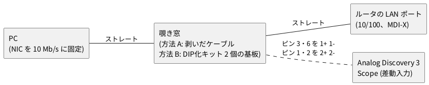

# 5-1 リンクパルスを見る — 使わなくなったルータの 10BASE-T の対をオシロで見る

> [!WARNING]
> **この工作 (5 章 ethernet-10base-t) は、まだ実機で測っていない。** 波形の図と数値は規格 (IEEE 802.3) の値から計算で作ったもので、手元のルータと PC で同じに見えるかは確かめていない。測ったら WaveForms の CSV を題の隣に置いて `data:` で重ねる。

この題で作るのは、ルータと PC の間の線に触れるための「覗き窓」だけで、回路は無い。作り方は 2 つある。短い LAN ケーブルの途中の被覆を剥ぐ方法 (方法 A、基板なし) と、秋月の LAN コネクターDIP化キットを 2 個使ってユニバーサル基板に組む方法 (方法 B)。方法 B の基板図を「つなぎ方」に付けた。

## この章の意図

ネットワークは「ケーブルに流れる電圧」で、回路と地続きだ。この章は、使わなくなったルータの
LAN ポートを相手に、10 Mb/s のイーサネット (10BASE-T) をディスクリート部品と Raspberry Pi Pico 2 で
送受し、最後は PC の `ping` に答えるまでを 6 題で組む。

| 題 | やること | 組む物 |
| --- | --- | --- |
| 5-1 (この題) | ルータと PC の間の対にオシロを掛け、リンクパルスとフレームの波形を見る | 覗き窓 (剥いだケーブルか DIP化キット) |
| 5-2 | Pico 2 の PIO と抵抗だけでリンクパルスとフレームを送り、ルータにリンクさせる | 送信回路 |
| 5-3 | 100 Ω (オーム) 終端と 74HC14 で差動を 3.3 V の論理に戻し、ロジアナで読む | 受信回路 |
| 5-4 | マンチェスターを PIO で復号し、MAC と IP のヘッダを USB シリアルに出す | 受信のプログラム |
| 5-5 | ARP と ping に答える。応答までの時間をオシロで測る | 最小の IP 処理 |
| 5-6 | トランス内蔵の RJ45 に差し替えて絶縁し、波形の違いを比べる | パルストランス |

10BASE-T を選ぶのは、信号が 10 MHz までで教科書のオシロ (Analog Discovery 3) に入り、
マイコンの PIO で作れる最後の世代のイーサネットだからだ。100BASE-TX は 125 MHz の
MLT-3 で、どちらも教科書の範囲を超える。

この題では**何も組まない**。ルータと PC が出している信号に触れて、次の題から自分で作る物
(100 ns のパルス、5 MHz のプリアンブル、フレームの長さ) を先に目で見ておく。

## 10BASE-T の信号

| 項目 | 値 |
| --- | --- |
| 速さ | 10 Mb/s (1 ビット 100 ns) |
| 符号 | マンチェスター。1 ビットの中央で必ず電圧が変わる。1 は低→高、0 は高→低 |
| 線 | ツイストペア 2 対 (送りと受けで別の対)。特性インピーダンス 100 Ω |
| 振幅 | 差動で 2.2〜2.8 V<sub>p</sub> (100 Ω の負荷で) |
| 絶縁 | 両端にパルストランス。対は直流的に浮いている |
| リンクパルス | 送る物が無いとき 16 ms ごとに幅 100 ns の正のパルス (相手に「線がつながっている」と知らせる) |
| ピン | 端末 (PC、MDI) は 1・2 で送り 3・6 で受ける。ハブやルータの LAN ポート (MDI-X) は逆に 3・6 で送り 1・2 で受ける |

マンチェスター符号は、クロックをデータに埋め込む符号だ。受け手はビットの中央の変わり目から
クロックを取り戻せるので、別にクロックの線を引かなくてよい。代わりに、線の上の変わり目は
ビットの速さの 2 倍 (最大 20 M 回/秒) になる。

```logic
# ロジックアナライザの画面 (tommie-fence の logic フェンス)
title: 図1 マンチェスター符号 — 1 はビットの中央で立ち上がり、0 は立ち下がり
device: generic
time: 100ns/div
signals:
  BIT:  clock 10MHz
  DATA: pattern 1010101011 bit 100ns
  TX:   pattern 01100110011001100101 bit 50ns
cursors: [850ns, 950ns]
```


図1 は符号の説明の図で、計器の画面ではない (BIT はビットの区切りを示す 10 MHz、DATA は送るビット、
TX が線の上の電圧の高低)。DATA の `1010101011` はプリアンブルの終わりと SFD (後述) の終わりで、
`…1010` の間は TX が 5 MHz の方形波になり、最後の `11` で変わり目の間隔が 50 ns に詰まる。
カーソルは最後の `11` の 2 ビットの真ん中に置いた (X1 850 ns・X2 950 ns、ΔX = 100 ns = 1 ビット)。
実際の線の上では、高が +2.5 V・低が −2.5 V の差動電圧になる。

フレームの前には、受け手がクロックを合わせるためのプリアンブル (`10101010` × 7 バイト = 56 ビット、
5.6 µs) と SFD (Start Frame Delimiter、`10101011`、0.8 µs) が付く。

## 用意する物

| 物 | 数 | 備考 |
| --- | --- | --- |
| 使わなくなったルータ | 1 | LAN ポートが 10/100 Mb/s (10BASE-T に対応) の物。WAN ポートは使わない |
| PC | 1 | 有線 LAN。NIC の速さを 10 Mb/s に固定できる物 (下記) |
| LAN ケーブル (ストレート) | 2 | 短い物 (1 m 程度)。カテゴリは 5 以上なら何でもよい。方法 A ではもう 1 本、途中を剥ぐ短い物 (30 cm 程度) を使う |
| 秋月 LAN コネクターDIP化キット (105404) | 方法 B で 2 個 | 下記。この章の 5-2 以降でも 1 個使う |
| Analog Discovery 3 | 1 | **BNC アダプタ基板**と BNC のプローブ (下記) |

### 使う部品: 秋月の LAN コネクターDIP化キット

この章は、RJ45 のジャックを **LAN コネクターDIP化キット** ([秋月電子通商 105404](https://akizukidenshi.com/catalog/g/g105404/)、型番 AE-RJ-45-LAN-DIP-A-KIT、200 円) に載せて使う。
8 本のピンを 2.54 mm ピッチの 1 列に出すので、ユニバーサル基板やブレッドボードにそのまま挿せる。

| 項目 | 内容 (商品ページとデータシートによる) |
| --- | --- |
| セット内容 | 変換基板 1 枚、RJ45 LAN コネクタ 1 個、1×10 の細ピンヘッダ 1 本 (8 本だけ使う。切って使える) |
| 変換基板の大きさ | 25.36 × 15 mm。ピンヘッダの穴は 2.54 mm ピッチの 1 列 |
| 規格 | 10/100 Base-T。パルストランスは入っていない (素の信号が出る) |
| 半田付け | 変換基板にコネクタとピンヘッダを半田付けして組み立てる |
| 通販 | 1 回 2 セットまで。在庫僅少の表示だった (2026-10 に商品ページで確認) |

組み立てたら、**ピンヘッダの 8 本とジャックの 8 本の対応を、テスターの導通で確かめる**。ストレートケーブルを挿し、
ケーブルの反対側のプラグのピン (ツメを下にして左から 1〜8 番) とヘッダの各ピンの導通を見る。
データシート ([AE-RJ-45-LAN-DIP-A.pdf](https://akizukidenshi.com/goodsaffix/AE-RJ-45-LAN-DIP-A.pdf)) は基板のパターン図だけで、ピンの番号は書かれていない。
この章はヘッダの 1〜8 番がジャックの 1〜8 番に一対一で対応するとして描く。違えば図のピンを読み替える。
商品写真では、ジャックはキットの基板の上に載り、2.54 mm のヘッダ (CN2) は基板の一辺の縁に 1 列で出ている。
ユニバーサル基板に挿すときは、キットの基板が縁から外へ張り出す向き (ジャックの口が外を向く) にする。
反対のピッチ 1.27 mm の列 (CN1) は使わない。

5-6 で使うパルストランス内蔵の [パルストランス内蔵モジュラージャックDIP化キット (109374)](https://akizukidenshi.com/catalog/g/g109374/) は、その題で紹介する。

ルータの LAN 側は、PC とルータのスイッチをまたいで 1 つのネットワークになる。ルータの DHCP が
PC に番地を配るので、設定は要らない。PC からルータの番地 (多くは 192.168.0.1 か 192.168.1.1) に
`ping` を打つと、ケーブルにフレームが流れる。

## つなぎ方




PC とルータの間に覗き窓を挟み、ルータから PC へ向かう対 (ピン 3・6) にオシロの ch1、PC からルータへ向かう対
(ピン 1・2) に ch2 を掛ける。10BASE-T と 100BASE-TX が使う線は、この 4 本だけ (ピン 4・5・7・8 は使わない)。

```circuit
# 回路図 (tommie-fence の circuit フェンス)
title: 図2 10BASE-T の 2 対にオシロを掛ける (覗き窓で線に触れる)
parts:
  J1:
    type: device
    at: 1,3
    label: Router
    pins: [RX+, RX-, TX+, TX-]
    turn: mirror
  J2:
    type: device
    at: 11,3
    label: PC
    pins: [TX+, TX-, RX+, RX-]
  SC:
    type: device
    at: 6.5,7
    label: AD3
    pins: [1+, 1-, 2+, 2-]
    turn: r90
wires:
  - J1.RX+ -- 6.38,2.75 -- J2.TX+
  - J1.RX- -- 6.13,3 -- J2.TX-
  - J1.TX+ -- 6.88,3.25 -- J2.RX+
  - J1.TX- -- 6.63,3.5 -- J2.RX-
  - SC.1+ |- 6.88,3.25
  - SC.1- |- 6.63,3.5
  - SC.2+ |- 6.38,2.75
  - SC.2- |- 6.13,3
notes:
  - box 4.5,2 8.5,4 ink
  - text 6.5,1.45 small: 覗き窓 (方法 A のケーブル、方法 B の基板)
  - text 1,2.3 small left: ピン 1・2 (PC からルータへ)
  - text 1,3.9 small left: ピン 3・6 (ルータから PC へ)
```


### 方法 A: 短い LAN ケーブルの途中を剥ぐ (おすすめ)

半田付けが要らず、数分でできる。ケーブルが 1 本だめになるので、捨てて構わない短い物 (30 cm 程度) を使う。

1. ケーブルの真ん中で外側の被覆を 20〜30 mm だけカッターで裂く。**中の線の被覆を切らない**ように、刃を浅く入れて一周させ、被覆を抜き取る
2. 4 対の撚り線が出る。ストレートケーブルは両端で同じ色の線がピンの同じ番号につながっている。ピン 3・6 が 1 対、ピン 1・2 がもう 1 対
3. 色は規格で決まる。T568B (多くのケーブル) では、ピン 1・2 が橙の対 (白橙・橙)、ピン 3・6 が緑の対 (白緑・緑)。T568A ではこの 2 対の色が入れ替わる。**色を信じず、ケーブルの端のプラグで番号を数えて、同じ色の線を選ぶ**
4. 4 本の線 (橙の対 2 本と緑の対 2 本) を、撚りを少しだけほどいて、被覆を 3 mm 剥く。導体を切らないよう、ワイヤストリッパの穴は線より少し大きい物を選ぶ
5. 剥いた所に、細いリード線を半田付けするか、ミニクリップで挟む。**半田付けの方が確実**で、ほかの線に触れても短絡しにくい。付けたら絶縁テープで巻く
6. オシロの 1+ を白緑か緑の線 (ピン 3)、1− を もう一方 (ピン 6) に。2+・2− も橙の対に同じように付ける

線の撚りをほどく長さは 1 cm 以内にする。長くほどくと、100 Ω の特性インピーダンスが崩れて波形が乱れる。10 Mb/s では大きな影響はないが、
5-2 以降で測る値を 5-1 と比べるときは、この乱れが入っていることを頭に置く。

### 方法 B: DIP化キット 2 個でブレークアウト基板を作る

何度でも使え、短絡の心配がない。ただし 2 個のジャックは向きが逆になるので、**ピン 1・2・3・6 の 4 本が基板の上で交差する**
(ジャックを基板の左右の縁に向かい合わせに置くと、ピンの並びが上下で逆になるため)。交差は被覆線で跨ぐ。
ピン 4・5・7・8 は使わないので渡さない。

```perf
# ユニバーサル基板の実体配線図 (tommie-fence の perf フェンス)
title: 図3 DIP化キット 2 個のブレークアウト (7×5 cm 横置き、部品面)
board:
  size: 7x5cm
  silk: board
  h: 1.6mm
  material: FR-4
  slots: on
parts:
  J1: sip8 a18 r90 105404
  J2: sip8 x11 r270 105404
wires:
  - a18 -- h18 white
  - h18 -- h11 white
  - h11 -- u11 white
  - u11 -- x11 white
  - a17 -- j17 green
  - j17 -- j12 green
  - j12 -- u12 green
  - u12 -- x12 green
  - a16 -- l16 yellow
  - l16 -- l13 yellow
  - l13 -- u13 yellow
  - u13 -- x13 yellow
  - a13 -- n13 blue
  - n13 -- n16 blue
  - n16 -- u16 blue
  - u16 -- x16 blue
notes:
  - mark u13 yellow
  - mark u16 blue
  - mark u11 white
  - mark u12 green
  - text l-1 black: 黄の丸 (U13) はオシロの 1+ (ピン 3)、青の丸 (U16) は 1- (ピン 6)
  - text l-2 black: 白の丸 (U11) はオシロの 2+ (ピン 1)、緑の丸 (U12) は 2- (ピン 2)
unused: [J1.P4, J1.P5, J1.P7, J1.P8, J2.P4, J2.P5, J2.P7, J2.P8]
```


- 7×5 cm のユニバーサル基板 (24 列 × 18 行) を横に置き、**J1 (ルータ側) を左の縁の A 列、J2 (PC 側) を右の縁の X 列**に、
  ヘッダの 8 本を挿す。J1 は上からピン 1〜8 (P1〜P8)、J2 は 180° 回した向きなので下からピン 1〜8。図のとおり、
  キットの基板とジャックがユニバーサル基板の縁から外へ張り出す向き (ジャックの口が外を向く) に挿す。
  ジャックが基板の上に被さらないので、基板の穴の上には何も載らない
- 渡す線は 4 本 (白 = ピン 1、緑 = ピン 2、黄 = ピン 3、青 = ピン 6)。横の線は基板の縁の穴から、縦の線は H・J・L・N 列で
  向きを変える。**線が交わる所は、半円で跨いでいる (被覆線にする)**。裸の線どうしを重ねると短絡する
- オシロは U 列の 4 つの丸に当てる。黄が 1+ (ピン 3、ルータから PC)、青が 1− (ピン 6)、白が 2+ (ピン 1、PC からルータ)、緑が 2− (ピン 2)。
  ミニクリップで挟むか、細い線を半田付けする。対の 2 本は撚って、短く
- 信号は 10 MHz までで、ユニバーサル基板の範囲 (10 MHz 以下、短い配線) に収まる。渡す線は 5 cm ほどで、
  100 Ω の対の中に 1 か所だけインピーダンスの乱れが入るが、10BASE-T の 100 ns のビットには影響しない
  (100BASE-TX 以上では、この作りは使えない)

## PC の NIC を 10 Mb/s にする

今の NIC は 1000BASE-T でつながろうとするので、PC 側で 10 Mb/s に固定する。ルータの LAN ポートは
相手に合わせて 10BASE-T に落ちる。

Linux (`ethtool`):

```bash
sudo ethtool -s enp3s0 advertise 0x002   # 10BASE-T 全二重だけを申し出る (0x001 なら半二重)
ethtool enp3s0 | grep -E 'Speed|Duplex'  # Speed: 10Mb/s になったことを確かめる
sudo ethtool -s enp3s0 advertise 0x0ff   # 戻すとき (元の値は事前に ethtool enp3s0 で控える)
```

Windows は、デバイスマネージャーで NIC の「詳細設定」を開き、「速度とデュプレックス (Speed & Duplex)」を
「10 Mbps 全二重 (10 Mbps Full Duplex)」にする。

`advertise` で絞る方式は自動ネゴシエーション (FLP、後述) を残したまま 10 Mb/s にするので、
全二重でつながる。`autoneg off` で固定すると PC はリンクパルス (NLP) だけを出し、ルータは
並列検出で 10BASE-T **半二重**にする。ping には半二重でも支障ない。

USB の NIC には 10 Mb/s を選べない物がある。選べない PC では、5-2 で作る Pico 2 の送信回路を相手にする。

## 見えるはずの信号

ケーブルを順につないでいくと、3 つの段階が見える。

### 段階 1: リンクが無いとき — FLP バースト

ルータに覗き窓だけをつなぎ、PC はまだつながない。ルータの LAN ポートは相手を探して
**FLP (Fast Link Pulse) バースト**を 16 ms ごとに出す。1 バーストは幅 100 ns のパルス 17〜33 発で、
125 µs ごとの「クロックパルス」の間に、送りたいビットが 1 のときだけ「データパルス」(クロックの
62.5 µs 後) が入る。16 ビットで「自分は 10/100 の全二重・半二重ができる」と相手に伝える
(自動ネゴシエーション)。

```scope
# オシロスコープの画面 (tommie-fence の scope フェンス)
title: 図3 FLP バースト — 125 µs ごとのクロックパルス (ch1 = ルータからの対)
time: 20us/div
trigger: ch1 rising 1.25V at -4div
ch1: pulse 8kHz 1.25V offset 1.25V duty 0.08%
cursors: [0, 125us]
measure: [vmax, period]
```


図3 はクロックパルスだけを描いた (データパルスはビットが 1 の所にだけ、2 本の真ん中 62.5 µs に出る)。
時間軸を 500 µs/div にすると 1 バースト (2 ms ほど) が入り、20 ms/div にすると 16 ms ごとの
バーストの繰り返しが見える。ただし、どちらも 1 画面の標本の間隔が 100 ns より粗くなるので、
WaveForms の Scope のチャネルの設定で Filter を **MinMax** にする (間引きで落ちるパルスを拾う)。

### 段階 2: リンクが上がったとき — NLP

PC を 10 Mb/s にしてからつなぐ。両方が FLP を交わして 10BASE-T の全二重で合意すると、ルータの
ポートの LED が点く。合意のあとは FLP をやめ、送る物が無い間は **NLP (Normal Link Pulse)** を
16 ms (8〜24 ms) ごとに出す。NLP は幅 100 ns の正のパルス 1 発で、FLP の 1 発と同じ形だ。
ch1 (ルータの送り) と ch2 (PC の送り) のどちらにも、独立に出る。

```scope
# オシロスコープの画面 (tommie-fence の scope フェンス)
title: 図4 NLP 1 発 — 幅 100 ns、振幅 2.5 V
time: 100ns/div
trigger: ch1 rising 1.25V at -3div
ch1: pulse 62.5Hz 1.25V offset 1.25V duty 0.000625%
cursors: [0, 100ns]
measure: [vmax, vmin]
```


図4 の `pulse 62.5Hz` は 16 ms ごとの繰り返しで、1 画面 (1 µs) には 1 発だけが入る。
実物のパルスは角が丸く、立ち下がりのあとに小さく負に振れてから 0 V に戻る (トランスの応答)。
規格の型枠は幅 60〜200 ns、振幅は 2.2〜2.8 V<sub>p</sub> を許す。

### 段階 3: フレーム — プリアンブルとマンチェスター

PC からルータに `ping` を打つ。ch2 (PC の送り) に要求のフレーム、少し遅れて ch1 (ルータの送り) に
応答のフレームが出る。フレームの先頭はプリアンブルで、`1010…` のマンチェスターは
**5 MHz の方形波** (±2.5 V) に見える。

```scope
# オシロスコープの画面 (tommie-fence の scope フェンス)
title: 図5 プリアンブル — 1010… のマンチェスターは 5 MHz の方形波
time: 100ns/div
trigger: ch1 rising 0V
ch1: square 5MHz 2.5V
cursors: [0, 200ns]
measure: [vpp, freq]
```


プリアンブルのあと (SFD の最後の `11` から) はデータに応じて変わり目の間隔が 50 ns と 100 ns で
混ざり、方形波には見えなくなる。フレームの終わりは正側に 250 ns 以上とどまってから 0 V に戻る
(TP_IDL、アイドルの始まり)。次のフレームまでは少なくとも 9.6 µs (96 ビット分) 空く。

ping のフレームの長さは OS で違う。Linux の `ping` はデータ 56 バイトで、ICMP 64 + IP 20 + Ethernet 14 +
FCS 4 = 102 バイト。線の上ではプリアンブルと SFD の 8 バイトが付いて 110 バイト = 880 ビット = **88.0 µs**。
Windows はデータ 32 バイトで 86 バイト = **68.8 µs**。時間軸を 10 µs/div にすると 1 フレームが 9 目盛に入る。

ルータは ping を打たなくても、ARP の問い合わせや mDNS などのブロードキャストを時々流す。
ch1 に ping と無関係のフレームが出たらそれで、次の題で Pico 2 が受ける信号の予行になる。

## 計器の設定

計器は Analog Discovery 3 の Scope (BNC アダプタ基板)。信号が 10 MHz までなので、帯域 30 MHz 以上の
BNC アダプタ基板で足りる。125 MS/s で標本の間隔は 8 ns、幅 100 ns のパルスが 12 点で描ける。

| 項目 | 設定 |
| --- | --- |
| ch1 | 1+ をピン 3、1− をピン 6 (ルータの送り)。500 mV/div、0 V を下から 1 目盛 |
| ch2 | 2+ をピン 1、2− をピン 2 (PC の送り)。ch1 と同じ |
| トリガ | Normal、ch1 立ち上がり 1.25 V (パルスとプリアンブルのどちらにも掛かる)。段階 3 で PC の送りを見るときは ch2 |
| 時間軸 | 図4 は 100 ns/div、図3 は 20 µs/div (バースト全体は 500 µs/div)、図5 は 100 ns/div、1 フレームは 10 µs/div |
| Filter | 500 µs/div より遅い時間軸では MinMax (細いパルスを間引きで落とさない) |

## 見るべき値

| 何を | 値 | 根拠 |
| --- | --- | --- |
| NLP の幅 (図4 の ΔX) | 100 ns (型枠は 60〜200 ns) | IEEE 802.3 14.3.1.2.1 |
| NLP の間隔 | 16 ms (8〜24 ms) | 同 14.2.1.1 |
| パルスの高さ (図4 の Vmax) | 2.5 V (2.2〜2.8 V) | 同 14.3.1.2.1 (100 Ω 負荷) |
| FLP のクロックパルスの間隔 (図3 の ΔX) | 125 µs (±14 µs)。データパルスはその 62.5 µs 後 | 同 28.2.1.1.2 |
| FLP の 1 バースト | 17〜33 発、2 ms ほど。16 ms ごと | 同 28.2.1.1.2 |
| プリアンブルの周波数 (図5 の Freq) | 5 MHz (ビット 100 ns、`1010…`)。Vpp は 5 V | 同 7.2.3.2・14.3.1.2.1 |
| プリアンブルと SFD の長さ | 8 バイト = 6.4 µs | 同 7.2.3.2・7.2.3.3 |
| ping 1 フレーム (線の上) | Linux 88.0 µs / Windows 68.8 µs | 上の計算 |
| フレームの間 | 9.6 µs 以上 (IFG) | 同 4.2.3.2.2 |

数は規格の値で、手元のルータと PC で**同じに見えるかは測って確かめる**。振幅はケーブルが長いほど下がる
(100 m で半分ほど)。NLP の間隔は機器ごとに 8〜24 ms の中の決まった値を取る。

## LTspice での確かめ

ルータと PC が出す信号を見るだけの題で、計算する回路が無い。この題は SPICE の対象外。数値は
IEEE 802.3 の値とビット数からの算術で、上の表に根拠の節を書いた。

## 出典

- [IEEE 802.3-2022](https://ieeexplore.ieee.org/document/9844436) — Clause 14 (10BASE-T。14.2.1.1 リンクパルスの間隔、14.3.1.2.1 出力の振幅と型枠)、Clause 28 (Auto-Negotiation。28.2.1.1.2 FLP バーストの時間)、Clause 4 (4.2.3.2.2 IFG)、Clause 7 (7.2.3.2 プリアンブル・7.2.3.3 SFD)。IEEE の GET Program で無料で読める
- [Ethernet over twisted pair — Wikipedia (英語)](https://en.wikipedia.org/wiki/Ethernet_over_twisted_pair) — ピン配置 (MDI と MDI-X) とリンクパルスの概要
- [秋月電子通商 LAN コネクターDIP化キット (105404)](https://akizukidenshi.com/catalog/g/g105404/) と [基板図 AE-RJ-45-LAN-DIP-A.pdf](https://akizukidenshi.com/goodsaffix/AE-RJ-45-LAN-DIP-A.pdf) — 部品の仕様・大きさ・価格
- [Autonegotiation — Wikipedia (英語)](https://en.wikipedia.org/wiki/Autonegotiation) — FLP バーストの構成 (17〜33 パルス、125 µs と 62.5 µs)
- [Manchester code — Wikipedia (英語)](https://en.wikipedia.org/wiki/Manchester_code) — IEEE 802.3 の符号の向き (1 は低→高)
