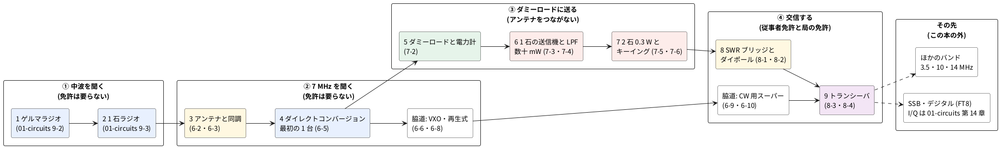
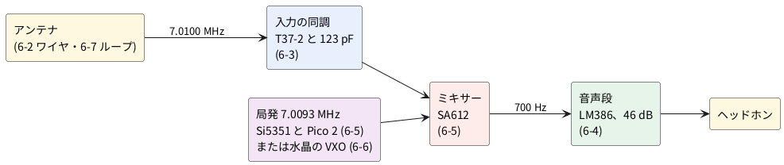
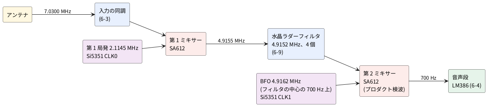

# 6-1 7 MHz の CW 受信機のブロック図 — 前提知識と、中波から変わること

> [!WARNING]
> **この工作 (6 章 ham-receiver) は、まだ実際の回路で検証していない。** 回路図・実体配線図・数値 (同調の値、利得、帯域、波形、スペクトルなど) は、
> 計算とシミュレーションと見積りで作ったもので、正しく動くかどうかは確実ではない。組むときは、自分で確かめながら進めてほしい。

この題は実体配線図・Analog Discovery 3・オシロの図を付けない — ブロック図と道順だけの題で、組む回路が無い (回路と波形は 6-2 から)。

第 6〜8 章は、アマチュア無線の **7 MHz 帯の CW (モールス符号の電信)** を、自分で作った機械で聞き、送るまでの工作だ。
この第 6 章は**受信機**で、いちばん作りやすい物から順に並べる。第 7 章が送信機、第 8 章がアンテナと仕上げ (まだ書いていない)。
受信だけなら免許は要らない。この章の回路は電波を出さない。

## 道のり — 中波ラジオからトランシーバまで

アマチュア無線の自作を、作りやすい物から順に 4 つの段階に分ける。段階の区切りは回路の難しさではなく、
**電波を出すか**と**免許が要るか**に置いた。①②は聞くだけ、③はアンテナをつながずダミーロード (50 Ω の抵抗) に送るだけ、
④で初めてアンテナから電波を出す。終点は受信機と送信機を 1 枚にしたトランシーバ (8-4) で、その先はこの本では扱わない。




箱の頭の数字 (1〜9) が本筋の作る順。白い箱は脇道で、組まなくても先へ進める。
送信の決まり (免許・保証認定・スプリアス) は 7-1 で扱う (第 7・8 章はまだ書いていない)。

**難しさは、次の 6 つのうち当てはまる数で数える** (0〜6 点)。書き手の感覚ではなく、題を見れば誰でも同じ点になる物を選んだ。

| 記号 | 当てはまると 1 点 | 難しくなる理由 |
| --- | --- | --- |
| A | 3 MHz を超える | ブレッドボードが使えず、ユニバーサル基板に短い線で組む |
| B | 計器で合わせる所がある | 同調・帯域・バイアスを、測りながら追い込む |
| C | tinySA Ultra か LiteVNA64 が要る | Analog Discovery 3 だけでは確かめられない |
| D | 2 つ以上のユニットを合わせる | 動かないときに疑う所が増える |
| E | 0.1 W 以上を扱う | 発熱、高調波、石を壊す負荷の外れ |
| F | 能動素子がある | 電源とバイアスが要り、発振することがある |

| 順 | 作る物 | 題 | A | B | C | D | E | F | 点 |
| --- | --- | --- | --- | --- | --- | --- | --- | --- | --- |
| 1 | ゲルマラジオ | [01-circuits 9-2](../../01-circuits/09-rf/02-crystal-radio.md) | | | | | | | 0 |
| 2 | 1 石ラジオ | [01-circuits 9-3](../../01-circuits/09-rf/03-one-transistor-radio.md) | | | | | | ○ | 1 |
| 3 | アンテナと同調 | [6-2](02-wire-antenna.md)・[6-3](03-input-tuning.md) | ○ | ○ | ○ | | | | 3 |
| 4 | ダイレクトコンバージョン受信機 | [6-5](05-direct-conversion.md) | ○ | | | ○ | | ○ | 3 |
| 5 | ダミーロードと電力計 | 7-2 | ○ | | ○ | | | | 2 |
| 6 | 1 石の送信機とローパスフィルタ | 7-3・7-4 | ○ | ○ | ○ | | | ○ | 4 |
| 7 | 2 石 0.3 W とキーイング | 7-5・7-6 | ○ | ○ | ○ | | ○ | ○ | 5 |
| 8 | SWR ブリッジとダイポール | 8-1・8-2 | ○ | ○ | ○ | | | | 3 |
| 9 | トランシーバ | 8-3・8-4 | ○ | ○ | ○ | ○ | ○ | ○ | 6 |

5 番から先の点は、まだ書いていない題の計画から付けた見込み。題を書いたら付け直す。

```graph
# グラフ (tommie-fence の graph フェンス)
title: 作る順と難しさ — 測る道具を作る題 (5・8) で一度下がる
x: 作る順 番 1..9
y:
  - 難しさ 点 0..6
lines:
  難しさ 点:
    - 1 0: ゲルマラジオ
    - 2 1: 1 石ラジオ
    - 3 3: アンテナと同調
    - 4 3: 最初の 1 台
    - 5 2: ダミーロード
    - 6 4: 1 石の送信機
    - 7 5: 2 石 0.3 W
    - 8 3: SWR ブリッジ
    - 9 6: トランシーバ
```


- **いちばん大きい段差は 2 → 3** (中波から 7 MHz へ)。基板と計器が一度に替わる。3 を単独の題にして、同調回路だけを LiteVNA64 で合わせる練習に充ててある
- **4 (最初の 1 台) は 3 と同じ点**。3 で同調を済ませてあるので、足すのは IC と局発だけになる
- **5 と 8 で点が下がる**。ダミーロード・電力計・SWR ブリッジは受動部品だけの測る道具で、次の題 (6・9) を確かめるのに使う

## 前提知識

この章は、次の題を読んで (できれば組んで) いることを前提にする。同じ説明は繰り返さず、題を指す。
**太字**は、読んでいないとこの章の回路が追えない題。

| 何を知っているか | 題 | この章で使う所 |
| --- | --- | --- |
| LC の共振と Q | **[01-circuits 9-1 LC 同調](../../01-circuits/09-rf/01-lc-resonance.md)**・[9-32 共振の電流の波](../../01-circuits/09-rf/32-lc-resonance-phase.md) | 入力の同調回路 (6-3)、スモールループ (6-7) |
| 同調と検波で放送を聞く | **[01-circuits 9-2 ゲルマラジオ](../../01-circuits/09-rf/02-crystal-radio.md)**・[9-3 1 石ラジオ](../../01-circuits/09-rf/03-one-transistor-radio.md) | 章の全体。中波で「必ず聞こえる 1 台」を先に作っておく |
| 周波数を混ぜて差を取り出す (ミキサー) | **[01-circuits 9-12 バランスドミキサー](../../01-circuits/09-rf/12-balanced-mixer.md)**・[05-etc 3-1 1 石ミキサー](../03-mixer-2sc1815/01-mixer.md) | SA612 のミキサー (6-5・6-10) |
| スーパーヘテロダインと中間周波 (IF) | [01-circuits 9-10 スーパーヘテロダイン](../../01-circuits/09-rf/10-superheterodyne.md) | CW 用スーパーヘテロダイン (6-10) |
| 直接変換 (信号のすぐ脇の局発で、いきなり音にする) | [01-circuits 14-5 Tayloe 検波器](../../01-circuits/14-iq/05-tayloe-detector.md) | ダイレクトコンバージョン受信機 (6-5) |
| 水晶発振とコルピッツ発振 | **[01-circuits 3-5 水晶発振](../../01-circuits/03-oscillators/05-crystal-oscillator.md)**・[3-10 コルピッツ発振](../../01-circuits/03-oscillators/10-colpitts.md) | 水晶の VXO (6-6)、再生式 (6-8) |
| マイコンから周波数を数値で決める | **[01-circuits 9-16 DDS モジュール](../../01-circuits/09-rf/16-dds-sdr-module.md)**・[11-5 I2C](../../01-circuits/11-microcontrollers/05-i2c-temperature.md) | Si5351 と Pico 2 の局発 (6-5・6-10) |
| LM386 の使い方 | [01-circuits 12-6 インターホン (LM386)](../../01-circuits/12-projects/06-intercom-lm386.md) | 音声段 (6-4) |
| コイルを自分で巻く | [01-circuits 6-3 自作トランス](../../01-circuits/06-transformers/03-diy-transformer.md)・[03-nanovna 4-14 トロイダルコアの材質](../../03-nanovna/04-components/14-toroid-materials.md) | T37-2 に巻く同調コイル (6-3) |
| NanoVNA の校正と、SWR・S21 の読み方 | **[03-nanovna 1-1 SOLT 校正](../../03-nanovna/01-calibration/01-solt.md)**・[7-1 SWR とインピーダンスの読み方](../../03-nanovna/07-antennas/01-swr-impedance-reading.md) | 同調回路 (6-3)、ループ (6-7)、ラダーフィルタ (6-9) |
| 水晶を NanoVNA で測る | [03-nanovna 4-6 水晶](../../03-nanovna/04-components/06-crystal.md) ・[6-7 水晶ラダーフィルタ (3 個)](../../03-nanovna/06-filters/07-crystal-ladder.md) | VXO (6-6)、ラダーフィルタ (6-9) |
| tinySA の中心・幅・RBW | [03-nanovna 11-2 中心・スパン・RBW](../../03-nanovna/11-spectrum-analyzer/02-center-span-rbw.md) | アンテナの確かめ (6-2・6-7) |
| アンテナをつなぐ前に放電する | **[03-nanovna 0-4 静電気とアンテナの帯電](../../03-nanovna/00-tools/04-esd-antenna-discharge.md)** | 6-2 から先、アンテナを計器や受信機につなぐ全部の題 |
| バーアンテナとループの向き (ヌル) | [05-etc 2-12 アンテナの比較](../02-radio-clock/12-antenna-compare.md)・[03-nanovna 7-7 ループアンテナ](../../03-nanovna/07-antennas/07-loop-antenna.md) | スモールループ (6-7) |

モールス符号そのもの (符号を耳で読む練習) は、この教科書では扱わない。CW が聞こえても読めなくて構わない —
「ピー」という 700 Hz の音が断続して聞こえれば、受信機は働いている。

## なぜ 7 MHz の CW か

- **CW は受信機も送信機もいちばん簡単**。搬送波を入れたり切ったりするだけなので、音声の変調も復調も要らない。受信側は「信号のすぐ脇の周波数を混ぜて、差を音にする」だけで済む
- **7 MHz は 1 日じゅう国内のどこかが聞こえる**。昼は数百 km、夜は遠くまで届く。局の数も多い
- **すぐ上に強い試験信号がある**。7.2〜7.45 MHz は短波放送の 41 m バンドで、強い AM の放送局が並ぶ。アマチュアの CW が聞こえないとき、受信機が働いているかを放送で確かめられる
- **ユニバーサル基板に組める**。7 MHz は、この教科書のユニバーサル基板の範囲 (10 MHz 以下・短い配線・単純な回路。[01-circuits の README](../../01-circuits/README.md)) の内側にある

日本の 7 MHz 帯は 7.000〜7.200 MHz で、下の 7.000〜7.030 MHz が CW だけの区分 (JARL のバンドプラン)。CW はその上でも出てよいが、多くはこの 30 kHz に集まる。

| 周波数 | 何が聞こえるか | この章での使い方 |
| --- | --- | --- |
| 7.000〜7.030 MHz | アマチュア無線の CW | 聞く目的の信号 |
| 7.030〜7.200 MHz | アマチュア無線の SSB (音声)・デジタル・CW | 6-5 の受信機なら SSB も聞ける |
| 7.200〜7.450 MHz | 短波放送 (AM) | 受信機とアンテナが働いているかの確かめ |

## 中波から変わること

中波 (1 MHz) のラジオを作った経験は、そのまま役に立つ。変わるのは次の所。

| 項目 | 中波 (01-circuits 第 9 章) | 7 MHz (この章) |
| --- | --- | --- |
| 波長 | 300 m (1 MHz) | 42 m (7.1 MHz)。1/4 波長は 約 10.6 m |
| 基板 | ブレッドボード (3 MHz 以下) | ユニバーサル基板。7 MHz の通る線は短く、GND は太く |
| 同調コイル | フェライトのバーアンテナ (数百 µH (マイクロヘンリー)) | トロイダルコア T37-2 に手巻き (約 4 µH) |
| 浮遊容量 5 pF の重み | 同調容量 200 pF 級に対して小さい | 同調容量 120 pF 級の 4 % で、周波数が 2 % (約 140 kHz) 動く。トリマで合わせる |
| アンテナ | バーアンテナだけで足りる | 外に線が要る。ワイヤ 5 m (6-2) か同調式のループ (6-7) |
| 検波 | 包絡線検波 (ダイオード) | 局発と混ぜて差を音にする (ミキサー)。CW は包絡線検波では「ブツブツ」としか聞こえない |
| 周波数の安定 | 放送の帯域 (±7.5 kHz) に入っていればよい | 100 Hz 動くと音の高さが 100 Hz 変わる。局発は水晶か、水晶を基準にした PLL |
| 信号の強さ | 放送局は mV 級 | アマチュア局は µV 級。雑音の床は受信機ではなく、アンテナが拾う雑音で決まる |
| 計器 | Analog Discovery 3 | 音声と電源は AD3、7 MHz は tinySA Ultra と LiteVNA64。AD3 の信号発生器は 7 MHz の試験信号に使える |

## 2 つの受信機

この章で作る受信機は、原理で 2 つに分かれる。

**ダイレクトコンバージョン (6-5)**: 信号の 700 Hz 脇に局発を置き、混ぜた差 (700 Hz) をそのまま音声増幅する。
ブロックは 4 つで、IC は 2 個 (局発を除く)。弱点は、局発の上 700 Hz と下 700 Hz の信号が同じ音になること (逆サイド)。




**スーパーヘテロダイン (6-10)**: いったん中間周波 (4.9152 MHz の水晶で作るフィルタの中心、4.9155 MHz) に変え、帯域 460 Hz ほどの水晶ラダーフィルタ (6-9) に通してから、
もう一度混ぜて音にする。フィルタが逆サイドを落とすので、1 つの信号は 1 か所でしか聞こえない。IC は 3 個 (局発を除く)。




**再生式 (6-8)** は別の系統で、1 石の検波回路に正帰還を掛けて感度と選択度を稼ぐ。部品はいちばん少ないが、調整に慣れが要る。

## 進む順

題は作りやすい順に並べてある。6-5 までが最初の 1 台で、6-6 から先は好きな題だけ組めばよい。

| 題 | 作る物 | 基板 | 新しく要る計器 |
| --- | --- | --- | --- |
| [6-2 最初のアンテナ](02-wire-antenna.md) | 室内のワイヤ 5 m とカウンターポイズ | — | tinySA Ultra |
| [6-3 入力の同調回路](03-input-tuning.md) | T37-2 のコイルとトリマ | ユニバーサル基板 | LiteVNA64 |
| [6-4 音声段](04-audio-lm386.md) | LM386、利得 200 倍 | ブレッドボード | AD3 |
| [6-5 ダイレクトコンバージョン受信機](05-direct-conversion.md) | 6-3 と 6-4 に SA612 と局発を足す。**最初の 1 台** | ユニバーサル基板 + ブレッドボード (局発) | AD3 |
| [6-6 水晶の VXO](06-vxo.md) | 局発をマイコン無しの水晶発振に替える。聞けるのは 7.020〜7.026 MHz | ユニバーサル基板 (7×9 cm) | AD3 |
| [6-7 スモールループ](07-small-loop.md) | 直径 60 cm の同調式ループ。雑音の方向を消す | — | LiteVNA64 |
| [6-8 再生式受信機](08-regenerative.md) | 1 石の再生検波と LM386 | ユニバーサル基板 (7×9 cm) | AD3・tinySA Ultra |
| [6-9 水晶ラダーフィルタ](09-crystal-ladder-filter.md) | 4.9152 MHz の水晶 4 個の帯域通過フィルタ | ユニバーサル基板 | LiteVNA64 |
| [6-10 CW 用スーパーヘテロダイン](10-cw-superhet.md) | 6-9 のフィルタを挟んで逆サイドを落とす | ユニバーサル基板 2 枚 (5×7 cm と 7×9 cm) | AD3 |

- **動かないときに原因を絞れる順**にしてある。6-3 (同調) と 6-4 (音声) を単独で確かめてから 6-5 で合わせるので、6-5 で音が出なければ、疑うのは SA612 と局発だけになる
- マイコンを使いたくなければ、6-5 の回路図を読んだうえで、局発だけ 6-6 の VXO で組む。聞ける範囲は水晶の刻印のすぐ下の 5.5 kHz (7.0200〜7.0255 MHz) に限られる
- 6-8 (再生式) は 6-5 と独立している。6-3 と 6-4 のあとなら、どちらを先に組んでもよい

## 章で使う主な部品

題ごとの部品表は各題にある。ここは、先にそろえておく物の一覧。

| 部品 | 数 | 使う題 | 備考 |
| --- | --- | --- | --- |
| SA612A (NE612・NE602 も同じ) | 2 | 6-5・6-6・6-10 | DIP8。ミキサーと発振のトランジスタが入った IC。6-10 で 2 個 |
| LM386N-1 | 1 | 6-4 から先 | DIP8。音声増幅 |
| トロイダルコア T37-2 (赤) | 2〜3 | 6-3・6-5・6-8 | 外径 9.5 mm。巻く線は φ0.3 mm のウレタン線 (UEW) |
| トロイダルコア FT37-61 | 3 | 6-6・6-9・6-10 | VXO の直列コイル (47 µH) と、ラダーフィルタの整合 (18 µH × 2) |
| トリマコンデンサ 50 pF 級 | 2 | 6-3・6-5 | 同調の合わせ込み |
| ポリバリコン (単連 260 pF 級) | 1〜2 | 6-6・6-7・6-8 | 中波ラジオ用の物 |
| 2SC1815 | 1 | 6-8 | 再生検波 |
| Si5351A モジュール | 1 | 6-5・6-10 | I2C で設定する発振器。3 出力 |
| Raspberry Pi Pico 2 | 1 | 6-5・6-10 | 局発の設定 |
| 水晶 7.030 MHz | 1 | 6-6 | VXO。入手先は 6-6 |
| 水晶 4.9152 MHz | 4 以上 | 6-9・6-10 | 同じ袋の物をそろえて選ぶ |
| ヘッドホン (32 Ω (オーム)) と 3.5 mm ジャック | 1 | 6-4 から先 | スマートフォン用のイヤホンでよい |
| ユニバーサル基板 5×7 cm | 4 | 6-3・6-5・6-9・6-10 | 縁のパッド付き・両面スルーホール |
| ユニバーサル基板 7×9 cm | 1〜3 | 6-6・6-8・6-10 | 同上。受信機全体を 1 枚に載せる題で使う |
| 端面 SMA コネクタ | 4 | 6-3・6-9 | VNA で測る治具 |

## 見るべき値

組まない題なので、計器で当てる値はこの題には無い。見るべき値は 6-2 以降の各題にある。

## LTspice での確かめ

ブロック図と道順の題で、計算する回路が無い。この題は SPICE の対象外。本文の数 (波長・1/4 波長・局発の周波数) は算術で確かめた。

| 確かめること | 本文の数字 | 算術の値 | 判定 |
| --- | --- | --- | --- |
| 7.1 MHz の波長と 1/4 波長 | 42 m・約 10.6 m | 299.79 ÷ 7.1 = 42.22 m・10.56 m | 合う |
| ダイレクトコンバージョンの局発 (7.0100 MHz を 700 Hz の音に) | 7.0093 MHz | 7.0100 − 0.0007 = 7.0093 MHz | 合う |
| スーパーヘテロダインの第 1 局発 (7.0300 MHz、フィルタの中心 4.915514 MHz。6-9) | 2.1145 MHz | 7.0300 − 4.915514 = 2.114486 MHz | 合う |
| BFO (フィルタの中心の 700 Hz 上) | 4.9162 MHz | 4.915514 + 0.0007 = 4.916214 MHz | 合う |
| 浮遊容量 5 pF で動く周波数 (同調容量 123 pF、7.1 MHz) | 約 2 %・約 140 kHz | 7.1 × (1 − √(123 ÷ 128)) = 0.140 MHz (1.97 %) | 合う |

## 出典

自作。7 MHz 帯の区分は [JARL のアマチュアバンドプラン (2023 年 9 月 25 日施行)](https://www.jarl.org/Japanese/A_Shiryo/A-3_Band_Plan/bandplan20230925.pdf) による。
参考: [ダイレクトコンバージョン受信機 (Wikipedia)](https://ja.wikipedia.org/wiki/ダイレクトコンバージョン受信機)、
[スーパーヘテロダイン受信機 (Wikipedia)](https://ja.wikipedia.org/wiki/スーパーヘテロダイン受信機)、
[再生回路 (Wikipedia)](https://ja.wikipedia.org/wiki/再生回路)、
[短波放送 (Wikipedia)](https://ja.wikipedia.org/wiki/短波放送)、
[アマチュア無線の周波数帯 (Wikipedia)](https://ja.wikipedia.org/wiki/アマチュア無線の周波数帯)、
[モールス符号 (Wikipedia)](https://ja.wikipedia.org/wiki/モールス符号)。
