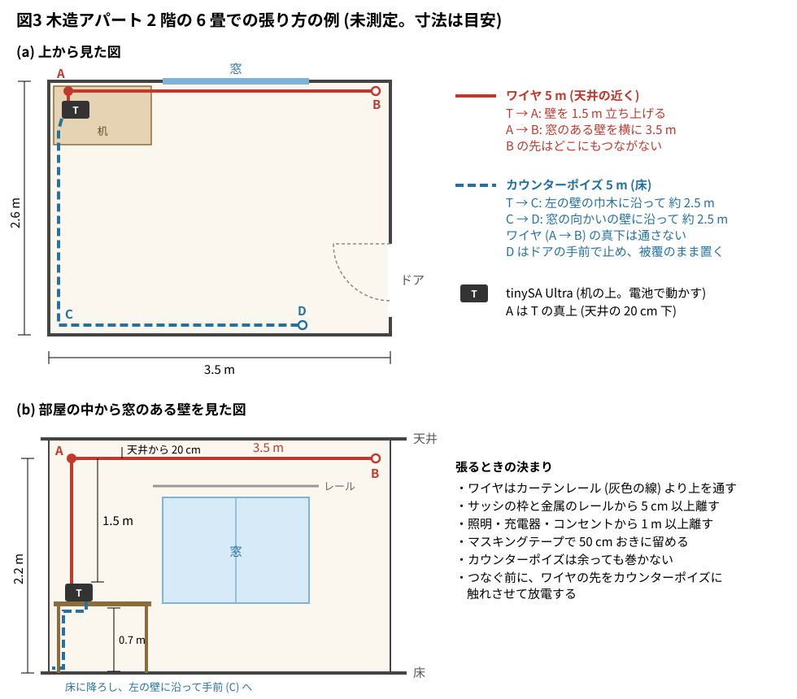

# 6-2 最初のアンテナ — 室内のワイヤ 5 m とカウンターポイズを tinySA で確かめる

受信機を作る前に、**アンテナが働いているか**を先に確かめる。受信機が鳴らないとき、原因がアンテナなのか回路なのかを
分けられるようにするためだ。[6-1](01-block.md) のブロック図のいちばん左、アンテナだけを取り出して扱う。

使うのは電線 2 本だけである。1 本を部屋の中に 5 m 張り (**ワイヤ**)、もう 1 本を同じ長さで床に這わせる
(**カウンターポイズ**。大地の代わりになる帰り道の線)。これを **tinySA Ultra** (手のひらのスペクトラムアナライザ) の
入力に直接つなぎ、次の 2 つが見えれば合格とする。

- 7.2〜7.45 MHz の**短波放送** (41 m バンド。AM の強い局が並ぶ) の搬送波が、線として立つ
- アンテナをつなぐと、**雑音の床が計器だけのときより上がる**

2 つめが大事な印である。短波では、空から来る雑音と街の雑音 (外来雑音) が受信機の中の雑音よりずっと大きい。
床が上がるなら、アンテナは外来雑音を受信機の雑音より大きく届けている。そこから先はアンテナを大きくしても、
信号と雑音が一緒に増えるだけで、聞こえ方はあまり変わらない。**室内の 5 m で足りるか**を、この床の上がりで判断する。

> [!WARNING]
> ワイヤは**室内**に張る。屋外に張ると雷の誘導と電線への接触の危険がある (屋外のアンテナは第 8 章)。
> 室内でも、化繊の床やカーテンをこすった線には静電気が溜まる。**計器につなぐ前に、ワイヤの先を
> カウンターポイズ (計器の GND 側) に 1 度触れさせて放電する** ([03-nanovna 0-4](../../03-nanovna/00-tools/04-esd-antenna-discharge.md))。
> この題は受信だけで、電波は出さない。

## ワイヤ 5 m の電気的な姿

7.1 MHz の波長 λ (ラムダ) は 42.2 m、その 1/4 は 10.6 m である。垂直に立てた線は λ/4 の長さで共振し、
リアクタンスが消えて数十 Ω (オーム) の抵抗に見える。**5 m はその半分に足りないので、共振の手前にあり、
小さなコンデンサに見える** (容量性)。単線のモノポール (大地を相手にした 1 本の線) の式で見積もると次のとおり
(計算値。線の直径 0.5 mm、まっすぐ立てた理想の姿)。

| 量 | 値 (7.1 MHz、見積り) | 求め方 |
| --- | --- | --- |
| 電気長 | 42.6° (共振は 90°) | 360° × 5 m ÷ 42.2 m |
| リアクタンス | −626 Ω (容量性) | −Z<sub>0</sub> ÷ tan (電気長)。Z<sub>0</sub> = 60 × (ln (2h ÷ a) − 1) = 576 Ω |
| 等価な容量 C<sub>a</sub> | 36 pF | 7.1 MHz で −626 Ω になる容量 |
| 放射抵抗 R<sub>r</sub> | 5.5 Ω | 40π² × (h ÷ λ)²。π (パイ) は円周率 |
| 実効高 h<sub>e</sub> | 2.5 m | 短い垂直線は h ÷ 2 ([2-12](../02-radio-clock/12-antenna-compare.md) と同じ) |

実効高は、電界 E (V/m) から取り出す起電力 e を e = h<sub>e</sub> × E で決める長さである。
電界 50 dBµV/m (316 µV/m。µ (マイクロ) は 100 万分の 1) の放送なら、e = 2.5 m × 316 µV/m = 791 µV になる。

実際の室内では、ワイヤは斜めや L 字に張られ、壁や天井にも近い。上の数は桁の目安で、±6 dB は動くと見ておく。

## 回路図

```circuit
# 回路図 (tommie-fence の circuit フェンス)
title: 図1 ワイヤ5mとカウンターポイズをtinySAにつなぐ
parts:
  ANT1: antenna 3,2
  U1:
    type: device
    at: 7,4
    label: tinySA Ultra
    pins: [RF, GND]
  CP: port 2,6
wires:
  - 3,2 -- 3,4 -- U1.RF
  - U1.GND -| 5,6 -- 2,6
notes:
  - text 3.3,2.2 blue: ワイヤ 5 m (窓際に張る)
  - text 2,6.6 blue: カウンターポイズ 5 m (床に這わせる)
style:
  pitch: 1.2
```


- **ANT1 (ワイヤ)** は tinySA の入力 (SMA の中心導体) へ。入力は通常モードの側 (100 kHz〜800 MHz)
- **CP (カウンターポイズ)** は SMA の外皮 (GND) へ。先はどこにもつながず、被覆のまま床に伸ばす
- SMA と電線の間は、SMA オス-みの虫クリップのケーブルか、SMA-BNC 変換と BNC-ターミナル (ねじ端子) 変換でつなぐ。
  7 MHz では、この数 cm の変換の長さは問題にならない
- 整合の回路は入れない。受信機につなぐときの同調回路は [6-3](03-input-tuning.md) で作る

**等価回路。** アンテナは「起電力 e と、直列の R<sub>r</sub> と C<sub>a</sub>」に置き換えられる。計器の入力は 50 Ω である。

```circuit
# 回路図 (tommie-fence の circuit フェンス)
title: 図2 等価回路 (7.1MHz、見積り)
parts:
  V1: sine 2,6 2,2 l=e
  R1: resistor 2,2 4.5,2 5.5 l=Rr
  C1: capacitor 4.5,2 7,2 36p l=Ca
  C2: capacitor 7,6 9.5,6 20p l=Cret
  R2: resistor 9.5,2 9.5,6 50 l=RL
  G1: ground 2,7
wires:
  - 7,2 -- 9.5,2
  - 2,6 -- 7,6
  - 2,6 -- 2,7
notes:
  - box 1.2,1.4 7.6,5 blue
  - text 3,3.8 blue: アンテナ (ワイヤ 5 m)
  - text 8,1.2 blue: tinySA の入力
  - text 5.5,7.2 blue: カウンターポイズが無いときの帰り道
style:
  pitch: 1.2
```


- 図2 は等価回路で、R<sub>r</sub> 5.5 Ω と C<sub>a</sub> 36 pF は部品ではない (買って付ける物ではないので E24 に丸めていない)
- **カウンターポイズがあるとき**は C<sub>ret</sub> を短絡と見る。50 Ω に出る電圧は e × 50 ÷ |55.5 − j626| = e × 0.080 (**−22.0 dB**)。
  アンテナの 626 Ω のリアクタンスが、起電力のほとんどを持っていく
- **カウンターポイズが無いとき**、電流の帰り道は計器の筐体と周りの物との容量だけになる。これを 20 pF と仮定すると
  (手のひらの大きさの金属箱の目安)、リアクタンスが −1121 Ω 増え、出る電圧は e × 0.029 (−30.9 dB)。**約 9 dB 下がる**
- 下がるだけでなく、**計器を手で持つ・USB ケーブルを挿すたびに読みが変わる**。体や PC が帰り道に加わるからだ。
  カウンターポイズは、帰り道を 1 本の線に決めて読みを落ち着かせる役目を持つ
- 整合を取った理想 (R<sub>r</sub> だけを相手に電力を取り切る) と比べると、直結は 25.5 dB 損をしている。
  それでも床が上がるなら足りている、というのがこの題の確かめ方である

**実体配線図は入れない。** 組む基板が無い (電線 2 本と計器だけ)。
**Analog Discovery 3 とオシロの図も入れない。** 入力に出る信号は数十 µV で、AD3 の Scope の雑音 (mV の桁) に埋もれて見えない。
周波数ごとの大きさを見る題なので、計器は tinySA、図はスペクトラムにする。

## 張り方の例 — 木造アパートの 2 階

6 畳の部屋 (約 2.6 m × 3.5 m、天井の高さ 約 2.4 m) で、机を窓の角に置いた場合の例である (未測定。寸法は自分の部屋に合わせて変える)。
木造の壁は電波をほとんど弱めないので、窓際にこだわらなくてよい。2 階は地面から遠いぶん、1 階より有利である。



図3 の (a) は部屋を上から見た図、(b) は部屋の中から窓のある壁を見た図である。T は机の上の tinySA、赤い線がワイヤ (T → A → B)、
青い破線がカウンターポイズ (T → C → D)。

| 区間 | 長さ | 通す所 | 留め方 |
| --- | --- | --- | --- |
| T → A (立ち上げ) | 1.5 m | 机の上 (高さ 0.7 m) から、天井の 20 cm 下 (高さ 2.2 m) まで、壁に沿ってまっすぐ上げる | マスキングテープで 50 cm おき |
| A → B (水平) | 3.5 m | 窓のある壁の、天井の 20 cm 下を横に。カーテンレールより上 | 両端と真ん中の 3 か所。回り縁に掛けるフックでもよい |
| T → C → D (カウンターポイズ) | 5 m | 机の下から床に降ろし、**ワイヤとは別の壁**の巾木 (壁と床の境の板) に沿って L 字に | 養生テープで 50 cm おき。ドアの前は横切らない (D はドアの手前で止める) |

**ワイヤ (T → A → B)。**

- 形は逆 L 字になる。立ち上げの 1.5 m が地面に沿って来る波を、水平の 3.5 m が上空から降りてくる波 (夜の短波放送と遠くのアマチュア局) を受ける。
  どちらも働くので、全部を垂直に立てられなくても気にしなくてよい (上の表の数は ±6 dB の内で動く)
- **2 つの壁の間に、部屋を斜めに渡して張る**のも良い。壁の中の電気の配線から離れるので雑音が減ることがある。
  両端を回り縁のフックに結び、たるみは 10 cm ほど残す (ぴんと張るとフックが抜ける)。頭の上を通るので、常設には壁沿いのほうが邪魔にならない
- **金属に沿わせない。** アルミサッシの枠・金属のカーテンレール・エアコンの配管からは 5 cm 以上離す。
  沿わせると、線と金属の間の容量で信号が逃げる
- **雑音の元から離す。** LED の照明器具・充電器・ルータ・コンセントと電源コードから 1 m 以上。天井の照明の真横は通さない
- 画鋲で留めるなら、線を刺さずに、線をまたぐように被覆の外で挟む。先端 (B) は被覆のままで、どこにもつながない
- 目立たせたくなければ、壁の色に近い細い線 (AWG 26〜28) にする。受信だけなら太さで感度は変わらない

**カウンターポイズ (T → C → D)。**

1. 電線 5 m の片端を 1 cm 剥き、tinySA の SMA の外皮の側 (みの虫クリップの黒) につなぐ
2. 机の脚に沿わせて床に降ろす。机の上で余らせない
3. 巾木に沿って床を這わせる。**ワイヤの水平の部分 (A → B) の真下は避け、別の壁へ向ける。**
   2 本を近くで平行に走らせると、互いに逆向きの電流が打ち消し合う 2 本線に近づき、アンテナとして働きにくくなる
4. 角では直角に曲げてよい。**余っても巻かない** (巻くとコイルになり、帰り道のインピーダンスが上がる)。
   余りは折り返さず、次の壁へ伸ばす。どうしても折り返すなら、行きと帰りの間を 10 cm 以上空ける
5. 先端 (D) は被覆のまま床に置く。水道管やコンセントのアースにはつながない (雑音を持ち込むことがある)
6. 養生テープで 50 cm おきに留める。カーペットやラグの下に入れてもよい

- 2 階の床の下は 1 階の天井で、そこには 1 階の照明と配線がある。床に這わせて床 (雑音) が上がるなら、
  カウンターポイズを**腰の高さ (机の天板の高さ) の壁沿い**に上げて比べる。床から離すと下の階の雑音が減ることがある
- 5 m を伸ばす場所が無ければ、3 m でも試す。短くすると帰り道のリアクタンスが増え、放送の線が数 dB 下がる (図2 の C<sub>ret</sub> の側)
- 張り終えたら、つなぐ前の放電 (頭の警告) を忘れない。化繊のカーペットに這わせた線は特に溜まる

## 計器の設定

tinySA Ultra は**電池で動かし、USB ケーブルを抜く**。PC につなぐと、PC の雑音が GND から入り、PC 自体が帰り道にもなる。

| 項目 | 設定 | 理由 |
| --- | --- | --- |
| 開始 / 終了 | 7.0 MHz / 7.5 MHz | アマチュアの 7 MHz 帯 (7.0〜7.2 MHz) と 41 m バンドの放送 (7.2〜7.45 MHz) が 1 画面に入る |
| 点数 | 450 | 1 点 = 約 1.1 kHz。RBW より細かい |
| RBW | 3 kHz | 放送は 5 kHz おきに並ぶので、隣の局と分かれる。床は RBW 30 kHz のときより 10 dB 下がる |
| LNA | 入 | 計器の床を 16〜20 dB 下げて、外来雑音を計器の雑音の上に出す |
| 減衰 (ATT) | 0 dB | 信号が小さい。減衰を入れると床がそのぶん上がる |
| 基準レベル (REF) | −60 dBm | いちばん強い局 (−71 dBm 前後) が上から 1 目盛 |
| 縦の目盛 | 10 dB/div | 既定 |
| マーカー | 高い線 (短波放送) に 1〜3、線の無い所 (7.1 MHz) に 4 | 1〜3 が放送の強さ、4 が雑音の床の読み |

```spectrum
# スペクトラムアナライザの画面 (tommie-fence の spectrum フェンス)
title: 図4 夜の41mバンドの例 (見積り。1〜3は短波放送の例、4は局の無い所)
device: tinysa-ultra
sweep: 7.0M-7.5M 450
rbw: 3kHz
lna: on
ref: -60dBm
signal:
  - sine 7.26MHz -71dBm
  - sine 7.325MHz -81dBm
  - sine 7.41MHz -76dBm
markers: [7.26M, 7.325M, 7.41M, 7.1M]
```


図4 のマーカー 1〜3 は**実在の局を指していない**。「夜の 41 m バンドには短波放送の搬送波がこういう高さで立つ」ことを見せる例で、
周波数も強さも仮に置いた。短波放送の局は季節ごとに周波数を変え、時刻で入れ替わるので、自分の画面では別の所に別の本数の線が立つ。

| マーカー | 図に置いた物 | 自分の画面で当たる物 |
| --- | --- | --- |
| 1 (7.260 MHz、−71 dBm) | 強い短波放送の例 (電界 50 dBµV/m) | 7.2〜7.45 MHz でいちばん高い線 |
| 2 (7.325 MHz、−81 dBm) | 弱めの短波放送の例 (40 dBµV/m) | 床から 10 dB 以上出ている、ほかの線 |
| 3 (7.410 MHz、−76 dBm) | 中くらいの短波放送の例 (45 dBµV/m) | 同上 |
| 4 (7.100 MHz) | **局の無い所** (雑音の床を読む) | 線の立っていない所ならどこでもよい |

- 図4 は**見積り**で、実測ではない。線の本数は 3 本とは限らない。夜は 10 本以上並ぶこともあり、昼は 1 本も立たないことがある
- 放送の線は 5 kHz の倍数の周波数に立つ (7.260 MHz など)。7.0〜7.2 MHz はアマチュア無線の帯で、放送の線は立たない。
  ここに見える線は CW や SSB の交信で、出たり消えたりする
- 図の床 (マーカー 4 の −132 dBm) は**計器だけの床** (アンテナを外したときの値。LNA の利得を 20 dB と置いた計算)。
  アンテナをつなぐと、床は下の表の −116 dBm 前後まで上がるはずである。図は外来雑音を描いていない
- 放送の線は数秒〜数十秒の周期でゆっくり上下する (フェージング)。読みは何回かの掃引の高いほうを取る

## 見るべき値

**実機では組んでいない (未測定)。** 次の表は図2 の等価回路と、外来雑音の統計の中央値から出した見積りである。

| 測る所 | 期待する値 (見積り) | 根拠 |
| --- | --- | --- |
| 計器だけの床 (アンテナを外す、RBW 3 kHz、LNA 入) | −128〜−132 dBm | −102 dBm (RBW 30 kHz) − 10 dB − LNA 16〜20 dB |
| アンテナをつないだ床 (7.1 MHz、局の無い所) | −116 dBm 前後 (住宅地) | 人工雑音の中央値 (−90.3 dBm) − 直結の損 25.5 dB |
| **床の上がり** | **10 dB 以上** | 上の 2 つの差。これが合格の印 |
| 強い放送 (電界 50 dBµV/m) | −71 dBm | e = 791 µV、50 Ω に 63 µV |
| 弱めの放送 (電界 40 dBµV/m) | −81 dBm | 電界が 10 dB 下がれば読みも 10 dB 下がる |
| カウンターポイズを外す | 放送の線が約 9 dB 下がり、手を近づけると変わる | 帰り道 20 pF の仮定 |

- 床の上がりが 3 dB も無いときは、アンテナが足りないか、つながっていない。みの虫クリップの接触と、ワイヤの被覆を剥いた所を見る
- 床が −100 dBm より高いときは、外来雑音ではなく**室内の雑音**を拾っている (次の節)
- 強い中波の放送局が近いと、LNA が飽和して実在しない線が出ることがある。LNA を切って消える線は計器の中で出来た物である
  ([03-nanovna 11-3](../../03-nanovna/11-spectrum-analyzer/03-noise-floor-attenuator.md))

## 試すこと

**カウンターポイズの有無。** カウンターポイズを SMA の外皮から外し、放送の線の高さを比べる。次に計器を手で握る。
カウンターポイズが無いときだけ、握ると線が上がる (体が帰り道になる)。

**窓際と部屋の奥。** ワイヤを窓のある壁に張ったときと、部屋の奥の壁に張ったときで、放送の線と床を比べる。
木造では差が小さい。鉄筋コンクリートの建物では、壁が電波を 10〜20 dB 弱める (目安) ので、窓際が有利になる。放送の線が下がって床が変わらないなら、
その床は室内の雑音である。

**室内の雑音の見分け。** スイッチング電源 (充電器・LED 照明・PC・ルータ) の雑音は、次の 3 つで放送と区別できる。

| 見分け方 | 放送 | スイッチング電源の雑音 |
| --- | --- | --- |
| 並び方 | 5 kHz の倍数の周波数に 1 本ずつ | 数十 kHz おきに等間隔で並ぶ山か、帯になった盛り上がり |
| 時間の変化 | 数秒〜数十秒でゆっくり上下する | 一定か、機器の負荷で形が変わる |
| 機器の電源を切る | 変わらない | 消える |

怪しい機器の電源を 1 つずつ切り、床が下がる物を探す。ワイヤをその機器と電源コードから 1 m 以上離すだけでも下がる。

**昼と夜。** 短波は上空の電離層で反射して遠くへ届く。昼は低い層 (D 層) が 7 MHz を吸収するので、遠くの放送は弱く、
聞こえるのは国内と近隣の数百 km の局である。日が沈むと吸収が消え、41 m バンドには遠くの放送が並ぶ。
**放送を試し受信の信号に使うなら、夕方から夜がいちばん確実で**、昼は線が 1 本も立たないこともある (アンテナの故障ではない)。
昼に確かめるなら、床の上がりのほうを見る。

## 部品

| 部品 | 値・型番 | 備考 |
| --- | --- | --- |
| ANT1 | ビニール被覆の電線 5 m | 単線でもより線でもよい。導体の直径 0.5 mm 前後 (AWG 24)。計器の側の端だけ 1 cm 剥き、先端は被覆のまま |
| CP | 同じ電線 5 m | 床に這わせる。巻いたままにしない (コイルになる) |
| U1 | tinySA Ultra ZS405 | 電池で動かす。通常モードの入力 |
| 変換 | SMA オス-みの虫クリップのケーブル | または SMA-BNC 変換と BNC-ターミナル変換 |

- 電源は計器の電池だけ (回路が無いので 5 V も使わない)
- この 2 本の線は、[6-5](05-direct-conversion.md) の受信機でもそのまま使う

## LTspice での確かめ

この題は **SPICE の対象外**: 決まる値はモノポールの式 (リアクタンス・放射抵抗・実効高) と、R と C の直列の分圧だけである。
算術 (Python) で確かめた。スクリプトは [sim/02-wire-antenna.py](sim/02-wire-antenna.py)。

| 確かめること | 本文の数字 | 算術の値 | 判定 |
| --- | --- | --- | --- |
| 波長と λ/4 | 42.2 m・10.6 m | 42.22 m・10.56 m | 合う |
| 電気長・Z<sub>0</sub>・リアクタンス | 42.6°・576 Ω・−626 Ω | 42.6°・576 Ω・−626 Ω | 合う |
| 等価な容量・放射抵抗 | 36 pF・5.5 Ω | 35.8 pF・5.54 Ω | 合う |
| 50 Ω への分圧 (カウンターポイズ有り / 無し) | −22.0 dB / −30.9 dB (差 約 9 dB) | −22.0 dB / −30.9 dB (差 −8.9 dB) | 合う |
| 整合に比べた損 | 25.5 dB | −25.5 dB | 合う |
| 50・40 dBµV/m の読み | −71・−81 dBm | −71.0・−81.0 dBm | 合う |
| 住宅地の外来雑音 (RBW 3 kHz、入力で) | −116 dBm 前後 | −115.8 dBm (有能雑音 −90.3 dBm) | 合う |
| 計器の床 (RBW 3 kHz、LNA 入) | −128〜−132 dBm | −128.0 dBm (16 dB)・−132.0 dBm (20 dB) | 合う |

確かめていない物: 室内に斜めに張った実際のワイヤのインピーダンス、帰り道の容量 (20 pF は仮定)、放送の電界の強さ (50 dBµV/m は例)、
建物の減衰、実際の場所の雑音 (統計の中央値から ±10 dB は外れる)。どれも測って書き直す値である。

## 出典

自作。外来雑音の中央値 (人工雑音の式 F<sub>a</sub> = c − d log f。住宅地は c = 72.5、d = 27.7) は
[ITU-R 勧告 P.372 (Radio noise)](https://www.itu.int/rec/R-REC-P.372/en)、
tinySA Ultra の床と LNA は [tinySA wiki の仕様](https://tinysa.org/wiki/pmwiki.php?n=TinySA4.Specification) による。

参考: [短波放送 (Wikipedia)](https://ja.wikipedia.org/wiki/%E7%9F%AD%E6%B3%A2%E6%94%BE%E9%80%81)、
[電離層 (Wikipedia)](https://ja.wikipedia.org/wiki/%E9%9B%BB%E9%9B%A2%E5%B1%A4)、
[Counterpoise (ground system) (Wikipedia、英語)](https://en.wikipedia.org/wiki/Counterpoise_(ground_system))、
[Antenna effective length (Wikipedia、英語)](https://en.wikipedia.org/wiki/Antenna_effective_length)
