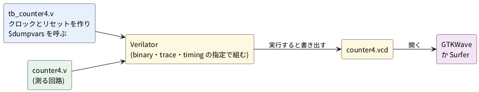
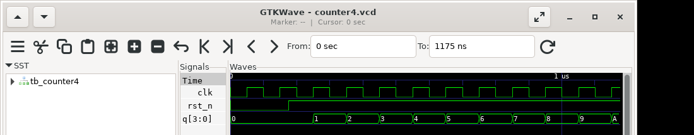

# 0-6 波形を見る道具 — VCD と波形ビューア

この題は組まない題で、実体配線図と Analog Discovery 3 は付けない。PC の中だけで動かす (`device: SIM`)。

0-5 では、ブラウザの soft-fpga で波形を見た。PC のシミュレーションの波形を見るには、波形をファイルに書き出し、**波形ビューア**で開く。
この題では、4 ビットのカウンタを Verilog だけのテストベンチで動かして VCD を書き出し、GTKWave で開く。

3-2 は、C++ のテストベンチから VCD を書き出して中身を読む題だ。この題は逆に、C++ を 1 行も書かず、ビューアで見ることに絞る。

## 説明

- **VCD** (Value Change Dump) は、信号の変化を並べたテキストのファイルだ。どのシミュレータも書き出せるので、ビューアとの受け渡しに使われる
- Verilog のテストベンチの中で、次の 2 つのシステムタスクを呼ぶと、波形が書き出される
  - `$dumpfile("名前.vcd")`: 書き出すファイルを決める
  - `$dumpvars(0, モジュール名)`: そのモジュールから下の信号を全部書き出す (`0` は階層を全部という意味)
- Verilator は `--binary` を付けると、C++ を書かなくてもテストベンチを実行できる形に組み立てる。
  テストベンチに `#50` のような待ち時間を書くには `--timing` が、波形を書き出すには `--trace` が要る
- 波形ビューアは、VCD を開いて信号を並べて見る道具だ。この題では次の 2 つを扱う
  - **GTKWave**: 古くからある定番。この題の確認では 3.3.116 を使った
  - **Surfer**: 新しいビューア。この題の確認では 0.5.0-dev (開発版) を使い、同じ VCD を読み込めるところまで確かめた
- 大きな波形には、VCD より小さい **FST** という形式がある。Verilator は `--trace-fst` で書き出せ、GTKWave がそのまま開ける

## 流れの図

図 1 は、テストベンチが VCD を作り、ビューアで開くまでの流れだ。




## Verilog

測る回路は 3-1 と同じ `counter4` だ。

```verilog
// counter4.v
module counter4 (
    input  wire       clk,
    input  wire       rst_n,
    output reg  [3:0] q
);
    always @(posedge clk) begin
        if (!rst_n) q <= 4'd0;
        else        q <= q + 4'd1;
    end
endmodule
```

## テストベンチ

クロックは 100 ns 周期にした。リセットは 175 ns に外す。立ち上がり (50 ns・150 ns …) の合間で外すと、波形が読みやすい。

```verilog
// tb_counter4.v
`timescale 1ns / 1ps
module tb_counter4;
    reg        clk;
    reg        rst_n;
    wire [3:0] q;

    counter4 dut (.clk(clk), .rst_n(rst_n), .q(q));

    initial begin                   // 100 ns 周期のクロック
        clk = 1'b0;
        forever #50 clk = ~clk;
    end

    initial begin
        $dumpfile("counter4.vcd");
        $dumpvars(0, tb_counter4);
        rst_n = 1'b0;
        #175 rst_n = 1'b1;          // 立ち上がりの合間に外す
        #1000;
        $display("q = %0d", q);
        $finish;
    end
endmodule
```

- `` `timescale 1ns / 1ps `` は、`#50` を 50 ns と読ませる宣言だ。これが無いと、待ち時間の単位が決まらない
- `$finish` で止める。これが無いと、クロックを作る `forever` のため、シミュレーションが終わらない
- `$display` で `q` を使っているのは、`-Wall` の lint が「使っていない信号」と警告するのを避けるためでもある

## 動かす

```bash
verilator --lint-only -Wall counter4.v
verilator --binary --trace -Wall --timing tb_counter4.v counter4.v --top-module tb_counter4
./obj_dir/Vtb_counter4
```

2 行目は、`tb_counter4.v` も `counter4.v` も警告なしで通った。実行の結果は次のとおりだった。

```text
q = 10
- tb_counter4.v:22: Verilog $finish
```

カレントディレクトリに `counter4.vcd` (709 バイト) ができる。

- `--top-module tb_counter4` は、最上位をテストベンチにする指定だ。これを付けないと、Verilator は最上位を自分で選ぶ
- 実行ファイルの名前は `V` + 最上位の名前で、`obj_dir/` の下にできる
- FST で書き出すときは、`$dumpfile` の名前を `.fst` にし、組み立てに `--trace-fst` を付ける。
  この題の回路でも、`counter4.fst` ができ、`fst2vcd` で VCD に戻せることを確かめた

## 波形ビューアで開く

### GTKWave

```bash
gtkwave counter4.vcd
```

- 左上の **SST** (信号の階層の木) で `tb_counter4` を選ぶと、その下の信号が左下に並ぶ
- 見たい信号 (`clk` `rst_n` `q`) を選び、**Append** (または Insert) で右の波形の欄に足す
- 波形の欄にマウスを置いて、全体を見るには **Time → Zoom → Zoom Full** を選ぶ
- 4 ビットの `q` の値は、信号を右クリックして **Data Format** で 16 進・10 進・2 進を選べる。
  この題の図は 16 進のままなので、10 は `A` と出る
- 波形の上でクリックすると、その時刻に縦線 (マーカー) が立つ。上の `Marker:` と `Cursor:` の欄に、その時刻が出る

図 2 は、上の手順で開いた GTKWave の画面だ (Xvfb の中で開いて撮った)。



### Surfer

```bash
surfer counter4.vcd
```

Surfer も同じ VCD を読み込めた。操作は GTKWave と違うので、使うときは Surfer の説明を見る。
GTKWave を毎回手で操作する代わりに、信号の並びを `.gtkw` (GTKWave の保存ファイル) に保存しておくと、次から同じ並びで開ける。

## 計器の設定

組まない題なので、計器は使わない。図 3 は、VCD から 25 ns ごとの値を読み出して `logic` の図にしたもので、
実機で測った波形ではなく、計算の図だ。図 2 の GTKWave の画面と同じ並びになる。
カーソル X1 は最初に `q` が 1 になったビット (250〜275 ns) の真ん中、X2 は `q` が 10 になったビット (1150〜1175 ns) の真ん中に置いた。

```logic
# ロジックアナライザの画面 (tommie-fence の logic フェンス)
title: 図3 VCD から読み出した counter4 (25 ns ごとの値の計算の図)
device: generic
window: 1.2us
signals:
  clk: pattern 001100110011001100110011001100110011001100110011 bit 25ns
  rst_n: pattern 000000011111111111111111111111111111111111111111 bit 25ns
  q0: pattern 000000000011110000111100001111000011110000111100 bit 25ns
  q1: pattern 000000000000001111111100000000111111110000000011 bit 25ns
  q2: pattern 000000000000000000000011111111111111110000000000 bit 25ns
  q3: pattern 000000000000000000000000000000000000001111111111 bit 25ns
buses:
  q: q3 q2 q1 q0 dec
cursors: [262.5ns,1162.5ns]
```


## 見るべき値

| 見る所 | 時刻 (ns) | q |
| --- | --- | --- |
| 初期状態 | 0 | 0 |
| rst_n が 1 になる | 175 | 0 |
| 最初の立ち上がり (リセット解除後) | 250 | 1 |
| 最後の立ち上がり | 1150 | 10 |

- リセットを外す前の立ち上がり (50 ns・150 ns) では、`q` は 0 のままだ
- 250 ns から 1150 ns まで、立ち上がりは 10 回あり、`q` は 1 から 10 (16 進で `A`) まで進む
- X1 と X2 の間隔は 900 ns で、クロック 9 周期に当たる。`q` は 1 から 10 へ 9 増えた
- 時間は Verilator の中の時間で、実機の時間ではない。10 MHz で動く回路を見たという意味ではない

## 出典

自作。`$dumpfile` と `$dumpvars` は Verilog の標準のシステムタスク。
`--binary` `--trace` `--trace-fst` `--timing` は [Verilator のマニュアル](https://veripool.org/guide/latest/) による。
GTKWave は [gtkwave.sourceforge.net](https://gtkwave.sourceforge.net/)、Surfer は [surfer-project.org](https://surfer-project.org/)。
