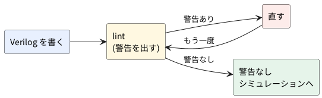

# 0-7 Verilator の lint で書き間違いを見つける

この題は組まない題で、実体配線図と Analog Discovery 3 は付けない。PC の中だけで動かす (`device: SIM`)。

Verilog は、書き間違いがあってもシミュレーションや合成が通ってしまうことがある。
たとえば、`if` の `else` を書き忘れると、回路はラッチ (値を覚える部品) になる。幅の違う信号を代入すると、上の桁が黙って捨てられる。
**lint** は、回路を動かす前に、こうした怪しい書き方を見つける検査だ。Verilator は `--lint-only` を付けると、lint だけを行う。

この本の Verilog は、すべて `verilator --lint-only -Wall` を警告なしで通したものを載せている。
この題では、わざと間違いを 6 つ入れた回路を lint にかけ、出た警告を 1 つずつ直す。

## 説明

- `verilator --lint-only -Wall ファイル名.v` を打つ。回路は組み立てず、検査だけする
- `-Wall` を付けると、既定では黙っている警告 (使っていない信号・駆動されていない信号・クロックの中の `=` など) も出る。
  この本では、いつも `-Wall` を付ける
- 警告が 1 つでもあると、Verilator は終了コード 1 で終わる (`%Error: Exiting due to N warning(s)`)。
  警告が無ければ、報告の 3 行 (`Verilation Report`) だけが出て、終了コードは 0 になる
- 警告の行は `%Warning-名前: ファイル:行:桁: 説明` の形だ。**名前** (`LATCH` や `WIDTHTRUNC`) で調べられる。
  説明の末尾の URL (`verilator.org/warn/名前`) に、その警告の解説がある
- 警告は直すのが基本だ。意図して残すときだけ、理由をコメントで書いて、その場所だけ黙らせる




## Verilog

まず、間違いの入った `bad.v`。次の 6 つの間違いを、番号つきのコメントで示した。

1. 幅が合わない (4 ビットを 3 ビットの信号に入れる)
2. `else` の無い `if` (ラッチになる)
3. `case` の取りこぼし (`sel` が 2 と 3 のとき、`t` が決まらない)
4. クロックで動く `always` で `=` を使う
5. 宣言していない名前を左辺に書く
6. どこからも駆動されない信号

```verilog
// bad.v  わざと間違いを入れた回路
module bad (
    input  wire       clk,
    input  wire       rst_n,
    input  wire [3:0] a,
    input  wire [1:0] sel,
    input  wire       en,
    input  wire       spare,
    output reg  [3:0] y,
    output reg  [3:0] cnt,
    output wire [3:0] z,
    output wire [3:0] w
);
    // 1 幅が合わない: 4 ビットを 3 ビットに入れる
    wire [2:0] narrow;
    assign narrow = a;

    // 2 else の無い if: ラッチになる
    always @(*) begin
        if (en) y = a;
    end

    // 3 case の取りこぼし: sel が 2 と 3 のとき t が決まらない
    reg [3:0] t;
    always @(*) begin
        case (sel)
            2'd0: t = 4'd1;
            2'd1: t = 4'd2;
        endcase
    end

    // 4 クロックで動く always に = を使う
    always @(posedge clk) begin
        if (!rst_n) cnt = 4'd0;
        else        cnt = cnt + 4'd1;
    end

    // 5 宣言していない名前を左辺に書く
    assign flag = a[0];
    assign z = {3'b000, flag};

    // 6 どこからも駆動されない
    wire [3:0] floating;
    assign w = floating | t | {1'b0, narrow};
endmodule
```

## lint を掛ける

```bash
verilator --lint-only -Wall bad.v
```

次の 9 件の警告が出て、終了コードは 1 だった (行番号は上の `bad.v` のもの)。

| 警告の名前 | 行 | 意味 | 上の番号 |
| --- | --- | --- | --- |
| `IMPLICIT` | 39 | `flag` の宣言が無いので、1 ビットの線を勝手に作った | 5 |
| `WIDTHTRUNC` | 16 | 4 ビットを 3 ビットに入れる。上の桁が捨てられる | 1 |
| `BLKSEQ` | 34・35 | クロックの `always` の中で `=` を使った (2 行ぶん) | 4 |
| `UNUSEDSIGNAL` | 8 | `spare` を使っていない | (6 つの外) |
| `UNDRIVEN` | 43 | `floating` を、どこからも駆動していない | 6 |
| `CASEINCOMPLETE` | 26 | `case` が全部の値を覆っていない (例は `2'd2`) | 3 |
| `LATCH` | 19・25 | `y` と `t` がラッチになる | 2・3 |

- 3 の取りこぼしは、`CASEINCOMPLETE` と `LATCH` の 2 つで知らされる。`case` の取りこぼしがラッチを作るからだ
- `-Wall` を付けずに掛けると、`IMPLICIT` `WIDTHTRUNC` `CASEINCOMPLETE` `LATCH` 2 件の 5 件だけが出た。
  `BLKSEQ` `UNUSEDSIGNAL` `UNDRIVEN` は `-Wall` を付けたときだけ出る
- `WIDTHTRUNC` の説明は「右辺に 3 ビットが要るのに、4 ビットが来た」と読む。`TRUNC` は切り捨て (truncate) の意味だ

## 直す

次の `good.v` は、6 つを直し、使っていない `spare` の入力を消した。

```verilog
// good.v  bad.v の間違いを直した回路
module good (
    input  wire       clk,
    input  wire       rst_n,
    input  wire [3:0] a,
    input  wire [1:0] sel,
    input  wire       en,
    output reg  [3:0] y,
    output reg  [3:0] cnt,
    output wire [3:0] z,
    output wire [3:0] w
);
    // 1 幅をそろえる: 下の 3 ビットを使う、と書く
    wire [2:0] narrow;
    assign narrow = a[2:0];

    // 2 else の代わりに、先に既定値を入れる
    always @(*) begin
        y = 4'd0;
        if (en) y = a;
    end

    // 3 default を書く
    reg [3:0] t;
    always @(*) begin
        case (sel)
            2'd0:    t = 4'd1;
            2'd1:    t = 4'd2;
            default: t = 4'd0;
        endcase
    end

    // 4 クロックで動く always は <= を使う
    always @(posedge clk) begin
        if (!rst_n) cnt <= 4'd0;
        else        cnt <= cnt + 4'd1;
    end

    // 5 宣言する
    wire flag;
    assign flag = a[0];
    assign z = {3'b000, flag};

    // 6 駆動する (使わないなら、消す)
    wire [3:0] floating;
    assign floating = 4'd0;
    assign w = floating | t | {1'b0, narrow};
endmodule
```

```bash
verilator --lint-only -Wall good.v
```

警告は出ず、報告の 3 行だけが出て、終了コードは 0 だった。

- 2 の `if` は、`else` を足す代わりに、先に `y = 4'd0;` と既定値を入れた。どの経路でも `y` が決まる
- 3 は `default` を足した。取りこぼしが無くても、`default` を書く癖をつけるとよい
- 4 は `<=` にした。クロックで動く `always` は `<=`、組み合わせの `always @(*)` は `=` を使う (2-2、`06-fpga/02-sequential/02-nonblocking.md`)
- 6 は、使うつもりが無いなら消すのがよい。ここでは `4'd0` を駆動して、警告の消え方を見せた

## 意図して残す警告

使わない入力を、あえて残すこともある。そのときは、その行だけ `lint_off` で囲み、理由を書く。

```verilog
// off.v  使わない入力を、理由を書いて黙らせる
module off (
    input  wire       a,
    /* verilator lint_off UNUSEDSIGNAL */
    input  wire       spare,   // 将来の拡張用。いまは使わない
    /* verilator lint_on UNUSEDSIGNAL */
    output wire       y
);
    assign y = a;
endmodule
```

`verilator --lint-only -Wall off.v` は、警告なしで終了コード 0 だった。
`lint_off` の範囲は、その 1 行だけに狭くする。ファイルの先頭で警告を全部黙らせると、本物の間違いも見えなくなる。

## ほかによく見る警告

| 警告の名前 | 出る書き方 | 直し方 |
| --- | --- | --- |
| `PINMISSING` | module の呼び出しでポートをつなぎ忘れた (`.b(…)` が無い) | 全部のポートを名前でつなぐ |
| `DECLFILENAME` | ファイル名と module の名前が違う | 1 ファイルに 1 module、名前をそろえる |
| `WIDTHEXPAND` | 幅の狭い値を、広い信号に入れた (上の桁は 0 で埋まる) | 幅をそろえる。意図なら `{ 0, x }` と書く |

- `PINMISSING` `DECLFILENAME` `WIDTHEXPAND` は、別の小さな回路を同じ Verilator 5.042 で lint にかけて、出ることを確かめた
- 宣言していない信号を**式の中で**使うと、警告ではなく `%Error: Can't find definition of variable` になり、lint が先へ進まない。
  左辺 (`assign flag = …`) に書いたときだけ、`IMPLICIT` の警告になる

## 計器の設定

組まない題なので、計器は使わない。lint は PC で打つだけの検査で、波形は出ない。

## 見るべき値

| 打つ物 | 終了コード | 出る物 |
| --- | --- | --- |
| `verilator --lint-only -Wall bad.v` | 1 | 警告 9 件 (`IMPLICIT` `WIDTHTRUNC` `BLKSEQ` ×2 `UNUSEDSIGNAL` `UNDRIVEN` `CASEINCOMPLETE` `LATCH` ×2) |
| `verilator --lint-only bad.v` (`-Wall` なし) | 1 | 警告 5 件 |
| `verilator --lint-only -Wall good.v` | 0 | 報告の 3 行だけ |
| `verilator --lint-only -Wall off.v` | 0 | 警告なし |

- 自分の回路を書いたら、波形を見る前に、必ず `-Wall` で lint を掛ける。警告 0 を、次の手順に進む条件にする
- 警告の件数は、Verilator の版で変わることがある。この題の数は Verilator 5.042 のもの

## シミュレーションでの確かめ

道具は Verilator 5.042 (本文の版と同じ)。`sim/07-verilator-lint-bad.v` `sim/07-verilator-lint-good.v` `sim/07-verilator-lint-off.v` に本文の 3 本を置いた。

| 項目 | 本文の数字 | 実行結果 | 判定 |
| --- | --- | --- | --- |
| `bad.v` を `-Wall` で | 終了コード 1、警告 9 件 | 終了コード 1、9 件 (警告の名前・行番号とも表のとおり) | 合った |
| `bad.v` を `-Wall` なしで | 警告 5 件 | 5 件 (`IMPLICIT` `WIDTHTRUNC` `CASEINCOMPLETE` `LATCH` ×2) | 合った |
| `good.v` | 警告なし、終了コード 0 | 警告なし、終了コード 0 | 合った |
| `off.v` | 警告なし、終了コード 0 | 警告なし、終了コード 0 | 合った |
| `PINMISSING` `DECLFILENAME` `WIDTHEXPAND` | 出る | 小さな回路 3 本で、それぞれの警告が出た | 合った |
| 宣言なしの名前を式の中で使う | `%Error: Can't find definition of variable` | 同じエラー | 合った |

## 出典

自作。警告の名前と意味は [Verilator のマニュアル](https://veripool.org/guide/latest/) の「Errors and Warnings」による。
