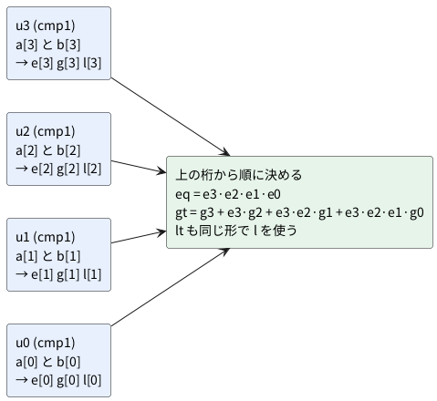

# 1-9 比較器 — 一致と大小

2 つの数 a と b を比べて、「等しい」「a が大きい」「a が小さい」の 3 本の信号を出す回路を書く。
まず 1 ビットの比較器をゲートで描き、それを 4 つ並べて 4 ビットにする。
同じ 4 ビットを `==` `>` `<` の比較演算子でも書き、256 通りの入力すべてで答えが同じことを確かめる。

この題は組まない題で、実体配線図と Analog Discovery 3 は付けない。PC の中だけで動かす (`device: SIM`)。

## 説明

- 比較器の出力は 3 本 (`eq` `gt` `lt`)。**どんな入力でも、3 本のうち 1 本だけが 1 になる**
- 1 ビットなら、等しいのは XNOR (排他的論理和の反転)。a が大きいのは「a が 1 で b が 0」のときだけ、a が小さいのは「a が 0 で b が 1」のときだけだ
- 複数ビットの大小は、**上の桁から順に見る**。上の桁が違えばそこで決まる。上の桁が等しいあいだだけ、1 つ下の桁が効く
- Verilog の `==` `>` `<` は、既定では**符号の無い数**として比べる。符号付きの数の比べ方は 1-11 で扱う

## 論理図

図 1 は 1 ビットの比較器だ。X1 が一致 (XNOR)、G1 が a > b、L1 が a < b。
Nb と Na は、AND の片方の入力を反転する NOT だ。

```circuit
# 回路図 (tommie-fence の circuit フェンス)
title: 図1 比較器の最小の形 (1 ビット)
parts:
  a: port 1,2
  b: port 1,4
  X1: xnor 14,8
  Nb: not 9,15
  G1: and 17,13
  Na: not 9,17
  L1: and 17,19
  eq: port 25,8
  gt: port 25,13
  lt: port 25,19
wires:
  - 1,2 -- 4,2
  - 4,2 -- 4,17
  - 1,4 -- 6,4
  - 6,4 -- 6,19
  - 4,8 |- X1.a
  - 6,8 |- X1.b
  - 4,13 |- G1.a
  - 6,15 -- Nb.in
  - Nb.out -- 13,15
  - 13,15 |- G1.b
  - 4,17 -- Na.in
  - Na.out -- 13,17
  - 13,17 |- L1.a
  - 6,19 |- L1.b
  - X1.out -- 25,8
  - G1.out -- 25,13
  - L1.out -- 25,19
style:
  grid: off
  pitch: 0.8
```


- a と b の縦線は、黒丸の所だけで枝分かれしている。黒丸の無い交差はつながっていない
- 入力が (0, 0) と (1, 1) のとき、X1 だけが 1。(1, 0) のとき G1 だけ、(0, 1) のとき L1 だけが 1 になる

図 2 は、これを 4 つ並べた 4 ビットの比較器のブロック図だ。




- gt の式は、「g3 が 1 なら a が大きい。そうでなくても e3 が 1 (上の桁が等しい) で g2 が 1 なら大きい」と、下へ順に続く
- 上の桁が違うとき、下の桁の e や g が何であっても、e3 が 0 なので下の項は 0 になる

## Verilog

1 ビットの比較器 (図 1)。

```verilog
// cmp1.v  1 ビットの比較器
module cmp1 (
    input  wire a,
    input  wire b,
    output wire eq,    // a == b
    output wire gt,    // a > b
    output wire lt     // a < b
);
    assign eq = ~(a ^ b);
    assign gt = a & ~b;
    assign lt = ~a & b;
endmodule
```

それを 4 つ並べた 4 ビットの比較器 (図 2)。

```verilog
// cmp4_bits.v  1 ビットの比較器を 4 つ並べ、上の桁から順に決める 4 ビットの比較器
module cmp4_bits (
    input  wire [3:0] a,
    input  wire [3:0] b,
    output wire       eq,
    output wire       gt,
    output wire       lt
);
    wire [3:0] e;
    wire [3:0] g;
    wire [3:0] l;
    cmp1 u3 (.a(a[3]), .b(b[3]), .eq(e[3]), .gt(g[3]), .lt(l[3]));
    cmp1 u2 (.a(a[2]), .b(b[2]), .eq(e[2]), .gt(g[2]), .lt(l[2]));
    cmp1 u1 (.a(a[1]), .b(b[1]), .eq(e[1]), .gt(g[1]), .lt(l[1]));
    cmp1 u0 (.a(a[0]), .b(b[0]), .eq(e[0]), .gt(g[0]), .lt(l[0]));

    assign eq = e[3] & e[2] & e[1] & e[0];
    // 上の桁が等しいあいだだけ、下の桁の大小が効く
    assign gt = g[3] | (e[3] & g[2]) | (e[3] & e[2] & g[1]) | (e[3] & e[2] & e[1] & g[0]);
    assign lt = l[3] | (e[3] & l[2]) | (e[3] & e[2] & l[1]) | (e[3] & e[2] & e[1] & l[0]);
endmodule
```

比較演算子で書いた 4 ビットの比較器。

```verilog
// cmp4_op.v  比較演算子で書いた 4 ビットの比較器
module cmp4_op (
    input  wire [3:0] a,
    input  wire [3:0] b,
    output wire       eq,
    output wire       gt,
    output wire       lt
);
    assign eq = (a == b);
    assign gt = (a >  b);
    assign lt = (a <  b);
endmodule
```

2 つを並べて、3 本とも同じなら `same` を 1 にする比較用の箱。

```verilog
// cmp4_cmp.v  2 つの比較器に同じ入力を入れ、3 本とも同じなら same を 1 にする
module cmp4_cmp (
    input  wire [3:0] a,
    input  wire [3:0] b,
    output wire       eq,
    output wire       gt,
    output wire       lt,
    output wire       same
);
    wire eq_p;
    wire gt_p;
    wire lt_p;
    cmp4_bits u_bits (.a(a), .b(b), .eq(eq),   .gt(gt),   .lt(lt));
    cmp4_op   u_op   (.a(a), .b(b), .eq(eq_p), .gt(gt_p), .lt(lt_p));
    assign same = ({eq, gt, lt} == {eq_p, gt_p, lt_p});
endmodule
```

- 演算子で書いた版は 3 行で済む。1 ビットずつ組む版は、図 1・図 2 の回路がどう働くかを見せるためのもの
- 実際の設計では、`==` `>` `<` を使うのがふつうだ。合成ツールが、使う FPGA に合う比較回路を選ぶ

## 動かす

```cpp
// tb_cmp4_cmp.cpp
#include <cstdio>
#include "Vcmp4_cmp.h"

int main() {
    Vcmp4_cmp top;
    // 先に、見るための 6 通り
    const int a_list[] = {5, 5, 3, 8, 7, 15};
    const int b_list[] = {5, 3, 9, 7, 8, 0};
    std::printf("# a b eq gt lt same\n");
    for (int i = 0; i < 6; i++) {
        top.a = a_list[i];
        top.b = b_list[i];
        top.eval();
        std::printf("%x %x %d %d %d %d\n", top.a, top.b, top.eq, top.gt, top.lt, top.same);
    }
    // 次に、256 通りすべてを比べる
    int bad = 0;
    int ones = 0;
    for (int a = 0; a < 16; a++) {
        for (int b = 0; b < 16; b++) {
            top.a = a;
            top.b = b;
            top.eval();
            if (!top.same) bad++;
            if (top.eq + top.gt + top.lt != 1) bad++;   // 3 本のうち 1 本だけが 1
            if (top.eq != (a == b) || top.gt != (a > b) || top.lt != (a < b)) bad++;
            ones++;
        }
    }
    std::printf("%d 通りを試し、食い違いは %d 件\n", ones, bad);
    return bad;
}
```

```bash
verilator --lint-only -Wall --top-module cmp4_cmp cmp4_cmp.v cmp4_bits.v cmp4_op.v cmp1.v
verilator -Wall --cc --exe --build --top-module cmp4_cmp cmp4_cmp.v cmp4_bits.v cmp4_op.v cmp1.v tb_cmp4_cmp.cpp
./obj_dir/Vcmp4_cmp
```

lint は警告なしで通った。実行結果 (a・b は 16 進) は次のとおりだった。

```text
# a b eq gt lt same
5 5 1 0 0 1
5 3 0 1 0 1
3 9 0 0 1 1
8 7 0 1 0 1
7 8 0 0 1 1
f 0 0 1 0 1
256 通りを試し、食い違いは 0 件
```

## 計器の設定

組まない題なので、計器は使わない。実行結果の 6 通りをロジックアナライザの画面と同じ形の図 3 に描く。
実機で測った波形ではなく、実行結果から作った計算の図で、入力を変えた 1 回を 1 ms と見なして並べた。

```logic
# ロジックアナライザの画面 (tommie-fence の logic フェンス)
title: 図3 6 通りの比較 (Verilator の実行結果から作った計算の図)
device: generic
window: 6ms
signals:
  a0: pattern 111011 bit 1ms
  a1: pattern 001011 bit 1ms
  a2: pattern 110011 bit 1ms
  a3: pattern 000101 bit 1ms
  b0: pattern 111100 bit 1ms
  b1: pattern 010100 bit 1ms
  b2: pattern 100100 bit 1ms
  b3: pattern 001010 bit 1ms
  eq: pattern 100000 bit 1ms
  gt: pattern 010101 bit 1ms
  lt: pattern 001010 bit 1ms
buses:
  a: a3 a2 a1 a0 hex
  b: b3 b2 b1 b0 hex
```


## 見るべき値

| a | b | eq | gt | lt | 理由 |
| --- | --- | --- | --- | --- | --- |
| 0x5 | 0x5 | 1 | 0 | 0 | 4 桁とも等しい |
| 0x5 | 0x3 | 0 | 1 | 0 | 上の桁 (a[3]・b[3]) は等しい。a[2] が 1 で b[2] が 0 なので a が大きい |
| 0x3 | 0x9 | 0 | 0 | 1 | 最上位 a[3] が 0、b[3] が 1 で、そこで決まる |
| 0x8 | 0x7 | 0 | 1 | 0 | 最上位だけで決まる。下の 3 桁は b のほうが大きいが、見られない |
| 0x7 | 0x8 | 0 | 0 | 1 | 上の行の a と b を入れ替えた。gt と lt も入れ替わる |
| 0xF | 0x0 | 0 | 1 | 0 | 最大と最小 |

- どの行も、eq・gt・lt のうち 1 になるのは 1 本だけ
- 4 行目 (8 と 7) と 5 行目 (7 と 8) は、4 ビットの最下位 3 桁が全部違っても、最上位で大小が決まることを示す。2 進で 1000 と 0111 だ
- 6 通りしか見ていないが、`same` の列を 256 通りすべてで確かめ、食い違いは 0 件だった。全数を試す書き方は 3-4 で扱った

## 出典

自作。
