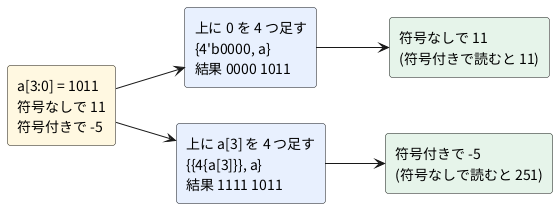

# 1-11 符号付きの数 — 2 の補数と signed

負の数をビットで表す方法 (2 の補数) と、Verilog の `signed` の働きを見る。
同じ 4 ビット `1011` を、符号なしの数として読めば 11、符号付きの数として読めば −5 だ。
ビットは同じで、読み方だけが違う。どこで読み方が効くかを、比較・広げる・右シフトの 3 つで確かめる。

この題は組まない題で、実体配線図と Analog Discovery 3 は付けない。PC の中だけで動かす (`device: SIM`)。

## 説明

- **2 の補数**は、最上位ビットの重みだけを負にして読む方法だ。4 ビットの重みは、符号なしでは 8・4・2・1、符号付きでは −8・4・2・1 になる

| ビット | b3 | b2 | b1 | b0 | 読み |
| --- | --- | --- | --- | --- | --- |
| 符号なしの重み | 8 | 4 | 2 | 1 | 0 〜 15 |
| 符号付きの重み | −8 | 4 | 2 | 1 | −8 〜 7 |
| 例 `1011` (符号なし) | 8 | 0 | 2 | 1 | 11 |
| 例 `1011` (符号付き) | −8 | 0 | 2 | 1 | −5 |

- 最上位ビットが 1 なら負の数だ。このビットを**符号ビット**と呼ぶ
- 符号を反転するには、全ビットを反転して 1 を足す。5 (`0101`) → 反転 `1010` → +1 で `1011` (−5)
- **−8 の符号を反転しても −8 のまま**になる。4 ビットでは +8 が表せないためで、`1000` を反転して 1 を足すと `1000` に戻る。あふれた結果だ
- Verilog では、`wire signed [3:0] sa;` のように `signed` を付けた信号が、符号付きの数として扱われる。付けなければ符号なしだ
- `signed` を付けても、ビットの並びは変わらない。変わるのは、比較・広げる・右シフトのときの扱いだけだ

## 論理図

符号付きの数を広げる (4 ビットを 8 ビットにする) ときは、上に**符号ビットを複製して**足す。0 を足すと、負の数の値が変わってしまう。
図 1 は `1011` (符号付きで −5、符号なしで 11) を 8 ビットに広げる 2 通りを並べたものだ。




- 0 を足した 8 ビットは 11 のままだ。符号ビットを足した 8 ビットは、符号付きで読むと −5 のままになる
- 符号付きの数を広げるのは `{{4{a[3]}}, a}`。`{4{a[3]}}` は `a[3]` を 4 回並べる書き方で、1-3 の連結の応用だ

## Verilog

```verilog
// signed_demo.v  同じ 4 ビットを、符号なしと符号付きで読んで比べる
module signed_demo (
    input  wire [3:0] a,
    input  wire [3:0] b,
    output wire       lt_u,        // 符号なしで a < b
    output wire       lt_s,        // 符号付きで a < b
    output wire [7:0] ext_zero,    // 上に 0 を足して 8 ビットに広げる
    output wire [7:0] ext_sign,    // 上に符号ビットを足して 8 ビットに広げる
    output wire [3:0] neg,         // -a (反転して 1 を足す)
    output wire [3:0] lsr,         // 論理右シフト (上に 0 が入る)
    output wire [3:0] asr,         // 算術右シフト (上に符号ビットが入る)
    output wire       same         // 反転 + 1 と、単項のマイナスが一致していれば 1
);
    wire signed [3:0] sa = a;
    wire signed [3:0] sb = b;

    assign lt_u     = (a < b);
    assign lt_s     = (sa < sb);
    assign ext_zero = {4'b0000, a};
    assign ext_sign = {{4{a[3]}}, a};
    assign neg      = ~a + 4'd1;
    assign lsr      = a >> 1;
    assign asr      = sa >>> 1;

    wire [3:0] neg_op = -sa;
    assign same = (neg == neg_op);
endmodule
```

- `sa` と `sb` は、`a` と `b` と**同じビット**に `signed` の札を付けただけの線だ。`lt_s` の比較だけが、符号付きで行われる
- `>>` は論理右シフトで、上に 0 が入る。`>>>` は算術右シフトで、`signed` の信号に使うと上に符号ビットが入る。符号なしの信号に `>>>` を使っても、上には 0 が入る
- `ext_sign` は、符号付きの信号を代入で広げる書き方 (`wire signed [7:0] se = sa;`) でも得られる。ただし Verilator の `-Wall` は、この暗黙の広がりを警告する (実際に出た警告)

```text
%Warning-WIDTHEXPAND: signed_demo.v:14:26: Operator ASSIGNW expects 8 bits on the Assign RHS, but Assign RHS's VARREF 'sa' generates 4 bits.
```

- この題では、広げる幅と中身を目で見えるように、`{{4{a[3]}}, a}` と明示して書いた。lint も警告なしで通る
- 符号付きと符号なしを混ぜた式は、**式の中に 1 つでも符号なしがあると、全体が符号なしとして計算される**。ここでは `sa` と `sb` を両方 `signed` にして、`lt_s` を符号付きで比べている

## 動かす

```cpp
// tb_signed_demo.cpp
#include <cstdio>
#include "Vsigned_demo.h"

static int as_signed4(int v) { return v >= 8 ? v - 16 : v; }

int main() {
    Vsigned_demo top;
    int bad = 0;
    std::printf("# a 符号なし 符号付き ext_zero ext_sign neg 符号付き lsr asr same\n");
    for (int a = 0; a < 16; a++) {
        top.a = a;
        top.b = 0;
        top.eval();
        std::printf("%x %2d %3d %02x %02x %x %3d %x %x %d\n", a, a, as_signed4(a),
                    top.ext_zero, top.ext_sign, top.neg, as_signed4(top.neg),
                    top.lsr, top.asr, top.same);
        if (!top.same) bad++;
        if (as_signed4(top.ext_sign & 0xF) != as_signed4(a)) bad++;
        if (as_signed4(top.asr) != (as_signed4(a) >> 1)) bad++;
    }
    std::printf("# a b lt_u lt_s\n");
    const int a_list[] = {3, 7, 15, 8, 12};
    const int b_list[] = {5, 15, 1, 7, 12};
    for (int i = 0; i < 5; i++) {
        top.a = a_list[i];
        top.b = b_list[i];
        top.eval();
        std::printf("%x %x %d %d\n", top.a, top.b, top.lt_u, top.lt_s);
    }
    std::printf("食い違い: %d 件\n", bad);
    return bad;
}
```

```bash
verilator --lint-only -Wall signed_demo.v
verilator -Wall --cc --exe --build signed_demo.v tb_signed_demo.cpp
./obj_dir/Vsigned_demo
```

lint は警告なしで通った。実行結果は次のとおりだった (a の列は 16 進、次の 2 列は 10 進)。

```text
# a 符号なし 符号付き ext_zero ext_sign neg 符号付き lsr asr same
0  0   0 00 00 0   0 0 0 1
1  1   1 01 01 f  -1 0 0 1
2  2   2 02 02 e  -2 1 1 1
3  3   3 03 03 d  -3 1 1 1
4  4   4 04 04 c  -4 2 2 1
5  5   5 05 05 b  -5 2 2 1
6  6   6 06 06 a  -6 3 3 1
7  7   7 07 07 9  -7 3 3 1
8  8  -8 08 f8 8  -8 4 c 1
9  9  -7 09 f9 7   7 4 c 1
a 10  -6 0a fa 6   6 5 d 1
b 11  -5 0b fb 5   5 5 d 1
c 12  -4 0c fc 4   4 6 e 1
d 13  -3 0d fd 3   3 6 e 1
e 14  -2 0e fe 2   2 7 f 1
f 15  -1 0f ff 1   1 7 f 1
# a b lt_u lt_s
3 5 1 1
7 f 1 0
f 1 0 1
8 7 0 1
c c 0 0
食い違い: 0 件
```

## 計器の設定

組まない題なので、計器は使わない。実行結果をロジックアナライザの画面と同じ形の図 2 に描く。
実機で測った波形ではなく、実行結果から作った計算の図で、a を 0 から F まで変えた 1 回を 1 ms と見なして並べた。
バス `a` は符号付き (`sint`) で、`neg` も符号付きで読んだ。

```logic
# ロジックアナライザの画面 (tommie-fence の logic フェンス)
title: 図2 a を 0 から F まで変えたときの a と neg (符号付きで読む。計算の図)
device: generic
window: 16ms
signals:
  a0: pattern 0101010101010101 bit 1ms
  a1: pattern 0011001100110011 bit 1ms
  a2: pattern 0000111100001111 bit 1ms
  a3: pattern 0000000011111111 bit 1ms
  n0: pattern 0101010101010101 bit 1ms
  n1: pattern 0110011001100110 bit 1ms
  n2: pattern 0111100001111000 bit 1ms
  n3: pattern 0111111110000000 bit 1ms
buses:
  a: a3 a2 a1 a0 sint
  neg: n3 n2 n1 n0 sint
```


## 見るべき値

| a (2 進) | 符号なし | 符号付き | neg (2 進) | neg (符号付き) |
| --- | --- | --- | --- | --- |
| 0000 | 0 | 0 | 0000 | 0 |
| 0001 | 1 | 1 | 1111 | −1 |
| 0111 | 7 | 7 | 1001 | −7 |
| 1000 | 8 | −8 | 1000 | −8 |
| 1011 | 11 | −5 | 0101 | 5 |
| 1111 | 15 | −1 | 0001 | 1 |

- `a = 1000` の neg は `1000` で、符号付きで −8 のままだ。4 ビットでは +8 が表せない
- 比較は、符号なしと符号付きで答えが変わる。次の 5 通りで確かめた

| a | b | 符号なし a < b | 符号付き a < b | 符号付きの値 |
| --- | --- | --- | --- | --- |
| 0x3 | 0x5 | 1 | 1 | 3 < 5 |
| 0x7 | 0xF | 1 | 0 | 7 < −1 は偽 |
| 0xF | 0x1 | 0 | 1 | −1 < 1 は真 |
| 0x8 | 0x7 | 0 | 1 | −8 < 7 は真 |
| 0xC | 0xC | 0 | 0 | 等しい |

- 最上位ビットが同じ (どちらも 0 か、どちらも 1) なら、符号なしでも符号付きでも比較の答えは同じ。0x3 と 0x5 がそれに当たる
- 最上位ビットが違うと、答えが逆になる。符号なしの 15 (0xF) は大きい数、符号付きの −1 は小さい数だ
- 右シフトは `a = 8` (`1000`) で、論理 (`lsr`) が 4 (`0100`)、算術 (`asr`) が c (`1100` = −4) になる。符号付きの −8 を 2 で割ると −4 で、算術シフトの結果と合う
- 負の数を右シフトで割るなら算術シフトを使う。論理シフトでは、符号ビットが 0 に変わって正の数になってしまう

## シミュレーションでの確かめ

道具は Verilator 5.042 (本文のテストベンチ `sim/11-signed-tb.cpp` を `--cc --exe --build` で組んで実行) と Icarus Verilog 12.0。回路は `sim/11-signed.v` に置いた。

| 項目 | 本文の数字 | 実行結果 | 判定 |
| --- | --- | --- | --- |
| lint | 警告なし | 警告なし | 合った |
| 16 通りの表 (ext_zero・ext_sign・neg・lsr・asr・same) | 本文の実行結果 | 出力が本文のブロックと完全に一致 | 合った |
| 比較 5 通り | lt_u = 1・1・0・0・0、lt_s = 1・0・1・1・0 | 同じ | 合った |
| 食い違い | 0 件 | 0 件 | 合った |
| 図 2 のパターン | n0〜n3 | `-a` を 4 ビットで計算した並びと一致 | 合った |
| `wire signed [7:0] se = sa;` の警告 | `WIDTHEXPAND` | `WIDTHEXPAND` が出た (名前が重なると `VARHIDDEN` も出る) | 合った |

## 出典

自作。
