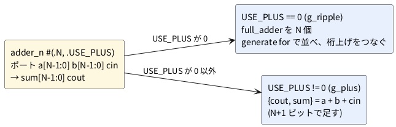

# 1-12 parameter と generate — 幅を変えられる部品

1-7 の加算器は 4 ビット専用だった。8 ビットが要るたびに書き直すのは手間なので、幅を引数にした加算器を 1 本書く。
幅を渡す仕組みが `parameter`、その幅に合わせて全加算器を必要な数だけ並べる仕組みが `generate` だ。
同じ部品を幅 4 と幅 8 で作り、`+` で書いた版と答えが同じことを確かめる。

この題は組まない題で、実体配線図と Analog Discovery 3 は付けない。PC の中だけで動かす (`device: SIM`)。

## 説明

- **`parameter`** は、箱 (module) を呼ぶときに外から渡せる定数だ。`module adder_n #(parameter N = 4) (...)` と書くと、`N` の既定値は 4 になる
- 呼ぶ側は `adder_n #(.N(8)) u1 (...)` と書いて、`N` を 8 にして使う。ポートの `.a(...)` と同じように、名前で渡せる
- 信号の幅も `[N-1:0]` のように `N` で書けるので、`N` を変えるだけでポートの幅が変わる
- **`generate`** は、シミュレーションや合成の前の段階 (エラボレーションと呼ぶ) で、回路を組み立てる仕組みだ。ここで決まる数は、動作中に変わらない
  - `for` は同じ回路を N 個並べる。繰り返しの変数は `genvar` で宣言する。ふつうの `integer` は使えない
  - `if` は、`parameter` の値で回路の形そのものを切り替える。選ばれなかった側の回路は作られない
  - 中身には `begin : 名前` で名前を付ける。シミュレーションの波形では、この名前が階層に出る
- `always` の中の `for` や `if` は、動作の書き方で、`generate` の中のものとは別物だ。回路を並べるのは `generate` のほう

## 論理図

図 1 は、`adder_n` の中身の切り替えを描いたブロック図だ。
`USE_PLUS` が 0 なら全加算器を N 個並べ、0 でなければ `+` を 1 つ置く。どちらも同じポートで外に見える。




- g_ripple の中の `generate for` は、N が 4 なら 4 個、8 なら 8 個の `full_adder` を作る。個々の名前は `g_ripple.g_fa[0].u_fa` のように、階層の名前が付く
- 桁上げの線 `c[0]` 〜 `c[N]` は、`c[0]` が `cin`、`c[N]` が `cout` に当たる。1-7 の `c1`・`c2`・`c3` を、番号で一般化したものだ

## Verilog

全加算器と半加算器は 1-6 のものをそのまま使う。

```verilog
// half_adder.v
module half_adder (
    input  wire a,
    input  wire b,
    output wire sum,
    output wire carry
);
    assign sum   = a ^ b;
    assign carry = a & b;
endmodule
```

```verilog
// full_adder.v
module full_adder (
    input  wire a,
    input  wire b,
    input  wire cin,
    output wire sum,
    output wire cout
);
    wire s1, c1, c2;
    half_adder u_ha1 (.a(a),  .b(b),   .sum(s1),  .carry(c1));
    half_adder u_ha2 (.a(s1), .b(cin), .sum(sum), .carry(c2));
    assign cout = c1 | c2;
endmodule
```

幅を変えられる加算器。

```verilog
// adder_n.v  幅 N を変えられる加算器。USE_PLUS で、全加算器を並べる版と + の版を選ぶ
module adder_n #(
    parameter N        = 4,
    parameter USE_PLUS = 0
) (
    input  wire [N-1:0] a,
    input  wire [N-1:0] b,
    input  wire         cin,
    output wire [N-1:0] sum,
    output wire         cout
);
    generate
        if (USE_PLUS != 0) begin : g_plus
            wire [N:0] total = {1'b0, a} + {1'b0, b} + {{N{1'b0}}, cin};
            assign {cout, sum} = total;
        end else begin : g_ripple
            wire [N:0] c;
            assign c[0] = cin;
            genvar i;
            for (i = 0; i < N; i = i + 1) begin : g_fa
                full_adder u_fa (.a(a[i]), .b(b[i]), .cin(c[i]), .sum(sum[i]), .cout(c[i+1]));
            end
            assign cout = c[N];
        end
    endgenerate
endmodule
```

- `parameter N = 4` の既定値は、呼ぶ側が `#(.N(...))` を書かなかったときだけ使われる
- `USE_PLUS != 0` を `generate if` の条件にしている。この条件は、動作中ではなくエラボレーションのときに決まる定数でなければならない
- `{N{1'b0}}` は、0 を N 個並べる書き方。`{{N{1'b0}}, cin}` で N+1 ビットに揃えて足している (1-7 で `4'b0` と書いた所を、幅に合わせて一般化した)
- `genvar i;` は `generate` の中に置いた。`for` の更新は `i = i + 1` と書く

幅 4 と幅 8 を、2 通りずつ並べて比べる箱。

```verilog
// adder_param_cmp.v  幅 4 と幅 8 の加算器を、全加算器の版と + の版で作り、答えを比べる
module adder_param_cmp (
    input  wire [7:0] a,
    input  wire [7:0] b,
    input  wire       cin,
    output wire [7:0] sum8,      // 幅 8、全加算器の版
    output wire       cout8,
    output wire [3:0] sum4,      // 幅 4、全加算器の版 (a と b の下位 4 ビット)
    output wire       cout4,
    output wire       same4,     // 幅 4 の 2 つの版が一致
    output wire       same8      // 幅 8 の 2 つの版が一致
);
    wire [7:0] sum8_p;
    wire       cout8_p;
    wire [3:0] sum4_p;
    wire       cout4_p;

    adder_n #(.N(8), .USE_PLUS(0)) u_r8 (.a(a),      .b(b),      .cin(cin), .sum(sum8),   .cout(cout8));
    adder_n #(.N(8), .USE_PLUS(1)) u_p8 (.a(a),      .b(b),      .cin(cin), .sum(sum8_p), .cout(cout8_p));
    adder_n #(.N(4), .USE_PLUS(0)) u_r4 (.a(a[3:0]), .b(b[3:0]), .cin(cin), .sum(sum4),   .cout(cout4));
    adder_n #(.N(4), .USE_PLUS(1)) u_p4 (.a(a[3:0]), .b(b[3:0]), .cin(cin), .sum(sum4_p), .cout(cout4_p));

    assign same8 = ({cout8, sum8} == {cout8_p, sum8_p});
    assign same4 = ({cout4, sum4} == {cout4_p, sum4_p});
endmodule
```

- `#(.N(8), .USE_PLUS(0))` が、幅 8 で全加算器を並べる版。`#(.N(4), .USE_PLUS(1))` が、幅 4 で `+` を使う版
- 同じ `adder_n` を、`N` と `USE_PLUS` の 4 通りの組み合わせで 4 つ作っている。それぞれ別の回路になる

## 動かす

```cpp
// tb_adder_param_cmp.cpp
#include <cstdio>
#include "Vadder_param_cmp.h"

int main() {
    Vadder_param_cmp top;
    const int a_list[]   = {0x0F, 0xFF, 0x7F, 0xFF, 0x34};
    const int b_list[]   = {0x01, 0x01, 0x7F, 0xFF, 0x1C};
    const int cin_list[] = {0, 0, 1, 1, 0};
    std::printf("# a b cin sum8 cout8 sum4 cout4 same4 same8\n");
    for (int i = 0; i < 5; i++) {
        top.a = a_list[i];
        top.b = b_list[i];
        top.cin = cin_list[i];
        top.eval();
        std::printf("%02x %02x %d %02x %d %x %d %d %d\n", top.a, top.b, top.cin,
                    top.sum8, top.cout8, top.sum4, top.cout4, top.same4, top.same8);
    }
    // 8 ビットの a・b と cin の全部 (2^17 通り) を試す
    long bad = 0;
    long tried = 0;
    for (int a = 0; a < 256; a++) {
        for (int b = 0; b < 256; b++) {
            for (int cin = 0; cin < 2; cin++) {
                top.a = a;
                top.b = b;
                top.cin = cin;
                top.eval();
                int total = a + b + cin;
                int total4 = (a & 0xF) + (b & 0xF) + cin;
                if (!top.same8 || !top.same4) bad++;
                if (top.sum8 != (total & 0xFF) || top.cout8 != (total >> 8)) bad++;
                if (top.sum4 != (total4 & 0xF) || top.cout4 != (total4 >> 4)) bad++;
                tried++;
            }
        }
    }
    std::printf("%ld 通りを試し、食い違いは %ld 件\n", tried, bad);
    return bad != 0;
}
```

```bash
verilator --lint-only -Wall --top-module adder_param_cmp adder_param_cmp.v adder_n.v full_adder.v half_adder.v
verilator -Wall --cc --exe --build --top-module adder_param_cmp adder_param_cmp.v adder_n.v full_adder.v half_adder.v tb_adder_param_cmp.cpp
./obj_dir/Vadder_param_cmp
```

lint は警告なしで通った。最初の 5 通り (16 進) と、全数の結果は次のとおりだった。

```text
# a b cin sum8 cout8 sum4 cout4 same4 same8
0f 01 0 10 0 0 1 1 1
ff 01 0 00 1 0 1 1 1
7f 7f 1 ff 0 f 1 1 1
ff ff 1 ff 1 f 1 1 1
34 1c 0 50 0 0 1 1 1
131072 通りを試し、食い違いは 0 件
```

## 計器の設定

組まない題なので、計器は使わない。実行結果の 5 通りをロジックアナライザの画面と同じ形の図 2 に描く。
実機で測った波形ではなく、実行結果から作った計算の図で、入力を変えた 1 回を 1 ms と見なして並べた。
a と b は表に書き、図には答え (sum8・sum4) と桁上げを出す。

```logic
# ロジックアナライザの画面 (tommie-fence の logic フェンス)
title: 図2 幅 8 と幅 4 の答え (Verilator の実行結果から作った計算の図)
device: generic
window: 5ms
signals:
  cin: pattern 00110 bit 1ms
  s0: pattern 00110 bit 1ms
  s1: pattern 00110 bit 1ms
  s2: pattern 00110 bit 1ms
  s3: pattern 00110 bit 1ms
  s4: pattern 10111 bit 1ms
  s5: pattern 00110 bit 1ms
  s6: pattern 00111 bit 1ms
  s7: pattern 00110 bit 1ms
  cout8: pattern 01010 bit 1ms
  t0: pattern 00110 bit 1ms
  t1: pattern 00110 bit 1ms
  t2: pattern 00110 bit 1ms
  t3: pattern 00110 bit 1ms
  cout4: pattern 11111 bit 1ms
  same4: pattern 11111 bit 1ms
  same8: pattern 11111 bit 1ms
buses:
  sum8: s7 s6 s5 s4 s3 s2 s1 s0 hex
  sum4: t3 t2 t1 t0 hex
```


## 見るべき値

| a | b | cin | 幅 8 の答え (cout8, sum8) | 幅 4 の答え (cout4, sum4) | same4 | same8 |
| --- | --- | --- | --- | --- | --- | --- |
| 0x0F | 0x01 | 0 | 0, 0x10 | 1, 0x0 | 1 | 1 |
| 0xFF | 0x01 | 0 | 1, 0x00 | 1, 0x0 | 1 | 1 |
| 0x7F | 0x7F | 1 | 0, 0xFF | 1, 0xF | 1 | 1 |
| 0xFF | 0xFF | 1 | 1, 0xFF | 1, 0xF | 1 | 1 |
| 0x34 | 0x1C | 0 | 0, 0x50 | 1, 0x0 | 1 | 1 |

- 1 行目は、同じ入力 0x0F + 0x01 でも、幅 8 なら 0x10 (桁上げ無し)、幅 4 なら下位 4 ビットの F + 1 で 0x0 に桁上げ 1 になる。幅 `N` が答えの形を決めている
- 2 行目の 0xFF + 0x01 は、幅 8 では 0x100 になる。sum8 が 0x00 で cout8 が 1
- 3 行目の 0x7F + 0x7F + 1 = 0xFF で、幅 8 の桁上げは 0
- どの行も same4 と same8 が 1。全加算器を並べた版と `+` の版は、5 通りで一致した
- 8 ビットの a・b と cin の全部 (2 の 17 乗 = 131072 通り) を試して、食い違いは 0 件だった。幅 4 の答えも、a と b の下位 4 ビットを C++ で足した値と全部一致した
- 幅を増やすとき、直すのは呼ぶ側の `#(.N(...))` だけで、`adder_n` 本体は触らない

## 出典

自作。
