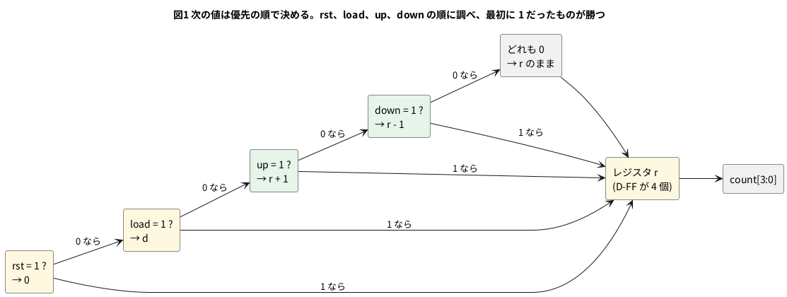

# 2-8 アップダウンカウンタとロード

2-4 のカウンタは 1 を足すだけだった。ここに「1 を引く」と「好きな値を読み込む」を足す。
入力は 3 つ。`up` が 1 なら 1 増やし、`down` が 1 なら 1 減らし、`load` が 1 なら `d` の値をそのまま入れる。
クロックの立ち上がりごとに、この 3 つのうち 1 つだけが効く。

困るのは、2 つ以上が同時に 1 になったときである。どれを勝たせるかを**優先の順**として書いておく。
この題では `rst` (2-3) → `load` → `up` → `down` の順にした。

- `load` が `up` と `down` に勝つ。値を読み込むとき、増減の指示は無視する
- `up` と `down` が両方 1 なら `up` が勝つ。互いに打ち消して動かない、という作りにもできるが、ここでは決めを 1 つにした

4 ビットなので、15 に 1 を足すと 0 に、0 から 1 を引くと 15 に回り込む。

組まない題なので、実体配線図と Analog Discovery 3 は入れない。

## 論理図




## Verilog

```verilog
// updown.v
module updown #(
    parameter W = 4
) (
    input          clk,
    input          rst,
    input          load,
    input  [W-1:0] d,
    input          up,
    input          down,
    output [W-1:0] count
);
    reg [W-1:0] r;

    assign count = r;

    always @(posedge clk)
        if (rst)       r <= {W{1'b0}};
        else if (load) r <= d;
        else if (up)   r <= r + 1'b1;
        else if (down) r <= r - 1'b1;
endmodule
```

- `if` / `else if` を上から順に調べるので、書いた順がそのまま優先の順になる。順を入れ替えれば、勝つものが変わる
- 3 つとも 0 のときは、どの `if` にも当たらず `r` に何も代入しない。値は保たれる (2-5 と同じ)
- `r + 1'b1` と `r - 1'b1` は W ビットで計算され、桁があふれた分は捨てられる。これが 15 → 0 と 0 → 15 の回り込みになる

## 動かす

```verilog
// tb_updown.v
module tb_updown;
    reg        clk;
    reg        rst;
    reg        load;
    reg  [3:0] d;
    reg        up;
    reg        down;
    wire [3:0] count;

    updown #(.W(4)) u (.clk(clk), .rst(rst), .load(load), .d(d), .up(up), .down(down), .count(count));

    initial clk = 0;
    always #5 clk = ~clk;    // 立ち上がりは 5, 15, 25, ... us

    // 立ち上がりの 1 us 後に入力を変え、次の立ち上がりで取り込ませる
    task step(input l, input [3:0] dd, input u_, input dn);
        begin
            load = l; d = dd; up = u_; down = dn;
            @(posedge clk); #1;
            $display("load=%b d=%2d up=%b down=%b -> count=%0d", l, dd, u_, dn, count);
        end
    endtask

    initial begin
        $dumpfile("updown.vcd");
        $dumpvars(0, tb_updown);
        rst = 1; load = 0; d = 0; up = 0; down = 0;
        @(posedge clk); #1 rst = 0;
        step(0, 0, 0, 0);    // 何もしない
        step(1, 5, 0, 0);    // load 5
        step(0, 0, 1, 0);    // up
        step(0, 0, 1, 0);    // up
        step(0, 0, 1, 0);    // up
        step(0, 0, 0, 1);    // down
        step(0, 0, 0, 1);    // down
        step(1, 12, 1, 1);   // load が up と down に勝つ
        step(0, 0, 1, 1);    // up が down に勝つ
        step(1, 15, 0, 0);   // load 15
        step(0, 0, 1, 0);    // up: 15 -> 0
        step(0, 0, 0, 1);    // down: 0 -> 15
        step(0, 0, 0, 0);    // 保持
        #20 $finish;
    end
endmodule
```

```bash
verilator --lint-only -Wall updown.v
verilator --timescale 1us/1ns --binary --timing --trace --top-module tb_updown updown.v tb_updown.v
./obj_dir/Vtb_updown
```

`-Wall` の lint は警告 0 件で通った。実行すると、1 回の `step` ごとに入力と、立ち上がりの 1 µs 後の `count` が出る。

```text
load=0 d= 0 up=0 down=0 -> count=0
load=1 d= 5 up=0 down=0 -> count=5
load=0 d= 0 up=1 down=0 -> count=6
load=0 d= 0 up=1 down=0 -> count=7
load=0 d= 0 up=1 down=0 -> count=8
load=0 d= 0 up=0 down=1 -> count=7
load=0 d= 0 up=0 down=1 -> count=6
load=1 d=12 up=1 down=1 -> count=12
load=0 d= 0 up=1 down=1 -> count=13
load=1 d=15 up=0 down=0 -> count=15
load=0 d= 0 up=1 down=0 -> count=0
load=0 d= 0 up=0 down=1 -> count=15
load=0 d= 0 up=0 down=0 -> count=15
```

## シミュレーションの波形

```logic
# ロジックアナライザの画面 (tommie-fence の logic フェンス)
title: 図2 LOAD が UP と DOWN に勝ち、UP が DOWN に勝つ。15 の次は 0、0 の次は 15
device: generic
time: 16us/div
signals:
  CLK: edges 0s=0 5us=1 10us=0 15us=1 20us=0 25us=1 30us=0 35us=1 40us=0 45us=1 50us=0 55us=1 60us=0 65us=1 70us=0 75us=1 80us=0 85us=1 90us=0 95us=1 100us=0 105us=1 110us=0 115us=1 120us=0 125us=1 130us=0 135us=1 140us=0 145us=1 150us=0 155us=1
  RST: edges 0s=1 6us=0
  LOAD: edges 0s=0 16us=1 26us=0 76us=1 86us=0 96us=1 106us=0
  UP: edges 0s=0 26us=1 56us=0 76us=1 96us=0 106us=1 116us=0
  DOWN: edges 0s=0 56us=1 96us=0 116us=1 126us=0
  D0: edges 0s=0 16us=1 26us=0 96us=1 106us=0
  D1: edges 0s=0 96us=1 106us=0
  D2: edges 0s=0 16us=1 26us=0 76us=1 86us=0 96us=1 106us=0
  D3: edges 0s=0 76us=1 86us=0 96us=1 106us=0
  Q0: edges 0s=0 25us=1 35us=0 45us=1 55us=0 65us=1 75us=0 95us=1 115us=0 125us=1
  Q1: edges 0s=0 35us=1 55us=0 65us=1 85us=0 105us=1 115us=0 125us=1
  Q2: edges 0s=0 25us=1 55us=0 65us=1 115us=0 125us=1
  Q3: edges 0s=0 55us=1 65us=0 85us=1 115us=0 125us=1
buses:
  D: D3..D0 dec
  Q: Q3..Q0 dec
cursors: [60us, 110us]
```


## 見るべき値 (シミュレーションを実行して得た値)

| 立ち上がり | 入力 | `count` |
| --- | --- | --- |
| 25 µs | load = 1、d = 5 | 5 |
| 35 µs から 55 µs | up = 1 (3 回) | 6、7、8 |
| 65 µs と 75 µs | down = 1 (2 回) | 7、6 |
| 85 µs | load = 1、up = 1、down = 1 | 12 (load が勝つ) |
| 95 µs | up = 1、down = 1 | 13 (up が勝つ) |
| 105 µs | load = 1、d = 15 | 15 |
| 115 µs | up = 1 | 0 (15 の次は 0 に回り込む) |
| 125 µs | down = 1 | 15 (0 の次は 15 に回り込む) |

- 図2のカーソル X1 = 60 µs では Q = 8、X2 = 110 µs では Q = 15 である。X1 は up を 3 回効かせたあと、X2 は 15 を読み込んだあとにあたる
- 85 µs の行が優先の順の確かめになる。load と up と down が全部 1 なのに、12 が入る。95 µs の行で load を外すと、up だけが効いて 13 になる
- 波形で `count` は、立ち上がりの瞬間にだけ変わる。`load` や `up` が 1 になった時刻 (16 µs、26 µs、…) では変わらない。取り込まれるのは次の立ち上がりである

## シミュレーションでの確かめ

道具は Verilator 5.042 (`--timescale 1us/1ns --binary --timing --trace`、lint は `--lint-only -Wall`)。回路は `sim/08-updown-load.v`、テストベンチは `sim/08-updown-load-tb.v` に置いた。図の波形 (logic フェンスの `edges`) は、実行で書き出した VCD の変化の時刻と 1 本ずつ突き合わせた。

| 項目 | 本文の数字 | 実行結果 | 判定 |
| --- | --- | --- | --- |
| lint | 警告 0 件 | 警告 0 件 | 合った |
| 13 ステップの `count` | 0, 5, 6, 7, 8, 7, 6, 12, 13, 15, 0, 15, 15 | 本文のブロックと完全に一致 | 合った |
| 優先の順 | load が up・down に勝つ、up が down に勝つ | 12 と 13 | 合った |
| 回り込み | 15 → 0、0 → 15 | 同じ | 合った |
| 図 2 の波形 | CLK・RST・LOAD・UP・DOWN・D0〜D3・Q0〜Q3 | VCD と一致 | 合った |

## 出典

自作。優先の順は `if` / `else if` の並びで決める書き方で、Verilog の一般的な作法である。

参考: [Counter (digital) (Wikipedia)](https://en.wikipedia.org/wiki/Counter_(digital))
