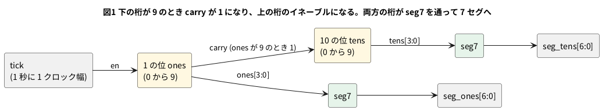

# 2-9 10 進カウンタと桁上げ — ストップウォッチの秒を 2 桁の 7 セグに

2 進カウンタ (2-4) は 0 から 15 まで数えて 0 に戻る。人が読む「秒」は 0 から 9 まで数えて、次は桁が上がる。
そこで 4 ビットのカウンタを **9 の次に 0 へ戻す** 形にして、1 桁の 10 進カウンタを作る。
これを 2 つ並べれば、00 から 99 まで数える。

2 桁にするときの要点は 1 つで、**下の桁が 9 から 0 へ戻る瞬間に、上の桁を 1 つ進める**。
この「9 から 0 へ戻るよ」という信号を桁上げ (`carry`) と呼び、上の桁のイネーブル (2-5) につなぐ。
上の桁にもクロックは毎回来るが、`carry` が 1 のときだけ値を更新する。

数えた値は 4 ビットの BCD (2 進化 10 進。0 から 9 までの 4 ビット) で、そのままでは 7 セグに出せない。
7 本の線 (a から g) のどれを点けるかに直すデコーダ `seg7` を通す。

この題の動かす所は WEB (ブラウザの soft-fpga) で、ここでは Verilog と動作を Verilator で確かめた。
組まない題なので、実体配線図と Analog Discovery 3 は入れない。ブレッドボードに 7 セグを付けるのは 5-15 である。

## 論理図




## Verilog

1 桁の 10 進カウンタ。

```verilog
// bcd_digit.v
module bcd_digit (
    input            clk,
    input            rst,
    input            en,
    output reg [3:0] q,
    output           carry
);
    assign carry = en && (q == 4'd9);

    always @(posedge clk)
        if (rst)     q <= 4'd0;
        else if (en) q <= (q == 4'd9) ? 4'd0 : q + 4'd1;
endmodule
```

2 桁。下の桁の `carry` を、上の桁の `en` に入れる。

```verilog
// bcd2.v
module bcd2 (
    input        clk,
    input        rst,
    input        en,
    output [3:0] ones,
    output [3:0] tens,
    output       carry
);
    wire c0;

    bcd_digit d0 (.clk(clk), .rst(rst), .en(en), .q(ones), .carry(c0));
    bcd_digit d1 (.clk(clk), .rst(rst), .en(c0), .q(tens), .carry(carry));
endmodule
```

7 セグのデコーダ。1 が点灯で、`seg` は上位から g f e d c b a の順である。

```verilog
// seg7.v
module seg7 (
    input      [3:0] d,
    output reg [6:0] seg
);
    always @(*)
        case (d)
            4'd0:    seg = 7'b0111111;
            4'd1:    seg = 7'b0000110;
            4'd2:    seg = 7'b1011011;
            4'd3:    seg = 7'b1001111;
            4'd4:    seg = 7'b1100110;
            4'd5:    seg = 7'b1101101;
            4'd6:    seg = 7'b1111101;
            4'd7:    seg = 7'b0000111;
            4'd8:    seg = 7'b1111111;
            4'd9:    seg = 7'b1101111;
            default: seg = 7'b0000000;
        endcase
endmodule
```

ストップウォッチの秒。2-7 と同じ数え方で `tick` (1 秒に 1 クロック幅) を作り、2 桁に入れる。

```verilog
// stopwatch.v
module stopwatch #(
    parameter CLK_HZ = 27_000_000
) (
    input        clk,
    input        rst,
    output [6:0] seg_ones,
    output [6:0] seg_tens
);
    localparam LAST = CLK_HZ - 1;
    localparam W    = (CLK_HZ > 1) ? $clog2(CLK_HZ) : 1;

    reg [W-1:0] cnt;
    wire        tick = (cnt == LAST[W-1:0]);
    wire [3:0]  ones;
    wire [3:0]  tens;
    wire        unused_carry;

    always @(posedge clk)
        if (rst || tick) cnt <= {W{1'b0}};
        else             cnt <= cnt + 1'b1;

    bcd2 sec (.clk(clk), .rst(rst), .en(tick), .ones(ones), .tens(tens), .carry(unused_carry));
    seg7 s0 (.d(ones), .seg(seg_ones));
    seg7 s1 (.d(tens), .seg(seg_tens));
endmodule
```

- `carry = en && (q == 4'd9)` の `en` が大事である。`en` が 0 の間は桁が動かないので、`q` が 9 で止まっているあいだに `carry` が 1 のままだと、上の桁が進んでしまう。`en` を掛けておけば、数えるクロックのときだけ 1 になる
- `bcd2` の `carry` は、99 から 00 へ戻る瞬間に 1 になる。ここでは使わないので `stopwatch` では `unused_carry` に受けた。3 桁目を足すときの桁上げになる
- `stopwatch` の `CLK_HZ` は 2-7 と同じ約束で、動かす所ごとに書き換えるのはこの値だけである
- 7 セグのデコーダそのものの書き方は 1-8 で扱う。この題では、点灯を 1、並びを g f e d c b a と決めて載せた

## 動かす

lint は、`CLK_HZ` を既定 (27 000 000) と 4 の 2 通りで警告 0 件で通った。

```bash
verilator --lint-only -Wall bcd_digit.v
verilator --lint-only -Wall bcd2.v bcd_digit.v
verilator --lint-only -Wall seg7.v
verilator --lint-only -Wall --top-module stopwatch stopwatch.v bcd2.v bcd_digit.v seg7.v
verilator --lint-only -Wall -GCLK_HZ=4 --top-module stopwatch stopwatch.v bcd2.v bcd_digit.v seg7.v
```

### 桁上げを波形で見る

`bcd2` のイネーブルを 1 に固定して、クロックごとに 1 ずつ数えさせた。

```verilog
// tb_bcd2.v
module tb_bcd2;
    reg        clk;
    reg        rst;
    wire [3:0] ones;
    wire [3:0] tens;
    wire       carry;
    wire       c0 = u.c0;       // 1 の位の桁上げ (10 の位のイネーブル)
    integer    n;

    bcd2 u (.clk(clk), .rst(rst), .en(1'b1), .ones(ones), .tens(tens), .carry(carry));

    initial clk = 0;
    always #5 clk = ~clk;    // 立ち上がりは 5, 15, 25, ... us

    initial begin
        $dumpfile("bcd2.vcd");
        $dumpvars(0, tb_bcd2);
        rst = 1;
        #12 rst = 0;                     // 12 us: 立ち上がり (15) の前に放す
        for (n = 1; n <= 101; n = n + 1) begin
            @(posedge clk); #1;
            if (n <= 12 || n >= 98)
                $display("clock %0d: tens=%0d ones=%0d carry=%b", n, tens, ones, carry);
        end
        #20 $finish;
    end
endmodule
```

```bash
verilator --timescale 1us/1ns --binary --timing --trace --top-module tb_bcd2 tb_bcd2.v bcd2.v bcd_digit.v
./obj_dir/Vtb_bcd2
```

```text
clock 8: tens=0 ones=8 carry=0
clock 9: tens=0 ones=9 carry=0
clock 10: tens=1 ones=0 carry=0
clock 11: tens=1 ones=1 carry=0
clock 98: tens=9 ones=8 carry=0
clock 99: tens=9 ones=9 carry=1
clock 100: tens=0 ones=0 carry=0
clock 101: tens=0 ones=1 carry=0
```

(出力は 1 から 12 クロックと 98 から 101 クロックのうち、桁が変わる所を抜いた。)

### 秒の表示を見る

`CLK_HZ` を 4 にして、4 クロックを 1 秒にした `stopwatch` を 100 秒ぶん回し、1 秒ごとの `seg_tens` `seg_ones` を出した。

```verilog
// tb_stopwatch.v
module tb_stopwatch;
    reg        clk;
    reg        rst;
    wire [6:0] seg_ones;
    wire [6:0] seg_tens;
    integer    n;
    integer    sec;

    stopwatch #(.CLK_HZ(4)) u (.clk(clk), .rst(rst), .seg_ones(seg_ones), .seg_tens(seg_tens));

    initial clk = 0;
    always #5 clk = ~clk;    // 立ち上がりは 5, 15, 25, ... us

    initial begin
        rst = 1;
        #12 rst = 0;                     // 12 us: 立ち上がり (15) の前に放す
        // CLK_HZ = 4 なので 4 クロックが 1 秒。4 x 秒 のあと、立ち上がりの 1 us 後に読む
        for (n = 1; n <= 4 * 100 + 4; n = n + 1) begin
            @(posedge clk); #1;
            if (n % 4 == 0) begin
                sec = n / 4;
                if (sec <= 11 || sec >= 98)
                    $display("sec=%0d tens=%07b ones=%07b", sec, seg_tens, seg_ones);
            end
        end
        #20 $finish;
    end
endmodule
```

```bash
verilator --timescale 1us/1ns --binary --timing --top-module tb_stopwatch tb_stopwatch.v stopwatch.v bcd2.v bcd_digit.v seg7.v
./obj_dir/Vtb_stopwatch
```

```text
sec=1 tens=0111111 ones=0000110
sec=2 tens=0111111 ones=1011011
sec=9 tens=0111111 ones=1101111
sec=10 tens=0000110 ones=0111111
sec=11 tens=0000110 ones=0000110
sec=98 tens=1101111 ones=1111111
sec=99 tens=1101111 ones=1101111
sec=100 tens=0111111 ones=0111111
sec=101 tens=0111111 ones=0000110
```

(出力は sec=1 から 11 と 98 から 101 のうち、読みどころだけ抜いた。)

## シミュレーションの波形

```logic
title: 図2 1 の位が 9 のとき C0 が 1 になり、次の立ち上がりで 10 の位が進む
device: generic
time: 16us/div
signals:
  CLK: edges 0s=0 5us=1 10us=0 15us=1 20us=0 25us=1 30us=0 35us=1 40us=0 45us=1 50us=0 55us=1 60us=0 65us=1 70us=0 75us=1 80us=0 85us=1 90us=0 95us=1 100us=0 105us=1 110us=0 115us=1 120us=0 125us=1 130us=0 135us=1 140us=0 145us=1 150us=0 155us=1 160us=0
  C0: edges 0s=0 35us=1 45us=0 135us=1 145us=0
  O0: edges 0s=1 5us=0 15us=1 25us=0 35us=1 45us=0 55us=1 65us=0 75us=1 85us=0 95us=1 105us=0 115us=1 125us=0 135us=1 145us=0 155us=1
  O1: edges 0s=0 5us=1 25us=0 65us=1 85us=0 105us=1 125us=0
  O2: edges 0s=1 25us=0 85us=1 125us=0
  O3: edges 0s=0 25us=1 45us=0 125us=1 145us=0
  T0: edges 0s=0 45us=1 145us=0
  T1: edges 0s=0 145us=1
  T2: edges 0s=0
  T3: edges 0s=0
buses:
  Ones: O3..O0 dec
  Tens: T3..T0 dec
cursors: [40us, 50us]
```


図2の時刻は、元のシミュレーションの 60 µs を 0 にずらして書いてある。元の時刻では、`ones` が 9 になるのが 95 µs、10 の位が進むのが 105 µs である。

## 見るべき値 (シミュレーションを実行して得た値)

7 セグのデコーダが出した 7 ビット (g f e d c b a の順、1 が点灯)。

| 数 | `seg` | 数 | `seg` |
| --- | --- | --- | --- |
| 0 | 0111111 | 5 | 1101101 |
| 1 | 0000110 | 6 | 1111101 |
| 2 | 1011011 | 7 | 0000111 |
| 3 | 1001111 | 8 | 1111111 |
| 4 | 1100110 | 9 | 1101111 |

- 図2のカーソル X1 = 40 µs では Ones = 9、Tens = 0、C0 = 1。X2 = 50 µs では Ones = 0、Tens = 1、C0 = 0 である。9 から 0 へ戻るのと、10 の位が 1 つ進むのは**同じ立ち上がり**で起きる。C0 は 1 つ手前の周期で 1 になっている
- 99 の次は 00 に戻る。`bcd2` の `carry` は、99 を示しているクロックの 1 周期だけ 1 になる (出力の `clock 99` の行)
- `stopwatch` は、`CLK_HZ` クロックごとに 1 つ進む。100 秒ぶんを回したとき、100 秒目に 00、101 秒目に 01 になった
- 数字の形は 7 セグの記号の並びで決まる。実際の 7 セグがアノードコモンなら 1 と 0 を入れ替える (点灯が 0 になる)。5-15 で、手持ちの部品に合わせて書く

### 動かす所ごとの `CLK_HZ`

| 動かす所 | `CLK_HZ` に入れる値 |
| --- | --- |
| ブラウザの soft-fpga (4-3) | 波形を見やすい小さい値 (たとえば 4)。1 秒ごとの実際の表示を見るには、ブラウザが 1 秒に回せるクロック数が要る。この数は測っていないので、4-1 以降で測って書く。ブラウザで 7 セグの表示がどう見えるかも、この題では確かめていない |
| Pico 2 の Soft-FPGA (5-15) | 5-5 で測ったクロックを入れる。測る前は決めない |
| Tang Nano 9K (8-4 と同じ水晶) | 27 000 000 |

## 出典

自作。2 桁の 10 進カウンタは、桁上げを上の桁のイネーブルにする一般的な作法である。7 セグの a から g の並びと
字形は、7 セグメントディスプレイの一般的な表記による
([https://ja.wikipedia.org/wiki/7%E3%82%BB%E3%82%B0%E3%83%A1%E3%83%B3%E3%83%88%E3%83%87%E3%82%A3%E3%82%B9%E3%83%97%E3%83%AC%E3%82%A4](https://ja.wikipedia.org/wiki/7%E3%82%BB%E3%82%B0%E3%83%A1%E3%83%B3%E3%83%88%E3%83%87%E3%82%A3%E3%82%B9%E3%83%97%E3%83%AC%E3%82%A4))。
Tang Nano 9K の 27 MHz の水晶は Sipeed の Tang Nano 9K のページ
([https://wiki.sipeed.com/hardware/en/tang/Tang-Nano-9K/Nano-9K.html](https://wiki.sipeed.com/hardware/en/tang/Tang-Nano-9K/Nano-9K.html)) による。
