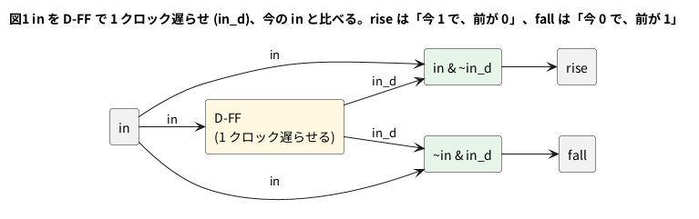

# 2-10 立ち上がりの検出 — 1 クロックのパルスを作る

押しボタンやスイッチの信号は、押している間ずっと 1 である。これをそのままカウンタのイネーブルにつなぐと、
押している間じゅう数えつづけてしまう。ほしいのは「押した瞬間に 1 回だけ」である。

作り方は、信号を **1 クロック遅らせたもの** と今の信号を比べる。
今が 1 で、1 クロック前が 0 なら、いま立ち上がったところである。これで 1 クロックだけ 1 になる信号が得られる。
同じ形で、立ち下がり (今が 0 で、1 クロック前が 1) も取れる。

この「1 クロックのパルス」は、2-5 のイネーブルとして使える。2-8 の `up` につなげば、押すたびに 1 つ数えるカウンタになる。

組まない題なので、実体配線図と Analog Discovery 3 は入れない。

## 論理図




## Verilog

```verilog
// edge_detect.v
module edge_detect (
    input  clk,
    input  rst,
    input  in,
    output rise,
    output fall
);
    reg in_d;    // 1 クロック前の in

    always @(posedge clk)
        if (rst) in_d <= 1'b0;
        else     in_d <= in;

    assign rise =  in & ~in_d;
    assign fall = ~in &  in_d;
endmodule
```

- `in_d` は D-FF 1 個。立ち上がりごとに `in` を取り込むので、`in_d` は常に「1 クロック前の `in`」である
- `rise` と `fall` は組み合わせの式で、フリップフロップではない。`in` が変わると、その同じクロックの中で `rise` が 1 になり、次の立ち上がりで `in_d` が追いついて 0 に戻る
- リセット中の `in_d` は 0 にした。`in` がリセットの解除時にすでに 1 なら、解除の直後に 1 回 `rise` が出る。これを避けたければ、`in_d` のリセット値を `in` に合わせる
- `in` は **クロックに同期した信号** であることを前提にした。外から来る押しボタンの信号を直接入れてはいけない。クロックと無関係に変わる信号は、フリップフロップ 2 段で受けてから使う (9-2)。さらに、押したときの細かい揺れ (チャタリング) は、この回路では取れない (6-3)

## 動かす

```verilog
// tb_edge_detect.v
module tb_edge_detect;
    reg  clk;
    reg  rst;
    reg  in;
    wire rise;
    wire fall;
    integer n_rise;
    integer n_fall;

    edge_detect u (.clk(clk), .rst(rst), .in(in), .rise(rise), .fall(fall));

    initial clk = 0;
    always #5 clk = ~clk;    // 立ち上がりは 5, 15, 25, ... us

    // 立ち上がりの直前の rise と fall を数える
    always @(posedge clk) begin
        if (rst) begin
            n_rise <= 0;
            n_fall <= 0;
        end else begin
            if (rise) n_rise <= n_rise + 1;
            if (fall) n_fall <= n_fall + 1;
        end
    end

    // in は立ち上がりの 1 us 後に変える (クロックに同期した信号)
    task hold(input v, input integer clocks);
        begin
            in = v;
            repeat (clocks) @(posedge clk);
            #1;
        end
    endtask

    initial begin
        $dumpfile("edge_detect.vcd");
        $dumpvars(0, tb_edge_detect);
        rst = 1; in = 0;
        #12 rst = 0;                  // 12 us: 立ち上がり (15) の前に放す
        @(posedge clk); #1;           // 15 us の 1 us 後
        hold(0, 2);
        hold(1, 6);                   // 長い 1: rise は 1 回だけ
        hold(0, 3);
        hold(1, 1);                   // 1 クロックだけの 1
        hold(0, 2);
        hold(1, 3);
        hold(0, 3);
        #20;
        $display("rise pulses=%0d fall pulses=%0d", n_rise, n_fall);
        $finish;
    end
endmodule
```

```bash
verilator --lint-only -Wall edge_detect.v
verilator --timescale 1us/1ns --binary --timing --trace --top-module tb_edge_detect edge_detect.v tb_edge_detect.v
./obj_dir/Vtb_edge_detect
```

`-Wall` の lint は警告 0 件で通った。`in` を 6 クロック・1 クロック・3 クロックの 3 通りの長さで 1 にしたとき、`rise` と `fall` が出た回数は次のとおり。

```text
rise pulses=3 fall pulses=3
```

## シミュレーションの波形

```logic
title: 図2 IN が 1 の間ずっと立っていても、RISE は変わった直後の 1 回だけ。FALL も 1 回だけ
device: generic
time: 24us/div
signals:
  CLK: edges 0s=0 5us=1 10us=0 15us=1 20us=0 25us=1 30us=0 35us=1 40us=0 45us=1 50us=0 55us=1 60us=0 65us=1 70us=0 75us=1 80us=0 85us=1 90us=0 95us=1 100us=0 105us=1 110us=0 115us=1 120us=0 125us=1 130us=0 135us=1 140us=0 145us=1 150us=0 155us=1 160us=0 165us=1 170us=0 175us=1 180us=0 185us=1 190us=0 195us=1 200us=0 205us=1 210us=0 215us=1 220us=0 225us=1 230us=0 235us=1
  IN: edges 0s=0 36us=1 96us=0 126us=1 136us=0 156us=1 186us=0
  RISE: edges 0s=0 36us=1 45us=0 126us=1 135us=0 156us=1 165us=0
  FALL: edges 0s=0 96us=1 105us=0 136us=1 145us=0 186us=1 195us=0
cursors: [40us, 100us]
```


## 見るべき値 (シミュレーションを実行して得た値)

| IN が 1 になった | IN が 1 だった長さ | RISE の幅 | IN が 0 になった | FALL の幅 |
| --- | --- | --- | --- | --- |
| 36 us | 6 クロック (60 us) | 9 us (36 us から 45 us) | 96 us | 9 us (96 us から 105 us) |
| 126 us | 1 クロック (10 us) | 9 us (126 us から 135 us) | 136 us | 9 us (136 us から 145 us) |
| 156 us | 3 クロック (30 us) | 9 us (156 us から 165 us) | 186 us | 9 us (186 us から 195 us) |

- 図2のカーソル X1 = 40 us では IN = 1、RISE = 1、FALL = 0。X2 = 100 us では IN = 0、RISE = 0、FALL = 1 である
- IN が 6 クロックのあいだ 1 でも、RISE は 1 回、9 us だけである。長さがちがっても、パルスの数は IN の変化の数と同じ 3 回になる
- RISE の幅が 10 us ではなく 9 us なのは、テストベンチが IN を立ち上がりの 1 us 後に変えているためである。IN が変わってから次の立ち上がりまでの時間がそのまま幅になる。FPGA の中で同じクロックのフリップフロップが作った信号なら、変わる時刻はクロックの立ち上がりとほぼ同時なので、幅はほぼ 1 クロックになる
- 1 クロックしか続かない IN (126 us から 136 us) も、立ち上がりと立ち下がりが 1 回ずつ検出される。1 クロックより短い IN は、立ち上がりの時刻をまたがないので検出できない

## 出典

自作。「1 クロック前の値と比べて変化を検出する」形は、同期回路の一般的な作法である。
