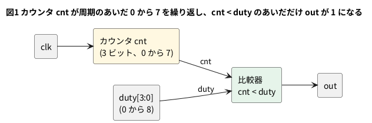

# 2-11 PWM — カウンタと比較器

LED の明るさや、モーターの速さを変えたいとき、出力の電圧を変える代わりに、**1 と 0 を速く切り替えて、1 の割合を変える**。
これが PWM (パルス幅変調) である。1 周期のうち 1 の時間の割合をデューティと呼ぶ。
デューティが 25 % なら、4 クロックに 1 クロックだけ 1 で、残りの 3 クロックは 0 になる。

作り方は、2-4 のカウンタと、数を比べる回路 (比較器) の 2 つである。カウンタは 0 から (周期 - 1) まで数え、
`カウンタの値 < デューティ` が成り立つあいだだけ出力を 1 にする。デューティを大きくすれば、1 の時間が長くなる。

組まない題なので、実体配線図と Analog Discovery 3 は入れない。

## 論理図




## Verilog

```verilog
// pwm.v
module pwm #(
    parameter W = 3
) (
    input          clk,
    input          rst,
    input  [W:0]   duty,
    output         out
);
    reg [W-1:0] cnt;

    assign out = ({1'b0, cnt} < duty);

    always @(posedge clk)
        if (rst) cnt <= {W{1'b0}};
        else     cnt <= cnt + 1'b1;
endmodule
```

- 周期は 2 の `W` 乗クロックである。`W = 3` なら 8 クロック。カウンタは 3 ビットで、数えきると自然に 0 に戻る (2-4)
- `duty` は `W + 1` ビットで、0 から 2^W (= 8) まで入れられる。0 は常に 0、8 は常に 1 (100 %) である。
  `W` ビットだけにすると、100 % が作れない (8 は 3 ビットに入らない)
- `{1'b0, cnt}` は、比べる幅を `duty` にそろえるために上に 0 を 1 つ付けている。幅が違うと lint が警告する
- 出力 `out` はカウンタから比較器を通る組み合わせの式で、`out` 自体にはフリップフロップが無い。LED やモーターに出すなら、
  `out` をもう 1 段のフリップフロップで受けるとひげ (グリッチ、9-5) が減る。この題では確かめていない

## 動かす

デューティを 0 から 8 まで変えて、それぞれ 8 周期 (64 クロック) のあいだに `out` が 1 だったクロック数を数えた。

```verilog
// tb_pwm.v
module tb_pwm;
    reg        clk;
    reg        rst;
    reg  [3:0] duty;
    wire       out;
    integer    hi;
    integer    i;
    integer    d;

    pwm #(.W(3)) u (.clk(clk), .rst(rst), .duty(duty), .out(out));

    initial clk = 0;
    always #5 clk = ~clk;    // 立ち上がりは 5, 15, 25, ... us

    initial begin
        $dumpfile("pwm.vcd");
        $dumpvars(0, tb_pwm);
        rst = 1; duty = 4'd0;
        #12 rst = 0;                     // 12 us: 立ち上がり (15) の前に放す
        for (d = 0; d <= 8; d = d + 1) begin
            duty = d[3:0];
            @(posedge clk); #1;          // duty が変わった周期の途中を捨てるため 1 周期分進める
            repeat (7) @(posedge clk);
            #1;
            hi = 0;
            for (i = 0; i < 64; i = i + 1) begin
                @(posedge clk);
                if (out) hi = hi + 1;
            end
            $display("duty=%0d/8: out was 1 for %0d of 64 clocks", d, hi);
        end
        #20 $finish;
    end
endmodule
```

```bash
verilator --lint-only -Wall pwm.v
verilator --lint-only -Wall -GW=8 pwm.v
verilator --timescale 1us/1ns --binary --timing --trace --top-module tb_pwm tb_pwm.v pwm.v
./obj_dir/Vtb_pwm
```

`W` が 3 と 8 の 2 通りで、lint は警告 0 件で通った。

```text
duty=0/8: out was 1 for 0 of 64 clocks
duty=1/8: out was 1 for 8 of 64 clocks
duty=2/8: out was 1 for 16 of 64 clocks
duty=3/8: out was 1 for 24 of 64 clocks
duty=4/8: out was 1 for 32 of 64 clocks
duty=5/8: out was 1 for 40 of 64 clocks
duty=6/8: out was 1 for 48 of 64 clocks
duty=7/8: out was 1 for 56 of 64 clocks
duty=8/8: out was 1 for 64 of 64 clocks
```

## シミュレーションの波形

デューティを 2、4、6 の順に変え、それぞれ 2 周期ずつ出した。時刻は、周期の頭 (元のシミュレーションの 85 us) を 0 にずらして書いてある。

```logic
title: 図2 デューティを 2、4、6 にすると OUT が 1 の幅が 2、4、6 クロックになる
device: generic
time: 48us/div
signals:
  CLK: edges 0s=1 5us=0 10us=1 15us=0 20us=1 25us=0 30us=1 35us=0 40us=1 45us=0 50us=1 55us=0 60us=1 65us=0 70us=1 75us=0 80us=1 85us=0 90us=1 95us=0 100us=1 105us=0 110us=1 115us=0 120us=1 125us=0 130us=1 135us=0 140us=1 145us=0 150us=1 155us=0 160us=1 165us=0 170us=1 175us=0 180us=1 185us=0 190us=1 195us=0 200us=1 205us=0 210us=1 215us=0 220us=1 225us=0 230us=1 235us=0 240us=1 245us=0 250us=1 255us=0 260us=1 265us=0 270us=1 275us=0 280us=1 285us=0 290us=1 295us=0 300us=1 305us=0 310us=1 315us=0 320us=1 325us=0 330us=1 335us=0 340us=1 345us=0 350us=1 355us=0 360us=1 365us=0 370us=1 375us=0 380us=1 385us=0 390us=1 395us=0 400us=1 405us=0 410us=1 415us=0 420us=1 425us=0 430us=1 435us=0 440us=1 445us=0 450us=1 455us=0 460us=1 465us=0 470us=1 475us=0 480us=1
  D0: edges 0s=0
  D1: edges 0s=1 161us=0 321us=1
  D2: edges 0s=0 161us=1
  D3: edges 0s=0
  OUT: edges 0s=1 20us=0 80us=1 100us=0 160us=1 200us=0 240us=1 280us=0 320us=1 380us=0 400us=1 460us=0 480us=1
buses:
  Duty: D3..D0 dec
cursors: [0s, 80us]
```


## 見るべき値 (シミュレーションを実行して得た値)

| デューティ | `out` が 1 の幅 (1 周期あたり) | 64 クロックで 1 だったクロック数 |
| --- | --- | --- |
| 0/8 | 0 クロック | 0 |
| 2/8 (25 %) | 2 クロック | 16 |
| 4/8 (50 %) | 4 クロック | 32 |
| 6/8 (75 %) | 6 クロック | 48 |
| 8/8 (100 %) | 8 クロック | 64 |

- 図2のカーソル X1 = 0 s と X2 = 80 us の差 ΔX は 80 us、1/ΔX = 12.5 kHz である。これが PWM の周波数で、クロック 100 kHz の 1/8 に当たる
- OUT は、デューティ 2 のとき 0 us から 20 us、80 us から 100 us の 2 周期で 20 us ずつ 1 になる。デューティ 4 に変えると、160 us から 200 us、240 us から 280 us で 40 us ずつ、デューティ 6 では 320 us から 380 us、400 us から 460 us で 60 us ずつになる
- 周期は変わらず、1 の幅だけが変わる。平均の電圧は (1 の割合) x (電源電圧) である

### 周期の選び方 (計算値)

PWM の周波数は、クロックの周波数 ÷ 2^W である。LED の明るさに使うなら、チラつきが見えない速さにする。
27 MHz のクロックで計算すると次のとおりで、W を増やすと、段数 (デューティの細かさ) が増える代わりに周波数が下がる。

| W | 周期 (クロック数) | PWM の周波数 (計算値) | デューティの段数 |
| --- | --- | --- | --- |
| 3 | 8 | 27 000 000 / 8 = 3 375 000 Hz | 9 段 (0/8 から 8/8) |
| 8 | 256 | 27 000 000 / 256 ≒ 105 469 Hz | 257 段 |
| 16 | 65 536 | 27 000 000 / 65 536 ≒ 412 Hz | 65 537 段 |

実機で LED の明るさがどう見えるかは、この題では測っていない。PWM の信号をブレッドボードに出して AD3 で見る実験は、
Pico 2 の Soft-FPGA (第 5 章) や FPGA ボード (第 8 章) の題で扱う。

## 出典

自作。PWM の考え方 (カウンタと比較器) は、マイコンやディジタル回路の一般的な作法である。
Tang Nano 9K の 27 MHz の水晶は Sipeed の Tang Nano 9K のページ
([https://wiki.sipeed.com/hardware/en/tang/Tang-Nano-9K/Nano-9K.html](https://wiki.sipeed.com/hardware/en/tang/Tang-Nano-9K/Nano-9K.html)) による。
