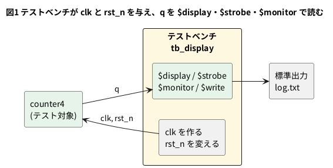

# 3-5 $display でログを出す

3-1〜3-3 では、C++ のテストベンチが `printf` で値を出した。Verilog のテストベンチの中からも、
`$display` で同じことができる。**テストベンチを Verilog で書くなら、値を見る手段はまず `$display` 系**だ。
この題では、`$display`・`$write`・`$strobe`・`$monitor` の 4 つを同じカウンタで動かし、
「同じ時刻に書いたのに値が違う」を `$display` と `$strobe` で見る。

この題は組まない題で、実体配線図と Analog Discovery 3 は付けない。PC の中だけで動かす (`device: SIM`)。
Verilator 5 の `--binary --timing` で、Verilog のテストベンチをそのまま実行する (2-10 と同じ)。

## 説明

- `$display("書式", 値, ...)` は、書式に値をはめて 1 行出し、改行する。C の `printf` と同じ考え方
- `$write` は同じ書式で、**改行しない**
- `$strobe` は、その時刻の処理が全部済んだあとで値を読み、1 行出す
- `$monitor` は、一度書くと、**引数のどれかが変わるたびに** 1 行出す。止めるには `$monitoroff`
- `$fdisplay(fd, ...)` は、ファイルへ出す。`fd` は `$fopen` が返す番号

| 書式 | 出る物 | q = 3 (4 ビット) のとき |
| --- | --- | --- |
| `%d` | 10 進。幅は最大値の桁数に揃う (2 桁) | 空白 1 つ + `3` |
| `%0d` | 10 進。幅を詰める | `3` |
| `%h` | 16 進 | `3` |
| `%b` | 2 進。ビット幅ぶん出る | `0011` |
| `%t` | 時刻。`$timeformat` で形を決める | `15 ns` |

表の値は、実際に Icarus Verilog と Verilator で出して確かめた (どちらも同じだった)。

## 論理図

図 1 は、テスト対象の `counter4` (3-1 と同じ) と、テストベンチの見張りの位置だ。




## Verilog

テスト対象は 3-1 と同じ `counter4`。

```verilog
// counter4.v
module counter4 (
    input  wire       clk,
    input  wire       rst_n,
    output reg  [3:0] q
);
    always @(posedge clk) begin
        if (!rst_n) q <= 4'd0;
        else        q <= q + 4'd1;
    end
endmodule
```

## テストベンチ

```verilog
// tb_display.v
`timescale 1ns/1ps
module tb_display;
    reg        clk;
    reg        rst_n;
    wire [3:0] q;
    integer    fd;

    counter4 dut (.clk(clk), .rst_n(rst_n), .q(q));

    initial clk = 1'b0;
    always #5 clk = ~clk;                         // 周期 10 ns

    initial begin
        $timeformat(-9, 0, " ns", 5);             // %t を「15 ns」の形で出す
        fd = $fopen("log.txt", "w");
        rst_n = 1'b0;
        #1;
        $display("%t rst_n=%b q=%0d (0x%h, 0b%b)", $time, rst_n, q, q, q);

        #11 rst_n = 1'b1;                         // 12 ns でリセットを外す
        repeat (3) begin
            @(posedge clk);
            $display("%t display q=%0d", $time, q);
            $strobe ("%t strobe  q=%0d", $time, q);
            $fdisplay(fd, "%0d", q);              // ファイルへも書ける
        end

        #1;
        $write("write は改行しない: ");
        $write("q=%0d ", q);
        $write("\n");

        $monitor("%t monitor q=%0d", $time, q);   // q が変わるたびに 1 行
        repeat (3) @(posedge clk);
        #1 $monitoroff;                           // 以後は出さない
        @(posedge clk);
        $fclose(fd);
        $finish;
    end
endmodule
```

- `$time` は、いまの時刻を `` `timescale `` の単位 (ここでは ns) の整数で返す
- `$timeformat(-9, 0, " ns", 5)` は、`%t` の出し方を決める。単位を 10 のマイナス 9 乗 (ns)、小数 0 桁、後ろに空白と `ns` を付け、幅 5 にする
- `@(posedge clk)` は「クロックの立ち上がりまで待つ」。待ったあとの `$display` と `$strobe` に注目してほしい

## 動かす

```bash
verilator --lint-only -Wall counter4.v
verilator --binary --timing --timescale 1ns/1ps --top-module tb_display counter4.v tb_display.v
./obj_dir/Vtb_display
cat log.txt
```

`counter4.v` の lint は、警告なしで通った。テストベンチを足した build に `-Wall` を付けると、`$strobe` と `$monitor` で
`q` を読んだところに `SYNCASYNCNET` の警告が出て止まった。そのため、この題の build は `-Wall` を付けずに通した。
テスト対象の lint は `counter4.v` だけで取る。

実行した結果は次のとおり (Verilator 5.042)。

```text
 1 ns rst_n=0 q=0 (0x0, 0b0000)
15 ns display q=0
15 ns strobe  q=1
25 ns display q=1
25 ns strobe  q=2
35 ns display q=2
35 ns strobe  q=3
write は改行しない: q=3 
45 ns monitor q=4
55 ns monitor q=5
65 ns monitor q=6
```

`log.txt` には、`$fdisplay` が書いた `0`・`1`・`2` が 1 行ずつ入った。

- **同じ 15 ns の立ち上がりで、`$display` は `q=0`、`$strobe` は `q=1` だった。**
  `@(posedge clk)` を抜けた時点では、`counter4` の `q <= q + 1` (ノンブロッキング代入) がまだ反映されていない。
  `$display` はその場で読むので更新前の 0、`$strobe` はその時刻の更新が済んでから読むので更新後の 1 になる。
  ノンブロッキング代入の順番は 2-2 で見た
- 「立ち上がりの値を見たい」ときは、`$display` が更新前の値、`$strobe` が更新後の値と覚えておく。
  迷うなら、3-3 のように立ち下がりで読むと、どちらでも更新後の値が安定して読める
- `$monitor` は、`q` が変わった時刻 (45・55・65 ns) にだけ 1 行出た。`q` が変わらないクロックでは出ない。
  なお Icarus Verilog (3-6) では、`$monitor` を書いた時刻 (36 ns) にも 1 行出た。Verilator 5.042 では出なかった
- 1 ns の行の `q` は、Verilator では 0 だった。Icarus Verilog では同じ行が `q=x` になる。この違いは 3-6 で見る

## 計器の設定

組まない題なので、計器は使わない。実行したときの `clk`・`rst_n`・`q` の変化を、ロジックアナライザの画面と同じ形の図 2 に描く。
実機で測った波形ではなく、Verilator に VCD を書き出させて、その変化の時刻から作った図だ。
カーソル X1 (13 ns) は 15 ns の立ち上がりの手前で、`$display` が読んだ値 (`q` = 0) と同じ。
X2 (17 ns) は立ち上がりのあとで、`$strobe` が読んだ値 (`q` = 1) と同じ。

```logic
title: 図2 15 ns の立ち上がり。$display は q=0、$strobe は q=1 を読む
device: generic
time: 5ns/div
signals:
  clk: edges 0ns=0 5ns=1 10ns=0 15ns=1 20ns=0 25ns=1 30ns=0 35ns=1 40ns=0 45ns=1 50ns=0
  rst_n: edges 0ns=0 12ns=1
  q0: edges 0ns=0 15ns=1 25ns=0 35ns=1 45ns=0
  q1: edges 0ns=0 25ns=1 45ns=0
  q2: edges 0ns=0 45ns=1
  q3: edges 0ns=0
buses:
  q: q3 q2 q1 q0 dec
cursors: [13ns, 17ns]
```


## 見るべき値

| 時刻 | `$display` が読む q | `$strobe` が読む q | 備考 |
| --- | --- | --- | --- |
| 15 ns (1 回目の立ち上がり) | 0 | 1 | リセットは 12 ns に外れている |
| 25 ns | 1 | 2 | |
| 35 ns | 2 | 3 | |

- 全部の行で、`$strobe` の値は `$display` の値より 1 大きい
- `$monitor` の行は 45・55・65 ns の 3 本で、`q` が 4・5・6 になった時刻と一致する (図 2 は 50 ns まで描いたので、45 ns の `q` = 4 だけが見える)
- `$monitoroff` を書いた 66 ns のあとは、75 ns の立ち上がりを過ぎても何も出なかった

## 出典

自作。`$display`・`$strobe`・`$monitor` の定義は IEEE 1800-2017 の 21 章 (入出力のシステムタスク)。
Verilator での扱いは [Verilator のマニュアル](https://veripool.org/guide/latest/) による。
