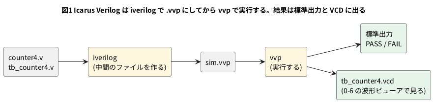

# 3-6 Verilog で書くテストベンチと Icarus Verilog

3-1〜3-4 のテストベンチは C++ だった。Verilator は回路を C++ にするので、相手も C++ で書くのが自然だった。
一方、世の中の Verilog の例題やデータシートのサンプルは、**Verilog で書いたテストベンチ**が付いていることが多い。
それを動かす道具が、オープンソースのシミュレータ **Icarus Verilog** (`iverilog`) だ。

この題では、3-3 で C++ に書いた「期待値と比べて PASS か FAIL を言うテストベンチ」を Verilog で書き直し、
Icarus Verilog で動かす。同じものを Verilator でも動かして、2 つの違い (4 値と 2 値) を見る。

この題は組まない題で、実体配線図と Analog Discovery 3 は付けない。PC の中だけで動かす (`device: SIM`)。

## 説明

- Icarus Verilog は、Verilog を **イベント駆動** で動かす。`#5` の遅延も `@(posedge clk)` の待ちも、書いたとおりに動く
- 信号は **4 値** (0・1・x・z) で持つ。x は「分からない」、z は「どこにもつながっていない」。
  リセットしていないレジスタは、最初 x になる
- 2 段に分かれる。`iverilog` が Verilog を `.vvp` という中間のファイルにし、`vvp` がそれを実行する
- 波形は `$dumpfile` と `$dumpvars` で VCD に書く。見方は 0-6
- Verilator は 0 と 1 だけの **2 値** で計算する。x は持たないので、リセットを書き忘れても、0 から始まったように見えることがある

3-3 の C++ と比べると、役割は同じで道具が違う。

| | C++ のテストベンチ (3-3) | Verilog のテストベンチ (この題) |
| --- | --- | --- |
| 書く言語 | C++ | Verilog |
| 動かす道具 | Verilator (回路を C++ にして build) | Icarus Verilog (そのまま実行)。Verilator でも `--binary --timing` で動く |
| 時間 | C++ が `clk` を反転して `eval()` | `#5` や `@(posedge clk)` で書く |
| 値 | 2 値 | Icarus は 4 値、Verilator は 2 値 |
| 向く所 | 大きい回路、C++ のモデルとの突き合わせ | 小さい回路、他人の Verilog の例題を動かす |

## 流れの図




## Verilog

テスト対象は 3-1 と同じ `counter4`。

```verilog
// counter4.v
module counter4 (
    input  wire       clk,
    input  wire       rst_n,
    output reg  [3:0] q
);
    always @(posedge clk) begin
        if (!rst_n) q <= 4'd0;
        else        q <= q + 4'd1;
    end
endmodule
```

## テストベンチ

```verilog
// tb_counter4.v
`timescale 1ns/1ps
module tb_counter4;
    reg        clk;
    reg        rst_n;
    wire [3:0] q;
    reg  [3:0] expected;       // 参照モデル: 期待値を別に数える
    integer    errors;

    counter4 dut (.clk(clk), .rst_n(rst_n), .q(q));

    initial clk = 1'b0;
    always #5 clk = ~clk;      // 周期 10 ns

    // 参照モデル。立ち上がりで、DUT と同じ rst_n を見て進める
    always @(posedge clk) begin
        if (!rst_n) expected <= 4'd0;
        else        expected <= expected + 4'd1;
    end

    // 比べるのは立ち下がり。立ち上がりの更新が済んだあとの安定した値を見る
    always @(negedge clk) begin
        if (q !== expected) begin
            errors <= errors + 1;
            if (errors < 3)
                $display("NG: %0t q=%0d, 期待は %0d", $time, q, expected);
        end
    end

    initial begin
        $timeformat(-9, 0, " ns", 5);
        $dumpfile("tb_counter4.vcd");
        $dumpvars(0, tb_counter4);
        errors = 0;
        rst_n  = 1'b0;
        repeat (2) @(posedge clk);
        #1 rst_n = 1'b1;                  // 2 クロックのあいだリセット
        repeat (20) @(posedge clk);
        #1;
        if (errors == 0) $display("PASS: 不一致 0 件");
        else             $display("FAIL: 不一致 %0d 件", errors);
        $finish;
    end
endmodule
```

- 参照モデル `expected` は、DUT とは別の `always` で数える。3-3 の C++ の変数と同じ役目
- 比べる `!==` は **4 値の不一致** で、x や z も 1 つの値として比べる。`!=` だと x が混ざった比較の結果が x になる
  (この題の「動かす」で、`!=` が間違いを見逃すのを確かめた)
- 立ち上がりでなく立ち下がりで比べる理由は 3-5 と同じ。立ち上がりの時刻には、ノンブロッキング代入がまだ反映されていない
- `$dumpfile` と `$dumpvars(0, tb_counter4)` で、`tb_counter4` の下の全部の信号を VCD に書く

## 動かす

Icarus Verilog は、Ubuntu なら `sudo apt install iverilog` で入る (確かめた版は 12.0)。

```bash
iverilog -g2012 -Wall -Wno-timescale -o sim.vvp counter4.v tb_counter4.v
vvp sim.vvp
```

- `-g2012` は、SystemVerilog (2012) の文法を許す
- `-Wno-timescale` は、`counter4.v` に `` `timescale `` が無いことの警告を止める。
  外すと「時間の単位が決まっていない部品がある」と警告が出るが、動作は変わらない (`counter4` に遅延は無いため)

実行した結果は次のとおりだった。

```text
VCD info: dumpfile tb_counter4.vcd opened for output.
PASS: 不一致 0 件
tb_counter4.v:42: $finish called at 216000 (1ps)
```

終わりの行の `216000 (1ps)` は、216 ns のこと。Icarus は VCD の単位 (ps) で時刻を出す。
同じ 2 つのファイルを Verilator で動かすと次のとおりで、`PASS` は同じだった。

```bash
verilator --lint-only -Wall counter4.v
verilator --binary --timing --timescale 1ns/1ps -Wall --top-module tb_counter4 counter4.v tb_counter4.v
./obj_dir/Vtb_counter4
```

```text
PASS: 不一致 0 件
```

### 間違えた回路で比べる

3-3 と同じく、わざと間違えた `counter4` を用意する。`if (!rst_n)` の行を消して、リセットを書き忘れた形だ。

```text
-        if (!rst_n) q <= 4'd0;
-        else        q <= q + 4'd1;
+        q <= q + 4'd1;
```

同じテストベンチで、Icarus Verilog と Verilator の結果を並べる。Verilator の build は、lint の警告 (下記) で止まるので `-Wno-UNUSEDSIGNAL` を足して通した。

| | Icarus Verilog 12.0 | Verilator 5.042 |
| --- | --- | --- |
| 1 行目 | `NG: 10 ns q=x, 期待は 0` | `NG: 10 ns q=1, 期待は 0` |
| 2 行目 | `NG: 20 ns q=x, 期待は 0` | `NG: 20 ns q=2, 期待は 0` |
| 3 行目 | `NG: 30 ns q=x, 期待は 1` | `NG: 30 ns q=3, 期待は 1` |
| 最後 | `FAIL: 不一致 21 件` | `FAIL: 不一致 21 件` |

- どちらも FAIL になり、件数 (21) も同じだった。**間違いは両方が見つけた**
- 見え方は違う。リセットが無いので、Icarus の `q` は最後まで **x** (`x + 1` は x)。
  Verilator の `q` は 0 から始まり、リセットを無視して 1、2、3 と数えた
- x を見ると「初期値が決まっていない」と一目で分かる。Verilator の 2 値では、期待値 0 とのずれとしか見えない。
  **リセットの書き忘れは、4 値のシミュレータのほうが見つけやすい**
- Verilator の lint (`verilator --lint-only -Wall`) は、この間違えた `counter4` に
  「`rst_n` が使われていない」という警告 (`UNUSEDSIGNAL`) を出した。lint は 0-7 で見た
- `!==` を `!=` に書き換えて、間違えた回路を Icarus で動かすと、**`PASS: 不一致 0 件` と出た**。
  `q` が x のとき `q != expected` は x になり、`if` は x を偽として扱うので、不一致を数えない。
  テストが通っても、安心できないことの例だ

## 計器の設定

組まない題なので、計器は使わない。正しい `counter4` の実行を、ロジックアナライザの画面と同じ形の図 2 に描く。
Verilator に VCD を書き出させ、その変化の時刻から作った図で、実機で測った波形ではない。
カーソルは、比べを行う立ち下がり (40 ns と 60 ns) に置いた。

```logic
# ロジックアナライザの画面 (tommie-fence の logic フェンス)
title: 図2 リセットを外してからの q と expected。立ち下がりの 40 ns と 60 ns で比べる
device: generic
time: 10ns/div
signals:
  clk: edges 0ns=0 5ns=1 10ns=0 15ns=1 20ns=0 25ns=1 30ns=0 35ns=1 40ns=0 45ns=1 50ns=0 55ns=1 60ns=0 65ns=1 70ns=0 75ns=1 80ns=0 85ns=1 90ns=0 95ns=1 100ns=0
  rst_n: edges 0ns=0 16ns=1
  q0: edges 0ns=0 25ns=1 35ns=0 45ns=1 55ns=0 65ns=1 75ns=0 85ns=1 95ns=0
  q1: edges 0ns=0 35ns=1 55ns=0 75ns=1 95ns=0
  q2: edges 0ns=0 55ns=1 95ns=0
  q3: edges 0ns=0 95ns=1
  e0: edges 0ns=0 25ns=1 35ns=0 45ns=1 55ns=0 65ns=1 75ns=0 85ns=1 95ns=0
  e1: edges 0ns=0 35ns=1 55ns=0 75ns=1 95ns=0
  e2: edges 0ns=0 55ns=1 95ns=0
  e3: edges 0ns=0 95ns=1
buses:
  q: q3 q2 q1 q0 dec
  expected: e3 e2 e1 e0 dec
cursors: [40ns, 60ns]
```


## 見るべき値

| 見る所 | q | expected | 比べた結果 |
| --- | --- | --- | --- |
| 40 ns の立ち下がり (X1) | 2 | 2 | 一致 |
| 60 ns の立ち下がり (X2) | 4 | 4 | 一致 |

- 正しい `counter4` では、どの立ち下がりでも一致し、Icarus Verilog でも Verilator でも `PASS: 不一致 0 件` になる
- リセットを書き忘れた `counter4` では、両方の道具で `FAIL: 不一致 21 件` になる。Icarus の `q` は x、Verilator の `q` は 1、2、3 と数える
- `!=` で比べると、Icarus では x が混ざった間違いが PASS になる。比べるときは `!==` を使う

## 出典

自作。Icarus Verilog は [steveicarus.github.io/iverilog](https://steveicarus.github.io/iverilog/) による。
`!==` と 4 値の扱いは IEEE 1800-2017 による。
