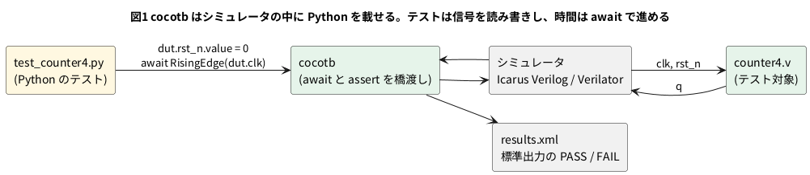

# 3-7 cocotb — Python で試験を書く

3-3 は C++、3-6 は Verilog でテストベンチを書いた。**cocotb** は、テストベンチを **Python** で書く道具だ。
回路は Verilog のまま、シミュレータ (Icarus Verilog か Verilator) の中で動く。Python 側から、信号を読み書きし、
クロックを待ち、`assert` で合否を言う。テストの数が増えたり、期待値の計算が込み入ってきたりすると、
Python の標準ライブラリがそのまま使えるのが効いてくる。

この題では、3-1 の `counter4` を cocotb で 2 つ試す。そのあと、リセットを書き忘れた回路で FAIL になるのを見る。

この題は組まない題で、実体配線図と Analog Discovery 3 は付けない。PC の中だけで動かす (`device: SIM`)。

## 説明

- テストは Python の `async def` の関数で、`@cocotb.test()` を付ける。cocotb が見つけて 1 つずつ動かす
- 回路の信号は `dut.clk`・`dut.rst_n`・`dut.q` のように、**ポートの名前**で触る。書き込みは `dut.rst_n.value = 0`、読み出しは `dut.q.value`
- 時間は `await` で進める。`await RisingEdge(dut.clk)` は「クロックの立ち上がりまで待つ」、`await FallingEdge(dut.clk)` は立ち下がりまで
- クロックは `Clock(dut.clk, 10, unit="ns")` を `cocotb.start_soon(...)` で動かすと、周期 10 ns で回りつづける
- `dut.q.value` は、0・1・x・z を持てる値 (`LogicArray`) だ。整数と `==` で比べられる。x が混ざっていると一致しない
- 合否は Python の `assert`。外れると、そのテストは FAIL になり、`make` が失敗で終わる

3-6 の Verilog のテストベンチと比べると、書くのは「波形を作る部分」と「比べる部分」で、同じ。
違うのは、**テストを複数並べたり、結果の一覧を出したりする仕組みが最初から付いている**ことだ。

## 流れの図




## Verilog

テスト対象は 3-1 と同じ `counter4`。

```verilog
// counter4.v
module counter4 (
    input  wire       clk,
    input  wire       rst_n,
    output reg  [3:0] q
);
    always @(posedge clk) begin
        if (!rst_n) q <= 4'd0;
        else        q <= q + 4'd1;
    end
endmodule
```

## テスト

```python
# test_counter4.py
import cocotb
from cocotb.clock import Clock
from cocotb.triggers import FallingEdge, RisingEdge


async def reset(dut, clocks=2):
    """rst_n を 0 にして clocks 回の立ち上がりを待ち、1 に戻す。"""
    dut.rst_n.value = 0
    for _ in range(clocks):
        await RisingEdge(dut.clk)
    await FallingEdge(dut.clk)      # クロックの谷で入力を変える
    dut.rst_n.value = 1


@cocotb.test()
async def count_up_and_wrap(dut):
    """リセットのあと 1 ずつ増え、15 の次は 0 に戻る。"""
    cocotb.start_soon(Clock(dut.clk, 10, unit="ns").start())
    await reset(dut)
    assert dut.q.value == 0, f"リセット直後の q が {dut.q.value}"

    expected = 0
    for _ in range(20):             # 16 より長く回し、15 → 0 も通す
        await RisingEdge(dut.clk)
        await FallingEdge(dut.clk)  # 更新が済んだ谷で読む
        expected = (expected + 1) & 0xF
        assert dut.q.value == expected, (
            f"q={dut.q.value}, 期待は {expected}"
        )


@cocotb.test()
async def reset_returns_to_zero(dut):
    """数えている途中でリセットを掛けると 0 に戻る。"""
    cocotb.start_soon(Clock(dut.clk, 10, unit="ns").start())
    await reset(dut)
    for _ in range(5):
        await RisingEdge(dut.clk)
    await FallingEdge(dut.clk)
    assert dut.q.value == 5

    dut.rst_n.value = 0
    await RisingEdge(dut.clk)
    await FallingEdge(dut.clk)
    assert dut.q.value == 0
```

- `reset` は、2 つのテストで使う共通の手順を関数にした。Verilog のテストベンチで `task` に書くのと同じ考え方
- 入力を変えるのは、クロックの谷 (立ち下がり) にした。立ち上がりの直後に変えると、同じ時刻に回路が動いて、値の見え方が揺れることがあるため (3-5)
- 読むのも谷にした。立ち上がりのノンブロッキング代入が済んだあとの、安定した値になる
- `20` 回回して、`q` が 15 から 0 へ戻る所も通す。3-3 と同じ理由で、1 周以上回さないと、桁あふれの間違いは見つからない
- `expected = (expected + 1) & 0xF` は、参照モデルを Python の 1 行で書いたもの。回路が 4 ビットで折り返す所を `& 0xF` で真似ている

## 動かす

Python の仮想環境 (venv) に cocotb を入れる。Icarus Verilog は 3-6 で入れたものを使う。
確かめた版は、cocotb 2.1.0、Python 3.12、Icarus Verilog 12.0。

```bash
python3 -m venv .venv
. .venv/bin/activate
pip install cocotb
```

`make` が使う `Makefile` を置く。cocotb が用意した部品 (`Makefile.sim`) を読み込むだけの短いものだ。

```makefile
# Makefile
SIM ?= icarus
TOPLEVEL_LANG = verilog
VERILOG_SOURCES = $(PWD)/counter4.v
COCOTB_TOPLEVEL = counter4
COCOTB_TEST_MODULES = test_counter4
include $(shell cocotb-config --makefiles)/Makefile.sim
```

```bash
make
```

実行した結果は次のとおりだった (cocotb が出す起動の行と、ファイルの絶対パスは省いた)。

```text
     0.00ns INFO     cocotb.regression                  running test_counter4.count_up_and_wrap (1/2)
   215.00ns INFO     cocotb.regression                  test_counter4.count_up_and_wrap passed
   215.00ns INFO     cocotb.regression                  running test_counter4.reset_returns_to_zero (2/2)
   290.00ns INFO     cocotb.regression                  test_counter4.reset_returns_to_zero passed
   ** TEST                                 STATUS  SIM TIME (ns)
   ** test_counter4.count_up_and_wrap       PASS         215.00
   ** test_counter4.reset_returns_to_zero   PASS          75.00
   ** TESTS=2 PASS=2 FAIL=0 SKIP=0                       290.00
```

- 2 つとも PASS だった。1 つ目は 215 ns、2 つ目は 75 ns (シミュレーションの時間)
- 結果は `results.xml` にも書かれる。CI (0-11) はこれを読んで合否を集められる
- シミュレータを Verilator に替えて `make SIM=verilator` と書くと、同じテストが PASS した (Verilator 5.042 で確かめた)。
  テスト (Python) を書き換えずに、シミュレータだけを替えられる

### 間違えた回路で FAIL にする

3-6 と同じく、`if (!rst_n)` の行を消してリセットを書き忘れた `counter4` に替えて `make` した。

```text
    15.00ns WARNING  cocotb.regression                  test_counter4.count_up_and_wrap failed
        assert dut.q.value == 0, f"リセット直後の q が {dut.q.value}"
    AssertionError: リセット直後の q が XXXX
   ** test_counter4.count_up_and_wrap       FAIL          15.00
   ** test_counter4.reset_returns_to_zero   FAIL          65.00
   ** TESTS=2 PASS=0 FAIL=2 SKIP=0                        80.00
```

- 2 つとも FAIL で、1 つ目は 15 ns で止まった。`q` が **XXXX** (4 ビットとも x) と、Python の側から見えた
- `make` はエラーで終わった (`Error 2`)。CI は、この終わり方で失敗を知る
- 失敗した行のファイル名と行番号が出るので、どの `assert` で外れたかがすぐ分かる。Verilog の `$display` の表を目で追うより楽だ

## 計器の設定

組まない題なので、計器は使わない。2 つ目のテスト (`reset_returns_to_zero`) の信号を、ロジックアナライザの画面と同じ形の図 2 に描く。
cocotb に波形 (`WAVES=1`) を書かせ、変化の時刻から作った図で、実機で測った波形ではない。
cocotb のクロックは最初が high なので、`clk` は 0 ns から 1 で始まる。テストは 75 ns で終わるので、それより右は最後の値を引き伸ばしただけだ。

カーソルは、2 つの `assert` が読む値の手前に置いた。
X1 (64 ns) は、65 ns の谷でリセットを掛ける直前で `q` = 5。X2 (74 ns) は、70 ns の立ち上がりでリセットが効いたあとで `q` = 0。

```logic
title: 図2 数えている途中でリセットを掛けると、次の立ち上がりで q が 0 に戻る
device: generic
time: 10ns/div
signals:
  clk: edges 0ns=1 5ns=0 10ns=1 15ns=0 20ns=1 25ns=0 30ns=1 35ns=0 40ns=1 45ns=0 50ns=1 55ns=0 60ns=1 65ns=0 70ns=1 75ns=0
  rst_n: edges 0ns=0 15ns=1 65ns=0
  q0: edges 0ns=0 20ns=1 30ns=0 40ns=1 50ns=0 60ns=1 70ns=0
  q1: edges 0ns=0 30ns=1 50ns=0
  q2: edges 0ns=0 50ns=1 70ns=0
  q3: edges 0ns=0
buses:
  q: q3 q2 q1 q0 dec
cursors: [64ns, 74ns]
```


## 見るべき値

| 見る所 | q | rst_n | 備考 |
| --- | --- | --- | --- |
| 64 ns (X1) | 5 | 1 | 5 クロック数えた。65 ns の谷で `assert dut.q.value == 5` |
| 74 ns (X2) | 0 | 0 | 70 ns の立ち上がりで 0 に戻った。75 ns の谷で `assert dut.q.value == 0` |

- 正しい `counter4` で、2 つのテストが PASS (`TESTS=2 PASS=2 FAIL=0`)
- リセットを書き忘れた回路では 2 つとも FAIL、1 つ目は 15 ns で `q` が `XXXX`
- 同じ Python のテストが、Icarus Verilog でも Verilator でも PASS だった

## 出典

自作。cocotb の書き方は [docs.cocotb.org](https://docs.cocotb.org/) による。
`Clock` の単位の引数名は、古い資料では `units`。cocotb 2.1.0 では `unit` に改名されていて、`units` と書くと `DeprecationWarning` が出る (動きはした)。
