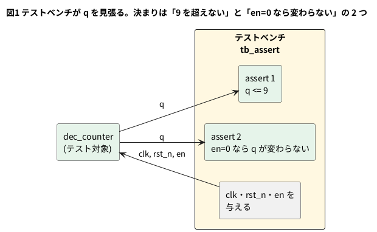

# 3-8 assert — 起きてはいけないことを書く

3-3 では、参照モデルで「正しい答え」を作り、回路の出力と比べた。答えを全部計算できるなら、それでよい。
しかし回路が大きくなると、全部の答えを別に計算するのは、回路を 2 回書くのと変わらない手間になる。

そこで、答えの代わりに **「これだけは起きてはいけない」** を書いておく方法がある。
10 進カウンタなら「`q` は 9 を超えない」、止めているときなら「`q` は変わらない」。
この「いつでも成り立つべき性質」を式にして、外れたらその場で言わせる文が **`assert`** だ。

この題は組まない題で、実体配線図と Analog Discovery 3 は付けない。PC の中だけで動かす (`device: SIM`)。

## 説明

- `assert (式) else $error("メッセージ");` は、式が偽になったとき `$error` を実行する。真なら何も起きない
- 手続きの中 (`always` や `initial` の中) に書く形を **即時アサーション** と呼ぶ。書いたその時刻の値で、その場で判定する
- クロックに合わせて並行に見張る `assert property (@(posedge clk) ...)` は **並行アサーション** と呼ぶ。この題では使わず、「動かす」の終わりに、書けるかどうかだけ確かめる
- `$error` は、メッセージを出し、シミュレータによっては止める。`$fatal(1, ...)` は、必ず止める。止まり方はシミュレータで違う (「動かす」で見る)
- 見張りは **テストベンチの側** に書く。回路 (DUT) には書かない。回路が合成に使われても、見張りが混ざらない
- 3-3 の「期待値と比べる」と、assert は両立する。答えが分かる所は参照モデルで比べ、
  答えは分からないが守らせたい決まりは assert で見張る

## テスト対象

1 桁の 10 進カウンタ `dec_counter`。`en` が 1 のあいだ 0 から 9 を数え、9 の次は 0 に戻る。`en` が 0 のあいだは止まる。
2-9 の 10 進カウンタを、イネーブル付きの 1 桁にしたものだ。

```verilog
// dec_counter.v
module dec_counter (
    input  wire       clk,
    input  wire       rst_n,
    input  wire       en,
    output reg  [3:0] q
);
    always @(posedge clk) begin
        if (!rst_n) q <= 4'd0;
        else if (en) begin
            if (q == 4'd9) q <= 4'd0;
            else           q <= q + 4'd1;
        end
    end
endmodule
```

## 論理図

図 1 は、見張りの位置だ。テストベンチが `clk`・`rst_n`・`en` を与え、`q` を 2 つの決まりで見張る。




## テストベンチ

```verilog
// tb_assert.v
`timescale 1ns/1ps
module tb_assert;
    reg        clk;
    reg        rst_n;
    reg        en;
    wire [3:0] q;
    reg  [3:0] q_prev;       // 1 つ前の谷での q
    reg        en_prev;      // 1 つ前の谷での en
    reg        rst_prev;     // 1 つ前の谷での rst_n

    dec_counter dut (.clk(clk), .rst_n(rst_n), .en(en), .q(q));

    initial clk = 1'b0;
    always #5 clk = ~clk;

    // クロックの谷 (立ち下がり) で、起きてはいけないことを見張る
    always @(negedge clk) begin
        // 1. q は 9 を超えない
        assert (q <= 4'd9)
            else $error("q が 9 を超えた: q=%0d", q);
        // 2. en が 0 だった直後のクロックでは q が変わらない
        if (rst_prev && !en_prev)
            assert (q == q_prev)
                else $error("en=0 なのに q が %0d から %0d に変わった", q_prev, q);
        q_prev   <= q;
        en_prev  <= en;
        rst_prev <= rst_n;
    end

    initial begin
        rst_n = 1'b0;
        en    = 1'b1;
        repeat (2) @(posedge clk);
        #1 rst_n = 1'b1;
        repeat (12) @(posedge clk);
        #1 en = 1'b0;                  // 5 クロックのあいだ止める
        repeat (5) @(posedge clk);
        #1 en = 1'b1;
        repeat (12) @(posedge clk);
        #1;
        $display("終わり q=%0d", q);
        $finish;
    end
endmodule
```

- 見張りは、立ち下がり (谷) で行う。立ち上がりで更新された `q` が安定したあとの値を見るため (3-5)
- 2 つ目の決まりは「1 つ前の谷での値」と比べる。そのため `q_prev`・`en_prev`・`rst_prev` に、毎回の谷で値を覚えさせている。
  `en_prev` が 0 なら、その谷から次の立ち上がりまでの `en` は 0 だったので、`q` は変わってはいけない
- リセット中 (`rst_prev` が 0) は、2 つ目の決まりを見ない。リセットは `q` を変えてよいから
- `assert (...) else $error(...)` の `else` は、`if` の `else` と同じ形だ。式が偽のときに実行される
- テストの入力は、`en` を 12 クロック 1、5 クロック 0、12 クロック 1 にした。10 を数え切って 9 から 0 へ戻る所も、止まる所も通る

## 動かす

```bash
verilator --lint-only -Wall dec_counter.v
iverilog -g2012 -Wall -Wno-timescale -o a.vvp dec_counter.v tb_assert.v
vvp a.vvp
verilator --binary --timing --assert --timescale 1ns/1ps --top-module tb_assert dec_counter.v tb_assert.v
./obj_dir/Vtb_assert
```

正しい `dec_counter` は、lint が警告なしで通り、Icarus Verilog 12.0 でも Verilator 5.042 でも、見張りに掛からずに最後まで走った。

```text
終わり q=4
```

Verilator の `--assert` は、アサーションを有効にする印だ。この題の即時アサーションは、付けなくても働いた
(5.042 で確かめた)。並行アサーションは `--assert` を付けてだけ試した。

### 数え方を間違えた回路で見張りを鳴らす

2 通りの間違いを入れて、見張りが鳴るのを見る。

間違い 1 は、9 で 0 に戻すところを 10 にした「数え間違い」。

```text
-            if (q == 4'd9) q <= 4'd0;
+            if (q == 4'd10) q <= 4'd0;
```

Icarus Verilog の出力は次のとおり。

```text
ERROR: tb_assert.v:21: q が 9 を超えた: q=10
       Time: 120000  Scope: tb_assert
ERROR: tb_assert.v:21: q が 9 を超えた: q=10
       Time: 280000  Scope: tb_assert
終わり q=2
```

Verilator の出力は次のとおり。

```text
[120000] %Error: tb_assert.v:21: Assertion failed in tb_assert: q が 9 を超えた: q=10
%Error: tb_assert.v:21: Verilog $stop
Aborting...
```

間違い 2 は、`en` を見ずに数えつづける「止まらない」間違い。`else if (en) begin` を `else begin` にした。

```text
-        else if (en) begin
+        else begin
```

Icarus Verilog は、`en` が 0 だった 5 クロックのぶん、5 回鳴った。

```text
ERROR: tb_assert.v:25: en=0 なのに q が 2 から 3 に変わった
       Time: 150000  Scope: tb_assert
(以下、q が 3 から 4、4 から 5、5 から 6、6 から 7 に変わった 4 件)
終わり q=9
```

Verilator は、最初の 1 件 (`[150000] ... en=0 なのに q が 2 から 3 に変わった`) で止まった。

- **Icarus Verilog は、`$error` を出しても止まらず、最後まで走る。終了コードは 0** だった。
  表示だけを見ていると、成功と見間違える。CI で使うときは、`$fatal` にするか、鳴った回数を数えて最後に判定する
- **Verilator は、最初の `$error` で止まる。終了コードは 1** だった
- `$error` を `$fatal(1, ...)` に替えて間違い 1 を動かすと、Icarus も止まって終了コードは 1 になった
  (Verilator も止まり、終了コードは 1)。止め方をそろえたいときは、`$fatal` を使う
- 時刻の `120000` は ps 単位で、120 ns のこと。間違い 1 の 10 は、115 ns の立ち上がりで `q` が 10 になり、
  次の谷 (120 ns) の見張りが見つけた
- 間違い 2 の回路に Verilator の lint を掛けると、「`en` が使われていない」という警告 (`UNUSEDSIGNAL`) が出た (0-7)。
  assert は動かして初めて鳴るが、lint は動かす前に見つけられる。両方使う

### 並行アサーション

並行アサーション `assert property (@(posedge clk) disable iff (!rst_n) q <= 4'd9) else $error(...);` を、
同じ間違い 1 の回路に付けて動かした。

- Verilator 5.042 は、そのまま書けて、`[125000] %Error: ... Assertion failed ... q=10` で止まった
- Icarus Verilog 12.0 は、`sorry: concurrent_assertion_item not supported` と言って build できなかった

Icarus を使うなら、即時アサーションまでにする。並行アサーションは、使うシミュレータが対応しているかを先に確かめる。

## 計器の設定

組まない題なので、計器は使わない。間違い 1 の回路を Icarus で動かし、`q` の変化をロジックアナライザの画面と同じ形の図 2 に描く。
VCD の変化の時刻から作った図で、実機で測った波形ではない。
カーソル X1 (110 ns) は 9 のとき、X2 (120 ns) は **見張りが鳴った谷** で、`q` は 10 だった。

```logic
title: 図2 9 の次が 10 になる (間違い 1)。120 ns の谷で assert が鳴る
device: generic
time: 15ns/div
signals:
  clk: edges 0ns=0 5ns=1 10ns=0 15ns=1 20ns=0 25ns=1 30ns=0 35ns=1 40ns=0 45ns=1 50ns=0 55ns=1 60ns=0 65ns=1 70ns=0 75ns=1 80ns=0 85ns=1 90ns=0 95ns=1 100ns=0 105ns=1 110ns=0 115ns=1 120ns=0 125ns=1 130ns=0 135ns=1 140ns=0 145ns=1 150ns=0
  q0: edges 0ns=0 25ns=1 35ns=0 45ns=1 55ns=0 65ns=1 75ns=0 85ns=1 95ns=0 105ns=1 115ns=0 135ns=1
  q1: edges 0ns=0 35ns=1 55ns=0 75ns=1 95ns=0 115ns=1 125ns=0
  q2: edges 0ns=0 55ns=1 95ns=0
  q3: edges 0ns=0 95ns=1 125ns=0
buses:
  q: q3 q2 q1 q0 dec
cursors: [110ns, 120ns]
```


## 見るべき値

| 見る所 | q | 見張りの結果 |
| --- | --- | --- |
| 110 ns の谷 (X1) | 9 | 通る (`q <= 9`) |
| 120 ns の谷 (X2) | 10 | **鳴る** (`q が 9 を超えた: q=10`) |
| 130 ns の谷 | 0 | 通る (125 ns の立ち上がりで 0 に戻った) |

| 回路 | Icarus Verilog 12.0 | Verilator 5.042 |
| --- | --- | --- |
| 正しい | 鳴らない・終了コード 0 | 鳴らない・終了コード 0 |
| 間違い 1 (10 で戻す) | 2 件鳴る (120 ns と 280 ns)・止まらない・終了コード 0 | 1 件で止まる・終了コード 1 |
| 間違い 2 (en を見ない) | 5 件鳴る (150〜190 ns)・止まらない・終了コード 0 | 1 件で止まる・終了コード 1 |

- 間違い 1 が 280 ns にもう 1 回鳴るのは、`en` を 1 に戻したあとにも、10 を数えるため
- 見張りは「答えを知らなくても書ける」ので、乱数の入力を流す試験 (3-9) と組み合わせると効く

## 出典

自作。`assert`・`$error`・`$fatal` は IEEE 1800-2017 の 16 章 (アサーション) と 20 章 (システムタスク) による。
Verilator の `--assert` と、Icarus Verilog が並行アサーションに対応していないことは、それぞれのマニュアルと、手元での実行結果による。
