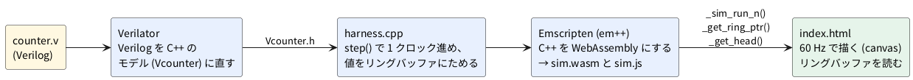

# 4-1 soft-fpga の仕組み — Verilog → Verilator → Emscripten → ブラウザ

この題は実体配線図と Analog Discovery 3 の図を付けない。ブラウザの中で動く題で、組む物が無いから。

0-5 では、ブラウザでカウンタの波形が流れるのを見た。
この題は、その波形が出るまでの道を読む。道の途中を知っておくと、4-3 で自分の Verilog に差し替えるとき、どこを直せばよいか分かる。

## 道のり




## 各段の仕事

| 段 | ファイル | 仕事 |
| --- | --- | --- |
| Verilog | `verilog/counter.v` | 回路の本体。ポートは `clk` `rst` `count` |
| Verilator | (自動で `obj_dir_01/` に出る) | Verilog を C++ のクラス `Vcounter` に直す。`top->clk` に値を入れて `eval()` を呼ぶと、回路の 1 回分の計算が走る |
| ハーネス | `cxx/harness.cpp` | `sim_init()` でリセットし、`step()` で 1 クロック進めて `count` と `rst` を 1 サンプル残す。`sim_run_n(n)` は `step()` を n 回まとめて回し、`reset_sim()` は履歴を残したままリセットする。サンプルは 4096 個のリングバッファに順に書く。リングバッファとトリガーは共通の部品 `cxx/rtlscope_ring.h` が受け持つ |
| Emscripten | `scripts/build-wasm.sh` | 上の C++ と Verilator の部品を WebAssembly にして、`sim.wasm` と `sim.js` を出す。どの例にも共通の手順は `scripts/_build-wasm-common.sh` にある |
| 画面 | `web/index.html` | `sim.js` を読み、60 Hz 前後の描画ごとに `sim_run_n()` を 1 回呼んでは、リングバッファを読んで canvas に描く。描くのは共通の部品 `js/rtlscope-la.js` (06-8080 と同じ Logic Analyzer) |

### リングバッファ

`step()` は 1 回呼ぶたびに `count` の値を 1 個、リングバッファに書き、書いた数 (`head`) を 1 増やす。
バッファは 4096 個で、いっぱいになると古い値の上に書く。画面は最新の分だけを読んで描く。
書くのは `cxx/rtlscope_ring.h` の `record()` で、1 サンプルが 1 語 (32 ビット) の 01-counter に当てはめて縮めると、次の 2 行になる。

```cpp
buf_[head_ & (SIZE - 1)] = w[0];   // w[0] は count (0〜7 ビット) と rst (8 ビット)
head_++;
```

`head_ & (SIZE - 1)` は、4096 が 2 のべき乗だから使える書き方で、`head_` を 4096 で割った余りと同じ。

### なぜ 1 クロックごとに JavaScript を呼ばないのか

WebAssembly と JavaScript の境目をまたぐ呼び出しは、1 回ごとに手間がかかる。
1 クロックごとに画面へ値を渡すと、クロックの数が増えたときに追いつかない。
そこで soft-fpga は、WebAssembly の側で値をバッファにため、JavaScript は 1 回の描画につき 1 度だけ、そのバッファを直に読む (soft-fpga の README の設計メモ)。
クロックを進めるのも同じ考えで、画面は描画ごとに `sim_run_n()` を 1 回呼び、何百回もの `step()` は WebAssembly の中で回る。

もう 1 つ。ブラウザのメモリが伸びる設定 (`ALLOW_MEMORY_GROWTH=1`) だと、伸びたときに古い読み口が無効になる。
画面側はそれに気を付けて読み口を作り直す、と README にある。4-3 以降で大きな回路を載せるときに出会う話題なので、頭の隅に置いておく。

## ビルドの要点

0-2 で作った Docker の `build-wasm` コンテナが、Emscripten を持っている。

```bash
docker compose -f docker/compose.yml run --rm build-wasm scripts/build-wasm.sh
```

`scripts/build-wasm.sh` が作るのは 01-counter だけで、サブモジュールは要らない。出力は `examples/01-counter/web/` の `sim.js` と `sim.wasm`。

詳しい手順は 4-3 で自分の Verilog に差し替えながら行う。手順そのものは soft-fpga のリポジトリが持っているので、この本には写さない。

## 見るべき値

次を実際に動かして確かめた (soft-fpga ac6b663、2026-10-12。Verilator 5.048、Emscripten 5.0.7、soft-fpga の `build-wasm` コンテナ。確認は Playwright の Chromium で、公開ページと手元のビルドの両方)。

| 見る所 | 値 |
| --- | --- |
| リングバッファの大きさ (`_get_ring_size()`) | 4096 |
| 速度スライダの既定 | 200 (1 回の描画で進める `step()` の数) |
| 半秒走らせたあとの `cycles` | 6002 (開いたときのリセットの 2 サンプル + 200 × 約 30 回の描画) |
| 01-counter の `sim.wasm` の大きさ | 147,688 バイト (手元のビルド。公開ページの物は 147,071 バイト) |

`sim.wasm` の大きさは、使った版や最適化の設定で変わる。

## シミュレーションでの確かめ (対象外を含む)

soft-fpga の ac6b663 (4-1 の本文と同じ版) を手元に取り、PC 用の Verilator (5.042) で 01-counter を組んで確かめた。
Emscripten による WebAssembly 化とブラウザでの描画は、この環境では動かせないので確かめていない。

| 項目 | 本文の数字 | 実行結果 | 判定 |
| --- | --- | --- | --- |
| リングバッファの大きさ | 4096 | `cxx/harness.cpp` が `rtlscope::Ring<4096, 1>`、`js/sft-counter-la-defs.js` が `ringSize: 4096` | 合った |
| 速度スライダの既定 | 200 | `web/index.html` の `value="200"` | 合った |
| サンプルの構成 | `count` (0〜7 ビット) と `rst` (8 ビット) | `harness.cpp` の `record_sample()` と同じ | 合った |
| 開いたときのリセットのサンプル数 | 2 | `sim_init()` 直後の `head` が 2 (PC 用の自己検査が `OK: all checks passed`) | 合った |
| `head_ & (SIZE - 1)` の書き方 | 4096 は 2 のべき乗 | `static_assert` で 2 のべき乗を要求している | 合った |
| 半秒後の `cycles` = 6002、`sim.wasm` の大きさ | 6002、147,688 バイト | ブラウザと Emscripten が要る | 対象外 |

## 出典

自作。構成は [tommie-jp/soft-fpga](https://github.com/tommie-jp/soft-fpga) の README (Design notes) と
`examples/01-counter` (`cxx/harness.cpp`、`web/index.html`)、`scripts/build-wasm.sh`。
Verilator は [Verilator のガイド](https://veripool.org/guide/latest/)、Emscripten は [Emscripten の資料](https://emscripten.org/docs/)。
