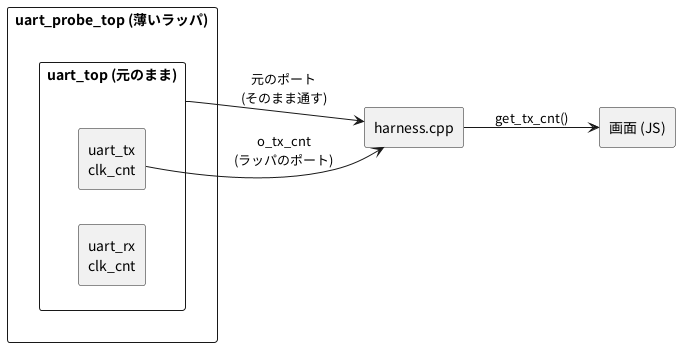

# 4-5 見たい信号を外へ引き出す — 最上位の薄いラッパ

この題は実体配線図と Analog Discovery 3 の図を付けない。ブラウザの中で動く題で、組む物が無いから。

soft-fpga の画面が見せられるのは、C++ のハーネスが読んだ値だけ。ハーネスが楽に読めるのは、最上位のモジュールのポートだけだ。
4-4 の信号機は、状態 `state` を見せるために、モジュールの中で `o_state` という観測用の出力を足していた。
では、他人が書いたモジュールで、中の信号に出力が無いときはどうするか。

この題では、03-uart (4-6) の送信機の中にある、ビットの長さを数えるカウンタ `clk_cnt` を外へ出す。
`uart_top` にも `uart_tx` にも、`clk_cnt` を出すポートは無い。
中のファイルには手を入れず、**最上位にもう 1 枚、薄いラッパ (包むだけのモジュール) を書いて、そのポートに出す**。

中の信号を C++ から直に読む書き方もある。ただし、その名前は Verilator が決めていて、版で変わる。
この題の後半で、3 つの版の Verilator で実際にビルドして比べる。

## しくみ




- ラッパは `uart_top` を 1 つ置き、元のポートを全部そのまま外へ通す。だからハーネスは、クラスの名前を替えるだけで元の読み方のまま動く
- 足すのは、`u_core.u_tx.clk_cnt` を読んで出す `o_tx_cnt` の 1 本 (受信機の分の `o_rx_cnt` も同じ書き方)
- `u_core.u_tx.clk_cnt` は階層の名前 (インスタンスの名前を `.` でつないだ道筋)。Verilator は、この形の参照を解いてビルドする

## Verilog (ラッパ)

`examples/03-uart/verilog/uart_probe_top.v` として新しく置く。`uart_top.v` `uart_tx.v` `uart_rx.v` は元のまま。

```verilog
// 薄いラッパ: uart_top を中身ごと包み、ポートはそのまま通す。
// 外に出ていない送信機・受信機のビット計数 clk_cnt を、階層の名前で読んで出力にする。
module uart_probe_top #(
    parameter CLKS_PER_BIT = 16
) (
    input         clk,
    input         rst,
    input  [7:0]  tx_data,
    input         tx_valid,
    output        tx_ready,
    output [7:0]  o_rx_data,
    output        o_rx_valid,
    output        o_rx_error,
    output [1:0]  o_tx_state,
    output [1:0]  o_rx_state,
    output [2:0]  o_tx_bit,
    output [2:0]  o_rx_bit,
    output [7:0]  o_tx_data,
    output        o_txd,
    output        o_rxd,
    // ここから下が足した観測用の出力
    output [15:0] o_tx_cnt,
    output [15:0] o_rx_cnt
);
    uart_top #(.CLKS_PER_BIT(CLKS_PER_BIT)) u_core (
        .clk        (clk),
        .rst        (rst),
        .tx_data    (tx_data),
        .tx_valid   (tx_valid),
        .tx_ready   (tx_ready),
        .o_rx_data  (o_rx_data),
        .o_rx_valid (o_rx_valid),
        .o_rx_error (o_rx_error),
        .o_tx_state (o_tx_state),
        .o_rx_state (o_rx_state),
        .o_tx_bit   (o_tx_bit),
        .o_rx_bit   (o_rx_bit),
        .o_tx_data  (o_tx_data),
        .o_txd      (o_txd),
        .o_rxd      (o_rxd)
    );

    assign o_tx_cnt = u_core.u_tx.clk_cnt;
    assign o_rx_cnt = u_core.u_rx.clk_cnt;
endmodule
```

- 元のポートを 1 本でも空けると (`.o_tx_bit()` のように)、`-Wall` の lint が `PINCONNECTEMPTY` (空のピン) の警告を出す (確かめた)。全部通すのはそのためでもある
- ファイルの名前はモジュールの名前と同じ `uart_probe_top.v` にする。違うと `-Wall` が `DECLFILENAME` の警告を出す
- 4 つのファイルを合わせた lint (`verilator --lint-only -Wall uart_probe_top.v uart_top.v uart_tx.v uart_rx.v --top-module uart_probe_top`) は、Verilator 4.200・5.042・5.048 のどれでも警告なしで通る (確かめた)
- 階層の名前の参照は、**シミュレーションのための書き方**。合成ツールの Yosys 0.33 に同じ 4 ファイルを読ませると、`u_core.u_tx.clk_cnt` を知らない線とみなし、`o_tx_cnt` は「何もつながっていない」と警告した (確かめた)。実物の FPGA (第 6 章) に載せるときは、このラッパを外す

## つなぐ (ハーネス・ビルド・画面)

soft-fpga の写しで、次の 3 か所を直す。どれも元の行の名前を替えるか、1〜2 行を足すだけ。

1. `examples/03-uart/cxx/harness.cpp` — クラスを替え、読む関数を足す

   ```cpp
   #include "Vuart_probe_top.h"          // 元は "Vuart_top.h"
   static Vuart_probe_top* top;          // 元は Vuart_top*
   // sim_init() の中も new Vuart_probe_top() に替える

   EMSCRIPTEN_KEEPALIVE uint32_t get_tx_cnt() { return top->o_tx_cnt; }
   ```

2. `scripts/build-wasm-03.sh` — Verilator に渡すファイルの先頭に `uart_probe_top.v` を足し、`--top-module uart_top` を `--top-module uart_probe_top` に替え、`EXPORTED_FUNCTIONS` の並びに `_get_tx_cnt` を足す。
   この並びは `"…"` の中に書いてあり、名前の引用符は `\"` と書く。`\"_get_ring_size\",` の後ろ、`${LA_EXPORTS}` の前に `\"_get_tx_cnt\",` を入れる
3. `examples/03-uart/web/index.html` — 波形の下の欄 (`TX Data` から `rx_error` までが並ぶ欄) に 1 行足し、描くたびに (`loop()` の中で) 値を入れる

   ```html
   <div><span class="label">tx_cnt  : </span><span class="val" id="r-txcnt">-</span></div>
   ```

   ```js
   document.getElementById('r-txcnt').textContent = Module._get_tx_cnt();
   ```

あとは 4-3 と同じく、docker の `build-wasm` で `scripts/build-wasm-03.sh` を回し、`examples/03-uart/web/` で Web サーバを立てて開く。

```bash
docker compose -f docker/compose.yml run --rm build-wasm scripts/build-wasm-03.sh
ln -sfn ../../../js examples/03-uart/web/js
cd examples/03-uart/web
python3 -m http.server 8081
```

2 行目の `ln` は、画面の Logic Analyzer の部品 (リポジトリの根の `js/`) を `web/js` として見せるシンボリックリンク。
`index.html` は `js/rtlscope-la.js` などを読むが、03-uart にはこのリンクを張る台本が無い。張らないと部品が 404 になり、画面は何も動かない (Console に `setupLa is not defined` が出る)。

Send で字を送ると、波形の下の欄の `tx_cnt` が 15 から 0 へ数え下がり、0 の次でまた 15 に戻る。

## 中の信号を直に読む書き方と比べる

ラッパを書かずに、C++ から中の `clk_cnt` を直に読む書き方が 2 つある。
同じ `main` を `-D` で 4 通りに切り替えて、3 つの版の Verilator でビルドした。

```cpp
// 送信機のビット計数 clk_cnt を 4 通りの書き方で読む。どれを使うかは -D で選ぶ。
#include <cstdio>
#include "verilated.h"
#if defined(WAY_WRAP)
  #include "Vuart_probe_top.h"
  typedef Vuart_probe_top Top;
  #define TX_CNT(t) ((t)->o_tx_cnt)                              // 薄いラッパの出力
#elif defined(WAY_ROOTP)
  #include "Vuart_top.h"
  #include "Vuart_top___024root.h"
  typedef Vuart_top Top;
  #define TX_CNT(t) ((t)->rootp->uart_top__DOT__u_tx__DOT__clk_cnt) // 5.x の中の名前
#elif defined(WAY_OLD)
  #include "Vuart_top.h"
  typedef Vuart_top Top;
  #define TX_CNT(t) ((t)->uart_top__DOT__u_tx__DOT__clk_cnt)        // 4.x の中の名前
#elif defined(WAY_PUBLIC)
  #include "Vuart_top.h"
  #include "Vuart_top_uart_top.h"
  #include "Vuart_top_uart_tx.h"
  typedef Vuart_top Top;
  #define TX_CNT(t) ((t)->uart_top->u_tx->clk_cnt)                  // verilator public
#endif

static void tick(Top* t) { t->clk = 0; t->eval(); t->clk = 1; t->eval(); }

int main() {
    Top* t = new Top;
    t->rst = 1; t->tx_valid = 0; t->tx_data = 0; tick(t); t->rst = 0;
    t->tx_data = 0x41; t->tx_valid = 1; tick(t); t->tx_valid = 0;   // step 1
    for (int s = 2; s <= 20; s++) {
        tick(t);
        if (s <= 3 || s >= 16) printf("step %2d clk_cnt=%2u txd=%u\n", s, (unsigned)TX_CNT(t), (unsigned)t->o_txd);
    }
    delete t;
    return 0;
}
```

- `WAY_ROOTP` と `WAY_OLD` は、Verilator が中の信号に付けた名前 (`uart_top__DOT__u_tx__DOT__clk_cnt`) を直に読む。`__DOT__` は階層の `.` を置き換えた印
- `WAY_PUBLIC` は、`uart_tx.v` の宣言を `reg [15:0] clk_cnt /*verilator public*/;` に書き換えたもの。中のファイルに手を入れる
- ビルドは `verilator --cc --exe --build <Verilog のファイル> read_cnt.cpp -CFLAGS -DWAY_… --top-module <最上位>`

| 書き方 | 4.200 (2021) | 5.042 (2025) | 5.048 (2026) | 中のファイルを直すか |
| --- | --- | --- | --- | --- |
| 薄いラッパ `top->o_tx_cnt` | 通る | 通る | 通る | 直さない |
| 中の名前 (5.x の形) `top->rootp->…` | 通らない (`Vuart_top___024root.h` が無い) | 通る | 通る | 直さない |
| 中の名前 (4.x の形) `top->…` | 通る | 通らない (`Vuart_top` に `uart_top__DOT__u_tx__DOT__clk_cnt` が無い) | 通らない | 直さない |
| `/*verilator public*/` `top->uart_top->u_tx->clk_cnt` | 通る | 通る | 通る | 直す |

通った書き方は、どれも同じ値を出した (step 2 で `clk_cnt=14`、step 3 で 13、step 16 で 0)。

- 中の名前は、4.x では最上位のクラスに直に並び、5.x では `rootp` の先に移った。**同じ C++ が、版を上げただけでビルドできなくなる**
- 中の名前は、階層が変わっても変わる。ラッパで包んだ後は、同じ信号が `uart_probe_top__DOT__u_core__DOT__u_tx__DOT__clk_cnt` になった (生成されたヘッダで確かめた)
- `/*verilator public*/` は 3 つの版で通った。ただし、中のファイルを書き換える。しかも、ハーネスが読むクラスの名前 (`Vuart_top_uart_tx`) とその道筋 (`uart_top->u_tx`) は、モジュールとインスタンスの名前で決まる。public を付けると `uart_tx` が別のクラスに分かれ、受信機の側の名前まで `__PVT__u_rx__DOT__clk_cnt` に変わった (5.042 で生成されたヘッダで確かめた)
- ラッパのポートの名前は、自分で決めた名前なので版にも階層にも引きずられない

soft-fpga の設計メモ (`docs/90-rtlscope-OBSERVEマクロ設計メモ.md`) も、`/*verilator public*/` (選択肢 A) とラッパ (選択肢 B) を並べ、A を「Verilator のバージョンに依存しない」としている。上の表の結果はそれと合う。
この題のラッパは、中の信号を階層の名前で最上位のポートまで引き上げる形で、メモの B (下の階層に置く観測用のモジュール) とは置き場所が違う。

## 画面に見えるはずのもの

リセット直後に `A` (0x41) を送ったとして、最初の 20 クロックの `TXD` と `tx_cnt` を `logic` のフェンスで描く。
4-3・4-4 と同じく、1 クロックを 1 ms と置いた仮の目盛。`clk_cnt` は 16 ビットだが、値は 0〜15 なので下位 4 ビット (`C3`〜`C0`) だけを描く。

```logic
title: 図1 tx_cnt が 15 から 0 へ 16 クロックで数え下がり、1 ビットの長さを作る
device: generic
window: 20ms
signals:
  CLK: dio0 clock 1kHz
  TXD: dio1 edges 0s=1 2ms=0 18ms=1
  C: dio2..dio5 counter on CLK rising sequence 0 15 14 13 12 11 10 9 8 7 6 5 4 3 2 1 0 15 14 13 12
buses:
  tx_cnt: C3..C0 dec
cursors: [2.25ms, 18.25ms]
trigger: TXD falling at 2ms
```


- `tx_cnt` は 1 ms (クロック 1) で 15 になり、16 ms で 0 まで下がる。17 ms でまた 15 に戻る
- `TXD` の変わり目 (2・18 ms) は、`tx_cnt` が 15 に戻った次のクロック。送信機の `txd` はレジスタで、状態が変わった 1 クロック後に線が変わるから (4-6)
- X1 (2.25 ms) はスタートビットの始まり、X2 (18.25 ms) は bit 0 の始まりで、どちらも `tx_cnt` = 14。間隔の 16 ms が 1 ビットの長さ (`CLKS_PER_BIT` = 16)

## 見るべき値

soft-fpga の写しの 03-uart にラッパをつなぎ、Verilator 5.048・Emscripten の docker でビルドして、ブラウザ (Playwright の Chromium 153) で動かした。
上の 3 か所の直し方は、soft-fpga ac6b663 (2026-10-12) の写しでそのまま通り、下の表の数も同じだった (2026-10-13 に測り直した)。
`Module._send_byte(0x41)` のあと `Module._step()` を 1 回ずつ呼び、そのたびに `Module._get_tx_cnt()` を読んだ。
`step` の数え方は 4-4 と同じで、リセット直後を 0、`step` を 1 回呼んだ後を 1 とする。

| `step` | `tx_cnt` | そのときの送信機 | 種類 |
| --- | --- | --- | --- |
| 1 | 15 | START に入った | 動かして確かめた |
| 2 | 14 | `txd` が 0 に落ちた | 動かして確かめた |
| 16 | 0 | スタートビットの最後のクロック | 動かして確かめた |
| 17 | 15 | DATA に入った | 動かして確かめた |
| 18 | 14 | `txd` が bit 0 の 1 になった | 動かして確かめた |
| 33 | 15 | bit 1 に進んだ | 動かして確かめた |
| 40 | 8 | 波形の下の欄の `tx_cnt` に 8 が出た | 動かして確かめた |

| 見る所 | 値 | 種類 |
| --- | --- | --- |
| lint (`-Wall`、4 ファイル) | 警告なし (4.200・5.042・5.048) | 動かして確かめた |
| 1 ビットの長さ (`tx_cnt` が 15 に戻る間隔) | 16 クロック | 動かして確かめた。`CLKS_PER_BIT` と一致 |
| 4 通りの書き方のビルド | 上の比べる表のとおり | 動かして確かめた |

## 出典

自作。包んだ例は [tommie-jp/soft-fpga](https://github.com/tommie-jp/soft-fpga) の `examples/03-uart`。
中の信号の読み方の選択肢は、同リポジトリの `docs/90-rtlscope-OBSERVEマクロ設計メモ.md`。
観測用の出力の例は `examples/02-traffic-fsm/verilog/traffic_fsm.v` の `o_state` `o_timer` `o_btn_req`。
Verilator 4.200 は Docker Hub の `verilator/verilator:4.200` で動かした。
