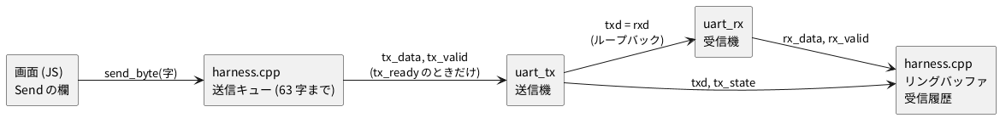

# 4-6 UART のループバックを波形で見る

この題は実体配線図と Analog Discovery 3 の図を付けない。ブラウザの中で動く題で、組む物が無いから。

soft-fpga の例 `03-uart` は、UART の送信機 (`uart_tx`) と受信機 (`uart_rx`) を 1 本の線でつないだもの。
送信機の出す線 `txd` を、そのまま受信機の入力 `rxd` に戻している。これをループバックと呼ぶ。
画面の欄に文字を打って Send を押すと、1 字ずつ線に乗って流れ、受信機がそれを拾って受信履歴に出す。

この題では、1 字が線に乗った形 (フレーム) を波形で読む。
UART の 1 フレームは、**スタートビット (0) → データ 8 ビット (下位ビットから) → ストップビット (1)** の 10 ビット。
線は何も送らない間 1 (アイドル) のままで、スタートビットの立ち下がりが「これから 1 字が来る」合図になる。
同じフレームを、第 7 章では実物の UART として Analog Discovery 3 の Logic で読む。

## しくみ




- 画面の JS は、文字を 1 字ずつ `send_byte()` で C++ のキューに積む
- ハーネスは毎クロック、送信機が空いているか (`tx_ready`) を見て、空いていればキューから 1 字を渡す
- キューは 64 字ぶんの配列で、満杯の見分けに 1 つ空けるので、積めるのは 63 字まで。送信の欄は 32 字までなので、欄に打った字は全部届く (`Hello World` の 11 字が受信履歴に全部出た。公開中の画面を Playwright で確かめた)
- 受信した字は、ハーネスが 64 字の記録に残す。1 回の描画の間に何字届いても、画面は前の描画から増えた分を全部履歴に出す
- 2026-10-11 より前の soft-fpga は、キューが 8 字ぶん (積めるのは 7 字) で、受信履歴も 1 回の描画で最後の 1 字しか出さなかった。古い写しで試すと `Hello World` が `Hello W` で切れる
- 1 ビットの長さは parameter の `CLKS_PER_BIT` で、既定は 16 クロック。1 フレームは 10 × 16 = 160 クロック (計算値)
- 実物の FPGA なら、クロック 100 MHz・115200 baud で `CLKS_PER_BIT` は 868 になる (soft-fpga の設計メモの値)。ブラウザで波形を見やすくするため 16 にしてある

## Verilog (送信機)

soft-fpga の `examples/03-uart/verilog/uart_tx.v` そのまま。受信機 `uart_rx.v` と、2 つをつなぐ `uart_top.v` は同じディレクトリにある。

```verilog
module uart_tx #(
    parameter CLKS_PER_BIT = 16
) (
    input            clk,
    input            rst,
    input      [7:0] tx_data,
    input            tx_valid,
    output reg       txd,
    output           tx_ready,
    output     [1:0] o_tx_state,
    output     [2:0] o_tx_bit,
    output     [7:0] o_tx_data
);
    localparam S_IDLE  = 2'd0;
    localparam S_START = 2'd1;
    localparam S_DATA  = 2'd2;
    localparam S_STOP  = 2'd3;

    localparam [15:0] FULL_CNT = CLKS_PER_BIT - 1;

    reg [1:0]  state;
    reg [2:0]  bit_idx;
    reg [15:0] clk_cnt;
    reg [7:0]  data_buf;

    assign tx_ready   = (state == S_IDLE);
    assign o_tx_state = state;
    assign o_tx_bit   = bit_idx;
    assign o_tx_data  = data_buf;

    always @(posedge clk) begin
        if (rst) begin
            state    <= S_IDLE;
            txd      <= 1'b1;
            bit_idx  <= 3'd0;
            clk_cnt  <= 16'd0;
            data_buf <= 8'd0;
        end else begin
            case (state)
                S_IDLE: begin
                    txd <= 1'b1;
                    if (tx_valid) begin
                        data_buf <= tx_data;
                        clk_cnt  <= FULL_CNT;
                        state    <= S_START;
                    end
                end
                S_START: begin
                    txd <= 1'b0;
                    if (clk_cnt == 16'd0) begin
                        clk_cnt <= FULL_CNT;
                        bit_idx <= 3'd0;
                        state   <= S_DATA;
                    end else begin
                        clk_cnt <= clk_cnt - 16'd1;
                    end
                end
                S_DATA: begin
                    txd <= data_buf[bit_idx];
                    if (clk_cnt == 16'd0) begin
                        clk_cnt <= FULL_CNT;
                        if (bit_idx == 3'd7) begin
                            state <= S_STOP;
                        end else begin
                            bit_idx <= bit_idx + 3'd1;
                        end
                    end else begin
                        clk_cnt <= clk_cnt - 16'd1;
                    end
                end
                S_STOP: begin
                    txd <= 1'b1;
                    if (clk_cnt == 16'd0) begin
                        state   <= S_IDLE;
                        bit_idx <= 3'd0;
                    end else begin
                        clk_cnt <= clk_cnt - 16'd1;
                    end
                end
                default: begin
                    state <= S_IDLE;
                    txd   <= 1'b1;
                end
            endcase
        end
    end
endmodule
```

- 状態は IDLE (0)・START (1)・DATA (2)・STOP (3)。`clk_cnt` を 15 から 0 まで数えて、1 ビットぶんの 16 クロックを作る
- `txd` は状態ごとに `txd <= …` で書くレジスタ。**状態が変わった次のクロックで `txd` が変わる**。波形では `tx_state` の変わり目より `txd` の変わり目が 1 クロック遅れて見える
- データは `data_buf[bit_idx]` で、`bit_idx` が 0 から 7 へ進む。下位ビットから先に出る
- 受信機は、立ち下がりを見つけてから半ビット (8 クロック) 待ち、そこから 16 クロックごとに線を読む。ビットの真ん中で読むので、境目の前後の揺れを拾わない

3 つのファイルを合わせた lint (`verilator --lint-only -Wall uart_top.v uart_tx.v uart_rx.v --top-module uart_top`) は、警告なしで通る (確かめた)。

## 手順

1. [https://tommie-jp.github.io/soft-fpga/03-uart/](https://tommie-jp.github.io/soft-fpga/03-uart/) を開く。自分でビルドするなら soft-fpga の `scripts/build-wasm-03.sh` (4-3 と同じく docker の `build-wasm` で回す)。
   手元で開く前に `ln -sfn ../../../js examples/03-uart/web/js` で Logic Analyzer の部品へのリンクを張る (4-5)
2. 速度のスライダ (1〜500、開いたときは 60) を左いっぱい (1) にして Run を押す。1 回の描画で 1 クロックだけ進む
3. 欄に `A` と打って Send を押す。`txd` のレーンにフレームが流れる
4. フレームが右端まで来たら Run をもう一度押して止める (Pause)。Logic Analyzer は開いたときの倍率 1x で 1 クロックを 1 画素に描き、幅いっぱい (1200 画素) の窓で最新の 976 クロックぶんが入る。1 フレームの 160 クロックは全部入る
5. 受信履歴に `> 0x41 'A'` が出る。`Hi` を送ると `0x48 'H'` と `0x69 'i'` が続けて出る

波形の下の欄の `RX Data` は最後に受けた字。`rx_error` はストップビットが 0 だったときに 1 になる (ループバックでは起きない)。

Logic Analyzer のレーンは、soft-fpga の `js/sft-uart-la-defs.js` が決めている。開いたときに見えるのは、上から次の 9 本。

| レーン | 中身 |
| --- | --- |
| `FRAME` | 読み下し。上の段に送信のフレーム (`TX 'A'`)、下の段に受信のフレーム (`RX 'A'`) を箱で描く |
| `txd` `rxd` | 送信の線と受信の線。ループバックなので同じ形になる |
| `tx_rdy` | `tx_ready`。送信機が IDLE のとき 1 |
| `rx_vld` | `rx_valid`。1 字を受け終えたクロックだけ 1 |
| `tx_state` `rx_state` | 状態を IDLE・START・DATA・STOP の名前で出す |
| `tx_data` `rx_data` | 送信バッファの字と、最後に受けた字 (16 進) |

`tx_valid`・`rx_err` (`rx_error`)・`tx_bit`・`rx_bit`・`rst` は隠してある。レーンの上に並ぶ丸い札を押すと出る。

## 画面に見えるはずのもの

リセット直後に `A` (0x41 = 2 進で 0100 0001) を送ったとして、最初の 300 クロックを `logic` のフェンスで描く。
ブラウザの画面には時間の単位が無いので、1 クロックを 1 µs と置いた仮の目盛にする (4-3・4-4 は 1 ms と置いたが、読み下しの baud を整数で書くために変えた)。
すると 1 ビット = 16 µs で、baud は 1 ÷ 16 µs = 62500 (計算値)。読み下しの `baud 62500` はこの仮の目盛に合わせた数。
`rxd` は `txd` と同じ線なので描かない。`clk` は 1 クロックが 2 画素ほどで塗りになるので描かない。ハーネスはクロックごとに 1 標本を記録するので、`sample:` は書かない (1 クロックより細かい変化は無い)。

```logic
# ロジックアナライザの画面 (tommie-fence の logic フェンス)
title: 図1 A (0x41) の 1 フレーム。0 で始まり、下位ビットから 1 0 0 0 0 0 1 0、1 で終わる
device: generic
time: 30us/div
start: -30us
signals:
  TXD: dio0 edges 0s=1 2us=0 18us=1 34us=0 114us=1 130us=0 146us=1
  TS1: dio1 edges 0s=0 17us=1 161us=0
  TS0: dio2 edges 0s=0 1us=1 17us=0 145us=1 161us=0
  RS1: dio3 edges 0s=0 11us=1 155us=0
  RS0: dio4 edges 0s=0 3us=1 11us=0 139us=1 155us=0
buses:
  tx_state: TS1 TS0 dec
  rx_state: RS1 RS0 dec
decode:
  RX: uart TXD baud 62500 8N1 hex
cursors: [26us, 42us]
trigger: TXD falling at 2us
```


- `TXD` はアイドルの 1 から、2 µs (クロック 2) で 0 に落ちる。これがスタートビットで、18 µs まで 16 クロック続く
- その後の 8 ビットは、下位から 1・0・0・0・0・0・1・0。0x41 の 2 進 0100 0001 を右から読んだ並び。1 になるのは bit 0 (18〜33 µs) と bit 6 (114〜129 µs)
- 146 µs で 1 に戻る。これがストップビットで、そのまま 1 のアイドルに続く
- 読み下しの箱は 0x41。ASCII で `A`
- `tx_state` の数は 0 = IDLE、1 = START、2 = DATA、3 = STOP。`rx_state` も同じ。soft-fpga の画面のレーンは、この数の代わりに名前を出す。受信機は送信機より遅れて START に入り (3 µs)、ストップビットの真ん中 (155 µs) で IDLE に戻る
- X1 (26 µs) は bit 0 の真ん中で `TXD` = 1、X2 (42 µs) は bit 1 の真ん中で `TXD` = 0。間隔の 16 µs が 1 ビットで、1/ΔX = 62.5 kHz は仮の目盛の 62500 baud に当たる

## 見るべき値

soft-fpga の 03-uart を、Verilator 5.042 の PC のシミュレーション (ハーネスに `A` を 1 字送る `main` を足したもの) と、
Verilator 5.048・Emscripten の docker でビルドしてブラウザ (Playwright の Chromium 153) で開いたものの両方で動かした。
ブラウザでは `Module._send_byte(0x41)` のあと `Module._step()` を 200 回呼び、リングバッファの `txd` の変わり目を拾った。
2 つの結果は同じだった。
2026-10-13 に、soft-fpga ac6b663 (2026-10-12) の公開中の画面で同じことをして、下の表の数がどれも変わっていないことを確かめた (Playwright 1.63 の Chromium 153)。`step` の数え方は 4-4 と同じで、リセット直後を 0、`step` を 1 回呼んだ後を 1 とする。

| 見る所 | `step` の番号 | 種類 |
| --- | --- | --- |
| `tx_valid` が 1 (キューから字を渡す) | 1 | 動かして確かめた |
| `txd` が 0 に落ちる (スタートビットの始まり) | 2 | 動かして確かめた |
| データ bit *k* の始まり | 18 + 16 *k* (bit 0 は 18、bit 7 は 130) | 動かして確かめた |
| `txd` の変わり目 (0x41) | 2 で 0、18 で 1、34 で 0、114 で 1、130 で 0、146 で 1 | 動かして確かめた |
| ストップビットの始まり | 146 | 動かして確かめた |
| 送信機が IDLE に戻る (`tx_ready` = 1) | 161 | 動かして確かめた |
| 受信機が bit *k* を読む (`rx_bit` が進む) | 27 + 16 *k* (bit 0 は 27、bit 7 は 139) | 動かして確かめた |
| `rx_valid` が 1、`rx_data` = 0x41 | 155 | 動かして確かめた |
| 1 フレームの長さ | 160 クロック (2〜161) | 計算値と一致 |

- 受信機が読むのは、各ビットの始まりから 9 クロック目 (bit 0 なら 18 → 27)。16 クロックの真ん中に近い所で読んでいる
- 画面の欄に `Hi` と打って Send を押すと、受信履歴に `0x48 'H'` と `0x69 'i'` が出た (Playwright で欄に打ち、ボタンを押して確かめた。ac6b663 の公開中の画面でも同じ)
- 手順の 2〜4 のとおり速度 1 で `A` を送って止めると、`FRAME` のレーンに `TX 'A'` と `RX 'A'` の箱が出た (ac6b663 の公開中の画面を Playwright で操作して確かめた)

## 出典

自作。例と Verilog は [tommie-jp/soft-fpga](https://github.com/tommie-jp/soft-fpga) の `examples/03-uart`
(設計は同リポジトリの `docs/03-uart/01-実装計画.md`)。画面は [03-uart](https://tommie-jp.github.io/soft-fpga/03-uart/)。
