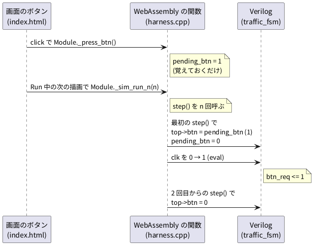

# 4-7 ボタンとスイッチを画面に付ける — JS から入力を与える

この題は実体配線図と Analog Discovery 3 の図を付けない。ブラウザの中で動く題で、組む物が無いから。

5-4 では、DIP スイッチで Verilog の入力を切り替え、出力を LED で見た。
ブラウザの soft-fpga には DIP スイッチが無い。代わりに、**画面のボタンを押して、Verilog の入力ポートを動かす**。

まず 02-traffic-fsm の歩行者ボタン (4-4) が、どうやって `btn` の入力まで届くかを読む。
そのあと、自分の soft-fpga の写しに小さな例を足す。画面のスイッチ 2 個とボタン 1 個で、AND・OR と押した回数を見る。

## 歩行者ボタンの道筋 (02-traffic-fsm)

押してから `btn` に 1 が入るまでに、3 つの層をくぐる。




- `index.html` は、ボタンの `click` で `Module._press_btn()` を呼ぶだけ。C++ の関数は、ビルドのときに `EXPORTED_FUNCTIONS` に名前を書いたものだけが JS から呼べる (`scripts/build-wasm-02.sh` に `"_press_btn"` がある)
- `harness.cpp` の `press_btn()` は、`pending_btn` を 1 にするだけで、Verilog には触らない
- Run を押している間、画面は描き替えのたびに `Module._sim_run_n(n)` を呼ぶ。n は速度のスライダの値 (1〜300、開いたときは 30)。`sim_run_n()` は C++ の中で `step()` を n 回呼ぶ
- `step()` は 1 回で 1 クロック進める。その頭で `top->btn = pending_btn;` と入れ、すぐ `pending_btn = 0;` に戻す。だから `btn` が 1 になるのは、押した後の最初の 1 クロックだけ
- 1 クロックの合図を覚えておくのは Verilog の側 (`if (btn) btn_req <= 1'b1;`)。押したことは `btn_req` に残る

ボタンは「押した」という出来事なので、1 クロックの合図にする。
スイッチは「今どちらか」という状態なので、JS が書き換えるまで同じ値を毎クロック入れ続ける。この違いを、次の例で並べて見る。

## 足す例 (90-switches)

soft-fpga の写しに `examples/90-switches` を作る。番号の 90 は、元の例と重ならないように選んだだけ。

### Verilog

`examples/90-switches/verilog/sw_gates.v`

```verilog
// 画面のスイッチ 2 個とボタン 1 個を入力にする。
// sw はスイッチ (押すたびに 0 と 1 が入れ替わり、そのまま残る)、btn はボタン (1 クロックだけ 1)。
module sw_gates (
    input        clk,
    input        rst,
    input  [1:0] sw,
    input        btn,
    output       y_and,
    output       y_or,
    output [3:0] o_presses
);
    reg [3:0] presses;     // ボタンを押した回数 (16 で 0 に戻る)

    assign y_and     = sw[1] & sw[0];
    assign y_or      = sw[1] | sw[0];
    assign o_presses = presses;

    always @(posedge clk) begin
        if (rst)
            presses <= 4'd0;
        else if (btn)
            presses <= presses + 4'd1;
    end
endmodule
```

- `y_and` と `y_or` は組み合わせ回路 (5-4 の `gates.v` の AND・OR と同じ働き)。スイッチを替えたら、クロックを待たずに変わる
- `presses` はクロックで動くカウンタ。`btn` が 1 のクロックでだけ 1 増える

lint (`verilator --lint-only -Wall sw_gates.v`) は、警告なしで通る (確かめた)。

### C++ (ハーネス)

`examples/90-switches/cxx/harness.cpp`。02-traffic-fsm の `harness.cpp` の形をまねて、リングバッファを省いた。

```cpp
#include "Vsw_gates.h"
#include "verilated.h"
#ifdef __EMSCRIPTEN__
#include <emscripten.h>
#else
#define EMSCRIPTEN_KEEPALIVE
#endif
#include <stdint.h>

static Vsw_gates* top;
static uint8_t  sw_state    = 0;  // スイッチ: JS が書き換えるまで同じ値を入れ続ける
static uint8_t  pending_btn = 0;  // ボタン: 次の 1 クロックだけ 1 を入れる
static uint32_t cycles      = 0;

static void tick() {
    top->clk = 0; top->eval();
    top->clk = 1; top->eval();
}

extern "C" {

EMSCRIPTEN_KEEPALIVE void sim_init() {
    top = new Vsw_gates();
    top->sw = 0; top->btn = 0;
    top->rst = 1; tick();
    top->rst = 0; top->clk = 0; top->eval();
    sw_state = 0; pending_btn = 0; cycles = 0;
}

EMSCRIPTEN_KEEPALIVE void step() {
    top->sw     = sw_state;
    top->btn    = pending_btn;
    pending_btn = 0;
    tick();
    cycles++;
}

EMSCRIPTEN_KEEPALIVE void set_sw(uint32_t v) { sw_state = v & 0x3u; }
EMSCRIPTEN_KEEPALIVE void press_btn()        { pending_btn = 1; }

// bit0 = y_and, bit1 = y_or, bits[7:4] = presses
EMSCRIPTEN_KEEPALIVE uint32_t get_out() {
    return (uint32_t)(top->y_and & 1u)
         | (uint32_t)(top->y_or  & 1u) << 1
         | (uint32_t)(top->o_presses & 0xFu) << 4;
}

EMSCRIPTEN_KEEPALIVE uint32_t get_cycles() { return cycles; }

} // extern "C"
```

- スイッチは `sw_state` に覚えておき、`step()` のたびに `top->sw` へ入れる。ボタンは `pending_btn` を入れたら 0 に戻す。違いはこの 2 行だけ
- 入力を書くのは `clk` を 0 にする前。Verilog から見ると、クロックが low の間に入力が変わり、次の立ち上がりで読まれる

### JS (画面)

`examples/90-switches/web/index.html` の中の、入力にかかわる所。

```js
let sw = 0;                                   // 画面のスイッチの状態 (2 ビット)

function toggle(bit, el) {                    // スイッチ: 押すたびに 0 と 1 を入れ替える
  sw ^= (1 << bit);
  el.classList.toggle('on', (sw >> bit) & 1);
  Module._set_sw(sw);
}
const sw0 = document.getElementById('sw0');
const sw1 = document.getElementById('sw1');
sw0.addEventListener('click', () => toggle(0, sw0));
sw1.addEventListener('click', () => toggle(1, sw1));
// ボタン: 押した合図だけを渡す。次の step の 1 クロックだけ btn = 1 になる
document.getElementById('btn').addEventListener('click', () => Module._press_btn());

function loop() {
  Module._step();                             // 描くたびに 1 クロック進める
  const o = Module._get_out();
  document.getElementById('led-and').classList.toggle('on', o & 1);
  document.getElementById('led-or').classList.toggle('on', (o >> 1) & 1);
  document.getElementById('presses').textContent = (o >> 4) & 0xF;
  document.getElementById('cycles').textContent = Module._get_cycles() + ' cycles';
  requestAnimationFrame(loop);
}
requestAnimationFrame(loop);
```

この JS は `var Module = { onRuntimeInitialized: function () { Module._sim_init(); … } };` の中に書き、そのあと `<script src="sim.js"></script>` で読み込む (02-traffic-fsm の `index.html` と同じ形)。
画面には SW0・SW1・BTN の 3 つのボタンと、AND・OR の丸 (LED の代わり)、押した回数の数を置いた。

## 手順

1. soft-fpga を写す (0-2)。上の 3 つのファイルを `examples/90-switches/` の下に置く
2. ビルドのスクリプトを `scripts/build-wasm-02.sh` から写して `scripts/build-wasm-90.sh` を作り、次の 4 か所を替える
   - `EXAMPLE` を `examples/90-switches` に
   - `OBJ_DIR` を `obj_dir_90` に (ほかの例の生成物と混ざらないように)
   - Verilator に渡すファイルを `sw_gates.v` に
   - `EXPORTED_FUNCTIONS` の並びを、この例の 6 つの関数だけにする。元の行は `"…"` の中に `\"` で名前を書き、末尾に `${LA_EXPORTS}` (Logic Analyzer の関数の名前) を足している。
     この例のハーネスにはリングバッファも Logic Analyzer も無いので、`${LA_EXPORTS}` も消す。残すと、無い関数を出そうとしてリンクが `symbol exported via --export not found` で止まる (確かめた)

     ```bash
     -s EXPORTED_FUNCTIONS="[\"_sim_init\",\"_step\",\"_set_sw\",\"_press_btn\",\"_get_out\",\"_get_cycles\"]" \
     ```

3. 4-3 と同じく docker の `build-wasm` で回す

   ```bash
   docker compose -f docker/compose.yml run --rm build-wasm scripts/build-wasm-90.sh
   ```

4. `examples/` で Web サーバを立てて、`/90-switches/web/` を開く

   ```bash
   cd examples
   python3 -m http.server 8081
   ```

5. SW0 と SW1 を押して、AND と OR の丸が 5-4 の真理値表どおりに点くのを見る。BTN を押すたびに `presses` が 1 増える

PC で先に確かめるなら、`main_linux.cpp` (スイッチの 4 通りとボタン 3 回を流して出力を印字する小さな `main`) を足し、
`verilator --cc --exe --build sw_gates.v harness.cpp main_linux.cpp` でビルドして動かす。

## 画面に見えるはずのもの

次の筋書きで 20 クロック回したところを `logic` のフェンスで描く。1 クロックを 1 ms と置いた仮の目盛 (4-3・4-4 と同じ)。

- クロック 3 の前に SW0 を入れ、7 の前に SW1 を入れ、17 の前に SW0 を切る
- クロック 10 と 14 で BTN を押す

`CLK` の立ち上がりが、`step()` の中の `clk` 0 → 1 に当たる。入力は、その前の low の間 (立ち上がりの 0.5 ms 前) に変わるように描いた。
`presses` は 4 ビットだが、2 回しか押さないので下位 2 ビット (`P1` `P0`) だけを描く。

```logic
# ロジックアナライザの画面 (tommie-fence の logic フェンス)
title: 図1 スイッチは入れたまま残り、ボタンは 1 クロックだけの合図になる
device: generic
window: 20ms
signals:
  CLK: dio0 clock 1kHz
  SW1: dio1 edges 0s=0 6.5ms=1
  SW0: dio2 edges 0s=0 2.5ms=1 16.5ms=0
  BTN: dio3 edges 0s=0 9.5ms=1 10.5ms=0 13.5ms=1 14.5ms=0
  AND: dio4 edges 0s=0 6.5ms=1 16.5ms=0
  OR: dio5 edges 0s=0 2.5ms=1
  P1: dio6 edges 0s=0 14ms=1
  P0: dio7 edges 0s=0 10ms=1 14ms=0
buses:
  presses: P1 P0 dec
cursors: [8.25ms, 12.25ms]
trigger: BTN rising at 9.5ms
```


- `SW0` `SW1` は、押した後ずっと同じ値に残る。`AND` と `OR` は、スイッチと同じ時刻に変わる (組み合わせ回路なので、クロックを待たない)
- `BTN` は 1 クロック (1 ms) だけ 1 になる。`presses` は、その間の `CLK` の立ち上がり (10 ms・14 ms) で 1 増える
- X1 (8.25 ms) は SW0 と SW1 が両方 1 で `AND` = 1、`presses` = 0。X2 (12.25 ms) は 1 回押した後で `presses` = 1
- 17 ms の手前で SW0 を切ると、`AND` だけが 0 に戻り、`OR` は SW1 が 1 なので 1 のまま

## 見るべき値

soft-fpga の写しに 90-switches を足し、Verilator 5.042 の PC のシミュレーションと、Verilator 5.048・Emscripten の docker でビルドしたブラウザ (Playwright の Chromium 153) で動かした。
2026-10-13 に soft-fpga ac6b663 (2026-10-12) の写しで手順を通し直し、下の表の数がどれも変わっていないことを確かめた。02-traffic-fsm の行は、公開中の画面で確かめた。
ブラウザでは、Playwright のスクリプトで画面の SW0・SW1・BTN を `click` し、AND・OR の丸と `presses` の欄を読んだ。

| 画面の操作 | AND | OR | `presses` | 種類 |
| --- | --- | --- | --- | --- |
| 開いた直後 | 0 | 0 | 0 | 動かして確かめた |
| SW0 を押す | 0 | 1 | 0 | 動かして確かめた |
| SW1 を押す | 1 | 1 | 0 | 動かして確かめた |
| SW0 をもう一度押す (切る) | 0 | 1 | 0 | 動かして確かめた |
| BTN を 3 回押す | 0 | 1 | 3 | 動かして確かめた |

| 見る所 | 値 | 種類 |
| --- | --- | --- |
| 図1 の筋書きで出力が変わる `step` | 3 で OR = 1、7 で AND = 1、10 で `presses` = 1、14 で 2、17 で AND = 0 | 動かして確かめた (PC とブラウザで一致) |
| `step()` の前に `press_btn()` を 2 回呼ぶ | `presses` は 1 しか増えない (3 → 4) | 動かして確かめた |
| 02-traffic-fsm の歩行者ボタン | `click` して `step()` を 1 回 (または `sim_run_n(1)` を 1 回) 呼ぶと、欄の `btn_req` が 1 になる | 動かして確かめた |

- 2 回呼んでも 1 回にしかならないのは、`pending_btn` が「押したかどうか」の 1 ビットしか持たないから。この画面では、描き替えの 1 回の間に BTN を 2 回押すと 1 回に数える。人の指でそこまで速く 2 回押すことはまず無いので、この例では数を持たせなかった
- 実物のボタンにはチャタリング (押した瞬間に接点が何度も開閉する) があり、1 回押しても何回にも数える。画面のボタンには起きない。実物の対策は 6-3 で扱う

## 出典

自作。読んだ仕組みは [tommie-jp/soft-fpga](https://github.com/tommie-jp/soft-fpga) の `examples/02-traffic-fsm` (`cxx/harness.cpp` の `press_btn()`・`step()`・`sim_run_n()`、`web/index.html`、`scripts/build-wasm-02.sh`)。
90-switches は、それをまねてこの題のために書いた (soft-fpga のリポジトリには無い)。
