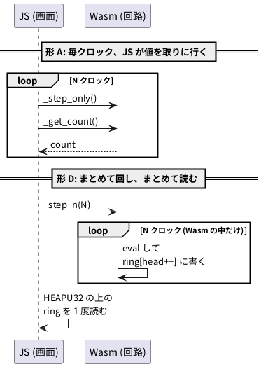

# 4-8 リングバッファと TypedArray — 毎クロック JS を呼ばない

この題は実体配線図と Analog Discovery 3 の図を付けない。ブラウザの中で動く題で、組む物が無いから。

4-1 で、soft-fpga は毎クロックの値を WebAssembly の側のリングバッファにため、JavaScript は 1 回の描画につき 1 度だけ、そのバッファを直に読むと書いた。
この題は、その設計を測って確かめる。
同じカウンタを 5 つの渡し方で 200 万クロック回し、1 クロックに何 ns かかるかを node と headless の Chromium で比べる。

## 用語

- **境界**: WebAssembly (Wasm) と JavaScript (JS) の間。JS から Wasm の関数を呼ぶときも、Wasm から JS の関数を呼ぶときも、ここをまたぐ
- **HEAPU32**: Emscripten が用意する `Uint32Array`。Wasm のメモリ全体を 32 ビットずつ並べて見せる。Wasm のメモリの番地 (バイト) を 4 で割ると、`HEAPU32` の添字になる
- **TypedArray のビュー**: `Uint32Array` などが、別の `ArrayBuffer` の上に窓を開けたもの。写しを作らずに中身を読む (ゼロコピー)

## 渡し方の違い




形 A は 1 クロックに 2 回、境界をまたぐ。形 D は N クロックで 1 回だけまたぐ。比べた 5 つの形は次のとおり。

| 形 | 1 クロックごとにすること | 境界をまたぐ回数 |
| --- | --- | --- |
| A | JS が `step_only()` と `get_count()` を呼び、JS の配列に入れる | 1 クロックに 2 回 |
| B | Wasm が回し、毎クロック `EM_JS` で JS の関数を呼んで値を渡す (JS は受けた値を変数に置くだけ) | 1 クロックに 1 回 |
| E | B と同じ。ただし JS は受けた値を JS の配列に `push` で足す | 1 クロックに 1 回 |
| C | JS が `step()` を呼ぶ。値は Wasm がリングバッファに書く。最後に JS がリングを 1 度読む | 1 クロックに 1 回 |
| D | JS が `step_n(N)` を 1 度呼ぶ。Wasm が N クロック回してリングに書く。最後に JS がリングを 1 度読む | N クロックで 1 回 |

soft-fpga の README は「毎サイクルの `EM_ASM` / `EM_JS` コールバックは呼出オーバーヘッドで破綻する」と書く。それが形 B と E。
01-counter の画面は形 C で、JS が速度スライダの数だけ `_step()` を呼ぶ。09-pdp11 の `sim-worker.js` は形 D で、`_step_n()` を 1 度呼ぶ。

## C++

01-counter の `cxx/harness.cpp` を写し、比べる形の関数を足した。回路は 01-counter の `counter.v` (8 ビットのカウンタ) のまま。

```cpp
// 4-8 の測定用: 01-counter の harness.cpp に、比べる形を 2 つ足したもの。
#include "Vcounter.h"
#include "verilated.h"
#include <emscripten.h>
#include <stdint.h>

static Vcounter* top;
static const int RING_SIZE = 1024;
static uint32_t ring[RING_SIZE];
static uint32_t head = 0;

// 形 B: 毎クロック、Wasm から JS の関数を呼んで値を渡す
EM_JS(void, js_sample, (uint32_t v), { Module.onSample(v); });

static inline void tick() {
    top->clk = 0; top->eval();
    top->clk = 1; top->eval();
}

extern "C" {

EMSCRIPTEN_KEEPALIVE void sim_init() {
    top = new Vcounter();
    top->clk = 0; top->rst = 1; top->eval();
    tick();
    top->clk = 0; top->eval();
    top->rst = 0; top->eval();
    head = 0;
}

// 01-counter と同じ: 1 クロック進めて、値をリングバッファに書く
EMSCRIPTEN_KEEPALIVE void step() {
    tick();
    ring[head & (RING_SIZE - 1)] = top->count;
    head++;
}

// 1 クロック進めるだけ (値は get_count で読む)
EMSCRIPTEN_KEEPALIVE void step_only() { tick(); }
EMSCRIPTEN_KEEPALIVE uint32_t get_count() { return top->count; }

// 形 B
EMSCRIPTEN_KEEPALIVE void step_n_callback(uint32_t n) {
    for (uint32_t i = 0; i < n; i++) { tick(); js_sample(top->count); }
}

// 形 D: n クロックを Wasm の中で回し、リングバッファに書く
EMSCRIPTEN_KEEPALIVE void step_n(uint32_t n) {
    for (uint32_t i = 0; i < n; i++) {
        tick();
        ring[head & (RING_SIZE - 1)] = top->count;
        head++;
    }
}

EMSCRIPTEN_KEEPALIVE uint32_t* get_ring_ptr() { return ring; }
EMSCRIPTEN_KEEPALIVE uint32_t get_head() { return head; }
EMSCRIPTEN_KEEPALIVE int get_ring_size() { return RING_SIZE; }

}
```

- `ring` は静的な配列なので、番地は動かない。JS は `_get_ring_ptr()` で番地を 1 度もらえば足りる
- ビルドの旗は soft-fpga の `scripts/build-wasm.sh` と同じ (`-O2`、`ALLOW_MEMORY_GROWTH=1`、`EXPORTED_RUNTIME_METHODS=["HEAPU32"]`)。`EXPORTED_FUNCTIONS` に上の関数を足した

## JS

測る関数の中身。node とブラウザの両方から同じファイルを読む。
各形を 1 度回して温めたあと 7 回測り、中央値を採る。測る前に `_sim_init()` を 1 度だけ呼び、以後は続けて回す。

```js
// N (= 2_000_000) と sink (形 B の受け皿。Module.onSample が書く) は、この外で決めてある
const ringIndex = () => Module._get_ring_ptr() >>> 2;   // バイトの番地 → HEAPU32 の添字

const forms = {
  'A: JS が毎クロック step と get_count を呼ぶ': () => {
    const out = new Uint32Array(1024);
    for (let i = 0; i < N; i++) { Module._step_only(); out[i & 1023] = Module._get_count(); }
    return out[(N - 1) & 1023];
  },
  'B: Wasm が毎クロック JS を呼ぶ (EM_JS)': () => {
    Module._step_n_callback(N);
    return sink;
  },
  'E: Wasm が毎クロック JS を呼び、JS の配列に記録を足す': () => {
    const log = [];
    Module.onSample = (v) => { log.push({ count: v }); };
    Module._step_n_callback(N);
    Module.onSample = (v) => { sink = v; };
    return log[log.length - 1].count;
  },
  'C: JS が毎クロック step を呼び、最後にリングを 1 度読む': () => {
    for (let i = 0; i < N; i++) Module._step();
    const ring = Module.HEAPU32.subarray(ringIndex(), ringIndex() + 1024);
    return ring[(Module._get_head() - 1) & 1023];
  },
  'D: step_n を 1 度呼び、最後にリングを 1 度読む': () => {
    Module._step_n(N);
    const ring = Module.HEAPU32.subarray(ringIndex(), ringIndex() + 1024);
    return ring[(Module._get_head() - 1) & 1023];
  },
};
```

- `HEAPU32.subarray(…)` は写しを作らない。リングの 1024 語の上に窓を開けるだけ
- どの形も最後の `count` を返す。それまでに回したクロックの数を 256 で割った余りと一致するかを毎回確かめた (5 つの形とも一致した)

## 手順

1. soft-fpga の写しを取る (0-2、4-3)。01-counter の `counter.v` は元のカウンタのまま使う
2. 写しの直下に `bench/` を作り、上の C++ と、ビルドの手順 `bench/build.sh` を置く。`build.sh` の中身は `scripts/build-wasm.sh` の 01-counter の部分と同じで、ハーネスを差し替え、出力を `bench/bench.js` にしたもの
3. Emscripten の容器でビルドする

   ```bash
   docker compose -f docker/compose.yml run --rm build-wasm bench/build.sh
   ```

4. node で測る。Emscripten が出す `bench.js` は CommonJS なので、`require('./bench.js')` の戻り値を `Module` として使い、`onRuntimeInitialized` を待ってから測る
5. ブラウザでも測る。`bench/` を Web サーバで配り、`bench.js` を読むページを Chromium で開いて、同じ関数を呼ぶ

## 画面に見えるはずのもの

この題は画面を描かない。測った数が、node なら端末に、ブラウザならページから返る。1 行の形は次のとおり (実物は欄の間がタブ)。

```text
D: step_n を 1 度呼び、最後にリングを 1 度読む  15.6 ms  128.4 M clk/s  7.8 ns/clk  値の確かめ OK
```

## 見るべき値

200 万クロックを回すのにかかった時間の中央値を、1 クロックあたりに直した。3 度測り直し、その幅を書く。
動かして確かめた (Verilator 5.048、Emscripten 5.0.7、soft-fpga の `build-wasm` 容器。node v24.15.0、Chromium 153 (Playwright 1.63 の headless)。WSL2 の上)。

| 形 | node (ns/クロック) | Chromium (ns/クロック) | 種類 |
| --- | --- | --- | --- |
| A: JS が毎クロック 2 つの関数を呼ぶ | 11.4〜11.7 | 13.2〜14.3 | 動かして確かめた |
| B: Wasm が毎クロック JS を呼ぶ | 10.0〜10.3 | 10.4〜10.8 | 動かして確かめた |
| E: B に JS の配列への記録を足す | 42.7〜47.1 | 27.2〜29.3 | 動かして確かめた |
| C: JS が毎クロック `step()`、リングは最後に 1 度 | 9.8〜10.0 | 11.6〜12.1 | 動かして確かめた |
| D: `step_n()` を 1 度、リングは最後に 1 度 | 7.7〜8.4 | 7.9〜8.3 | 動かして確かめた |

読み方:

- いちばん速いのは D で、1 クロックの時間が A より 3〜4 割短い。境界をまたぐ回数が減ったぶんが効いている
- 境界をまたぐこと自体の手間は、今の V8 (node と Chromium の JS エンジン) では 1 回に数 ns だった。B と D の差 (約 2〜2.5 ns) が、1 クロックに 1 回またぐ手間に当たる
- 大きく遅くなったのは E。JS の側で毎クロック記録を作ると、境界の手間より記録の手間のほうが重い。README の「破綻する」は、毎クロック JS で何か仕事をする形 (E や、毎クロック描く形) で起きる
- 01-counter の速度スライダの既定は 1 回の描画で 200 クロック。この数なら、どの形でも 1 回の描画あたり 10 µs に届かない (計算値。200 × 47 ns ≒ 9.4 µs)。差が効くのは、1 回の描画で何十万クロックも回す 06-8080 (既定 10 万) や 09-pdp11 (20 万から 200 万まで自動で増減) のような例

1 回の描画 (60 Hz なら 16.7 ms) に回せるクロックの数を、上の Chromium の数から出すと次のとおり (計算値)。

| 形 | 16.7 ms に回せるクロック |
| --- | --- |
| A (13.2 ns) | 約 126 万 |
| E (27.2 ns) | 約 61 万 |
| D (7.9 ns) | 約 211 万 |

描く時間も同じ 16.7 ms に入るので、実際に回せる数はこれより少ない。
09-pdp11 の上限 200 万クロックは、D の形でないと 1 回の描画に収まらない。

数は回路の大きさ、機械、ブラウザの版で変わる。比べるときは、同じ機械で形だけを変えて測る。

## 出典

自作。設計は [tommie-jp/soft-fpga](https://github.com/tommie-jp/soft-fpga) の README (Design notes) と
`docs/01-soft-FPGA-WebAssembly-設計議論メモ.md`。ハーネスと画面は `examples/01-counter` (`cxx/harness.cpp`、`web/index.html`)、
`step_n` の形は `examples/09-pdp11/web/sim-worker.js`。`EM_JS` と `HEAPU32` は [Emscripten の資料](https://emscripten.org/docs/)
(Interacting with code)。
