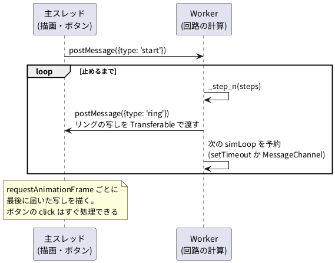

# 4-9 Web Worker で回す — 画面を止めない

この題は実体配線図と Analog Discovery 3 の図を付けない。ブラウザの中で動く題で、組む物が無いから。

ブラウザのページは、描画もボタンの処理も JavaScript も、1 本のスレッド (主スレッド) で順に動かす。
回路の計算を主スレッドで長く回すと、その間は描画もボタンも待たされる。
**Web Worker** は、ページとは別のスレッドで JavaScript と WebAssembly を動かす仕組み。回路の計算を Worker に移すと、主スレッドは描画とボタンだけを受け持てる。

soft-fpga では、06-8080 と 09-pdp11 が Worker で回している (`web/sim-worker.js`)。01〜05 も Worker に移すと設計メモ `docs/93-sim-worker化とrtlscope-log設計.md` で決めてある。この題を書いた時点の soft-fpga (コミット 19c032a) では、01〜05 はまだ主スレッドで回している。

この題は、4-8 のカウンタを主スレッドと Worker の 2 通りで回し、画面の更新の間隔とボタンの反応を headless の Chromium で測る。

## 仕組み




- Worker と主スレッドはメモリを分け合わない。値は `postMessage` で送る
- 送るのはリングバッファの**写し**。Worker の中で `HEAPU32.slice(…)` で写しを作り、その `ArrayBuffer` を Transferable (2 つ目の引数) として渡す。渡した `ArrayBuffer` は持ち主が主スレッドに移るので、中身を写し直す手間がかからない
- 4-8 の「HEAPU32 の上に TypedArray を作って直に読む」形は、主スレッドからは使えなくなる。主スレッドに Wasm のメモリが無いから。設計メモ 93 の「移行時の注意点」もこれを書いている

## Worker の側

soft-fpga の `examples/09-pdp11/web/sim-worker.js` と同じ形を、最小にしたもの。`bench.js` と `bench.wasm` は 4-8 で作ったもの (`_step_n` を持つ)。

```js
'use strict';
// 4-9: Worker の側。soft-fpga の sim-worker.js と同じ形 (setTimeout(simLoop, 0) で回し、
// リングバッファの写しを Transferable で主スレッドへ送る) を最小にしたもの。
var Module = {
  onRuntimeInitialized: function () {
    Module._sim_init();
    ringBase = Module._get_ring_ptr() >>> 2;
    postMessage({ type: 'ready' });
  }
};
importScripts('bench.js');

var ringBase = 0, running = false, steps = 0, sched = 'timeout';

// 次の simLoop の呼び方。setTimeout(…, 0) は入れ子が深くなると 4 ms 待たされるので、
// 06-8080 の sim-worker.js は最高速度のとき MessageChannel で自分に合図を送る
var mc = new MessageChannel();
mc.port2.onmessage = function () { simLoop(); };
function scheduleNext() {
  if (sched === 'mc') mc.port1.postMessage(null);
  else setTimeout(simLoop, 0);
}

function simLoop() {
  if (!running) return;
  Module._step_n(steps);
  var snap = Module.HEAPU32.slice(ringBase, ringBase + 1024);   // 写しを作る
  postMessage({ type: 'ring', head: Module._get_head() >>> 0, snap: snap.buffer }, [snap.buffer]);
  scheduleNext();
}

self.onmessage = function (e) {
  if (e.data.type === 'start') { steps = e.data.steps; sched = e.data.sched || 'timeout'; running = true; simLoop(); }
  if (e.data.type === 'stop') running = false;
};
```

- `var Module = {…}` を `importScripts('sim.js')` より前に置くのは、soft-fpga の `sim-worker.js` と同じ。Emscripten の出力は、先にある `Module` を使う
- `simLoop` は 1 回ごとに `setTimeout` か `MessageChannel` で次を予約して、いったん手を離す。手を離すたびに、主スレッドからの `stop` などのメッセージが届く。ずっと回り続ける `while` にすると、`stop` を受け取れない
- 09-pdp11 は `setTimeout(simLoop, 0)`、06-8080 は最高速度のとき `MessageChannel` を使っている

## 主スレッドの側

比べる 2 つの回し方。描画 `draw()` は、01-counter と同じくリングの下位ビットを canvas に 1 本描く。
`record()` は、3 秒の間 `requestAnimationFrame` が呼ばれた時刻を記録し、毎回 `onFrame` を呼ぶ。

```js
// 主スレッドで回す: 1 回の描画ごとに step_n(steps) を呼んでから描く
async function runMain(steps, durationMs) {
  await new Promise((res) => {
    if (window.Module && Module.calledRun) return res();
    window.Module = { onRuntimeInitialized: res };
    const s = document.createElement('script'); s.src = 'bench.js'; document.body.appendChild(s);
  });
  Module._sim_init();
  const base = Module._get_ring_ptr() >>> 2;
  const h0 = Module._get_head();
  const r = await record(durationMs, () => {
    Module._step_n(steps);
    draw(Module.HEAPU32.subarray(base, base + 1024), Module._get_head());
  });
  return summary(r, Module._get_head() - h0);
}

// Worker で回す: 主スレッドは届いた写しを描くだけ
async function runWorker(steps, durationMs, sched) {
  const w = new Worker('demo-worker.js');
  await new Promise((res) => { w.onmessage = (e) => { if (e.data.type === 'ready') res(); }; });
  let last = null;   // 最後に届いたリングの写し (head は Worker の中で数えたクロックの数)
  w.onmessage = (e) => { if (e.data.type === 'ring') last = e.data; };
  w.postMessage({ type: 'start', steps, sched });
  const r = await record(durationMs, () => { if (last) draw(new Uint32Array(last.snap), last.head); });
  w.postMessage({ type: 'stop' });
  w.terminate();
  return summary(r, last ? last.head : 0);
}
```

主スレッドで回す形は、01-counter の画面の `loop()` と同じ (描画ごとに回してから描く)。Worker で回す形は、09-pdp11 の画面 (`js/sft-pdp11-worker-bridge.js`) と同じく、届いた写しを `requestAnimationFrame` で描く。

## 手順

1. 4-8 の `bench/` に、上の `demo-worker.js` と、`runMain` と `runWorker` を持つページ `worker-demo.html` を置く。ページには canvas とボタンを 1 つずつ置き、ボタンの `click` で時刻を記録する
2. `bench/` を Web サーバで配る (`python3 -m http.server`)。Worker は `file://` からは作れないので、必ず Web サーバ越しに開く
3. Playwright で Chromium を headless で開き、`runMain(steps, 3000)` と `runWorker(steps, 3000, sched)` を呼ぶ。始めて 1 秒たったらボタンを 5 回押し、押してから処理が終わるまでの時間を測る
4. `steps` (1 回に回すクロックの数) を 200、200 万、1200 万と変えて比べる。200 は 01-counter の既定。1200 万は、1 回の `_step_n` が約 100 ms かかるように選んだ (4-8 の D の形の 1 クロック約 8 ns から計算した値)

画面を目で見るなら、ブラウザで `worker-demo.html` を開き、開発者ツールの Console で `runMain(12000000, 3000)` と打つ。打ってすぐボタンを押すと、反応が遅れるのが分かる。

## 画面に見えるはずのもの

- 主スレッドで `steps` = 1200 万: canvas の線が 1 秒に 10 回ほどしか描き変わらず、ぎくしゃく動く。ボタンを押しても、押した印が出るまで遅れる
- Worker で `steps` = 1200 万: canvas は 1 秒に 60 回描き変わる。ボタンはすぐ反応する
- どちらでも `steps` = 200 なら、目で見て違いは無い

## 見るべき値

動かして確かめた (4-8 と同じ `bench.wasm`、Chromium 153 (Playwright 1.63 の headless)、WSL2 の上)。3 度測り、3 度とも同じ傾向だった。下の表は、ここに載せたコードで測った回の数。

| steps | 回し方 | 描画の回数 (1 秒) | 描画の間隔の中央値 | 間隔の最大 | ボタンの反応 (中央値) | 回路のクロック (1 秒) |
| --- | --- | --- | --- | --- | --- | --- |
| 200 | 主スレッド | 60.1 | 16.7 ms | 20.6 ms | 1 ms | 1 万 2 千 |
| 200 | Worker (setTimeout) | 60.5 | 16.7 ms | 17.9 ms | 1 ms | 4 万 8 千 |
| 200 | Worker (MessageChannel) | 60.3 | 16.7 ms | 24.2 ms | 1 ms | 2240 万 |
| 200 万 | 主スレッド | 58.7 | 16.7 ms | 24.2 ms | 17 ms | 1 億 1700 万 |
| 200 万 | Worker (setTimeout) | 60.6 | 16.7 ms | 17.2 ms | 1 ms | 9700 万 |
| 200 万 | Worker (MessageChannel) | 60.4 | 16.7 ms | 17.1 ms | 1 ms | 1 億 2000 万 |
| 1200 万 | 主スレッド | 10.1 | 102.4 ms | 115.7 ms | 104 ms | 1 億 2100 万 |
| 1200 万 | Worker (setTimeout) | 60.3 | 16.7 ms | 17.1 ms | 1 ms | 1 億 1600 万 |
| 1200 万 | Worker (MessageChannel) | 60.4 | 16.7 ms | 18.0 ms | 1 ms | 1 億 1900 万 |

- 「ボタンの反応」は、Playwright がマウスのクリックを送ってから、Chromium がその処理を終えたと返すまでの時間。押した 5 回はどれも `click` の処理まで届いた。遅れはしても、押したことは失われない
- 主スレッドで 1200 万クロックずつ回すと、描画が 1 秒に約 10 回に落ち、ボタンの反応が約 100 ms 遅れる。1 回の `_step_n` の時間 (約 100 ms) が、そのまま描画とボタンを待たせている
- Worker に移すと、同じ 1200 万クロックでも描画は 60 回、ボタンの反応は 1〜2 ms のまま。回路のクロックの速さはほぼ同じ
- Worker を `setTimeout(…, 0)` で回すと、1 回に回す数が少ないとき遅い。`steps` = 200 で 1 秒に 4 万 8 千クロック、つまり 1 秒に 240 回しか `simLoop` が回っていない。入れ子の `setTimeout` は 4 ms 待たされる (HTML の決まり) ため。`MessageChannel` で予約すると、同じ 200 で 2240 万クロックまで上がった。06-8080 が最高速度のとき `MessageChannel` を使うのはこのため

数は機械とブラウザの版で変わる。headless の Chromium は画面に描かないので、画面に出すブラウザとは描画の手間が違う。比べるときは同じ機械で回し方だけを変える。

## 確かめていないこと

- soft-fpga の 06-8080・09-pdp11 の画面そのものでは測っていない。どちらもサブモジュールの取得とディスクの用意が要る。ここでは同じ形を最小にした `demo-worker.js` で測った
- `SharedArrayBuffer` で主スレッドと Worker がメモリを分け合う形 (設計メモ 01・93 に名前が出る) は試していない。使うには、Web サーバが COOP・COEP の見出しを返す必要がある

## 出典

自作。形は [tommie-jp/soft-fpga](https://github.com/tommie-jp/soft-fpga) の `examples/09-pdp11/web/sim-worker.js`、
`examples/06-8080/web/sim-worker.js`、`js/sft-pdp11-worker-bridge.js`。移行の方針は同リポジトリの
`docs/93-sim-worker化とrtlscope-log設計.md`。Web Worker と Transferable は
[MDN の Web Workers API](https://developer.mozilla.org/ja/docs/Web/API/Web_Workers_API)、
入れ子の `setTimeout` の 4 ms は [HTML Standard のタイマー](https://html.spec.whatwg.org/multipage/timers-and-user-prompts.html#timers)。
