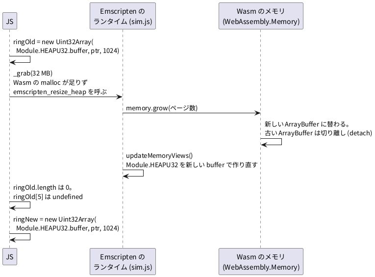

# 4-10 メモリが伸びるとビューが切れる

この題は実体配線図と Analog Discovery 3 の図を付けない。ブラウザの中で動く題で、組む物が無いから。

soft-fpga のビルドは、どの例も `-s ALLOW_MEMORY_GROWTH=1` を付けている。WebAssembly のメモリが足りなくなったら、伸ばしてよいという設定。
4-1 で、この設定だと「伸びたときに古い読み口が無効になる」と README にある、と書いた。
この題は、それを小さなプログラムで再現し、伸びる前と後の数を取る。そのうえで、soft-fpga の画面がどう読み口を作り直しているかを実物から読む。

## 何が起きるか




- Wasm のメモリは 1 つの `ArrayBuffer` として JS に見える。`memory.grow()` で伸ばすと、`ArrayBuffer` が新しいものに替わり、古いものは**切り離される** (detach)。切り離された `ArrayBuffer` の長さは 0 になる
- 古い `ArrayBuffer` の上に作った TypedArray のビューも、長さ 0 になる。添字で読むと `undefined` が返る。例外は投げない
- Emscripten のランタイムは、伸ばした直後に `updateMemoryViews()` を呼び、`Module.HEAPU32` などを新しい `ArrayBuffer` の上に作り直す (`sim.js` の中の `growMemory` で確かめた)。古いビューを JS の変数に握っていると、その変数だけが古いまま残る
- Wasm の中の番地 (ポインタ) は変わらない。リングバッファの番地 `ptr` は伸びた後も同じ。作り直すのは JS のビューだけ

## C++

soft-fpga のハーネスと同じく、リングバッファを静的な配列に置く。`grab()` で大きなメモリを取らせて、メモリを伸ばす。

```cpp
// 4-10: メモリが伸びると、JS が前に作った TypedArray のビューが切れることを確かめる。
#include <emscripten.h>
#include <emscripten/heap.h>
#include <stdint.h>
#include <stdlib.h>

static const int RING_SIZE = 1024;
static uint32_t ring[RING_SIZE];   // soft-fpga のハーネスと同じく、静的な配列

extern "C" {

EMSCRIPTEN_KEEPALIVE uint32_t* get_ring_ptr() {
    for (int i = 0; i < RING_SIZE; i++) ring[i] = 1000 + i;
    return ring;
}

// bytes だけ取る。メモリが足りなければ、Wasm のメモリが伸びる
EMSCRIPTEN_KEEPALIVE void* grab(uint32_t bytes) { return malloc(bytes); }

EMSCRIPTEN_KEEPALIVE uint32_t heap_size() { return (uint32_t)emscripten_get_heap_size(); }

}
```

ビルドの手順 `grow/build.sh`。soft-fpga の `scripts/build-wasm.sh` と同じ旗で、`ALLOW_MEMORY_GROWTH` を 1 と 0 の 2 通りに作る。

```bash
#!/bin/bash
# 容器の中で /work/grow から呼ぶ
set -euo pipefail
cd /work/grow
for g in 1 0; do
  em++ -O2 grow.cpp \
    -s EXPORTED_FUNCTIONS='["_get_ring_ptr","_grab","_heap_size"]' \
    -s EXPORTED_RUNTIME_METHODS='["HEAPU32"]' \
    -s ALLOW_MEMORY_GROWTH=$g -s EXIT_RUNTIME=0 \
    -o grow$g.js
done
ls -l grow*.js grow*.wasm
```

## JS

node で読む。伸びる前に 2 つのビュー (丸ごとの `HEAPU32` と、リングだけのビュー) を握っておき、32 MB を取らせた後にもう一度見る。

```js
// node grow.mjs [1|0]  — 1 = ALLOW_MEMORY_GROWTH=1 で作った grow1.js を読む
import { createRequire } from 'node:module';
const require = createRequire(import.meta.url);
const g = process.argv[2] ?? '1';
const Module = require(`./grow${g}.js`);
await new Promise((resolve) => { Module.onRuntimeInitialized = resolve; });

const MB = 1024 * 1024;
const ptr = Module._get_ring_ptr();
const heapOld = Module.HEAPU32;                                  // 丸ごとのビュー
const ringOld = new Uint32Array(Module.HEAPU32.buffer, ptr, 1024); // リングだけのビュー

const show = (label) => console.log(label, {
  heapSize_MB: Module._heap_size() / MB,
  'heapOld.byteLength': heapOld.byteLength,
  'ringOld.byteLength': ringOld.byteLength,
  'ringOld.length': ringOld.length,
  'ringOld[5]': ringOld[5],
  'ringOld.buffer.detached': ringOld.buffer.detached,
  'Module.HEAPU32.byteLength': Module.HEAPU32.byteLength,
  '同じ buffer か': ringOld.buffer === Module.HEAPU32.buffer,
});

console.log(`ALLOW_MEMORY_GROWTH=${g}, node ${process.version}, ring の番地 ${ptr}`);
show('伸びる前');
let p = 0;
try {
  p = Module._grab(32 * MB);
  console.log('32 MB を取った: 番地', p);
} catch (e) {
  console.log('32 MB を取れなかった:', String(e).slice(0, 120));
}
show('取った後');

// 読み口を作り直す: Module.HEAPU32 をもう一度読み、同じ番地からビューを作る
const ringNew = new Uint32Array(Module.HEAPU32.buffer, ptr, 1024);
console.log('作り直したビュー', { 'ringNew.length': ringNew.length, 'ringNew[5]': ringNew[5] });
```

## 手順

1. soft-fpga の写しの直下に `grow/` を作り、上の `grow.cpp`、`build.sh`、`grow.mjs` を置く。`grow/` に `{"type":"commonjs"}` だけの `package.json` を置く (Emscripten の出力 `grow1.js` を CommonJS として読ませるため)
2. Emscripten の容器でビルドする

   ```bash
   docker compose -f docker/compose.yml run --rm build-wasm grow/build.sh
   ```

3. node で 2 通り動かす

   ```bash
   cd grow
   node grow.mjs 1
   node grow.mjs 0
   ```

## 画面に見えるはずのもの

この題は画面を描かない。端末に出る数を読む。もし soft-fpga の画面でビューが切れたら、ロジックアナライザの線が全部 0 の高さに張り付く。
01-counter の Logic Analyzer (共通部品 RTLScopeLA、`js/rtlscope-la.js`) は、リングのビュー `heapu32` から `(heapu32[idx] >> sig.bit) & 1` でビットを取り出す。切れたビューは `undefined` を返し、`(undefined >> bit) & 1` は 0 になるから。README の「実行中に表示が消える」は、この見え方を言っている。

## 見るべき値

動かして確かめた (Emscripten 5.0.7、soft-fpga の `build-wasm` 容器。node v24.15.0)。

`ALLOW_MEMORY_GROWTH=1` のとき:

| 見る所 | 伸びる前 | 32 MB を取った後 |
| --- | --- | --- |
| Wasm のメモリ (`emscripten_get_heap_size()`) | 16.125 MB | 32.125 MB |
| 握っていた `heapOld.byteLength` | 16,908,288 | 0 |
| 握っていた `ringOld.byteLength` | 4096 | 0 |
| `ringOld.length` | 1024 | 0 |
| `ringOld[5]` | 1005 | `undefined` |
| `ringOld.buffer.detached` | `false` | `true` |
| 今の `Module.HEAPU32.byteLength` | 16,908,288 | 33,685,504 |
| `ringOld.buffer === Module.HEAPU32.buffer` | `true` | `false` |
| 作り直したビューの `ringNew[5]` | — | 1005 |

- 伸びた後、握っていた 2 つのビューはどちらも長さ 0 になった。例外は出ていない。気付かずに読み続けると、`undefined` を 0 と取り違える
- リングの番地は伸びる前も後も 1040。`Module.HEAPU32.buffer` から同じ番地でビューを作り直すと、元の値 1005 が読めた

`ALLOW_MEMORY_GROWTH=0` のとき、32 MB を取ろうとすると `Aborted(OOM)` で止まった。メモリは 16.125 MB のまま、ビューも切れない。伸ばさない設定は、ビューの心配が無い代わりに、足りなくなると止まる。

soft-fpga の公開ページの 01-counter (ac6b663。リングは 4096 サンプル) を Chromium (headless) で開き、速度を 2000 にして 3 秒回した (2026-10-13)。`Module.HEAPU32.byteLength` は回す前も後も 16,908,288 で、メモリは伸びなかった (36 万 6000 クロック)。小さな回路では伸びることはまず無い。09-pdp11 は `INITIAL_MEMORY` を 64 MB (`67108864`) にしてから伸ばす設定にしている (`scripts/build-wasm-09.sh`)。

## soft-fpga の画面はどう作り直しているか

ビューを長く握らず、**使うたびに `Module.HEAPU32` を読み直す**。ランタイムが伸ばすたびに `Module.HEAPU32` を作り直すので、毎回読み直せば、いつも新しいビューを使える。

- 01〜05 の `web/index.html`: Logic Analyzer を組み立てる共通部品 `js/sft-la-glue.js` の `draw()` を、描画ごとに呼ぶ。`draw()` は `ringView()` で `M.HEAPU32.subarray(ringBase, …)` を毎回作り直し、RTLScopeLA の `update()` に渡す。ソースのコメントも「メモリ拡張で HEAPU32 が差し替わるため毎回取り直す」と書く。最初に覚えておくのは番地を 4 で割った添字 `ringBase` (数) だけ
- RTLScopeLA は、受け取ったビューを、マウスでずらしたときの描き直しのために覚えておく (`_lastHeapu32`)。ただし 01〜04 の画面の `loop()` は、動かしていない間も毎フレーム `draw()` を呼ぶ。05-dormann は、回路を回したあとと、リセットしたあとに必ず `draw()` を呼ぶ。どの例でも、Wasm を動かしたあとには覚えたビューが新しいものに替わる
- 06-8080・09-pdp11 の `sim-worker.js`: 送るたびに `Module.HEAPU32` から `.slice()` で写しを作る (4-9)。`Module.HEAPU8.buffer` の上のビューも、使う場所で作ってすぐ `.slice()` する

README (日本語版 `README.ja.md`) も「JS は読み口を持ち続けず、描くたびに `Module.HEAPU32` を取り直してから読む」と書く (a70e845 で今の形に直った。それより前は「ハーネス側で growth を監視しビューを再生成する」と書いていた)。伸びたかどうかを見張るのではなく、描くたびに読み直す形。

自分で画面を書くときの決まりは 2 つ。

1. 番地 (数) は覚えてよい。ビュー (TypedArray) は覚えない
2. `Module.HEAPU32` などは、描く・送るたびに読み直す

## 出典

自作。soft-fpga の書き方は [tommie-jp/soft-fpga](https://github.com/tommie-jp/soft-fpga) の README (Design notes)、
`examples/01-counter/web/index.html`、`js/sft-la-glue.js`、`js/rtlscope-la.js`、`examples/09-pdp11/web/sim-worker.js`、
`scripts/build-wasm*.sh`。メモリが伸びるときの決まりは
[MDN の WebAssembly.Memory.prototype.grow()](https://developer.mozilla.org/ja/docs/WebAssembly/Reference/JavaScript_interface/Memory/grow) と
[Emscripten の設定 (ALLOW_MEMORY_GROWTH)](https://emscripten.org/docs/tools_reference/settings_reference.html#allow-memory-growth)。
