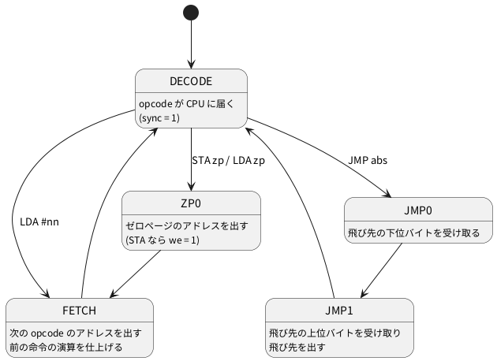

# 4-11 6502 の内部を見る — マイクロシーケンサとバス

この題は実体配線図と Analog Discovery 3 の図を付けない。ブラウザの中で動く題で、組む物が無いから。

soft-fpga の例 `04-6502` は、Apple-I を 6502 の RTL で動かす。
RTL は他の人が書いたもの (Arlet Ottens の 6502 コアに、David Banks と Ed Spittles が 65C02 の命令を足した `cpu_65c02.v`) を借りている。
この題では、その RTL を読んで動かし、**1 命令が何クロックで、各クロックにバスへ何が出るか**を数える。

命令エミュレータは、`LDA #$AA` を 1 回の関数呼び出しで済ませ、クロックの数を表から足すだけ。
RTL のシミュレーションでは、クロックごとにアドレスバスとデータバスの値が決まり、CPU の中の状態 (マイクロシーケンサの今の位置) も見える。
この違いが soft-fpga で CPU を動かす意味になる。

## マイクロシーケンサ

`cpu_65c02.v` の中心は、6 ビットの `state` を持つ状態機械。
アドレスの指定の仕方 (アドレッシングモード) ごとに、状態をたどる道が決まっている。状態は 54 個 (`ABS0` 〜 `JMPIX2`)。
各状態で、そのクロックに出すアドレスと、ALU に渡す値が決まる。これがマイクロシーケンサ。

この題で走らせる 4 命令がたどる道を描く。




- 1 本の矢印が 1 クロック。DECODE から DECODE に戻るまでの矢印の数が、その命令のクロック数
- `LDA #nn` は DECODE → FETCH → DECODE で 2 クロック。`STA zp` と `LDA zp` は ZP0 を挟んで 3 クロック。`JMP abs` も 3 クロック
- 状態の名前と注釈は `cpu_65c02.v` の `parameter` の並びとコメントから取った

## 走らせるプログラム

Woz Monitor に打ち込む 9 バイト。soft-fpga の設計メモ `docs/04-6502/53-機械語入門.md` の例 3.2 と同じ。

| アドレス | バイト | 命令 | データシートのクロック数 |
| --- | --- | --- | --- |
| $0300 | A9 AA | `LDA #$AA` | 2 |
| $0302 | 85 10 | `STA $10` | 3 |
| $0304 | A5 10 | `LDA $10` | 3 |
| $0306 | 4C 00 03 | `JMP $0300` | 3 |

1 周は 2 + 3 + 3 + 3 = 11 クロック (計算値)。

## C++ — ハーネスを変えずにバスを書き出す

ブラウザの画面と同じ値を、PC でも取る。
soft-fpga の `examples/04-6502/cxx/harness.cpp` をそのまま使い、`main` だけを自分で書く。
ハーネスはクロックごとに、リングバッファの Word0 へ `AB` (アドレス)・`DB` (データ)・`WE`・`SYNC` を詰める。下の `main` はそれを読み、状態の名前を添えて出す。

```cpp
// 04-6502 の harness.cpp をそのまま使い、Woz Monitor にプログラムを打ち込んで、
// 1 クロックごとのバス (addr・data・we・sync) とマイクロシーケンサの状態を出す。
#include <cstdint>
#include <cstdio>

extern "C" {
void      sim_init();
void      step();
void      send_key(uint8_t ch);
uint32_t* get_ring_ptr();
uint32_t  get_head();
int       get_ring_size();
uint8_t   get_state();
}

// cpu_65c02.v の parameter の並び (0〜53)
static const char* NAME[] = {
    "ABS0", "ABS1", "ABSX0", "ABSX1", "ABSX2", "BRA0", "BRA1", "BRA2",
    "BRK0", "BRK1", "BRK2", "BRK3", "DECODE", "FETCH", "INDX0", "INDX1",
    "INDX2", "INDX3", "INDY0", "INDY1", "INDY2", "INDY3", "JMP0", "JMP1",
    "JMPI0", "JMPI1", "JSR0", "JSR1", "JSR2", "JSR3", "PULL0", "PULL1",
    "PULL2", "PUSH0", "PUSH1", "READ", "REG", "RTI0", "RTI1", "RTI2",
    "RTI3", "RTI4", "RTS0", "RTS1", "RTS2", "RTS3", "WRITE", "ZP0",
    "ZPX0", "ZPX1", "IND0", "JMPIX0", "JMPIX1", "JMPIX2"};

int main(int argc, char** argv) {
    const char* typed = argc > 1 ? argv[1] : "0300: A9 AA 85 10 A5 10 4C 00 03\r0300R\r";
    sim_init();
    for (const char* p = typed; *p; ++p) send_key((uint8_t)*p);
    for (int i = 0; i < 200000; ++i) step();  // 打ち込みが済み、0300 から走り出すまで回す
    for (int i = 0; i < 1000 && get_state() != 22; ++i) step();  // JMP0 (22) まで進め、次の JMP1 から出す

    const uint32_t* ring = get_ring_ptr();
    const uint32_t  mask = (uint32_t)get_ring_size() - 1;
    for (int i = 0; i < 13; ++i) {
        step();
        const uint32_t w = ring[((get_head() - 1) & mask) * 2];  // Word0 = AB/DB/WE/SYNC
        printf("%2d addr=%04X data=%02X we=%u sync=%u state=%s\n", i, w & 0xFFFF,
               (w >> 16) & 0xFF, (w >> 24) & 1, (w >> 25) & 1, NAME[get_state()]);
    }
    return 0;
}
```

- 引数を付けると、打ち込む文字列を替えられる (下の表の INC や JSR はこれで測った)
- 20 万クロック回したあと、1 周のどこにいるかは打ち込みの速さで決まる。そこで JMP0 の状態 (番号 22) まで進めてから出し、出力の頭を JMP1 に揃えた。JMP の無いプログラムでも止まらないよう、1000 クロックで打ち切る
- `get_state()` はハーネスが前から持っている関数で、`cpu_65c02.v` の観測用出力 `o_state` を返す

## 手順

### ブラウザで見る

1. [04-6502](https://tommie-jp.github.io/soft-fpga/04-6502/) を開く。Apple-I (Woz Monitor + BASIC) が選ばれていて、端末に `\` が出る
2. 端末をクリックし、`0300: A9 AA 85 10 A5 10 4C 00 03` と打って Enter、続けて `0300R` と打って Enter
3. **Pause** を押して止め、**Step Inst** を何回か押す。1 回押すごとに、次の DECODE まで進む
4. 右の **State** の欄が DECODE で止まり、`PC` が 0301 → 0303 → 0305 → 0307 → 0301 と進む
5. 下の Logic Analyzer の `addr` `data` `we` `sync` の 4 本で、1 周 11 クロックの並びを見る。いちばん上の `INSTR` のレーンは、sync で命令の境目を切り、`LDA` `STA` `LDA` `JMP` と命令の名前を出す。`reset` と `A` `X` `Y` `SP` のレーンは、最初は隠れている (上の札を押すと出る)

### PC で数える

soft-fpga を取ってきて (0-2)、RTL のサブモジュールを入れる。

```bash
git submodule update --init examples/04-6502/verilog/hoglet
```

上の C++ を `probe6502.cpp` に保存し、ハーネスと一緒にビルドする。
`-Wno-…` は soft-fpga の `examples/04-6502/CMakeLists.txt` と同じ並び。

```bash
SRC=examples/04-6502
verilator --cc --exe --build -j 8 --top-module apple1_top --prefix Vapple1_top \
  -Wno-CASEX -Wno-CASEINCOMPLETE -Wno-WIDTHEXPAND -Wno-WIDTHTRUNC -Wno-CASEOVERLAP \
  $SRC/verilog/apple1_top.v $SRC/verilog/hoglet/cpu_65c02.v $SRC/verilog/hoglet/ALU.v \
  $SRC/cxx/harness.cpp probe6502.cpp -o probe6502
./obj_dir/probe6502
```

## 画面に見えるはずのもの

PC で取った 13 クロックを `logic` のフェンスで描く。
ブラウザの画面には時間の単位が無いので、1 クロックを 1 ms と置いた仮の目盛。
アドレスは下位 8 ビットだけをバスにまとめた (上位は、$0010 を出すクロックだけ 00、ほかは 03)。

```logic
title: 図1 11 クロックで 4 命令が 1 周し、sync は opcode が届くクロックで立つ
device: generic
window: 13ms
signals:
  CLK: dio0 clock 1kHz
  SYNC: dio1 edges 0s=0 1ms=1 2ms=0 3ms=1 4ms=0 6ms=1 7ms=0 9ms=1 10ms=0 12ms=1
  WE: dio2 edges 0s=0 4ms=1 5ms=0
  A: dio3..dio10 counter on CLK rising sequence 0x00 0x01 0x02 0x03 0x10 0x04 0x05 0x10 0x06 0x07 0x08 0x00 0x01
  D: dio11..dio18 counter on CLK rising sequence 0x03 0xA9 0xAA 0x85 0xAA 0xAA 0xA5 0x10 0xAA 0x4C 0x00 0x03 0xA9
buses:
  addr: A7..A0 hex
  data: D7..D0 hex
cursors: [4.5ms, 8.5ms]
trigger: SYNC rising at 1ms
```


各クロックの状態は、図の外に表で添える。

| 時刻 (ms) | addr | data | we | sync | state | 何をしているか |
| --- | --- | --- | --- | --- | --- | --- |
| 0 | $0300 | 03 | 0 | 0 | JMP1 | JMP の飛び先 $0300 を出す。data は前のクロックの $0308 の中身 |
| 1 | $0301 | A9 | 0 | 1 | DECODE | `LDA #` の opcode A9 が届く |
| 2 | $0302 | AA | 0 | 0 | FETCH | 即値 AA が届く。次の opcode のアドレスを出す |
| 3 | $0303 | 85 | 0 | 1 | DECODE | `STA zp` の opcode 85 が届く |
| 4 | $0010 | AA | **1** | 0 | ZP0 | $0010 へ A (AA) を書く |
| 5 | $0304 | AA | 0 | 0 | FETCH | 次の opcode のアドレス |
| 6 | $0305 | A5 | 0 | 1 | DECODE | `LDA zp` の opcode A5 |
| 7 | $0010 | 10 | 0 | 0 | ZP0 | $0010 を読みに出す。data はまだ前のクロックの値 (オペランド 10) |
| 8 | $0306 | **AA** | 0 | 0 | FETCH | $0010 の中身 AA がここで届く |
| 9 | $0307 | 4C | 0 | 1 | DECODE | `JMP` の opcode 4C |
| 10 | $0308 | 00 | 0 | 0 | JMP0 | 飛び先の下位 00 |
| 11 | $0300 | 03 | 0 | 0 | JMP1 | 飛び先の上位 03。次の周に入る |
| 12 | $0301 | A9 | 0 | 1 | DECODE | 2 周目の `LDA #` |

### 読み方

- **sync の立ち上がりから次の立ち上がりまでが 1 命令**。間隔は 2、3、3、3 クロック。sync が立つクロックで data に出ているのが、その命令の opcode
- **読みのデータは 1 クロック遅れて届く。** X2 (8.5 ms) の data = AA は、1 つ前のクロック (7 ms) に出したアドレス $0010 の中身。
  この RTL は、アドレスを出した次のクロックにデータが来るメモリ (同期メモリ。FPGA の block RAM と同じ) を前提にしている。ハーネスもそれに合わせ、`DB` には 1 つ前のアドレスの中身を入れる
- **書きのデータは同じクロックに出る。** X1 (4.5 ms) では addr = $0010、we = 1、data = AA が同時に出ている
- 実物の 6502 は、opcode のアドレスを出しているクロックで SYNC を 1 にする。この記録では、その 1 クロック後 (opcode が CPU に届く DECODE のクロック) に sync が立つ。アドレスの並び ($0300、$0301、$0302、$0303、$0010 …) は実物と同じ

## 見るべき値

soft-fpga (`ac6b663`。Logic Analyzer を RTLScopeLA に替えた後) の 04-6502 を、Verilator 5.042 で PC にビルドして動かした (2026-10-13。前の版 19c032a と同じ並びだった)。
ブラウザは公開中の [04-6502](https://tommie-jp.github.io/soft-fpga/04-6502/) を Playwright の Chromium (headless) で開き、同じプログラムを打ち込んでリングバッファを読んだ。
2 つの addr・data・we・sync の並びは、1 周 11 クロックぶん一致した。

| 見る所 | 値 | 種類 |
| --- | --- | --- |
| 1 周のクロック数 | 11 (2 + 3 + 3 + 3) | 動かして確かめた |
| we = 1 のクロック | 1 周に 1 回 (STA の ZP0、addr = $0010、data = AA) | 動かして確かめた |
| sync が立つクロックの state | いつも DECODE | 動かして確かめた |
| Step Inst で止まる所 | DECODE、PC = 0301 → 0303 → 0305 → 0307 → 0301 | 動かして確かめた (ブラウザ) |

ほかの命令も、同じ C++ に打ち込む文字列を替えて数えた。クロック数はどれもデータシートの値と同じ。
ただし**バスに出る並びは、実物と同じとは限らない**。

| 命令 | データシートのクロック数 | 数えた値 | バスに出た並び (opcode の次のクロックから) |
| --- | --- | --- | --- |
| `INC $10` | 5 | 5 | $0301 → $0010 読み → $0010 読み → $0010 書き |
| `LDA $0200,X` (X = 1) | 4 | 4 | $0303 → $0304 → $0201 読み |
| `LDA $02FF,X` (X = 1、ページをまたぐ) | 5 | 5 | $0303 → $0304 → $0200 読み → $0300 読み |
| `JSR $0310` | 6 | 6 | $0301 → $01FD 書き → $01FC 書き → $0302 → $0302 |
| `RTS` | 6 | 6 | (スタックの $01FC・$01FD を読む) |

- ページをまたぐ `LDA abs,X` は、上位バイトを直す前のアドレス ($0200) を 1 回余計に読む。実物の NMOS 6502 と同じ振る舞い
- `INC` は、この RTL では「読む → 読む → 書く」。NMOS の 6502 は「読む → 元の値を書く → 新しい値を書く」と 2 回書く
- `JSR` も、合計の 6 クロックは同じでも、スタックを読むクロックが無く、$0302 を 2 回出す。実物とは順番が違う

命令エミュレータで数えられるのは、表の「数えた値」の列まで。どのクロックにどのアドレスが出るかは、RTL を動かして初めて見える。

## 出典

自作。例と RTL は [tommie-jp/soft-fpga](https://github.com/tommie-jp/soft-fpga) の `examples/04-6502`
(RTL はサブモジュール `verilog/hoglet` = [tommie-jp/verilog-6502](https://github.com/tommie-jp/verilog-6502)。
元は Arlet Ottens の [verilog-6502](https://github.com/Arlet/verilog-6502))。
同期メモリを前提にすることは verilog-6502 の README に書かれている。
命令のクロック数とバスの並びは MOS Technology の MCS6500 Microcomputer Family Hardware Manual (1976) の付録 A。
画面の使い方は soft-fpga の `docs/04-6502/53-機械語入門.md`。
