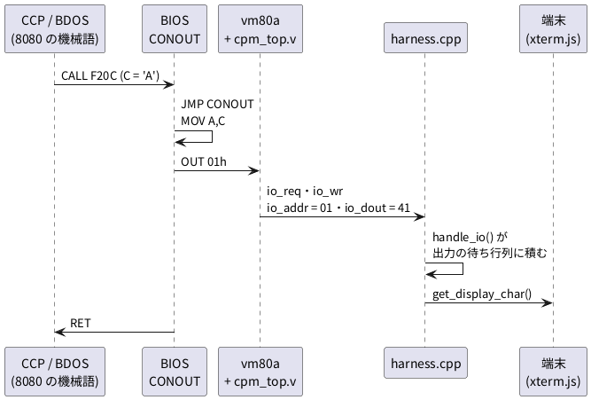

# 4-12 8080 と CP/M — I/O のバスを見る

この題は実体配線図と Analog Discovery 3 の図を付けない。ブラウザの中で動く題で、組む物が無いから。

soft-fpga の例 `06-8080` は、Intel 8080 の RTL で CP/M 2.2 を動かす。
RTL は vm80a (8080 の互換チップの写真から起こした Verilog) を借りている。
この題では、CP/M が端末へ 1 文字を出すとき、**OUT 命令が 8080 のバスにどう出るか**を取って図にする。

6502 (4-11) はメモリの番地に周辺を置き、ふつうの書き込みで文字を出す。
8080 には I/O 専用の命令 `OUT` と `IN` があり、メモリとは別の「I/O のサイクル」がバスに出る。
どのサイクルがメモリでどれが I/O かを、8080 は各サイクルの頭にデータバスへ出す 1 バイト (ステータス) で知らせる。

## 1 文字が端末に出るまで

CP/M の CCP がプロンプト `A>` の `A` を出すときの道筋。




- BIOS の入口は `F200` から 3 バイトずつ並ぶ飛び先の表。5 番目 (`F20C`) が CONOUT
- CONOUT は 3 命令だけ。soft-fpga の `sw/cpm/bios/bios.asm` は z80asm で書いてあるので綴りは Z80 だが、使っているのは 8080 にもある命令

```text
CONOUT:
    ld  a, c              ; 8080 の MOV A,C   (文字を A へ)
    out (PORT_CONOUT), a  ; 8080 の OUT 01h   (ポート 01 へ A を出す)
    ret                   ; 8080 の RET
```

- `io_req` と `io_wr` は 8080 のピンには無い。`cpm_top.v` が `WR_N` とステータスから作る 1 クロックの合図で、ハーネスはこれを見てポートの処理を呼ぶ
- ブラウザでは、ハーネスは Web Worker (`web/sim-worker.js`) の中で回る

## ステータスの 1 バイト

8080 は各マシンサイクルの最初の T ステート (T1、`SYNC` = 1) に、データバスへステータスを出す。
ビットの意味は Intel の 8080A のデータシートの通り。soft-fpga はこれを `status` のレーンに出す。

| ビット | D7 | D6 | D5 | D4 | D3 | D2 | D1 | D0 |
| --- | --- | --- | --- | --- | --- | --- | --- | --- |
| 名前 | MEMR | INP | M1 | OUT | HLTA | STACK | WO̅ | INTA |

| サイクル | status | 立っているビット |
| --- | --- | --- |
| 命令の取り込み (M1) | A2 | MEMR・M1・WO̅ |
| メモリを読む | 82 | MEMR・WO̅ |
| I/O へ出す (OUT) | 10 | OUT だけ (WO̅ = 0 で書く) |
| I/O から読む (IN) | 42 | INP・WO̅ |
| スタックへ書く | 04 | STACK だけ |
| スタックから読む | 86 | MEMR・STACK・WO̅ |
| メモリへ書く | 00 | なし |

表の値は、どれもこの題と 4-14 で動かして見た値。

## C++ — CP/M を起動して OUT を捕まえる

soft-fpga の `examples/06-8080/cxx/harness.cpp` をそのまま使い、`main` だけを書く。
CP/M を起動し、BIOS の名乗りの後に最初に出る `A` (プロンプト) の `io_req` を見つけたら、その前後のリングバッファを出す。
リングバッファは 1 サンプルが 7 ワードで、Word0 にバスの信号と T ステートの番号、Word1 にアドレス、Word3 にデータバス、Word4 にステータスが入る (`harness.cpp` の冒頭の表)。

```cpp
// 06-8080 の harness.cpp をそのまま使う観測プログラム。
//   probe8080 out  <06-8080 のパス>  : CP/M を起動し、プロンプト "A>" の 'A' を出す OUT 01h の前後を出す
//   probe8080 count <16 進のバイト…> : 0000 から置いた機械語を走らせ、命令ごとの T ステートを数える
#include <cstdint>
#include <cstdio>
#include <cstdlib>
#include <string>
#include <vector>

extern "C" {
int       sim_init(const char* bios, const char* cpm, const char* dsk);
void      step();
int       get_display_char();
uint32_t* get_ring_ptr();
uint32_t  get_head();
int       get_ring_words();
void      sim_poke(uint16_t addr, uint8_t val);
uint8_t   sim_read_byte(uint16_t addr);
}

static const uint32_t MASK = 4096 - 1;  // RING_SIZE (cpm_const.h)
static uint32_t word(uint32_t h, int k) { return get_ring_ptr()[(h & MASK) * get_ring_words() + k]; }
static uint32_t last() { return get_head() - 1; }

static void print_sample(uint32_t h, uint32_t origin) {
    const uint32_t w0 = word(h, 0), w1 = word(h, 1), w3 = word(h, 3), w4 = word(h, 4);
    printf("%3d T%u SYNC=%u DBIN=%u WR_N=%u io_req=%u status=%02X addr=%04X dbus=%02X\n",
           (int)(h - origin), (w0 >> 26) & 63, (w0 >> 9) & 1, (w0 >> 8) & 1, (w0 >> 10) & 1,
           (w0 >> 24) & 1, w4 & 0xFF, w1 & 0xFFFF, (w3 >> 24) & 0xFF);
}

static int run_out(const std::string& dir) {
    if (sim_init((dir + "/sw/cpm/bios/bios.bin").c_str(), (dir + "/rom/cpm22.bin").c_str(),
                 (dir + "/sw/cpm/disks/cpm22.dsk").c_str()))
        return 1;
    std::string out;
    for (long i = 0; i < 20000000; ++i) {
        step();
        for (int ch; (ch = get_display_char()) >= 0;) out += (char)ch;
        const uint32_t w0 = word(last(), 0);
        const bool out_req = ((w0 >> 24) & 3) == 3;  // io_req と io_wr
        // BIOS の名乗り (2 行目) の後に出る最初の 'A' がプロンプト
        if (out_req && (w0 & 0xFF) == 0x01 && ((w0 >> 16) & 0xFF) == 'A' &&
            out.find("tommie.jp") != std::string::npos) {
            for (int k = 0; k < 3; ++k) step();
            const uint32_t end = get_head(), origin = end - 22;
            for (uint32_t h = origin; h < end; ++h) print_sample(h, origin);
            return 0;
        }
    }
    return 1;
}

static int run_count(const std::vector<uint8_t>& prog) {
    sim_init(nullptr, nullptr, nullptr);
    for (size_t i = 0; i < prog.size(); ++i) sim_poke((uint16_t)i, prog[i]);
    bool prev_sync = false;
    long m1_at = -1;
    uint16_t m1_addr = 0;
    std::string cycles;  // マシンサイクルの status を並べる
    for (long i = 0; i < 4000; ++i) {
        step();
        const uint32_t h = last();
        const bool sync = (word(h, 0) >> 9) & 1;
        if (sync && !prev_sync) {  // SYNC の立ち上がり = マシンサイクルの始まり
            const uint8_t status = word(h, 4) & 0xFF;
            const uint16_t addr = word(h, 1) & 0xFFFF;
            if (status & 0x20) {  // M1 (命令フェッチ)
                if (m1_at >= 0)
                    printf("%04X op=%02X T=%ld status=%s\n", m1_addr, sim_read_byte(m1_addr),
                           (i - m1_at) / 2, cycles.c_str());  // 1 T = 2 step
                if (m1_at >= 0 && addr == 0) break;             // 0000 に戻ったら終わり
                m1_at = i; m1_addr = addr; cycles.clear();
            }
            char b[4];
            snprintf(b, sizeof b, "%s%02X", cycles.empty() ? "" : ",", status);
            cycles += b;
        }
        prev_sync = sync;
    }
    printf("RAM 0080=%02X 0081=%02X\n", sim_read_byte(0x0080), sim_read_byte(0x0081));
    return 0;
}

int main(int argc, char** argv) {
    const std::string mode = argc > 1 ? argv[1] : "";
    if (mode == "out" && argc > 2) return run_out(argv[2]);
    if (mode == "count") {
        std::vector<uint8_t> prog;
        for (int i = 2; i < argc; ++i) prog.push_back((uint8_t)strtol(argv[i], nullptr, 16));
        return run_count(prog);
    }
    fprintf(stderr, "usage: probe8080 out <dir> | probe8080 count <hex bytes...>\n");
    return 2;
}
```

- `count` の使い方は 4-14 で使う。この題では `out` だけを使う
- `step()` 1 回が soft-fpga の `clk` の 1 周期。vm80a は `clk` を 2 つに分けた `f1`・`f2` で動くので、**1 T ステートは `step()` 2 回**

## 手順

### ブラウザで見る

1. [06-8080](https://tommie-jp.github.io/soft-fpga/06-8080/) を開く。端末に名乗りと `A>` が出るまで待つ
2. **⚙ Trigger** を開き、種類を **On I/O**、`addr/port` に `01`、`post` に `40` を入れて **Set** を押す
3. 端末をクリックして `A` を 1 文字打つ。CCP がその字を端末へ返す (エコー) ときの OUT 01h でトリガが掛かり、止まる
4. Logic Analyzer の信号の札で `pin_SYNC` `pin_DBIN` `pin_WR_N` `status` `addr` を足し、倍率を 32x にして **⊙Trig** を押す
5. 上の M-CYC の帯に OUT → MEM RD → IO OUT と並ぶ。IO OUT の帯の中で `pin_WR_N` が 1 T ぶん下がり、`port` = 01、`data` = 41 になる

### PC で数える

soft-fpga を取ってきて (0-2)、RTL のサブモジュールを入れる。
CP/M の BIOS と CCP+BDOS の作り方は soft-fpga の `scripts/setup-cpm22.sh` に従う
(BIOS は `make -C examples/06-8080/sw/cpm`、CCP+BDOS は `examples/06-8080/rom/cpm22.bin` に置く 5632 バイト)。

```bash
git submodule update --init examples/06-8080/verilog/vm80a
make -C examples/06-8080/sw/cpm
```

上の C++ を `examples/06-8080/probe8080.cpp` に保存し、`examples/06-8080/CMakeLists.txt` の末尾に次を足してビルドする (実験用。コミットしない)。

```cmake
add_executable(probe8080 cxx/harness.cpp probe8080.cpp)
target_compile_features(probe8080 PRIVATE cxx_std_17)
verilate(probe8080 PREFIX Vcpm_top
    SOURCES ${CMAKE_CURRENT_SOURCE_DIR}/verilog/cpm_top.v ${CMAKE_CURRENT_SOURCE_DIR}/verilog/vm80a/org/rtl/vm80a.v
    TOP_MODULE cpm_top VERILATOR_ARGS -Wno-WIDTHEXPAND -Wno-WIDTHTRUNC -Wno-UNOPTFLAT)
```

```bash
cd examples/06-8080
cmake -S . -B build && cmake --build build --target probe8080
./build/probe8080 out $PWD
```

## 画面に見えるはずのもの

PC で取った 22 サンプル (11 T ステート) を `logic` のフェンスで描く。1 T を 1 ms と置いた仮の目盛で、`CLK` は soft-fpga の `clk` (1 T に 2 周期)。
`T` は soft-fpga の `t_state` のレーンと同じ、マシンサイクルの中の T ステートの番号。

```logic
title: 図1 OUT 01h は 4 + 3 + 3 T で、最後の I/O のサイクルで WR_N が 1 T 下がる
device: generic
window: 11ms
signals:
  CLK: dio0 clock 2kHz
  SYNC: dio1 edges 0s=1 1ms=0 4ms=1 5ms=0 7ms=1 8ms=0 10ms=1
  DBIN: dio2 edges 0s=0 1ms=1 2ms=0 5ms=1 6ms=0
  WR_N: dio3 edges 0s=1 8.5ms=0 9.5ms=1
  IO_REQ: dio4 edges 0s=0 9ms=1 9.5ms=0
  TS: dio5..dio7 counter on CLK rising sequence 1 1 2 2 3 3 4 4 1 1 2 2 3 3 1 1 2 2 3 3 1 1
  D: dio8..dio15 counter on CLK rising sequence 0x0A 0x0A 0xD3 0xD3 0x0A 0x0A 0x0A 0x0A 0x0A 0x0A 0x01 0x01 0x0A 0x0A 0x0A 0x0A 0x41 0x41 0x41 0x41 0x41 0x41
buses:
  T: TS2..TS0 dec
  dbus: D7..D0 hex
cursors: [1.5ms, 9.25ms]
trigger: IO_REQ rising at 9ms
```


| 時刻 (ms) | マシンサイクル | status | addr | 何が起きるか |
| --- | --- | --- | --- | --- |
| 0〜4 | M1 (4 T) | A2 | F2E8 | OUT の opcode を取り込む。X1 (1.5 ms) で DBIN = 1、dbus = D3 |
| 4〜7 | M2 (3 T) | 82 | F2E9 | ポート番号 01 をメモリから読む (5〜6 ms で dbus = 01) |
| 7〜10 | M3 (3 T) | 10 | 0101 | I/O のサイクル。アドレスバスの上下 8 ビットに同じポート番号 01 が出る。X2 (9.25 ms) で WR_N = 0、io_req = 1、dbus = 41 (`A`) |
| 10〜 | 次の M1 | A2 | F2EA | RET の取り込み |

### 読み方

- **SYNC の立ち上がりがマシンサイクルの頭。** OUT は 3 つのマシンサイクルで、合計 10 T。データシートの OUT の 10 T と同じ
- **I/O のサイクルでは、アドレスバスの上位にもポート番号が出る** (addr = 0101)。8080 の I/O のサイクルの決まり (Intel のデータシート)
- **`WR_N` が下がるのは 1 T だけ** (8.5〜9.5 ms、`clk` 2 周期)。この間に dbus の 41 を周辺が受け取る
- `IO_REQ` は `cpm_top.v` が作る半 T の合図で、`WR_N` が下がった次の `clk` に 1 回だけ立つ。実物の 8080 にはこの信号が無く、周辺は status の OUT ビットと `WR_N` から自分で作る
- dbus が `0A` のところは、ハーネスが前の OUT (改行 0A) の値を保っているだけ。DBIN = 1 か WR_N = 0 の間の値だけを読む

## 見るべき値

soft-fpga (`19c032a`) の 06-8080 を Verilator 5.042 で PC にビルドし、CP/M を起動して取った。
ブラウザは公開中の [06-8080](https://tommie-jp.github.io/soft-fpga/06-8080/) (画面の版表示 Ver.1.0.0、2026/06/13) を Playwright の Chromium (headless) で開き、上の手順で止めた。

| 見る所 | 値 | 種類 |
| --- | --- | --- |
| OUT 01h の長さ | 10 T (4 + 3 + 3)、status は A2 → 82 → 10 | 動かして確かめた (PC とブラウザ) |
| I/O のサイクルのアドレス | 0101 | 動かして確かめた (PC とブラウザ) |
| `WR_N` が 0 の長さ | 1 T (`clk` 2 周期) | 動かして確かめた (PC とブラウザ) |
| 出したデータ | 41 (`A`) | 動かして確かめた (PC とブラウザ) |
| `io_req` が 1 の長さ | `clk` 1 周期 (半 T) | 動かして確かめた (PC) |
| CONOUT の 1 文字の長さ (飛び先の表 → RET の終わり) | JMP 10 + MOV 5 + OUT 10 + RET 10 = 35 T | 各命令は動かして確かめた。和は計算値 |
| CP/M が起動してから `A` を出すまでの `step()` の数 | 625,408 | 動かして確かめた (PC) |

- ブラウザでは OUT の opcode の番地が F2E7 になり、PC より 1 小さい。BIOS の名乗りの文字列が PC 用 (`… Linux`) とブラウザ用 (`… WASM`) で 1 文字違い、その後ろの番地がずれるため (`sw/cpm/Makefile` の `SIGNON_LINUX` と `SIGNON_WASM`)
- 8080 を 2 MHz で動かしたとすると、1 T は 0.5 µs、OUT 01h は 5 µs (計算値)。soft-fpga の速さは 3-16 で測る

## 出典

自作。例と RTL は [tommie-jp/soft-fpga](https://github.com/tommie-jp/soft-fpga) の `examples/06-8080`
(RTL はサブモジュール `verilog/vm80a` = [1801BM1/vm80a](https://github.com/1801BM1/vm80a))。
BIOS は同リポジトリの `sw/cpm/bios/bios.asm`、I/O の合図は `verilog/cpm_top.v`、リングバッファの並びは `cxx/harness.cpp`。
ステータスのビットと命令の T ステート数は Intel の 8080A のデータシートと Intel 8080 Microcomputer Systems User's Manual (1975)。
画面の使い方は soft-fpga の `docs/06-8080/25-デバッグパネル-使い方.md`、ステータスの値は `docs/06-8080/59-8080-ステータスバイトとバスアーキテクチャ比較.md`。
