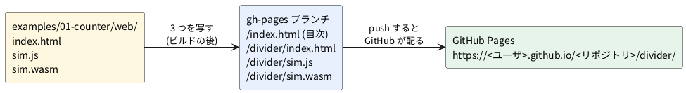

# 4-13 GitHub Pages に載せる

この題は実体配線図と Analog Discovery 3 の図を付けない。ブラウザの中で動く題で、組む物が無いから。

4-3 で、01-counter を分周器に差し替えて、手元の Web サーバで動かした。
この題は、それを **GitHub Pages** に載せて、URL を開けば誰でも見られるようにする道筋を書く。
GitHub Pages は、リポジトリの中の静的なファイル (HTML・JS・画像など) を、そのまま Web サイトとして配る GitHub の仕組み。
soft-fpga の公開ページ (`https://tommie-jp.github.io/soft-fpga/`) も、これで配っている。

この題では実際には公開しない (push しない)。Pages と同じ形にファイルを並べ、手元の Web サーバで開いて動くことまでを確かめる。

## 道のり




## 何をどこに置くか

ブラウザが読むのは、ビルドの出力の 3 つだけ。

| ファイル | 中身 | Pages に置くか |
| --- | --- | --- |
| `index.html` | 画面。`sim.js` を読み、canvas に描く | 置く |
| `sim.js` | Emscripten が出す読み込み係。`sim.wasm` を取ってきて初期化する | 置く |
| `sim.wasm` | 回路 (Verilator の C++) を WebAssembly にしたもの | 置く |
| `sim-worker.js` | Worker で回す例だけにある (4-9) | あれば置く |
| `verilog/`、`cxx/`、`obj_dir/` | ソースと中間の出力 | 置かない |

soft-fpga の `scripts/doDeployPages.sh` も、例ごとに `index.html`・`sim.js`・`sim.wasm`・`sim-worker.js`・`favicon.ico`・画像・`js/` を写している。

置き場所は 2 通りある (GitHub の資料)。

- **ブランチから配る**: 配るファイルだけを入れたブランチ (慣例で `gh-pages`) を作り、Settings → Pages で、そのブランチの `/ (root)` を選ぶ。soft-fpga はこの形
- **GitHub Actions から配る**: ワークフローでビルドして、出力を Pages に上げる。ビルドに Verilator と Emscripten が要るので、ワークフローの用意が重い。この題では扱わない

ブランチから配ると、GitHub は既定で Jekyll (サイトを組み立てる道具) を通す。Jekyll は `_` で始まる名前のファイルを配らない。Emscripten の出力は `sim.js` と `sim.wasm` なので当たらないが、念のため空の `.nojekyll` を置くと Jekyll を通さなくなる。

## 気を付ける所

### 1. 相対パスで書く

自分のリポジトリの Pages は `https://<ユーザ>.github.io/<リポジトリ>/` の下に出る (プロジェクトサイト)。
`index.html` で `<script src="/sim.js">` と `/` から書くと、`https://<ユーザ>.github.io/sim.js` を探しに行って 404 になる。
01-counter の `index.html` は `<script src="sim.js">` と相対で書いてあるので、そのまま置けばよい。

`sim.js` は、`sim.wasm` を「`sim.js` を読んだ場所と同じディレクトリ」から取る (Emscripten の `locateFile`)。だから 3 つは同じディレクトリに並べる。

URL の終わりの `/` を落とした `…/divider` を開いても、GitHub Pages は `…/divider/` へ転送する (301)。soft-fpga の公開ページで確かめた。

### 2. `.wasm` の MIME

MIME は、Web サーバが「このファイルは何か」を伝える見出し (`Content-Type`)。
`sim.js` は `WebAssembly.instantiateStreaming()` で `sim.wasm` を読み込みながら翻訳する。これは `Content-Type: application/wasm` のときしか使えない。
違う MIME だと、`sim.js` は Console にエラーを 2 行出して、ファイルを全部読んでから翻訳するやり方に切り替える。動きはするが、起動が遅くなる。

GitHub Pages は `.wasm` を `application/wasm` で返す。手元の `python3 -m http.server` (Python 3.12) も `application/wasm` で返す。

### 3. ビルドの出力はコミットしてよいか

`sim.js` と `sim.wasm` は main ブランチには入れず、`gh-pages` ブランチにだけ入れる。soft-fpga も main の `.gitignore` で外し、配るときに `gh-pages` へ写している。

## 手順

### 手元で Pages と同じ形を作って開く (動かして確かめた)

1. 4-3 の分周器に差し替えてビルドする (4-3 の手順 1〜4)
2. Pages と同じ形にファイルを並べる。`my-fpga` はリポジトリの名前の代わり

   ```bash
   mkdir -p site/my-fpga/divider
   cp examples/01-counter/web/{index.html,sim.js,sim.wasm} site/my-fpga/divider/
   touch site/my-fpga/.nojekyll
   ```

   `site/my-fpga/index.html` には、`<a href="divider/">分周器</a>` のように、例への相対のリンクを書く

3. `site/` を根にして Web サーバを立て、`http://localhost:8000/my-fpga/divider/` を開く。これで、Pages の `https://<ユーザ>.github.io/my-fpga/divider/` と同じ深さになる

   ```bash
   cd site
   python3 -m http.server 8000
   ```

4. Run を押して、波形が流れることを見る。Console にエラーが出ていないことを見る

### GitHub に載せる (この題では未実行)

soft-fpga の `scripts/doDeployPages.sh` が行っていることを、自分のリポジトリでなぞる。
soft-fpga の `docs/05-deploy-gh-pages.md` はこの台本を `scripts/deploy-gh-pages.sh` と書いているが、この題を書いた時点 (コミット 19c032a) の名前は `scripts/doDeployPages.sh`。

1. GitHub に自分のリポジトリを作る (main に Verilog とハーネス)
2. `gh-pages` ブランチを別のディレクトリに出す。まだ無ければ、履歴を持たないブランチ (orphan) として作る (`git worktree add --orphan -b gh-pages <ディレクトリ>`)
3. 手元で確かめた `site/my-fpga/` の中身を、そのディレクトリの根に写す。`gh-pages` の根が `https://<ユーザ>.github.io/<リポジトリ>/` になる
4. コミットして `gh-pages` を push する
5. リポジトリの Settings → Pages で、Source を Deploy from a branch、Branch を `gh-pages` / `/ (root)` にする (初回だけ)。soft-fpga の `docs/05-deploy-gh-pages.md` の 4 節に、`gh` コマンドで設定するやり方もある
6. 数分待って `https://<ユーザ>.github.io/<リポジトリ>/divider/` を開く

soft-fpga 本体の公開は `doDeployAll.sh` が受け持つ。06-8080 と 09-pdp11 をビルドし、`scripts/doDeployPages.sh --no-build 06 09` で `gh-pages` に写して push したあと、公開された URL が 200 を返すか、CP/M の `A>` が出るか、リンクが切れていないかまで確かめる。
自分の例 1 つなら、上の 6 手で足りる。

## 画面に見えるはずのもの

4-3 と同じ画面。Run を押すと 8 本のレーン (`b7`〜`b0`) に分周器の波形が流れ、`b0` (`led`) が 8 クロックの周期で上下する。
Console には何も出ない。MIME が違うときだけ、次の 2 行が出る。

```text
wasm streaming compile failed: TypeError: Failed to execute 'compile' on 'WebAssembly': Incorrect response MIME type. Expected 'application/wasm'.
falling back to ArrayBuffer instantiation
```

## 見るべき値

手元の Web サーバ (Python 3.12 の `http.server` と、MIME を変えるために書いた小さな Python のサーバ) に Pages と同じ形で置き、Chromium 153 (Playwright 1.63 の headless) で開いて動かして確かめた。
ビルドは Verilator 5.048、Emscripten 5.0.7 (soft-fpga の `build-wasm` 容器)。

| 開いた URL | 結果 | 種類 |
| --- | --- | --- |
| `/my-fpga/divider/` | Run で 0.5 秒回して 6600 クロック。最後の 8 個の `count` は 192, 192, 194, 197, 197, 197, 199, 200。Console にエラー無し | 動かして確かめた |
| `/my-fpga/divider` (終わりの `/` 無し) | `/my-fpga/divider/` へ 301 で転送され、同じく動いた | 動かして確かめた |
| `<script src="/sim.js">` に書き換えた版 | `/sim.js` が 404。`Module` が初期化されず、画面は動かない | 動かして確かめた |
| `.wasm` を `application/octet-stream` で返すサーバ | Console に上の 2 行。ArrayBuffer に切り替えて動いた (6400 クロック) | 動かして確かめた |
| 手元の `sim.wasm` の `Content-Type` | `application/wasm` | 動かして確かめた |
| 公開中の `https://tommie-jp.github.io/soft-fpga/01-counter/sim.wasm` の `Content-Type` | `application/wasm` (2026-10-11 に curl で見た) | 動かして確かめた |

並びを 2 進に直すと、192 は `ticks` = 48・`tick` = 0・`led` = 0、194 は `tick` = 1、197 は `ticks` = 49・`led` = 1。4-3 の表と同じ向きに変わっている。

GitHub への push と、公開された URL を開くことは確かめていない (未実行)。

## 出典

自作。手順の元は [tommie-jp/soft-fpga](https://github.com/tommie-jp/soft-fpga) の `docs/05-deploy-gh-pages.md`、
`scripts/doDeployPages.sh`、`doDeployAll.sh`。Pages の設定は GitHub の資料
[GitHub Pages サイトの公開元を設定する](https://docs.github.com/ja/pages/getting-started-with-github-pages/configuring-a-publishing-source-for-your-github-pages-site)。
`instantiateStreaming` と MIME は
[MDN の WebAssembly.instantiateStreaming()](https://developer.mozilla.org/ja/docs/WebAssembly/Reference/JavaScript_interface/instantiateStreaming_static)。
