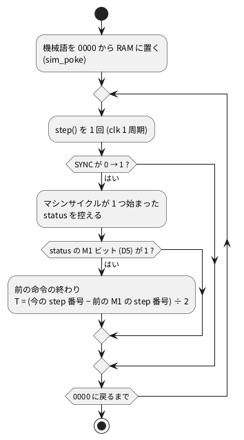

# 4-14 命令エミュレータに無い信号 — T ステートを数える

この題は実体配線図と Analog Discovery 3 の図を付けない。ブラウザの中で動く題で、組む物が無いから。

8080 の 1 命令は、いくつかのマシンサイクル (M1、M2 …) に分かれ、各マシンサイクルは 3〜5 個の T ステートでできている。
T ステートはクロックの 1 周期で、8080 を 2 MHz で動かせば 1 T は 0.5 µs (計算値)。

命令エミュレータは、命令を 1 つ実行するたびに、データシートの表の T ステート数を足して時間を数える。
表の数を足すだけなので、表と違う動きは起きようがない。
soft-fpga の 06-8080 は RTL (vm80a) をクロックごとに動かすので、T ステートは**数えて初めて分かる値**になる。
この題では、命令ごとの T ステート数を soft-fpga で数え、データシートの値と突き合わせる。

## 数え方

T ステートは、4-12 で見た `SYNC` で区切って数える。




- `SYNC` の立ち上がりがマシンサイクルの頭。その頭の status に M1 ビットが立っていれば、新しい命令の取り込み
- M1 の頭から次の M1 の頭までが 1 命令。間の `step()` の数を 2 で割ると T ステート数になる。vm80a は `clk` を `f1`・`f2` の 2 相に分けて動くので、1 T は `clk` 2 周期
- 間に `SYNC` が何回立ったかが、マシンサイクルの数

この手順は 4-12 の観測プログラム `probe8080.cpp` の `count` に書いてある。soft-fpga のテスト (`examples/06-8080/tests/timing/`) も、リングバッファの `SYNC` の立ち上がりで同じように区切っている。

## 数えるプログラム

0000 から次の機械語を置く。終わりの `RZ` で 0000 に戻ったところで数え終わる。

| 番地 | バイト | 命令 | 番地 | バイト | 命令 |
| --- | --- | --- | --- | --- | --- |
| 0000 | 31 00 80 | `LXI SP,8000h` | 001B | E3 | `XTHL` |
| 0003 | 00 | `NOP` | 001C | C1 | `POP B` |
| 0004 | 41 | `MOV B,C` | 001D | 09 | `DAD B` |
| 0005 | 3E 55 | `MVI A,55h` | 001E | 21 80 00 | `LXI H,0080h` |
| 0007 | 21 80 00 | `LXI H,0080h` | 0021 | 34 | `INR M` |
| 000A | 80 | `ADD B` | 0022 | 32 81 00 | `STA 0081h` |
| 000B | 3C | `INR A` | 0025 | 3A 81 00 | `LDA 0081h` |
| 000C | 3D | `DCR A` | 0028 | CD 40 00 | `CALL 0040h` |
| 000D | 7E | `MOV A,M` | 002B | AF | `XRA A` (Z = 1 にする) |
| 000E | 77 | `MOV M,A` | 002C | C4 40 00 | `CNZ 0040h` (飛ばない) |
| 000F | EB | `XCHG` | 002F | CC 40 00 | `CZ 0040h` (飛ぶ) |
| 0010 | DB 40 | `IN 40h` | 0032 | C0 | `RNZ` (戻らない) |
| 0012 | D3 40 | `OUT 40h` | 0033 | C8 | `RZ` (戻る。スタックの 0000 へ) |
| 0014 | 2A 80 00 | `LHLD 0080h` | 0034〜003F | 00 | `NOP` (埋め草) |
| 0017 | 22 80 00 | `SHLD 0080h` | 0040 | C9 | `RET` |
| 001A | C5 | `PUSH B` | | | |

- ポート 40h は soft-fpga のハーネスが何もしないポート。`IN 40h` は FF を読む
- `INR M` の前に `LXI H,0080h` を置き直すのは、`XTHL` と `DAD B` で HL が変わり、`INR M` が機械語を書き換えないようにするため

## 手順

4-12 の手順で `probe8080` をビルドしておき、上のバイトを並べて渡す。

```bash
cd examples/06-8080
P="31 00 80 00 41 3E 55 21 80 00 80 3C 3D 7E 77 EB DB 40 D3 40 2A 80 00 22 80 00 \
C5 E3 C1 09 21 80 00 34 32 81 00 3A 81 00 CD 40 00 AF C4 40 00 CC 40 00 C0 C8"
PAD=$(printf '00 %.0s' $(seq 12))   # 0034〜003F の NOP
./build/probe8080 count $P $PAD C9
```

1 行に 1 命令ずつ、番地・opcode・T ステート数・マシンサイクルごとの status が出る。

ブラウザでは、[06-8080](https://tommie-jp.github.io/soft-fpga/06-8080/) の Logic Analyzer で `pin_SYNC` と `T` のレーンを出し、M-CYC の帯の長さを T の目盛で読む。
4-12 のトリガ (On I/O) で止めた画面でも、OUT が 4 + 3 + 3 T に分かれて見える。

## 画面に見えるはずのもの

`PUSH B` の 1 命令を `logic` のフェンスで描く。PC で取った 24 サンプルで、1 T を 1 ms と置いた仮の目盛。
`T` は soft-fpga の `t_state` のレーンと同じ、マシンサイクルの中の T ステートの番号。

```logic
# ロジックアナライザの画面 (tommie-fence の logic フェンス)
title: 図1 PUSH B は 5 + 3 + 3 = 11 T で、スタックへ書く 2 つのサイクルで WR_N が下がる
device: generic
window: 12ms
signals:
  CLK: dio0 clock 2kHz
  SYNC: dio1 edges 0s=1 1ms=0 5ms=1 6ms=0 8ms=1 9ms=0 11ms=1
  DBIN: dio2 edges 0s=0 1ms=1 2ms=0
  WR_N: dio3 edges 0s=1 6.5ms=0 7.5ms=1 9.5ms=0 10.5ms=1
  TS: dio4..dio6 counter on CLK rising sequence 1 1 2 2 3 3 4 4 5 5 1 1 2 2 3 3 1 1 2 2 3 3 1 1
buses:
  T: TS2..TS0 dec
cursors: [0ms, 11ms]
trigger: SYNC rising at 5ms
```


| 時刻 (ms) | マシンサイクル | status | 何をしているか |
| --- | --- | --- | --- |
| 0〜5 | M1 (5 T) | A2 | opcode C5 を取り込む (1〜2 ms で DBIN = 1)。5 T なのは、取り込みの後で SP を 1 減らす分 (Intel のマニュアル) |
| 5〜8 | M2 (3 T) | 04 | スタック (SP − 1) へ B を書く。6.5〜7.5 ms で WR_N = 0 |
| 8〜11 | M3 (3 T) | 04 | スタック (SP − 2) へ C を書く。9.5〜10.5 ms で WR_N = 0 |
| 11〜 | 次の M1 | A2 | 次の命令 (`XTHL`) |

- X1 (0 ms) と X2 (11 ms) は、M1 の `SYNC` の立ち上がり 2 つ。ΔX = 11 ms が 11 T に当たる
- `SYNC` は 3 回立つ。マシンサイクルが 3 つ
- M1 だけが 5 T と長い。8080 の M1 は 4 T か 5 T で、`PUSH`・`CALL`・条件付きの `RET` などが 5 T を使う

## 見るべき値

soft-fpga (`19c032a`) の 06-8080 を Verilator 5.042 で PC にビルドし、上のプログラムを `probe8080 count` で数えた。`ac6b663` (2026-10-13) でも数え直し、下の表とポート 30h のカウンタの値は全部同じだった (06-8080 のハーネスと RTL は、この間に変わっていない)。
データシートの値は Intel の 8080A のデータシートの命令表 (T ステート数・マシンサイクル数)。

| 命令 | データシートの T | 数えた T | データシートの M | 数えた SYNC の数 | 数えた status の並び |
| --- | --- | --- | --- | --- | --- |
| `NOP` | 4 | 4 | 1 | 1 | A2 |
| `MOV B,C` | 5 | 5 | 1 | 1 | A2 |
| `MVI A,55h` | 7 | 7 | 2 | 2 | A2,82 |
| `LXI H,0080h` | 10 | 10 | 3 | 3 | A2,82,82 |
| `ADD B` | 4 | 4 | 1 | 1 | A2 |
| `INR A` / `DCR A` | 5 | 5 | 1 | 1 | A2 |
| `MOV A,M` | 7 | 7 | 2 | 2 | A2,82 |
| `MOV M,A` | 7 | 7 | 2 | 2 | A2,00 |
| `XCHG` | 4 | 4 | 1 | 1 | A2 |
| `IN 40h` | 10 | 10 | 3 | 3 | A2,82,42 |
| `OUT 40h` | 10 | 10 | 3 | 3 | A2,82,10 |
| `LHLD 0080h` | 16 | 16 | 5 | 5 | A2,82,82,82,82 |
| `SHLD 0080h` | 16 | 16 | 5 | 5 | A2,82,82,00,00 |
| `PUSH B` | 11 | 11 | 3 | 3 | A2,04,04 |
| `XTHL` | 18 | 18 | 5 | 5 | A2,86,86,04,04 |
| `POP B` | 10 | 10 | 3 | 3 | A2,86,86 |
| `DAD B` | 10 | 10 | 3 | **1** | A2 |
| `INR M` | 10 | 10 | 3 | 3 | A2,82,00 |
| `STA 0081h` | 13 | 13 | 4 | 4 | A2,82,82,00 |
| `LDA 0081h` | 13 | 13 | 4 | 4 | A2,82,82,82 |
| `CALL 0040h` | 17 | 17 | 5 | 5 | A2,82,82,04,04 |
| `RET` | 10 | 10 | 3 | 3 | A2,86,86 |
| `XRA A` | 4 | 4 | 1 | 1 | A2 |
| `CNZ` (飛ばない) / `CZ` (飛ぶ) | 11 / 17 | 11 / 17 | 3 / 5 | 3 / 5 | A2,82,82 / A2,82,82,04,04 |
| `RNZ` (戻らない) / `RZ` (戻る) | 5 / 11 | 5 / 11 | 1 / 3 | 1 / 3 | A2 / A2,86,86 |

- T ステート数は、表の命令の全部がデータシートと一致した (動かして確かめた)
- **`DAD B` だけ、`SYNC` が 1 回しか立たない。** データシートでは 3 つのマシンサイクル (4 + 3 + 3 T) だが、vm80a は後ろの 2 つで `SYNC` を出さず、10 T が 1 つのマシンサイクルに見える。T ステートの合計は同じなので、命令エミュレータの数え方では見えない違い
- M1 の長さも `SYNC` の間隔で測った。`PUSH B`・`CALL`・`CNZ`・`CZ`・`RNZ`・`RZ` の M1 は 5 T、ほかは 4 T。`CNZ` が飛ばないときの 11 T は 5 + 3 + 3 T、`RNZ` が戻らないときの 5 T は M1 だけ
- `XTHL` は 4 + 3 + 3 + 3 + 5 T で、最後のマシンサイクル (スタックへ書く 2 回目) が 5 T

### ハーネスのカウンタ (ポート 30h)

soft-fpga のハーネスには、命令から読めるカウンタがある。`OUT 30h` で 0 に戻し、`IN 30h` で値を取る (上位は `IN 31h`〜`33h`)。
このカウンタは `harness.cpp` の `step()` の中の `cycle_count++` で増える。**数えるのは `clk` の周期で、1 T で 2 増える。**

次の機械語で確かめた。2 回の `IN 30h` の間は `IN 30h` (10 T) + `STA` (13 T) + `NOP` 10 個 (40 T) = 63 T (計算値)。

```bash
./build/probe8080 count 31 00 80 D3 30 DB 30 32 80 00 \
  00 00 00 00 00 00 00 00 00 00 DB 30 32 81 00 C3 19 00
```

| 見る所 | 値 | 種類 |
| --- | --- | --- |
| 1 回目の `IN 30h` (RAM 0080) | 12h = 18 | 動かして確かめた |
| 2 回目の `IN 30h` (RAM 0081) | 90h = 144 | 動かして確かめた |
| 差 | 126 = 63 T × 2 | 動かして確かめた |

カウンタで T ステートを測るときは、読んだ値を 2 で割る。

## シミュレーションでの確かめ (対象外を含む)

4-12 と同じく、soft-fpga の ac6b663 の 06-8080 を Verilator 5.042 で PC にビルドし、本文のバイト列を `probe8080 count` で数え直した
(`sim/12-8080-cpm-io-bus-probe.cpp` の `count`。図 1 の 24 サンプルは `sim/14-count-t-states-push-trace.cpp`)。ブラウザの画面 (`pin_SYNC` と `T` のレーン) は動かしていない。

| 項目 | 本文の数字 | 実行結果 | 判定 |
| --- | --- | --- | --- |
| 命令ごとの T ステート数 | 表の 25 行のとおり (データシートと一致) | 全行一致 (`NOP` 4、`LHLD` 16、`XTHL` 18、`CALL` 17、`CNZ` 11 / `CZ` 17、`RNZ` 5 / `RZ` 11 など) | 合った |
| マシンサイクルごとの status の並び | 表の「数えた status の並び」 | 全行一致 | 合った |
| `DAD B` の SYNC の数 | 1 回 (データシートは 3 つ) | status は `A2` だけ。10 T が 1 つに見える | 合った |
| `PUSH B` の 11 T と status | A2、04、04 | 同じ | 合った |
| 図 1 の 24 サンプル (`PUSH B`) | SYNC は 0・5・8・11 ms、DBIN は 1〜2 ms、WR_N は 6.5〜7.5 と 9.5〜10.5 ms、T は 1 1 2 2 3 3 4 4 5 5 1 1 2 2 3 3 1 1 2 2 3 3 1 1 | 全サンプル一致 (アドレスは SP − 1 = 7FFF、SP − 2 = 7FFE) | 合った |
| `IN 30h` のカウンタ | 12h = 18、90h = 144、差 126 | RAM 0080 = 12、0081 = 90 | 合った |
| 差 126 = 63 T × 2 | 計算値 | (10 + 13 + 40) × 2 = 126 | 合った |
| ブラウザで M-CYC の帯を読む操作 | 画面の操作 | ブラウザが要る | 対象外 |

## 出典

自作。例と RTL は [tommie-jp/soft-fpga](https://github.com/tommie-jp/soft-fpga) の `examples/06-8080`
(RTL はサブモジュール `verilog/vm80a` = [1801BM1/vm80a](https://github.com/1801BM1/vm80a))。
T ステートの区切り方は同リポジトリの `examples/06-8080/tests/` と `docs/06-8080/26-Vitestタイミングテスト.md`、カウンタは `cxx/harness.cpp` と `docs/06-8080/20-サイクルカウンタ.md`。
命令の T ステート数とマシンサイクル数、ステータスのビットは Intel の 8080A のデータシートと Intel 8080 Microcomputer Systems User's Manual (1975)。
