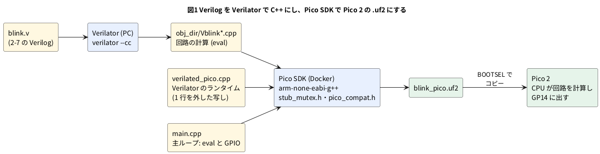

# 5-1 Pico 2 で Verilog を動かす仕組み — Verilator の C++ を Pico SDK でビルドする

> [!WARNING]
> **この題は実機で動かしていない。** Verilog の lint と、Pico 2 用の `.uf2` ができるところまでを PC で確かめた。
> Pico 2 に書き込んで動かすのは 5-2 で、その結果もまだ測っていない。

この題は実体配線図と Analog Discovery 3 の図を付けない。PC でビルドするだけの組まない題だから。

第 4 章では、Verilator が Verilog から作った C++ をブラウザで動かした。
第 5 章では、同じ C++ を Raspberry Pi Pico 2 の CPU で動かす。
FPGA は使わない。Pico 2 の CPU が回路の動きを 1 クロックずつ計算し、結果を GPIO のピンに出す。
この方式を作者の GitHub では Soft-FPGA と呼んでいる
([Soft-FPGA-TD4](https://github.com/tommie-jp/Soft-FPGA-TD4) が 4 ビット CPU の TD4 で先に動かした)。

この題では、2-7 の `blink.v` (分周して LED を点滅させる回路) を Pico 2 用にビルドし、仕組みを確かめる。

## 仕組み

Verilator は、Verilog の 1 つのモジュールを C++ の 1 つのクラスにする。`blink.v` なら `Vblink` というクラスになる。

- 入出力のポートは、クラスのメンバ変数になる (`top.clk` `top.rst` `top.led`)
- `top.eval()` を呼ぶと、そのときの入力で回路を 1 回計算し、出力とフリップフロップの値を新しくする
- クロックもただの入力である。`clk` を 0 にして `eval()`、1 にして `eval()` と 2 回呼ぶと、立ち上がりが 1 回起き、
  回路が 1 クロック進む

```cpp
while (true) {
    top.clk = 0; top.eval();   // 立ち下がり
    top.clk = 1; top.eval();   // 立ち上がり: カウンタが 1 進む
    gpio_put(PIN_LED, top.led);
}
```

Pico 2 の主ループがこれを繰り返す。だから**クロックの周波数は、主ループが 1 周する速さで決まる**。
1 周の時間は、`eval()` の計算の量と GPIO の読み書きで変わる。どれだけかは測るまで分からない。測り方は 5-5 で扱う。

## 図




- `blink.v` から C++ (`obj_dir/`) までは第 4 章と同じ。Pico SDK から右が Pico 2 のための所
- Verilator は PC で走らせる。Pico 2 の中で動くのは、Verilator が出した C++ とランタイムだけ

## Pico SDK で通らない所と、その直し方

Verilator が出す C++ とランタイム (`verilated.cpp`) は、PC の Linux で動かす前提で書かれている。
Pico SDK でそのままビルドすると、次の 4 か所で止まった。直し方の 1 と 2 は Soft-FPGA-TD4 と同じ手で、3 と 4 はこの題で足した。

| # | 止まった所 | 原因 | 直し方 |
| --- | --- | --- | --- |
| 1 | `'mutex' in namespace 'std' does not name a type` | Pico SDK の C++ には `std::mutex` が無い | 何もしない `mutex` を定義した `stub_mutex.h` を、`-include` で全部の C++ の先頭に差し込む (Soft-FPGA-TD4 の `verilator-TD4/stub_mutex.h` をそのまま使う) |
| 2 | `verilated_threads.h` の中で `condition_variable_any::wait` が無い、`VlThreadPool` の二重定義 | ランタイムがスレッドの仕組みを読み込む | `verilated.cpp` を `verilated_pico.cpp` に写し、`#include "verilated_threads.h"` の 1 行を外す |
| 3 | `expected ')' before 'PRIu64'` | Ubuntu の `arm-none-eabi` の newlib が `PRIu64` などを定義しない | `pico_compat.h` で `PRId64` `PRIu64` `PRIx64` を補う |
| 4 | リンクで `undefined reference to '__aeabi_read_tp'` | ランタイムの `thread_local` の変数に、Pico SDK の素の環境は対応していない | `pico_compat.h` で `thread_local` を空にする。Soft-FPGA は 1 つのコアの 1 本の流れで回すので、ただの `static` で足りる |

ほかに、Verilator の C++ は `dynamic_cast` を使うので、`CMakeLists.txt` で RTTI を有効にする (`PICO_CXX_ENABLE_RTTI`)。

Soft-FPGA-TD4 は Windows の VS Code と Raspberry Pi の拡張 (`CMakeLists.txt` に書かれた SDK は 2.2.0、
コンパイラは 14_2_Rel1) でビルドしている。3 と 4 は、0-2 の Docker (Ubuntu 24.04 の `gcc-arm-none-eabi` 13.2.1) で出た。
Soft-FPGA-TD4 の環境で 3 と 4 が出るかは確かめていない。

## ファイル

作業用のフォルダに次を置く。`blink.v` は 2-7 のものをそのまま使う。

| ファイル | 中身 |
| --- | --- |
| `blink.v` | 2-7 の Verilog |
| `main.cpp` | 主ループ (下) |
| `CMakeLists.txt` | ビルドの設定 (下) |
| `pico_compat.h` | 上の表の 3 と 4 (下) |
| `stub_mutex.h` | 上の表の 1。[Soft-FPGA-TD4 の `verilator-TD4/stub_mutex.h`](https://github.com/tommie-jp/Soft-FPGA-TD4/blob/master/verilator-TD4/stub_mutex.h) をコピーする |
| `verilated_pico.cpp` | 上の表の 2。下のコマンドで作る |
| `pico_sdk_import.cmake` | Pico SDK の `external/` からコピーする (0-2 と同じ) |

`main.cpp`:

```cpp
// 2-7 の blink.v を Pico 2 で回す。LED は GP14
#include "pico/stdlib.h"
#include "Vblink.h"

#define PIN_LED 14

int main() {
    gpio_init(PIN_LED);
    gpio_set_dir(PIN_LED, GPIO_OUT);

    VerilatedContext ctx;
    Vblink top{&ctx};

    // リセットを 2 クロック掛ける
    top.rst = 1;
    for (int i = 0; i < 2; i++) {
        top.clk = 0; top.eval();
        top.clk = 1; top.eval();
    }
    top.rst = 0;

    while (true) {
        top.clk = 0; top.eval();   // 立ち下がり
        top.clk = 1; top.eval();   // 立ち上がり: カウンタが 1 進む
        gpio_put(PIN_LED, top.led);
    }
}
```

`CMakeLists.txt`:

```cmake
cmake_minimum_required(VERSION 3.13)
set(PICO_BOARD pico2 CACHE STRING "Board type")
include(pico_sdk_import.cmake)
project(blink_pico C CXX ASM)
set(CMAKE_CXX_STANDARD 17)
set(PICO_CXX_ENABLE_RTTI 1)    # Verilator の出す C++ が dynamic_cast を使う
pico_sdk_init()

set(VL_INC /vlinc)             # Verilator の include (docker run -v で渡す)
file(GLOB VL_SOURCES obj_dir/Vblink*.cpp)

add_executable(blink_pico main.cpp ${VL_SOURCES} verilated_pico.cpp)
target_include_directories(blink_pico PRIVATE . obj_dir ${VL_INC} ${VL_INC}/vltstd)
set_source_files_properties(main.cpp ${VL_SOURCES} verilated_pico.cpp
    PROPERTIES COMPILE_FLAGS "-include ${CMAKE_SOURCE_DIR}/pico_compat.h -include ${CMAKE_SOURCE_DIR}/stub_mutex.h")
target_link_libraries(blink_pico pico_stdlib)
pico_add_extra_outputs(blink_pico)
```

`pico_compat.h`:

```cpp
// Ubuntu の arm-none-eabi の newlib では PRIu64 などが定義されない。Verilator のランタイムが使うので補う
#include <cinttypes>
#ifndef PRIu64
#define PRId64 "lld"
#define PRIu64 "llu"
#define PRIx64 "llx"
#endif
// Pico SDK の素の環境には thread_local の支え (__aeabi_read_tp) が無い。
// Soft-FPGA は 1 つのコアの 1 本の流れで回すので、ただの static にしてよい
#define thread_local
```

`-include` は、ソースの 1 行目に `#include` を書いたのと同じ働きをする。Verilator が出し直すたびにファイルを直さずに済む
(Soft-FPGA-TD4 の FAQ と同じ考え)。

## ビルドする

Verilator は PC で走らせる (版は 5.042 で確かめた)。`CLK_HZ` は 5-2 で使う仮の値 100 000 にしておく。

```bash
verilator --lint-only -Wall blink.v
verilator --cc --no-timing -GCLK_HZ=100000 blink.v --top-module blink
sed 's|^#include "verilated_threads.h"|// & (Pico には thread が無いので外す)|' \
  /usr/local/share/verilator/include/verilated.cpp > verilated_pico.cpp
```

`--no-timing` は、`#` の遅延などシミュレーション用の書き方を使わない指定。3 行目の場所は Verilator を入れた所によって変わる
(`verilator --getenv VERILATOR_ROOT` の `include/`)。

Pico SDK は 0-2 の `wb-pico-sdk` のコンテナを使う。Verilator の include を `/vlinc` に渡す。

```bash
docker run --rm --user "$(id -u):$(id -g)" -v "$PWD":/work \
  -v /usr/local/share/verilator/include:/vlinc:ro wb-pico-sdk \
  bash -c 'cmake -S . -B build -DPICO_BOARD=pico2 -G Ninja && cmake --build build -j8'
```

`build/blink_pico.uf2` ができればよい。Pico 2 への書き込み (BOOTSEL を押しながら USB をつなぎ、出たドライブにコピーする) は 0-2 と同じ。

C/C++ を第 1、MicroPython を第 2 にする決まり (README) があるが、この章は C++ だけで書く。
MicroPython からは Verilator の C++ を呼べないからである。

## 見るべき値

PC で実際に打って得た値。Pico 2 の上では動かしていない。

| 確かめること | 打つ物 | 出た物 |
| --- | --- | --- |
| lint | `verilator --lint-only -Wall blink.v` | 警告なし (Verilation Report の 3 行だけ) |
| C++ への変換 | `verilator --cc …` | `obj_dir/` に `Vblink.cpp` など 5 つの C++ |
| ビルド | `cmake --build build` | エラーなし。上の表の 4 か所を直す前は止まった |
| `.uf2` の大きさ | `ls -l build/blink_pico.uf2` | 599 040 バイト |
| プログラムの大きさ | `arm-none-eabi-size build/blink_pico.elf` | text 303 288 バイト、bss 6 428 バイト |
| 内訳 | `arm-none-eabi-size` で `.o` ごと | 回路 (`Vblink*.o`) は合わせて約 1.4 KB、ランタイム (`verilated_pico.cpp.o`) は約 74 KB。残りの多くは、ランタイムが引き込む C++ の標準ライブラリ (文字列の書式・ロケールなど) |

0-2 の C だけの `blink.uf2` は 12 800 バイトだった。回路そのものは小さく、大きさのほとんどはランタイムの側にある。
Pico 2 のフラッシュ (4 MB) には十分に収まる。ランタイムを削る話は 5-13 に置く。

## 出典

自作。Pico SDK でビルドする手 (`stub_mutex.h` を `-include` で差し込む、`verilated.cpp` を写して直す、RTTI を有効にする) は
[tommie-jp/Soft-FPGA-TD4](https://github.com/tommie-jp/Soft-FPGA-TD4) の `verilator-TD4/CMakeLists.txt`・`stub_mutex.h`・`etc/92-FAQ.md` に倣った。
`eval()` とモデルのクラスは Verilator の資料 ([Verilator User's Guide](https://veripool.org/guide/latest/))。
Pico SDK は [raspberrypi/pico-sdk](https://github.com/raspberrypi/pico-sdk) の 2.2.0。
