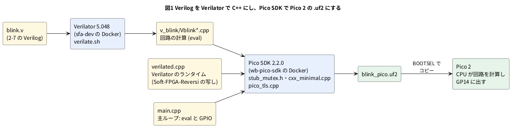

# 5-1 Pico 2 で Verilog を動かす仕組み — Verilator の C++ を Pico SDK でビルドする

> [!WARNING]
> **この題は実機で動かしていない。** Verilog の lint と、Pico 2 用の `.uf2` ができるところまでを PC で確かめた。
> Pico 2 に書き込んで動かすのは 5-2 で、その結果もまだ測っていない。

この題は実体配線図と Analog Discovery 3 の図を付けない。PC でビルドするだけの組まない題だから。

第 4 章では、Verilator が Verilog から作った C++ をブラウザで動かした。
第 5 章では、同じ C++ を Raspberry Pi Pico 2 の CPU で動かす。
FPGA は使わない。Pico 2 の CPU が回路の動きを 1 クロックずつ計算し、結果を GPIO のピンに出す。
この方式を作者の GitHub では Soft-FPGA と呼んでいる
([Soft-FPGA-TD4](https://github.com/tommie-jp/Soft-FPGA-TD4) が 4 ビット CPU の TD4 で先に動かした)。

この題では、2-7 の `blink.v` (分周して LED を点滅させる回路) を Pico 2 用にビルドし、仕組みを確かめる。

## 仕組み

Verilator は、Verilog の 1 つのモジュールを C++ の 1 つのクラスにする。`blink.v` なら `Vblink` というクラスになる。

- 入出力のポートは、クラスのメンバ変数になる (`top.clk` `top.rst` `top.led`)
- `top.eval()` を呼ぶと、そのときの入力で回路を 1 回計算し、出力とフリップフロップの値を新しくする
- クロックもただの入力である。`clk` を 0 にして `eval()`、1 にして `eval()` と 2 回呼ぶと、立ち上がりが 1 回起き、
  回路が 1 クロック進む

```cpp
while (true) {
    top.clk = 0; top.eval();   // 立ち下がり
    top.clk = 1; top.eval();   // 立ち上がり: カウンタが 1 進む
    gpio_put(PIN_LED, top.led);
}
```

Pico 2 の主ループがこれを繰り返す。だから**クロックの周波数は、主ループが 1 周する速さで決まる**。
1 周の時間は、`eval()` の計算の量と GPIO の読み書きで変わる。どれだけかは測るまで分からない。測り方は 5-5 で扱う。

## 図




- `blink.v` から C++ (`v_blink/`) までは第 4 章と同じ。Pico SDK から右が Pico 2 のための所
- Verilator は PC の Docker で走らせる。Pico 2 の中で動くのは、Verilator が出した C++ とランタイムだけ
- この題の手順は、第 5 章の全部の題で使う。5-2 から先の題は、題ごとに替わる所だけを書く

## Pico SDK で通らない所と、その直し方

Verilator が出す C++ とランタイム (`verilated.cpp`) は、PC の Linux で動かす前提で書かれている。
Pico SDK でそのままビルドすると、次の所で止まる。直し方は、Pico 2 で動いている
[Soft-FPGA-Reversi](https://github.com/tommie-jp/Soft-FPGA-Reversi) の `firmware/src/` に倣った。
4 の `pico_tls.cpp` だけがこの本で足したファイルである。

| # | 止まる所 | 原因 | 直し方 |
| --- | --- | --- | --- |
| 1 | `'mutex' in namespace 'std' does not name a type` | Pico SDK の C++ には `std::mutex` が無い | Soft-FPGA-Reversi の `stub_mutex.h` を、`-include` で全部の C++ の先頭に差し込む。何もしない `mutex` を定義する |
| 2 | `verilated_threads.h` の中の `condition_variable_any` などが無い | ランタイムがスレッドの仕組みを読み込む | 同じ `stub_mutex.h` が `verilated_threads.h` と `verilated_trace.h` を読んだことにし、要る型だけを中身の無い形で置く。`verilated.cpp` の行を外さずに済む |
| 3 | 起動の直後に「VerilatedContext thread count mismatch」で止まる (Soft-FPGA-Reversi の `doc/07-Picoビルド.md`) | Pico 2 ではスレッドの数が 0 と数えられ、ランタイムの検査に引っかかる | Soft-FPGA-Reversi の `verilated.cpp` を使う。この検査を外し、`<iostream>` と `<sstream>` も外してある |
| 4 | リンクで `undefined reference to '__aeabi_read_tp'` | ランタイムの `thread_local` の変数の置き場を返す関数が、Ubuntu の `arm-none-eabi-gcc` 13.2.1 の newlib に無い | `pico_tls.cpp` で足す (下)。Soft-FPGA-Reversi は xPack の `arm-none-eabi-gcc` 15.2.1 を使うので、この関数を自分で書かない |

ほかに、Verilator の C++ は `dynamic_cast` を使うので、`CMakeLists.txt` で RTTI を有効にする (`PICO_CXX_ENABLE_RTTI`)。
`cxx_minimal.cpp` (Soft-FPGA-Reversi) は、C++ の例外の仕組みを何もしない関数に置き換え、`.uf2` を小さくする。

### この手順に決めた理由

この章は、初め 2 通りの手順で書いていた。もう 1 つは、PC に入れた Verilator 5.042 のランタイムを `sed` で 1 行外して写し、
自作の `pico_compat.h` で `PRIu64` を補い、`thread_local` を空の語に置き換える手順だった。どちらも `.uf2` まではビルドできた。
この本は次の理由で、上の表の手順に決めた。

- 道具の版を固定できる。Verilator は 0-2 の `sfa-dev` (5.048)、Pico SDK は `wb-pico-sdk` (2.2.0、`arm-none-eabi-gcc` 13.2.1) の Docker で走る。
  PC に入れた Verilator の版は人によって違う
- 手で書くファイルが `pico_tls.cpp` の 1 つで済む。ほかの 3 つは Soft-FPGA-Reversi から写すだけ
- Pico 2 で動いている物に倣っている。Soft-FPGA-Reversi は Verilator 5.048 のランタイムを Pico 2 で回している
- `thread_local` の意味を変えない。空の語に置き換えると、ランタイムの変数の持ち方が変わる。`pico_tls.cpp` は置き場を 1 つ返すだけで、`thread_local` はそのまま
- 上の表の 3 の検査を外してある。もう 1 つの手順では、この検査が残っていた (Pico 2 で止まるかは確かめていない)

Soft-FPGA-Reversi の `stub_mutex.h` と `verilated.cpp` は Verilator 5.048 に合わせてある。`sfa-dev` の Verilator を上げたら、2 つも合わせ直す。

## ファイル

作業用の空のフォルダに次を置く。`blink.v` は 2-7 のものをそのまま使う。

| ファイル | 中身 | どこから |
| --- | --- | --- |
| `blink.v` | 2-7 の Verilog | 2-7 |
| `main.cpp` | 主ループ | 下に載せる |
| `verilate.sh` | Verilog を C++ にする手順 | 下に載せる |
| `CMakeLists.txt` | ビルドの設定 | 下に載せる |
| `pico_tls.cpp` | 上の表の 4 | 下に載せる |
| `stub_mutex.h` `cxx_minimal.cpp` | 上の表の 1・2 と、例外の仕組みの置き換え | Soft-FPGA-Reversi の `firmware/src/` |
| `verilated.cpp` | 上の表の 3 | Soft-FPGA-Reversi の `firmware/src/verilator-runtime/` |
| `pico_sdk_import.cmake` | Pico SDK を読み込む設定 | ビルドのときにコンテナの中で写す (下) |

Soft-FPGA-Reversi の 3 つは、この本で確かめたコミット (`5be3b16`) から取る。

```bash
R=https://raw.githubusercontent.com/tommie-jp/Soft-FPGA-Reversi/5be3b16ef907e9ce9c3b622187ad32672e432831/firmware/src
curl -fsSLO $R/stub_mutex.h
curl -fsSLO $R/cxx_minimal.cpp
curl -fsSLO $R/verilator-runtime/verilated.cpp
```

`main.cpp`:

```cpp
// 2-7 の blink.v を Pico 2 で回す。LED は GP14
#include "pico/stdlib.h"
#include "Vblink.h"

#define PIN_LED 14

int main() {
    gpio_init(PIN_LED);
    gpio_set_dir(PIN_LED, GPIO_OUT);

    VerilatedContext ctx;
    Vblink top{&ctx};

    // リセットを 2 クロック掛ける
    top.rst = 1;
    for (int i = 0; i < 2; i++) {
        top.clk = 0; top.eval();
        top.clk = 1; top.eval();
    }
    top.rst = 0;

    while (true) {
        top.clk = 0; top.eval();   // 立ち下がり
        top.clk = 1; top.eval();   // 立ち上がり: カウンタが 1 進む
        gpio_put(PIN_LED, top.led);
    }
}
```

`verilate.sh` (Verilog を C++ にする。`sfa-dev:local` の中で打つ):

```bash
#!/bin/sh
# Verilog を C++ にする (sfa-dev のコンテナの中で打つ)
set -e
rm -rf vlinc && cp -r /usr/local/share/verilator/include vlinc   # ランタイムのヘッダ
verilator --cc --no-timing --no-trace -Wall --prefix Vblink -GCLK_HZ=100000 --Mdir v_blink blink.v
```

- 1 行目でランタイムのヘッダ (`include/`) を作業用のフォルダの `vlinc/` に写す。Pico SDK の側はこれを読む
- 2 行目が変換。`--prefix Vblink` がクラスの名前、`--Mdir v_blink` が C++ を置くフォルダになる。`-GCLK_HZ=100000` は 5-2 で使う仮の値
- `-Wall` を付けたので、lint の警告が 1 つでもあればここで止まる。`--no-timing` は `#` の遅延などシミュレーション用の書き方を使わない指定、`--no-trace` は波形を残す仕組みを入れない指定

`CMakeLists.txt`:

```cmake
cmake_minimum_required(VERSION 3.13)
set(PICO_BOARD pico2 CACHE STRING "Board type")
include(pico_sdk_import.cmake)
project(soft_fpga C CXX ASM)
set(CMAKE_CXX_STANDARD 17)
set(PICO_CXX_ENABLE_RTTI 1)          # Verilator の出す C++ が dynamic_cast を使う
pico_sdk_init()

set(VL_INC ${CMAKE_SOURCE_DIR}/vlinc)              # Verilator の include (sfa-dev からコピー)
set(VL_RUNTIME ${CMAKE_SOURCE_DIR}/verilated.cpp)  # Soft-FPGA-Reversi の verilated.cpp
set_source_files_properties(${VL_RUNTIME} PROPERTIES COMPILE_FLAGS "-w")

# add_soft_fpga(名前 主ループの.cpp 回路 …)
# 回路の名前 M は、verilate.sh が C++ を出したフォルダ v_M を指す
function(add_soft_fpga NAME MAIN)
    set(SRCS ${MAIN} cxx_minimal.cpp pico_tls.cpp ${VL_RUNTIME})
    set(DIRS "")
    foreach(M ${ARGN})
        file(GLOB GEN ${CMAKE_SOURCE_DIR}/v_${M}/V*.cpp)
        list(APPEND SRCS ${GEN})
        list(APPEND DIRS ${CMAKE_SOURCE_DIR}/v_${M})
        set_source_files_properties(${GEN} PROPERTIES COMPILE_FLAGS "-w")
    endforeach()
    add_executable(${NAME} ${SRCS})
    target_include_directories(${NAME} PRIVATE ${CMAKE_SOURCE_DIR} ${DIRS})
    target_include_directories(${NAME} SYSTEM PRIVATE ${VL_INC} ${VL_INC}/vltstd)
    # C++ のソースには先に stub_mutex.h を読ませる (Pico に無い mutex などの代わり)
    target_compile_options(${NAME} PRIVATE -O2 -Wall -Wextra
        $<$<COMPILE_LANGUAGE:CXX>:-include ${CMAKE_SOURCE_DIR}/stub_mutex.h>)
    target_link_libraries(${NAME} pico_stdlib)
    pico_add_extra_outputs(${NAME})
endfunction()

# ここから下が題ごとに替わる
add_soft_fpga(blink_pico main.cpp blink)
```

- `add_soft_fpga` は、主ループの `.cpp`、`cxx_minimal.cpp`、`pico_tls.cpp`、ランタイム、回路の C++ をまとめて 1 つの `.uf2` にする
- 回路を 2 つ以上使う題は、`add_soft_fpga` の後ろに回路の名前を並べる (5-6 など)
- `-include` は、ソースの 1 行目に `#include` を書いたのと同じ働きをする。Verilator が出し直すたびにファイルを直さずに済む
  (Soft-FPGA-TD4 の FAQ と同じ考え)。Verilator の出した C++ とランタイムは `-w` で警告を出さない

`pico_tls.cpp`:

```cpp
// pico_tls.cpp — Ubuntu の arm-none-eabi-gcc (newlib) に無い __aeabi_read_tp を足す
// Verilator のランタイムは thread_local を使う。Pico 2 では 1 スレッドなので、
// 両方のコアで同じ TLS の領域 (リンカスクリプトの __tls_base) を返す。
// ARM の TLS は「スレッドポインタ + 8」から始まるので 8 を引いておく。
// .tdata が空 (初期値つきの thread_local が無い) ことを readelf で確かめて使う。
extern "C" __attribute__((naked)) void* __aeabi_read_tp(void) {
    __asm volatile(
        "ldr r0, =(__tls_base - 8)\n"
        "bx lr\n");
}
```

Pico SDK 2.2.0 のリンカスクリプト (`memmap_default.ld`) は、`__tls_base` を `.tbss` (初期値なしの `thread_local`) の頭に置く。
`.tbss` は起動時に 0 で埋める `.bss` の範囲に入る。`.tdata` (初期値つき) が空なら、この 1 か所を返すだけで足りる。

## ビルドする

作業用のフォルダで次の 2 行を打つ。1 行目が Verilog から C++ (`sfa-dev:local`)、2 行目が C++ から `.uf2` (`wb-pico-sdk`)。
どちらのコンテナも 0-2 で作った物。

```bash
docker run --rm --user "$(id -u):$(id -g)" -v "$PWD":/work -w /work sfa-dev:local sh verilate.sh
docker run --rm --user "$(id -u):$(id -g)" -v "$PWD":/work -w /work wb-pico-sdk \
  bash -c 'cp /opt/pico-sdk/external/pico_sdk_import.cmake . && cmake -S . -B build -DPICO_BOARD=pico2 && cmake --build build -j8'
```

`build/blink_pico.uf2` ができればよい。Pico 2 への書き込み (BOOTSEL を押しながら USB をつなぎ、出たドライブにコピーする) は 0-2 と同じ。

C/C++ を第 1、MicroPython を第 2 にする決まり (README) があるが、この章は C++ だけで書く。
MicroPython からは Verilator の C++ を呼べないからである。

## 見るべき値

空のフォルダから上の手順でビルドし、実際に打って得た値。Pico 2 の上では動かしていない。

| 確かめること | 打つ物 | 出た物 |
| --- | --- | --- |
| C++ への変換と lint | `sh verilate.sh` (`sfa-dev:local` の中) | 警告なし。Verilation Report に `Verilator 5.048`。`v_blink/` に `Vblink.cpp` など 5 つの C++ |
| ビルド | `cmake --build build` | エラーも警告もなし |
| `pico_tls.cpp` を外すと | 同じ | リンクで `undefined reference to '__aeabi_read_tp'` (上の表の 4) |
| `.uf2` の大きさ | `ls -l build/blink_pico.uf2` | 92 160 バイト |
| プログラムの大きさ | `arm-none-eabi-size build/blink_pico.elf` | text 49 828 バイト、bss 2 308 バイト |
| 内訳 | `arm-none-eabi-size` で `.o` ごと | 回路 (`v_blink/Vblink*.o`) は合わせて text 約 1.6 KB。ランタイム (`verilated.cpp.o`) は text 約 64 KB で、使わない所はリンクで落ちる |
| `thread_local` の置き場 | `arm-none-eabi-readelf -S build/blink_pico.elf` | `.tdata` は 0 バイト、`.tbss` は 0x44 バイト。`__tls_base` は `.tbss` の頭 |

0-2 の C だけの `blink.uf2` は 12 800 バイトだった。回路そのものは小さく、大きさのほとんどはランタイムの側にある。
もう 1 つの手順 (PC の Verilator 5.042 の `verilated.cpp` から 1 行だけ外した写し) では、同じ `blink` の `.uf2` が 599 040 バイトだった。
差の多くは、ランタイムが `<iostream>` と `<sstream>` から引き込む C++ の標準ライブラリ (文字列の書式・ロケールなど) である。
どちらも Pico 2 のフラッシュ (4 MB) には収まる。ランタイムを削る話は 5-13 に置く。

## シミュレーションでの確かめ (対象外を含む)

手元には本文の Docker イメージ (`sfa-dev:local`、`wb-pico-sdk`) と Verilator 5.048 が無い。代わりに、手元の Pico SDK 2.2.0・arm-none-eabi-gcc 13.2.1・
Verilator 5.042 で、2-7 の `blink.v` と本文の `main.cpp`・`CMakeLists.txt`・`pico_tls.cpp` を使ってビルドし直した。
`stub_mutex.h`・`cxx_minimal.cpp` は手元の Soft-FPGA-Reversi (`5be3b16`) の `firmware/src/` のもの。
`verilated.cpp` は 5.048 用で 5.042 のヘッダでは通らないため、5.042 の `verilated.cpp` に表の 3 と同じ趣旨の直し
(`<iostream>`・`<sstream>` を外し、文字列ストリームを固定の文に替える) を当てた写しを使った (`sim/make-pico-runtime.py`)。

| 項目 | 本文の数字 | 実行結果 | 判定 |
| --- | --- | --- | --- |
| C++ への変換 (`-Wall`) | 警告なし、`v_blink/` に C++ が 5 つ | 警告なし、5 つ (Verilator 5.042) | 合った |
| ビルド | エラーも警告もなし | エラーなし | 合った |
| `pico_tls.cpp` を外すと | リンクで `undefined reference to '__aeabi_read_tp'` | 同じエラー | 合った |
| 回路の `.o` の text | 合わせて約 1.6 KB | 1 575 バイト (40 + 472 + 136 + 723 + 204) | 合った |
| `thread_local` の置き場 | `.tdata` 0 バイト、`.tbss` 0x44 バイト、`__tls_base` は `.tbss` の頭 | `.tdata` 0、`.tbss` 0x44、`__tls_base` = `.tbss` の頭 (20001ac0) | 合った |
| `.uf2` の大きさ | 92 160 バイト | 91 648 バイト (−0.6 %) | 近い値 (版の差) |
| プログラムの大きさ | text 49 828・bss 2 308 バイト | text 49 508・bss 2 276 バイト | 近い値 (版の差) |
| ランタイム (`verilated.cpp.o`) の text | 約 64 KB | 57 546 バイト | 近い値 (版の差。5.048 の写しではない) |

確かめられなかったもの。

- Pico 2 への書き込みと動作 (実機)。5-2 に続く
- Verilator 5.048・`sfa-dev`・`wb-pico-sdk` でのビルドそのもの。別の手順の `.uf2` 599 040 バイトも、手元に 5.048 が無いので再現していない
- Soft-FPGA-Reversi の `verilated.cpp` が 5.048 のランタイムに当てた直しの範囲 (5-13 の `diff`)

## 出典

自作。Pico SDK でビルドする手 (`stub_mutex.h`・`cxx_minimal.cpp`・Pico 向けに直した `verilated.cpp`、RTTI を有効にする) は
[tommie-jp/Soft-FPGA-Reversi](https://github.com/tommie-jp/Soft-FPGA-Reversi) の `firmware/CMakeLists.txt`・`firmware/src/`・`doc/07-Picoビルド.md` (コミット `5be3b16`) に倣った。
Soft-FPGA の方式と `-include` で差し込む考えは [tommie-jp/Soft-FPGA-TD4](https://github.com/tommie-jp/Soft-FPGA-TD4) の `verilator-TD4/` と `etc/92-FAQ.md`。
`eval()` とモデルのクラスは Verilator の資料 ([Verilator User's Guide](https://veripool.org/guide/latest/))。
Pico SDK は [raspberrypi/pico-sdk](https://github.com/raspberrypi/pico-sdk) の 2.2.0。
