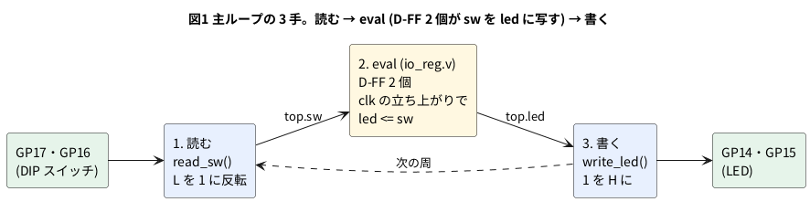

# 5-3 Verilog の入出力を GPIO につなぐ — 入力を読み、eval し、出力を書く

> [!WARNING]
> **この題は実機で組んでいない。** Verilog の lint、`.uf2` のビルド、同じ主ループを PC で回して入出力を確かめるところまでを行った。
> Pico 2 に書き込んで測ってはいない。入力から出力までの遅れは、測って表に書く。

5-2 の `blink.v` は出力 1 本だけで、入力が無かった。この題では Verilog に入力と出力を 2 本ずつ持たせ、
Pico 2 の GPIO のピンにつなぐ。主ループは次の 3 手を繰り返す。

1. **読む**: 入力のピンを `gpio_get` で読み、Verilog の入力ポート (`top.sw`) に入れる
2. **eval**: `clk` を 0 → 1 にして `eval()` を 2 回呼び、回路を 1 クロック進める
3. **書く**: Verilog の出力ポート (`top.led`) を `gpio_put` で出力のピンに出す

Verilog の側はピンの番号を知らない。どのポートをどのピンにつなぐかは、C++ の側で表 (表1) にして決める。

## ピンの対応 (表1)

| Verilog のポート | 向き | GPIO (ピンの番号) | 部品 | 1 のとき |
| --- | --- | --- | --- | --- |
| `sw[0]` | 入力 | GP17 (22 番) | SW1 (DIP スイッチの 1) | スイッチが ON (ピンは L) |
| `sw[1]` | 入力 | GP16 (21 番) | SW2 (DIP スイッチの 2) | スイッチが ON (ピンは L) |
| `led[0]` | 出力 | GP14 (19 番) | R1・D1 | LED が点く (ピンは H) |
| `led[1]` | 出力 | GP15 (20 番) | R2・D2 | LED が点く (ピンは H) |
| `clk` | — | ピンにつながない | 主ループの `tick()` | — |
| `rst` | — | ピンにつながない | 起動のときに 2 クロックだけ 1 | — |

- DIP スイッチの片側は GND につなぎ、ピンは Pico 2 の内蔵プルアップで H に引く。ON で L、OFF で H になる。
  C++ の `read_sw()` で反転して、Verilog には「ON = 1」で渡す。Soft-FPGA-TD4 の `main.cpp` と同じ流儀
- 内蔵プルダウンを使って「ON = H」にしない。RP2350 の A2 版のチップには、入力のピンが 2 V あたりに留まり、
  内蔵プルダウンでは L に下がらない不具合がある (データシートのエラッタ RP2350-E9)。内蔵プルアップはこの不具合の影響を受けない
- `clk` と `rst` は Verilog の中では入力だが、ピンにはつながない。主ループが自分で 0 と 1 を入れる
- Soft-FPGA-TD4 の `main.cpp` は、DIP スイッチを GP10〜GP13、LED を GP2〜GP5 につないでいる。この題のピンは、
  ブレッドボードの線が交わらない並びを選んだ。ピンを替えるときは表1 と `main.cpp` の 2 つの配列だけを直す

## 論理図




`io_reg.v` は 2 ビットのレジスタ (D フリップフロップ 2 個、2-1) で、クロックの立ち上がりごとに `sw` を `led` に写す。
読む・eval・書くを 1 周で順に行うので、同じ周で読んだ値が、その周の終わりにピンに出る。

## Verilog

```verilog
// io_reg.v: 2 本の入力 sw を、クロックの立ち上がりごとに 2 本の出力 led へ写す
module io_reg (
    input  wire       clk,
    input  wire       rst,
    input  wire [1:0] sw,
    output reg  [1:0] led
);
    always @(posedge clk)
        if (rst)
            led <= 2'b00;
        else
            led <= sw;
endmodule
```

C++ にするのは 5-1 の `verilate.sh` で、最後の行を次に替える。`-Wall` の lint は警告なしで通った (Verilator 5.048)。

```bash
verilator --cc --no-timing --no-trace -Wall --prefix Vio_reg --Mdir v_io_reg io_reg.v
```

## Pico 2 のプログラム

ビルドの手順は 5-1 と同じ ([5-1 の「ファイル」と「ビルドする」](01-verilator-on-pico.md#ファイル))。
題ごとに替えるのは、`verilate.sh` の最後の行 (上)、`CMakeLists.txt` の最後の行、`main.cpp` の 3 つ。
`CMakeLists.txt` の最後の行は次にする。

```cmake
add_soft_fpga(io_reg_pico main.cpp io_reg)
```

`main.cpp`:

```cpp
// io_reg.v を Pico 2 で回す。入力は DIP スイッチ、出力は LED
#include "pico/stdlib.h"
#include "Vio_reg.h"

// Verilog のポートと GPIO の対応 (表1)。添字がビットの番号
static const uint PIN_SW[2]  = {17, 16};   // sw[0] = GP17 (SW1)、sw[1] = GP16 (SW2)
static const uint PIN_LED[2] = {14, 15};   // led[0] = GP14 (D1)、led[1] = GP15 (D2)

// 1. 読む: スイッチを ON にすると L (内蔵プルアップ)。反転して 1 にする
static uint8_t read_sw() {
    uint8_t v = 0;
    for (int i = 0; i < 2; i++)
        if (!gpio_get(PIN_SW[i])) v |= 1u << i;
    return v;
}

// 3. 書く: 1 で H (LED が点く)
static void write_led(uint8_t v) {
    for (int i = 0; i < 2; i++)
        gpio_put(PIN_LED[i], (v >> i) & 1);
}

// 2. eval: 立ち下がりと立ち上がりで 2 回。これで 1 クロック
static void tick(Vio_reg &top) {
    top.clk = 0; top.eval();
    top.clk = 1; top.eval();
}

int main() {
    for (int i = 0; i < 2; i++) {
        gpio_init(PIN_SW[i]);
        gpio_set_dir(PIN_SW[i], GPIO_IN);
        gpio_pull_up(PIN_SW[i]);
        gpio_init(PIN_LED[i]);
        gpio_set_dir(PIN_LED[i], GPIO_OUT);
    }

    VerilatedContext ctx;
    Vio_reg top{&ctx};

    top.rst = 1;                 // リセットを 2 クロック掛ける
    tick(top);
    tick(top);
    top.rst = 0;

    while (true) {
        top.sw = read_sw();      // 1. 読む
        tick(top);               // 2. eval
        write_led(top.led);      // 3. 書く
    }
}
```

空のフォルダから 5-1 の手順でビルドし、`build/io_reg_pico.uf2` (92 672 バイト) ができた。**実機では動かしていない。**

### PC で主ループを回す

5-2 と同じく、Pico SDK の GPIO の関数を PC の替え玉に差し替えて、`main.cpp` を PC で回した。
周ごとに入力のピンの値 (1 = H = OFF、0 = L = ON) を変え、その周の終わりの出力のピンを出した。

```text
loop 1: GP17=1 GP16=1 -> GP14=0 GP15=0
loop 2: GP17=0 GP16=1 -> GP14=1 GP15=0
loop 3: GP17=0 GP16=1 -> GP14=1 GP15=0
loop 4: GP17=1 GP16=0 -> GP14=0 GP15=1
loop 5: GP17=0 GP16=0 -> GP14=1 GP15=1
loop 6: GP17=1 GP16=1 -> GP14=0 GP15=0
```

- 入力のピンが L (ON) のビットだけ、出力のピンが H (点く) になった。ピンの上では入力と出力が逆の向きになる
- 入力を変えた周 (loop 2・4・5・6) のうちに出力が変わった。1 周の中で読む → eval → 書くの順だから

## 回路図

```circuit
# 回路図 (tommie-fence の circuit フェンス)
title: 図2 DIP スイッチ 2 本と LED 2 個を Pico 2 につなぐ
parts:
  SW1: dip-switch4 4,7.02
  MCU: pico2 9,3 mirror
  R1: resistor 12,5 14,5 330
  D1: led 14,5 14,7 red
  R2: resistor 12,9 14,9 330
  D2: led 14,9 14,11 red
  G1: ground 1,8
  G2: ground 2,8
  G3: ground 14,7
  G4: ground 14,11
  G5: ground 6.5,1
wires:
  - SW1.B1 -- MCU.GP17
  - SW1.B2 -- MCU.GP16
  - SW1.A1 -| 1,8
  - SW1.A2 -| 2,8
  - MCU.GP14 -| 12,5
  - MCU.GP15 -| 11.5,9
  - 11.5,9 -- 12,9
  - MCU.GND38 -| 6.5,1
style:
  pitch: 1.2
```


- Pico 2 の箱は左右を入れ替えて描いた (`mirror`)。入力の GP17・GP16 が左、出力の GP14・GP15 が右に来る
- DIP スイッチ SW1 は 4 連のうち 1 と 2 だけを使う。A の側が GND、B の側が GPIO。3 と 4 は何もつながない
- プルアップの抵抗は Pico 2 の中にあるので、図には出ない (`gpio_pull_up`)
- LED の電流は 1 個あたり (3.3 − 2.0) / 330 ≈ 3.9 mA (計算値。赤 LED の V<sub>F</sub> を 2.0 V と置いた)

## 実体配線図

```breadboard
# ブレッドボードの実体配線図 (tommie-fence の breadboard フェンス)
title: 図3 DIP スイッチ 2 本を GP17・GP16 に、LED 2 個を GP14・GP15 につなぐ
board: full
parts:
  MCU: pico2 @ h5
  R1: resistor h26 h29 330
  D1: led f29(A) f30(K) red cap=above
  R2: resistor h33 h36 330
  D2: led f36(A) f37(K) red cap=above
  SW1: dip-switch4 @ e40
  PAT:
    type: device
    at: top
    label: AD3 Patterns
    pins: [DIO0, DIO1, GND]
  LOG:
    type: device
    at: bottom
    label: AD3 Logic
    pins: [DIO2, DIO3, GND]
wires:
  - MCU.GND38 -- -t7 black
  - -t3 -- -b3 black
  - i23 -- i26 yellow
  - j24 -- j25 orange
  - g25 -- g33 orange
  - j30 -- -b30 black
  - j37 -- -b37 black
  - MCU.GP17 -- a27 green
  - c27 -- c40 green
  - a24 -- a26 blue
  - d26 -- d41 blue
  - j40 -- -b40 black
  - j41 -- -b41 black
  - PAT.DIO0 -- a40 green
  - PAT.DIO1 -- a41 blue
  - PAT.GND -- -t44 black
  - LOG.DIO2 -- j26 yellow
  - LOG.DIO3 -- j33 orange
  - LOG.GND -- -b44 black
```


- 左半分 (GP14 → R1 → D1) は 5-2 の図2 と同じ。GP15 は j24 → j25 と g25 → g33 の橙の線で R2 (h33〜h36) へ回し、D2 を f36・f37 に挿す
- 入力は Pico 2 の上の列のピン。GP17 (22 番、23 列) は緑の線で a27 へ出し、c27 → c40 で SW1 の 1 番のスイッチ (e40) へ。
  GP16 (21 番、24 列) は青の線で a24 → a26、d26 → d41 で 2 番のスイッチ (e41) へ
- DIP スイッチ SW1 は溝をまたいで e40〜e43・f40〜f43 に挿す。1 番のスイッチは e40 と f40 の間、2 番は e41 と f41 の間。
  下の側 (f40・f41) は j40・j41 から − レールへ落とす
- AD3 は 2 つの箱に分けて描いた。上の箱が Patterns (DIO0・DIO1 から信号を出す)、下の箱が Logic (DIO2・DIO3 で読む)。
  実物は 1 台の AD3 で、GND は 1 本でもよい
- 線の色はネットごとにそろえた。GP17 が緑、GP16 が青、GP14 が黄、GP15 が橙、GND が黒。赤は使っていない (+ の電源を使わない)

## 計器の設定

AD3 の Patterns で入力のピンに一定の速さの方形波を入れ、Logic で入力と出力の 4 本を同時に記録する。
手で DIP スイッチを切り替えるより、何度でも同じ形で測れる。

| 計器 | 設定 |
| --- | --- |
| Patterns | DIO0 を Clock 100 Hz、DIO1 を Clock 50 Hz。AD3 の DIO は 3.3 V の信号なので、Pico 2 のピンにそのまま入れてよい (0-3) |
| Logic | DIO0〜DIO3 を Enable。標本化 100 kS/s、4 ms/div。バスを 2 つ作る (IN = DIO1・DIO0、OUT = DIO3・DIO2、2 進) |
| Logic のトリガ | DIO0 の立ち下がり |

**Patterns を使う間は、DIP スイッチの 1 と 2 を OFF にしておく。** ON のままだと、AD3 が H を出したピンが
スイッチを通って GND につながり、AD3 の出力を GND に落とす形になる。

標本化 100 kS/s は、一番速い 100 Hz の 1000 倍。窓 40 ms は 4000 標本で、AD3 の 1 本 32 768 標本に収まる。

```logic
# ロジックアナライザの画面 (tommie-fence の logic フェンス)
title: 図4 入力のピンが L のビットだけ、出力のピンが H になる
device: ad3
time: 4ms/div
sample: 100kHz
signals:
  GP17: dio0 pattern 10101010 bit 5ms
  GP16: dio1 pattern 1010 bit 10ms
  GP14: dio2 pattern 01010101 bit 5ms
  GP15: dio3 pattern 0101 bit 10ms
buses:
  IN: GP16 GP17 bin
  OUT: GP15 GP14 bin
cursors: [2.5ms, 12.5ms]
trigger: GP17 falling at 5ms
```


- IN と OUT はピンの電圧の並び (H = 1)。IN の 0b11 → 0b10 → 0b01 → 0b00 に対し、OUT は 0b00 → 0b01 → 0b10 → 0b11 と、ビットごとに逆になる
- 図4 は、入力が変わってから出力が変わるまでの遅れを 0 と置いて描いた。遅れはまだ測っていない。4 ms/div の 1 目盛の 1/100 (40 µs (マイクロ秒)) より短ければ、
  この画面では見分けられない。遅れは次の表の手順で、時間の目盛を細かくして測る
- カーソルは GP17 のビットの真ん中 (2.5 ms と 12.5 ms) に置いた。ΔX は 10 ms、1/ΔX は 100 Hz で、Patterns の DIO0 の周波数になる

## 見るべき値

計算値と、PC で回した結果と、測って書く欄。

| 測る所 | 見るべき値 | 分かること |
| --- | --- | --- |
| SW1 を ON | D1 が点く (PC で回した結果) | `sw[0]` → `led[0]` の道が通っている |
| SW2 を ON | D2 が点く (PC で回した結果) | `sw[1]` → `led[1]` の道が通っている |
| Logic の IN と OUT | ビットごとに逆 (図4) | 反転 (`read_sw`) とレジスタ (`io_reg.v`) が働いている |
| 入力の立ち下がりから出力の立ち上がりまで | 測って書く。トリガを GP17 の立ち下がり、10 µs/div、標本化 10 MS/s にし、カーソルを GP17 と GP14 の変わり目に置いて ΔX を読む | 読む → eval → 書くにかかる時間 |
| 上の遅れの最小と最大 (トリガを何度も掛ける) | 測って書く | 入力は周のどこで変わるか分からないので、遅れは最大で 1 周ぶん長くなる。最大と最小の差が、主ループの 1 周の時間の目安になる |

DIP スイッチを手で切り替えると、切り替えの瞬間に H と L を何度か行き来することがある (チャタリング)。
主ループは速いので、その行き来がそのまま LED のピンにも出る。Logic で GP17 を見ると確かめられる。取り除き方は第 6 章で扱う。

## シミュレーションでの確かめ (対象外を含む)

PC で回す確かめは手元の Verilator 5.042 で行った。`.uf2` の大きさは、本文の Docker でビルドし直した。`io_reg.v` を lint し、本文の `main.cpp` を替え玉の GPIO で PC で回した
(`sim/03-gpio-io.v`・`sim/03-gpio-io-pc.cpp`。本文の `while (true)` を 6 周に替え、周ごとに入力のピンを与えた)。
`.uf2` と `arm-none-eabi-size` の値は、本文の Docker イメージ (`sfa-dev:local` の Verilator 5.048 と `wb-pico-sdk` の Pico SDK 2.2.0、`arm-none-eabi-gcc` 13.2.1) で、本文の `.cpp` と `.v` からビルドし直した値。

| 項目 | 本文の数字 | 実行結果 | 判定 |
| --- | --- | --- | --- |
| lint (`-Wall`) | 警告なし | 警告 0 件 | 合った |
| PC で回した 6 周 | 本文の `text` のとおり | 6 行とも同じ | 合った |
| ピンの番号 | GP14 = 19 番、GP15 = 20 番、GP16 = 21 番、GP17 = 22 番 | Pico の標準ピン配置と同じ | 合った |
| `.uf2` の大きさ | 92 672 バイト | 92 672 バイト | 合った |
| LED の電流 | 約 3.9 mA | (3.3 − 2.0) ÷ 330 = 3.9 mA (計算) | 計算値として合った |

### エミュレータ (picoemu) での確かめ

picoemu (`danish9661/pico-emulator` の `b83786f` に `sim/picoemu-m33.patch` を当てた版。手順は [5-2](02-counter-led.md#エミュレータ-picoemu-での確かめ)) に `io_reg_pico.uf2` を載せ、Cortex-M33 で動かした。入力は `-script` で与えた (ms 刻み)。
確かめは `python3 sim/picoemu-check.py --picoemu ./picoemu --uf2 <.uf2 を集めたフォルダ> 5-3`。picoemu は機能の模型で、周期・ジッタ・周波数の実時間は対象外にした。

| 項目 | 本文の数字 | picoemu の結果 | 判定 |
| --- | --- | --- | --- |
| SW1 を ON (GP17 を L) | D1 が点く | 5 ms に GP17 を L にすると GP14 が H、15 ms に H に戻すと L | 合った |
| SW2 を ON (GP16 を L) | D2 が点く | 10 ms に GP16 を L にすると GP15 が H、20 ms に H に戻すと L | 合った |
| 両方 ON / 両方 OFF | 両方点く / 両方消える | 10〜15 ms は GP14・GP15 とも H、何も与えない間とそれ以降は両方 L | 合った |
| 入力から出力までの遅れ | 測って書く | 周期の模型の値しか出ない | 対象外 (実時間) |

確かめられなかったもの。

- 入力から出力までの遅れ (読む → eval → 書く)。実機を AD3 で測る欄で、PC の値は意味が無いので取っていない
- 内蔵プルダウンの不具合 (RP2350-E9) は、データシートの記述の引用で、手元では確かめていない

## 出典

自作。DIP スイッチを内蔵プルアップで読んで反転する形は
[tommie-jp/Soft-FPGA-TD4](https://github.com/tommie-jp/Soft-FPGA-TD4) の `verilator-TD4/main.cpp` に倣った。
内蔵プルダウンの不具合は Raspberry Pi の
[RP2350 Datasheet](https://datasheets.raspberrypi.com/rp2350/rp2350-datasheet.pdf) の付録 D.5.1 RP2350-E9
(A2 版に出る。A3 版で直った、と付録 C にある。外付けにするなら 8.2 kΩ 以下のプルダウン、とある)。
Pico 2 のピン番号は [Pico-2-Pinout.pdf](https://datasheets.raspberrypi.com/pico/Pico-2-Pinout.pdf)。AD3 の Patterns と Logic は 0-4 と
02-analog-discovery の第 7 章。
