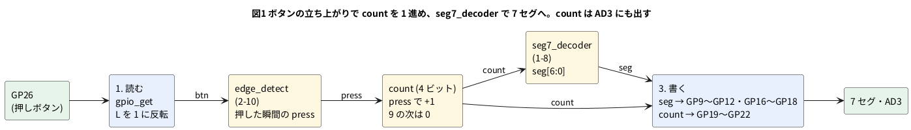

# 5-15 7 セグと押しボタンを付ける

> [!WARNING]
> **この題は実機で組んでいない。** Verilog は Verilator の lint を通し、Pico 2 のプログラムは `.uf2` までのビルドを確かめた。
> 主ループは PC に移して、ボタンを押す入力を入れて確かめた (下の「PC で主ループを回す」)。
> Pico 2 に書き込んで測ってはいない。図4 のボタンの跳ねは**例として置いた形**で、測った波形ではない。
> 「見るべき値」の「測って書く」は、組んでから埋める。

5-3 では、スイッチ 2 本と LED 2 個を GPIO につないだ。この題では、**押しボタン 1 個で 0〜9 を数え、7 セグメント LED に出す**。
7 セグメントは 1 桁、押しボタンは 1 個、入力も出力も 5-3 と同じ「読む → eval → 書く」の主ループで回す。

回路は 3 つの部品を重ねたもの。新しく書くのは、つなぐ `seg_counter.v` だけである。

| 部品 | 役 | どこから |
| --- | --- | --- |
| `edge_detect` | ボタンを押した瞬間に 1 クロックだけ 1 になる `press` を作る | 2-10 |
| `count` (4 ビット) | `press` のたびに 1 増える。9 の次は 0 に戻る | この題 |
| `seg7_decoder` | 0〜9 を 7 セグメントの点灯の並びに直す | 1-8 |

ボタンは**クロックと無関係に変わる信号**だが、この主ループは 1 クロックにつき 1 回だけピンを読む。
読んだ値はそのクロックの間ずっと同じなので、2-10 の注意 (外から来る信号は 2 段で受ける) は、この題では要らない。
実物の FPGA でボタンをそのまま入れるときは、2 段で受ける (9-2)。

## 論理図




図の 2 番めの手 (eval) では、この 3 つの部品を合わせて 1 回で計算する。

## Verilog

`seg_counter.v` (この題で書く物):

```verilog
// seg_counter.v: 押しボタンを押すたびに 0〜9 を数え、7 セグに出す
module seg_counter (
    input  wire       clk,
    input  wire       rst,
    input  wire       btn,      // 1 = 押している
    output reg  [3:0] count,    // 0〜9
    output wire [6:0] seg       // {g, f, e, d, c, b, a}。1 で点灯
);
    wire press;
    wire release_unused;

    edge_detect u_edge (
        .clk(clk), .rst(rst), .in(btn),
        .rise(press), .fall(release_unused)
    );

    always @(posedge clk)
        if (rst)
            count <= 4'd0;
        else if (press)
            count <= (count == 4'd9) ? 4'd0 : count + 4'd1;

    seg7_decoder u_dec (.d(count), .seg(seg));
endmodule
```

- `edge_detect` は 2-10 の `edge_detect.v`、`seg7_decoder` は 1-8 の `seg7_decoder.v` を、そのまま同じフォルダに置く。ここには写さない
- `fall` は使わない。`release_unused` という名前の線に受けておくと、`-Wall` で警告が出ない
- `seg7_decoder` は 0〜F の 16 通りを持つが、`count` は 9 までしか行かない
- `seg` は `{g, f, e, d, c, b, a}` の順で、1 が点灯。共通カソードの表示器 (下の 5161AS) は、1 を出したセグメントが光る

C++ にするのは 5-1 の `verilate.sh` で、最後の行を次に替える。`-Wall` の lint は警告なしで通った (Verilator 5.048)。

```bash
verilator --cc --no-timing --no-trace -Wall --prefix Vseg_counter --Mdir v_seg_counter seg_counter.v edge_detect.v seg7_decoder.v
```

## ピンの対応 (表1)

| Verilog のポート | 向き | GPIO (ピンの番号) | つなぐ先 | 1 のとき |
| --- | --- | --- | --- | --- |
| `btn` | 入力 | GP26 (31 番) | SW1 (押しボタン) | ボタンを押している (ピンは L) |
| `seg[0]` (a) | 出力 | GP11 (15 番) | R1 → DS1 の a | 点灯 (ピンは H) |
| `seg[1]` (b) | 出力 | GP12 (16 番) | R2 → DS1 の b | 点灯 |
| `seg[2]` (c) | 出力 | GP16 (21 番) | R3 → DS1 の c | 点灯 |
| `seg[3]` (d) | 出力 | GP17 (22 番) | R4 → DS1 の d | 点灯 |
| `seg[4]` (e) | 出力 | GP18 (24 番) | R5 → DS1 の e | 点灯 |
| `seg[5]` (f) | 出力 | GP10 (14 番) | R6 → DS1 の f | 点灯 |
| `seg[6]` (g) | 出力 | GP9 (12 番) | R7 → DS1 の g | 点灯 |
| `count[0]` | 出力 | GP22 (29 番) | AD3 の DIO1 | 1 |
| `count[1]` | 出力 | GP21 (27 番) | AD3 の DIO2 | 1 |
| `count[2]` | 出力 | GP20 (26 番) | AD3 の DIO3 | 1 |
| `count[3]` | 出力 | GP19 (25 番) | AD3 の DIO4 | 1 |
| `clk` `rst` | — | ピンにつながない | 主ループが 0 と 1 を入れる | — |

- 押しボタンは GND との間に入れ、ピンは Pico 2 の内蔵プルアップで H に引く。押すと L になる。C++ で反転して、Verilog には「押している = 1」で渡す
  (5-3 と同じ。内蔵プルダウンを使わない理由も 5-3 にある)
- GP26 は ADC の入力にもなるピンだが、`gpio_init` で普通の GPIO にして使う
- `count` を 4 本写すのは、**回路の内部の値をピンに出す**ため。7 セグの 7 本をそのまま Logic で読むと、本数が多くて配線が混む
  (5-5 が LED の値を別のピンに写したのと同じ考え)。`count` の 4 ビットは、7 セグに出る数字そのものになる

## 回路図

```circuit
# 回路図 (tommie-fence の circuit フェンス)
title: 図2 Pico 2 の GPIO から 7 セグメントと押しボタン、AD3 へ
parts:
  U1: pico2 12,6
  SEGg: port 6,5.2
  SEGf: port 6,6
  SEGa: port 6,8
  SEGb: port 6,8.8
  BTN: port 18,4
  CNT0: port 18,4.8
  CNT1: port 18,5.6
  CNT2: port 18,6.4
  CNT3: port 18,7.2
  SEGe: port 18,8
  SEGd: port 18,8.8
  SEGc: port 18,9.6
  GP: ground 10,10
  SEGa: port 22,2
  R1: resistor 22,2 25,2 330
  SEGb: port 22,3.2
  R2: resistor 22,3.2 25,3.2 330
  SEGc: port 22,4.4
  R3: resistor 22,4.4 25,4.4 330
  SEGd: port 22,5.6
  R4: resistor 22,5.6 25,5.6 330
  SEGe: port 22,6.8
  R5: resistor 22,6.8 25,6.8 330
  SEGf: port 22,8
  R6: resistor 22,8 25,8 330
  SEGg: port 22,9.2
  R7: resistor 22,9.2 25,9.2 330
  DS1: seg7 33,6
  GC: ground 31.2,10
  BTN: port 22,12
  SW1: button 22,12 22,14
  GB: ground 22,14
  AD:
    type: device
    at: 30,13
    label: AD3
    pins: [DIO0, DIO1, DIO2, DIO3, DIO4, GND]
  BTN: port 26,11.8
  CNT0: port 26,12.5
  CNT1: port 26,13.2
  CNT2: port 26,13.9
  CNT3: port 26,14.6
  GA: ground 28.8,15.3
wires:
  - U1.GP9 -| 10.2,5.2
  - 10.2,5.2 -- 6,5.2
  - U1.GP10 -| 9.8,6
  - 9.8,6 -- 6,6
  - U1.GP11 -| 9.4,8
  - 9.4,8 -- 6,8
  - U1.GP12 -| 10.4,8.8
  - 10.4,8.8 -- 6,8.8
  - U1.GND18 -| 10,10
  - U1.GP26 -| 14,4
  - 14,4 -- 18,4
  - U1.GP22 -| 14.4,4.8
  - 14.4,4.8 -- 18,4.8
  - U1.GP21 -| 14.8,5.6
  - 14.8,5.6 -- 18,5.6
  - U1.GP20 -| 15.2,6.4
  - 15.2,6.4 -- 18,6.4
  - U1.GP19 -| 15.6,7.2
  - 15.6,7.2 -- 18,7.2
  - U1.GP18 -| 16,8
  - 16,8 -- 18,8
  - U1.GP17 -| 16.4,8.8
  - 16.4,8.8 -- 18,8.8
  - U1.GP16 -| 16.8,9.6
  - 16.8,9.6 -- 18,9.6
  - 25,2 -- 30,2
  - 30,2 |- DS1.a
  - 25,3.2 -- 29.4,3.2
  - 29.4,3.2 |- DS1.b
  - 25,4.4 -- 28.8,4.4
  - 28.8,4.4 |- DS1.c
  - 25,5.6 -- 28.4,5.6
  - 28.4,5.6 |- DS1.d
  - 25,6.8 -- 28.8,6.8
  - 28.8,6.8 |- DS1.e
  - 25,8 -- 29.4,8
  - 29.4,8 |- DS1.f
  - 25,9.2 -- 30,9.2
  - 30,9.2 |- DS1.g
  - DS1.COM1 -| 31.2,10
  - DS1.COM2 -| 31.2,10
  - AD.DIO0 -| 28.4,11.8
  - 28.4,11.8 -- 26,11.8
  - AD.DIO1 -| 28,12.5
  - 28,12.5 -- 26,12.5
  - AD.DIO2 -| 27.2,13.2
  - 27.2,13.2 -- 26,13.2
  - AD.DIO3 -| 27.6,13.9
  - 27.6,13.9 -- 26,13.9
  - AD.DIO4 -| 28,14.6
  - 28,14.6 -- 26,14.6
  - AD.GND -| 28.8,15.3
style:
  pitch: 1.2
```


- 同じ名前の端子どうしがつながっている (`SEGa` など)。Pico 2 の 12 本のピンは、名前を介して、7 本が右の抵抗 R1〜R7 (R1 が a、R7 が g)、4 本が AD3、1 本が押しボタンにつながる
- 抵抗は 1 セグメントに 1 本ずつ。共通カソードの COM1 と COM2 は GND へ落とす
- 電流は 1 セグメントあたり (3.3 − 2.0) / 330 ≈ 3.9 mA (計算値。赤の 7 セグメントの V<sub>F</sub> を 2.0 V と置いた。使う品のデータシートで確かめる)。
  「8」を出すと 7 本が同時に点き、COM から GND へ約 27 mA (計算値) が流れる
- 330 Ω は E24 の値。Pico 2 の GPIO の出力は、既定で 4 mA の駆動強さに設定されている (RP2350 のデータシート 9.6 Pads。`gpio_set_drive_strength` で 2・4・8・12 mA に替えられる)。
  3.9 mA はそれにほぼ等しい。**ピンの電圧がどこまで下がるかは測って書く** (下の表)
- 押しボタンは GP26 (BTN) と GND の間。AD3 は DIO0 でボタンの電圧、DIO1〜DIO4 で `count` の 4 ビットを読む

## 実体配線図

```breadboard
# ブレッドボードの実体配線図 (tommie-fence の breadboard フェンス)
title: 図3 Pico 2 の右に 7 セグメントと抵抗 7 本、左に押しボタン、上に AD3 の Logic
board: full
parts:
  SW1: button @ e2
  MCU: pico2 @ g8
  DS1: seg7 @ d33 r180
  R3: resistor c34 c29 330 cap=below
  R4: resistor b36 b30 330 cap=above
  R5: resistor c37 c41 330 cap=below
  R2: resistor i33 i29 330 cap=above:-2,0
  R1: resistor j34 j30 330 cap=below
  R6: resistor i36 i40 330 cap=above:3,0
  R7: resistor j37 j41 330 cap=below
  AD:
    type: device
    at: top
    label: AD3 Logic
    pins: [GND, DIO0, DIO1, DIO2, DIO3, DIO4]
wires:
  - j4 -- -b4 black
  - a35 -- -t35 black
  - h20 -- -b20 black
  - -t60 -- -b60 black
  - a17 -- a4 purple
  - a27 -- a29 yellow
  - a26 -- a30 yellow
  - a24 -- a41 yellow
  - h23 -- h29 brown
  - h22 -- h30 orange
  - h21 -- h40 gray
  - h19 -- h41 blue
  - AD.GND -- -t1 black
  - AD.DIO0 -- a2 green
  - AD.DIO1 -- a19 green
  - AD.DIO2 -- a21 green
  - AD.DIO3 -- a22 green
  - AD.DIO4 -- a23 green
```


- Pico 2 は上のブロックに上の列のピン、下のブロックに下の列のピンが挿さる。7 セグメントを光らせる 7 本は、
  Pico 2 の**上の列** (GP16・GP17・GP18) と**下の列** (GP9〜GP12) に分けて引いた。上の列の線は上の端 (a 行)、下の列の線は下の端 (h 行) から出す
- 7 セグ DS1 (5161AS) は 180 度回して (`r180`) d↔h の行に挿す。上の列のピンは左から dp・c・COM1・d・e、下の列は左から b・a・COM2・f・g
- 抵抗は 7 本。1 本ずつ、7 セグのピンの列から横へ 4〜6 穴伸ばして、その端の列に Pico 2 の線を挿す。**抵抗のリード線と線の端を同じ穴には挿さない**
- 黄 (c・d・e)・茶 (b)・橙 (a)・灰 (f)・青 (g) の線が、Pico 2 から抵抗への信号。線の色は、7 本が束になる所で見分けるために 1 本ずつ替えた
- 紫の線が GP26 から押しボタンの上側 (a4)。ボタンの下側は黒の線で GND (j4 → − レール)。押していなくても、ボタンの同じ側の 2 本は中でつながっている
- 緑の線 (AD3 の DIO0〜DIO4) は、押しボタンの列と Pico 2 の上の列 (GP22・GP21・GP20・GP19) へ。黒の線で AD3 の GND を − レールへ
- 上の − レールと下の − レールは、右端の黒の線でつないだ。GND は Pico 2 の GND13 (h20) から下のレールへ、COM は上のレールへ
- 電源は Pico 2 の USB ケーブルから取る。ブレッドボードの + レールは使わない

## 部品表

| 部品 | 値・型番 | 数 | 役 |
| --- | --- | --- | --- |
| U1 | Raspberry Pi Pico 2 | 1 | Soft-FPGA を動かす。USB から給電 |
| DS1 | 7 セグメント LED 5161AS (赤、カソードコモン、0.56 インチ 1 桁) | 1 | 数字を出す |
| R1〜R7 | 330 Ω (オーム)、E24、1/4 W | 7 | セグメントの電流を決める |
| SW1 | タクトスイッチ (4 ピン) | 1 | 数を進めるボタン |
| — | ブレッドボード (full、63 列) | 1 | |
| AD | Analog Discovery 3 | 1 | Logic で 5 本を測る |

電源は 3.3 V (Pico 2 の GPIO)。教科書の既定の 5 V から外すのは、Pico 2 のピンに 5 V を入れると壊れるため (0-3)。
ブレッドボードを流れる電流は、「8」を出したときで約 27 mA (計算値) で、1 穴 200 mA、ブレッドボード全体 500 mA の目安に収まる。

## Pico 2 のプログラム

ビルドの手順は 5-1 と同じ ([5-1 の「ファイル」と「ビルドする」](01-verilator-on-pico.md#ファイル))。
作業用のフォルダに `seg_counter.v` `edge_detect.v` `seg7_decoder.v` を置く。題ごとに替えるのは、`verilate.sh` の最後の行 (上)、`CMakeLists.txt` の最後の行、主ループの `.cpp` の 3 つ。

```cmake
add_soft_fpga(seg515 seg515.cpp seg_counter)
```

`seg515.cpp`:

```cpp
// 5-15 7 セグと押しボタン — seg_counter.v を Pico 2 で回す
#include "pico/stdlib.h"
#include "Vseg_counter.h"

// Verilog のポートと GPIO の対応 (表1)。添字がビットの番号
static const uint PIN_SEG[7] = {11, 12, 16, 17, 18, 10, 9};   // seg[0..6] = a b c d e f g
static const uint PIN_MON[4] = {22, 21, 20, 19};              // count[0..3] を AD3 へ写す
static const uint PIN_BTN    = 26;                            // 押すと L (内蔵プルアップ)

static void write_pins(const uint *pins, int n, unsigned v) {
    for (int i = 0; i < n; i++) gpio_put(pins[i], (v >> i) & 1u);
}

static void tick(Vseg_counter &top) {
    top.clk = 0; top.eval();
    top.clk = 1; top.eval();
}

int main() {
    for (int i = 0; i < 7; i++) { gpio_init(PIN_SEG[i]); gpio_set_dir(PIN_SEG[i], GPIO_OUT); }
    for (int i = 0; i < 4; i++) { gpio_init(PIN_MON[i]); gpio_set_dir(PIN_MON[i], GPIO_OUT); }
    gpio_init(PIN_BTN);
    gpio_set_dir(PIN_BTN, GPIO_IN);
    gpio_pull_up(PIN_BTN);

    VerilatedContext ctx;
    Vseg_counter top{&ctx};

    top.rst = 1; top.btn = 0;
    tick(top);
    tick(top);
    top.rst = 0;

    while (true) {
        top.btn = gpio_get(PIN_BTN) ? 0 : 1;      // 1. 読む。押すと L なので反転
        tick(top);                                // 2. eval
        write_pins(PIN_SEG, 7, top.seg);          // 3. 書く
        write_pins(PIN_MON, 4, top.count);
    }
}
```

空のフォルダから 5-1 の手順でビルドし、`build/seg515.uf2` (93 696 バイト) ができた (Verilator 5.048、Pico SDK 2.2.0)。
`arm-none-eabi-size` は text 50 476 バイト、bss 2 308 バイト。**実機では動かしていない。**

### PC で主ループを回す

5-3 と同じく、GPIO の関数を PC の替え玉に差し替えて、`seg515.cpp` を PC の Verilator で回した。
周ごとにボタンのピンの値 (1 = 離している、0 = 押している) を替え、書き出した 7 本と `count` の 4 本を読み戻して、数字に直した。

| ボタンの入れ方 | 出た数字 (`count`) |
| --- | --- |
| 10 周離す → 20 周押す → 20 周離す | 0 のまま → 押した周で 1 → 離しても 1 |
| 押した周に、L・H・L と跳ねる押し方 | 跳ねの 1 回目で 2、跳ねの 3 回目 (2 度目の L) で 3。**1 回押したのに 2 つ進んだ** |
| 2 周離す・2 周押すを 10 回繰り返す | 0 → 1 → 2 → 3 → 4 → 5 → 6 → 7 → 8 → 9 → 0 (9 の次は 0) |

- 出た `seg` の値は、0 から順に 0x3F・0x06・0x5B・0x4F・0x66・0x6D・0x7D・0x07・0x7F・0x6F。1-8 の `seg7_decoder` の表と同じ
- 押している間ずっと L でも、`press` は押した 1 周だけ 1 になる。数は 1 つしか進まない
- 2 行目が、**チャタリング** (ボタンの接点が跳ねて、L と H を何度か行き来する) の影響。この回路は跳ねを取らないので、跳ねた回数だけ進む。取り方は 6-3 で扱う

## 計器の設定

AD3 の Logic で、押しボタンの電圧 (DIO0) と `count` の 4 ビット (DIO1〜DIO4) を同時に記録する。

| 計器 | 設定 |
| --- | --- |
| Logic | DIO0〜DIO4 を Enable。標本化 100 kS/s (1 標本 10 µs)。時間軸 3 ms/div。バスを 1 つ作る (COUNT = DIO4・DIO3・DIO2・DIO1、16 進) |
| Logic のトリガ | DIO0 の立ち下がり (ボタンを押した瞬間) |

標本化 100 kS/s は、見たい変化 (ボタンの跳ねは ms の桁) の 100 倍ほど。窓 30 ms は 3000 標本で、AD3 の 1 本 32 768 標本に収まる。
`count` の変わり目は、主ループの 1 周 (測っていない。µs の桁と見込む) の後に出る。この画面では 1 標本以内なので、0 と置いて描いた。

## Logic に見えるはずの画面

図4 は、**押し 2 回** を見たもの。1 回目はきれいに押せた場合、2 回目はボタンが 1 度跳ねた場合。時間の目盛は仮 (跳ねの幅は例)。

```logic
# ロジックアナライザの画面 (tommie-fence の logic フェンス)
title: 図4 1 回目の押しは 1 つ進み、跳ねた 2 回目の押しは 2 つ進む (跳ねの形は例。測った波形ではない)
device: ad3
time: 3ms/div
start: -4ms
sample: 100kHz
signals:
  BTN: dio0 pattern 111100000011111101000000111111 bit 1ms from -4ms
  CNT0: dio1 pattern 000011111111111100111111111111 bit 1ms from -4ms
  CNT1: dio2 pattern 000000000000000011111111111111 bit 1ms from -4ms
  CNT2: dio3 pattern 000000000000000000000000000000 bit 1ms from -4ms
  CNT3: dio4 pattern 000000000000000000000000000000 bit 1ms from -4ms
buses:
  COUNT: CNT3 CNT2 CNT1 CNT0 hex
trigger: BTN falling at 0s
```


- BTN が L の間がボタンを押している間。1 回目は 6 ms 押して、COUNT は 0 → 1 になる
- 2 回目は、L の 12 ms 目と 14 ms 目の 2 回 L に落ちる (間の 13 ms は H)。COUNT は 1 → 2 → 3 と**2 つ進む**。7 セグの表示は、一瞬 2 を経て 3 になる
- COUNT の値は、そのとき 7 セグに出ている数字と同じ。DIO1〜DIO4 のバスが 1・2・3 と並ぶので、**表示の数字を目で見なくても、Logic で内部の値が読める**

## 見るべき値

**測っていない。測って空欄を埋める。** 数を決め打たないのは、この冊の決め (1 クロックの時間は実測してから書く)。

| 測る所 | 見るべき値 | 分かること |
| --- | --- | --- |
| 7 セグの表示 | 電源を入れると 0。1 回押すと 1 になる (PC で回した結果) | 押しボタン → `edge_detect` → `count` → `seg7_decoder` → 7 セグの道が通っている |
| 10 回押す | 0 → 1 → … → 9 → 0 (PC で回した結果) | 9 の次の折り返し |
| 1 回押したのに 2 つ以上進む回数 | 測って書く (100 回押して何回か) | ボタンの跳ねの多さ。跳ねを取るのは 6-3 |
| DIO0 の立ち下がりから COUNT が変わるまで | 測って書く。トリガを DIO0 の立ち下がり、10 µs/div、標本化 10 MS/s にして、カーソルを両方の変わり目に置く | 読む → eval → 書くにかかる時間。5-3 の遅れと同じ測り方 |
| 跳ねの回数と、跳ね始めから落ち着くまでの時間 | 測って書く。DIO0 を 1 ms/div で見る | ボタンごとに違う。6-3 の取り込み時間 (20 ms) の根拠 |
| 「8」を出したときの COM の電流 | 約 27 mA (計算値)。測って書く | 7 本が同時に点いたときの電流 |
| 1 セグメントの抵抗 (R1〜R7) の両端の電圧 | 測って書く | 電流 = 電圧 / 330 Ω。計算値の 3.9 mA と比べる |
| ピンの電圧 (点灯中) | 測って書く | 駆動強さ 4 mA の設定で、3.3 V からどれだけ下がるか |

見るとよいこと:

- 跳ねを取らないと、押すたびに数が 1 つとは限らない。**回路は正しく書いたのに、数がずれる**ことがある
- 「8」を出すと、「1」より暗く見えるか (見えるなら、ピンの電圧が下がっている)

## シミュレーションでの確かめ (対象外を含む)

PC で回す確かめは手元の Verilator 5.042 で行った。`.uf2` の大きさは、本文の Docker でビルドし直した。`seg_counter.v` は 2-10 の `edge_detect.v` と 1-8 の `seg7_decoder.v` と合わせて lint し、
本文の `seg515.cpp` を替え玉の GPIO で PC で回して、ボタンの入れ方を 3 通り与えた (`sim/15-seg7-button.v`・`sim/15-seg7-button-pc.cpp`)。
`.uf2` と `arm-none-eabi-size` の値は、本文の Docker イメージ (`sfa-dev:local` の Verilator 5.048 と `wb-pico-sdk` の Pico SDK 2.2.0、`arm-none-eabi-gcc` 13.2.1) で、本文の `.cpp` と `.v` からビルドし直した値。

| 項目 | 本文の数字 | 実行結果 | 判定 |
| --- | --- | --- | --- |
| lint (`-Wall`) | 警告なし | 警告 0 件 | 合った |
| 10 周離す・20 周押す・20 周離す | 0 のまま → 押した周で 1 → 離しても 1 | loop 1 で 0 (seg 0x3F)、loop 11 で 1 (0x06)、以後 1 のまま | 合った |
| 跳ねる押し方 (L・H・L) | 跳ねの 1 回目で +1、2 度目の L でもう +1。1 回押して 2 つ進む | 離 3 周のあと、L の周で 1、H を挟んで次の L の周で 2 | 合った |
| 2 周離す・2 周押す × 10 | 0 → 1 → … → 9 → 0 | 0・1・…・9・0 (loop 3・7・11 … 39 で進む) | 合った |
| `seg` の値 | 0x3F・0x06・0x5B・0x4F・0x66・0x6D・0x7D・0x07・0x7F・0x6F | 同じ | 合った |
| ピンの番号 | GP9 = 12 番 … GP26 = 31 番 | Pico の標準ピン配置と同じ | 合った |
| 「8」の電流 | 約 27 mA | 7 × (3.3 − 2.0) ÷ 330 = 27.6 mA (計算) | 計算値として合った |
| `.uf2` の大きさ | 93 696 バイト、text 50 476・bss 2 308 | 93 696 バイト、text 50 476・bss 2 308 | 合った |

確かめられなかったもの。

- 実機の跳ねの回数・時間、入力から出力までの遅れ、ピンの電圧、COM の電流 (実機)

## 出典

自作。`edge_detect` は 2-10、`seg7_decoder` は 1-8。主ループの「読む → eval → 書く」と、DIP スイッチを内蔵プルアップで読んで反転する形は 5-3
([tommie-jp/Soft-FPGA-TD4](https://github.com/tommie-jp/Soft-FPGA-TD4) の `verilator-TD4/main.cpp` に倣った)。
GPIO の駆動強さ (2・4・8・12 mA、既定は 4 mA) は Raspberry Pi の
[RP2350 Datasheet](https://datasheets.raspberrypi.com/rp2350/rp2350-datasheet.pdf) の 9.6 Pads と、PADS_BANK0 の GPIO のレジスタの DRIVE の欄。
Pico 2 のピン番号は [Pico-2-Pinout.pdf](https://datasheets.raspberrypi.com/pico/Pico-2-Pinout.pdf)。
7 セグメント LED の 5161AS のピンの並びは 01-circuits の 10-7 と breadboard-fence の部品表。AD3 の Logic の使い方は 0-4。
