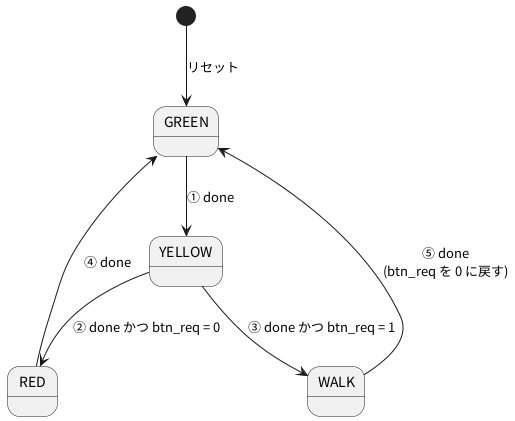

# 6-1 状態機械の書き方 — 状態のレジスタと、次の状態の case

この題は実体配線図と Analog Discovery 3 の図を付けない。PC の Verilator だけで動かす題で、組む物が無いから。

状態機械 (FSM) は、「今どの状態か」をフリップフロップに覚えておき、入力と時間で次の状態へ移る回路。
4-4 の信号機は、状態を変える処理と灯を書く処理を 1 つの `always` にまとめていた。
この題では同じ信号機を、決まった **3 つの部分** に分けて書き直す。

| 部分 | 何をするか | 回路の種類 |
| --- | --- | --- |
| 状態のレジスタ | クロックの立ち上がりで `next` を `state` に取り込む。それだけ | 順序回路 (2-1 の D フリップフロップ 2 個) |
| 次の状態の `case` | 今の `state` と入力から `next` を決める | 組み合わせ回路 (1-5 の `always @(*)` と `case`) |
| 出力 | 今の `state` から灯を決める | 組み合わせ回路 |

分けると、状態遷移図の矢印 1 本が `case` の 1 行に当たる。図と Verilog を 1 行ずつ突き合わせられるので、
矢印の書き漏らしや、図に無い移り方を見つけやすい (後半の「状態遷移図と Verilog の突き合わせ」)。
6-2 では、この題の Verilog をそのまま Pico 2 に載せる。

## 状態遷移図

4-4 と同じ信号機。矢印に ①〜⑤ の番号を付けた。




- `done` は「今の状態の時間が尽きた」(`timer` が 0)。どの状態も、時間が尽きたら次へ移る
- `btn_req` は歩行者ボタンを押したことの記憶。GREEN のうちに押すと 1 になり、YELLOW の終わりで行き先を決める
- 灯は状態だけで決まる。GREEN は青、YELLOW は黄、RED は赤、WALK は赤と歩行者の灯

## Verilog

`traffic_fsm2.v`。ポートの名前と既定の長さは 4-4 の `traffic_fsm` と同じにした。違いは、
`state` を出口に出したことと、`timer` の幅を `W` で変えられるようにしたこと (6-2 で秒の単位にするため)。

```verilog
// 4-4 の信号機を、状態のレジスタと次の状態の case に分けて書き直す
module traffic_fsm2 #(
    parameter W           = 10,   // timer の幅 (いちばん長い時間が入る幅)
    parameter GREEN_TIME  = 500,  // 各状態の長さ (クロック数)
    parameter YELLOW_TIME = 100,
    parameter RED_TIME    = 300,
    parameter WALK_TIME   = 400
) (
    input            clk,
    input            rst,
    input            btn,
    output           red,
    output           yellow,
    output           green,
    output           walk,
    output reg [1:0] state
);
    localparam [1:0] S_GREEN  = 2'd0;
    localparam [1:0] S_YELLOW = 2'd1;
    localparam [1:0] S_RED    = 2'd2;
    localparam [1:0] S_WALK   = 2'd3;

    localparam [W-1:0] T_GREEN  = GREEN_TIME[W-1:0]  - 1'b1;
    localparam [W-1:0] T_YELLOW = YELLOW_TIME[W-1:0] - 1'b1;
    localparam [W-1:0] T_RED    = RED_TIME[W-1:0]    - 1'b1;
    localparam [W-1:0] T_WALK   = WALK_TIME[W-1:0]   - 1'b1;

    reg [1:0]   next;
    reg [W-1:0] timer;
    reg         btn_req;
    wire        done = (timer == {W{1'b0}});

    // (1) 状態のレジスタ: クロックの立ち上がりで next を取り込むだけ
    always @(posedge clk)
        if (rst) state <= S_GREEN;
        else     state <= next;

    // (2) 次の状態: 今の状態と入力から、組み合わせ回路で決める
    always @(*) begin
        next = state;                 // 矢印に当たらなければ今の状態のまま
        case (state)
            S_GREEN:  if (done) next = S_YELLOW;
            S_YELLOW: if (done) next = btn_req ? S_WALK : S_RED;
            S_RED:    if (done) next = S_GREEN;
            S_WALK:   if (done) next = S_GREEN;
            default:            next = S_GREEN;
        endcase
    end

    // (3) 状態に付いた時間: 状態が変わるクロックで次の状態の長さを入れ、ほかは 1 ずつ減らす
    always @(posedge clk)
        if (rst)
            timer <= T_GREEN;
        else if (next != state)
            case (next)
                S_GREEN:  timer <= T_GREEN;
                S_YELLOW: timer <= T_YELLOW;
                S_RED:    timer <= T_RED;
                default:  timer <= T_WALK;
            endcase
        else
            timer <= timer - 1'b1;

    // 歩行者ボタンの記憶: 押したら 1、WALK が終わるクロックで 0
    always @(posedge clk)
        if (rst)                         btn_req <= 1'b0;
        else if (state == S_WALK && done) btn_req <= 1'b0;
        else if (btn)                    btn_req <= 1'b1;

    // (4) 出力: 今の状態だけで決まる
    assign green  = (state == S_GREEN);
    assign yellow = (state == S_YELLOW);
    assign red    = (state == S_RED) || (state == S_WALK);
    assign walk   = (state == S_WALK);
endmodule
```

- (1) の `always @(posedge clk)` は、`state <= next` しか書かない。どこへ移るかの判断を持ち込まない
- (2) の `always @(*)` は組み合わせ回路なので `=` で書く (`<=` はクロックで動く側。2-2)。`case` の 1 行が状態遷移図の矢印 1 本
- (3) の `timer` と `btn_req` は、状態とは別に覚えておく値 (データ)。状態が変わるクロックを `next != state` で知る
- (4) の灯は `state` を読むだけ。状態が変わったクロックで灯も変わり、ずれない。出力が状態だけで決まる形をムーア型と呼ぶ (入力でも変わる形がミーリー型。6-4)

Verilator の lint は警告なしで通る (`verilator --lint-only -Wall traffic_fsm2.v`、確かめた)。

### 書き忘れると lint が言うこと — `next = state;`

(2) の最初の `next = state;` を消すと、`done` が 0 のとき `next` に何も書かない道ができる。
組み合わせ回路のつもりが、値を覚えておく回路 (ラッチ) になる。Verilator の lint はこれを言う (確かめた)。

```text
%Warning-LATCH: traffic_fsm2.v:39:5: Latch inferred for signal 'traffic_fsm2.next' (not all control paths of combinational always assign a value)
%Error: Exiting due to 1 warning(s)
```

`always @(*)` の頭で、全部の出口に「何もなければこの値」を先に書く。これがこの型の決まりごと。

## 状態遷移図と Verilog の突き合わせ

図と Verilog を 1 対 1 に対応させ、両方向から確かめる。

| 矢印 | 図の条件 | Verilog の行 |
| --- | --- | --- |
| ① GREEN → YELLOW | `done` | `S_GREEN:  if (done) next = S_YELLOW;` |
| ② YELLOW → RED | `done` かつ `btn_req` = 0 | `S_YELLOW: if (done) next = btn_req ? S_WALK : S_RED;` の後ろ |
| ③ YELLOW → WALK | `done` かつ `btn_req` = 1 | 同じ行の前 |
| ④ RED → GREEN | `done` | `S_RED:    if (done) next = S_GREEN;` |
| ⑤ WALK → GREEN | `done` | `S_WALK:   if (done) next = S_GREEN;` と、`btn_req` を 0 に戻す行 |
| (矢印なし) | 図に無い値 | `default: next = S_GREEN;` (2 ビットで 4 状態なので起きない) |

1. **図 → Verilog**: 矢印を 1 本ずつ指でなぞり、表の右の列の行が `case` にあるかを見る。①〜⑤ の 5 本が全部ある
2. **Verilog → 図**: `case` の行を 1 行ずつ読み、表の左の列に矢印があるかを見る。図に無い行は `default` だけ
3. **動かして数える**: 試験で長く回し、5 本の矢印がそれぞれ 1 回以上通ったことと、図に無い移り方が 0 回であることを数える。
   あわせて 4-4 の `traffic_fsm` と同じ入力を入れ、毎クロック状態と灯が一致するかを比べる (書き直して振る舞いが変わっていないことの確かめ)

1 と 2 は目で行う。3 は次の試験で行う。

### 試験 — 4-4 と比べ、矢印を数える

長さを短く (5・2・3・4 クロック) して、10 万クロック回す。ボタンは 16 クロックに 1 回ほどでたらめに押す。

```verilog
// 4-4 の traffic_fsm と、2 つに分けた traffic_fsm2 を同じ入力で回し、毎クロック比べる。
// あわせて、状態遷移図の 5 本の矢印がそれぞれ何回通ったかを数える
module tb_fsm2;
    reg clk;
    initial clk = 1'b0;
    reg rst = 1'b1;
    reg btn = 1'b0;

    wire r1, y1, g1, w1, r2, y2, g2, w2;
    wire [1:0] s1, s2;
    wire [9:0] t1;   // 比べない (timer の中身は書き方で違ってよい)
    wire       q1;

    traffic_fsm  #(.GREEN_TIME(5), .YELLOW_TIME(2), .RED_TIME(3), .WALK_TIME(4)) old_fsm (
        .clk(clk), .rst(rst), .btn(btn),
        .red(r1), .yellow(y1), .green(g1), .walk(w1),
        .o_state(s1), .o_timer(t1), .o_btn_req(q1));
    traffic_fsm2 #(.GREEN_TIME(5), .YELLOW_TIME(2), .RED_TIME(3), .WALK_TIME(4)) new_fsm (
        .clk(clk), .rst(rst), .btn(btn),
        .red(r2), .yellow(y2), .green(g2), .walk(w2), .state(s2));

    always #1 clk = ~clk;

    integer cyc = 0, errors = 0;
    integer gy = 0, yr = 0, yw = 0, rg = 0, wg = 0, other = 0;
    reg [1:0] prev;

    initial begin
        repeat (2) @(posedge clk);
        rst = 1'b0;
        prev = s2;
        repeat (100000) begin
            @(negedge clk);
            btn = ($random % 16) == 0;          // 16 クロックに 1 回ほど押す
            @(posedge clk); #0.1;
            cyc = cyc + 1;
            if ({s1, r1, y1, g1, w1} !== {s2, r2, y2, g2, w2}) begin
                errors = errors + 1;
                if (errors < 5) $display("NG cycle %0d: old %b new %b", cyc,
                                         {s1, r1, y1, g1, w1}, {s2, r2, y2, g2, w2});
            end
            if (s2 != prev)
                case ({prev, s2})
                    4'b00_01: gy = gy + 1;
                    4'b01_10: yr = yr + 1;
                    4'b01_11: yw = yw + 1;
                    4'b10_00: rg = rg + 1;
                    4'b11_00: wg = wg + 1;
                    default:  other = other + 1;
                endcase
            prev = s2;
        end
        $display("cycles %0d, mismatches %0d", cyc, errors);
        $display("arrows: GREEN->YELLOW %0d, YELLOW->RED %0d, YELLOW->WALK %0d, RED->GREEN %0d, WALK->GREEN %0d, other %0d",
                 gy, yr, yw, rg, wg, other);
        if (errors == 0 && other == 0 && gy > 0 && yr > 0 && yw > 0 && rg > 0 && wg > 0)
            $display("PASS");
        else
            $display("FAIL");
        $finish;
    end
endmodule
```

`traffic_fsm.v` は 4-4 の Verilog (soft-fpga の `examples/02-traffic-fsm/verilog/traffic_fsm.v`) をそのまま置く。

```bash
verilator --binary --timing --top-module tb_fsm2 tb_fsm2.v traffic_fsm.v traffic_fsm2.v
./obj_dir/Vtb_fsm2
```

```text
cycles 100000, mismatches 0
arrows: GREEN->YELLOW 9605, YELLOW->RED 5649, YELLOW->WALK 3955, RED->GREEN 5649, WALK->GREEN 3955, other 0
PASS
```

10 万クロックで、4-4 と状態・灯が食い違ったクロックは 0。5 本の矢印はどれも通り、図に無い移り方は 0 回だった (Verilator 5.042 で実行)。
② と ④、③ と ⑤ の回数が同じなのは、RED と WALK に入ったら必ず GREEN に戻るから。

## 波形 — `next` が先に変わり、`state` は 1 クロック遅れて追う

長さを 5・2・3・4 クロックにして、リセットの直後から 22 クロック回した。2 クロック目にボタンを 1 クロックだけ押す。
クロックごとの値を `$display` で書き出し (下の表)、それを `logic` のフェンスに写した。
時間の単位は無いので、1 クロックを 1 ms と置いた仮の目盛。クロックの立ち上がりは 0 ms・1 ms・2 ms … にある。

| クロック | 0〜1 | 2 | 3 | 4 | 5 | 6 | 7〜9 | 10 | 11〜14 | 15 | 16 | 17 | 18〜19 | 20 | 21 |
| --- | --- | --- | --- | --- | --- | --- | --- | --- | --- | --- | --- | --- | --- | --- | --- |
| `btn` | 0 | 1 | 0 | 0 | 0 | 0 | 0 | 0 | 0 | 0 | 0 | 0 | 0 | 0 | 0 |
| `btn_req` | 0 | 0 | 1 | 1 | 1 | 1 | 1 | 1 | 0 | 0 | 0 | 0 | 0 | 0 | 0 |
| `done` | 0 | 0 | 0 | 1 | 0 | 1 | 0 | 1 | 0 | 1 | 0 | 1 | 0 | 1 | 0 |
| `next` | 0 | 0 | 0 | 1 | 1 | 3 | 3 | 0 | 0 | 1 | 1 | 2 | 2 | 0 | 0 |
| `state` | 0 | 0 | 0 | 0 | 1 | 1 | 3 | 3 | 0 | 0 | 1 | 1 | 2 | 2 | 0 |

```logic
# ロジックアナライザの画面 (tommie-fence の logic フェンス)
title: 図1 done が 1 のクロックで next が変わり、次の立ち上がりで state が追う
device: generic
window: 25ms
start: -1ms
signals:
  CLK: clock 1kHz
  btn: edges 0s=0 2ms=1 3ms=0
  btn_req: edges 0s=0 3ms=1 11ms=0
  done: edges 0s=0 4ms=1 5ms=0 6ms=1 7ms=0 10ms=1 11ms=0 15ms=1 16ms=0 17ms=1 18ms=0 20ms=1 21ms=0
  N1: edges 0s=0 6ms=1 10ms=0 17ms=1 20ms=0
  N0: edges 0s=0 4ms=1 10ms=0 15ms=1 17ms=0
  S1: edges 0s=0 7ms=1 11ms=0 18ms=1 21ms=0
  S0: edges 0s=0 5ms=1 11ms=0 16ms=1 18ms=0
buses:
  next: N1 N0 dec
  state: S1 S0 dec
cursors: [6.5ms, 7.5ms]
trigger: btn rising at 2ms
```


- 状態の数は 0 = GREEN、1 = YELLOW、2 = RED、3 = WALK
- X1 (6.5 ms) は YELLOW の最後のクロック。`done` が 1 で、`btn_req` が 1 なので `next` はもう 3 (WALK)。`state` はまだ 1
- X2 (7.5 ms) は 1 クロック後。`state` が 3 になった。ΔX = 1 ms (= 1 クロック) が「`next` を `state` に取り込む」遅れ
- 2 周目 (11 ms より後) はボタンを押していないので、YELLOW の次が 2 (RED)

## 見るべき値

PC の Verilator (5.042) で実際に動かして得た値。

| 見る所 | 値 |
| --- | --- |
| lint (`-Wall`) | 警告 0 件 |
| `next = state;` を消したときの lint | `LATCH` の警告 1 件 |
| 4-4 と食い違ったクロック (10 万クロック) | 0 |
| 通った矢印 ①〜⑤ | 9605・5649・3955・5649・3955 回。図に無い移り方 0 回 |
| `next` が変わってから `state` が追うまで | 1 クロック (図1の ΔX) |
| 短い長さ (5・2・3・4) の 1 周目 | GREEN 5・YELLOW 2・WALK 4 クロック (0〜4・5〜6・7〜10) |

## シミュレーションでの確かめ

Verilator 5.042 (`--lint-only -Wall`、`--binary --timing`) と Icarus Verilog 12.0 で、本文の Verilog とテストベンチを抜き出して走らせ直した。
原本は `sim/` に置いた。

| ファイル | 中身 |
| --- | --- |
| `sim/01-fsm-template.v` | `traffic_fsm2` (本文の Verilog) |
| `sim/01-fsm-template-tb.v` | 本文の試験 `tb_fsm2` |
| `sim/01-fsm-template-ref.v` | 4-4 の `traffic_fsm`。[4-4](../04-soft-fpga-web/04-traffic-fsm.md) の Verilog をそのまま置いた |
| `sim/01-fsm-template-wave-tb.v` | 波形の表を作る試験。本文に載っていないので、説明どおり (長さ 5・2・3・4、リセット後 2 クロック目に `btn` を 1 クロック) に書いた |

| 項目 | 本文の数字 | 実行結果 | 判定 |
| --- | --- | --- | --- |
| lint (`-Wall`) | 警告なし | 警告 0 件 | 合った |
| `next = state;` を消した lint | `LATCH` の警告 1 件 (39:5) | `Latch inferred for signal 'traffic_fsm2.next'` 1 件 (39:5) | 合った |
| 4-4 との食い違い (10 万クロック) | 0 | 0 | 合った |
| 矢印 ①〜⑤ の回数 | 9605・5649・3955・5649・3955、図に無い移り方 0 | 9605・5649・3955・5649・3955、0 | 合った |
| 波形の表 (22 クロックの `btn_req`・`done`・`next`・`state`) | 表のとおり | 表と全クロックで同じ | 合った |
| 短い長さの 1 周目 | GREEN 5・YELLOW 2・WALK 4 クロック | `state` が 0 を 5 クロック、1 を 2 クロック、3 を 4 クロック | 合った |

仮定は、4-4 の `traffic_fsm` を 4-4 の本文の Verilog のまま使ったこと。

## 出典

自作。信号機の状態機械は [tommie-jp/soft-fpga](https://github.com/tommie-jp/soft-fpga) の `examples/02-traffic-fsm` (4-4) を書き直したもの。
Verilator の警告 `LATCH` の意味は Verilator の文書
[Warnings — LATCH](https://verilator.org/guide/latest/warnings.html#cmdoption-arg-LATCH)。
