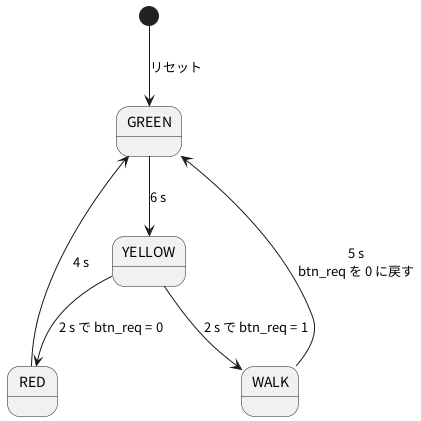

# 6-2 信号機 — 青・黄・赤と歩行者ボタン

> [!WARNING]
> **この題は実機で組んでいない。** Verilog は Verilator の lint を通し、PC のシミュレーションで 30 秒分を回した。
> Pico 2 への書き込みと、LED の点灯、AD3 での測定は確かめていない。
> 「見るべき値」はシミュレーションの値と計算値で、測った値ではない。

4-4 でブラウザの中に描いた信号機を、Pico 2 の Soft-FPGA で動かし、ブレッドボードの LED を光らせる。
Verilog は 6-1 の `traffic_fsm2` をそのまま使い、長さだけを秒に直す。

- 車の信号は LED 3 個 (青・黄・赤)。歩行者の灯は Pico 2 の基板の LED (GP25) に出す
- 歩行者ボタンは押しボタン 1 個。押すと、次の黄の後に赤でなく「歩行者の青」(WALK) に入る
- クロックは 5-7 のタイマ割り込みで **1 kHz (1 クロック = 1 ms)** に固定する。Soft-FPGA のクロックは
  固定しないと回路の規模で変わる (5-6) ので、秒で決めた長さが守られない

1 クロック 1 ms は、この大きさの回路の 1 クロックの計算 (5-5・5-6 で測る) より十分長いと見込んだ。
間に合うかは 5-9 の測り方で確かめる。

## 状態遷移図

6-1 と同じ。長さを秒にした。




| 状態 | 青 (GP15) | 黄 (GP14) | 赤 (GP16) | 歩行者 (GP25) | 長さ |
| --- | --- | --- | --- | --- | --- |
| GREEN | 1 | 0 | 0 | 0 | 6 s |
| YELLOW | 0 | 1 | 0 | 0 | 2 s |
| RED | 0 | 0 | 1 | 0 | 4 s |
| WALK | 0 | 0 | 1 | 1 | 5 s |

## 回路図

```circuit
title: 図2 GP15・GP14・GP16 から LED を光らせ、GP0 で押しボタンを読む
parts:
  U1: pico2 4,6 mirror
  GRN: port 6.5,9.8
  YEL: port 6.5,9.4
  BTN: port 6.5,2.2
  RED: port 1.5,9.8
  G0: ground 1.5,3.4
  GRN: port 8.5,3
  D1: led 8.5,3 8.5,5 green
  R1: resistor 8.5,5 8.5,7 330
  G1: ground 8.5,7
  YEL: port 11,3
  D2: led 11,3 11,5 yellow
  R2: resistor 11,5 11,7 330
  G2: ground 11,7
  RED: port 13.5,3
  D3: led 13.5,3 13.5,5 red
  R3: resistor 13.5,5 13.5,7 330
  G3: ground 13.5,7
  BTN: port 16,3
  SW1: button 16,4 16,6 l=$\mathrm{SW1}$
  G4: ground 16,6
  AD:
    type: device
    at: 19.5,9
    label: AD3
    pins: [DIO0, DIO1, DIO2, DIO3, GND]
  GRN: port 18,8.17
  YEL: port 18,8.58
  RED: port 18,9
  BTN: port 18,9.42
  G5: ground 18,10.4
wires:
  - U1.GP15 |- 6.5,9.8
  - U1.GP14 |- 6.5,9.4
  - U1.GP0 |- 6.5,2.2
  - U1.GP16 |- 1.5,9.8
  - U1.GND38 |- 1.5,3 -- 1.5,3.4
  - 16,3 -- 16,4
  - AD.DIO0 |- 18,8.17
  - AD.DIO1 |- 18,8.58
  - AD.DIO2 |- 18,9
  - AD.DIO3 |- 18,9.42
  - AD.GND |- 18,9.83 -- 18,10.4
style:
  pitch: 1.2
  grid: on
```


- 線で結ぶ代わりに、**同じ名前の端子 (白丸と名前) どうしがつながっている**。U1 の GP15 から出た `GRN` は、D1 の上の `GRN` と AD3 の DIO0 の `GRN` につながる
- LED は GPIO が 1 (3.3 V) のとき光る。330 Ω (オーム) は LED のカソードと GND の間に置いた
- 押しボタンは GP0 と GND の間。GP0 は Pico 2 の中でプルアップする (外に抵抗を付けない)。離すと 1、押すと 0。
  プルダウンにしないのは、RP2350 のプルダウンには不具合 (正誤表 E9) があるため。Soft-FPGA-TD4 も DIP スイッチをプルアップで読む
- AD3 は DIO0〜DIO3 で 4 本を読むだけ。何も出さない

## 部品表

| 部品 | 値・型番 | 数 | 役 |
| --- | --- | --- | --- |
| U1 | Raspberry Pi Pico 2 | 1 | Soft-FPGA を動かす。USB から給電 |
| D1 | 5 mm LED 緑 | 1 | 車の青 |
| D2 | 5 mm LED 黄 | 1 | 車の黄 |
| D3 | 5 mm LED 赤 | 1 | 車の赤 |
| R1〜R3 | 330 Ω (E24)、1/4 W | 3 | LED の電流を決める |
| SW1 | タクトスイッチ (4 ピン) | 1 | 歩行者ボタン |
| — | ブレッドボード (full、63 列) | 1 | |
| — | ジャンパ線 | 約 15 本 | |
| AD | Analog Discovery 3 | 1 | Logic で 4 本を測る |

電源は教科書の既定の 5 V ではなく **3.3 V** (Pico 2 の GPIO)。Pico 2 のピンに 5 V を入れると壊れるため (0-3)。
LED の電流は (3.3 V − 2.0 V) ÷ 330 Ω ≈ 4 mA (見積り。LED の順電圧を 2.0 V と置いた)。

## 実体配線図

```bread
title: 図3 Pico 2 に LED 3 個と押しボタンを付け、AD3 の Logic で 4 本を測る
board: full
parts:
  MCU: pico2 @ h5
  SW1: button @ e1
  D1: led f30(A) f32(K) green
  R1: resistor j32 -b32 330
  D2: led f36(A) f38(K) yellow
  R2: resistor j38 -b38 330
  D3: led g42(A) g44(K) red
  R3: resistor j44 -b44 330
  AD:
    type: device
    at: bottom
    label: AD3 Logic
    pins: [DIO3, DIO0, DIO1, DIO2, GND]
wires:
  - a7 -- -t7 black
  - a1 -- -t1 black
  - -t63 -- -b63 black
  - i5 -- i3 blue
  - i24 -- i30 white
  - j23 -- j26 orange
  - h26 -- h36 orange
  - b24 -- b42 gray
  - e42 -- f42 gray
  - AD.DIO3 -- j3 purple
  - AD.DIO0 -- j30 green
  - AD.DIO1 -- j36 green
  - AD.DIO2 -- j42 green
  - AD.GND -- -b50 black
```


- Pico 2 は USB を左に向けて `@ h5` に挿す (0-4 と同じ)。下の列 (h 行) の 19 番 GP14 は 23 列、20 番 GP15 は 24 列。上の列 (c 行) の 21 番 GP16 は 24 列、38 番 GND は 7 列
- 青 (D1) は GP15 から白の線で 30 列へ。黄 (D2) は GP14 から橙の線 2 本 (j 行で 26 列へ、h 行で 36 列へ) で運ぶ。赤 (D3) は GP16 から灰の線で上の列の 42 列へ運び、溝をまたぐ短い灰の線で下の列へ下ろす
- LED は長いほう (アノード) を左にして f 行・g 行に挿し、カソードの列から 330 Ω を下の − レール (GND) へ立てる
- 押しボタン (SW1) は左端で溝をまたぐ。下の側 (3 列) に GP0 から青の線、上の側 (1 列) から上の − レールへ黒の線。ボタンは押すと上と下がつながる
- GND は Pico 2 の 38 番 (7 列) から上の − レールへ。上と下の − レールは右端 (63 列) でつなぐ。赤の線は使わない (+ の電源をブレッドボードに配らない)
- AD3 の DIO は緑と紫、GND は黒。DIO0 は青の LED の 30 列、DIO1 は黄の 36 列、DIO2 は赤の 42 列、DIO3 はボタンの 3 列に、それぞれ j 行で挿す
- 電源は Pico 2 の USB。ブレッドボードを流れる電流は LED 3 個で 15 mA 以下 (見積り)、信号は 1 Hz 以下で、ブレッドボードの範囲に収まる

## Verilog

6-1 の `traffic_fsm2.v` をそのまま使い、Pico 2 に載せる最上位 `traffic_top.v` を足す。

```verilog
// Pico 2 に載せる最上位。クロックは 5-7 の方法で CLK_HZ に固定する。時間は秒で書く
module traffic_top #(
    parameter CLK_HZ = 1000
) (
    input        clk,
    input        rst,
    input        btn_n,     // 押しボタン。押すと 0 (Pico 2 の中のプルアップ)
    output       led_green,
    output       led_yellow,
    output       led_red,
    output       led_walk,
    output [1:0] o_state    // 試験で見る。ピンには出さない
);
    traffic_fsm2 #(
        .W          (16),
        .GREEN_TIME (6 * CLK_HZ),
        .YELLOW_TIME(2 * CLK_HZ),
        .RED_TIME   (4 * CLK_HZ),
        .WALK_TIME  (5 * CLK_HZ)
    ) u_fsm (
        .clk   (clk),
        .rst   (rst),
        .btn   (~btn_n),
        .red   (led_red),
        .yellow(led_yellow),
        .green (led_green),
        .walk  (led_walk),
        .state (o_state)
    );
endmodule
```

- 長さは「秒 × `CLK_HZ`」のクロック数。1 kHz で GREEN は 6000 クロック。`timer` の幅 `W` を 16 にした (65 535 クロック = 65 s まで入る)
- ボタンは押すと 0 なので、`~btn_n` で 1 にして渡す
- 歩行者ボタンはチャタリング (押した瞬間の数 ms の暴れ。6-3) を取っていない。`btn_req` は 1 にするだけの記憶なので、何回跳ねても結果は同じ

Verilator の lint は警告なしで通る (`verilator --lint-only -Wall --top-module traffic_top traffic_top.v traffic_fsm2.v`、確かめた)。

### Pico 2 のピンの割り当て

Pico 2 のプログラムの組み方 (主ループの 3 手と、タイマ割り込みで固定したクロック) は 5-3 と 5-7。
動く手本は [Soft-FPGA-TD4](https://github.com/tommie-jp/Soft-FPGA-TD4) の `verilator-TD4/main.cpp` で、
DIP スイッチ (入力) と LED (出力) を GPIO につなぐ所をこの表に替える。

| Verilog | Pico 2 | 向き | 設定 |
| --- | --- | --- | --- |
| `clk` | (ピンなし) | — | 1 ms ごとのタイマ割り込みで 0 → 1 と変えて評価する (5-7) |
| `rst` | (ピンなし) | — | 起動して最初の 1 クロックだけ 1 |
| `btn_n` | GP0 | 入力 | 中のプルアップを有効に |
| `led_green` | GP15 | 出力 | |
| `led_yellow` | GP14 | 出力 | |
| `led_red` | GP16 | 出力 | |
| `led_walk` | GP25 | 出力 | Pico 2 の基板の LED |
| `o_state` | (ピンなし) | — | 使わない |

## 動かす — PC のシミュレーション

`CLK_HZ` を 1000 にして 30 秒分 (3 万クロック) を回す。1.0 s から 0.2 s だけボタンを押す。

```verilog
// CLK_HZ = 1000 (1 クロック = 1 ms) で 30 s 回す。1.0 s から 0.2 s だけボタンを押す
module tb_top;
    reg clk;
    reg rst;
    reg btn_n;
    wire g, y, r, w;
    wire [1:0] st;

    traffic_top #(.CLK_HZ(1000)) dut (
        .clk(clk), .rst(rst), .btn_n(btn_n),
        .led_green(g), .led_yellow(y), .led_red(r), .led_walk(w), .o_state(st));

    integer ms;
    reg [3:0] last;
    initial begin
        clk = 1'b0; rst = 1'b1; btn_n = 1'b1;
        #1 clk = 1'b1; #1 clk = 1'b0;
        rst = 1'b0;
        last = 4'bxxxx;
        for (ms = 0; ms < 30000; ms = ms + 1) begin
            btn_n = !(ms >= 1000 && ms < 1200);
            #0.5;
            if ({g, y, r, w} !== last)
                $display("%6.3f s  green=%b yellow=%b red=%b walk=%b", ms / 1000.0, g, y, r, w);
            last = {g, y, r, w};
            #0.5 clk = 1'b1; #1 clk = 1'b0;
        end
        $finish;
    end
endmodule
```

```bash
verilator --binary --timing --top-module tb_top tb_top.v traffic_top.v traffic_fsm2.v
./obj_dir/Vtb_top
```

```text
 0.000 s  green=1 yellow=0 red=0 walk=0
 6.000 s  green=0 yellow=1 red=0 walk=0
 8.000 s  green=0 yellow=0 red=1 walk=1
13.000 s  green=1 yellow=0 red=0 walk=0
19.000 s  green=0 yellow=1 red=0 walk=0
21.000 s  green=0 yellow=0 red=1 walk=0
25.000 s  green=1 yellow=0 red=0 walk=0
```

1 周目はボタンを押したので、黄の後が赤と歩行者 (8〜13 s)。2 周目は押していないので、黄の後が赤だけ (21〜25 s)。
時刻はリセットの直後を 0 s とした (Verilator 5.042 で実行)。

## 計器の設定

| 計器 | 設定 |
| --- | --- |
| Logic | DIO0 (青)・DIO1 (黄)・DIO2 (赤)・DIO3 (ボタン) を Enable。DIO は 3.3 V。GND を共通にする (0-4) |
| 時間軸 | 3 s/div (10 目盛で 30 s)。標本化 1 kS/s (30 s で 3 万標本。AD3 の 1 本 32 768 標本に入る) |
| トリガ | DIO3 (ボタン) の立ち下がり。トリガの前を 1 s 見せる |

一番速い変化は、ボタンを押していた 0.2 s。1 kS/s はその 200 倍で、Logic の標本化の目安 (一番速い変化の 4 倍以上) を満たす。

## Logic に見えるはずの画面

シミュレーションの時刻をそのまま写した。ボタンは 1.0 s から 0.2 s だけ押したとした。
ボタンの跳ね (チャタリング) は描いていない (6-3 で見る)。

```logic
title: 図4 ボタンを押すと、黄の後の赤が 5 s (歩行者)、押さなければ 4 s
device: ad3
time: 3s/div
start: -1s
sample: 1kHz
signals:
  BTN: dio3 edges 0s=1 1s=0 1.2s=1
  GREEN: dio0 edges 0s=1 6s=0 13s=1 19s=0 25s=1
  YELLOW: dio1 edges 0s=0 6s=1 8s=0 19s=1 21s=0
  RED: dio2 edges 0s=0 8s=1 13s=0 21s=1 25s=0
cursors: [10.5s, 23s]
trigger: BTN falling at 1s
```


- X1 (10.5 s) は 1 周目の WALK の中。RED が 1 (歩行者の灯は GP25 なので Logic には出ない)
- X2 (23 s) は 2 周目の RED の中。どちらも RED は 1 だが、続く長さが違う (8〜13 s の 5 s と、21〜25 s の 4 s)
- GREEN は 6 s、YELLOW は 2 s。変わり目の時刻は Logic の画面で読める

## 見るべき値

シミュレーションの値。実機では測っていない。Logic で変わり目の時刻を読み、この表に書き加える。

| 見る所 | シミュレーション | 実機 (測って書く) |
| --- | --- | --- |
| GREEN の長さ | 6.000 s (6000 クロック) | |
| YELLOW の長さ | 2.000 s | |
| ボタンを押した後の RED (WALK) の長さ | 5.000 s | |
| ボタンを押さないときの RED の長さ | 4.000 s | |
| ボタンを押してから WALK に入るまで | 7.0 s (押した時刻による。GREEN の残り + YELLOW の 2 s) | |
| LED 1 個の電流 | 約 4 mA (見積り) | |

実機の長さは、5-7 で固定したクロックの正確さで決まる。1 クロックが 1.000 ms からずれれば、6 s も同じ割合でずれる。

## 出典

自作。信号機の状態機械は [tommie-jp/soft-fpga](https://github.com/tommie-jp/soft-fpga) の `examples/02-traffic-fsm` (4-4) と 6-1。
Pico 2 で Verilog を動かす形は [tommie-jp/Soft-FPGA-TD4](https://github.com/tommie-jp/Soft-FPGA-TD4) の `verilator-TD4/main.cpp`。
RP2350 のプルダウンの不具合 (E9) は Raspberry Pi の RP2350 のデータシートの正誤表と、Soft-FPGA-TD4 の `etc/10-E9-internal-pull-down-registor.pdf`。
