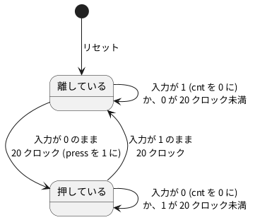

# 6-3 押しボタンのチャタリングを取る

> [!WARNING]
> **この題は実機で組んでいない。** Verilog は Verilator の lint を通し、PC のシミュレーションで
> 跳ねる押し方・跳ねない押し方・短いひげを入れて確かめた。Pico 2 への書き込みと、AD3 での測定はしていない。
> 図4のボタンの跳ねは**例として置いた形**で、測った波形ではない。

押しボタンの接点は、押した瞬間に何度か付いたり離れたりする。これをチャタリング (跳ね) と呼ぶ。
跳ねている間に入力を読むと、1 回押しただけで何回も押したように見える。

この題では、ボタンの値が **同じまま 20 ms 続いたら採る** 回路を Verilog で書き、跳ねを取る前と後を LED で比べる。

- D1 (緑): 生の入力が 1 → 0 に変わるたびに点けたり消したりする。跳ねると 2 回、3 回と変わり、押したのに消えることがある
- D2 (黄): 跳ねを取ってから、押すたびに点けたり消したりする。1 回押せば必ず 1 回だけ変わる
- D3 (赤): 跳ねを取った値。押している間だけ点く。押してから点くまでに 20 ms ほど遅れる

ブレッドボードは 6-2 と同じ物を使う (LED の役だけ替える)。クロックは 6-2 と同じく、5-7 の方法で **1 kHz** に固定する。
20 ms は 20 クロック。

## 状態遷移図

跳ねを取る回路は、「今採っている値」(`clean_n`) と、「違う値が何クロック続いたか」(`cnt`) を持つ小さな状態機械。




- 状態は `clean_n` の 1 ビット (1 = 離している、0 = 押している)。`cnt` は状態に付いたデータで、6-1 の `timer` と同じ役
- 入力が今の状態と同じ値に戻ったら、`cnt` を 0 から数え直す。跳ねている間は 20 まで届かない
- 押している状態へ移るクロックで、`press` を 1 クロックだけ 1 にする

## 回路図

```circuit
title: 図1 GP0 で押しボタンを読み、GP15・GP14・GP16 の LED で結果を見せる
parts:
  U1: pico2 4,6 mirror
  RAW: port 6.5,9.8
  CLN: port 6.5,9.4
  BTN: port 6.5,2.2
  HLD: port 1.5,9.8
  G0: ground 1.5,3.4
  RAW: port 8.5,3
  D1: led 8.5,3 8.5,5 green
  R1: resistor 8.5,5 8.5,7 330
  G1: ground 8.5,7
  CLN: port 11,3
  D2: led 11,3 11,5 yellow
  R2: resistor 11,5 11,7 330
  G2: ground 11,7
  HLD: port 13.5,3
  D3: led 13.5,3 13.5,5 red
  R3: resistor 13.5,5 13.5,7 330
  G3: ground 13.5,7
  BTN: port 16,3
  SW1: button 16,4 16,6 l=$\mathrm{SW1}$
  G4: ground 16,6
  AD:
    type: device
    at: 19.5,9
    label: AD3
    pins: [DIO0, DIO1, DIO2, DIO3, GND]
  RAW: port 18,8.17
  CLN: port 18,8.58
  HLD: port 18,9
  BTN: port 18,9.42
  G5: ground 18,10.4
wires:
  - U1.GP15 |- 6.5,9.8
  - U1.GP14 |- 6.5,9.4
  - U1.GP0 |- 6.5,2.2
  - U1.GP16 |- 1.5,9.8
  - U1.GND38 |- 1.5,3 -- 1.5,3.4
  - 16,3 -- 16,4
  - AD.DIO0 |- 18,8.17
  - AD.DIO1 |- 18,8.58
  - AD.DIO2 |- 18,9
  - AD.DIO3 |- 18,9.42
  - AD.GND |- 18,9.83 -- 18,10.4
style:
  pitch: 1.2
  grid: on
```


- 回路は 6-2 と同じ。線で結ぶ代わりに、同じ名前の端子どうしがつながっている
- `RAW` は D1 (生の入力で反転)、`CLN` は D2 (跳ねを取ってから反転)、`HLD` は D3 (跳ねを取った値)、`BTN` は押しボタン
- 押しボタンは GP0 と GND の間。GP0 は Pico 2 の中でプルアップする (6-2)。離すと 1、押すと 0
- AD3 は DIO3 でボタンの電圧 (跳ねる入力) を、DIO0〜DIO2 で 3 つの LED の信号を読む

## 部品表

6-2 と同じ。

| 部品 | 値・型番 | 数 | 役 |
| --- | --- | --- | --- |
| U1 | Raspberry Pi Pico 2 | 1 | Soft-FPGA を動かす。USB から給電 |
| D1〜D3 | 5 mm LED 緑・黄・赤 | 各 1 | 生の入力・跳ねを取った後・押している間 |
| R1〜R3 | 330 Ω (オーム)、E24、1/4 W | 3 | LED の電流を決める |
| SW1 | タクトスイッチ (4 ピン) | 1 | 跳ねを見るボタン |
| — | ブレッドボード (full、63 列) | 1 | |
| AD | Analog Discovery 3 | 1 | Logic で 4 本を測る |

電源は 3.3 V (Pico 2 の GPIO)。教科書の既定の 5 V から外すのは、Pico 2 のピンに 5 V を入れると壊れるため (0-3)。

## 実体配線図

```bread
title: 図2 6-2 と同じブレッドボード。AD3 の DIO3 でボタンの跳ねを見る
board: full
parts:
  MCU: pico2 @ h5
  SW1: button @ e1
  D1: led f30(A) f32(K) green
  R1: resistor j32 -b32 330
  D2: led f36(A) f38(K) yellow
  R2: resistor j38 -b38 330
  D3: led g42(A) g44(K) red
  R3: resistor j44 -b44 330
  AD:
    type: device
    at: bottom
    label: AD3 Logic
    pins: [DIO3, DIO0, DIO1, DIO2, GND]
wires:
  - a7 -- -t7 black
  - a1 -- -t1 black
  - -t63 -- -b63 black
  - i5 -- i3 blue
  - i24 -- i30 white
  - j23 -- j26 orange
  - h26 -- h36 orange
  - b24 -- b42 gray
  - e42 -- f42 gray
  - AD.DIO3 -- j3 purple
  - AD.DIO0 -- j30 green
  - AD.DIO1 -- j36 green
  - AD.DIO2 -- j42 green
  - AD.GND -- -b50 black
```


- 6-2 の図3と同じ配線。D1 (30 列) が GP15、D2 (36 列) が GP14、D3 (42 列) が GP16、ボタン (3 列) が GP0
- AD3 の DIO3 (紫) をボタンの 3 列に挿し、跳ねる入力をそのまま見る。DIO0〜DIO2 (緑) は 3 つの LED の列
- 電源は Pico 2 の USB。ブレッドボードを流れる電流は LED 3 個で 15 mA 以下 (見積り)

## Verilog

### debounce.v — 跳ねを取る

```verilog
// 押しボタン (押すと 0) を 2 段で受け、同じ値が N クロック続いたら採る。
// 押した瞬間に 1 クロックだけ press を 1 にする
module debounce #(
    parameter N = 20                 // 何クロック続いたら採るか (1 kHz なら 20 ms)
) (
    input      clk,
    input      rst,
    input      btn_n,
    output reg clean_n,              // チャタリングを取った値 (押すと 0)
    output     press
);
    localparam W = $clog2(N);
    localparam [W-1:0] LAST = N[W-1:0] - 1'b1;

    reg [1:0]   sync;                // クロックと関係なく変わる入力を 2 段で受ける
    reg [W-1:0] cnt;                 // clean_n と違う値が何クロック続いたか
    reg         clean_d;             // 1 クロック前の clean_n

    always @(posedge clk)
        if (rst) begin
            sync    <= 2'b11;
            cnt     <= {W{1'b0}};
            clean_n <= 1'b1;
        end else begin
            sync <= {sync[0], btn_n};
            if (sync[1] == clean_n)
                cnt <= {W{1'b0}};            // 同じ値に戻ったら数え直す
            else if (cnt == LAST) begin
                clean_n <= sync[1];          // N クロック続いたので採る
                cnt     <= {W{1'b0}};
            end else
                cnt <= cnt + 1'b1;
        end

    always @(posedge clk)
        if (rst) clean_d <= 1'b1;
        else     clean_d <= clean_n;

    assign press = clean_d & ~clean_n;       // 1 → 0 に変わったクロックだけ 1
endmodule
```

- `sync` の 2 段は、クロックと関係なく変わるボタンの信号を受ける所 (9-2)。2 段目の `sync[1]` だけを使う
- `cnt` は、`sync[1]` が `clean_n` と違うクロックの数。同じ値に戻ると 0 に戻る。`N` 回続いたら `clean_n` を替える
- `press` は `clean_n` が 1 から 0 に変わったクロックだけ 1。押し続けても 1 回しか出ない
- `N` は `parameter` なので、クロックが違っても「何 ms」で決められる (下の `debounce_top` で `CLK_HZ / 50`)

### debounce_top.v — Pico 2 に載せる最上位

```verilog
// 押すたびに LED を点けたり消したりする。D1 は生の入力で、D2 はチャタリングを取ってから
module debounce_top #(
    parameter CLK_HZ = 1000
) (
    input      clk,
    input      rst,
    input      btn_n,       // GP0。押すと 0
    output reg led_raw,     // GP15 (D1)。生の入力の立ち下がりごとに反転
    output reg led_clean,   // GP14 (D2)。press ごとに反転
    output     led_hold     // GP16 (D3)。チャタリングを取った値で、押している間 1
);
    wire clean_n;
    wire press;

    debounce #(.N(CLK_HZ / 50)) u_db (      // 1/50 s = 20 ms
        .clk(clk), .rst(rst), .btn_n(btn_n), .clean_n(clean_n), .press(press));

    // 生の入力も 2 段で受けてから立ち下がりを見る (段の数を D2 とそろえる)
    reg [2:0] raw;
    always @(posedge clk)
        if (rst) raw <= 3'b111;
        else     raw <= {raw[1:0], btn_n};
    wire raw_fall = raw[2] & ~raw[1];

    always @(posedge clk)
        if (rst) begin
            led_raw   <= 1'b0;
            led_clean <= 1'b0;
        end else begin
            if (raw_fall) led_raw   <= ~led_raw;
            if (press)    led_clean <= ~led_clean;
        end

    assign led_hold = ~clean_n;
endmodule
```

- D1 の側も 2 段で受けてから立ち下がりを見る。D2 との違いは「20 クロック続いたか」を見るかどうかだけ
- 12-4 の時計のボタン (`button.v`) は 10 ms ごとに 2 回読む別の書き方。どちらも「短い間の変化を採らない」点は同じ

Verilator の lint は 2 つとも警告なしで通る (`verilator --lint-only -Wall --top-module debounce_top debounce_top.v debounce.v`、確かめた)。

### Pico 2 のピンの割り当て

組み方は 6-2 と同じ (5-3・5-7、手本は Soft-FPGA-TD4 の `verilator-TD4/main.cpp`)。

| Verilog | Pico 2 | 向き | 設定 |
| --- | --- | --- | --- |
| `clk` | (ピンなし) | — | 1 ms ごとのタイマ割り込みで 0 → 1 と変えて評価する (5-7) |
| `rst` | (ピンなし) | — | 起動して最初の 1 クロックだけ 1 |
| `btn_n` | GP0 | 入力 | 中のプルアップを有効に |
| `led_raw` | GP15 | 出力 | D1 |
| `led_clean` | GP14 | 出力 | D2 |
| `led_hold` | GP16 | 出力 | D3 |

Soft-FPGA は 1 ms に 1 回しか GP0 を読まない。1 ms より短い跳ねは読まれないこともある。
D1 が何回反転するかは、跳ねの形と読む時刻の重なりで変わる。

## 動かす — PC のシミュレーション

クロックを 1 kHz (立ち上がりは 0.5 ms・1.5 ms・2.5 ms …) にして、次の 3 つを入れる。

1. 10 ms で押し、3.1 ms のあいだ跳ねる (10.8 ms で離れ、11.6 ms で付き、12.2 ms で離れ、13.1 ms から押したまま)。200 ms で離す
2. 400 ms で跳ねずに押し、600 ms で離す
3. 800 ms から 5 ms だけ L になるひげ (押したのではない短い乱れ)

```verilog
`timescale 1us / 100ns
// 1 kHz のクロックで、跳ねる押し方・きれいな押し方・5 ms のひげを入れる。
// 出力が変わった時刻を書き、press が 2 回 (跳ねる押し方ときれいな押し方) だけ出るかを確かめる
module tb_debounce;
    reg clk;
    reg rst;
    reg btn_n;
    wire led_raw, led_clean, led_hold;

    debounce_top #(.CLK_HZ(1000)) dut (
        .clk(clk), .rst(rst), .btn_n(btn_n),
        .led_raw(led_raw), .led_clean(led_clean), .led_hold(led_hold));

    // クロックの立ち上がりは 0.5 ms・1.5 ms・2.5 ms …
    initial begin
        clk = 1'b0;
        #500;
        forever begin clk = 1'b1; #500; clk = 1'b0; #500; end
    end

    integer presses = 0;
    always @(posedge clk) if (dut.press) presses = presses + 1;

    always @(led_raw or led_clean or led_hold)
        if (!rst) $display("%8.1f ms  raw=%b clean=%b hold=%b", $realtime / 1000.0, led_raw, led_clean, led_hold);

    initial begin
        rst = 1'b1; btn_n = 1'b1;
        #2000 rst = 1'b0;                                  // 2 ms でリセットを解く
        // 跳ねる押し方: 10 ms で押し、3.1 ms のあいだ跳ねる
        #8000  btn_n = 1'b0;   // 10.0 ms
        #800   btn_n = 1'b1;   // 10.8
        #800   btn_n = 1'b0;   // 11.6
        #600   btn_n = 1'b1;   // 12.2
        #900   btn_n = 1'b0;   // 13.1 (ここから押したまま)
        // 200 ms で離し、1.4 ms のあいだ跳ねる
        #186900 btn_n = 1'b1;  // 200.0
        #700   btn_n = 1'b0;   // 200.7
        #700   btn_n = 1'b1;   // 201.4
        // 跳ねない押し方: 400 ms で押し、600 ms で離す
        #198600 btn_n = 1'b0;  // 400.0
        #200000 btn_n = 1'b1;  // 600.0
        // 5 ms だけの L (ひげ): 800 ms
        #200000 btn_n = 1'b0;  // 800.0
        #5000   btn_n = 1'b1;  // 805.0
        #100000;
        $display("press %0d", presses);
        if (presses == 2) $display("PASS");
        else              $display("FAIL");
        $finish;
    end
endmodule
```

```bash
verilator --binary --timing --top-module tb_debounce tb_debounce.v debounce_top.v debounce.v
./obj_dir/Vtb_debounce
```

```text
    12.5 ms  raw=1 clean=0 hold=0
    15.5 ms  raw=0 clean=0 hold=0
    34.5 ms  raw=0 clean=0 hold=1
    35.5 ms  raw=0 clean=1 hold=1
   221.5 ms  raw=0 clean=1 hold=0
   402.5 ms  raw=1 clean=1 hold=0
   421.5 ms  raw=1 clean=1 hold=1
   422.5 ms  raw=1 clean=0 hold=1
   621.5 ms  raw=1 clean=0 hold=0
   802.5 ms  raw=0 clean=0 hold=0
press 2
PASS
```

`press` は 2 回で、跳ねる押し方とひげのどちらでも余計に出なかった (Verilator 5.042 で実行)。

- 跳ねる押し方: D1 (`raw`) は 12.5 ms で点き、15.5 ms で消えた。1 回押しただけで 2 回反転し、押す前と同じ消えた状態に戻った
- 同じ押し方で、D3 (`hold`) は 34.5 ms、D2 (`clean`) は 35.5 ms に 1 回だけ変わった。押した 10 ms から数えて 24.5 ms の遅れ
- 跳ねない押し方 (400 ms) では、D1 は 402.5 ms (2 段の受けの分)、D3 は 421.5 ms (さらに 20 クロック) に変わった
- 5 ms のひげ (800 ms) で D1 は反転したが、D2 と D3 は変わらなかった。20 ms より短い L は押したと見なさない

## 計器の設定

| 計器 | 設定 |
| --- | --- |
| Logic | DIO3 (ボタン)・DIO0 (D1)・DIO1 (D2)・DIO2 (D3) を Enable。DIO は 3.3 V。GND を共通にする (0-4) |
| 時間軸 | 5 ms/div (10 目盛で 50 ms)。標本化 500 kS/s (50 ms で 2 万 5 千標本。AD3 の 1 本 32 768 標本に入る) |
| トリガ | DIO3 の立ち下がり (押した最初の変わり目)。トリガの前を 5 ms 見せる |

跳ねは 1 回が数 µs (マイクロ秒) のこともある。500 kS/s は 2 µs ごとに読むので、それより短い跳ねは見落とす。
細かく見たいときは、時間軸を 500 µs/div に縮め、標本化を 5 MS/s に上げて、押した直後の 5 ms だけを見る。

## Logic に見えるはずの画面

ボタンの跳ねは、シミュレーションに入れた例の形 (押してから 3.1 ms、2 回離れる) をそのまま描いた。
実物の跳ねの回数と長さはボタンごとに違う。D1〜D3 の時刻は、この跳ねを入れたシミュレーションの値。

```logic
title: 図4 跳ねると D1 は 2 回反転して元に戻り、D2 は約 25 ms 後に 1 回だけ変わる (跳ねは例)
device: ad3
time: 5ms/div
start: 5ms
sample: 500kHz
signals:
  BTN: dio3 edges 0s=1 10ms=0 10.8ms=1 11.6ms=0 12.2ms=1 13.1ms=0
  D1: dio0 edges 0s=0 12.5ms=1 15.5ms=0
  D2: dio1 edges 0s=0 35.5ms=1
  D3: dio2 edges 0s=0 34.5ms=1
cursors: [14ms, 40ms]
trigger: BTN falling at 10ms
```


- X1 (14 ms) は跳ね終わった直後。D1 は 1 (12.5 ms で点いた) で、D2・D3 はまだ 0
- X2 (40 ms) では D1 は 0 に戻り (15.5 ms で消えた)、D2 と D3 が 1。押したのは 1 回なので、正しいのは D2
- 時刻は Pico 2 を 1 kHz で回したときの値。D3 の 34.5 ms は、押した 10 ms から 2 段の受け (2 ms) と、跳ねが止んでからの 20 クロックを足した所

## 見るべき値

シミュレーションの値。実機では測っていない。実機では、ボタンを 10 回押して D1 と D2 の反転の回数を数え、
Logic でボタンの跳ねの長さと D3 の遅れを読んで、表に書き加える。

| 見る所 | シミュレーション | 実機 (測って書く) |
| --- | --- | --- |
| 1 回押したときの D2 の反転 | 1 回 | |
| 1 回押したときの D1 の反転 | 跳ねた押し方で 2 回 (跳ね方による) | |
| 跳ねない押し方で、押してから D3 が点くまで | 21.5 ms (2 段の受け + 20 クロック。計算値は 21〜22 ms) | |
| 跳ねた押し方で、押してから D3 が点くまで | 24.5 ms (最後の跳ねから 21.4 ms) | |
| 5 ms のひげで D2・D3 が変わるか | 変わらない | |
| ボタンの跳ねの長さ (押してから最後の変わり目まで) | 3.1 ms (シミュレーションに入れた例) | |

21〜22 ms の幅は、ボタンを押す時刻とクロックの立ち上がりの重なりで 1 クロック分ずれるため。

## 出典

自作。跳ねを取る考え方は 12-4 の `button.v` と同じ。Pico 2 で Verilog を動かす形は
[tommie-jp/Soft-FPGA-TD4](https://github.com/tommie-jp/Soft-FPGA-TD4) の `verilator-TD4/main.cpp`。
