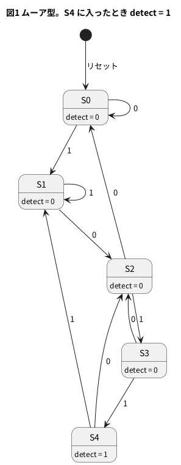
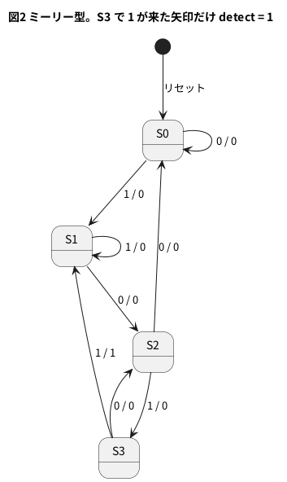

# 6-4 系列検出 — 1011 を見つける (ムーアとミーリー)

この題は実体配線図と Analog Discovery 3 の図を付けない。ブラウザの soft-fpga で動かす題で、組む物が無いから。

1 ビットずつ流れてくる信号から、「1011 という並びが来たこと」を見つける回路を作る。
通信の同期の合図 (プリアンブル) を探すときに使う、状態機械の定番の題である。

作り方は 6-1 と同じで、状態に「ここまでの並び」を覚えさせる。
新しいのは、出力の作り方を 2 通り書いて比べる所である。

| 型 | 出力を決めるもの | 出力が出るクロック |
| --- | --- | --- |
| ムーア型 | 今の状態だけ | 4 ビット目を取り込んだ次のクロック |
| ミーリー型 | 今の状態と今の入力 | 4 ビット目が来たそのクロック |

6-1 の信号機 (`traffic_fsm2`) は、灯が状態だけで決まるムーア型だった。
ミーリー型は、入力が変われば出力も同じクロックの中で変わる。その代わり、状態が 1 つ少なくて済む。

## 状態の意味

どちらの型も、状態は「直前の入力のうち、1011 の頭として使える所まで」を表す。
たとえば `10` の後に `1` が来れば `101`、`0` が来れば頭として使える物が無いので最初に戻る。

| 状態 | 意味 (直前の入力の末尾) | ムーア | ミーリー |
| --- | --- | --- | --- |
| S0 | 手がかりなし | あり | あり |
| S1 | `1` | あり | あり |
| S2 | `10` | あり | あり |
| S3 | `101` | あり | あり |
| S4 | `1011` (検出した) | あり | **無い** |

ミーリー型は S3 で `1` を見たその遷移に出力を付けるので、「検出した状態」を持たない。

## 状態遷移図

ムーア型。出力 `detect` は状態に付ける。




ミーリー型。出力は遷移の矢印に付ける (入力 / 出力の順)。




- 検出した直後の行き先が S0 でない所が要点である。`1011` の最後の `1` は、次の `1011` の頭にも使える。
  S0 に戻すと、`1011011` の 2 つ目を見落とす
- 図1の S4 → S1 は `10111` の末尾が `1` だから。S4 → S2 は `10110` の末尾が `10` だから。どちらも、次の検出の頭になる所まで覚えている

## Verilog

ムーア型。6-1 の 3 つの部分 (状態のレジスタ、次の状態の `case`、出力) に分けて書く。

```verilog
// 系列 1011 の検出 (ムーア型)。出力は状態だけで決まる。
// 最後の 1 は次の検出の最初の 1 に使い回す (重なりを許す)
module seq_moore (
    input        clk,
    input        rst,
    input        din,
    output       detect,
    output [2:0] state
);
    localparam [2:0] S0 = 3'd0,   // 手がかりなし
                     S1 = 3'd1,   // 直前が 1
                     S2 = 3'd2,   // 直前が 10
                     S3 = 3'd3,   // 直前が 101
                     S4 = 3'd4;   // 直前が 1011 (検出)

    reg [2:0] st;
    reg [2:0] next;

    always @(posedge clk)
        if (rst) st <= S0;
        else     st <= next;

    always @(*) begin
        next = st;
        case (st)
            S0:      next = din ? S1 : S0;
            S1:      next = din ? S1 : S2;
            S2:      next = din ? S3 : S0;
            S3:      next = din ? S4 : S2;
            S4:      next = din ? S1 : S2;
            default: next = S0;
        endcase
    end

    assign detect = (st == S4);
    assign state  = st;
endmodule
```

ミーリー型。出力の行が `st` だけでなく `din` も読む。

```verilog
// 系列 1011 の検出 (ミーリー型)。出力は状態と今の入力で決まる。
// 4 つ目のビットが来たそのクロックで detect が 1 になる
module seq_mealy (
    input        clk,
    input        rst,
    input        din,
    output       detect,
    output [1:0] state
);
    localparam [1:0] S0 = 2'd0,   // 手がかりなし
                     S1 = 2'd1,   // 直前が 1
                     S2 = 2'd2,   // 直前が 10
                     S3 = 2'd3;   // 直前が 101

    reg [1:0] st;
    reg [1:0] next;

    always @(posedge clk)
        if (rst) st <= S0;
        else     st <= next;

    always @(*) begin
        next = st;
        case (st)
            S0:      next = din ? S1 : S0;
            S1:      next = din ? S1 : S2;
            S2:      next = din ? S3 : S0;
            S3:      next = din ? S1 : S2;   // 1 なら 1011 の完成。最後の 1 を次の頭に使う
            default: next = S0;
        endcase
    end

    assign detect = (st == S3) && din;
    assign state  = st;
endmodule
```

- 次の状態の `case` は、ムーアとミーリーで同じ形である。違うのは最後の `assign detect` の 1 行だけ
- ミーリー型の `detect` は `din` から出力まで組み合わせ回路でつながる。`din` がクロックと関係なく変わる信号なら、
  `detect` にひげ (グリッチ) が出る。クロックと同期した信号を入れるか、`detect` をもう 1 段のフリップフロップで受けると、ムーア型と同じ 1 クロック遅れになる
- どちらも `next = st;` を最初に置いてラッチを避ける (6-1)

Verilator の lint は 2 つとも警告なしで通る (`verilator --lint-only -Wall seq_moore.v`、`seq_mealy.v`、確かめた)。

## 試験 — 基準と比べる

基準は、直前の 4 ビットをシフトレジスタに持ち、`1011` に等しいかを調べる式にする。でたらめな 10 万ビットを入れ、2 つの型と比べる。
期待する関係は次の 2 つ。

- ミーリー型の `detect` は、4 ビット目を入れたクロックの基準と同じ
- ムーア型の `detect` は、それを 1 クロック遅らせた物と同じ

```verilog
// ムーア型とミーリー型を、同じ入力 10 万ビットで、直前 4 ビットを見る基準と比べる
module tb_seq;
    reg clk;
    reg rst;
    reg din;
    wire moore, mealy;
    wire [2:0] ms;
    wire [1:0] ys;

    seq_moore u_moore (.clk(clk), .rst(rst), .din(din), .detect(moore), .state(ms));
    seq_mealy u_mealy (.clk(clk), .rst(rst), .din(din), .detect(mealy), .state(ys));

    initial clk = 1'b0;
    always #5 clk = ~clk;

    reg [3:0] hist;          // 直前 4 ビット (今の din が最下位)
    reg       ref_mealy;     // 基準: 今のクロックで 4 ビット目が来たか
    reg       ref_moore;     // 基準: 1 クロック遅らせたもの
    integer   cyc, bad_mealy, bad_moore, n_mealy, n_moore;

    initial begin
        rst = 1'b1; din = 1'b0; hist = 4'b0; ref_moore = 1'b0;
        cyc = 0; bad_mealy = 0; bad_moore = 0; n_mealy = 0; n_moore = 0;
        repeat (2) @(posedge clk);
        #1 rst = 1'b0;
        repeat (100000) begin
            din = ($random & 1) != 0;
            hist = {hist[2:0], din};
            ref_mealy = (hist == 4'b1011);
            #2;   // 組み合わせの出力が落ち着くのを待つ
            if (mealy !== ref_mealy) bad_mealy = bad_mealy + 1;
            if (moore !== ref_moore) bad_moore = bad_moore + 1;
            if (mealy) n_mealy = n_mealy + 1;
            if (moore) n_moore = n_moore + 1;
            @(posedge clk);
            #1;
            ref_moore = ref_mealy;
            cyc = cyc + 1;
        end
        $display("bits %0d, mealy detections %0d, moore detections %0d", cyc, n_mealy, n_moore);
        $display("mismatch vs reference: mealy %0d, moore %0d", bad_mealy, bad_moore);
        if (bad_mealy == 0 && bad_moore == 0) $display("PASS"); else $display("FAIL");
        $finish;
    end
endmodule
```

```bash
verilator --binary --timing --top-module tb_seq tb_seq.v seq_moore.v seq_mealy.v
./obj_dir/Vtb_seq
```

```text
bits 100000, mealy detections 6304, moore detections 6304
mismatch vs reference: mealy 0, moore 0
PASS
```

10 万ビットで基準と食い違ったクロックは、どちらの型も 0 だった (Verilator 5.042 で実行)。
検出は 6304 回で、10 万ビットの 1/16 (6250) に近い。重なった検出も数えている。

## ブラウザの soft-fpga で見る

4-3 の手順で、soft-fpga の `01-counter` の `counter.v` を次に差し替える。
出力の幅 8 ビットと `clk` `rst` `count` の名前を変えないので、ハーネスと画面はそのまま使える。
16 ビットの決まった列を 1 クロック 1 ビットずつ入れ、2 つの検出器の出力を `count` に並べる。

```verilog
// soft-fpga の 01-counter に差し替える用。ポートは元の counter と同じ (clk, rst, count[7:0])。
// 16 ビットの決まった列を 1 クロック 1 ビットずつ入れ、ムーア型とミーリー型の出力を count に並べる
module counter (
    input        clk,
    input        rst,
    output [7:0] count
);
    // 時間の順に 0,1,0,1,1,0,1,1,0,0,1,1,0,1,0,0 (最下位ビットが最初)
    localparam [15:0] PAT = 16'b0010_1100_1101_1010;

    reg  [3:0] phase;
    wire       din = PAT[phase];
    wire       moore;
    wire       mealy;
    wire [2:0] mstate;
    wire [1:0] ystate;

    always @(posedge clk)
        if (rst) phase <= 4'd0;
        else     phase <= phase + 4'd1;

    seq_moore u_moore (.clk(clk), .rst(rst), .din(din), .detect(moore), .state(mstate));
    seq_mealy u_mealy (.clk(clk), .rst(rst), .din(din), .detect(mealy), .state(ystate));

    // b0 = din, b1 = ミーリー, b2 = ムーア, b5:b3 = ムーアの状態, b7:b6 = ミーリーの状態
    assign count = {ystate, mstate, moore, mealy, din};
endmodule
```

- 入れる列 `PAT` は `0101 1011 0011 0100` (時間の順、左から右) で、`1011` を 2 回含む。1 回目と 2 回目は最後の `1` を共有している (`1011011`)
- 画面のレーンは、`b0` が入力 `din`、`b1` がミーリー、`b2` がムーア、`b5`〜`b3` がムーアの状態、`b7`〜`b6` がミーリーの状態
- `seq_moore.v` と `seq_mealy.v` は `verilog/` に一緒に置く。soft-fpga の `scripts/build-wasm.sh` の `verilator --cc` の行は
  `counter.v` しか指していないので、この 2 つも並べて書き足す (PC の CMake の `SOURCES` も同じ)

Verilator の lint は警告なしで通る (`verilator --lint-only -Wall --top-module counter counter.v seq_moore.v seq_mealy.v`、確かめた)。
PC のシミュレーションは、`examples/01-counter` を別の場所に写し、`CMakeLists.txt` の `SOURCES` に 2 つの `.v` を足して動かした。

```text
OK: 100 cycles, last count=219
```

219 は 2 進で `11 011 0 1 1`。100 クロック目 (16 クロックの 4 番目、図3の 4 ms と同じ位置) の値で、
`din` = 1、ミーリー = 1、ムーア = 0、ムーアの状態 = 3 (S3)、ミーリーの状態 = 3 (S3) と読める。
ブラウザ用のビルド (emsdk が要る) と画面の表示は、この題では確かめていない。

## シミュレーションの波形

`tb_counter.v` で `counter` を 24 クロック回し、クロックごとの値を書き出した。1 クロックを 1 ms と置いた仮の目盛で描く。

```logic
# ロジックアナライザの画面 (tommie-fence の logic フェンス)
title: 図3 ミーリーは 4 ビット目が来たクロックで 1、ムーアは 1 クロック遅れて 1 (重なった 2 回目も見つける)
device: generic
window: 24ms
signals:
  CLK: clock 1kHz
  DIN: edges 0s=0 1ms=1 2ms=0 3ms=1 5ms=0 6ms=1 8ms=0 10ms=1 12ms=0 13ms=1 14ms=0 17ms=1 18ms=0 19ms=1 21ms=0 22ms=1
  MEALY: edges 0s=0 4ms=1 5ms=0 7ms=1 8ms=0 20ms=1 21ms=0 23ms=1
  MOORE: edges 0s=0 5ms=1 6ms=0 8ms=1 9ms=0 21ms=1 22ms=0
  Q2: edges 0s=0 5ms=1 6ms=0 8ms=1 9ms=0 21ms=1 22ms=0
  Q1: edges 0s=0 3ms=1 5ms=0 6ms=1 8ms=0 9ms=1 10ms=0 13ms=1 16ms=0 19ms=1 21ms=0 22ms=1
  Q0: edges 0s=0 2ms=1 3ms=0 4ms=1 5ms=0 7ms=1 8ms=0 11ms=1 13ms=0 14ms=1 15ms=0 18ms=1 19ms=0 20ms=1 21ms=0 23ms=1
buses:
  Moore_state: Q2 Q1 Q0 dec
cursors: [4.5ms, 5.5ms]
trigger: CLK rising at 0s
```


- X1 (4.5 ms) は 4 ビット目 (`1011` の最後の `1`) を入れたクロック。`MEALY` が 1 で、ムーアの状態は S3 (3)。`MOORE` はまだ 0
- X2 (5.5 ms) は 1 クロック後。ムーアが S4 (4) に入って `MOORE` が 1 になった。ΔX = 1 ms (= 1 クロック)
- 7 ms は 2 回目で、1 回目の最後の `1` (4 ms) を頭に使っている。ムーアは 5 ms の S4 から `0` で S2 (6 ms)、`1` で S3 (7 ms)、`1` で S4 (8 ms) と進む。
  ミーリーは 7 ms の S3 で `1` を見て、その場で 1 になる

## 見るべき値

PC の Verilator (5.042) で実際に動かして得た値。

| 見る所 | 値 |
| --- | --- |
| lint (`-Wall`) | 3 つとも警告 0 件 |
| 10 万ビットの試験 | ミーリー・ムーアとも基準と食い違い 0 回。検出は 6304 回ずつ |
| ミーリーの検出のクロック (図3) | 4・7・20・23 ms (4 ビット目を入れたクロック) |
| ムーアの検出のクロック (図3) | 5・8・21 ms (ミーリーの 1 クロック後) |
| 状態の数 | ムーア 5、ミーリー 4 (状態レジスタは 3 ビットと 2 ビット) |
| soft-fpga の PC シミュレーション (100 クロック後) | `last count=219` |

## シミュレーションでの確かめ (対象外を含む)

Verilator 5.042 と Icarus Verilog 12.0 で、本文の `seq_moore.v`・`seq_mealy.v`・試験 `tb_seq`・soft-fpga 用の `counter.v` を抜き出して走らせ直した。
原本は `sim/04-sequence-detector-moore.v`・`-mealy.v`・`-tb.v`・`-counter.v`。
`counter.v` の 24 クロックの波形と 100 クロック後の値は、本文に試験が無いので、説明どおりに書いた
`sim/04-sequence-detector-counter-tb.v` で読んだ (リセットを 1 クロック掛けてから回す)。

| 項目 | 本文の数字 | 実行結果 | 判定 |
| --- | --- | --- | --- |
| lint (`-Wall`) | 3 つとも警告なし | 警告 0 件 (`seq_moore`・`seq_mealy`・`counter`) | 合った |
| 10 万ビットの試験 | 検出 6304 回ずつ、基準との食い違い 0、`PASS` | 6304 回ずつ、0、`PASS` | 合った |
| ミーリーの検出のクロック (24 クロック) | 4・7・20・23 | 4・7・20・23 | 合った |
| ムーアの検出のクロック | 5・8・21 (ミーリーの 1 クロック後) | 5・8・21 | 合った |
| 状態の数 | ムーア 5、ミーリー 4 | `seq_moore` は S0〜S4、`seq_mealy` は S0〜S3 | 合った |
| 100 クロック後の `count` | 219 (`din`=1、ミーリー 1、ムーア 0、ムーア S3、ミーリー S3) | 219 と、各ビットの読みも同じ | 合った |

確かめられなかったもの。

- ブラウザの soft-fpga での表示 (emsdk と soft-fpga のハーネスが要る)。本文もここは確かめていないと書いてある
- soft-fpga の PC シミュレーションの `OK: 100 cycles` の行そのもの (ハーネスが手元に無い)。値は上の試験で確かめた

## 出典

自作。ムーア型とミーリー型の区別と、系列検出器を重なりを許して作る形は、ディジタル回路の教科書の定番の題である。
波形のもとは `tb_counter.v` の出力。差し替え先は [tommie-jp/soft-fpga](https://github.com/tommie-jp/soft-fpga) の `examples/01-counter`。
