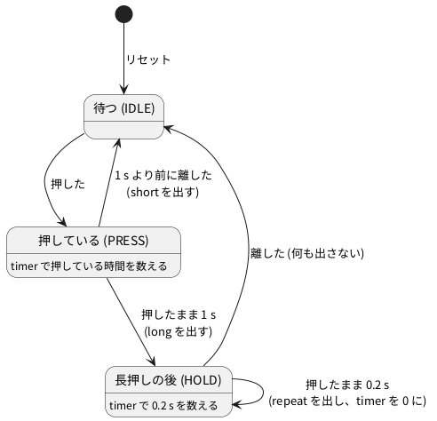

# 6-6 時間を持つ状態機械 — 長押しと短押し

> [!WARNING]
> **この題は実機で組んでいない。** Verilog は Verilator の lint を通し、PC のシミュレーションで
> 短押し (300 ms)・長押し (2.5 s)・押すときと離すときの跳ね (チャタリング)・1 秒の境の前後・短いひげを入れて確かめた。
> Pico 2 用の `.uf2` はビルドまで確かめたが、書き込んで動かしてはいない。AD3 での測定もしていない。
> 「見るべき値」の時刻はシミュレーションの値と設計値で、測った値ではない。

押しボタン 1 つでも、**押していた長さ**で別の働きを持たせられる。電子レンジや時計の設定ボタンでよく見る形で、
ちょんと押せば 1 つ進み、押し続けると速く進む。

この題では、ボタンを押している時間を数える状態機械を書き、3 つの出来事を見分ける。

| 出来事 | いつ出るか | 見せる LED |
| --- | --- | --- |
| `short` (短押し) | 1 秒より前に離したとき、離した所で 1 回 | D1 (緑) |
| `long` (長押し) | 押したまま 1 秒に達したとき、1 回 | D2 (黄) |
| `repeat` (繰り返し) | 長押しの後も押し続ける間、0.2 秒ごと | D3 (赤) |

- ボタンの信号は、6-3 のチャタリング取り (`debounce`) を通してから状態機械に渡す。跳ねで短押しが何回も出ないようにするため
- 1 秒と 0.2 秒は `parameter` の `LONG_MS = 1000` と `REPEAT_MS = 200` で決める。クロックが変わっても ms で書ける
- 3 つの出来事は、どれも 1 クロック (1 ms) だけ 1 になるパルス。1 ms では LED が光っても目に見えないので、
  LED には 100 ms に伸ばして出す (`pulse_stretch`)
- ブレッドボードは 6-2・6-3 と同じ物を使う (LED の役だけ替える)。クロックは 5-7 の方法で **1 kHz** に固定する。1 秒は 1000 クロック

6-1 の信号機は「時間が尽きたら次へ」だけで動いた。この題の状態機械は、**入力 (ボタン) と時間の両方**で行き先が決まる。
押している間に時間を数え、離した時刻が 1 秒より前か後かで出す物を変える。

この形は 6-7 (99 秒タイマー) の時間の設定でそのまま使う。短押しで 1 秒足し、押し続ければ 0.2 秒ごとに足して速く進める。
12-4 の時計の時刻合わせ (今は押すたびに 1 進むだけ) も、同じ形に替えれば長押しで速く進められる。

## 状態遷移図




| 状態 | 意味 | `timer` | 出口 |
| --- | --- | --- | --- |
| IDLE | ボタンを離している | 0 のまま | 押したら PRESS |
| PRESS | 押してから 1 s まで | 入ってからのクロック数 | 離したら IDLE (`short`)。1000 クロック続いたら HOLD (`long`) |
| HOLD | 1 s を過ぎても押している | 前の `long` か `repeat` からのクロック数 | 200 クロックごとに `repeat` して数え直す。離したら IDLE |

- 「押した」「離した」は、6-3 の `debounce` を通した値 (`pressed`) で見る。押してから `pressed` が 1 になるまで約 21.5 ms 遅れる (6-3)
- 長押しの後で離したときは何も出さない。長押しのつもりで押した人に、離した所で短押しまで出すと、2 回数えてしまう
- `timer` は 6-1 の信号機と同じく、状態に付いたデータ。違うのは、HOLD の中で `repeat` を出すたびに 0 に戻すこと

## 回路図

回路は 6-2・6-3 と同じ。LED の役だけを替えた。

```circuit
title: 図1 GP0 で押しボタンを読み、短押し・長押し・繰り返しを GP15・GP14・GP16 の LED で見せる
parts:
  U1: pico2 4,6 mirror
  SHT: port 6.5,9.8
  LNG: port 6.5,9.4
  BTN: port 6.5,2.2
  RPT: port 1.5,9.8
  G0: ground 1.5,3.4
  SHT: port 8.5,3
  D1: led 8.5,3 8.5,5 green
  R1: resistor 8.5,5 8.5,7 330
  G1: ground 8.5,7
  LNG: port 11,3
  D2: led 11,3 11,5 yellow
  R2: resistor 11,5 11,7 330
  G2: ground 11,7
  RPT: port 13.5,3
  D3: led 13.5,3 13.5,5 red
  R3: resistor 13.5,5 13.5,7 330
  G3: ground 13.5,7
  BTN: port 16,3
  SW1: button 16,4 16,6 l=$\mathrm{SW1}$
  G4: ground 16,6
  AD:
    type: device
    at: 19.5,9
    label: AD3
    pins: [DIO0, DIO1, DIO2, DIO3, GND]
  SHT: port 18,8.17
  LNG: port 18,8.58
  RPT: port 18,9
  BTN: port 18,9.42
  G5: ground 18,10.4
wires:
  - U1.GP15 |- 6.5,9.8
  - U1.GP14 |- 6.5,9.4
  - U1.GP0 |- 6.5,2.2
  - U1.GP16 |- 1.5,9.8
  - U1.GND38 |- 1.5,3 -- 1.5,3.4
  - 16,3 -- 16,4
  - AD.DIO0 |- 18,8.17
  - AD.DIO1 |- 18,8.58
  - AD.DIO2 |- 18,9
  - AD.DIO3 |- 18,9.42
  - AD.GND |- 18,9.83 -- 18,10.4
style:
  pitch: 1.2
  grid: on
```


- 線で結ぶ代わりに、同じ名前の端子どうしがつながっている
- `SHT` は D1 (短押し)、`LNG` は D2 (長押し)、`RPT` は D3 (繰り返し)、`BTN` は押しボタン
- 押しボタンは GP0 と GND の間。GP0 は Pico 2 の中でプルアップする (6-2)。離すと 1、押すと 0
- AD3 は DIO3 でボタンの電圧を、DIO0〜DIO2 で 3 つの LED の信号を読む。LED の信号は 100 ms に伸ばした後の物で、
  立ち上がりの時刻が出来事の時刻 (1 ms のパルスそのものは Pico 2 の中にあり、ピンには出さない)

## 部品表

6-2・6-3 と同じ。

| 部品 | 値・型番 | 数 | 役 |
| --- | --- | --- | --- |
| U1 | Raspberry Pi Pico 2 | 1 | Soft-FPGA を動かす。USB から給電 |
| D1〜D3 | 5 mm LED 緑・黄・赤 | 各 1 | 短押し・長押し・繰り返し |
| R1〜R3 | 330 Ω (オーム)、E24、1/4 W | 3 | LED の電流を決める |
| SW1 | タクトスイッチ (4 ピン) | 1 | 押す長さを変えて押すボタン |
| — | ブレッドボード (full、63 列) | 1 | |
| — | ジャンパ線 | 約 15 本 | |
| AD | Analog Discovery 3 | 1 | Logic で 4 本を測る |

電源は 3.3 V (Pico 2 の GPIO)。教科書の既定の 5 V から外すのは、Pico 2 のピンに 5 V を入れると壊れるため (0-3)。

LED の抵抗は 3.3 V で決めた。LED の順電圧を 2.0 V、流したい電流を 4 mA ほどと置くと、
(3.3 V − 2.0 V) ÷ 4 mA = 325 Ω。E24 で一番近い 330 Ω にして、電流は (3.3 − 2.0) ÷ 330 ≈ 3.9 mA (計算値)。
LED は 1 個ずつ 100 ms しか点かず、3 個が同時に点くことは無いので、GPIO 1 本あたりも合計も 4 mA ほどに収まる。

## 実体配線図

```bread
title: 図2 6-3 と同じブレッドボード。D1・D2・D3 が短押し・長押し・繰り返し
board: full
parts:
  MCU: pico2 @ h5
  SW1: button @ e1
  D1: led f30(A) f32(K) green
  R1: resistor j32 -b32 330
  D2: led f36(A) f38(K) yellow
  R2: resistor j38 -b38 330
  D3: led g42(A) g44(K) red
  R3: resistor j44 -b44 330
  AD:
    type: device
    at: bottom
    label: AD3 Logic
    pins: [DIO3, DIO0, DIO1, DIO2, GND]
wires:
  - a7 -- -t7 black
  - a1 -- -t1 black
  - -t63 -- -b63 black
  - i5 -- i3 blue
  - i24 -- i30 white
  - j23 -- j26 orange
  - h26 -- h36 orange
  - b24 -- b42 gray
  - e42 -- f42 gray
  - AD.DIO3 -- j3 purple
  - AD.DIO0 -- j30 green
  - AD.DIO1 -- j36 green
  - AD.DIO2 -- j42 green
  - AD.GND -- -b50 black
```


- 6-2 の図3と同じ配線。D1 (30 列) が GP15、D2 (36 列) が GP14、D3 (42 列) が GP16、ボタン (3 列) が GP0
- GND は Pico 2 の 38 番 (7 列) から上の − レールへ。上と下の − レールは右端 (63 列) でつなぐ。
  正の電源はブレッドボードに配らないので、赤の線は無い
- AD3 の DIO3 (紫) はボタンの 3 列、DIO0〜DIO2 (緑) は 3 つの LED の列に j 行で挿す
- 電源は Pico 2 の USB。ブレッドボードを流れる電流は LED 1 個分の 4 mA ほど (計算値)、信号は 10 Hz 以下 (一番速いのは 0.2 秒ごとの繰り返し) で、ブレッドボードの範囲に収まる

## Verilog

ファイルは 4 つ。`debounce.v` は 6-3 のものをそのまま使う。

| ファイル | 中身 |
| --- | --- |
| `debounce.v` | 6-3。同じ値が 20 ms 続いたら採る |
| `press_fsm.v` | この題の状態機械。押している時間を数え、`short`・`long`・`repeat` を出す |
| `pulse_stretch.v` | 1 クロックのパルスを 100 ms に伸ばす |
| `press_top.v` | Pico 2 に載せる最上位。上の 3 つをつなぐ |

### press_fsm.v — 押している時間で 3 つを見分ける

6-1 と同じく、状態のレジスタ・次の状態の `case`・状態に付いた時間・出力の 4 つに分けて書く。

```verilog
// 押している長さで、短押し・長押し・繰り返しを分ける状態機械。
// pressed は 6-3 の debounce を通した値 (押している間 1)。出力は 1 クロックだけ 1 のパルス
module press_fsm #(
    parameter CLK_HZ    = 1000,   // クロックの周波数 (1000 の倍数にする)
    parameter LONG_MS   = 1000,   // これだけ押し続けたら長押し
    parameter REPEAT_MS = 200,    // 長押しの後、押し続ける間 repeat を出す間隔
    parameter W         = 16      // timer の幅 (LONG_MS のクロック数が入る幅)
) (
    input            clk,
    input            rst,
    input            pressed,
    output           short_p,     // 1 秒より前に離した
    output           long_p,      // 1 秒押し続けた
    output           repeat_p,    // 長押しの後、0.2 秒ごと
    output reg [1:0] state
);
    localparam [1:0] S_IDLE  = 2'd0;   // 待つ
    localparam [1:0] S_PRESS = 2'd1;   // 押している (長押しになるまで数える)
    localparam [1:0] S_HOLD  = 2'd2;   // 長押しの後も押している

    localparam integer LONG_CYC   = CLK_HZ / 1000 * LONG_MS;
    localparam integer REPEAT_CYC = CLK_HZ / 1000 * REPEAT_MS;
    localparam [W-1:0] T_LONG   = LONG_CYC[W-1:0]   - 1'b1;
    localparam [W-1:0] T_REPEAT = REPEAT_CYC[W-1:0] - 1'b1;

    reg [1:0]   next;
    reg [W-1:0] timer;                 // 今の状態に入ってから (HOLD では前の repeat から) 何クロックか
    wire long_done   = (state == S_PRESS) && (timer == T_LONG);
    wire repeat_done = (state == S_HOLD)  && (timer == T_REPEAT);

    // (1) 状態のレジスタ
    always @(posedge clk)
        if (rst) state <= S_IDLE;
        else     state <= next;

    // (2) 次の状態
    always @(*) begin
        next = state;
        case (state)
            S_IDLE:  if (pressed)        next = S_PRESS;
            S_PRESS: if (!pressed)       next = S_IDLE;
                     else if (long_done) next = S_HOLD;
            S_HOLD:  if (!pressed)       next = S_IDLE;
            default:                     next = S_IDLE;
        endcase
    end

    // (3) 状態に付いた時間: 状態が変わるクロックと repeat を出したクロックで 0 に戻す
    always @(posedge clk)
        if (rst || state == S_IDLE || next != state || repeat_done)
            timer <= {W{1'b0}};
        else
            timer <= timer + 1'b1;

    // (4) 出力: 状態と入力で決まる (ミーリー型)。どれも 1 クロックだけ 1
    assign short_p  = (state == S_PRESS) && !pressed;
    assign long_p   = long_done   && pressed;
    assign repeat_p = repeat_done && pressed;
endmodule
```

- (2) の `case` の 1 行が状態遷移図の矢印に当たる。PRESS の行は、先に「離したか」を見て、次に「1 秒に達したか」を見る。
  ちょうど 1 秒目のクロックで離したら、短押しとして扱う
- (3) の `timer` は IDLE の間 0 のまま。PRESS に入ったクロックから 1 ずつ増え、999 (`T_LONG`) で長押しになる。
  入ってから 1000 クロック目なので、1 kHz で 1.000 s
- HOLD は自分へ戻る矢印 (0.2 s ごとの `repeat`) を持つ。状態は変わらないので、`repeat_done` のクロックで `timer` を 0 に戻す
- (4) の出力は `state` だけでなく入力の `pressed` でも決まる。6-1 の灯 (ムーア型) と違い、出来事を「移る矢印の上」で出すミーリー型 (6-4)。
  `pressed` は `debounce` のフリップフロップから来るので、1 クロックの中で揺れない
- 時間は `CLK_HZ / 1000 * LONG_MS` でクロック数に直す。`CLK_HZ` が 1000 の倍数なら割り切れる (FPGA の 27 MHz も)。
  ただし 27 MHz で 1 s は 2700 万クロックで、`W = 16` (65 535 まで) に入らないので `W` を 25 以上にする

### pulse_stretch.v — 1 ms のパルスを 100 ms に伸ばす

```verilog
// 1 クロックのパルスを N クロックに伸ばす。1 ms のパルスは目に見えないので、LED には 100 ms で出す
module pulse_stretch #(
    parameter N = 100
) (
    input  clk,
    input  rst,
    input  pulse,
    output out
);
    localparam W = $clog2(N + 1);
    localparam [W-1:0] LEN = N[W-1:0];

    reg [W-1:0] cnt;                         // 残りのクロック数

    always @(posedge clk)
        if (rst)                    cnt <= {W{1'b0}};
        else if (pulse)             cnt <= LEN;          // 来たら数え直す
        else if (cnt != {W{1'b0}})  cnt <= cnt - 1'b1;

    assign out = (cnt != {W{1'b0}});
endmodule
```

- パルスが来たクロックの次から `N` クロックのあいだ `out` が 1。100 ms は人の目で点いたと分かる長さ
- 繰り返しは 200 ms ごとなので、100 ms 点いて 100 ms 消える点滅に見える。100 ms より速く来れば、消えずに点きっぱなしになる

### press_top.v — Pico 2 に載せる最上位

```verilog
// Pico 2 に載せる最上位。ボタン 1 つの短押し・長押し・繰り返しを、LED 3 個で見せる
module press_top #(
    parameter CLK_HZ    = 1000,
    parameter LONG_MS   = 1000,
    parameter REPEAT_MS = 200,
    parameter SHOW_MS   = 100        // LED を点ける長さ
) (
    input        clk,
    input        rst,
    input        btn_n,              // GP0。押すと 0
    output       led_short,          // GP15 (D1 緑)
    output       led_long,           // GP14 (D2 黄)
    output       led_repeat,         // GP16 (D3 赤)
    output [1:0] o_state,            // 試験で見る。ピンには出さない
    output [2:0] o_pulse             // 試験で見る。{short, long, repeat} の 1 クロックのパルス
);
    localparam integer SHOW_CYC = CLK_HZ / 1000 * SHOW_MS;

    wire clean_n;
    wire press_unused;
    wire short_p, long_p, repeat_p;

    debounce #(.N(CLK_HZ / 50)) u_db (       // 6-3。1/50 s = 20 ms
        .clk(clk), .rst(rst), .btn_n(btn_n), .clean_n(clean_n), .press(press_unused));

    press_fsm #(.CLK_HZ(CLK_HZ), .LONG_MS(LONG_MS), .REPEAT_MS(REPEAT_MS)) u_fsm (
        .clk(clk), .rst(rst), .pressed(~clean_n),
        .short_p(short_p), .long_p(long_p), .repeat_p(repeat_p), .state(o_state));

    pulse_stretch #(.N(SHOW_CYC)) u_s (.clk(clk), .rst(rst), .pulse(short_p),  .out(led_short));
    pulse_stretch #(.N(SHOW_CYC)) u_l (.clk(clk), .rst(rst), .pulse(long_p),   .out(led_long));
    pulse_stretch #(.N(SHOW_CYC)) u_r (.clk(clk), .rst(rst), .pulse(repeat_p), .out(led_repeat));

    assign o_pulse = {short_p, long_p, repeat_p};
endmodule
```

- `debounce` の `clean_n` は押すと 0 なので、`~clean_n` で押している間 1 にして状態機械に渡す
- `debounce` の `press` (押した瞬間の 1 クロック) はこの題では使わない。状態機械は押している**間**を見るので、値の `clean_n` だけで足りる。
  名前に `unused` を入れたのは、Verilator の lint がこの名前の信号を「使っていない」と言わない決まり (`--unused-regexp` の既定が `*unused*`) のため
- `o_state` と `o_pulse` は試験で見るための出口。Pico 2 のピンには割り当てない

Verilator の lint は警告なしで通る (`verilator --lint-only -Wall --top-module press_top press_top.v press_fsm.v pulse_stretch.v debounce.v`、
Verilator 5.042 で確かめた。0-2 の `sfa-dev` の 5.048 でも、下の `verilate.sh` の `-Wall` で止まらなかった)。

### Pico 2 のピンの割り当て

組み方は 6-2・6-3 と同じ (5-3・5-7)。

| Verilog | Pico 2 | 向き | 設定 |
| --- | --- | --- | --- |
| `clk` | (ピンなし) | — | 500 µs (マイクロ秒) ごとのタイマ割り込みで 0 と 1 を交互に入れて評価する (5-7)。1 kHz |
| `rst` | (ピンなし) | — | 起動して最初の 2 クロックだけ 1 |
| `btn_n` | GP0 | 入力 | 中のプルアップを有効に |
| `led_short` | GP15 | 出力 | D1 |
| `led_long` | GP14 | 出力 | D2 |
| `led_repeat` | GP16 | 出力 | D3 |
| `o_state` `o_pulse` | (ピンなし) | — | 使わない |

`press66.cpp`:

```cpp
// 6-6 長押しと短押し — 5-7 の繰り返しタイマで 1 kHz に固定して press_top を回す
#include "pico/stdlib.h"
#include "Vpress_top.h"

constexpr uint PIN_BTN    = 0;     // GP0: SW1。中のプルアップ、押すと L
constexpr uint PIN_LONG   = 14;    // GP14: D2 (黄)
constexpr uint PIN_SHORT  = 15;    // GP15: D1 (緑)
constexpr uint PIN_REPEAT = 16;    // GP16: D3 (赤)
constexpr int64_t HALF_US = 500;   // 半周期 500 µs → クロック 1 kHz

static VerilatedContext ctx;
static Vpress_top top{&ctx};
static unsigned g_clk = 0;

static bool on_half(repeating_timer_t*) {
    g_clk ^= 1u;
    if (g_clk) top.btn_n = gpio_get(PIN_BTN);   // 立ち上がりの前に 1 回だけ読む
    top.clk = g_clk;
    top.eval();
    gpio_put(PIN_SHORT,  top.led_short);
    gpio_put(PIN_LONG,   top.led_long);
    gpio_put(PIN_REPEAT, top.led_repeat);
    return true;                                // 次も呼ぶ
}

int main() {
    gpio_init(PIN_BTN);
    gpio_set_dir(PIN_BTN, GPIO_IN);
    gpio_pull_up(PIN_BTN);
    for (uint p : {PIN_SHORT, PIN_LONG, PIN_REPEAT}) {
        gpio_init(p);
        gpio_set_dir(p, GPIO_OUT);
    }

    // リセットを 2 クロック掛ける
    top.btn_n = 1;
    top.rst = 1;
    for (int i = 0; i < 2; i++) {
        top.clk = 0; top.eval();
        top.clk = 1; top.eval();
    }
    top.rst = 0;

    repeating_timer_t timer;
    add_repeating_timer_us(-HALF_US, on_half, nullptr, &timer);   // 負の周期: 呼び始めの間隔 (5-7)
    while (true) tight_loop_contents();
}
```

- ボタンは立ち上がりの半周期の頭で 1 回だけ読む。1 kHz なので 1 ms に 1 回。6-3 と同じく、1 ms より短い跳ねは読まれないこともある
- 割り込みの中は `gpio_get`・`eval()`・`gpio_put` だけ。主ループは何もしない

ビルドは 5-1 の手順と同じ。作業用のフォルダに `press66.cpp` と 4 つの `.v`、5-1 の `CMakeLists.txt`・`pico_tls.cpp`・
`stub_mutex.h`・`cxx_minimal.cpp`・`verilated.cpp` を置き、`CMakeLists.txt` の最後の行と `verilate.sh` を次に替える。

```cmake
add_soft_fpga(press66 press66.cpp press_top)
```

`verilate.sh`:

```bash
#!/bin/sh
# Verilog を C++ にする (sfa-dev のコンテナの中で打つ)
set -e
rm -rf vlinc && cp -r /usr/local/share/verilator/include vlinc
verilator --cc --no-timing --no-trace -Wall --prefix Vpress_top --top-module press_top --Mdir v_press_top \
  press_top.v press_fsm.v pulse_stretch.v debounce.v
```

打つのは 5-1 の「ビルドする」の 2 行 (`sfa-dev:local` で `sh verilate.sh`、`wb-pico-sdk` で `cmake`)。
空のフォルダから作ってビルドし、`build/press66.uf2` (95 744 バイト) ができた。`press66.cpp` に警告は出なかった。**実機では動かしていない。**

## 動かす — PC のシミュレーション

クロックを 1 kHz (立ち上がりは 0.5 ms・1.5 ms・2.5 ms …) にして、5 つの押し方を続けて入れる。
時刻は最初に押した所を 0 ms とした。

| # | 押し方 | 時刻 | 正しい出来事 |
| --- | --- | --- | --- |
| 1 | 短押し 300 ms。押すときに 3.1 ms、離すときに 1.4 ms 跳ねる (6-3 と同じ形) | 0〜300 ms | `short` 1 回 |
| 2 | 長押し 2.5 s。同じように跳ねる | 800〜3300 ms | `long` 1 回、`repeat` 7 回 |
| 3 | 跳ねずに 0.9 s (1 秒の境の手前) | 4000〜4900 ms | `short` 1 回 |
| 4 | 跳ねずに 1.1 s (境の後で、繰り返しの前に離す) | 5500〜6600 ms | `long` 1 回 |
| 5 | 5 ms だけの L (押したのではないひげ) | 7000〜7005 ms | 何も出ない |

2 の `repeat` が 7 回なのは、長押しの 1 s の後に押していた 1.5 s を 0.2 s で割ると 7.5 で、8 回目の前に離すから。

`tb_press.v`:

```verilog
`timescale 1us / 100ns
// 1 kHz のクロックで 5 つの押し方を入れ、short・long・repeat の数を押し方ごとに数える。
// 時刻は最初に押した時刻 (T0 = 100 ms) を 0 として書く
module tb_press;
    reg clk;
    reg rst;
    reg btn_n;
    wire led_s, led_l, led_r;
    wire [1:0] st;
    wire [2:0] p;

    press_top #(.CLK_HZ(1000)) dut (
        .clk(clk), .rst(rst), .btn_n(btn_n),
        .led_short(led_s), .led_long(led_l), .led_repeat(led_r), .o_state(st), .o_pulse(p));

    // クロックの立ち上がりは 0.5 ms・1.5 ms・2.5 ms …
    initial begin
        clk = 1'b0;
        #500;
        forever begin clk = 1'b1; #500; clk = 1'b0; #500; end
    end

    localparam real T0 = 100000.0;           // 100 ms (µs で)
    integer n_s = 0, n_l = 0, n_r = 0;       // いま数えている押し方の分
    integer errors = 0;

    always @(posedge clk) begin
        if (p[2]) begin n_s = n_s + 1; $display("%9.1f ms  short",  ($realtime - T0) / 1000.0); end
        if (p[1]) begin n_l = n_l + 1; $display("%9.1f ms  long",   ($realtime - T0) / 1000.0); end
        if (p[0]) begin n_r = n_r + 1; $display("%9.1f ms  repeat", ($realtime - T0) / 1000.0); end
    end

    always @(led_s or led_l or led_r)
        if (!rst) $display("%9.1f ms    LED short=%b long=%b repeat=%b",
                           ($realtime - T0) / 1000.0, led_s, led_l, led_r);

    // 押し方ごとに数を確かめ、数え直す
    task check(input [8*24-1:0] name, input integer s, input integer l, input integer r);
        begin
            if (n_s == s && n_l == l && n_r == r)
                $display("ok   %0s: short %0d long %0d repeat %0d", name, n_s, n_l, n_r);
            else begin
                $display("NG   %0s: short %0d long %0d repeat %0d (want %0d %0d %0d)",
                         name, n_s, n_l, n_r, s, l, r);
                errors = errors + 1;
            end
            n_s = 0; n_l = 0; n_r = 0;
        end
    endtask

    initial begin
        rst = 1'b1; btn_n = 1'b1;
        #2000 rst = 1'b0;                       // 2 ms でリセットを解く
        #98000;                                 // T0 = 100 ms
        // (1) 短押し 300 ms。押すときに 3.1 ms、離すときに 1.4 ms 跳ねる
        btn_n = 1'b0; #800 btn_n = 1'b1; #800 btn_n = 1'b0; #600 btn_n = 1'b1; #900 btn_n = 1'b0;   // 0〜3.1 ms
        #296900 btn_n = 1'b1; #700 btn_n = 1'b0; #700 btn_n = 1'b1;                                  // 300〜301.4 ms
        #498600 check("short 300 ms", 1, 0, 0);                                                      // 800 ms
        // (2) 長押し 2.5 s。同じように跳ねる
        btn_n = 1'b0; #800 btn_n = 1'b1; #800 btn_n = 1'b0; #600 btn_n = 1'b1; #900 btn_n = 1'b0;   // 800 ms
        #2496900 btn_n = 1'b1; #700 btn_n = 1'b0; #700 btn_n = 1'b1;                                 // 3300 ms
        #698600 check("long 2.5 s", 0, 1, 7);                                                        // 4000 ms
        // (3) 境の手前: 跳ねずに 0.9 s
        btn_n = 1'b0; #900000 btn_n = 1'b1;
        #600000 check("clean 0.9 s", 1, 0, 0);                                                       // 5500 ms
        // (4) 境の後: 跳ねずに 1.1 s (長押しだが繰り返しの前に離す)
        btn_n = 1'b0; #1100000 btn_n = 1'b1;
        #400000 check("clean 1.1 s", 0, 1, 0);                                                       // 7000 ms
        // (5) 5 ms だけの L (ひげ)
        btn_n = 1'b0; #5000 btn_n = 1'b1;
        #500000 check("glitch 5 ms", 0, 0, 0);
        if (errors == 0) $display("PASS"); else $display("FAIL");
        $finish;
    end
endmodule
```

```bash
verilator --binary --timing --top-module tb_press tb_press.v press_top.v press_fsm.v pulse_stretch.v debounce.v
./obj_dir/Vtb_press
```

```text
    322.5 ms  short
    322.5 ms    LED short=1 long=0 repeat=0
    422.5 ms    LED short=0 long=0 repeat=0
ok   short 300 ms: short 1 long 0 repeat 0
   1825.5 ms  long
   1825.5 ms    LED short=0 long=1 repeat=0
   1925.5 ms    LED short=0 long=0 repeat=0
   2025.5 ms  repeat
   2025.5 ms    LED short=0 long=0 repeat=1
   2125.5 ms    LED short=0 long=0 repeat=0
   2225.5 ms  repeat
   2225.5 ms    LED short=0 long=0 repeat=1
   2325.5 ms    LED short=0 long=0 repeat=0
   2425.5 ms  repeat
   2425.5 ms    LED short=0 long=0 repeat=1
   2525.5 ms    LED short=0 long=0 repeat=0
   2625.5 ms  repeat
   2625.5 ms    LED short=0 long=0 repeat=1
   2725.5 ms    LED short=0 long=0 repeat=0
   2825.5 ms  repeat
   2825.5 ms    LED short=0 long=0 repeat=1
   2925.5 ms    LED short=0 long=0 repeat=0
   3025.5 ms  repeat
   3025.5 ms    LED short=0 long=0 repeat=1
   3125.5 ms    LED short=0 long=0 repeat=0
   3225.5 ms  repeat
   3225.5 ms    LED short=0 long=0 repeat=1
   3325.5 ms    LED short=0 long=0 repeat=0
ok   long 2.5 s: short 0 long 1 repeat 7
   4922.5 ms  short
   4922.5 ms    LED short=1 long=0 repeat=0
   5022.5 ms    LED short=0 long=0 repeat=0
ok   clean 0.9 s: short 1 long 0 repeat 0
   6522.5 ms  long
   6522.5 ms    LED short=0 long=1 repeat=0
   6622.5 ms    LED short=0 long=0 repeat=0
ok   clean 1.1 s: short 0 long 1 repeat 0
ok   glitch 5 ms: short 0 long 0 repeat 0
PASS
```

5 つの押し方で、出来事の数はどれも正しかった (Verilator 5.042 で実行)。

- 行の時刻は、パルスを読んだクロックの立ち上がり。LED はその同じ立ち上がりで点き、100 ms 後に消える
- 短押し (1): 離した 300 ms から 22.5 ms 後に `short`。最後の跳ね (301.4 ms) から `debounce` の 21 ms と、状態機械の 1 クロックを足した所。跳ねても 1 回だけ
- 長押し (2): 押した 800 ms から 1025.5 ms 後に `long`。`debounce` の遅れ (跳ねた分を入れて 24.5 ms) と、PRESS の 1000 クロックと、1 クロックを足した所
- 繰り返し (2): `long` の 200 ms 後から 200 ms ごとに 7 回 (2025.5〜3225.5 ms)。離した後 (3300 ms より後) には出ない。離したときに `short` も出ない
- 境の前後 (3・4): 0.9 s は短押し、1.1 s は長押しで、1.1 s では繰り返しの前に離したので `repeat` は 0 回。
  跳ねない押し方では、押してから `long` までが 1022.5 ms (`debounce` の 21.5 ms + 1000 クロック + 1 クロック)
- ひげ (5): 20 ms より短いので `debounce` が採らず、状態機械は IDLE のまま

## 計器の設定

| 計器 | 設定 |
| --- | --- |
| Logic | DIO3 (ボタン)・DIO0 (D1、短押し)・DIO1 (D2、長押し)・DIO2 (D3、繰り返し) を Enable。DIO は 3.3 V。GND を共通にする (0-4) |
| 時間軸 | 400 ms/div (10 目盛で 4 s)。標本化 5 kS/s (4 s で 2 万標本。AD3 の 1 本 32 768 標本に入る) |
| トリガ | DIO3 の立ち下がり (短押しの押し始め)。トリガの前を 0.2 s 見せる |

一番速い変化は LED の 100 ms で、5 kS/s はその 500 倍。ボタンの跳ね (数 ms) も 0.2 ms ごとに読めるが、
400 ms/div では 1 目盛の 1/100 より細かく、画面では線 1 本に潰れる。跳ねを見たいときは 6-3 の 5 ms/div にする。

## Logic に見えるはずの画面

シミュレーションの 1 と 2 (短押し 300 ms と長押し 2.5 s) の時刻を写した。ボタンの跳ねはこの時間軸では見えないので描いていない
(押した・離した時刻だけを描いた)。LED の時刻はシミュレーションの値。

```logic
title: 図3 短押しは離した所で D1、長押しは 1 s で D2、その後は 0.2 s ごとに D3
device: ad3
time: 400ms/div
start: -200ms
sample: 5kHz
signals:
  BTN: dio3 edges -1s=1 0s=0 300ms=1 800ms=0 3300ms=1
  SHT: dio0 edges 0s=0 322.5ms=1 422.5ms=0
  LNG: dio1 edges 0s=0 1825.5ms=1 1925.5ms=0
  RPT: dio2 edges 0s=0 2025.5ms=1 2125.5ms=0 2225.5ms=1 2325.5ms=0 2425.5ms=1 2525.5ms=0 2625.5ms=1 2725.5ms=0 2825.5ms=1 2925.5ms=0 3025.5ms=1 3125.5ms=0 3225.5ms=1 3325.5ms=0
cursors: [2075.5ms, 2275.5ms]
trigger: BTN falling at 0s
```


- 短押し (0〜300 ms): 離した 300 ms の 22.5 ms 後に SHT が 100 ms 点く。押している間は何も出ない
- 長押し (800 ms〜): 押してから 1025.5 ms 後 (1825.5 ms) に LNG が 100 ms 点く。その 200 ms 後から RPT が 0.2 s ごとに 7 回点く。離した 3300 ms の後と、離した所には何も出ない
- X1 (2075.5 ms) と X2 (2275.5 ms) は、1 回目と 2 回目の RPT の真ん中。ΔX = 200 ms、1/ΔX = 5 Hz が `REPEAT_MS = 200` の間隔

## 見るべき値

シミュレーションの値と設計値。実機では測っていない。実機では、Logic でボタンの押し始め・離した所と 3 本の LED の立ち上がりの時刻を読み、表に書き加える。

| 見る所 | シミュレーション・設計値 | 実機 (測って書く) |
| --- | --- | --- |
| 300 ms の短押しで出る数 | `short` 1 回、`long`・`repeat` 0 回 | |
| 離してから D1 が点くまで (短押し) | 22.5 ms (跳ねた押し方。最後の跳ねから 21.1 ms) | |
| 押してから D2 が点くまで (長押し) | 1025.5 ms (跳ねた押し方)、1022.5 ms (跳ねない押し方) | |
| D3 の間隔 (図3 の ΔX) | 200 ms (設計値 `REPEAT_MS`。1/ΔX = 5 Hz) | |
| 2.5 s の長押しで出る数 | `long` 1 回、`repeat` 7 回、`short` 0 回 | |
| 1 秒の境 | 0.9 s は短押し、1.1 s は長押し | |
| LED が点いている長さ | 100 ms (設計値 `SHOW_MS`) | |
| 5 ms のひげで出る数 | 0 回 | |
| LED 1 個の電流 | 約 3.9 mA (計算値) | |

実機の時間は、5-7 で固定したクロックの正確さで決まる。1 クロックが 1.000 ms からずれれば、1 s も 0.2 s も同じ割合でずれる。

## 使い道 — 6-7 のタイマーと 12-4 の時計

- 6-7 (99 秒タイマー) の設定の状態で、`short` を「+1 秒」、`long` と `repeat` も「+1 秒」として数えると、
  ちょんと押せば 1 つ、押し続ければ 1 s 後から 1 秒に 5 つの速さで進む。`press_fsm` はそのまま使い、3 つのパルスを足し算の側へつなぐ
- 12-4 の時計の時刻合わせ (`button.v`) は、押し続けても 1 回しか数えない。`debounce` と `press_fsm` に替えれば、同じように長押しで速く進められる

## 出典

自作。チャタリング取りの `debounce.v` は 6-3、状態機械の書き方は 6-1、クロックを 1 kHz に固定する方法は 5-7、
Pico 2 のビルドは 5-1 (Soft-FPGA-Reversi の `stub_mutex.h`・`cxx_minimal.cpp`・`verilated.cpp`、コミット `5be3b16`)。
Pico 2 で Verilog を動かす形は [tommie-jp/Soft-FPGA-TD4](https://github.com/tommie-jp/Soft-FPGA-TD4) の `verilator-TD4/main.cpp`。
Verilator の `--unused-regexp` の既定は Verilator の文書
[Verilator Arguments](https://verilator.org/guide/latest/exe_verilator.html#cmdoption-unused-regexp)。
