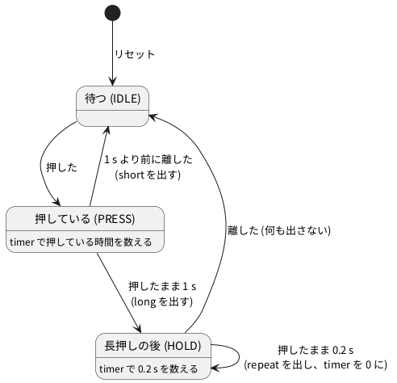

# 6-6 時間を持つ状態機械 — 長押しと短押し

> [!WARNING]
> **この題は実機で組んでいない。** Verilog は Verilator の lint と PC のシミュレーションで、
> 短押し (300 ms)・長押し (2.5 s)・押すときと離すときの跳ね (チャタリング)・1 秒の境の前後・短いひげを確かめた。
> Pico 2 で動かす手順 (`.uf2` のビルドまで確かめた) と AD3 での測り方は 6-18。
> 「見るべき値」はシミュレーションの値で、測った値ではない。

押しボタン 1 つでも、**押していた長さ**で別の働きを持たせられる。電子レンジや時計の設定ボタンのように、
ちょんと押せば 1 つ進み、押し続けると速く進む。

押している時間を数える状態機械を書き、3 つの出来事を見分ける。

| 出来事 | いつ出るか | 見せる LED |
| --- | --- | --- |
| `short` (短押し) | 1 秒より前に離したとき、離した所で 1 回 | D1 (緑) |
| `long` (長押し) | 押したまま 1 秒に達したとき、1 回 | D2 (黄) |
| `repeat` (繰り返し) | 長押しの後も押し続ける間、0.2 秒ごと | D3 (赤) |

- ボタンの信号は 6-3 のチャタリング取り (`debounce`) を通して渡す。跳ねで短押しが何回も出ないように
- 1 秒と 0.2 秒は `parameter` の `LONG_MS = 1000` と `REPEAT_MS = 200`。クロックが変わっても ms で書ける
- 3 つの出来事はどれも 1 クロック (1 ms) のパルス。1 ms では光っても見えないので、LED には 100 ms に伸ばして出す (`pulse_stretch`)
- クロックは 5-7 の方法で **1 kHz** に固定する。1 秒は 1000 クロック

6-1 の信号機は「時間が尽きたら次へ」だけだったが、この題は**入力 (ボタン) と時間の両方**で行き先が決まる。
押している間に時間を数え、離した時刻が 1 秒より前か後かで出す物を変える (使い道は末尾の 6-7 と 12-4)。

## 状態遷移図




| 状態 | 意味 | `timer` | 出口 |
| --- | --- | --- | --- |
| IDLE | ボタンを離している | 0 のまま | 押したら PRESS |
| PRESS | 押してから 1 s まで | 入ってからのクロック数 | 離したら IDLE (`short`)。1000 クロック続いたら HOLD (`long`) |
| HOLD | 1 s を過ぎても押している | 前の `long` か `repeat` からのクロック数 | 200 クロックごとに `repeat` して数え直す。離したら IDLE |

- 「押した」「離した」は、6-3 の `debounce` を通した値 (`pressed`) で見る。`pressed` は押してから約 21.5 ms 遅れる (6-3)
- 長押しの後で離したときは何も出さない。出すと長押しを 2 回に数えてしまう
- `timer` は 6-1 の信号機と同じく状態に付いたデータ。違いは、HOLD の中で `repeat` を出すたびに 0 に戻すこと

## Verilog

ファイルは 4 つ。

| ファイル | 中身 |
| --- | --- |
| `debounce.v` | 6-3 のものをそのまま使う。同じ値が 20 ms 続いたら採る |
| `press_fsm.v` | この題の状態機械。押している時間を数え、`short`・`long`・`repeat` を出す |
| `pulse_stretch.v` | 1 クロックのパルスを 100 ms に伸ばす |
| `press_top.v` | Pico 2 に載せる最上位。上の 3 つをつなぐ |

### press_fsm.v — 押している時間で 3 つを見分ける

6-1 と同じく、状態のレジスタ・次の状態の `case`・状態に付いた時間・出力の 4 つに分けて書く。

```verilog
// 押している長さで、短押し・長押し・繰り返しを分ける状態機械。
// pressed は 6-3 の debounce を通した値 (押している間 1)。出力は 1 クロックだけ 1 のパルス
module press_fsm #(
    parameter CLK_HZ    = 1000,   // クロックの周波数 (1000 の倍数にする)
    parameter LONG_MS   = 1000,   // これだけ押し続けたら長押し
    parameter REPEAT_MS = 200,    // 長押しの後、押し続ける間 repeat を出す間隔
    parameter W         = 16      // timer の幅 (LONG_MS のクロック数が入る幅)
) (
    input            clk,
    input            rst,
    input            pressed,
    output           short_p,     // 1 秒より前に離した
    output           long_p,      // 1 秒押し続けた
    output           repeat_p,    // 長押しの後、0.2 秒ごと
    output reg [1:0] state
);
    localparam [1:0] S_IDLE  = 2'd0;   // 待つ
    localparam [1:0] S_PRESS = 2'd1;   // 押している (長押しになるまで数える)
    localparam [1:0] S_HOLD  = 2'd2;   // 長押しの後も押している

    localparam integer LONG_CYC   = CLK_HZ / 1000 * LONG_MS;
    localparam integer REPEAT_CYC = CLK_HZ / 1000 * REPEAT_MS;
    localparam [W-1:0] T_LONG   = LONG_CYC[W-1:0]   - 1'b1;
    localparam [W-1:0] T_REPEAT = REPEAT_CYC[W-1:0] - 1'b1;

    reg [1:0]   next;
    reg [W-1:0] timer;                 // 今の状態に入ってから (HOLD では前の repeat から) 何クロックか
    wire long_done   = (state == S_PRESS) && (timer == T_LONG);
    wire repeat_done = (state == S_HOLD)  && (timer == T_REPEAT);

    // (1) 状態のレジスタ
    always @(posedge clk)
        if (rst) state <= S_IDLE;
        else     state <= next;

    // (2) 次の状態
    always @(*) begin
        next = state;
        case (state)
            S_IDLE:  if (pressed)        next = S_PRESS;
            S_PRESS: if (!pressed)       next = S_IDLE;
                     else if (long_done) next = S_HOLD;
            S_HOLD:  if (!pressed)       next = S_IDLE;
            default:                     next = S_IDLE;
        endcase
    end

    // (3) 状態に付いた時間: 状態が変わるクロックと repeat を出したクロックで 0 に戻す
    always @(posedge clk)
        if (rst || state == S_IDLE || next != state || repeat_done)
            timer <= {W{1'b0}};
        else
            timer <= timer + 1'b1;

    // (4) 出力: 状態と入力で決まる (ミーリー型)。どれも 1 クロックだけ 1
    assign short_p  = (state == S_PRESS) && !pressed;
    assign long_p   = long_done   && pressed;
    assign repeat_p = repeat_done && pressed;
endmodule
```

- (2) の `case` の 1 行が状態遷移図の矢印に当たる。PRESS の行は先に「離したか」、次に「1 秒に達したか」を見るので、
  ちょうど 1 秒目のクロックで離したら短押し
- (3) の `timer` は IDLE の間 0 のまま。PRESS に入ったクロックから 1 ずつ増え、999 (`T_LONG`) で長押しになる
  (入ってから 1000 クロック目、1 kHz で 1.000 s)
- HOLD は自分へ戻る矢印 (0.2 s ごとの `repeat`) を持ち、状態は変えずに `repeat_done` のクロックで `timer` を 0 に戻す
- (4) の出力は `state` と入力の `pressed` で決まる。出来事を「移る矢印の上」で出すミーリー型 (6-4。6-1 の灯はムーア型)。
  `pressed` は `debounce` のフリップフロップから来るので、1 クロックの中で揺れない
- 時間は `CLK_HZ / 1000 * LONG_MS` でクロック数に直す。`CLK_HZ` が 1000 の倍数なら割り切れる (FPGA の 27 MHz も)。
  ただし 27 MHz の 1 s (2700 万クロック) は `W = 16` (65 535 まで) に入らないので、`W` を 25 以上にする

### pulse_stretch.v — 1 ms のパルスを 100 ms に伸ばす

```verilog
// 1 クロックのパルスを N クロックに伸ばす。1 ms のパルスは目に見えないので、LED には 100 ms で出す
module pulse_stretch #(
    parameter N = 100
) (
    input  clk,
    input  rst,
    input  pulse,
    output out
);
    localparam W = $clog2(N + 1);
    localparam [W-1:0] LEN = N[W-1:0];

    reg [W-1:0] cnt;                         // 残りのクロック数

    always @(posedge clk)
        if (rst)                    cnt <= {W{1'b0}};
        else if (pulse)             cnt <= LEN;          // 来たら数え直す
        else if (cnt != {W{1'b0}})  cnt <= cnt - 1'b1;

    assign out = (cnt != {W{1'b0}});
endmodule
```

- パルスが来たクロックの次から `N` クロックのあいだ `out` が 1。100 ms なら点いたと目で分かる
- 繰り返しは 200 ms ごとなので、100 ms 点いて 100 ms 消える点滅に見える。100 ms より速く来れば点きっぱなし

### press_top.v — Pico 2 に載せる最上位

```verilog
// Pico 2 に載せる最上位。ボタン 1 つの短押し・長押し・繰り返しを、LED 3 個で見せる
module press_top #(
    parameter CLK_HZ    = 1000,
    parameter LONG_MS   = 1000,
    parameter REPEAT_MS = 200,
    parameter SHOW_MS   = 100        // LED を点ける長さ
) (
    input        clk,
    input        rst,
    input        btn_n,              // GP0。押すと 0
    output       led_short,          // GP15 (D1 緑)
    output       led_long,           // GP14 (D2 黄)
    output       led_repeat,         // GP16 (D3 赤)
    output [1:0] o_state,            // 試験で見る。ピンには出さない
    output [2:0] o_pulse             // 試験で見る。{short, long, repeat} の 1 クロックのパルス
);
    localparam integer SHOW_CYC = CLK_HZ / 1000 * SHOW_MS;

    wire clean_n;
    wire press_unused;
    wire short_p, long_p, repeat_p;

    debounce #(.N(CLK_HZ / 50)) u_db (       // 6-3。1/50 s = 20 ms
        .clk(clk), .rst(rst), .btn_n(btn_n), .clean_n(clean_n), .press(press_unused));

    press_fsm #(.CLK_HZ(CLK_HZ), .LONG_MS(LONG_MS), .REPEAT_MS(REPEAT_MS)) u_fsm (
        .clk(clk), .rst(rst), .pressed(~clean_n),
        .short_p(short_p), .long_p(long_p), .repeat_p(repeat_p), .state(o_state));

    pulse_stretch #(.N(SHOW_CYC)) u_s (.clk(clk), .rst(rst), .pulse(short_p),  .out(led_short));
    pulse_stretch #(.N(SHOW_CYC)) u_l (.clk(clk), .rst(rst), .pulse(long_p),   .out(led_long));
    pulse_stretch #(.N(SHOW_CYC)) u_r (.clk(clk), .rst(rst), .pulse(repeat_p), .out(led_repeat));

    assign o_pulse = {short_p, long_p, repeat_p};
endmodule
```

- `debounce` の `clean_n` は押すと 0 なので、`~clean_n` にして状態機械に渡す
- `debounce` の `press` (押した瞬間の 1 クロック) は使わない (状態機械は押している**間**を見るので `clean_n` で足りる)。
  名前に `unused` を入れたのは、Verilator の lint がこの名前の信号を「使っていない」と言わない決まり (`--unused-regexp` の既定が `*unused*`) のため
- `o_state` と `o_pulse` は試験で見るための出口。Pico 2 のピンには割り当てない

Verilator の lint は警告なしで通る (`verilator --lint-only -Wall --top-module press_top press_top.v press_fsm.v pulse_stretch.v debounce.v`、
Verilator 5.042 で確かめた)。

## Pico 2 で動かす

回路図・部品・実体配線図、Pico 2 のプログラム、Logic の設定と画面、picoemu での確かめは [6-18](18-long-short-press-pico.md) に分けた。どれも Pico 2 に載せて組む物なので、この題には図を置かない。

## 動かす — PC のシミュレーション

クロックを 1 kHz (立ち上がりは 0.5 ms・1.5 ms・2.5 ms …) にして、5 つの押し方を続けて入れる。
時刻は最初に押した所が 0 ms。

| # | 押し方 | 時刻 | 正しい出来事 |
| --- | --- | --- | --- |
| 1 | 短押し 300 ms。押すときに 3.1 ms、離すときに 1.4 ms 跳ねる (6-3 と同じ形) | 0〜300 ms | `short` 1 回 |
| 2 | 長押し 2.5 s。同じように跳ねる | 800〜3300 ms | `long` 1 回、`repeat` 7 回 |
| 3 | 跳ねずに 0.9 s (1 秒の境の手前) | 4000〜4900 ms | `short` 1 回 |
| 4 | 跳ねずに 1.1 s (境の後で、繰り返しの前に離す) | 5500〜6600 ms | `long` 1 回 |
| 5 | 5 ms だけの L (押したのではないひげ) | 7000〜7005 ms | 何も出ない |

2 の `repeat` が 7 回なのは、1 s の後に押していた 1.5 s ÷ 0.2 s = 7.5 で、8 回目の前に離すから。

`tb_press.v`:

```verilog
`timescale 1us / 100ns
// 1 kHz のクロックで 5 つの押し方を入れ、short・long・repeat の数を押し方ごとに数える。
// 時刻は最初に押した時刻 (T0 = 100 ms) を 0 として書く
module tb_press;
    reg clk;
    reg rst;
    reg btn_n;
    wire led_s, led_l, led_r;
    wire [1:0] st;
    wire [2:0] p;

    press_top #(.CLK_HZ(1000)) dut (
        .clk(clk), .rst(rst), .btn_n(btn_n),
        .led_short(led_s), .led_long(led_l), .led_repeat(led_r), .o_state(st), .o_pulse(p));

    // クロックの立ち上がりは 0.5 ms・1.5 ms・2.5 ms …
    initial begin
        clk = 1'b0;
        #500;
        forever begin clk = 1'b1; #500; clk = 1'b0; #500; end
    end

    localparam real T0 = 100000.0;           // 100 ms (µs で)
    integer n_s = 0, n_l = 0, n_r = 0;       // いま数えている押し方の分
    integer errors = 0;

    always @(posedge clk) begin
        if (p[2]) begin n_s = n_s + 1; $display("%9.1f ms  short",  ($realtime - T0) / 1000.0); end
        if (p[1]) begin n_l = n_l + 1; $display("%9.1f ms  long",   ($realtime - T0) / 1000.0); end
        if (p[0]) begin n_r = n_r + 1; $display("%9.1f ms  repeat", ($realtime - T0) / 1000.0); end
    end

    always @(led_s or led_l or led_r)
        if (!rst) $display("%9.1f ms    LED short=%b long=%b repeat=%b",
                           ($realtime - T0) / 1000.0, led_s, led_l, led_r);

    // 押し方ごとに数を確かめ、数え直す
    task check(input [8*24-1:0] name, input integer s, input integer l, input integer r);
        begin
            if (n_s == s && n_l == l && n_r == r)
                $display("ok   %0s: short %0d long %0d repeat %0d", name, n_s, n_l, n_r);
            else begin
                $display("NG   %0s: short %0d long %0d repeat %0d (want %0d %0d %0d)",
                         name, n_s, n_l, n_r, s, l, r);
                errors = errors + 1;
            end
            n_s = 0; n_l = 0; n_r = 0;
        end
    endtask

    initial begin
        rst = 1'b1; btn_n = 1'b1;
        #2000 rst = 1'b0;                       // 2 ms でリセットを解く
        #98000;                                 // T0 = 100 ms
        // (1) 短押し 300 ms。押すときに 3.1 ms、離すときに 1.4 ms 跳ねる
        btn_n = 1'b0; #800 btn_n = 1'b1; #800 btn_n = 1'b0; #600 btn_n = 1'b1; #900 btn_n = 1'b0;   // 0〜3.1 ms
        #296900 btn_n = 1'b1; #700 btn_n = 1'b0; #700 btn_n = 1'b1;                                  // 300〜301.4 ms
        #498600 check("short 300 ms", 1, 0, 0);                                                      // 800 ms
        // (2) 長押し 2.5 s。同じように跳ねる
        btn_n = 1'b0; #800 btn_n = 1'b1; #800 btn_n = 1'b0; #600 btn_n = 1'b1; #900 btn_n = 1'b0;   // 800 ms
        #2496900 btn_n = 1'b1; #700 btn_n = 1'b0; #700 btn_n = 1'b1;                                 // 3300 ms
        #698600 check("long 2.5 s", 0, 1, 7);                                                        // 4000 ms
        // (3) 境の手前: 跳ねずに 0.9 s
        btn_n = 1'b0; #900000 btn_n = 1'b1;
        #600000 check("clean 0.9 s", 1, 0, 0);                                                       // 5500 ms
        // (4) 境の後: 跳ねずに 1.1 s (長押しだが繰り返しの前に離す)
        btn_n = 1'b0; #1100000 btn_n = 1'b1;
        #400000 check("clean 1.1 s", 0, 1, 0);                                                       // 7000 ms
        // (5) 5 ms だけの L (ひげ)
        btn_n = 1'b0; #5000 btn_n = 1'b1;
        #500000 check("glitch 5 ms", 0, 0, 0);
        if (errors == 0) $display("PASS"); else $display("FAIL");
        $finish;
    end
endmodule
```

```bash
verilator --binary --timing --top-module tb_press tb_press.v press_top.v press_fsm.v pulse_stretch.v debounce.v
./obj_dir/Vtb_press
```

```text
    322.5 ms  short
    322.5 ms    LED short=1 long=0 repeat=0
    422.5 ms    LED short=0 long=0 repeat=0
ok   short 300 ms: short 1 long 0 repeat 0
   1825.5 ms  long
   1825.5 ms    LED short=0 long=1 repeat=0
   1925.5 ms    LED short=0 long=0 repeat=0
   2025.5 ms  repeat
   2025.5 ms    LED short=0 long=0 repeat=1
   2125.5 ms    LED short=0 long=0 repeat=0
   2225.5 ms  repeat
   2225.5 ms    LED short=0 long=0 repeat=1
   2325.5 ms    LED short=0 long=0 repeat=0
   2425.5 ms  repeat
   2425.5 ms    LED short=0 long=0 repeat=1
   2525.5 ms    LED short=0 long=0 repeat=0
   2625.5 ms  repeat
   2625.5 ms    LED short=0 long=0 repeat=1
   2725.5 ms    LED short=0 long=0 repeat=0
   2825.5 ms  repeat
   2825.5 ms    LED short=0 long=0 repeat=1
   2925.5 ms    LED short=0 long=0 repeat=0
   3025.5 ms  repeat
   3025.5 ms    LED short=0 long=0 repeat=1
   3125.5 ms    LED short=0 long=0 repeat=0
   3225.5 ms  repeat
   3225.5 ms    LED short=0 long=0 repeat=1
   3325.5 ms    LED short=0 long=0 repeat=0
ok   long 2.5 s: short 0 long 1 repeat 7
   4922.5 ms  short
   4922.5 ms    LED short=1 long=0 repeat=0
   5022.5 ms    LED short=0 long=0 repeat=0
ok   clean 0.9 s: short 1 long 0 repeat 0
   6522.5 ms  long
   6522.5 ms    LED short=0 long=1 repeat=0
   6622.5 ms    LED short=0 long=0 repeat=0
ok   clean 1.1 s: short 0 long 1 repeat 0
ok   glitch 5 ms: short 0 long 0 repeat 0
PASS
```

5 つの押し方で、出来事の数はどれも正しかった (Verilator 5.042 と 5.048 で実行)。

- 行の時刻はパルスを読んだクロックの立ち上がりで、LED はそこで点き 100 ms 後に消える
- 短押し (1): 離した 300 ms から 22.5 ms 後に `short` (最後の跳ね 301.4 ms + `debounce` の 21 ms + 1 クロック)。跳ねても 1 回だけ
- 長押し (2): 押した 800 ms から 1025.5 ms 後に `long` (跳ねを入れた `debounce` の遅れ 24.5 ms + 1000 クロック + 1 クロック)
- 繰り返し (2): `long` の 200 ms 後から 200 ms ごとに 7 回 (2025.5〜3225.5 ms)。離した後 (3300 ms〜) は何も出ない
- 境の前後 (3・4): 0.9 s は短押し、1.1 s は長押し (繰り返しの前に離したので `repeat` は 0 回)。
  跳ねない押し方では `long` まで 1022.5 ms (`debounce` の 21.5 ms + 1000 クロック + 1 クロック)
- ひげ (5): 20 ms より短いので `debounce` が採らない

## 見るべき値

シミュレーションの値。実機で Logic から読む時刻 (D1・D2 の遅れ、D3 の間隔、点く長さ) は 6-18 の「見るべき値」。

| 見る所 | シミュレーション・設計値 | 実機 (測って書く) |
| --- | --- | --- |
| 300 ms の短押しで出る数 | `short` 1 回、`long`・`repeat` 0 回 | |
| 2.5 s の長押しで出る数 | `long` 1 回、`repeat` 7 回、`short` 0 回 | |
| 1 秒の境 | 0.9 s は短押し、1.1 s は長押し | |
| 5 ms のひげで出る数 | 0 回 | |

## 使い道 — 6-7 のタイマーと 12-4 の時計

- 6-7 (99 秒タイマー) の設定で `short`・`long`・`repeat` をどれも「+1 秒」と数えれば、
  ちょんと押せば 1 つ、押し続ければ 1 s 後から 1 秒に 5 つ進む (`press_fsm` はそのまま、3 つのパルスを足し算の側へつなぐ)
- 12-4 の時計の時刻合わせ (`button.v`) は、押し続けても 1 回しか数えない。`debounce` と `press_fsm` に替えれば長押しで速く進む

## シミュレーションでの確かめ (対象外を含む)

本文の 3 つの `.v` と試験 `tb_press` を抜き出し、Verilator 5.042 で走らせ直した (`debounce.v` は 6-3 の `sim/03-debounce.v`)。
原本は `sim/06-long-short-press.v` (`press_fsm`)・`-stretch.v`・`-top.v`・`-tb.v`。`tb_press` は `sfa-dev:local` の Verilator 5.048 (`verilator --binary --timing`) でも走らせた。

| 項目 | 本文の数字 | 実行結果 | 判定 |
| --- | --- | --- | --- |
| lint (`--top-module press_top`、`-Wall`) | 警告なし | 警告 0 件 | 合った |
| 5 つの押し方の出来事の数 | 短押し 1・長押し 1 + 繰り返し 7・0.9 s で短押し・1.1 s で長押し・ひげ 0 | 全部 `ok`、`PASS` | 合った |
| シミュレーションの出力 (39 行、5.042・5.048) | 本文の `text` のとおり | どちらも 39 行とも同じ (時刻・LED の点き消えも)、`PASS` | 合った |
| 短押しで離してから `short` まで | 22.5 ms (最後の跳ね 301.4 ms から 21.1 ms) | 322.5 − 300 = 22.5 ms、322.5 − 301.4 = 21.1 ms | 合った |
| 長押しで押してから `long` まで | 1025.5 ms (跳ね有)、1022.5 ms (跳ね無し) | 1825.5 − 800 = 1025.5 ms、6522.5 − 5500 = 1022.5 ms | 合った |
| `repeat` の間隔・数 | 200 ms ごとに 7 回 | 2025.5〜3225.5 ms の 7 回、間隔 200 ms | 合った |

## 出典

自作。チャタリング取りの `debounce.v` は 6-3、状態機械の書き方は 6-1。
Verilator の `--unused-regexp` の既定は Verilator の文書
[Verilator Arguments](https://verilator.org/guide/latest/exe_verilator.html#cmdoption-unused-regexp)。
