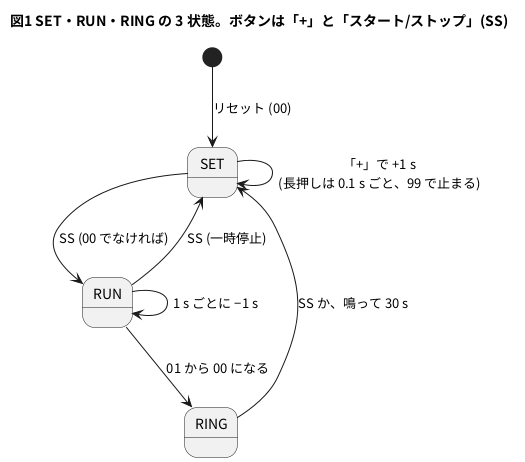

# 6-7 99 秒タイマー — 設定・計数・鳴るの 3 状態、0 でブザー

> [!WARNING]
> **この題は実機で組んでいない。** Verilog は Verilator の lint を警告 0 件で通し、PC のシミュレーションで
> 設定 → 計数 → 0 で鳴る → 30 秒で戻る、一時停止、長押しの速送り、99 での頭打ちを回して、自分で合否を言う試験を通した。
> Pico 2 のプログラムは `.uf2` までのビルドを確かめたが、書き込んで動かしてはいない。7 セグの点灯、ブザーの音、AD3 での測定はしていない。
> 「見るべき値」は設計値・シミュレーションの値・計算値で、測った値ではない。

第 2 章と第 6 章で作った部品を 1 台にまとめて、**キッチンタイマーのような 99 秒タイマー**を作る。
「+」のボタンで秒を決め、「スタート/ストップ」で数え始め、0 になったらブザーが鳴る。
時計とタイマーの筋 (2-7 の 1 Hz → 2-9 → この題 → 12-4 の時計) の 3 つ目に当たる。

| 部品 | 題 | この題での役 |
| --- | --- | --- |
| クロックを固定する | 5-7 | Pico 2 の Soft-FPGA を **1 kHz (1 クロック = 1 ms)** で回す。1 秒は 1000 クロック |
| 10 進カウンタと桁上げ | 2-9 | 残りの秒を 10 進の 2 桁で持つ。[12-4 の時計](../12-projects/04-clock.md) の `digit` と同じ持ち方 |
| 7 セグのデコーダ | 1-8 | 0〜9 を a〜g に直す。12-4 の `seg7dec.v` をそのまま使う |
| チャタリング取り | 6-3 | 2 つのボタンを 20 ms 続いたら採る。[6-3](03-debounce.md) の `debounce.v` をそのまま使う |
| 長押しで繰り返す | 6-6 | 「+」を押し続けると 0.5 s 後から 1 秒に 10 回進む |
| 状態機械 | 6-1 | 設定・計数・鳴るの 3 状態 |

## 決めたこと

| 項目 | 決め | 理由 |
| --- | --- | --- |
| 状態 | 設定 (`SET`)・計数 (`RUN`)・鳴る (`RING`) の 3 つ | キッチンタイマーの動きがこの 3 つで書ける |
| 「+」(SW1) | `SET` の間だけ効く。押した瞬間に +1 s。押し続けると 0.5 s 後から 0.1 s ごとに +1 s。**99 で止まる** (100 にしない) | 2 桁なので 99 が上限。6-6 の長押しの考えを使う |
| 「スタート/ストップ」(SW2) | `SET` → `RUN` (00 のときは始めない)、`RUN` → `SET` (一時停止。残りの秒はそのまま)、`RING` → `SET` (止める) | ボタン 2 つで足りる |
| 0 になったら | `RING` に入り、0.5 s 鳴らして 0.5 s 休むのを繰り返す。**30 秒鳴ったら自分で `SET` に戻る** (`RING_S`) | 気付かないときに鳴り続けない |
| `RING` から戻ったとき | 表示は `00` | 前に決めた秒を覚える回路を足さない (入門の題として小さくする) |
| 表示 | 1 桁の 7 セグ 5161AS (カソード共通) を **2 個、ダイナミック点灯せずに直結**。GPIO 14 本 + 抵抗 14 本 | 2 桁なら Pico 2 の GPIO で足りる。ダイナミック点灯は中級の 2-15 なので、入門のこの題では使わない |
| ブザー | **受動型の圧電サウンダ 村田 PKM13EPYH4000-A0** を GPIO から直に鳴らす。音の周波数は `parameter TONE_HZ` | 発振回路の無い型なので、回路が作る周波数で鳴る。電流が小さく (下の計算)、抵抗もトランジスタも要らない |
| 音の周波数 | この題は **500 Hz** | クロックが 1 kHz なので、作れる方形波は 1 クロックごとに反転する 500 Hz まで |
| 電源 | Pico 2 の USB。ブレッドボードに + の電源は配らない | 7 セグとブザーは GPIO の 3.3 V で動かす。レールは GND だけ使う |

PKM13EPYH4000-A0 の共振は 4.0 kHz で、500 Hz は共振から外れる。**音は 4 kHz で鳴らすより小さくなる** (どれだけ小さいかは測っていない)。
第 8 章で同じ Verilog を実物の FPGA に載せたら、クロックが速いので `TONE_HZ = 4000` にでき、共振で鳴らせる
(27 MHz なら 3375 クロックごとに反転して 4.000 kHz。lint は `-GCLK_HZ=27000000 -GTONE_HZ=4000` でも警告 0 件)。

| PKM13EPYH4000-A0 の値 | データシートの値 |
| --- | --- |
| 駆動 | 発振回路なし (External Drive)。回路が音の周波数を作る |
| 共振周波数 | 4.0 kHz |
| 音圧 | 70 dB 以上 (±1.5 V<sub>o-p</sub> = 3 V<sub>p-p</sub>、4.0 kHz の方形波、10 cm) |
| 容量 | 5.5 nF ±30 % |
| 最大入力 | ±15 V<sub>o-p</sub> |

GPIO の 0 / 3.3 V の方形波は 3.3 V<sub>p-p</sub> で、最大入力の内側。平均の電流は C × V × 2f で、
500 Hz なら 5.5 nF × 3.3 V × 1000 /s ≒ 18 µA (マイクロアンペア)、4 kHz でも 0.15 mA (計算値)。

## 状態遷移図




- 状態は `state` の 2 ビット。残りの秒 (`tens` と `ones`) と、1 秒の中の何クロック目か (`ms`) は状態に付いたデータで、6-1 の `timer` と同じ役
- `RUN` に入ったクロックで `ms` を 0 から数え始め、999 の次のクロックで 1 s 減らす。だから押してちょうど 1 s 後に最初の 1 s が減る
- 一時停止すると `ms` を 0 に戻す。続きを始めると、その秒を初めから数え直す (途中まで数えた分は捨てる。合計で最大 1 s 長くなる)
- `RING` の間は 1 s ごとに `rang` を 1 増やし、30 になる 1 s の終わりで `SET` に戻る

## 回路図

```circuit
# 回路図 (tommie-fence の circuit フェンス)
title: 図2 14 本の GPIO から 680 Ω を通して 2 個の 7 セグを直結し、GP15 でブザーを鳴らす
parts:
  U1: pico2 4,7 mirror
  PLUS: port 6.5,3.4
  SS: port 6.5,3.8
  TG: port 6.5,4.6
  TF: port 6.5,5
  TA: port 6.5,5.4
  TB: port 6.5,5.8
  OG: port 6.5,6.6
  OF: port 6.5,7
  OA: port 6.5,7.4
  OB: port 6.5,7.8
  SEC: port 6.5,10.6
  BZ: port 6.5,11
  OC: port 1.5,8.6
  OD: port 1.5,9
  OE: port 1.5,9.4
  TC: port 1.5,9.8
  TD: port 1.5,10.6
  TE: port 1.5,11
  G0: ground 1.5,4.6
  TA: port 10,1.6
  R1: resistor 10,1.6 11.5,1.6 680
  TB: port 10,2.6
  R2: resistor 10,2.6 11.5,2.6 680
  TC: port 10,3.6
  R3: resistor 10,3.6 11.5,3.6 680
  TD: port 10,4.6
  R4: resistor 10,4.6 11.5,4.6 680
  TE: port 10,5.6
  R5: resistor 10,5.6 11.5,5.6 680
  TF: port 10,6.6
  R6: resistor 10,6.6 11.5,6.6 680
  TG: port 10,7.6
  R7: resistor 10,7.6 11.5,7.6 680
  DS1: seg7 16,9 5161AS
  G1: ground 14.2,11.8
  OA: port 18,1.6
  R8: resistor 18,1.6 19.5,1.6 680
  OB: port 18,2.6
  R9: resistor 18,2.6 19.5,2.6 680
  OC: port 18,3.6
  R10: resistor 18,3.6 19.5,3.6 680
  OD: port 18,4.6
  R11: resistor 18,4.6 19.5,4.6 680
  OE: port 18,5.6
  R12: resistor 18,5.6 19.5,5.6 680
  OF: port 18,6.6
  R13: resistor 18,6.6 19.5,6.6 680
  OG: port 18,7.6
  R14: resistor 18,7.6 19.5,7.6 680
  DS2: seg7 24,9 5161AS
  G2: ground 22.2,11.8
  PLUS: port 8,14
  SW1: button 8,14 8,16 l=$\mathrm{SW1}$
  G3: ground 8,16
  SS: port 11,14
  SW2: button 11,14 11,16 l=$\mathrm{SW2}$
  G4: ground 11,16
  BZ: port 14,14
  BZ1: buzzer 14,14 14,16 l=$\mathrm{BZ1}$
  G5: ground 14,16
  AD:
    type: device
    at: 21,14.4
    label: AD3
    pins: [DIO0, DIO1, DIO2, GND]
  SEC: port 19,14
  BZ: port 19,14.4
  SS: port 19,14.8
  G6: ground 19,15.6
wires:
  - U1.GP0 -- 6.5,3.4
  - U1.GP1 -- 6.5,3.8
  - U1.GP2 -- 6.5,4.6
  - U1.GP3 -- 6.5,5
  - U1.GP4 -- 6.5,5.4
  - U1.GP5 -- 6.5,5.8
  - U1.GP6 -- 6.5,6.6
  - U1.GP7 -- 6.5,7
  - U1.GP8 -- 6.5,7.4
  - U1.GP9 -- 6.5,7.8
  - U1.GP14 -- 6.5,10.6
  - U1.GP15 -- 6.5,11
  - U1.GP21 -- 1.5,8.6
  - U1.GP20 -- 1.5,9
  - U1.GP19 -- 1.5,9.4
  - U1.GP18 -- 1.5,9.8
  - U1.GP17 -- 1.5,10.6
  - U1.GP16 -- 1.5,11
  - U1.GND38 -| 1.5,4.6
  - 11.5,1.6 -- 14.6,1.6 -- 14.6,7.4 -| DS1.a
  - 11.5,2.6 -- 14.4,2.6 -- 14.4,7.8 -| DS1.b
  - 11.5,3.6 -- 14.2,3.6 -- 14.2,8.2 -| DS1.c
  - 11.5,4.6 -- 14,4.6 -- 14,8.6 -| DS1.d
  - 11.5,5.6 -- 13.8,5.6 -- 13.8,9 -| DS1.e
  - 11.5,6.6 -- 13.6,6.6 -- 13.6,9.4 -| DS1.f
  - 11.5,7.6 -- 13.4,7.6 -- 13.4,9.8 -| DS1.g
  - DS1.COM1 -- 14.2,10.6 -- 14.2,11.8
  - DS1.COM2 -- 14.2,11
  - 19.5,1.6 -- 22.6,1.6 -- 22.6,7.4 -| DS2.a
  - 19.5,2.6 -- 22.4,2.6 -- 22.4,7.8 -| DS2.b
  - 19.5,3.6 -- 22.2,3.6 -- 22.2,8.2 -| DS2.c
  - 19.5,4.6 -- 22,4.6 -- 22,8.6 -| DS2.d
  - 19.5,5.6 -- 21.8,5.6 -- 21.8,9 -| DS2.e
  - 19.5,6.6 -- 21.6,6.6 -- 21.6,9.4 -| DS2.f
  - 19.5,7.6 -- 21.4,7.6 -- 21.4,9.8 -| DS2.g
  - DS2.COM1 -- 22.2,10.6 -- 22.2,11.8
  - DS2.COM2 -- 22.2,11
  - AD.DIO0 -| 19,14
  - AD.DIO1 -| 19,14.4
  - AD.DIO2 -| 19,14.8
  - AD.GND -| 19,15.2 -- 19,15.6
style:
  pitch: 1.2
  grid: on
```


- 線で結ぶ代わりに、**同じ名前の端子 (白丸と名前) どうしがつながっている**。U1 の GP4 から出た `TA` は、R1 の左の `TA` とつながる
- `T` で始まる 7 本は 10 の位 (DS1) の a〜g、`O` で始まる 7 本は 1 の位 (DS2) の a〜g。どちらも a〜g の順に上から並べた
- 7 セグはカソード共通。COM1 と COM2 (中でつながった共通のピン) を GND へ落とし、光らせたいセグメントの GPIO を 1 (3.3 V) にする。dp は使わない
- 押しボタンは GP0 (「+」、SW1) と GP1 (「スタート/ストップ」、SW2) から GND へ。GPIO は Pico 2 の中でプルアップする (6-2)。離すと 1、押すと 0
- 圧電サウンダ BZ1 は GP15 と GND の間に直につなぐ。極性は無い
- GP14 の `SEC` は `RUN` の間、1 秒の前半だけ 1 になる印。AD3 で 1 秒を測るために出した (表示には使わない)
- AD3 は DIO0 で `SEC`、DIO1 で `BZ`、DIO2 で `SS` (スタート/ストップのボタン) を読むだけ。何も出さない

## 部品表

| 部品 | 値・型番 | 数 | 役 |
| --- | --- | --- | --- |
| U1 | Raspberry Pi Pico 2 | 1 | Soft-FPGA を動かす。USB から給電 |
| DS1・DS2 | 5161AS (0.56 インチ 1 桁の 7 セグ、カソード共通、赤) | 2 | DS1 が 10 の位、DS2 が 1 の位 |
| R1〜R14 | 680 Ω (オーム)、E24、1/4 W | 14 | セグメント 1 本ずつの電流を決める。R1〜R7 が DS1 の a〜g、R8〜R14 が DS2 の a〜g |
| SW1・SW2 | タクトスイッチ (4 ピン) | 2 | SW1 が「+」、SW2 が「スタート/ストップ」 |
| BZ1 | 圧電サウンダ 村田 PKM13EPYH4000-A0 (秋月電子通商 P-04118) | 1 | 受動型 (発振回路なし)。共振 4.0 kHz |
| — | ブレッドボード (full、63 列) | 1 | |
| — | ジャンパ線 | 約 45 本 | |
| AD | Analog Discovery 3 | 1 | Logic で 3 本を測る |

電源は教科書の既定の 5 V ではなく **3.3 V** (Pico 2 の GPIO)。Pico 2 のピンに 5 V を入れると壊れるため (0-3)。

### セグメントの抵抗 (680 Ω) の決め方

1 本のセグメントの電流は (GPIO の H の電圧 − LED の順電圧) / R。GPIO の H を 3.3 V、5161AS の赤の順電圧を 1.8〜2.0 V と置くと (見積り。
5161AS のデータシートの値は確かめていない。電流が数 mA なので 20 mA のときの値より低めに置いた)、

| R (E24) | 1 本の電流 | 「88」で 14 本とも光るときの合計 |
| --- | --- | --- |
| 330 Ω | (3.3 − 2.0) / 330 = 3.9 mA 〜 (3.3 − 1.8) / 330 = 4.5 mA | 55〜64 mA |
| 470 Ω | 2.8〜3.2 mA | 39〜45 mA |
| **680 Ω** | **1.9〜2.2 mA** | **27〜31 mA** |

**680 Ω にした。** この題はダイナミック点灯をしないので、14 本が同時に光り続ける。12-4 の時計 (光るのは 4 桁のうち 1 桁ずつ) と違い、
GPIO の電流の合計がそのまま効く。RP2040 のデータシートは全 GPIO の電流の合計を 50 mA までとしているので、RP2350 (Pico 2) にも同じ数を目安に置き
(RP2350 の資料の値は確かめていない)、その半分ほどに収まる 680 Ω を選んだ。1 本あたり 2 mA 前後でも、部屋の中なら読める明るさと見込む (見積り)。
暗ければ 470 Ω に下げられるが、合計は目安の 50 mA に近づく。1 本の電流は、GPIO の既定の駆動の強さ (4 mA) の内側。

## 実体配線図

```bread
# ブレッドボードの実体配線図 (tommie-fence の bread フェンス)
title: 図3 Pico 2 から 680 Ω を通して 2 個の 7 セグへ。電源は Pico 2 の USB
board: full
parts:
  MCU: pico2 @ h10
  SW1: button @ e5
  SW2: button @ e1
  BZ1: buzzer f37 e37 cap=above:0,-1
  R5: resistor e31 f31 680 cap=above
  R4: resistor e32 f32 680 cap=above:-1,-1
  R3: resistor e33 f33 680 cap=above:1,-2
  R12: resistor e34 f34 680 cap=above
  R11: resistor e35 f35 680 cap=above:-1,-1
  R10: resistor e36 f36 680 cap=above:1,-2
  R9: resistor e38 f38 680 cap=above
  R8: resistor e39 f39 680 cap=above:1,-1
  R13: resistor e40 f40 680 cap=above:0,-2
  R14: resistor e41 f41 680 cap=above
  R2: resistor e42 f42 680 cap=above:1,-1
  R1: resistor e43 f43 680 cap=above:1,0
  R6: resistor e44 f44 680 cap=above:2,-1
  R7: resistor e45 f45 680 cap=above:2,0
  DS1: seg7 @ c51
  DS2: seg7 @ b58
  AD:
    type: device
    at: bottom
    label: AD3 Logic
    pins: [DIO2, GND, DIO0, DIO1]
wires:
  - a12 -- -t12 black
  - a5 -- -t5 black
  - a1 -- -t1 black
  - a37 -- -t37 black
  - a53 -- -t53 black
  - a60 -- -t60 black
  - j53 -- -b53 black
  - j60 -- -b60 black
  - -t63 -- -b63 black
  - j10 -- j7 brown
  - i11 -- i3 brown
  - i29 -- i37 gray
  - b29 -- b31 orange
  - b28 -- b32 orange [v-10]
  - a26 -- a33 orange
  - a25 -- a34 blue [v-7]
  - a24 -- a35 blue [v-14]
  - a23 -- a36 blue [v-21]
  - b45 -- b51 yellow
  - a44 -- a52 yellow
  - b43 -- a54 yellow [v-10]
  - b42 -- b55 yellow [v10]
  - a41 -- a58 white [v-6]
  - a40 -- a59 white [v-12]
  - a39 -- a61 white [v-18]
  - a38 -- a62 white [v-24]
  - j21 -- j38 blue [v-8]
  - j20 -- j39 blue [v-14]
  - j19 -- j40 blue [v5]
  - j18 -- j41 blue [v9]
  - j16 -- j42 orange [v14]
  - j15 -- j43 orange [v18]
  - j14 -- j44 orange [v23]
  - j13 -- j45 orange [v27]
  - g31 -- h51 yellow [v-12, h350, v32]
  - g32 -- h52 yellow [v-6, h320, v32]
  - g33 -- h54 yellow [h290, v32]
  - h34 -- i58 white [v-12, h260, v32]
  - h35 -- i59 white [v-4, h230, v34]
  - h36 -- i61 white [v4, h200, v41, h270, v-15]
  - AD.DIO0 -- j28 green
  - AD.DIO1 -- j29 green
  - AD.DIO2 -- j11 purple
  - AD.GND -- -b25 black
```


- Pico 2 は USB を左に向けて `@ h10` に挿す。下の列 (h 行) の 1 番 GP0 が 10 列、20 番 GP15 が 29 列。上の列 (c 行) の 21 番 GP16 が 29 列、38 番 GND が 12 列。ボードの外側の a・b 行と i・j 行から線を取る
- 押しボタンは左端で溝をまたぐ。SW1 (「+」、5〜7 列) は GP0 から j 行の茶の線、SW2 (「スタート/ストップ」、1〜3 列) は GP1 から i 行の茶の線。どちらも上の側から上の − レールへ黒の線
- 抵抗 14 本は溝をまたいで縦に挿す。上の列と下の列が別のネットになるので、片方に Pico 2、もう片方に 7 セグをつなぐ。並びは線が交わらない順にした
  - 31〜36 列の 6 本 (左から R5・R4・R3・R12・R11・R10) は 7 セグの**下のピン** (e・d・c) の抵抗。Pico 2 の上の列 (GP16〜GP21) から a・b 行とその上の線で抵抗の上の側へ入り、抵抗の下の側から g・h 行の線で 7 セグの下のピンへ。線は 46〜49 列で一段ずつ下がる
  - 38〜45 列の 8 本 (左から R9・R8・R13・R14・R2・R1・R6・R7) は 7 セグの**上のピン** (g・f・a・b) の抵抗。Pico 2 の下の列 (GP2〜GP9) から i・j 行の下の線で抵抗の下の側へ入る。抵抗の上の側からは、右の 4 本 (DS1 用) が a・b 行とその間・下の線で DS1 へ、左の 4 本 (DS2 用) が a 行の上の線で DS1 の上を越えて DS2 へ
- DS1 は c 行と g 行、DS2 は b 行と f 行に挿す (どちらも 6 穴離れた 2 行。DS1 は 51〜55 列、DS2 は 58〜62 列)。DS1 を 1 行下げたのは、上のピンへ来る 4 本を a・b 行とその間・下の 4 段に分けて、COM2 の黒の線をまたがずに届けるため。胴の下は使えないので、DS1 は上のピンを a・b 行、下のピンを h〜j 行から、DS2 は上のピンを a 行、下のピンを g〜j 行から線を取る。COM2 (上の真ん中) は上の − レール、COM1 (下の真ん中) は下の − レールへ
- 圧電サウンダ BZ1 は 37 列で溝をまたぐ (下の足が GP15、上の足が GND)。GP15 (29 列) から i 行の灰の線で下の足の列へ、上の足の列から上の − レールへ黒の線
- 線の色: 黒は GND だけ。橙と黄は 10 の位 (橙が Pico 2 → 抵抗、黄が抵抗 → DS1)、青と白は 1 の位 (青が Pico 2 → 抵抗、白が抵抗 → DS2)。茶はボタン、灰はブザー、緑と紫は AD3。赤は使わない (+ の電源をブレッドボードに配らない)
- AD3 の DIO0 (緑) は GP14 の 28 列、DIO1 (緑) は GP15 の 29 列、DIO2 (紫) は GP1 の 11 列に j 行で挿す。上と下の − レールは右端 (63 列) でつなぐ
- 電源は Pico 2 の USB。ブレッドボードを流れる電流は 7 セグの合計で 31 mA 以下 (見積り)、信号は 500 Hz 以下で、ブレッドボードの範囲 (3 MHz 以下) に収まる

## Verilog

モジュールは 5 つ。1 ファイル 1 モジュールにした。`debounce.v` は 6-3、`seg7dec.v` は 12-4 のものをそのまま使う (下に再び載せる)。

### timer99.v — タイマーの本体

```verilog
// 99 秒タイマー。設定 (SET)・計数 (RUN)・鳴る (RING) の 3 状態
module timer99 #(
    parameter CLK_HZ  = 1000,        // 5-7 で固定したクロック。1 クロック = 1 ms
    parameter TONE_HZ = 500,         // ブザーの音。1 kHz のクロックで作れるのは 500 Hz まで
    parameter RING_S  = 30,          // 鳴り続けて SET に戻るまでの秒
    parameter DEB_MS  = 20,          // チャタリングを取る長さ (6-3)
    parameter LONG_MS = 500,         // 「+」の長押しで繰り返しが始まるまで (6-6)
    parameter REP_MS  = 100          // 繰り返しの間隔
) (
    input        clk,
    input        rst,
    input        btn_plus_n,         // 「+」。押すと 0
    input        btn_ss_n,           // 「スタート/ストップ」。押すと 0
    output [6:0] seg_tens,           // 10 の位の {g, f, e, d, c, b, a}。1 で点灯
    output [6:0] seg_ones,           // 1 の位
    output       buzzer,             // 圧電サウンダへ。鳴らさない間は 0
    output       sec,                // RUN の間、1 秒の前半だけ 1 (AD3 で 1 秒を測る)
    output [1:0] o_state,            // 試験で見る。ピンには出さない
    output [7:0] o_count             // 残りの秒 {10 の位, 1 の位}。試験で見る
);
    localparam MS     = CLK_HZ / 1000;             // 1 ms のクロック数
    localparam SEC_W  = $clog2(CLK_HZ);
    localparam [SEC_W-1:0] SEC_LAST = CLK_HZ[SEC_W-1:0] - 1'b1;
    localparam [SEC_W-1:0] SEC_HALF = CLK_HZ[SEC_W:1];   // CLK_HZ / 2
    localparam HALF   = (CLK_HZ / (2 * TONE_HZ) > 0) ? CLK_HZ / (2 * TONE_HZ) : 1;
    localparam TONE_W = (HALF > 1) ? $clog2(HALF) : 1;
    localparam [TONE_W-1:0] TONE_LAST = HALF[TONE_W-1:0] - 1'b1;
    localparam RING_W = $clog2(RING_S + 1);
    localparam [RING_W-1:0] RING_LAST = RING_S[RING_W-1:0] - 1'b1;

    localparam [1:0] SET = 2'd0, RUN = 2'd1, RING = 2'd2;

    // ボタン: チャタリングを取り (6-3)、「+」だけ長押しで繰り返す (6-6)
    wire plus_clean_n, plus_press, ss_press, plus_step;
    debounce #(.N(DEB_MS * MS)) u_db_plus (
        .clk(clk), .rst(rst), .btn_n(btn_plus_n), .clean_n(plus_clean_n), .press(plus_press));
    /* verilator lint_off PINCONNECTEMPTY */    // スタート/ストップは押した瞬間だけを使う
    debounce #(.N(DEB_MS * MS)) u_db_ss (
        .clk(clk), .rst(rst), .btn_n(btn_ss_n), .clean_n(), .press(ss_press));
    /* verilator lint_on PINCONNECTEMPTY */
    key_repeat #(.LONG(LONG_MS * MS), .REP(REP_MS * MS)) u_rep (
        .clk(clk), .rst(rst), .clean_n(plus_clean_n), .press(plus_press), .step(plus_step));

    reg [1:0]        state;
    reg [3:0]        tens, ones;     // 残りの秒を 10 進の 2 桁で持つ (12-4 と同じ持ち方)
    reg [SEC_W-1:0]  ms;             // 1 秒の中の何クロック目か
    reg [RING_W-1:0] rang;           // 鳴ってから何秒か
    reg [TONE_W-1:0] tone_cnt;
    reg              tone;

    wire sec_end  = (ms == SEC_LAST);              // 1 秒の最後のクロック
    wire is_zero  = (tens == 4'd0) && (ones == 4'd0);
    wire is_99    = (tens == 4'd9) && (ones == 4'd9);
    wire is_one   = (tens == 4'd0) && (ones == 4'd1);

    // SET で +1 (99 で頭打ち)、RUN で 1 秒ごとに -1。1 の位が 9 → 0 で 10 の位へ桁上げ、0 → 9 で桁借り
    wire up   = (state == SET) && plus_step && !is_99;
    wire down = (state == RUN) && sec_end;

    always @(posedge clk)
        if (rst) begin
            state <= SET;
            tens  <= 4'd0;
            ones  <= 4'd0;
        end else begin
            if (up) begin
                if (ones == 4'd9) begin ones <= 4'd0; tens <= tens + 4'd1; end
                else              ones <= ones + 4'd1;
            end else if (down) begin
                if (ones == 4'd0) begin ones <= 4'd9; tens <= tens - 4'd1; end
                else              ones <= ones - 4'd1;
            end

            case (state)
                SET:  if (ss_press && !is_zero) state <= RUN;         // 00 のままでは始めない
                RUN:  if (ss_press)             state <= SET;         // 一時停止 (残りはそのまま)
                      else if (down && is_one)  state <= RING;        // 01 → 00 になる 1 秒の終わり
                RING: if (ss_press || (sec_end && rang == RING_LAST)) state <= SET;
                default:                        state <= SET;
            endcase
        end

    // 1 秒を数える。SET では 0 に止め、RUN と RING に入った所から数え始める
    always @(posedge clk)
        if (rst || state == SET || (state == RUN && ss_press)) ms <= {SEC_W{1'b0}};
        else if (sec_end)                                       ms <= {SEC_W{1'b0}};
        else                                                    ms <= ms + 1'b1;

    always @(posedge clk)
        if (rst || state != RING) rang <= {RING_W{1'b0}};
        else if (sec_end)         rang <= rang + 1'b1;

    // 音: HALF クロックごとに反転する方形波。1 kHz なら毎クロック反転で 500 Hz
    always @(posedge clk)
        if (rst || state != RING) begin
            tone_cnt <= {TONE_W{1'b0}};
            tone     <= 1'b0;
        end else if (tone_cnt == TONE_LAST) begin
            tone_cnt <= {TONE_W{1'b0}};
            tone     <= ~tone;
        end else
            tone_cnt <= tone_cnt + 1'b1;

    wire half1 = (ms < SEC_HALF);                  // 1 秒の前半
    assign buzzer = tone & half1;                  // 0.5 s 鳴らして 0.5 s 休む
    assign sec    = (state == RUN) && half1;

    seg7dec u_tens (.n(tens), .seg(seg_tens));
    seg7dec u_ones (.n(ones), .seg(seg_ones));

    assign o_state = state;
    assign o_count = {tens, ones};
endmodule
```

- `tens` と `ones` が残りの秒の 10 の位と 1 の位。12-4 の `digit` と同じく 1 桁を 4 ビットの 10 進で持つ。増やすときは 1 の位が 9 の次に 0 へ戻って 10 の位を 1 増やし (桁上げ)、
  減らすときは 1 の位が 0 の次に 9 へ戻って 10 の位を 1 減らす (桁借り)。12-4 は上へ数えるだけなので、この題で下へ数える向きを足した
- `up` は `SET` の間の「+」だけ。99 (`is_99`) では増やさない。`down` は `RUN` の間の 1 秒の終わり (`sec_end`) だけ
- `RUN` から `RING` へは、`01` を `00` にする同じクロックで移る (`down && is_one`)
- `half1` は 1 秒の前半 (`ms` が 0〜499)。`RING` の間はこれで 0.5 s 鳴らして 0.5 s 休む。`RUN` の間はこれを `sec` に出す
- 音は `HALF = CLK_HZ / (2 × TONE_HZ)` クロックごとに `tone` を反転して作る。1 kHz・500 Hz なら `HALF` が 1 で、毎クロック反転する
- 長さはどれも `parameter` (`TONE_HZ`・`RING_S`・`DEB_MS`・`LONG_MS`・`REP_MS`) で、ms か Hz で書く。`CLK_HZ` を替えても同じ長さになる
- `o_state` と `o_count` は試験で見るための出口。Pico 2 のピンには出さない

### key_repeat.v — 「+」の長押しで繰り返す

```verilog
// 押した瞬間に 1 回、押し続けて LONG クロック経ったら、あとは REP クロックごとに step を 1 クロック 1 にする
module key_repeat #(
    parameter LONG = 500,            // 繰り返しが始まるまで (1 kHz なら 0.5 s)
    parameter REP  = 100             // 繰り返しの間隔 (1 kHz なら 0.1 s。1 秒に 10 回)
) (
    input      clk,
    input      rst,
    input      clean_n,              // チャタリングを取った値 (押すと 0)
    input      press,                // 押した瞬間の 1 クロック
    output     step
);
    localparam W = $clog2(LONG + 1);
    localparam [W-1:0] LONG_LAST = LONG[W-1:0] - 1'b1;
    localparam [W-1:0] REP_LAST  = REP[W-1:0] - 1'b1;

    reg [W-1:0] hold;                // 押してから、または前の繰り返しから何クロックか
    reg         fast;                // 1 なら繰り返しに入った
    reg         rep;

    always @(posedge clk)
        if (rst || clean_n || press) begin
            hold <= {W{1'b0}};
            fast <= 1'b0;
            rep  <= 1'b0;
        end else if (hold == (fast ? REP_LAST : LONG_LAST)) begin
            hold <= {W{1'b0}};
            fast <= 1'b1;
            rep  <= 1'b1;
        end else begin
            hold <= hold + 1'b1;
            rep  <= 1'b0;
        end

    assign step = press | rep;
endmodule
```

- 押した瞬間 (`press`) に 1 回、押し続けて `LONG` クロック (0.5 s) で 1 回、あとは `REP` クロック (0.1 s) ごとに 1 回、`step` を 1 クロックだけ 1 にする
- 離す (`clean_n` が 1) と数え直す。チャタリングを取った後の値を見るので、跳ねで繰り返しが始まることはない
- 6-6 の `press_fsm` は、長押しと見分けるために短押しを**離したときに**出す。タイマーの「+」は押した瞬間に 1 進めたいので、見分けずに済むこの小さな形にした。
  押し続けた時間を数えて繰り返す考えは 6-6 と同じ

### debounce.v — チャタリングを取る (6-3 と同じ)

```verilog
// 押しボタン (押すと 0) を 2 段で受け、同じ値が N クロック続いたら採る (6-3 と同じ)。
// 押した瞬間に 1 クロックだけ press を 1 にする
module debounce #(
    parameter N = 20                 // 何クロック続いたら採るか (1 kHz なら 20 ms)
) (
    input      clk,
    input      rst,
    input      btn_n,
    output reg clean_n,              // チャタリングを取った値 (押すと 0)
    output     press
);
    localparam W = $clog2(N);
    localparam [W-1:0] LAST = N[W-1:0] - 1'b1;

    reg [1:0]   sync;                // クロックと関係なく変わる入力を 2 段で受ける
    reg [W-1:0] cnt;                 // clean_n と違う値が何クロック続いたか
    reg         clean_d;             // 1 クロック前の clean_n

    always @(posedge clk)
        if (rst) begin
            sync    <= 2'b11;
            cnt     <= {W{1'b0}};
            clean_n <= 1'b1;
        end else begin
            sync <= {sync[0], btn_n};
            if (sync[1] == clean_n)
                cnt <= {W{1'b0}};            // 同じ値に戻ったら数え直す
            else if (cnt == LAST) begin
                clean_n <= sync[1];          // N クロック続いたので採る
                cnt     <= {W{1'b0}};
            end else
                cnt <= cnt + 1'b1;
        end

    always @(posedge clk)
        if (rst) clean_d <= 1'b1;
        else     clean_d <= clean_n;

    assign press = clean_d & ~clean_n;       // 1 → 0 に変わったクロックだけ 1
endmodule
```

### seg7dec.v — 0〜9 を a〜g に (12-4 と同じ)

```verilog
// 0 から 9 を 7 セグの a〜g に直す (1-8・12-4 と同じ)。1 が点灯
module seg7dec (
    input      [3:0] n,
    output reg [6:0] seg    // {g, f, e, d, c, b, a}
);
    always @(*)
        case (n)
            4'd0:    seg = 7'b0111111;
            4'd1:    seg = 7'b0000110;
            4'd2:    seg = 7'b1011011;
            4'd3:    seg = 7'b1001111;
            4'd4:    seg = 7'b1100110;
            4'd5:    seg = 7'b1101101;
            4'd6:    seg = 7'b1111101;
            4'd7:    seg = 7'b0000111;
            4'd8:    seg = 7'b1111111;
            4'd9:    seg = 7'b1101111;
            default: seg = 7'b0000000;
        endcase
endmodule
```

Verilator の lint は警告 0 件 (`verilator --lint-only -Wall --top-module timer99 timer99.v debounce.v key_repeat.v seg7dec.v`、確かめた)。
`-GCLK_HZ=27000000 -GTONE_HZ=4000` を足しても 0 件。

## Pico 2 のプログラム

組み方は 5-1 (ビルドの道具) と 5-7 (繰り返しタイマで 1 kHz に固定する)。作業用の空のフォルダに、上の 4 つの `.v` と次のファイルを置く。

| ファイル | 中身 | どこから |
| --- | --- | --- |
| `main.cpp` | 主ループとピンの割り当て | 下に載せる |
| `verilate.sh` | Verilog を C++ にする手順 | 下に載せる |
| `CMakeLists.txt` | ビルドの設定 | 5-1 のもの。最後の行を下の 1 行に替える |
| `pico_tls.cpp` `stub_mutex.h` `cxx_minimal.cpp` `verilated.cpp` | Pico 2 で Verilator の C++ を動かす部品 | 5-1 と同じ |

`main.cpp`:

```cpp
// 6-7 99 秒タイマー — timer99.v を繰り返しタイマの割り込みで 1 kHz で回す (5-7)
#include "pico/stdlib.h"
#include "Vtimer99.h"

constexpr int64_t HALF_US = 500;              // 半周期 500 µs → クロック 1 kHz

constexpr uint PIN_PLUS = 0;                  // 「+」(押すと 0)
constexpr uint PIN_SS   = 1;                  // 「スタート/ストップ」(押すと 0)
constexpr uint PIN_SEC  = 14;                 // 1 秒の印 (AD3 の DIO0)
constexpr uint PIN_BZ   = 15;                 // 圧電サウンダ (AD3 の DIO1)
//                              a   b   c   d   e   f   g
constexpr uint PIN_TENS[7] = {  4,  5, 18, 17, 16,  3,  2 };   // 10 の位 (DS1)
constexpr uint PIN_ONES[7] = {  8,  9, 21, 20, 19,  7,  6 };   // 1 の位 (DS2)

static VerilatedContext ctx;
static Vtimer99 top{&ctx};
static unsigned g_clk = 0;

static void out_init(uint pin) {
    gpio_init(pin);
    gpio_set_dir(pin, GPIO_OUT);
    gpio_put(pin, 0);
}

static void in_init(uint pin) {
    gpio_init(pin);
    gpio_set_dir(pin, GPIO_IN);
    gpio_pull_up(pin);                        // 外に抵抗を付けない (6-2)
}

static void put_outputs() {
    for (int i = 0; i < 7; i++) {
        gpio_put(PIN_TENS[i], (top.seg_tens >> i) & 1u);
        gpio_put(PIN_ONES[i], (top.seg_ones >> i) & 1u);
    }
    gpio_put(PIN_SEC, top.sec);
    gpio_put(PIN_BZ, top.buzzer);
}

static bool on_half(repeating_timer_t*) {
    g_clk ^= 1u;                              // 立ち上がりと立ち下がりを交互に
    if (g_clk) {                              // 立ち上がりの前にボタンを読む
        top.btn_plus_n = gpio_get(PIN_PLUS);
        top.btn_ss_n   = gpio_get(PIN_SS);
    }
    top.clk = g_clk;
    top.eval();
    put_outputs();
    return true;                              // 次も呼ぶ
}

int main() {
    for (int i = 0; i < 7; i++) { out_init(PIN_TENS[i]); out_init(PIN_ONES[i]); }
    out_init(PIN_SEC);
    out_init(PIN_BZ);
    in_init(PIN_PLUS);
    in_init(PIN_SS);

    // リセットを 2 クロック掛ける
    top.btn_plus_n = 1;
    top.btn_ss_n   = 1;
    top.rst = 1;
    for (int i = 0; i < 2; i++) {
        top.clk = 0; top.eval();
        top.clk = 1; top.eval();
    }
    top.rst = 0;
    top.clk = 0; top.eval();

    repeating_timer_t timer;
    // 負の周期は「呼び始めから次の呼び始めまで」。計算の長さで周期がずれない
    add_repeating_timer_us(-HALF_US, on_half, nullptr, &timer);

    while (true)
        tight_loop_contents();
}
```

- 500 µs ごとの割り込みで `clk` を 0 と 1 に交互に変えて `eval()` する (5-7)。クロックは 1 kHz で、`timer99` の 1 秒は 1000 回の立ち上がり
- ボタンは立ち上がりの前に読む。1 ms に 1 回しか読まないが、`debounce` が 20 ms 続いたかを見るので足りる (6-3)
- セグメントは `seg_tens` と `seg_ones` のビット 0〜6 (a〜g) を、表の GPIO に 1 本ずつ出す

| Verilog | Pico 2 | 向き | 設定 |
| --- | --- | --- | --- |
| `clk` | (ピンなし) | — | 500 µs ごとのタイマ割り込みで 0 と 1 を交互に入れて評価する (5-7)。1 kHz |
| `rst` | (ピンなし) | — | 起動して最初の 2 クロックだけ 1 |
| `btn_plus_n` | GP0 | 入力 | 中のプルアップを有効に。SW1 |
| `btn_ss_n` | GP1 | 入力 | 中のプルアップを有効に。SW2 |
| `seg_tens[0]`〜`[6]` (a〜g) | GP4・GP5・GP18・GP17・GP16・GP3・GP2 | 出力 | DS1 (10 の位) |
| `seg_ones[0]`〜`[6]` (a〜g) | GP8・GP9・GP21・GP20・GP19・GP7・GP6 | 出力 | DS2 (1 の位) |
| `sec` | GP14 | 出力 | AD3 の DIO0 |
| `buzzer` | GP15 | 出力 | BZ1 と AD3 の DIO1 |
| `o_state` `o_count` | (ピンなし) | — | 使わない |

セグメントの並びが飛び飛びなのは、ブレッドボードで Pico 2 の上の列と下の列から 7 セグの下のピンと上のピンへ、線を交差させずに運ぶため (図3)。

`verilate.sh` (`sfa-dev:local` の中で打つ):

```bash
#!/bin/sh
# Verilog を C++ にする (sfa-dev のコンテナの中で打つ)
set -e
rm -rf vlinc && cp -r /usr/local/share/verilator/include vlinc
verilator --cc --no-timing --no-trace -Wall --prefix Vtimer99 --top-module timer99 --Mdir v_timer99 \
  timer99.v debounce.v key_repeat.v seg7dec.v
```

`CMakeLists.txt` の最後の行:

```cmake
add_soft_fpga(timer99_pico main.cpp timer99)
```

ビルドは 5-1 の「ビルドする」の 2 行と同じ。空のフォルダから打って、次のとおりになった。**実機では動かしていない。**

| 確かめること | 出た物 |
| --- | --- |
| C++ への変換と lint (`sh verilate.sh`) | 警告なし。Verilation Report に `Verilator 5.048` |
| ビルド (`cmake --build build`) | エラーなし。`main.cpp` からの警告なし |
| `.uf2` の大きさ | `build/timer99_pico.uf2` が 97 280 バイト |
| プログラムの大きさ (`arm-none-eabi-size`) | text 52 456 バイト、bss 2 840 バイト |

## 動かす — PC のシミュレーション

`CLK_HZ` を 1000 にして、1 クロックを 1 ms とみなして回す。押すたびに初めの 5 ms は 1 ms ごとに跳ねさせる。
`expect_st` は状態と残りの秒が期待どおりかを言う (3-3)。順は次のとおり。

1. `00` のままスタートを押しても始まらない
2. 「+」を 3 回短く押して `03`、続けて 2 s 押し続けて `20`
3. スタートで数え始め、5.5 s 後に `15`。`sec` の立ち上がりの間隔が 1000 ms
4. スタート/ストップで一時停止し、3 s 待っても `15` のまま。もう一度押して続きから数え、15 s で `RING`
5. 鳴り始めの 1 s に `buzzer` が 250 回立ち上がり、立ち上がりの間隔が 2 ms (500 Hz)。0.5 s 鳴らして 0.5 s 休むので 500 回の半分
6. 30 s 鳴って `SET` に戻り、`00` で `buzzer` は 0
7. 「+」を 12 s 押し続けて `99` で止まり、もう 1 回押しても `99`
8. 99 s 数えて `RING`。鳴っている間にスタート/ストップで止める

```verilog
// CLK_HZ = 1000 (1 クロック = 1 ms) で、設定 → 計数 → 0 で鳴る → 30 秒で戻るまでを回し、自分で合否を言う
module tb_timer99;
    reg clk = 0;
    reg rst = 1;
    reg plus_n = 1;
    reg ss_n   = 1;
    wire [6:0] seg_tens, seg_ones;
    wire       buzzer, sec;
    wire [1:0] state;
    wire [7:0] count;
    integer errors = 0;
    integer now = 0;                         // 何 ms 目か

    timer99 #(.CLK_HZ(1000), .TONE_HZ(500), .RING_S(30)) u (
        .clk(clk), .rst(rst), .btn_plus_n(plus_n), .btn_ss_n(ss_n),
        .seg_tens(seg_tens), .seg_ones(seg_ones), .buzzer(buzzer), .sec(sec),
        .o_state(state), .o_count(count));

    always #1 clk = ~clk;                    // 1 周期 = 2 時間単位 = 1 ms とみなす
    always @(posedge clk) now <= now + 1;

    task ms(input integer n);
        repeat (n) @(posedge clk);
    endtask

    task expect_st(input [1:0] want_state, input [7:0] want_count, input [8*28-1:0] what);
        if (state !== want_state || count !== want_count) begin
            $display("NG %0s: state=%0d count=%h (want %0d %h)", what, state, count, want_state, want_count);
            errors = errors + 1;
        end else
            $display("ok %0s: state=%0d count=%h", what, state, count);
    endtask

    // 押して n ms 待って離す。押し始めの 5 ms は 1 ms ごとに跳ねる
    task push(input integer which, input integer n);
        integer i;
        begin
            for (i = 0; i < 5; i = i + 1) begin
                if (which == 0) plus_n = i[0]; else ss_n = i[0];
                ms(1);
            end
            if (which == 0) plus_n = 0; else ss_n = 0;
            ms(n);
            if (which == 0) plus_n = 1; else ss_n = 1;
            ms(50);
        end
    endtask

    localparam PLUS = 0, SS = 1;
    localparam [1:0] SET = 0, RUN = 1, RING = 2;

    // 状態が変わった時刻を書く
    reg [1:0] last_state = 0;
    integer t_run = 0, t_ring = 0, t_set = 0;
    always @(posedge clk) begin
        if (state !== last_state) begin
            $display("   %7d ms  state %0d -> %0d  count=%h", now, last_state, state, count);
            if (state == RUN)  t_run  = now;
            if (state == RING) t_ring = now;
            if (state == SET && last_state == RING) t_set = now;
        end
        last_state <= state;
    end

    // sec の立ち上がりの間隔と、ブザーの立ち上がりの数・間隔
    integer sec_last = 0, sec_gap = 0, bz_rises = 0, bz_last = 0, bz_gap = 0;
    reg sec_d = 0, bz_d = 0;
    always @(posedge clk) begin
        sec_d <= sec;
        bz_d  <= buzzer;
        if (sec && !sec_d) begin sec_gap = now - sec_last; sec_last = now; end
        if (buzzer && !bz_d) begin bz_rises = bz_rises + 1; bz_gap = now - bz_last; bz_last = now; end
    end

    initial begin
        ms(3); rst = 0; ms(10);
        expect_st(SET, 8'h00, "after reset");
        push(SS, 100);   expect_st(SET, 8'h00, "start at 00 is ignored");

        push(PLUS, 100); push(PLUS, 100); push(PLUS, 100);
        expect_st(SET, 8'h03, "plus x3 (short)");
        push(PLUS, 2000);                                   // 長押し 2 s
        expect_st(SET, 8'h20, "plus held 2 s");

        push(SS, 100);                                      // RUN へ (押して 25 ms ほどで入る)
        ms(5370);        expect_st(RUN, 8'h15, "run 5.5 s");
        $display("   sec period %0d ms", sec_gap);
        if (sec_gap != 1000) begin $display("NG sec period"); errors = errors + 1; end

        push(SS, 100);   expect_st(SET, 8'h15, "pause");
        ms(3000);        expect_st(SET, 8'h15, "pause 3 s later");
        push(SS, 100);                                      // もう一度押して続きから
        ms(15000);       expect_st(RING, 8'h00, "0 -> ring");
        $display("   RUN -> RING %0d ms", t_ring - t_run);
        if (t_ring - t_run != 15000) begin $display("NG run length"); errors = errors + 1; end

        bz_rises = 0;
        ms(1000);
        $display("   buzzer: %0d rises in 1 s, period %0d ms", bz_rises, bz_gap);
        if (bz_rises != 250 || bz_gap != 2) begin $display("NG buzzer"); errors = errors + 1; end

        ms(29500);       expect_st(SET, 8'h00, "back to SET after 30 s");
        $display("   rang %0d ms", t_set - t_ring);
        if (t_set - t_ring != 30000) begin $display("NG ring length"); errors = errors + 1; end
        if (buzzer !== 1'b0) begin $display("NG buzzer stays on"); errors = errors + 1; end

        push(PLUS, 12000);                                  // 長押し 12 s: 99 で止まる
        expect_st(SET, 8'h99, "plus held 12 s stops at 99");
        push(PLUS, 100); expect_st(SET, 8'h99, "plus at 99");

        push(SS, 100);   ms(100000);                        // 99 s 数えて鳴る
        expect_st(RING, 8'h00, "99 s -> ring");
        push(SS, 100);   expect_st(SET, 8'h00, "stop while ringing");

        if (errors == 0) $display("PASS");
        else             $display("FAIL: %0d", errors);
        $finish;
    end
endmodule
```

```bash
verilator --binary --timing --top-module tb_timer99 tb_timer99.v timer99.v debounce.v key_repeat.v seg7dec.v
./obj_dir/Vtb_timer99
```

```text
ok after reset: state=0 count=00
ok start at 00 is ignored: state=0 count=00
ok plus x3 (short): state=0 count=03
ok plus held 2 s: state=0 count=20
      2714 ms  state 0 -> 1  count=20
ok run 5.5 s: state=1 count=15
   sec period 1000 ms
      8239 ms  state 1 -> 0  count=15
ok pause: state=0 count=15
ok pause 3 s later: state=0 count=15
     11394 ms  state 0 -> 1  count=15
     26394 ms  state 1 -> 2  count=00
ok 0 -> ring: state=2 count=00
   RUN -> RING 15000 ms
   buzzer: 250 rises in 1 s, period 2 ms
     56394 ms  state 2 -> 0  count=00
ok back to SET after 30 s: state=0 count=00
   rang 30000 ms
ok plus held 12 s stops at 99: state=0 count=99
ok plus at 99: state=0 count=99
     69259 ms  state 0 -> 1  count=99
    168259 ms  state 1 -> 2  count=00
ok 99 s -> ring: state=2 count=00
    169414 ms  state 2 -> 0  count=00
ok stop while ringing: state=0 count=00
PASS
```

試験は全部 ok で `PASS` (Verilator 5.042 と 5.048 で実行)。数字だけの行は状態が変わった時刻で、`state` は 0 が `SET`・1 が `RUN`・2 が `RING`。

- `plus held 2 s` の `20`: 短押し 3 回の `03` に、長押しで 17 足した。押した瞬間に 1、0.5 s で 1、0.6〜2.0 s の 0.1 s ごとに 15
- 一時停止の後、続きを始めてから `RING` まで 15 000 ms (`RUN -> RING`)。残り 15 s をちょうど数えた
- 鳴り始めてから `SET` に戻るまで 30 000 ms (`rang`)
- `plus held 12 s`: 12 s 押し続けると 100 回以上進む計算だが、`99` で止まった

スタートを押してから数え始めるまでの遅れは、跳ねずに押すと 22.5 ms だった (別の短い試験。押す時刻を 300 ms、クロックの立ち上がりを 0.5 ms・1.5 ms … に置いた)。
チャタリング取りの 2 段の受け (2 ms) と、20 ms 続いたかを見る分。

## 計器の設定

計器は AD3 の Logic。見たいのは 0 / 1 の並びと時刻で、電圧の形ではないので Logic にした。

| 計器 | 設定 |
| --- | --- |
| Logic | DIO0 (`SEC`)・DIO1 (`BZ`)・DIO2 (`SS`) を Enable。DIO は 3.3 V。GND を共通にする (0-4) |
| 1 秒を見る (図4) | 時間軸 1 s/div (10 目盛で 10 s)。標本化 1 kS/s (10 s で 1 万標本。AD3 の 1 本 32 768 標本に入る)。トリガは DIO2 の立ち下がり (スタートを押した所)。トリガの前を 1 s 見せる |
| ブザーの音を見る (図5) | 時間軸 1 ms/div (10 目盛で 10 ms)。標本化 100 kS/s。トリガは DIO1 の立ち上がり。トリガの前を 3 ms 見せる |

一番速い変化は、図4 ではボタンを押していた 0.1 s、図5 では 1 ms ごとの反転。標本化はどちらもその 4 倍より十分速い。

## Logic に見えるはずの画面

シミュレーションの時刻をそのまま写した。図4 は残りを 10 s 以上にして、ボタンは跳ねずに 0.1 s 押したとした。

```logic
# ロジックアナライザの画面 (tommie-fence の logic フェンス)
title: 図4 押して 22.5 ms で数え始め、SEC は 1 s ごとに 0.5 s だけ 1
device: ad3
time: 1s/div
start: -1s
sample: 1kHz
signals:
  SEC: dio0 edges -1s=0 22.5ms=1 522.5ms=0 1022.5ms=1 1522.5ms=0 2022.5ms=1 2522.5ms=0 3022.5ms=1 3522.5ms=0 4022.5ms=1 4522.5ms=0 5022.5ms=1 5522.5ms=0 6022.5ms=1 6522.5ms=0 7022.5ms=1 7522.5ms=0 8022.5ms=1 8522.5ms=0
  SS: dio2 edges -1s=1 0s=0 100ms=1
cursors: [272.5ms, 1272.5ms]
trigger: SS falling at 0s
```


- X1 (272.5 ms) と X2 (1.2725 s) は、1 秒目と 2 秒目の `SEC` の 1 の真ん中。ΔX は 1.000 s、1/ΔX は 1.000 Hz
- `SEC` はスタートを押してから 22.5 ms で 1 になり、以後 1 s ごとに 0.5 s だけ 1。表示はこの立ち上がりの 1 s 後ごとに 1 減る
- 実機の 1 s は、5-7 で固定したクロックの正確さで決まる。1 クロックが 1.000 ms からずれれば、1 s も同じ割合でずれる

```logic
# ロジックアナライザの画面 (tommie-fence の logic フェンス)
title: 図5 0 になると BZ が 1 ms ごとに反転する。周期 2 ms = 500 Hz
device: ad3
time: 1ms/div
start: -3ms
sample: 100kHz
signals:
  SEC: dio0 low
  BZ: dio1 pattern 0001010101 bit 1ms from -3ms
cursors: [500us, 2.5ms]
trigger: BZ rising at 0s
```


- t = 0 は `BZ` の最初の立ち上がり。`RING` に入ったのはその 1 ms 前 (`01` が `00` になったクロック) で、`SEC` は `RUN` の最後の秒の後半なので 0 のまま
- X1 (0.5 ms) と X2 (2.5 ms) は、続く 2 つの 1 の真ん中。ΔX は 2.000 ms、1/ΔX は 500.0 Hz
- `BZ` はこのあと 0.5 s 鳴り、0.5 s 休む。1 s/div で見ると 1 ms ごとの反転は細かすぎて塗りになるので、鳴る区間と休む区間は図にせず表に書いた

## 見るべき値

設計値・シミュレーションの値・計算値。実機では測っていない。実機では Logic で次の値を読み、表に書き加える。

| 見る所 | 設計値・シミュレーション | どこで得たか | 実機 (測って書く) |
| --- | --- | --- | --- |
| `SEC` の周期 | 1.000 s (1000 クロック)、1 の間は 0.5 s | 試験・図4 | |
| スタートを押してから数え始めるまで | 22.5 ms (跳ねずに押したとき) | 短い試験・図4 | |
| 15 s から `RING` まで | 15.000 s | 試験 | |
| `RING` の長さ (押さないとき) | 30.000 s で `SET` に戻る | 試験 | |
| ブザーの方形波 | 500 Hz (周期 2 ms、1 ms ごとに反転) | 試験・図5 | |
| 鳴る区間と休む区間 | 0.5 s ずつ (1 s に 250 周期) | 試験 | |
| 「+」の長押し | 0.5 s で 1 回、以後 0.1 s ごと (2 s で +17) | 試験 | |
| 99 で「+」を押したとき | 99 のまま | 試験 | |
| セグメント 1 本の電流 | 1.9〜2.2 mA (見積り) | 部品表の下の計算 | |
| 7 セグの合計 (「88」) | 27〜31 mA (見積り) | 同上 | |
| ブザーの平均の電流 (500 Hz) | 約 18 µA (計算値) | C × V × 2f | |
| ブザーの音の大きさ | 4 kHz より小さい (どれだけかは測っていない) | 共振から外れるため | |

セグメントの電流は、680 Ω の両端の電圧をテスタで測って 680 Ω で割れば出る。音の大きさは、同じ距離で 500 Hz と 4 kHz (第 8 章) を聞き比べる。

## シミュレーションでの確かめ (対象外を含む)

Verilator 5.042 で、本文の `timer99.v`・`key_repeat.v`・`seg7dec.v`・試験 `tb_timer99` を抜き出して走らせ直した。`debounce.v` は 6-3 のもの
(`sim/03-debounce.v`)。原本は `sim/07-timer-99s.v` (`timer99`)・`-key-repeat.v`・`-seg7dec.v`・`-tb.v`。
本文の「別の短い試験」(スタートの遅れが 22.5 ms) は `sim/07-timer-99s-start-tb.v` として書き直した (300 ms で押す)。
`.uf2` は、本文の Docker イメージ (`sfa-dev:local` の Verilator 5.048 と `wb-pico-sdk`) で 6-6 と同じ手順でビルドし直した。試験 `tb_timer99` も `sfa-dev` の 5.048 で走らせ直した。

| 項目 | 本文の数字 | 実行結果 | 判定 |
| --- | --- | --- | --- |
| lint (`-Wall`) | 警告 0 件 | 警告 0 件 | 合った |
| lint (`-GCLK_HZ=27000000 -GTONE_HZ=4000`) | 警告 0 件 | 警告 0 件 | 合った |
| 試験の出力 (26 行) | `PASS`、状態が変わる時刻 2714・8239・11394・26394・56394・69259・168259・169414 ms | 26 行とも同じ | 合った |
| `SEC` の周期 | 1000 ms | 1000 ms | 合った |
| 15 s から `RING` まで | 15 000 ms | 15 000 ms | 合った |
| `RING` の長さ | 30 000 ms | 30 000 ms | 合った |
| ブザー | 1 s に 250 回の立ち上がり、周期 2 ms | 250 回、2 ms | 合った |
| スタートを押してから数え始めるまで | 22.5 ms | 322.5 ms (300 ms に押す) = 22.5 ms | 合った |
| ブザーの最初の立ち上がり | `RING` に入った 1 ms 後 | 1322.5 ms に `RING`、1323.5 ms に最初の立ち上がり | 合った |
| 「+」の長押し (2 s で +17)、99 での頭打ち | `20`、`99` のまま | 試験の `ok` どおり | 合った |
| `.uf2` の大きさ | 97 280 バイト | 97 280 バイト | 合った |
| プログラムの大きさ | text 52 456・bss 2 840 バイト | text 52 456・bss 2 840 バイト | 合った |
| 抵抗の電流・合計 (680 Ω で 1.9〜2.2 mA、27〜31 mA) | 表のとおり | (3.3 − 2.0)/680 = 1.91 mA、(3.3 − 1.8)/680 = 2.21 mA、×14 = 26.8〜30.9 mA | 計算値として合った |
| ブザーの平均の電流 | 500 Hz で約 18 µA | 5.5 nF × 3.3 V × 1000 /s = 18 µA | 計算値として合った |

### エミュレータ (picoemu) での確かめ

picoemu (`danish9661/pico-emulator` の `b83786f` に `sim/picoemu-m33.patch` を当てた版。手順は [5-2](../05-soft-fpga-pico/02-counter-led.md#エミュレータ-picoemu-での確かめ)) に `timer99_pico.uf2` を載せ、Cortex-M33 で動かした。入力は `-script` で与えた (ms 刻み)。
確かめは `python3 sim/picoemu-check.py --picoemu ./picoemu --uf2 <.uf2 を集めたフォルダ> 6-7`。picoemu は機能の模型で、周期・ジッタ・周波数の実時間は対象外にした。

| 項目 | 本文の数字 | picoemu の結果 | 判定 |
| --- | --- | --- | --- |
| 設定の状態の表示 | スタートは 00 では無視。「+」3 回で 03、2 s 押し続けて 20 | 00・03・20 | 合った |
| 走る間 | 5.5 s で 15、止めると 15 のまま、3 s 後も 15 | 15・15・15 | 合った |
| `SEC` の周期、H の幅 | 1000 ms、500 ms | 1000 ms、500 ms (止めた間の 3.68 s を除く) | 合った |
| `RING` に入る時刻とブザー | `RING` は 26 394 ms、ブザーの最初の立ち上がりは 1 ms 後 | ブザーの最初の立ち上がりが 26 395 ms。表示は 15 s 後に 00 | 合った |
| ブザー | 1 s に 250 回の立ち上がり、周期 2 ms、鳴る 0.5 s と休む 0.5 s | 250 回、2.0 ms、50 回/100 ms が 5 区間 → 休み 5 区間 | 合った |
| 30 s で `SET` に戻る・99 での頭打ち | 試験のとおり | この確かめでは 56 s まで (ブザーの最後が 55.9 s)。99 での頭打ちは回していない | 確かめなかった |

確かめられなかったもの。

- Pico 2 への書き込み、7 セグの点灯、ブザーの音、AD3 での測定
- 圧電サウンダの仕様 (村田のデータシート) と 5161AS の順電圧。本文も確かめていないと書いてある

## 出典

自作。

- PKM13EPYH4000-A0 の駆動・共振周波数・音圧・容量・最大入力: 村田製作所の Product Search Data Sheet (2024-05-28)。秋月電子通商の通販コード P-04118
- 5161AS のピン配置: tommie-fence の `seg7` (`5161as`) の表 (e・d・COM・c・dp・b・a・COM・f・g)
- Pico 2 で Verilog を動かす形は [tommie-jp/Soft-FPGA-TD4](https://github.com/tommie-jp/Soft-FPGA-TD4) の `verilator-TD4/main.cpp`、ビルドの手は
  [tommie-jp/Soft-FPGA-Reversi](https://github.com/tommie-jp/Soft-FPGA-Reversi) (5-1)
- 繰り返しタイマは Raspberry Pi の Pico SDK の `pico_time` (`add_repeating_timer_us`、5-7)
- GPIO の電流の合計の目安 50 mA は Raspberry Pi の RP2040 のデータシートの値。RP2350 の値は確かめていない
