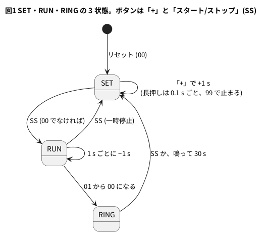

# 6-7 99 秒タイマー — 設定・計数・鳴るの 3 状態、0 でブザー

> [!WARNING]
> **この題は実機で組んでいない。** Verilog は Verilator の lint を警告 0 件で通し、PC のシミュレーションで
> 設定 → 計数 → 0 で鳴る → 30 秒で戻る、一時停止、長押しの速送り、99 での頭打ちを、自分で合否を言う試験で確かめた。
> 「見るべき値」は設計値とシミュレーションの値で、測った値ではない。

第 2 章と第 6 章の部品を 1 台にまとめて、**キッチンタイマーのような 99 秒タイマー**を作る。
「+」で秒を決め、「スタート/ストップ」で数え始め、0 になったらブザーが鳴る。
時計とタイマーの筋 (2-7 → 2-9 → この題 → 12-4 の時計) の 3 つ目。

| 部品 | 題 | この題での役 |
| --- | --- | --- |
| クロックを固定する | 5-7 | **1 kHz (1 クロック = 1 ms)** で回す。1 秒は 1000 クロック |
| 10 進カウンタと桁上げ | 2-9 | 残りの秒を 10 進の 2 桁で持つ ([12-4 の時計](../12-projects/04-clock.md) の `digit` と同じ) |
| 7 セグのデコーダ | 1-8 | 0〜9 を a〜g に直す (12-4 の `seg7dec.v` をそのまま) |
| チャタリング取り | [6-3](03-debounce.md) | 2 つのボタンを 20 ms 続いたら採る (`debounce.v` をそのまま) |
| 長押しで繰り返す | 6-6 | 「+」の速送り |
| 状態機械 | 6-1 | 設定・計数・鳴るの 3 状態 |

## 決めたこと

| 項目 | 決め | 理由 |
| --- | --- | --- |
| 状態 | 設定 (`SET`)・計数 (`RUN`)・鳴る (`RING`) の 3 つ | キッチンタイマーの動きが書ける |
| 「+」(SW1) | `SET` の間だけ効く。押した瞬間に +1 s、押し続けると 0.5 s 後から 0.1 s ごとに +1 s。**99 で止まる** (100 にしない) | 2 桁なので 99 が上限。6-6 の長押しの考えを使う |
| 「スタート/ストップ」(SW2) | `SET` → `RUN` (00 では始めない)、`RUN` → `SET` (一時停止。残りの秒はそのまま)、`RING` → `SET` (止める) | ボタン 2 つで足りる |
| 0 になったら | `RING` に入り、0.5 s 鳴らして 0.5 s 休む。**30 秒鳴ったら自分で `SET` に戻る** (`RING_S`) | 気付かないときに鳴り続けない |
| `RING` から戻ったとき | 表示は `00` | 前に決めた秒を覚える回路は足さない (入門の題なので小さく) |
| ブザー | **受動型の圧電サウンダ 村田 PKM13EPYH4000-A0** を GPIO から直に鳴らす。音の周波数は `parameter TONE_HZ` | 発振回路の無い型なので、回路が作る周波数で鳴る。電流が小さく (6-19)、抵抗もトランジスタも要らない |
| 音の周波数 | この題は **500 Hz** | クロックが 1 kHz なので、方形波は 1 クロックごとに反転する 500 Hz まで |

表示 (7 セグ 2 個の直結)・電源・サウンダの共振と音の大きさ・電流は 6-19。

## 状態遷移図




- 状態は `state` の 2 ビット。残りの秒 (`tens` と `ones`) と、1 秒の中の何クロック目か (`ms`) は状態に付いたデータで、6-1 の `timer` と同じ役
- `RUN` に入ったクロックで `ms` を 0 から数え始め、999 の次のクロックで 1 s 減らすので、押してちょうど 1 s 後に最初の 1 s が減る
- 一時停止で `ms` を 0 に戻すので、続きはその秒を初めから数え直す (途中の分は捨て、合計で最大 1 s 長くなる)
- `RING` の間は 1 s ごとに `rang` を 1 増やし、30 になる 1 s の終わりで `SET` に戻る

## Verilog

モジュールは 4 つ (`timer99`・`key_repeat`・`seg7dec` と 6-3 の `debounce`。試験の `tb_timer99` は数えない)。1 ファイル 1 モジュールにした。`debounce.v` は 6-3 の本文のコードブロックを写す (ここには載せない)。`seg7dec.v` は 12-4 と同じ中身だが、先に読む題なのでここに載せる。

### timer99.v — タイマーの本体

```verilog
// 99 秒タイマー。設定 (SET)・計数 (RUN)・鳴る (RING) の 3 状態
module timer99 #(
    parameter CLK_HZ  = 1000,        // 5-7 で固定したクロック。1 クロック = 1 ms
    parameter TONE_HZ = 500,         // ブザーの音。1 kHz のクロックで作れるのは 500 Hz まで
    parameter RING_S  = 30,          // 鳴り続けて SET に戻るまでの秒
    parameter DEB_MS  = 20,          // チャタリングを取る長さ (6-3)
    parameter LONG_MS = 500,         // 「+」の長押しで繰り返しが始まるまで (6-6)
    parameter REP_MS  = 100          // 繰り返しの間隔
) (
    input        clk,
    input        rst,
    input        btn_plus_n,         // 「+」。押すと 0
    input        btn_ss_n,           // 「スタート/ストップ」。押すと 0
    output [6:0] seg_tens,           // 10 の位の {g, f, e, d, c, b, a}。1 で点灯
    output [6:0] seg_ones,           // 1 の位
    output       buzzer,             // 圧電サウンダへ。鳴らさない間は 0
    output       sec,                // RUN の間、1 秒の前半だけ 1 (AD3 で 1 秒を測る)
    output [1:0] o_state,            // 試験で見る。ピンには出さない
    output [7:0] o_count             // 残りの秒 {10 の位, 1 の位}。試験で見る
);
    localparam MS     = CLK_HZ / 1000;             // 1 ms のクロック数
    localparam SEC_W  = $clog2(CLK_HZ);
    localparam [SEC_W-1:0] SEC_LAST = CLK_HZ[SEC_W-1:0] - 1'b1;
    localparam [SEC_W-1:0] SEC_HALF = CLK_HZ[SEC_W:1];   // CLK_HZ / 2
    localparam HALF   = (CLK_HZ / (2 * TONE_HZ) > 0) ? CLK_HZ / (2 * TONE_HZ) : 1;
    localparam TONE_W = (HALF > 1) ? $clog2(HALF) : 1;
    localparam [TONE_W-1:0] TONE_LAST = HALF[TONE_W-1:0] - 1'b1;
    localparam RING_W = $clog2(RING_S + 1);
    localparam [RING_W-1:0] RING_LAST = RING_S[RING_W-1:0] - 1'b1;

    localparam [1:0] SET = 2'd0, RUN = 2'd1, RING = 2'd2;

    // ボタン: チャタリングを取り (6-3)、「+」だけ長押しで繰り返す (6-6)
    wire plus_clean_n, plus_press, ss_press, plus_step;
    debounce #(.N(DEB_MS * MS)) u_db_plus (
        .clk(clk), .rst(rst), .btn_n(btn_plus_n), .clean_n(plus_clean_n), .press(plus_press));
    /* verilator lint_off PINCONNECTEMPTY */    // スタート/ストップは押した瞬間だけを使う
    debounce #(.N(DEB_MS * MS)) u_db_ss (
        .clk(clk), .rst(rst), .btn_n(btn_ss_n), .clean_n(), .press(ss_press));
    /* verilator lint_on PINCONNECTEMPTY */
    key_repeat #(.LONG(LONG_MS * MS), .REP(REP_MS * MS)) u_rep (
        .clk(clk), .rst(rst), .clean_n(plus_clean_n), .press(plus_press), .step(plus_step));

    reg [1:0]        state;
    reg [3:0]        tens, ones;     // 残りの秒を 10 進の 2 桁で持つ (12-4 と同じ持ち方)
    reg [SEC_W-1:0]  ms;             // 1 秒の中の何クロック目か
    reg [RING_W-1:0] rang;           // 鳴ってから何秒か
    reg [TONE_W-1:0] tone_cnt;
    reg              tone;

    wire sec_end  = (ms == SEC_LAST);              // 1 秒の最後のクロック
    wire is_zero  = (tens == 4'd0) && (ones == 4'd0);
    wire is_99    = (tens == 4'd9) && (ones == 4'd9);
    wire is_one   = (tens == 4'd0) && (ones == 4'd1);

    // SET で +1 (99 で頭打ち)、RUN で 1 秒ごとに -1。1 の位が 9 → 0 で 10 の位へ桁上げ、0 → 9 で桁借り
    wire up   = (state == SET) && plus_step && !is_99;
    wire down = (state == RUN) && sec_end;

    always @(posedge clk)
        if (rst) begin
            state <= SET;
            tens  <= 4'd0;
            ones  <= 4'd0;
        end else begin
            if (up) begin
                if (ones == 4'd9) begin ones <= 4'd0; tens <= tens + 4'd1; end
                else              ones <= ones + 4'd1;
            end else if (down) begin
                if (ones == 4'd0) begin ones <= 4'd9; tens <= tens - 4'd1; end
                else              ones <= ones - 4'd1;
            end

            case (state)
                SET:  if (ss_press && !is_zero) state <= RUN;         // 00 のままでは始めない
                RUN:  if (ss_press)             state <= SET;         // 一時停止 (残りはそのまま)
                      else if (down && is_one)  state <= RING;        // 01 → 00 になる 1 秒の終わり
                RING: if (ss_press || (sec_end && rang == RING_LAST)) state <= SET;
                default:                        state <= SET;
            endcase
        end

    // 1 秒を数える。SET では 0 に止め、RUN と RING に入った所から数え始める
    always @(posedge clk)
        if (rst || state == SET || (state == RUN && ss_press)) ms <= {SEC_W{1'b0}};
        else if (sec_end)                                       ms <= {SEC_W{1'b0}};
        else                                                    ms <= ms + 1'b1;

    always @(posedge clk)
        if (rst || state != RING) rang <= {RING_W{1'b0}};
        else if (sec_end)         rang <= rang + 1'b1;

    // 音: HALF クロックごとに反転する方形波。1 kHz なら毎クロック反転で 500 Hz
    always @(posedge clk)
        if (rst || state != RING) begin
            tone_cnt <= {TONE_W{1'b0}};
            tone     <= 1'b0;
        end else if (tone_cnt == TONE_LAST) begin
            tone_cnt <= {TONE_W{1'b0}};
            tone     <= ~tone;
        end else
            tone_cnt <= tone_cnt + 1'b1;

    wire half1 = (ms < SEC_HALF);                  // 1 秒の前半
    assign buzzer = tone & half1;                  // 0.5 s 鳴らして 0.5 s 休む
    assign sec    = (state == RUN) && half1;

    seg7dec u_tens (.n(tens), .seg(seg_tens));
    seg7dec u_ones (.n(ones), .seg(seg_ones));

    assign o_state = state;
    assign o_count = {tens, ones};
endmodule
```

- `tens` と `ones` が残りの秒の 10 の位と 1 の位。12-4 の `digit` と同じく 1 桁を 4 ビットの 10 進で持つ。増やすときは 1 の位が 9 の次に 0 へ戻って 10 の位を 1 増やし (桁上げ)、
  減らすときは 0 の次に 9 へ戻って 10 の位を 1 減らす (桁借り)。12-4 は上へ数えるだけなので、下へ数える向きを足した
- `up` は `SET` の間の「+」だけ。99 (`is_99`) では増やさない。`down` は `RUN` の間の 1 秒の終わり (`sec_end`) だけ
- `RUN` から `RING` へは、`01` を `00` にする同じクロックで移る (`down && is_one`)
- `half1` は 1 秒の前半 (`ms` が 0〜499)。`RING` の間は 0.5 s 鳴らして 0.5 s 休むのに使い、`RUN` の間は `sec` に出す
- 音は `HALF = CLK_HZ / (2 × TONE_HZ)` クロックごとに `tone` を反転して作る (1 kHz・500 Hz なら `HALF` = 1 で毎クロック反転)
- 長さはどれも `parameter` (`TONE_HZ`・`RING_S`・`DEB_MS`・`LONG_MS`・`REP_MS`) で ms か Hz で書くので、`CLK_HZ` を替えても変わらない
- `o_state` と `o_count` は試験用の出口で、ピンには出さない

### key_repeat.v — 「+」の長押しで繰り返す

```verilog
// 押した瞬間に 1 回、押し続けて LONG クロック経ったら、あとは REP クロックごとに step を 1 クロック 1 にする
module key_repeat #(
    parameter LONG = 500,            // 繰り返しが始まるまで (1 kHz なら 0.5 s)
    parameter REP  = 100             // 繰り返しの間隔 (1 kHz なら 0.1 s。1 秒に 10 回)
) (
    input      clk,
    input      rst,
    input      clean_n,              // チャタリングを取った値 (押すと 0)
    input      press,                // 押した瞬間の 1 クロック
    output     step
);
    localparam W = $clog2(LONG + 1);
    localparam [W-1:0] LONG_LAST = LONG[W-1:0] - 1'b1;
    localparam [W-1:0] REP_LAST  = REP[W-1:0] - 1'b1;

    reg [W-1:0] hold;                // 押してから、または前の繰り返しから何クロックか
    reg         fast;                // 1 なら繰り返しに入った
    reg         rep;

    always @(posedge clk)
        if (rst || clean_n || press) begin
            hold <= {W{1'b0}};
            fast <= 1'b0;
            rep  <= 1'b0;
        end else if (hold == (fast ? REP_LAST : LONG_LAST)) begin
            hold <= {W{1'b0}};
            fast <= 1'b1;
            rep  <= 1'b1;
        end else begin
            hold <= hold + 1'b1;
            rep  <= 1'b0;
        end

    assign step = press | rep;
endmodule
```

- 押した瞬間 (`press`) に 1 回、押し続けて `LONG` クロック (0.5 s) で 1 回、あとは `REP` クロック (0.1 s) ごとに 1 回、`step` を 1 クロックだけ 1 にする
- 離す (`clean_n` が 1) と数え直す。チャタリングを取った後の値を見るので、跳ねで繰り返しは始まらない
- 6-6 の `press_fsm` は長押しと見分けるため短押しを**離したときに**出す。タイマーの「+」は押した瞬間に進めたいので、見分けない小さな形にした。
  押し続けた時間を数えて繰り返す考えは 6-6 と同じ

### seg7dec.v — 0〜9 を a〜g に (12-4 と同じ)

```verilog
// 0 から 9 を 7 セグの a〜g に直す (1-8・12-4 と同じ)。1 が点灯
module seg7dec (
    input      [3:0] n,
    output reg [6:0] seg    // {g, f, e, d, c, b, a}
);
    always @(*)
        case (n)
            4'd0:    seg = 7'b0111111;
            4'd1:    seg = 7'b0000110;
            4'd2:    seg = 7'b1011011;
            4'd3:    seg = 7'b1001111;
            4'd4:    seg = 7'b1100110;
            4'd5:    seg = 7'b1101101;
            4'd6:    seg = 7'b1111101;
            4'd7:    seg = 7'b0000111;
            4'd8:    seg = 7'b1111111;
            4'd9:    seg = 7'b1101111;
            default: seg = 7'b0000000;
        endcase
endmodule
```

Verilator の lint は警告 0 件 (`verilator --lint-only -Wall --top-module timer99 timer99.v debounce.v key_repeat.v seg7dec.v`、確かめた)。
`-GCLK_HZ=27000000 -GTONE_HZ=4000` を足しても 0 件。

## 動かす — PC のシミュレーション

`CLK_HZ` を 1000 にして、1 クロックを 1 ms とみなして回す。押すたびに初めの 5 ms は 1 ms ごとに跳ねる。
`expect_st` が状態と残りの秒の合否を言う (3-3)。順は次のとおり。

1. `00` のままスタートを押しても始まらない
2. 「+」を 3 回短く押して `03`、続けて 2 s 押し続けて `20`
3. スタートで数え始め、5.5 s 後に `15`。`sec` の立ち上がりの間隔が 1000 ms
4. スタート/ストップで一時停止し、3 s 待っても `15`。また押すと続きから数え、15 s で `RING`
5. 鳴り始めの 1 s に `buzzer` が 250 回立ち上がり、間隔は 2 ms (500 Hz)。0.5 s 鳴らして 0.5 s 休むので 500 回の半分
6. 30 s 鳴って `SET` に戻り、`00` で `buzzer` は 0
7. 「+」を 12 s 押し続けて `99` で止まり、もう 1 回押しても `99`
8. 99 s 数えて `RING`。鳴っている間にスタート/ストップで止める

```verilog
// CLK_HZ = 1000 (1 クロック = 1 ms) で、設定 → 計数 → 0 で鳴る → 30 秒で戻るまでを回し、自分で合否を言う
module tb_timer99;
    reg clk = 0;
    reg rst = 1;
    reg plus_n = 1;
    reg ss_n   = 1;
    wire [6:0] seg_tens, seg_ones;
    wire       buzzer, sec;
    wire [1:0] state;
    wire [7:0] count;
    integer errors = 0;
    integer now = 0;                         // 何 ms 目か

    timer99 #(.CLK_HZ(1000), .TONE_HZ(500), .RING_S(30)) u (
        .clk(clk), .rst(rst), .btn_plus_n(plus_n), .btn_ss_n(ss_n),
        .seg_tens(seg_tens), .seg_ones(seg_ones), .buzzer(buzzer), .sec(sec),
        .o_state(state), .o_count(count));

    always #1 clk = ~clk;                    // 1 周期 = 2 時間単位 = 1 ms とみなす
    always @(posedge clk) now <= now + 1;

    task ms(input integer n);
        repeat (n) @(posedge clk);
    endtask

    task expect_st(input [1:0] want_state, input [7:0] want_count, input [8*28-1:0] what);
        if (state !== want_state || count !== want_count) begin
            $display("NG %0s: state=%0d count=%h (want %0d %h)", what, state, count, want_state, want_count);
            errors = errors + 1;
        end else
            $display("ok %0s: state=%0d count=%h", what, state, count);
    endtask

    // 押して n ms 待って離す。押し始めの 5 ms は 1 ms ごとに跳ねる
    task push(input integer which, input integer n);
        integer i;
        begin
            for (i = 0; i < 5; i = i + 1) begin
                if (which == 0) plus_n = i[0]; else ss_n = i[0];
                ms(1);
            end
            if (which == 0) plus_n = 0; else ss_n = 0;
            ms(n);
            if (which == 0) plus_n = 1; else ss_n = 1;
            ms(50);
        end
    endtask

    localparam PLUS = 0, SS = 1;
    localparam [1:0] SET = 0, RUN = 1, RING = 2;

    // 状態が変わった時刻を書く
    reg [1:0] last_state = 0;
    integer t_run = 0, t_ring = 0, t_set = 0;
    always @(posedge clk) begin
        if (state !== last_state) begin
            $display("   %7d ms  state %0d -> %0d  count=%h", now, last_state, state, count);
            if (state == RUN)  t_run  = now;
            if (state == RING) t_ring = now;
            if (state == SET && last_state == RING) t_set = now;
        end
        last_state <= state;
    end

    // sec の立ち上がりの間隔と、ブザーの立ち上がりの数・間隔
    integer sec_last = 0, sec_gap = 0, bz_rises = 0, bz_last = 0, bz_gap = 0;
    reg sec_d = 0, bz_d = 0;
    always @(posedge clk) begin
        sec_d <= sec;
        bz_d  <= buzzer;
        if (sec && !sec_d) begin sec_gap = now - sec_last; sec_last = now; end
        if (buzzer && !bz_d) begin bz_rises = bz_rises + 1; bz_gap = now - bz_last; bz_last = now; end
    end

    initial begin
        ms(3); rst = 0; ms(10);
        expect_st(SET, 8'h00, "after reset");
        push(SS, 100);   expect_st(SET, 8'h00, "start at 00 is ignored");

        push(PLUS, 100); push(PLUS, 100); push(PLUS, 100);
        expect_st(SET, 8'h03, "plus x3 (short)");
        push(PLUS, 2000);                                   // 長押し 2 s
        expect_st(SET, 8'h20, "plus held 2 s");

        push(SS, 100);                                      // RUN へ (押して 25 ms ほどで入る)
        ms(5370);        expect_st(RUN, 8'h15, "run 5.5 s");
        $display("   sec period %0d ms", sec_gap);
        if (sec_gap != 1000) begin $display("NG sec period"); errors = errors + 1; end

        push(SS, 100);   expect_st(SET, 8'h15, "pause");
        ms(3000);        expect_st(SET, 8'h15, "pause 3 s later");
        push(SS, 100);                                      // もう一度押して続きから
        ms(15000);       expect_st(RING, 8'h00, "0 -> ring");
        $display("   RUN -> RING %0d ms", t_ring - t_run);
        if (t_ring - t_run != 15000) begin $display("NG run length"); errors = errors + 1; end

        bz_rises = 0;
        ms(1000);
        $display("   buzzer: %0d rises in 1 s, period %0d ms", bz_rises, bz_gap);
        if (bz_rises != 250 || bz_gap != 2) begin $display("NG buzzer"); errors = errors + 1; end

        ms(29500);       expect_st(SET, 8'h00, "back to SET after 30 s");
        $display("   rang %0d ms", t_set - t_ring);
        if (t_set - t_ring != 30000) begin $display("NG ring length"); errors = errors + 1; end
        if (buzzer !== 1'b0) begin $display("NG buzzer stays on"); errors = errors + 1; end

        push(PLUS, 12000);                                  // 長押し 12 s: 99 で止まる
        expect_st(SET, 8'h99, "plus held 12 s stops at 99");
        push(PLUS, 100); expect_st(SET, 8'h99, "plus at 99");

        push(SS, 100);   ms(100000);                        // 99 s 数えて鳴る
        expect_st(RING, 8'h00, "99 s -> ring");
        push(SS, 100);   expect_st(SET, 8'h00, "stop while ringing");

        if (errors == 0) $display("PASS");
        else             $display("FAIL: %0d", errors);
        $finish;
    end
endmodule
```

```bash
verilator --binary --timing --top-module tb_timer99 tb_timer99.v timer99.v debounce.v key_repeat.v seg7dec.v
./obj_dir/Vtb_timer99
```

```text
ok after reset: state=0 count=00
ok start at 00 is ignored: state=0 count=00
ok plus x3 (short): state=0 count=03
ok plus held 2 s: state=0 count=20
      2714 ms  state 0 -> 1  count=20
ok run 5.5 s: state=1 count=15
   sec period 1000 ms
      8239 ms  state 1 -> 0  count=15
ok pause: state=0 count=15
ok pause 3 s later: state=0 count=15
     11394 ms  state 0 -> 1  count=15
     26394 ms  state 1 -> 2  count=00
ok 0 -> ring: state=2 count=00
   RUN -> RING 15000 ms
   buzzer: 250 rises in 1 s, period 2 ms
     56394 ms  state 2 -> 0  count=00
ok back to SET after 30 s: state=0 count=00
   rang 30000 ms
ok plus held 12 s stops at 99: state=0 count=99
ok plus at 99: state=0 count=99
     69259 ms  state 0 -> 1  count=99
    168259 ms  state 1 -> 2  count=00
ok 99 s -> ring: state=2 count=00
    169414 ms  state 2 -> 0  count=00
ok stop while ringing: state=0 count=00
PASS
```

試験は全部 ok で `PASS` (Verilator 5.042 と 5.048 で実行)。数字だけの行は状態が変わった時刻で、`state` は 0 が `SET`・1 が `RUN`・2 が `RING`。

- `plus held 2 s` の `20`: 短押し 3 回の `03` に、長押しで 17 足した。押した瞬間に 1、0.5 s で 1、0.6〜2.0 s の 0.1 s ごとに 15
- 一時停止の後、続きを始めてから `RING` まで 15 000 ms (`RUN -> RING`)。残りの 15 s ちょうど
- 鳴り始めてから `SET` に戻るまで 30 000 ms (`rang`)
- `plus held 12 s`: 100 回以上進む計算だが、`99` で止まった

スタートを押してから数え始めるまでの遅れは、跳ねずに押すと 22.5 ms (別の短い試験。押す時刻は 300 ms、クロックの立ち上がりは 0.5 ms・1.5 ms …)。
チャタリング取りの 2 段の受け (2 ms) と、20 ms 続いたかを見る分。

## 組む・Pico 2 で動かす

回路図・部品・抵抗の決め方・実体配線図は [6-19](19-timer-99s-wiring.md)、Pico 2 のプログラム・AD3 の Logic の設定と画面・picoemu での確かめは [6-17](17-timer-99s-pico.md) に分けた。どれも組んで測る物なので、この題には実体配線図・AD3・Logic の図を置かない。

## 見るべき値

設計値とシミュレーションの値 (実機では測っていない。読んだら表に書き加える)。Logic で読む値は 6-17、電流と音の大きさは 6-19。

| 見る所 | 設計値・シミュレーション | どこで得たか | 実機 (測って書く) |
| --- | --- | --- | --- |
| 15 s から `RING` まで | 15.000 s | 試験 | |
| `RING` の長さ (押さないとき) | 30.000 s で `SET` に戻る | 試験 | |
| 「+」の長押し | 0.5 s で 1 回、以後 0.1 s ごと (2 s で +17) | 試験 | |
| 99 で「+」を押したとき | 99 のまま | 試験 | |

## シミュレーションでの確かめ (対象外を含む)

本文の 3 つの `.v` と試験 `tb_timer99` を抜き出し、Verilator 5.042 で走らせ直した (`debounce.v` は 6-3 の `sim/03-debounce.v`)。
原本は `sim/07-timer-99s.v` (`timer99`)・`-key-repeat.v`・`-seg7dec.v`・`-tb.v`。「別の短い試験」(スタートの遅れ 22.5 ms) は `sim/07-timer-99s-start-tb.v` に書き直した (300 ms で押す)。
`tb_timer99` は `sfa-dev:local` の Verilator 5.048 でも走らせた。

| 項目 | 本文の数字 | 実行結果 | 判定 |
| --- | --- | --- | --- |
| lint (`-Wall`) | 警告 0 件 | 警告 0 件 | 合った |
| lint (`-GCLK_HZ=27000000 -GTONE_HZ=4000`) | 警告 0 件 | 警告 0 件 | 合った |
| 試験の出力 (26 行) | `PASS`、状態が変わる時刻 2714・8239・11394・26394・56394・69259・168259・169414 ms | 26 行とも同じ | 合った |
| `SEC` の周期 | 1000 ms | 1000 ms | 合った |
| 15 s から `RING` まで | 15 000 ms | 15 000 ms | 合った |
| `RING` の長さ | 30 000 ms | 30 000 ms | 合った |
| ブザー | 1 s に 250 回の立ち上がり、周期 2 ms | 250 回、2 ms | 合った |
| スタートを押してから数え始めるまで | 22.5 ms | 322.5 ms (300 ms に押す) = 22.5 ms | 合った |
| ブザーの最初の立ち上がり | `RING` に入った 1 ms 後 | 1322.5 ms に `RING`、1323.5 ms に最初の立ち上がり | 合った |
| 「+」の長押し (2 s で +17)、99 での頭打ち | `20`、`99` のまま | 試験の `ok` どおり | 合った |

確かめられなかったもの。

- Pico 2 への書き込み、7 セグの点灯、ブザーの音、AD3 での測定 (6-17・6-19)

## 出典

自作。

- PKM13EPYH4000-A0 の駆動・共振周波数: 村田製作所の Product Search Data Sheet (2024-05-28)。秋月電子通商の通販コード P-04118 (値の表は 6-19)
