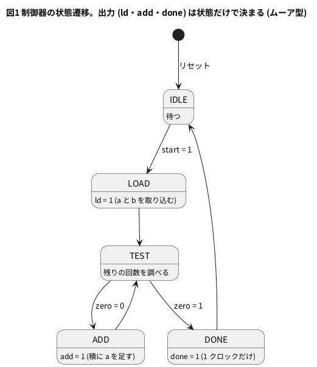
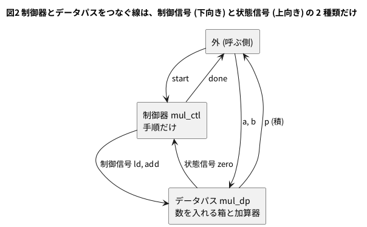

# 6-8 状態機械とデータパスを分ける — 掛け算を足し算の繰り返しで

この題は実体配線図と Analog Discovery 3 の図を付けない。PC の Verilator だけで動かす題で、組む物が無いから。

6-1 から 6-7 までの状態機械は、「いま何をする段か」(状態) と「数える・覚える数」(`timer` や `tens` と `ones`) を、1 つのモジュールに同居させていた。
手順が長くなり、数を持つ箱が増えると、1 本の `always` に全部が絡んで読めなくなる。

この題では、回路を 2 つに分ける。

| 部分 | 持つもの | 持たないもの |
| --- | --- | --- |
| 制御器 (状態機械) | 手順。いまどの段か | 数。足し算・比べる回路 |
| データパス | 数を入れる箱 (レジスタ) と、足し算・引き算の回路 | 手順。いつ何をするか |

つなぐ線は 2 種類だけで、向きが逆である。

- **制御信号** (制御器 → データパス): 「いま取り込め」「いま足せ」という命令。この題では `ld` と `add`
- **状態信号** (データパス → 制御器): 「残りの回数が 0 だ」という報告。この題では `zero`

題材は、足し算だけで掛け算をすることにする。`5 × 3` は `5 + 5 + 5` で、3 が「足す回数」である。

## 手順

`a × b` を、積を 0 にして、`a` を `b` 回足して作る。

1. `a` と `b` を取り込み、積を 0 にする (LOAD)
2. 残りの回数が 0 か調べる (TEST)。0 なら終わり (DONE)
3. 0 でなければ、積に `a` を足し、残りの回数を 1 減らす (ADD)。2 に戻る

手順の中に出てくる「数」は、`a` `b` 積 残りの回数の 4 つで、手順の中では計算しない。
計算はデータパスの仕事で、制御器は「足せ」と言うだけである。

## 状態遷移図




- 状態は 5 つ。遷移の条件に使う入力は `start` と `zero` の 2 本だけ。`a` や `b` の値は制御器に入らない
- TEST と ADD を別の状態にしたので、6-4 のムーア型と同じく出力は状態だけで決まる。そのぶん 1 回の足し算に 2 クロックかかる




## Verilog

### mul_dp.v — データパス

```verilog
// 掛け算のデータパス。数を入れる箱 (レジスタ) と、足し算・引き算だけを持つ。
// 手順は持たない。いつ何をするかは、制御信号 ld と add で外から決まる
module mul_dp #(
    parameter W = 8                  // 被乗数・乗数の幅
) (
    input              clk,
    input              rst,
    input              ld,           // 制御信号: a と b を取り込み、積を 0 にする
    input              add,          // 制御信号: 積に a を足し、残りの回数を 1 減らす
    input  [W-1:0]     a,
    input  [W-1:0]     b,
    output [2*W-1:0]   p,            // 積
    output             zero          // 状態信号: 残りの回数が 0
);
    reg [W-1:0]   a_r;               // 足す数 (取り込んだ a)
    reg [W-1:0]   cnt;               // 残りの回数 (取り込んだ b から 1 ずつ減る)
    reg [2*W-1:0] acc;               // 積を貯める箱

    always @(posedge clk)
        if (rst) begin
            a_r <= {W{1'b0}};
            cnt <= {W{1'b0}};
            acc <= {2*W{1'b0}};
        end else if (ld) begin
            a_r <= a;
            cnt <= b;
            acc <= {2*W{1'b0}};
        end else if (add) begin
            acc <= acc + {{W{1'b0}}, a_r};
            cnt <= cnt - 1'b1;
        end

    assign p    = acc;
    assign zero = (cnt == {W{1'b0}});
endmodule
```

- 箱は 3 つ。足す数 `a_r`、残りの回数 `cnt`、積 `acc`。`ld` で全部を入れ替え、`add` で `acc` と `cnt` を更新する
- `ld` も `add` も 0 のとき、箱は何も変えない。データパスは、命令が来ない間は黙っている
- `W` はデータパスだけが持つ。積の幅は `2 * W`
- `zero` は `cnt` が 0 かどうか。これが制御器へ戻る状態信号で、6-7 の `zero` (値が 0 になったら ALARM) と同じ形である

### mul_ctl.v — 制御器

```verilog
// 掛け算の制御器 (ムーア型の状態機械)。数は持たない。
// 見るのは start と zero だけ、出すのは ld・add・done だけ
module mul_ctl (
    input      clk,
    input      rst,
    input      start,                // 1 クロックだけ 1 にすると始まる
    input      zero,                 // 状態信号: データパスの残りの回数が 0
    output     ld,                   // 制御信号
    output     add,                  // 制御信号
    output     done                  // 積が出来た (1 クロックだけ 1)
);
    localparam [2:0] S_IDLE = 3'd0,  // 待つ
                     S_LOAD = 3'd1,  // a と b を取り込む
                     S_TEST = 3'd2,  // 残りの回数を調べる
                     S_ADD  = 3'd3,  // 1 回足す
                     S_DONE = 3'd4;  // 終わり

    reg [2:0] st;
    reg [2:0] next;

    always @(posedge clk)
        if (rst) st <= S_IDLE;
        else     st <= next;

    always @(*) begin
        next = st;
        case (st)
            S_IDLE:  if (start) next = S_LOAD;
            S_LOAD:             next = S_TEST;
            S_TEST:  if (zero)  next = S_DONE;
                     else       next = S_ADD;
            S_ADD:              next = S_TEST;
            S_DONE:             next = S_IDLE;
            default:            next = S_IDLE;
        endcase
    end

    assign ld   = (st == S_LOAD);
    assign add  = (st == S_ADD);
    assign done = (st == S_DONE);
endmodule
```

- 6-1 の 3 つの部分 (状態のレジスタ・次の状態の `case`・出力) のまま。この中に `a` も `b` も `W` も出てこない
- 数が何ビットでも、足す回数が何回でも、制御器は同じ文面で使える

### mul_top.v — つなぐだけの最上位

```verilog
// 制御器とデータパスをつなぐだけの最上位
module mul_top #(
    parameter W = 8
) (
    input              clk,
    input              rst,
    input              start,
    input  [W-1:0]     a,
    input  [W-1:0]     b,
    output [2*W-1:0]   p,
    output             done
);
    wire ld;
    wire add;
    wire zero;

    mul_ctl u_ctl (.clk(clk), .rst(rst), .start(start), .zero(zero),
                   .ld(ld), .add(add), .done(done));
    mul_dp #(.W(W)) u_dp (.clk(clk), .rst(rst), .ld(ld), .add(add),
                          .a(a), .b(b), .p(p), .zero(zero));
endmodule
```

最上位は、2 つを同じ名前の線でつなぐだけで、手順も計算も持たない。

Verilator の lint は警告なしで通る (`verilator --lint-only -Wall --top-module mul_top mul_top.v mul_ctl.v mul_dp.v`、確かめた。`-GW=4` でも通る)。

## 分けないで書くと

同じ振る舞いを、状態と数を 1 本の `always` に書いた物も用意した。

```verilog
// 同じ掛け算を、手順と数を分けずに 1 つの always に書いた物 (比べるため)
module mul_flat #(
    parameter W = 8
) (
    input              clk,
    input              rst,
    input              start,
    input  [W-1:0]     a,
    input  [W-1:0]     b,
    output [2*W-1:0]   p,
    output             done
);
    localparam [2:0] S_IDLE = 3'd0, S_LOAD = 3'd1, S_TEST = 3'd2, S_ADD = 3'd3, S_DONE = 3'd4;

    reg [2:0]     st;
    reg [W-1:0]   a_r;
    reg [W-1:0]   cnt;
    reg [2*W-1:0] acc;

    always @(posedge clk)
        if (rst) begin
            st  <= S_IDLE;
            a_r <= {W{1'b0}};
            cnt <= {W{1'b0}};
            acc <= {2*W{1'b0}};
        end else begin
            case (st)
                S_IDLE: if (start) st <= S_LOAD;
                S_LOAD: begin
                    a_r <= a;
                    cnt <= b;
                    acc <= {2*W{1'b0}};
                    st  <= S_TEST;
                end
                S_TEST: if (cnt == {W{1'b0}}) st <= S_DONE;
                        else                  st <= S_ADD;
                S_ADD: begin
                    acc <= acc + {{W{1'b0}}, a_r};
                    cnt <= cnt - 1'b1;
                    st  <= S_TEST;
                end
                S_DONE: st <= S_IDLE;
                default: st <= S_IDLE;
            endcase
        end

    assign p    = acc;
    assign done = (st == S_DONE);
endmodule
```

動きは同じだが、`case` の各行に「状態を進める」と「数を更新する」が混ざっている。
たとえば「`a` が 0 なら足さずに終わる」と手順を直したくなったとき、数の更新式を読み分けながら状態の進め方を探すことになる。
分けた版なら、手順の直しは `mul_ctl.v` だけ、数の直しは `mul_dp.v` だけで済む。

## 試験 — 全 65536 組

分けた版 (`mul_top`) と分けない版 (`mul_flat`) を同じ入力で回す。8 ビットの `a` と `b` の全 65536 組について、次の 3 つを調べる。

- 積が `a * b` に合うか
- 分けた版と分けない版の `p` と `done` が、全クロックで食い違わないか
- `start` を受けてから `done` が見えるまでが `2 * b + 2` クロックか

4 ビット版 (`W = 4`) も、制御器を 1 文字も変えずに、全 256 組を回す。

```verilog
`timescale 1ns / 1ps
// 8 ビット x 8 ビットの全 65536 組を、分けた版 (mul_top) と分けない版 (mul_flat) で回し、
// 積が a * b に合うか、done が出るまでのクロック数が両方で同じか調べる。
// 4 ビット版 (W = 4) も同じ制御器のまま全 256 組を回す
module tb_mul;
    reg        clk;
    reg        rst;
    reg        start;
    reg  [7:0] a;
    reg  [7:0] b;
    wire [15:0] p_s;
    wire        done_s;
    wire [15:0] p_f;
    wire        done_f;
    wire [7:0]  p4;
    wire        done4;

    mul_top  #(.W(8)) split  (.clk(clk), .rst(rst), .start(start), .a(a), .b(b), .p(p_s), .done(done_s));
    mul_flat #(.W(8)) flat   (.clk(clk), .rst(rst), .start(start), .a(a), .b(b), .p(p_f), .done(done_f));
    mul_top  #(.W(4)) narrow (.clk(clk), .rst(rst), .start(start), .a(a[3:0]), .b(b[3:0]), .p(p4), .done(done4));

    initial begin clk = 1'b0; forever #5 clk = ~clk; end

    integer n_bad    = 0;     // 積が合わない回数
    integer n_diff   = 0;     // 分けた版と分けない版が食い違った回数
    integer n_late   = 0;     // クロック数が 2b + 2 にならなかった回数
    integer n_runs   = 0;
    integer n_clocks = 0;
    integer max_clk  = 0;
    integer i, j, n;
    reg     ok4;
    wire [7:0]  want4 = a[3:0] * b[3:0];   // 4 ビット版の正しい積
    reg  [15:0] want;

    // a x b を 1 回回し、start を受けてから done が見えるまでのクロック数を返す
    task run(input [7:0] ta, input [7:0] tb, output integer clocks);
        begin
            a = ta; b = tb;
            start = 1'b1;
            @(posedge clk);            // start を受ける (これを 0 番目の立ち上がりと数える)
            #1 start = 1'b0;
            n = 0;
            while (!done_s) begin
                @(posedge clk);
                #1 n = n + 1;
            end
            clocks = n;
            want = ta * tb;
            if (p_s !== want) n_bad = n_bad + 1;
            if (p_s !== p_f || done_s !== done_f) n_diff = n_diff + 1;
            if (n != 2 * tb + 2) n_late = n_late + 1;
            n_runs = n_runs + 1;
            n_clocks = n_clocks + n;
            if (n > max_clk) max_clk = n;
            @(posedge clk);            // DONE から IDLE へ
            #1;
        end
    endtask

    integer c;
    initial begin
        rst = 1'b1; start = 1'b0; a = 8'd0; b = 8'd0;
        repeat (3) @(posedge clk);
        #1 rst = 1'b0;

        // 見せる例
        $display("   a    b      p  clocks");
        run(8'd5,   8'd3,   c); $display("%4d %4d %6d %6d", 5, 3, p_s, c);
        run(8'd12,  8'd0,   c); $display("%4d %4d %6d %6d", 12, 0, p_s, c);
        run(8'd0,   8'd9,   c); $display("%4d %4d %6d %6d", 0, 9, p_s, c);
        run(8'd7,   8'd1,   c); $display("%4d %4d %6d %6d", 7, 1, p_s, c);
        run(8'd1,   8'd7,   c); $display("%4d %4d %6d %6d", 1, 7, p_s, c);
        run(8'd255, 8'd255, c); $display("%4d %4d %6d %6d", 255, 255, p_s, c);

        n_bad = 0; n_diff = 0; n_late = 0; n_runs = 0; n_clocks = 0; max_clk = 0;
        for (i = 0; i < 256; i = i + 1)
            for (j = 0; j < 256; j = j + 1)
                run(i[7:0], j[7:0], c);
        $display("8 bit: %0d runs, bad %0d, split/flat differ %0d, not 2b+2 %0d, max %0d clocks, avg %0d.%0d",
                 n_runs, n_bad, n_diff, n_late, max_clk, n_clocks / n_runs, (n_clocks * 10 / n_runs) % 10);

        // 4 ビット版: 同じ制御器 (mul_ctl) のまま。a と b の下位 4 ビットだけ使う
        ok4 = 1'b1;
        for (i = 0; i < 16; i = i + 1)
            for (j = 0; j < 16; j = j + 1) begin
                a = i[7:0]; b = j[7:0];
                start = 1'b1; @(posedge clk); #1 start = 1'b0;
                while (!done4) begin @(posedge clk); #1; end
                if (p4 !== want4) ok4 = 1'b0;
                @(posedge clk); #1;
            end
        $display("4 bit: 256 runs, %s", ok4 ? "all match" : "MISMATCH");
        if (n_bad == 0 && n_diff == 0 && n_late == 0 && ok4) $display("PASS");
        else                                                $display("FAIL");
        $finish;
    end
endmodule
```

```bash
verilator --binary --timing --top-module tb_mul tb_mul.v mul_top.v mul_ctl.v mul_dp.v mul_flat.v
./obj_dir/Vtb_mul
```

```text
   a    b      p  clocks
   5    3     15      8
  12    0      0      2
   0    9      0     20
   7    1      7      4
   1    7      7     16
 255  255  65025    512
8 bit: 65536 runs, bad 0, split/flat differ 0, not 2b+2 0, max 512 clocks, avg 257.0
4 bit: 256 runs, all match
PASS
```

(Verilator 5.042 で実行。`clocks` は、`start` を受けた立ち上がりから、`done` が 1 に見えるまでの立ち上がりの数。)

- 65536 組すべてで積が合い、分けた版と分けない版は 1 クロックも食い違わなかった
- クロック数は `2 * b + 2`。`a` の大きさには関係なく、**乗数 `b` だけで決まる**。`7 × 1` は 4 クロック、`1 × 7` は 16 クロック
- `b` が 0 のときも 2 クロックかかる (LOAD と TEST)。足す回数が 0 回でも、手順の入口と出口は通る
- 最も遅いのは `b = 255` の 512 クロック。全組の平均は 257 クロック
- 4 ビット版も、同じ `mul_ctl` で全 256 組が合った

## 波形

`5 × 3` を回し、クロックごとの値を書いた。`W = 8` で、`b = 3`・`a = 5`・積 15 なので、残りの回数は下位 2 ビット、積は下位 4 ビットだけが動く。
1 クロックを 1 ms と置いた仮の目盛で、`k ms` は `k` 番目のクロックの周期の頭である。

```text
 0 start=0 st=0 ld=0 add=0 zero=1 done=0 cnt=0 acc=0
 1 start=1 st=0 ld=0 add=0 zero=1 done=0 cnt=0 acc=0
 2 start=0 st=1 ld=1 add=0 zero=1 done=0 cnt=0 acc=0
 3 start=0 st=2 ld=0 add=0 zero=0 done=0 cnt=3 acc=0
 4 start=0 st=3 ld=0 add=1 zero=0 done=0 cnt=3 acc=0
 5 start=0 st=2 ld=0 add=0 zero=0 done=0 cnt=2 acc=5
 6 start=0 st=3 ld=0 add=1 zero=0 done=0 cnt=2 acc=5
 7 start=0 st=2 ld=0 add=0 zero=0 done=0 cnt=1 acc=10
 8 start=0 st=3 ld=0 add=1 zero=0 done=0 cnt=1 acc=10
 9 start=0 st=2 ld=0 add=0 zero=1 done=0 cnt=0 acc=15
10 start=0 st=4 ld=0 add=0 zero=1 done=1 cnt=0 acc=15
11 start=0 st=0 ld=0 add=0 zero=1 done=0 cnt=0 acc=15
12 start=0 st=0 ld=0 add=0 zero=1 done=0 cnt=0 acc=15
13 start=0 st=0 ld=0 add=0 zero=1 done=0 cnt=0 acc=15
```

(`st` は 0 IDLE・1 LOAD・2 TEST・3 ADD・4 DONE。)

```logic
title: 図3 5 x 3 を回す。ld で取り込み、add を 3 回かけて積が 15 になり、zero で done
device: generic
window: 14ms
signals:
  CLK: clock 1kHz
  START: edges 0s=0 1ms=1 2ms=0
  S2: edges 0s=0 10ms=1 11ms=0
  S1: edges 0s=0 3ms=1 10ms=0
  S0: edges 0s=0 2ms=1 3ms=0 4ms=1 5ms=0 6ms=1 7ms=0 8ms=1 9ms=0
  LD: edges 0s=0 2ms=1 3ms=0
  ADD: edges 0s=0 4ms=1 5ms=0 6ms=1 7ms=0 8ms=1 9ms=0
  ZERO: edges 0s=1 3ms=0 9ms=1
  DONE: edges 0s=0 10ms=1 11ms=0
  C1: edges 0s=0 3ms=1 7ms=0
  C0: edges 0s=0 3ms=1 5ms=0 7ms=1 9ms=0
  A3: edges 0s=0 7ms=1
  A2: edges 0s=0 5ms=1 7ms=0 9ms=1
  A1: edges 0s=0 7ms=1
  A0: edges 0s=0 5ms=1 7ms=0 9ms=1
buses:
  State: S2 S1 S0 dec
  CNT: C1 C0 dec
  ACC: A3 A2 A1 A0 dec
cursors: [2ms, 10ms]
trigger: START rising at 1ms
```


- X1 (2 ms) は LOAD の周期、X2 (10 ms) は DONE の周期。ΔX = 8 ms = 8 クロックで、`2 * b + 2` (b = 3)
- `LD` が立った周期 (2 ms) の次の周期 (3 ms) に `CNT` が 3 になる。`ADD` が立つたびに、次の周期で `CNT` が 1 減り `ACC` が 5 増える (0 → 5 → 10 → 15)
- `ZERO` は `CNT` が 0 になった周期 (9 ms) に立つ。次の周期 (10 ms) で TEST から DONE に進み、`DONE` が 1 クロックだけ立つ
- `ACC` は DONE のあとも 15 のまま残り、次の `LD` まで変わらない。`done` が 1 の間に読めなくても、`p` は残っている

## 合成した大きさ

```bash
yosys -p "read_verilog -sv mul_top.v mul_ctl.v mul_dp.v; hierarchy -top mul_top; synth_gowin -top mul_top; stat"
```

| 書き方 | ALU | FF | LUT |
| --- | --- | --- | --- |
| 分けた (`mul_top`、`W = 8`) | 24 | 37 | 17 |
| 分けない (`mul_flat`、`W = 8`) | 24 | 37 | 32 |
| 分けた、`W = 4` | 12 | 21 | 17 |
| 分けた、`W = 16` | 48 | 69 | 30 |
| 制御器だけ (`mul_ctl`) | 0 | 5 | 5 |

(yosys 0.33、`synth_gowin`。FF は DFF と DFFRE の合計、LUT は LUT1〜LUT4 の合計。)

- ALU は 3 × `W` 個 (残りの回数の引き算が `W`、積の足し算が `2 * W`)、FF は 5 + 4 × `W` 個。幅を替えると、データパスだけが大きくなり、制御器の 5 FF は変わらない
- 分けない版の LUT が 15 個多い。差の原因は調べていない。**分けると回路が小さくなる、とは言えない**。この題で得るのは回路の小ささでなく、直す場所が分かれることである

## 分けると何ができるか

- **幅を替える**: `W = 4` を試験で動かしたとおり、`mul_ctl.v` は無修正のまま。直したのは `mul_top` の `.W(...)` だけ
- **呼ぶ側が工夫する**: 足す回数は乗数 `b` で決まるので、小さいほうを `b` に入れれば速い (`7 × 1` は 4 クロック、`1 × 7` は 16 クロック)。回路の中を替える必要はない
- **データパスを入れ替える**: 足し算の繰り返しは `b` クロックの 2 倍かかる。シフトと加算なら 8 ビットの積が 8 回の足し算で済む。
  このとき `mul_ctl` は「TEST → ADD の繰り返し」を「8 回数える」に直すだけで、`ld`・`add`・`done` の名前は残せる。この作りは 10-4 で書く
- **手順を替える**: TEST と ADD を 1 つにして 1 回の足し算を 1 クロックにする、`abort` を足して途中でやめる、などは `mul_ctl.v` だけの直しで、`mul_dp.v` は見なくてよい

## 見るべき値

PC の Verilator (5.042) と yosys (0.33) で実際に動かして得た値。実機はこの題に無い。

| 見る所 | 値 |
| --- | --- |
| lint (`-Wall`) | `mul_top`・`mul_flat`・`W = 4` とも警告 0 件 |
| 8 ビットの全 65536 組 | 積の食い違い 0 回、分けた版と分けない版の食い違い 0 回 |
| 4 ビット版の全 256 組 | すべて一致 (制御器は同じ) |
| `start` から `done` まで | `2 * b + 2` クロック (全 65536 組で一致) |
| 最も遅い組 | `255 × 255` の 512 クロック。平均 257 クロック |
| `5 × 3` | 8 クロック、積 15 |
| 合成 (ALU / FF / LUT) | 分けた版 24 / 37 / 17、分けない版 24 / 37 / 32 |

## 出典

自作。制御器とデータパスに分ける設計は、ディジタル回路設計の一般的な作法で、制御信号と状態信号でつなぐ形は
FSMD (finite state machine with datapath、データパスを持つ有限状態機械) と呼ばれる。
足し算を繰り返す掛け算は、最も素朴な逐次乗算である。
yosys の `synth_gowin` は [Yosys のマニュアル](https://yosyshq.readthedocs.io/projects/yosys/en/latest/cmd/synth_gowin.html)。
