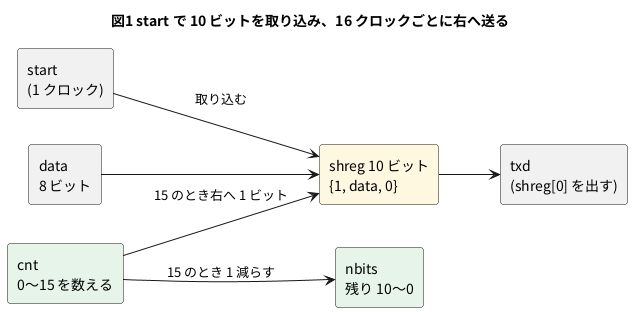

# 7-1 UART の送信 — ボーレートの分周とシフトレジスタ

> [!WARNING]
> **この題は実機で組んでいない。** Verilog は Verilator の lint を通し、PC のシミュレーションで
> 0x00〜0xFF の 256 字を送り、4800 bps ちょうどで読む受け手と突き合わせた。
> Pico 2 への書き込みと、AD3 での測定はしていない。「見るべき値」はシミュレーションの値と計算値。

UART は、1 本の線で 1 字 (8 ビット) ずつ送る、いちばん簡単な非同期の通信。
線は何も送らない間は 1 (アイドル)。1 字は次の 10 ビットで送る。これを 8N1 (データ 8 ビット・パリティなし・ストップ 1 ビット) と呼ぶ。

| 順 | ビット | 値 |
| --- | --- | --- |
| 1 | スタート | 0 (アイドルの 1 から 0 に下がるのが字の始まりの合図) |
| 2〜9 | データ bit0〜bit7 | 字の値。**下位ビット (bit0) から先に**送る |
| 10 | ストップ | 1 |

送る側と受ける側は、クロックの線を持たない。代わりに、1 ビットの長さ (ボーレート、bps) を両方で決めておく。
この題では、送る側を Verilog で書く。部品は 2 つ。

- **ボーレートの分周**: クロックを数えて、1 ビットの長さを作る (2-5・2-7 の分周と同じ)
- **シフトレジスタ**: 10 ビットを並べて右へ送り、いちばん右のビットをピンに出す (2-6)

## クロックとボーレートを決める

Pico 2 の Soft-FPGA は、クロックを 5-7 のタイマ割り込みで固定する。割り込みの周期は µs (マイクロ秒) の整数で決める。
この章 (7-1〜7-3) では、受信 (7-2) がボーレートの 16 倍で刻むので、**クロックの 1 周期 = ボーレートの 1/16** になる組を選んだ。

| ボーレート | 1/16 ビット | いちばん近い整数の µs | その周期で出るボーレート | ずれ |
| --- | --- | --- | --- | --- |
| 9600 bps | 6.510 µs | 7 µs | 8929 bps | −7.0 % |
| 4800 bps | 13.021 µs | **13 µs** | 4808 bps | **+0.16 %** |
| 2400 bps | 26.042 µs | 26 µs | 2404 bps | +0.16 % |

(計算値。ずれ = 出るボーレート ÷ 決めたボーレート − 1)

9600 bps は µs の整数では 7 % ずれ、受け手が読み違える (ずれがどこまで許されるかは 7-6)。
**この章は 4800 bps、クロックは 13 µs (76.923 kHz)** にする。1 ビットは 16 クロック = 208 µs (4800 bps ちょうどなら 208.33 µs)。

13 µs が、この大きさの回路の 1 クロックの計算 (5-5・5-6 で測る) に間に合うかは、5-9 の測り方で確かめる。
間に合わなければ 26 µs・2400 bps にする (Verilog は `CLK_HZ` と `BAUD` を替えるだけ)。

## 送る順の図




- `start` が来たら、シフトレジスタ `shreg` に {ストップの 1、データ 8 ビット、スタートの 0} を入れる。右端がスタートビット
- `cnt` が 0〜15 を数え、15 のクロックで `shreg` を右へ 1 ビット送る。空いた左端には 1 を入れる (送り終わるとアイドルの 1 が出続ける)
- `nbits` が 0 になったら送り終わり。`busy` が 0 に戻り、次の字を受け付ける

## 回路図

```circuit
# 回路図 (tommie-fence の circuit フェンス)
title: 図2 Pico 2 の GP15 から UART の TXD を出し、AD3 の DIO0 で読む
parts:
  MCU: pico2 3,6 mirror
  G1: ground 5,9
  AD:
    type: device
    at: 8.5,10
    label: AD3
    pins: [DIO0, GND]
  G2: ground 7,10.8
wires:
  - MCU.GND18 |- 5,9
  - MCU.GP15 |- AD.DIO0
  - AD.GND |- 7,10.2 -- 7,10.8
style:
  pitch: 1.2
  grid: on
```


- Pico 2 の GP15 が送る線 (TXD)。AD3 は DIO0 で読むだけで、何も出さない
- AD3 の GND と Pico 2 の GND (18 番) を共通にする (0-4)
- 部品は Pico 2 と AD3 だけ。電源は Pico 2 の USB で、ピンは 3.3 V (0-3)

## 実体配線図

```bread
# ブレッドボードの実体配線図 (tommie-fence の bread フェンス)
title: 図3 ブレッドボードに Pico 2 を挿し、AD3 の DIO0 と GND をつなぐ
board: half
parts:
  MCU: pico2 @ h5
  AD:
    type: device
    at: bottom
    label: AD3 Logic
    pins: [GND, DIO0]
wires:
  - AD.GND -- j22 black
  - AD.DIO0 -- j24 yellow
```


- `pico2 @ h5` は 0-4 と同じ向き。GP15 (20 番) は 24 列、GND (18 番) は 22 列。同じ列の j 行の穴から線を取る
- DIO0 は黄、GND は黒。赤は使わない (+ の電源をブレッドボードに配らない)
- 流れる電流は AD3 の DIO の入力へ向かうごく小さなもの。信号は 4800 bps (1 ビット 208 µs) で、ブレッドボードの範囲 (3 MHz 以下) に収まる

## Verilog

### uart_tx.v — 送信

```verilog
// UART の送信 (8N1)。start を 1 クロック 1 にすると data を送る。
// CLK_HZ を BAUD で割った数のクロックで 1 ビット。10 ビットのシフトレジスタを右へ送り、最下位をピンに出す
module uart_tx #(
    parameter CLK_HZ = 76_923,   // Pico 2 で 1 クロック 13 µs に固定したとき
    parameter BAUD   = 4800
) (
    input        clk,
    input        rst,
    input  [7:0] data,
    input        start,
    output       txd,
    output       busy
);
    localparam integer DIV  = (CLK_HZ + BAUD / 2) / BAUD;   // 1 ビットのクロック数 (四捨五入)
    localparam integer W    = (DIV > 1) ? $clog2(DIV) : 1;
    localparam integer LAST = DIV - 1;

    reg [9:0]   shreg;   // {ストップ, データ 8 ビット, スタート}。右へ送る
    reg [3:0]   nbits;   // 残りのビット数
    reg [W-1:0] cnt;     // 1 ビットの中のクロックを数える

    assign txd  = shreg[0];
    assign busy = (nbits != 4'd0);

    always @(posedge clk)
        if (rst) begin
            shreg <= 10'h3FF;                     // 何も送らない間は 1 (アイドル)
            nbits <= 4'd0;
            cnt   <= {W{1'b0}};
        end else if (!busy) begin
            if (start) begin
                shreg <= {1'b1, data, 1'b0};
                nbits <= 4'd10;
                cnt   <= {W{1'b0}};
            end
        end else if (cnt == LAST[W-1:0]) begin
            cnt   <= {W{1'b0}};
            shreg <= {1'b1, shreg[9:1]};          // 1 ビット右へ。空いた上に 1
            nbits <= nbits - 4'd1;
        end else
            cnt <= cnt + 1'b1;
endmodule
```

- `DIV` は 1 ビットのクロック数。`(CLK_HZ + BAUD / 2) / BAUD` は四捨五入の割り算。76 923 ÷ 4800 = 16.03 で 16 になる
- `shreg` の右端 `shreg[0]` がピンに出る。1 ビット右へ送るたびに、スタート → bit0 → … → bit7 → ストップの順に出てくる
- 送っている間 (`busy` が 1) は `start` を受け付けない

### hello_top.v — 0.5 s ごとに "Hi" を送る

```verilog
// 0.5 s ごとに "Hi\r\n" の 4 文字を送る。Pico 2 に載せる最上位
module hello_top #(
    parameter CLK_HZ = 76_923,
    parameter BAUD   = 4800
) (
    input  clk,
    input  rst,
    output txd       // GP15
);
    localparam integer HALF = CLK_HZ / 2;                 // 0.5 s のクロック数
    localparam integer W    = $clog2(HALF);

    reg [W-1:0] tcnt;    // 0.5 s を数える
    reg [2:0]   idx;     // 次に送る文字の番号。4 で送り終わり
    reg         start;
    reg [7:0]   data;
    wire        busy;

    uart_tx #(.CLK_HZ(CLK_HZ), .BAUD(BAUD)) u_tx (
        .clk(clk), .rst(rst), .data(data), .start(start), .txd(txd), .busy(busy));

    function [7:0] msg(input [2:0] i);
        case (i)
            3'd0:    msg = "H";
            3'd1:    msg = "i";
            3'd2:    msg = 8'h0D;    // \r
            default: msg = 8'h0A;    // \n
        endcase
    endfunction

    always @(posedge clk)
        if (rst) begin
            tcnt  <= {W{1'b0}};
            idx   <= 3'd4;           // 送らない
            start <= 1'b0;
            data  <= 8'h00;
        end else begin
            start <= 1'b0;
            if (tcnt == HALF[W-1:0] - 1'b1) begin
                tcnt <= {W{1'b0}};
                idx  <= 3'd0;        // 0.5 s ごとに 1 行を送り始める
            end else
                tcnt <= tcnt + 1'b1;

            if (idx != 3'd4 && !busy && !start) begin
                data  <= msg(idx);
                start <= 1'b1;       // 次のクロックで uart_tx が取り込む
                idx   <= idx + 3'd1;
            end
        end
endmodule
```

- `tcnt` で 0.5 s (38 461 クロック) を数え、`idx` を 0 にすると 1 行を送り始める
- `busy` が 0 のとき、`start` を 1 クロックだけ 1 にして次の字を渡す。`start` が 1 のクロックは次の字を出さない (`uart_tx` が取り込んで `busy` が 1 になるのを待つ)
- 送る字は `H` (0x48)・`i` (0x69)・CR (0x0D)・LF (0x0A)

Verilator の lint は警告なしで通る (`verilator --lint-only -Wall --top-module hello_top hello_top.v uart_tx.v`、確かめた)。

### Pico 2 のピンの割り当て

組み方は 5-3 と 5-7 (手本は [Soft-FPGA-TD4](https://github.com/tommie-jp/Soft-FPGA-TD4) の `verilator-TD4/main.cpp`)。

| Verilog | Pico 2 | 向き | 設定 |
| --- | --- | --- | --- |
| `clk` | (ピンなし) | — | **13 µs ごと**のタイマ割り込みで 0 → 1 と変えて評価する (5-7) |
| `rst` | (ピンなし) | — | 起動して最初の 1 クロックだけ 1 |
| `txd` | GP15 | 出力 | 起動直後から 1 を出す (アイドル) |

## 動かす — PC のシミュレーション

クロックを 13 µs にして、次の 2 つを確かめる。

1. `hello_top` の最初の `H` の変わり目の時刻を書き出す
2. `uart_tx` で 0x00〜0xFF の 256 字を続けて送り、**4800 bps ちょうどで読む受け手** (テストベンチの中に書いた、立ち下がりから 1.5 ビット待って 1 ビットごとに読む受け手) と突き合わせる。送る側は 4808 bps なので、0.16 % ずれた相手と通じるかの確かめにもなる

```verilog
`timescale 1ns / 1ps
// 1 クロック 13 µs (76.923 kHz) で回す。
// (1) hello_top の最初の 'H' の変わり目の時刻を書く
// (2) uart_tx で 0x00〜0xFF を続けて送り、4800 bps ちょうどで読む受け手 (このテストベンチの中) と突き合わせる
module tb_tx;
    localparam real BIT_NS = 1.0e9 / 4800.0;      // 208 333 ns
    reg clk;
    reg rst;
    initial begin
        clk = 1'b0;
        forever #6500 clk = ~clk;                  // 周期 13 µs
    end

    // (1)
    wire txd_hello;
    hello_top dut_hello (.clk(clk), .rst(rst), .txd(txd_hello));

    realtime t0;
    integer  nedge = 0;
    always @(txd_hello)
        if (!rst && nedge < 16) begin
            if (nedge == 0) t0 = $realtime;
            $display("hello: edge %0d txd=%b at %10.3f us (start + %8.3f us)",
                     nedge, txd_hello, $realtime / 1000.0, ($realtime - t0) / 1000.0);
            nedge = nedge + 1;
        end

    // (2)
    reg  [7:0] data;
    reg        start;
    wire       txd, busy;
    uart_tx dut_tx (.clk(clk), .rst(rst), .data(data), .start(start), .txd(txd), .busy(busy));

    integer i, errors = 0, got = 0;
    reg [7:0] rx;
    integer   b;

    // 4800 bps ちょうどの受け手: 立ち下がりから 1.5 ビット待ってから、1 ビットごとに読む
    initial begin
        #1000;
        forever begin
            @(negedge txd);
            #(BIT_NS * 1.5);
            for (b = 0; b < 8; b = b + 1) begin
                rx[b] = txd;
                #(BIT_NS);
            end
            if (txd !== 1'b1) begin
                errors = errors + 1;
                $display("stop bit error at byte %0d", got);
            end
            if (rx !== got[7:0]) begin
                errors = errors + 1;
                $display("NG: sent %02h got %02h", got[7:0], rx);
            end
            got = got + 1;
        end
    end

    initial begin
        rst = 1'b1; start = 1'b0; data = 8'h00;
        #26000 rst = 1'b0;
        for (i = 0; i < 256; i = i + 1) begin
            @(negedge clk);
            while (busy) @(negedge clk);
            data  = i[7:0];
            start = 1'b1;
            @(negedge clk);
            start = 1'b0;
            @(negedge clk);                       // busy が 1 になるのを待つ
        end
        while (busy) @(negedge clk);
        #(BIT_NS);
        $display("bytes %0d, errors %0d", got, errors);
        if (got == 256 && errors == 0) $display("PASS");
        else                            $display("FAIL");
        $finish;
    end
endmodule
```

```bash
verilator --binary --timing --top-module tb_tx tb_tx.v hello_top.v uart_tx.v
./obj_dir/Vtb_tx
```

```text
hello: edge 0 txd=0 at 500038.500 us (start +    0.000 us)
hello: edge 1 txd=1 at 500870.500 us (start +  832.000 us)
hello: edge 2 txd=0 at 501078.500 us (start + 1040.000 us)
hello: edge 3 txd=1 at 501494.500 us (start + 1456.000 us)
hello: edge 4 txd=0 at 501702.500 us (start + 1664.000 us)
hello: edge 5 txd=1 at 501910.500 us (start + 1872.000 us)
hello: edge 6 txd=0 at 502144.500 us (start + 2106.000 us)
hello: edge 7 txd=1 at 502352.500 us (start + 2314.000 us)
hello: edge 8 txd=0 at 502560.500 us (start + 2522.000 us)
hello: edge 9 txd=1 at 502976.500 us (start + 2938.000 us)
hello: edge 10 txd=0 at 503184.500 us (start + 3146.000 us)
hello: edge 11 txd=1 at 503392.500 us (start + 3354.000 us)
hello: edge 12 txd=0 at 503808.500 us (start + 3770.000 us)
hello: edge 13 txd=1 at 504016.500 us (start + 3978.000 us)
hello: edge 14 txd=0 at 504250.500 us (start + 4212.000 us)
hello: edge 15 txd=1 at 504458.500 us (start + 4420.000 us)
bytes 256, errors 0
PASS
```

256 字とも食い違いなし、ストップビットも全部 1 だった (Verilator 5.042 で実行)。
`H` の変わり目は 832・1040・1456・1664・1872 µs で、どれも 208 µs (16 クロック) の倍数。
2 字目 (`i`) は 2106 µs から始まる。ストップビット (1872〜2080 µs) の後に 2 クロック (26 µs) のすき間がある。
`start` を 1 クロック遅れて出し、`uart_tx` がそれを取り込むまでの 2 クロック。

## 計器の設定

| 計器 | 設定 |
| --- | --- |
| Logic | DIO0 を Enable。DIO は 3.3 V。GND を共通にする (0-4) |
| 時間軸 | 500 µs/div (10 目盛で 5 ms。1 字 = 10 ビット = 2.08 ms が 4 目盛ほど)。標本化 1 MS/s (1 ビットに 208 標本) |
| トリガ | DIO0 の立ち下がり (スタートビット)。トリガの前を 0.5 ms 見せる |
| 読み下し | Logic に UART を足す (DIO0、4800 bps、8 ビット、パリティなし、ストップ 1) |

## Logic に見えるはずの画面

シミュレーションの変わり目の時刻をそのまま写した。`H` の始まりを 0 s とした。

```logic
# ロジックアナライザの画面 (tommie-fence の logic フェンス)
title: 図4 "H" (0x48) は下位ビットから 0001 0010 と出る。1 ビットは 208 µs
device: ad3
time: 500us/div
start: -500us
sample: 1MHz
signals:
  TXD: dio0 edges -500us=1 0s=0 832us=1 1040us=0 1456us=1 1664us=0 1872us=1 2106us=0 2314us=1 2522us=0 2938us=1 3146us=0 3354us=1 3770us=0 3978us=1 4212us=0 4420us=1
decode:
  UART: uart TXD baud 4800 8N1 ascii
cursors: [936us, 1144us]
trigger: TXD falling at 0s
```


- 0 s より前はアイドルの 1。0 s で 0 に下がるのがスタートビット
- `H` = 0x48 = 0100 1000。下位から送るので、スタートの後は 0・0・0・1・0・0・1・0、最後にストップの 1
- X1 (936 µs) は bit3 の真ん中で 1、X2 (1144 µs) は bit4 の真ん中で 0。ΔX = 208 µs は 1 ビットの長さで、1/ΔX = 4.808 kHz がボーレート (4808 bps)
- 読み下しは `H` と `i`。3 字目 (CR) は窓の右端で切れるので、読み下しの箱は出ない。0x48 と 0x69 は 16 進で読む値

## 見るべき値

シミュレーションの値と計算値。実機では測っていない。Logic のカーソルで 1 ビットの長さを読み、表に書き加える。

| 見る所 | シミュレーション・計算値 | 実機 (測って書く) |
| --- | --- | --- |
| 1 ビットの長さ | 208 µs (16 クロック × 13 µs) | |
| ボーレート | 4808 bps (計算値。4800 bps に対して +0.16 %) | |
| 1 字 (10 ビット) の長さ | 2.080 ms | |
| 字と字のすき間 | 26 µs (2 クロック) | |
| 1 行 ("Hi" と CR LF の 4 字) を送り始める間隔 | 0.5 s (38 461 クロック) | |
| 読み下し | `H` `i` (0x48 0x69) | |
| 4800 bps ちょうどの受け手との突き合わせ | 256 字で食い違い 0 | |

実機のボーレートは、5-7 で固定したクロックの正確さで決まる。1 クロックが 13 µs からずれた分だけ、1 ビットもずれる。

## シミュレーションでの確かめ

Verilator 5.042 で、本文の `uart_tx.v` `hello_top.v` `tb_tx.v` を取り出して走らせ直した。
置き場は `sim/01-uart-tx.v` `sim/01-uart-tx-hello.v` `sim/01-uart-tx-tb.v`。

| 項目 | 本文の数字 | 実行結果 | 判定 |
| --- | --- | --- | --- |
| lint (`-Wall`、`hello_top` を最上位) | 警告 0 件 | 0 件 | 合った |
| `H` の変わり目 (start からの時刻) | 832・1040・1456・1664・1872 µs | 同じ | 合った |
| 2 字目の始まり | 2106 µs | 2106 µs | 合った |
| 変わり目 16 個 (図4) | 本文の 16 行 | 同じ 16 行 (時刻とも) | 合った |
| 256 字を 4800 bps ちょうどの受け手で読む | bytes 256, errors 0, PASS | 同じ | 合った |
| 1 行の送り始めの間隔 | 0.5 s (38 461 クロック) | `CLK_HZ / 2` = 38 461 | 合った |

Pico 2 の実機でのボーレートと 13 µs クロックが間に合うかは、実機が要るので確かめていない。

## 出典

自作。UART の送信の形は [tommie-jp/soft-fpga](https://github.com/tommie-jp/soft-fpga) の `examples/03-uart` (`uart_tx.v`) と同じ考え方で、
この題ではシフトレジスタで書き直した。AD3 の Logic の使い方は Digilent の
[Using the Logic Analyzer](https://digilent.com/reference/test-and-measurement/guides/waveforms-logic-analyzer)。
