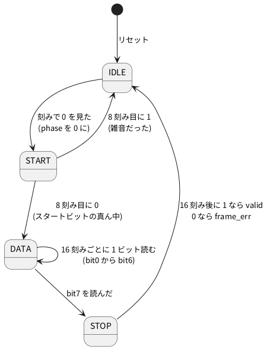

# 7-2 UART の受信 — 16 倍で刻んでビットの真ん中を読む

> [!WARNING]
> **この題は実機で組んでいない。** Verilog は Verilator の lint を通し、PC のシミュレーションで
> 4800 bps ちょうどの送り手・7-1 の `uart_tx`・27 MHz で 9600 bps の 3 通りから 256 字ずつ受けて突き合わせた。
> Pico 2 への書き込みと、AD3 での測定はしていない。「見るべき値」はシミュレーションの値と計算値。

受ける側は、送る側のクロックを知らない。分かるのは「線が 1 から 0 に下がったら字の始まり」と、決めておいたボーレートだけ。
ビットの境目の近くで線を読むと、隣のビットと取り違えやすい。そこで**各ビットの真ん中**で読む。

真ん中を見つけるために、ボーレートの **16 倍の速さで刻む** (1 ビットを 16 刻みに分ける)。

1. アイドル (1) の間、刻みごとに線を見る。0 を見たら、スタートビットが始まった
2. そこから **8 刻み目**がスタートビットの真ん中。もう一度 0 かを確かめる (1 なら短い雑音だったので 1 に戻る)
3. そこから **16 刻みごと**に読むと、bit0〜bit7 の真ん中に当たる
4. 最後に 16 刻み後のストップビットが 1 なら、受けた字を出す。0 なら字の区切りが合っていない (フレームエラー)

0 を見つけるのは、下がってから最大 1 刻み遅れる。16 倍で刻めば、読む時刻のずれは 1 ビットの 1/16 以内に収まる。

クロックとボーレートは 7-1 と同じ **13 µs (マイクロ秒) と 4800 bps**。16 × 4800 = 76.8 kHz の刻みは、13 µs のクロック (76.923 kHz) の毎クロックに当たる。
27 MHz の FPGA で 9600 bps なら、176 クロックに 1 回の刻みになる (8 章で使う)。Verilog は同じ物で、`CLK_HZ` と `BAUD` を替えるだけ。

## 状態遷移図




- 状態は 4 つ。`phase` は刻みを数えるデータで、6-1 の `timer` と同じ役 (状態が変わるクロックで 0 に戻す)
- 読んだビットはシフトレジスタ `shreg` の左から入れて右へ送る。下位ビットから来るので、8 ビット読むと bit0 が右端にそろう

## 回路図

```circuit
# 回路図 (tommie-fence の circuit フェンス)
title: 図2 GP14 で受け、字を GP2 から GP9、valid を GP10、読む時刻を GP11 に出す
parts:
  U1: pico2 4,6 mirror
  D0: port 6.8,3.4
  D1: port 6.8,3.8
  D2: port 6.8,4.2
  D3: port 6.8,4.6
  D4: port 6.8,5.4
  D5: port 6.8,5.8
  D6: port 6.8,6.2
  D7: port 6.8,6.6
  VALID: port 6.8,7.4
  SMP: port 6.8,7.8
  RXD: port 6.8,9.4
  G1: ground 7.6,5
  AD:
    type: device
    at: 12,6.5
    label: AD3
    pins: [DIO0, DIO1, DIO2, DIO3, DIO4, DIO5, DIO6, DIO7, DIO8, DIO9, DIO10, GND]
  RXD: port 10,4.21
  D0: port 10,4.62
  D1: port 10,5.04
  D2: port 10,5.46
  D3: port 10,5.87
  D4: port 10,6.29
  D5: port 10,6.71
  D6: port 10,7.13
  D7: port 10,7.54
  VALID: port 10,7.96
  SMP: port 10,8.38
  G2: ground 10,9.3
wires:
  - U1.GP2 |- 6.8,3.4
  - U1.GP3 |- 6.8,3.8
  - U1.GP4 |- 6.8,4.2
  - U1.GP5 |- 6.8,4.6
  - U1.GP6 |- 6.8,5.4
  - U1.GP7 |- 6.8,5.8
  - U1.GP8 |- 6.8,6.2
  - U1.GP9 |- 6.8,6.6
  - U1.GP10 |- 6.8,7.4
  - U1.GP11 |- 6.8,7.8
  - U1.GP14 |- 6.8,9.4
  - U1.GND8 |- 7.6,5
  - AD.DIO0 |- 10,4.21
  - AD.DIO1 |- 10,4.62
  - AD.DIO2 |- 10,5.04
  - AD.DIO3 |- 10,5.46
  - AD.DIO4 |- 10,5.87
  - AD.DIO5 |- 10,6.29
  - AD.DIO6 |- 10,6.71
  - AD.DIO7 |- 10,7.13
  - AD.DIO8 |- 10,7.54
  - AD.DIO9 |- 10,7.96
  - AD.DIO10 |- 10,8.38
  - AD.GND |- 10,8.79 -- 10,9.3
style:
  pitch: 1.2
  grid: on
```


- 同じ名前の端子どうしがつながっている (6-2 と同じ描き方)
- AD3 は DIO0 から字を送る (Protocol の UART)。Pico 2 の GP14 が受ける線 (RXD)
- 受けた字の 8 ビットは GP2〜GP9 (`D0`〜`D7`)、受け終えた合図は GP10 (`VALID`)、線を読んだ時刻は GP11 (`SMP`) に出し、AD3 の DIO1〜DIO10 で読む
- ストップビットが 0 だった (`frame_err`) ことは、Pico 2 の基板の LED (GP25) に出す
- 部品は Pico 2 と AD3 だけ。ピンは 3.3 V (0-3)。AD3 の DIO の出力も 3.3 V なので、そのまま GP14 に入れてよい

## 実体配線図

```bread
# ブレッドボードの実体配線図 (tommie-fence の bread フェンス)
title: 図3 DIO0 から GP14 へ送り、GP2 から GP11 を DIO1 から DIO10 で読む
board: half
parts:
  MCU: pico2 @ h5
  AD:
    type: device
    at: bottom
    label: AD3 Protocol・Logic
    pins: [DIO1, DIO2, DIO3, DIO4, GND, DIO5, DIO6, DIO7, DIO8, DIO9, DIO10, DIO0]
wires:
  - AD.DIO1 -- j8 green
  - AD.DIO2 -- j9 green
  - AD.DIO3 -- j10 green
  - AD.DIO4 -- j11 green
  - AD.GND -- j12 black
  - AD.DIO5 -- j13 green
  - AD.DIO6 -- j14 green
  - AD.DIO7 -- j15 green
  - AD.DIO8 -- j16 green
  - AD.DIO9 -- j18 purple
  - AD.DIO10 -- j19 orange
  - AD.DIO0 -- j23 yellow
```


- `pico2 @ h5` は 0-4 と同じ向き。下の列 (h 行) の 4 番 GP2 が 8 列、12 番 GP9 が 16 列、14 番 GP10 が 18 列、15 番 GP11 が 19 列、19 番 GP14 が 23 列、8 番 GND が 12 列
- AD3 の線は全部、ピンと同じ列の j 行に挿す。横に走る線が無いので、線どうしは交わらない
- 線の色: 送る線 (DIO0) は黄、字の 8 本は緑、`VALID` は紫、`SMP` は橙、GND は黒。赤は使わない
- 流れる電流は DIO の入出力のごく小さなもの。信号は 4800 bps で、ブレッドボードの範囲 (3 MHz 以下) に収まる

## Verilog

### uart_rx.v — 受信

```verilog
// UART の受信 (8N1)。ボーレートの 16 倍で刻み、スタートビットを見つけてから
// 8 刻み目 (スタートビットの真ん中)、そこから 16 刻みごと (各ビットの真ん中) に読む
module uart_rx #(
    parameter CLK_HZ = 76_923,
    parameter BAUD   = 4800
) (
    input            clk,
    input            rst,
    input            rxd,
    output reg [7:0] data,       // 受けた字 (次の字まで保つ)
    output reg       valid,      // 受け終えたクロックだけ 1
    output reg       frame_err,  // ストップビットが 0 だった
    output reg       sample      // 線を読んだ直後の 1 クロックだけ 1 (読む時刻を Logic で見るため)
);
    // 16 倍の刻み: CLK_HZ を (BAUD × 16) で割る (四捨五入)。1 なら毎クロック
    localparam integer DIV16 = (CLK_HZ + BAUD * 8) / (BAUD * 16);
    localparam integer TW    = (DIV16 > 1) ? $clog2(DIV16) : 1;
    localparam integer TLAST = DIV16 - 1;

    localparam [1:0] S_IDLE = 2'd0, S_START = 2'd1, S_DATA = 2'd2, S_STOP = 2'd3;

    reg [TW-1:0] tcnt;
    wire         tick = (tcnt == TLAST[TW-1:0]);
    reg [1:0]    sync;           // クロックと関係なく変わる入力を 2 段で受ける
    wire         rx = sync[1];
    reg [1:0]    state;
    reg [3:0]    phase;          // 刻みを数える (0〜15)
    reg [2:0]    nbit;           // 何ビット目を読むか
    reg [7:0]    shreg;

    always @(posedge clk)
        if (rst || tick) tcnt <= {TW{1'b0}};
        else             tcnt <= tcnt + 1'b1;

    always @(posedge clk)
        if (rst) begin
            sync      <= 2'b11;
            state     <= S_IDLE;
            phase     <= 4'd0;
            nbit      <= 3'd0;
            shreg     <= 8'h00;
            data      <= 8'h00;
            valid     <= 1'b0;
            frame_err <= 1'b0;
            sample    <= 1'b0;
        end else begin
            sync   <= {sync[0], rxd};
            valid  <= 1'b0;
            sample <= 1'b0;
            if (tick)
                case (state)
                    S_IDLE:
                        if (!rx) begin               // 0 を見た = スタートビットの始まり
                            phase <= 4'd0;
                            state <= S_START;
                        end
                    S_START:
                        if (phase == 4'd7) begin     // 8 刻み目 = スタートビットの真ん中
                            sample <= 1'b1;
                            phase  <= 4'd0;
                            nbit  <= 3'd0;
                            state <= rx ? S_IDLE : S_DATA;   // 1 なら雑音だったので戻る
                        end else
                            phase <= phase + 4'd1;
                    S_DATA:
                        if (phase == 4'd15) begin    // 16 刻み後 = 次のビットの真ん中
                            sample <= 1'b1;
                            phase  <= 4'd0;
                            shreg <= {rx, shreg[7:1]};       // 下位ビットから来るので右へ送る
                            nbit  <= nbit + 3'd1;
                            if (nbit == 3'd7) state <= S_STOP;
                        end else
                            phase <= phase + 4'd1;
                    default:                         // S_STOP
                        if (phase == 4'd15) begin
                            sample <= 1'b1;
                            phase  <= 4'd0;
                            state <= S_IDLE;
                            if (rx) begin
                                data      <= shreg;
                                valid     <= 1'b1;
                                frame_err <= 1'b0;
                            end else
                                frame_err <= 1'b1;
                        end else
                            phase <= phase + 4'd1;
                endcase
        end
endmodule
```

- `DIV16` は 16 倍の刻みのクロック数。76 923 ÷ 76 800 = 1.002 で 1 (毎クロック)、27 000 000 ÷ 153 600 = 175.8 で 176
- `tick` が 1 のクロックだけ状態機械が進む (2-5 のクロックイネーブル)
- `sync` の 2 段は、クロックと関係なく変わる入力を受ける所 (9-2)。線の値は 2 クロック遅れて `rx` に届く
- `sample` は読んだことを外から見るためだけの出口。受信には使わない

Verilator の lint は警告なしで通る (`verilator --lint-only -Wall uart_rx.v`、確かめた)。`uart_rx` をそのまま最上位にして Pico 2 に載せる。

### Pico 2 のピンの割り当て

組み方は 5-3 と 5-7 (手本は [Soft-FPGA-TD4](https://github.com/tommie-jp/Soft-FPGA-TD4) の `verilator-TD4/main.cpp`)。

| Verilog | Pico 2 | 向き | 設定 |
| --- | --- | --- | --- |
| `clk` | (ピンなし) | — | **13 µs ごと**のタイマ割り込みで 0 → 1 と変えて評価する (5-7) |
| `rst` | (ピンなし) | — | 起動して最初の 1 クロックだけ 1 |
| `rxd` | GP14 | 入力 | 中のプルアップを有効に (AD3 をつなぐ前もアイドルの 1 にしておく) |
| `data[0]`〜`data[7]` | GP2〜GP9 | 出力 | `data[0]` が GP2 |
| `valid` | GP10 | 出力 | |
| `sample` | GP11 | 出力 | |
| `frame_err` | GP25 | 出力 | Pico 2 の基板の LED |

## 動かす — PC のシミュレーション

テストベンチで 3 通りを確かめる。

1. Pico 2 の設定 (13 µs・4800 bps) で、**4800 bps ちょうどで送る送り手** (AD3 の Protocol の代わり) から `A` を 1 字送り、`sample` と `valid` の時刻を書く。続けて 0x00〜0xFF を字の間をあけずに送り、受けた字と突き合わせる
2. 7-1 の `uart_tx` の出口を `uart_rx` の入口につなぎ、0x00〜0xFF を突き合わせる
3. FPGA の設定 (27 MHz・9600 bps) で、9600 bps ちょうどの送り手から 0x00〜0xFF を突き合わせる。16 倍の刻みを 176 クロックの分周で作る場合の確かめ

```verilog
`timescale 1ns / 1ps
// (1) Pico 2 の設定 (13 µs・4800 bps): 4800 bps ちょうどで送る送り手 (AD3 の Protocol の代わり) から 'A' を送り、
//     読んだ時刻と valid の時刻を書く。続けて 0x00〜0xFF を送って突き合わせる
// (2) 7-1 の uart_tx から uart_rx へつなぎ、0x00〜0xFF を突き合わせる
// (3) FPGA の設定 (27 MHz・9600 bps): 16 倍の刻みを 176 クロックの分周で作る。0x00〜0xFF を突き合わせる
module tb_rx;
    // ---- (1)(2) 13 µs のクロック
    reg clk;
    initial begin
        clk = 1'b0;
        forever #6500 clk = ~clk;
    end
    reg rst;

    reg        line;                 // 送り手の線
    wire [7:0] d1;
    wire       v1, e1, s1;
    uart_rx dut1 (.clk(clk), .rst(rst), .rxd(line),
                  .data(d1), .valid(v1), .frame_err(e1), .sample(s1));

    reg  [7:0] tdat;
    reg        tstart;
    wire       txd, tbusy;
    wire [7:0] d2;
    wire       v2, e2, s2;
    uart_tx dut_tx (.clk(clk), .rst(rst), .data(tdat), .start(tstart), .txd(txd), .busy(tbusy));
    uart_rx dut2 (.clk(clk), .rst(rst), .rxd(txd),
                  .data(d2), .valid(v2), .frame_err(e2), .sample(s2));

    // ---- (3) 27 MHz のクロック
    reg clk27;
    initial begin
        clk27 = 1'b0;
        forever #18.518 clk27 = ~clk27;
    end
    reg        line27;
    wire [7:0] d3;
    wire       v3, e3, s3;
    uart_rx #(.CLK_HZ(27_000_000), .BAUD(9600)) dut3 (.clk(clk27), .rst(rst), .rxd(line27),
                  .data(d3), .valid(v3), .frame_err(e3), .sample(s3));

    // 送り手: 4800 bps (line) と 9600 bps (line27) で 8N1 を送る
    localparam real BIT4800 = 1.0e9 / 4800.0;
    localparam real BIT9600 = 1.0e9 / 9600.0;
    task automatic send4800(input [7:0] b);
        integer k;
        begin
            line = 1'b0; #(BIT4800);
            for (k = 0; k < 8; k = k + 1) begin line = b[k]; #(BIT4800); end
            line = 1'b1; #(BIT4800);
        end
    endtask
    task automatic send9600(input [7:0] b);
        integer k;
        begin
            line27 = 1'b0; #(BIT9600);
            for (k = 0; k < 8; k = k + 1) begin line27 = b[k]; #(BIT9600); end
            line27 = 1'b1; #(BIT9600);
        end
    endtask

    // 受けた字を数えて突き合わせる
    integer n1 = 0, n2 = 0, n3 = 0, err = 0;
    reg     trace = 1'b0;
    realtime tstart_edge;
    // 出力はクロックの立ち下がりで見る (立ち上がりで変わった値を、半周期後に読む)
    always @(negedge clk) begin
        if (v1) begin
            if (trace) $display("(1) valid    from start + %8.1f us, data = %02h '%c'", ($realtime - 6500 - tstart_edge) / 1000.0, d1, d1);
            else if (d1 !== n1[7:0]) begin err = err + 1; $display("(1) NG %02h %02h", n1[7:0], d1); end
            if (!trace) n1 = n1 + 1;
        end
        if (s1 && trace) $display("(1) sample from start + %8.1f us, shreg = %b", ($realtime - 6500 - tstart_edge) / 1000.0, dut1.shreg);
        if (v2) begin
            if (d2 !== n2[7:0]) begin err = err + 1; $display("(2) NG %02h %02h", n2[7:0], d2); end
            n2 = n2 + 1;
        end
        if (e1 || e2) begin err = err + 1; $display("frame error"); end
    end
    always @(negedge clk27) begin
        if (v3) begin
            if (d3 !== n3[7:0]) begin err = err + 1; $display("(3) NG %02h %02h", n3[7:0], d3); end
            n3 = n3 + 1;
        end
        if (e3) begin err = err + 1; $display("frame error (3)"); end
    end

    integer i;
    initial begin
        rst = 1'b1; line = 1'b1; line27 = 1'b1; tstart = 1'b0; tdat = 8'h00;
        #30000 rst = 1'b0;
        #100000;
        // (1) 'A' を 1 字、読む時刻を書く
        trace = 1'b1;
        tstart_edge = $realtime;
        send4800("A");
        #500000;
        trace = 1'b0;
        fork
            // (1) 0x00〜0xFF (字の間をあけずに続けて)
            for (i = 0; i < 256; i = i + 1) send4800(i[7:0]);
            // (2) uart_tx → uart_rx
            begin : loop2
                integer j;
                for (j = 0; j < 256; j = j + 1) begin
                    @(negedge clk);
                    while (tbusy) @(negedge clk);
                    tdat = j[7:0]; tstart = 1'b1;
                    @(negedge clk); tstart = 1'b0;
                    @(negedge clk);
                end
            end
            // (3) 27 MHz・9600 bps
            begin : loop3
                integer m;
                for (m = 0; m < 256; m = m + 1) send9600(m[7:0]);
            end
        join
        #5000000;
        $display("(1) 4800 bps sender -> rx @13us : %0d bytes", n1);
        $display("(2) uart_tx -> uart_rx @13us    : %0d bytes", n2);
        $display("(3) 9600 bps sender -> rx @27MHz: %0d bytes", n3);
        $display("errors %0d", err);
        if (n1 == 256 && n2 == 256 && n3 == 256 && err == 0) $display("PASS");
        else                                                 $display("FAIL");
        $finish;
    end
endmodule
```

```bash
verilator --binary --timing --top-module tb_rx tb_rx.v uart_rx.v uart_tx.v
./obj_dir/Vtb_rx
```

```text
(1) sample from start +    136.5 us, shreg = 00000000
(1) sample from start +    344.5 us, shreg = 10000000
(1) sample from start +    552.5 us, shreg = 01000000
(1) sample from start +    760.5 us, shreg = 00100000
(1) sample from start +    968.5 us, shreg = 00010000
(1) sample from start +   1176.5 us, shreg = 00001000
(1) sample from start +   1384.5 us, shreg = 00000100
(1) sample from start +   1592.5 us, shreg = 10000010
(1) sample from start +   1800.5 us, shreg = 01000001
(1) valid    from start +   2008.5 us, data = 41 'A'
(1) sample from start +   2008.5 us, shreg = 01000001
(1) 4800 bps sender -> rx @13us : 256 bytes
(2) uart_tx -> uart_rx @13us    : 256 bytes
(3) 9600 bps sender -> rx @27MHz: 256 bytes
errors 0
PASS
```

3 通りとも 256 字を受け、食い違いもフレームエラーも 0 だった (Verilator 5.042 で実行)。
(1) の送り手は 4800 bps ちょうど、受け手は 4808 bps の刻み (+0.16 %) で、ずれていても読めた。

`A` の時刻を読む。時刻はスタートビットの立ち下がりからで、GP11 の `sample` が 1 になった時刻。

| 読んだ所 | `sample` の時刻 | 線を読んだ時刻 (2 クロック前) | そのビットの真ん中 | ずれ |
| --- | --- | --- | --- | --- |
| スタート | 136.5 µs | 110.5 µs | 104.2 µs | +6.3 µs |
| bit0 | 344.5 µs | 318.5 µs | 312.5 µs | +6.0 µs |
| bit7 | 1800.5 µs | 1774.5 µs | 1770.8 µs | +3.7 µs |
| ストップ | 2008.5 µs | 1982.5 µs | 1979.2 µs | +3.3 µs |

- `sample` は 208 µs (16 クロック) ごとに出る。線を読んだ時刻は 2 段の受けの 2 クロック (26 µs) 前
- 読んだ時刻は真ん中より 3〜6 µs 遅い。0 を見つけるのが最大 1 刻み (13 µs) 遅れるため。このシミュレーションでは立ち下がりの 6.5 µs 後に最初のクロックが来た
- 受ける側の 1 ビット (208 µs) が送る側 (208.33 µs) より短いので、後ろのビットほど読む時刻が前へ寄る (6.3 → 3.3 µs)。ずれが大きいと最後のビットで隣に入る (7-6)

## 計器の設定

| 計器 | 設定 |
| --- | --- |
| Protocol | UART、TX = DIO0、Baud = 4800、8 ビット、パリティなし、ストップ 1。送信欄に `A` を入れて Send |
| Logic | DIO0〜DIO10 を Enable。DIO1〜DIO8 でバスを 1 つ作る (DIO8 を上位、16 進)。DIO0 に UART の読み下しを足す (4800 bps、8N1)。DIO は 3.3 V。GND を共通にする (0-4) |
| 時間軸 | 250 µs/div (10 目盛で 2.5 ms。1 字の 2.08 ms が入る)。標本化 1 MS/s (`SMP` の 13 µs のパルスに 13 標本) |
| トリガ | DIO0 の立ち下がり (スタートビット)。トリガの前を 250 µs 見せる |

Protocol で送りながら Logic で同じ DIO を見る使い方は、02-analog-discovery の 7-6 (`02-analog-discovery/07-logic/06-uart-echo.md`) と同じ。

## Logic に見えるはずの画面

シミュレーションの時刻を写した。スタートビットの立ち下がりを 0 s とした。
Pico 2 のクロックと送る時刻の重なりは毎回違うので、`SMP` の位置は 1 刻み (13 µs) の幅で前後する。

```logic
# ロジックアナライザの画面 (tommie-fence の logic フェンス)
title: 図4 'A' を受ける。SMP は 208 µs ごと、最後に DATA が 0x41
device: ad3
time: 250us/div
start: -250us
sample: 1MHz
signals:
  RXD: dio0 edges -250us=1 0s=0 208.33us=1 416.67us=0 1458.33us=1 1666.67us=0 1875us=1
  SMP: dio10 edges -250us=0 136.5us=1 149.5us=0 344.5us=1 357.5us=0 552.5us=1 565.5us=0 760.5us=1 773.5us=0 968.5us=1 981.5us=0 1176.5us=1 1189.5us=0 1384.5us=1 1397.5us=0 1592.5us=1 1605.5us=0 1800.5us=1 1813.5us=0 2008.5us=1 2021.5us=0
  VALID: dio9 edges -250us=0 2008.5us=1 2021.5us=0
  D7: dio8 low
  D6: dio7 edges -250us=0 2008.5us=1
  D5: dio6 low
  D4: dio5 low
  D3: dio4 low
  D2: dio3 low
  D1: dio2 low
  D0: dio1 edges -250us=0 2008.5us=1
buses:
  DATA: D7..D0 hex
decode:
  UART: uart RXD baud 4800 8N1 ascii
cursors: [143us, 351us]
trigger: RXD falling at 0s
```


- `A` = 0x41。下位から 1・0・0・0・0・0・1・0 と来る
- `SMP` は 10 本。スタート・bit0〜bit7・ストップの真ん中で読んだ印 (ピンには 26 µs 遅れて出る)
- X1 (143 µs) と X2 (351 µs) は 1 本目と 2 本目の `SMP` の真ん中。ΔX = 208 µs (16 クロック)、1/ΔX = 4.808 kHz は受ける側の刻みのボーレート
- 最後の `SMP` (ストップ) と同じ時刻に `VALID` が 1 クロック出て、`DATA` が 0x41 になる。読み下しの `A` と同じ値

## 見るべき値

シミュレーションの値と計算値。実機では測っていない。Protocol で字を送り、Logic で読み、表に書き加える。

| 見る所 | シミュレーション・計算値 | 実機 (測って書く) |
| --- | --- | --- |
| `SMP` の間隔 | 208 µs (16 クロック) | |
| スタートビットの真ん中から読む時刻のずれ | 0〜+13 µs (計算値。このシミュレーションでは +6.3 µs) | |
| `VALID` が出る時刻 | 立ち下がりから 2008.5 µs (ストップビットの真ん中 + 2 段の受け) | |
| `A` を送ったときの `DATA` | 0x41 | |
| 0x00〜0xFF を続けて送ったときの食い違い | 0 (4800 bps ちょうどの送り手、256 字) | |
| 基板の LED (`frame_err`) | 消えたまま | |

Protocol の Baud を 9600 にして送ると、受ける側は 1 ビットの半分の長さの字を読むことになり、
違う字になるかフレームエラーで LED が点く (計算から言えること。7-6 でずれの許される幅を探す)。

## シミュレーションでの確かめ

Verilator 5.042 で、本文の `uart_rx.v` と `tb_rx.v` を取り出し、7-1 の `uart_tx.v` と合わせて走らせ直した。
置き場は `sim/02-uart-rx.v` と `sim/02-uart-rx-tb.v` (送信は `sim/01-uart-tx.v`)。

| 項目 | 本文の数字 | 実行結果 | 判定 |
| --- | --- | --- | --- |
| lint (`-Wall`、`uart_rx.v`) | 警告 0 件 | 0 件 | 合った |
| `A` の `sample` の時刻 | 136.5・344.5 … 1800.5・2008.5 µs | 同じ 10 個 | 合った |
| `valid` と `data` | 2008.5 µs、0x41 | 2008.5 µs、0x41 | 合った |
| 3 通りの 256 字 | 256 字ずつ、errors 0、PASS | 同じ | 合った |
| 読む時刻のずれ (真ん中との差) | +6.3・+6.0・+3.7・+3.3 µs | 時刻から計算して同じ | 合った |

実機の Protocol で送ったときの受信は、実機が要るので確かめていない。

## 出典

自作。16 倍で刻んで真ん中を読む受け方は UART の受け手で広く使われる方式で、
[tommie-jp/soft-fpga](https://github.com/tommie-jp/soft-fpga) の `examples/03-uart` (`uart_rx.v`) は 1 ビットのクロック数を数えて真ん中を読む別の書き方。
AD3 の Protocol の使い方は Digilent の
[Using the Protocol Analyzer](https://digilent.com/reference/test-and-measurement/guides/waveforms-protocol-analyzer)。
