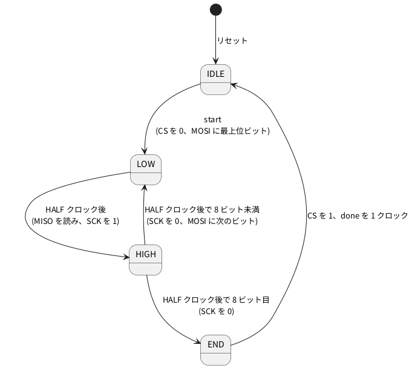

# 7-4 SPI のマスタ

> [!WARNING]
> **この題は実機で組んでいない。** Verilog は Verilator の lint を通し、PC のシミュレーション
> (74HC595 の動きを真似た模型) で 6 回の送りを確かめた。「見るべき値」はシミュレーションの値。

SPI は、**クロックの線を持つ**同期式の通信。UART (7-1〜7-3) はクロックを持たず、両側がボーレートを決めておいた。
SPI では送る側 (マスタ) がクロック SCK を出し、受ける側 (スレーブ) はその立ち上がりで線を読む。
ボーレートのずれを気にしなくてよい代わりに、線が増える。

| 線 | 向き (マスタから見て) | 役 |
| --- | --- | --- |
| SCK | 出力 | クロック。マスタが作る |
| MOSI | 出力 | マスタからスレーブへのデータ |
| MISO | 入力 | スレーブからマスタへのデータ |
| CS | 出力 | スレーブを選ぶ線。0 の間だけスレーブが動く |

この題は **モード 0** (SCK は 0 で待ち、立ち上がりでデータを読む) の 8 ビット・上位ビットから先 (MSB 先) で書く。
相手には 74HC595 (8 ビットのシフトレジスタ、LED を 8 本ぶん増やす定番の IC) を使う。
74HC595 は SPI のスレーブとして作られた IC ではないが、次のようにつなぐと SPI のスレーブとして動く。

| 74HC595 のピン | つなぐ先 | SPI での役 |
| --- | --- | --- |
| SER (14 番) | MOSI | データ入力 |
| SRCLK (11 番) | SCK | シフトクロック。立ち上がりで SER を取り込む |
| RCLK (12 番) | CS | 立ち上がりで、シフトレジスタの中身を出力 QA〜QH へ写す |
| QH' (9 番) | MISO | シフトレジスタのいちばん後ろ。1 つ前に送った字が 1 ビットずつ出てくる |

CS は送る間だけ 0 にして、送り終わりに 1 へ戻す。この**立ち上がりが RCLK の立ち上がり**になるので、
8 ビットを送り終えた瞬間に、LED へまとめて出る。送っている途中の半端な値は LED に出ない。

この題は Verilog を書いて PC で確かめる所までで、組まない (`device: SIM`)。実体配線図・Analog Discovery 3・Logic の図は付けない。
Pico 2 に載せて 74HC595 の LED と AD3 で見るのは 7-18。

## クロックと SCK の速さ

クロックは 7-1〜7-3 と同じ **13 µs (76.923 kHz)**。SCK は 2 クロックごとに反転させて、**1 周期 4 クロック = 52 µs (19.23 kHz)** にする。
1 字 (8 ビット) は 8 × 52 = 416 µs。74HC595 の SRCLK の上限は、データシートの表で 2 V のとき 5 MHz
(SN74HC595、−40〜85 °C) なので、19 kHz には十分な余裕がある。

## 状態遷移図




- MOSI は **SCK が 0 の間に**変える。スレーブは SCK が 1 に上がった瞬間に読むので、読む前に HALF クロックぶんの時間 (26 µs) 安定している
- MISO は **SCK を 1 に上げる直前**の値を読む。74HC595 の QH' は SRCLK の立ち上がりの後に変わる (データシートの tpd は標準 13 ns。5 V のときの値) ので、
  上げる直前の値は変わり終えて落ち着いた 1 つ前のビット。MISO は線の変化が自分の SCK の直後だけなので、2 段の同期 (9-2) は付けない
- SCK を上げる直前に読む、というこの順は、立ち上がりでデータを読むほかの SPI の相手にもそのまま使える

## Verilog

### spi_master.v — マスタ

```verilog
// SPI のマスタ (モード 0、8 ビット、MSB 先)。start を 1 クロック 1 にして data を送る。
// SCK の半周期は HALF クロック。cs_n は 1 字を送る間だけ 0。
// MOSI は SCK の立ち下がり側 (SCK = 0 の間) で変え、MISO は SCK を立ち上げる直前に読む
module spi_master #(
    parameter HALF = 2                 // SCK の半周期 (クロック数)。2 なら SCK = クロック / 4
) (
    input            clk,
    input            rst,
    input            start,
    input      [7:0] tx_data,
    input            miso,
    output reg       sck,
    output reg       mosi,
    output reg       cs_n,
    output           busy,
    output reg       done,             // 送り終えたクロックだけ 1
    output reg [7:0] rx_data           // done のとき、読んだ 8 ビット
);
    localparam integer W = (HALF > 1) ? $clog2(HALF) : 1;
    localparam [1:0] S_IDLE = 2'd0, S_LOW = 2'd1, S_HIGH = 2'd2, S_END = 2'd3;

    reg [1:0]   state;
    reg [W-1:0] cnt;      // 半周期の中のクロック
    reg [2:0]   nbit;     // 送ったビット数 (0〜7)
    reg [7:0]   tx_sh;    // 送るビット。上から出す
    reg [7:0]   rx_sh;    // 読んだビット。下から入れる
    wire        last = (cnt == HALF[W-1:0] - 1'b1);

    assign busy = (state != S_IDLE);

    always @(posedge clk)
        if (rst) begin
            state   <= S_IDLE;
            sck     <= 1'b0;
            mosi    <= 1'b0;
            cs_n    <= 1'b1;
            done    <= 1'b0;
            rx_data <= 8'h00;
            cnt     <= {W{1'b0}};
            nbit    <= 3'd0;
            tx_sh   <= 8'h00;
            rx_sh   <= 8'h00;
        end else begin
            done <= 1'b0;
            case (state)
                S_IDLE:
                    if (start) begin
                        cs_n  <= 1'b0;
                        tx_sh <= {tx_data[6:0], 1'b0};
                        mosi  <= tx_data[7];       // 最初のビットは SCK を上げる前に出しておく
                        nbit  <= 3'd0;
                        cnt   <= {W{1'b0}};
                        state <= S_LOW;
                    end
                S_LOW:                              // SCK = 0 の半周期
                    if (last) begin
                        rx_sh <= {rx_sh[6:0], miso};   // 立ち上げる直前の MISO を読む
                        sck   <= 1'b1;
                        cnt   <= {W{1'b0}};
                        state <= S_HIGH;
                    end else
                        cnt <= cnt + 1'b1;
                S_HIGH:                             // SCK = 1 の半周期
                    if (last) begin
                        sck <= 1'b0;
                        cnt <= {W{1'b0}};
                        if (nbit == 3'd7) state <= S_END;
                        else begin
                            mosi  <= tx_sh[7];     // 次のビットを SCK = 0 の間に出す
                            tx_sh <= {tx_sh[6:0], 1'b0};
                            nbit  <= nbit + 3'd1;
                            state <= S_LOW;
                        end
                    end else
                        cnt <= cnt + 1'b1;
                default: begin                      // S_END: CS を上げて終わり
                    cs_n    <= 1'b1;
                    rx_data <= rx_sh;
                    done    <= 1'b1;
                    state   <= S_IDLE;
                end
            endcase
        end
endmodule
```

- `HALF` が SCK の半周期のクロック数。`HALF = 2` で SCK はクロックの 1/4
- `tx_sh` を左へ 1 ビットずつ送り、上のビット `tx_sh[7]` を MOSI に出す。`rx_sh` は読んだビットを下から入れる
- 送っている間 (`busy`) は `start` を受け付けない。8 ビット送り終えると `cs_n` が 1 に戻り、`done` が 1 クロックだけ 1

### spi_top.v — 0.5 s ごとに 0x5A と 0xA5 を交互に送る

```verilog
// 0.5 s ごとに 0x5A と 0xA5 を交互に 74HC595 へ送る。Pico 2 に載せる最上位。
// 74HC595 の QH' (MISO) からは 1 つ前に送った字が返る。それが合っていれば ok を 1 にする
module spi_top #(
    parameter CLK_HZ = 76_923
) (
    input  clk,
    input  rst,
    input  miso,       // GP2   74HC595 の QH' (9 番)
    output sck,        // GP3   74HC595 の SRCLK (11 番)
    output mosi,       // GP5   74HC595 の SER (14 番)
    output cs_n,       // GP4   74HC595 の RCLK (12 番)。立ち上がりで出力 QA〜QH に写る
    output ok          // GP25  返ってきた字が 1 つ前に送った字と同じなら 1 (Pico 2 の基板の LED)
);
    localparam integer HALF_S = CLK_HZ / 2;               // 0.5 s のクロック数
    localparam integer W      = $clog2(HALF_S);

    reg [W-1:0] tcnt;
    reg         start;
    reg [7:0]   data;        // 次に送る字
    reg [7:0]   last_sent;   // 1 つ前に送った字。次の送りで MISO から返ってくる
    reg [7:0]   expect_rx;   // いま送っている間に返ってくるはずの字
    reg         ok_r;
    wire        busy, done;
    wire [7:0]  rx_data;

    spi_master #(.HALF(2)) u_spi (
        .clk(clk), .rst(rst), .start(start), .tx_data(data), .miso(miso),
        .sck(sck), .mosi(mosi), .cs_n(cs_n), .busy(busy), .done(done), .rx_data(rx_data));

    assign ok = ok_r;

    always @(posedge clk)
        if (rst) begin
            tcnt      <= {W{1'b0}};
            start     <= 1'b0;
            data      <= 8'h5A;
            last_sent <= 8'h00;
            expect_rx <= 8'h00;
            ok_r      <= 1'b0;
        end else begin
            start <= 1'b0;
            if (tcnt == HALF_S[W-1:0] - 1'b1) begin
                tcnt  <= {W{1'b0}};
                start <= !busy;                  // 次のクロックで spi_master が data を取り込む (送信中なら見送る)
            end else
                tcnt <= tcnt + 1'b1;

            if (start) begin
                expect_rx <= last_sent;
                last_sent <= data;
                data      <= ~data;              // 0x5A ↔ 0xA5
            end
            if (done) ok_r <= (rx_data == expect_rx);
        end
endmodule
```

- 0x5A (0101 1010) と 0xA5 (1010 0101) は、ビットを反転した組。LED の QA〜QD は 0x5A のとき 0・1・0・1、0xA5 のとき 1・0・1・0 になり、0.5 s ごとに交互に光る
- 74HC595 は 1 つ前に送った字を QH' から返す。`expect_rx` に 1 つ前の字を覚えておき、`done` で読んだ字と比べる。
  最初の 1 回だけは、74HC595 の中身が電源を入れた直後で決まっていないので、一致しない (GP25 は 0 のまま)

Verilator の lint は警告なしで通る (`verilator --lint-only -Wall --top-module spi_top spi_top.v spi_master.v`、確かめた)。

## 動かす — PC のシミュレーション

74HC595 の動きを真似たテストベンチの模型 (SRCLK の立ち上がりで SER を取り込む・RCLK の立ち上がりで出力へ写す・QH' は最上段) に
`spi_top` をつなぐ。6 回の送りで、LED (QA〜QH) に出た字と、MISO から返った字が合うかを見る。

```verilog
`timescale 1ns / 1ps
// 74HC595 の動きを真似た模型 (SRCLK↑ で SER を取り込む・RCLK↑ で出力へ写す・QH' は最上段) に
// spi_top をつなぎ、送った字が QA〜QH に出ること・次の送りで 1 つ前の字が MISO に返ることを確かめる
module tb_spi;
    reg clk;
    initial begin
        clk = 1'b0;
        forever #6500 clk = ~clk;                // 13 us
    end
    reg rst;
    wire sck, mosi, cs_n, ok;
    wire qh_p;

    // ---- 74HC595 の模型
    reg [7:0] sh;      // シフトレジスタ (sh[7] が QH' に出る)
    reg [7:0] q;       // 出力ラッチ (QA = q[0] … QH = q[7])
    initial begin sh = 8'hC3; q = 8'h00; end    // 電源投入直後は不定。適当な値にしておく
    always @(posedge sck) sh <= {sh[6:0], mosi}; // 上へ送って、いちばん下へ SER を入れる
    always @(posedge cs_n) q <= sh;              // RCLK = CS の立ち上がりで出力へ
    assign qh_p = sh[7];

    spi_top dut (.clk(clk), .rst(rst), .miso(qh_p), .sck(sck), .mosi(mosi), .cs_n(cs_n), .ok(ok));

    // ---- 記録
    realtime tcs;
    integer  nxfer = 0;
    integer  nsck = 0;
    always @(posedge sck) nsck = nsck + 1;
    always @(negedge cs_n) tcs = $realtime;
    real tlow;
    always @(posedge cs_n)
        if (!rst) begin
            nxfer = nxfer + 1;
            tlow = $realtime - tcs;
            #40000;                                 // 出力と ok が更新されたあとで書く
            $display("transfer %0d: CS low %6.1f us, QA-QH = %b (0x%02h)  ok(GP25) = %b",
                     nxfer, tlow / 1000.0, q, q, ok);
        end

    // 2 回目の送り (0xA5 を送り、1 つ前の 0x5A が返る) の変わり目を CS の立ち下がりからの時刻で書く
    always @(sck or mosi or cs_n or qh_p)
        if (!rst && nxfer == 1 && $realtime - tcs < 600000)
            $display("  edge %9.3f us  cs_n=%b sck=%b mosi=%b miso=%b", ($realtime - tcs) / 1000.0, cs_n, sck, mosi, qh_p);

    initial begin
        rst = 1'b1;
        #26000 rst = 1'b0;
        wait (nxfer == 6);
        #60000;
        $display("SCK rising edges: %0d (6 transfers x 8)", nsck);
        $finish;
    end
endmodule
```

```bash
verilator --binary --timing --top-module tb_spi tb_spi.v spi_top.v spi_master.v
./obj_dir/Vtb_spi
```

```text
transfer 1: CS low  429.0 us, QA-QH = 01011010 (0x5a)  ok(GP25) = 0
transfer 2: CS low  429.0 us, QA-QH = 10100101 (0xa5)  ok(GP25) = 1
transfer 3: CS low  429.0 us, QA-QH = 01011010 (0x5a)  ok(GP25) = 1
transfer 4: CS low  429.0 us, QA-QH = 10100101 (0xa5)  ok(GP25) = 1
transfer 5: CS low  429.0 us, QA-QH = 01011010 (0x5a)  ok(GP25) = 1
transfer 6: CS low  429.0 us, QA-QH = 10100101 (0xa5)  ok(GP25) = 1
SCK rising edges: 48 (6 transfers x 8)
```

(Verilator 5.042 で実行。`edge` の行は、2 回目の送りの変わり目を CS の立ち下がりからの時刻で書いたもの (7-18 の図の元)。上の出力は `edge` の行を除いた。)

## 見るべき値 (シミュレーションを実行して得た値)

- 2 回目の送りは 0xA5 を送り、MISO から 1 つ前の 0x5A が返って、`ok(GP25) = 1` になった。以後も 1 が続く
  (1 回目は、模型の 74HC595 の中身を電源投入直後の適当な値 0xC3 にしてあるので、返りが合わず 0)
- QA〜QH には送った字がそのまま出る (0x5A なら QA = 0・QB = 1・QC = 0・QD = 1)
- SCK の立ち上がりは 1 回の送りで 8 回、6 回で 48 回。CS が 0 の間は 429 µs (SCK の 8 周期 = 416 µs に、前後の 13 µs を足した長さ)

## シミュレーションでの確かめ

Verilator 5.042 で、本文の `spi_master.v` `spi_top.v` `tb_spi.v` を取り出して走らせ直した。
置き場は `sim/04-spi-master.v` `sim/04-spi-master-top.v` `sim/04-spi-master-tb.v`。

| 項目 | 本文の数字 | 実行結果 | 判定 |
| --- | --- | --- | --- |
| lint (`-Wall`、`spi_top` を最上位) | 警告 0 件 | 0 件 | 合った |
| 6 回の送り | QA〜QH = 0x5A と 0xA5 が交互、CS 0 の長さ 429.0 µs | 同じ | 合った |
| `ok` (GP25) | 1 回目 0、2 回目以降 1 | 同じ | 合った |
| SCK の立ち上がり | 48 回 | 48 回 | 合った |
| 最上位のポート表 (GP 番号) | `miso` GP2・`sck` GP3・`cs_n` GP4・`mosi` GP5 | Verilog のコメントだけ別の番号だった | **直した** |

直した所: `spi_top.v` のポートのコメントが GP4 = miso・GP2 = sck・GP3 = mosi・GP5 = cs_n と書いてあり、
7-18 の回路図・実体配線図・ピンの割り当て表 (GP2 = MISO・GP3 = SCK・GP4 = CS・GP5 = MOSI) と食い違っていた。
回路図に合わせてコメントを直した。信号の動きは変わらない。

74HC595 の遅れや LED の電流は実機が要るので確かめていない (7-18)。

## 出典

自作。74HC595 の機能・ピン・電圧の範囲・クロックの上限・標準の遅れは Texas Instruments
[SN54HC595, SN74HC595 データシート (SCLS041J、2021-10)](https://www.ti.com/lit/ds/symlink/sn74hc595.pdf) の表から読んだ。
SPI の語は一般に使われるもの。
74HC595 を LED につなぐ回路は 01-circuits/10-logic/06-shift-register.md。
