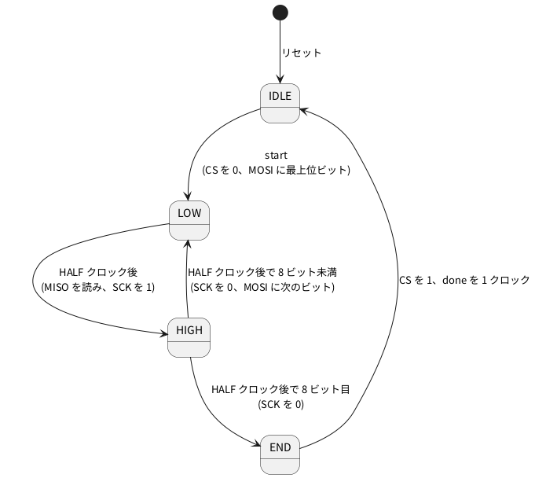

# 7-4 SPI のマスタ

> [!WARNING]
> **この題は実機で組んでいない。** Verilog は Verilator の lint を通し、PC のシミュレーション
> (74HC595 の動きを真似た模型) で 6 回の送りを確かめた。Pico 2 への書き込みと、74HC595・AD3 での測定はしていない。
> 「見るべき値」はシミュレーションの値と計算値。

SPI は、**クロックの線を持つ**同期式の通信。UART (7-1〜7-3) はクロックを持たず、両側がボーレートを決めておいた。
SPI では送る側 (マスタ) がクロック SCK を出し、受ける側 (スレーブ) はその立ち上がりで線を読む。
ボーレートのずれを気にしなくてよい代わりに、線が増える。

| 線 | 向き (マスタから見て) | 役 |
| --- | --- | --- |
| SCK | 出力 | クロック。マスタが作る |
| MOSI | 出力 | マスタからスレーブへのデータ |
| MISO | 入力 | スレーブからマスタへのデータ |
| CS | 出力 | スレーブを選ぶ線。0 の間だけスレーブが動く |

この題は **モード 0** (SCK は 0 で待ち、立ち上がりでデータを読む) の 8 ビット・上位ビットから先 (MSB 先) で書く。
相手には 74HC595 (8 ビットのシフトレジスタ、LED を 8 本ぶん増やす定番の IC) を使う。
74HC595 は SPI のスレーブとして作られた IC ではないが、次のようにつなぐと SPI のスレーブとして動く。

| 74HC595 のピン | つなぐ先 | SPI での役 |
| --- | --- | --- |
| SER (14 番) | MOSI | データ入力 |
| SRCLK (11 番) | SCK | シフトクロック。立ち上がりで SER を取り込む |
| RCLK (12 番) | CS | 立ち上がりで、シフトレジスタの中身を出力 QA〜QH へ写す |
| QH' (9 番) | MISO | シフトレジスタのいちばん後ろ。1 つ前に送った字が 1 ビットずつ出てくる |

CS は送る間だけ 0 にして、送り終わりに 1 へ戻す。この**立ち上がりが RCLK の立ち上がり**になるので、
8 ビットを送り終えた瞬間に、LED へまとめて出る。送っている途中の半端な値は LED に出ない。

## クロックと SCK の速さ

クロックは 7-1〜7-3 と同じ **13 µs (76.923 kHz)**。SCK は 2 クロックごとに反転させて、**1 周期 4 クロック = 52 µs (19.23 kHz)** にする。
1 字 (8 ビット) は 8 × 52 = 416 µs。74HC595 の SRCLK の上限は、データシートの表で 2 V のとき 5 MHz
(SN74HC595、−40〜85 ℃) なので、19 kHz には十分な余裕がある。

## 状態遷移図




- MOSI は **SCK が 0 の間に**変える。スレーブは SCK が 1 に上がった瞬間に読むので、読む前に HALF クロックぶんの時間 (26 µs) 安定している
- MISO は **SCK を 1 に上げる直前**の値を読む。74HC595 の QH' は SRCLK の立ち上がりの後に変わる (データシートの tpd は標準 13 ns。5 V のときの値) ので、
  上げる直前の値は変わり終えて落ち着いた 1 つ前のビット。MISO は線の変化が自分の SCK の直後だけなので、2 段の同期 (9-2) は付けない
- SCK を上げる直前に読む、というこの順は、立ち上がりでデータを読むほかの SPI の相手にもそのまま使える

## 回路図

```circuit
title: 図1 GP2 から GP5 を 74HC595 につなぎ、AD3 の DIO0 から DIO3 で読む
parts:
  MCU: pico2 3,7 mirror
  MISO: port 6.5,4.6
  SCK: port 6.5,5
  CS: port 6.5,5.4
  MOSI: port 6.5,5.8
  U1: ic 14,7 74HC595
  MOSI: port 10.5,6.5
  SCK: port 10.5,7
  CS: port 10.5,7.5
  MISO: port 17,9
  V1: vcc 14,3 3.3V
  G1: ground 14,12
  RD: resistor 19,6.5 19,8 330
  DD: led 19,8 19,9.5 red
  GD: ground 19,9.5
  RC: resistor 21.5,6 21.5,7.5 330
  DC: led 21.5,7.5 21.5,9 red
  GC: ground 21.5,9
  RB: resistor 24,5.5 24,7 330
  DB: led 24,7 24,8.5 red
  GB: ground 24,8.5
  RA: resistor 26.5,5 26.5,6.5 330
  DA: led 26.5,6.5 26.5,8 red
  GA: ground 26.5,8
  AD:
    type: device
    at: 24,12
    label: AD3
    pins: [DIO0, DIO1, DIO2, DIO3, GND]
  SCK: port 22.5,11.17
  MOSI: port 22.5,11.58
  MISO: port 22.5,12
  CS: port 22.5,12.42
  G2: ground 22.5,13.4
wires:
  - MCU.GP2 |- 6.5,4.6
  - MCU.GP3 |- 6.5,5
  - MCU.GP4 |- 6.5,5.4
  - MCU.GP5 |- 6.5,5.8
  - U1.SER |- 10.5,6.5
  - U1.SRCLK |- 10.5,7
  - U1.RCLK |- 10.5,7.5
  - U1.QH' |- 17,9
  - U1.VCC |- 14,3
  - U1.SRCLR |- 14.5,3
  - 14,3 -- 14.5,3
  - U1.GND |- 14,11
  - U1.OE |- 14.5,11
  - 14.5,11 -- 14,11 -- 14,12
  - U1.QA -| 26.5,5
  - U1.QB -| 24,5.5
  - U1.QC -| 21.5,6
  - U1.QD -| 19,6.5
  - AD.DIO0 |- 22.5,11.17
  - AD.DIO1 |- 22.5,11.58
  - AD.DIO2 |- 22.5,12
  - AD.DIO3 |- 22.5,12.42
  - AD.GND |- 22.5,12.83 -- 22.5,13.4
style:
  pitch: 1.2
  grid: on
```


- 同じ名前の端子 (白丸と名前) どうしがつながっている (6-2 と同じ描き方)。MISO は 74HC595 の QH' から Pico 2 の GP2 へ戻る線
- 74HC595 の SRCLR (10 番) は +3.3 V に固定してクリアしない。OE (13 番) は GND に固定して出力を常に出す (10-6 と同じ)
- LED は QA〜QD の 4 本。QE〜QH は開けておく。LED は出力が 1 (3.3 V) のとき光る
- AD3 は DIO0〜DIO3 で 4 本を読むだけ。何も出さない。電源は Pico 2 の USB で、74HC595 も 3.3 V (0-3)

## 部品表

| 部品 | 値・型番 | 数 | 役 |
| --- | --- | --- | --- |
| U1 | Raspberry Pi Pico 2 | 1 | Soft-FPGA を動かす。USB から給電 |
| U2 | 74HC595 (SN74HC595N など。16 ピン DIP) | 1 | SPI のスレーブ |
| D1〜D4 | 5 mm LED 赤 | 4 | QA〜QD の表示 |
| R1〜R4 | 330 Ω (E24)、1/4 W | 4 | LED の電流を決める |
| — | ブレッドボード (full、63 列) | 1 | |
| — | ジャンパ線 | 約 15 本 | |
| AD | Analog Discovery 3 | 1 | Logic で 4 本を測る |

- 電源は教科書の既定の 5 V ではなく **3.3 V**。Pico 2 のピンに 5 V を入れないため (0-3)。74HC595 はデータシートの電源電圧の範囲が 2 V〜6 V なので 3.3 V で動く
- LED の電流は (3.3 V − 2.0 V) ÷ 330 Ω ≈ 3.9 mA (計算値。赤 LED の順電圧を 2.0 V と置いた)。74HC595 の出力電流の規格 (±6 mA) は 5 V のときの値なので、
  3.3 V でこれ以下に収まる見込みだが、保証値は表になく実機で確かめる
- Pico 2 の出力 (VOH 最小 2.62 V、IOVDD = 3.3 V) が 74HC595 の入力 (VIH は 2 V で 1.5 V、4.5 V で 3.15 V = VCC の 0.7 倍。3.3 V では 2.3 V 前後と見積もる) を超える。
  QH' の出力は VCC = 3.3 V 近くまで上がり、Pico 2 の入力 (VIH 最小 2 V) に入れてよい

## 実体配線図

```bread
title: 図2 Pico 2 の GP2 から GP5 を 74HC595 につなぎ、AD3 の DIO0 から DIO3 で読む
board: full
parts:
  MCU: pico2 @ h5
  U1: dip16 @ e28 r180 74HC595
  RA: resistor j42 -b42 330
  DA: led h40(A) h42(K) red
  RB: resistor a42 -t42 330
  DB: led d40(A) d42(K) red
  RC: resistor a46 -t46 330
  DC: led d44(A) d46(K) red
  RD: resistor a50 -t50 330
  DD: led d48(A) d50(K) red
  AD:
    type: device
    at: bottom
    label: AD3 Logic
    pins: [DIO2, DIO0, DIO3, DIO1, GND]
wires:
  - a9 -- +t9 red
  - +t63 -- +b63 red
  - -t63 -- -b63 black
  - a7 -- -t7 black
  - i8 -- j28 blue
  - i9 -- g30 green
  - i10 -- h31 orange
  - i11 -- g33 yellow
  - j35 -- +b35 red
  - j29 -- +b29 red
  - j32 -- -b32 black
  - a28 -- -t28 black
  - g34 -- g40 purple
  - a35 -- a40 purple
  - b34 -- b44 purple
  - c33 -- c48 purple
  - AD.DIO2 -- j8 blue
  - AD.DIO0 -- j9 green
  - AD.DIO3 -- j10 orange
  - AD.DIO1 -- j11 yellow
  - AD.GND -- -b14 black
```


- Pico 2 は USB を左に向けて `@ h5` に挿す (0-4 と同じ)。下の列 (h 行) の 4 番 GP2 が 8 列、5 番 GP3 が 9 列、6 番 GP4 が 10 列、7 番 GP5 が 11 列。上の列 (c 行) の 36 番 3V3 が 9 列、38 番 GND が 7 列
- 74HC595 は溝をまたぎ、切り欠きを右にして `@ e28 r180` に挿す。下の列 (f 行) に 9 番 QH' (28 列)・10 番 SRCLR (29 列)・11 番 SRCLK (30 列)・12 番 RCLK (31 列)・13 番 OE (32 列)・14 番 SER (33 列)・15 番 QA (34 列)・16 番 VCC (35 列)、
  上の列 (e 行) に 8 番 GND (28 列) から 1 番 QB (35 列)
- 信号の線 (Pico 2 の下の列から 74HC595 の下の列へ): GP2 → QH' は青、GP3 → SRCLK は緑、GP4 → RCLK は橙、GP5 → SER は黄。AD3 の線も同じ色で、同じ列に挿す
- 電源: 3V3 (9 列) から上の + レールへ赤。74HC595 の VCC (35 列) と SRCLR (29 列) は下の + レールへ赤で短く。GND は Pico 2 の 38 番 (7 列) と 74HC595 の 8 番 (28 列) を上の − レールへ、OE (32 列) を下の − レールへ黒。上下のレールは右端 (63 列) でつなぐ
- LED は 4 個とも、長いほう (アノード) を左にして挿す。QA (34 列) は g 行の紫の線で 40 列の LED (h 行) へ。QB (35 列) は a 行、QC (34 列) は b 行、QD (33 列) は c 行の紫の線で、上の列の 40・44・48 列の LED (d 行) へ。
  カソードの列から 330 Ω を − レールへ立てる (QA は下の − レール、QB〜QD は上の − レール)
- 流れる電流は LED 4 個で 16 mA 以下 (計算値)。信号は 19 kHz で、ブレッドボードの範囲 (3 MHz 以下) に収まる

## Verilog

### spi_master.v — マスタ

```verilog
// SPI のマスタ (モード 0、8 ビット、MSB 先)。start を 1 クロック 1 にして data を送る。
// SCK の半周期は HALF クロック。cs_n は 1 字を送る間だけ 0。
// MOSI は SCK の立ち下がり側 (SCK = 0 の間) で変え、MISO は SCK を立ち上げる直前に読む
module spi_master #(
    parameter HALF = 2                 // SCK の半周期 (クロック数)。2 なら SCK = クロック / 4
) (
    input            clk,
    input            rst,
    input            start,
    input      [7:0] tx_data,
    input            miso,
    output reg       sck,
    output reg       mosi,
    output reg       cs_n,
    output           busy,
    output reg       done,             // 送り終えたクロックだけ 1
    output reg [7:0] rx_data           // done のとき、読んだ 8 ビット
);
    localparam integer W = (HALF > 1) ? $clog2(HALF) : 1;
    localparam [1:0] S_IDLE = 2'd0, S_LOW = 2'd1, S_HIGH = 2'd2, S_END = 2'd3;

    reg [1:0]   state;
    reg [W-1:0] cnt;      // 半周期の中のクロック
    reg [2:0]   nbit;     // 送ったビット数 (0〜7)
    reg [7:0]   tx_sh;    // 送るビット。上から出す
    reg [7:0]   rx_sh;    // 読んだビット。下から入れる
    wire        last = (cnt == HALF[W-1:0] - 1'b1);

    assign busy = (state != S_IDLE);

    always @(posedge clk)
        if (rst) begin
            state   <= S_IDLE;
            sck     <= 1'b0;
            mosi    <= 1'b0;
            cs_n    <= 1'b1;
            done    <= 1'b0;
            rx_data <= 8'h00;
            cnt     <= {W{1'b0}};
            nbit    <= 3'd0;
            tx_sh   <= 8'h00;
            rx_sh   <= 8'h00;
        end else begin
            done <= 1'b0;
            case (state)
                S_IDLE:
                    if (start) begin
                        cs_n  <= 1'b0;
                        tx_sh <= {tx_data[6:0], 1'b0};
                        mosi  <= tx_data[7];       // 最初のビットは SCK を上げる前に出しておく
                        nbit  <= 3'd0;
                        cnt   <= {W{1'b0}};
                        state <= S_LOW;
                    end
                S_LOW:                              // SCK = 0 の半周期
                    if (last) begin
                        rx_sh <= {rx_sh[6:0], miso};   // 立ち上げる直前の MISO を読む
                        sck   <= 1'b1;
                        cnt   <= {W{1'b0}};
                        state <= S_HIGH;
                    end else
                        cnt <= cnt + 1'b1;
                S_HIGH:                             // SCK = 1 の半周期
                    if (last) begin
                        sck <= 1'b0;
                        cnt <= {W{1'b0}};
                        if (nbit == 3'd7) state <= S_END;
                        else begin
                            mosi  <= tx_sh[7];     // 次のビットを SCK = 0 の間に出す
                            tx_sh <= {tx_sh[6:0], 1'b0};
                            nbit  <= nbit + 3'd1;
                            state <= S_LOW;
                        end
                    end else
                        cnt <= cnt + 1'b1;
                default: begin                      // S_END: CS を上げて終わり
                    cs_n    <= 1'b1;
                    rx_data <= rx_sh;
                    done    <= 1'b1;
                    state   <= S_IDLE;
                end
            endcase
        end
endmodule
```

- `HALF` が SCK の半周期のクロック数。`HALF = 2` で SCK はクロックの 1/4
- `tx_sh` を左へ 1 ビットずつ送り、上のビット `tx_sh[7]` を MOSI に出す。`rx_sh` は読んだビットを下から入れる
- 送っている間 (`busy`) は `start` を受け付けない。8 ビット送り終えると `cs_n` が 1 に戻り、`done` が 1 クロックだけ 1

### spi_top.v — 0.5 s ごとに 0x5A と 0xA5 を交互に送る

```verilog
// 0.5 s ごとに 0x5A と 0xA5 を交互に 74HC595 へ送る。Pico 2 に載せる最上位。
// 74HC595 の QH' (MISO) からは 1 つ前に送った字が返る。それが合っていれば ok を 1 にする
module spi_top #(
    parameter CLK_HZ = 76_923
) (
    input  clk,
    input  rst,
    input  miso,       // GP4   74HC595 の QH' (9 番)
    output sck,        // GP2   74HC595 の SRCLK (11 番)
    output mosi,       // GP3   74HC595 の SER (14 番)
    output cs_n,       // GP5   74HC595 の RCLK (12 番)。立ち上がりで出力 QA〜QH に写る
    output ok          // GP25  返ってきた字が 1 つ前に送った字と同じなら 1 (Pico 2 の基板の LED)
);
    localparam integer HALF_S = CLK_HZ / 2;               // 0.5 s のクロック数
    localparam integer W      = $clog2(HALF_S);

    reg [W-1:0] tcnt;
    reg         start;
    reg [7:0]   data;        // 次に送る字
    reg [7:0]   last_sent;   // 1 つ前に送った字。次の送りで MISO から返ってくる
    reg [7:0]   expect_rx;   // いま送っている間に返ってくるはずの字
    reg         ok_r;
    wire        busy, done;
    wire [7:0]  rx_data;

    spi_master #(.HALF(2)) u_spi (
        .clk(clk), .rst(rst), .start(start), .tx_data(data), .miso(miso),
        .sck(sck), .mosi(mosi), .cs_n(cs_n), .busy(busy), .done(done), .rx_data(rx_data));

    assign ok = ok_r;

    always @(posedge clk)
        if (rst) begin
            tcnt      <= {W{1'b0}};
            start     <= 1'b0;
            data      <= 8'h5A;
            last_sent <= 8'h00;
            expect_rx <= 8'h00;
            ok_r      <= 1'b0;
        end else begin
            start <= 1'b0;
            if (tcnt == HALF_S[W-1:0] - 1'b1) begin
                tcnt  <= {W{1'b0}};
                start <= !busy;                  // 次のクロックで spi_master が data を取り込む (送信中なら見送る)
            end else
                tcnt <= tcnt + 1'b1;

            if (start) begin
                expect_rx <= last_sent;
                last_sent <= data;
                data      <= ~data;              // 0x5A ↔ 0xA5
            end
            if (done) ok_r <= (rx_data == expect_rx);
        end
endmodule
```

- 0x5A (0101 1010) と 0xA5 (1010 0101) は、ビットを反転した組。LED の QA〜QD は 0x5A のとき 0・1・0・1、0xA5 のとき 1・0・1・0 になり、0.5 s ごとに交互に光る
- 74HC595 は 1 つ前に送った字を QH' から返す。`expect_rx` に 1 つ前の字を覚えておき、`done` で読んだ字と比べる。
  最初の 1 回だけは、74HC595 の中身が電源を入れた直後で決まっていないので、一致しない (GP25 は 0 のまま)

Verilator の lint は警告なしで通る (`verilator --lint-only -Wall --top-module spi_top spi_top.v spi_master.v`、確かめた)。

### Pico 2 のピンの割り当て

組み方は 5-3 と 5-7 (手本は [Soft-FPGA-TD4](https://github.com/tommie-jp/Soft-FPGA-TD4) の `verilator-TD4/main.cpp`)。

| Verilog | Pico 2 | 向き | 設定 |
| --- | --- | --- | --- |
| `clk` | (ピンなし) | — | **13 µs ごと**のタイマ割り込みで 0 → 1 と変えて評価する (5-7) |
| `rst` | (ピンなし) | — | 起動して最初の 1 クロックだけ 1 |
| `miso` | GP2 | 入力 | プルアップなし (74HC595 が 0 と 1 を出す) |
| `sck` | GP3 | 出力 | 起動直後は 0 |
| `cs_n` | GP4 | 出力 | 起動直後は 1 |
| `mosi` | GP5 | 出力 | |
| `ok` | GP25 | 出力 | Pico 2 の基板の LED |

## 動かす — PC のシミュレーション

74HC595 の動きを真似たテストベンチの模型 (SRCLK の立ち上がりで SER を取り込む・RCLK の立ち上がりで出力へ写す・QH' は最上段) に
`spi_top` をつなぐ。6 回の送りで、LED (QA〜QH) に出た字と、MISO から返った字が合うかを見る。

```verilog
`timescale 1ns / 1ps
// 74HC595 の動きを真似た模型 (SRCLK↑ で SER を取り込む・RCLK↑ で出力へ写す・QH' は最上段) に
// spi_top をつなぎ、送った字が QA〜QH に出ること・次の送りで 1 つ前の字が MISO に返ることを確かめる
module tb_spi;
    reg clk;
    initial begin
        clk = 1'b0;
        forever #6500 clk = ~clk;                // 13 us
    end
    reg rst;
    wire sck, mosi, cs_n, ok;
    wire qh_p;

    // ---- 74HC595 の模型
    reg [7:0] sh;      // シフトレジスタ (sh[7] が QH' に出る)
    reg [7:0] q;       // 出力ラッチ (QA = q[0] … QH = q[7])
    initial begin sh = 8'hC3; q = 8'h00; end    // 電源投入直後は不定。適当な値にしておく
    always @(posedge sck) sh <= {sh[6:0], mosi}; // 上へ送って、いちばん下へ SER を入れる
    always @(posedge cs_n) q <= sh;              // RCLK = CS の立ち上がりで出力へ
    assign qh_p = sh[7];

    spi_top dut (.clk(clk), .rst(rst), .miso(qh_p), .sck(sck), .mosi(mosi), .cs_n(cs_n), .ok(ok));

    // ---- 記録
    realtime tcs;
    integer  nxfer = 0;
    integer  nsck = 0;
    always @(posedge sck) nsck = nsck + 1;
    always @(negedge cs_n) tcs = $realtime;
    real tlow;
    always @(posedge cs_n)
        if (!rst) begin
            nxfer = nxfer + 1;
            tlow = $realtime - tcs;
            #40000;                                 // 出力と ok が更新されたあとで書く
            $display("transfer %0d: CS low %6.1f us, QA-QH = %b (0x%02h)  ok(GP25) = %b",
                     nxfer, tlow / 1000.0, q, q, ok);
        end

    // 2 回目の送り (0xA5 を送り、1 つ前の 0x5A が返る) の変わり目を CS の立ち下がりからの時刻で書く
    always @(sck or mosi or cs_n or qh_p)
        if (!rst && nxfer == 1 && $realtime - tcs < 600000)
            $display("  edge %9.3f us  cs_n=%b sck=%b mosi=%b miso=%b", ($realtime - tcs) / 1000.0, cs_n, sck, mosi, qh_p);

    initial begin
        rst = 1'b1;
        #26000 rst = 1'b0;
        wait (nxfer == 6);
        #60000;
        $display("SCK rising edges: %0d (6 transfers x 8)", nsck);
        $finish;
    end
endmodule
```

```bash
verilator --binary --timing --top-module tb_spi tb_spi.v spi_top.v spi_master.v
./obj_dir/Vtb_spi
```

```text
transfer 1: CS low  429.0 us, QA-QH = 01011010 (0x5a)  ok(GP25) = 0
transfer 2: CS low  429.0 us, QA-QH = 10100101 (0xa5)  ok(GP25) = 1
transfer 3: CS low  429.0 us, QA-QH = 01011010 (0x5a)  ok(GP25) = 1
transfer 4: CS low  429.0 us, QA-QH = 10100101 (0xa5)  ok(GP25) = 1
transfer 5: CS low  429.0 us, QA-QH = 01011010 (0x5a)  ok(GP25) = 1
transfer 6: CS low  429.0 us, QA-QH = 10100101 (0xa5)  ok(GP25) = 1
SCK rising edges: 48 (6 transfers x 8)
```

(Verilator 5.042 で実行。`edge` の行は、2 回目の送りの変わり目を CS の立ち下がりからの時刻で書いたもの。上の出力は `edge` の行を除いた。)

- 2 回目の送りは 0xA5 を送り、MISO から 1 つ前の 0x5A が返って、`ok(GP25) = 1` になった。以後も 1 が続く
  (1 回目は、模型の 74HC595 の中身を電源投入直後の適当な値 0xC3 にしてあるので、返りが合わず 0)
- QA〜QH には送った字がそのまま出る (0x5A なら QA = 0・QB = 1・QC = 0・QD = 1)
- SCK の立ち上がりは 1 回の送りで 8 回、6 回で 48 回。CS が 0 の間は 429 µs (SCK の 8 周期 = 416 µs に、前後の 13 µs を足した長さ)

## 計器の設定

| 計器 | 設定 |
| --- | --- |
| Logic | DIO0 = SCK、DIO1 = MOSI、DIO2 = MISO、DIO3 = CS を Enable。DIO は 3.3 V。GND を共通にする (0-4) |
| 時間軸 | 50 µs/div (10 目盛で 500 µs。1 回の送りが 429 µs)。標本化 1 MS/s (SCK の 1 周期に 52 標本) |
| トリガ | DIO3 (CS) の立ち下がり。トリガの前を 50 µs 見せる |
| Protocol | SPI。Select = DIO3、Clock = DIO0、Data (MOSI) = DIO1、Data (MISO) = DIO2。モード 0 (CPOL = 0、CPHA = 0)、MSB 先、8 ビット。操作の手順は Digilent の [Using the Protocol Analyzer](https://digilent.com/reference/test-and-measurement/guides/waveforms-protocol-analyzer) |

## Logic に見えるはずの画面

シミュレーションの変わり目の時刻をそのまま写した (2 回目の送り。CS の立ち下がりを 0 s とした)。

```logic
title: 図3 2 回目の送り。MOSI は 0xA5、MISO は 1 つ前の 0x5A
device: ad3
time: 50us/div
start: -50us
sample: 1MHz
signals:
  SCK:  dio0 edges -50us=0 26us=1 52us=0 78us=1 104us=0 130us=1 156us=0 182us=1 208us=0 234us=1 260us=0 286us=1 312us=0 338us=1 364us=0 390us=1 416us=0
  MOSI: dio1 edges -50us=0 0s=1 52us=0 104us=1 156us=0 260us=1 312us=0 364us=1
  MISO: dio2 edges -50us=0 26us=1 78us=0 130us=1 234us=0 286us=1 338us=0 390us=1
  CS:   dio3 edges -50us=1 0s=0 429us=1
cursors: [25us, 389us]
trigger: CS falling at 0s
```


- 0 s で CS が 0 に下がり、MOSI は 0xA5 の最上位ビット 1 を出す。SCK は 26 µs 後に最初の立ち上がり
- 0xA5 = 1010 0101 は上位ビットから送るので、SCK の立ち上がりごとの MOSI は 1・0・1・0・0・1・0・1
- MISO は SCK の立ち上がりのたびに変わる。立ち上がりの直前の値を並べると 0・1・0・1・1・0・1・0 = 0x5A。1 つ前に送った字
- X1 (25 µs) は最初の立ち上がりの直前で、MOSI = 1・MISO = 0。X2 (389 µs) は 8 回目の立ち上がりの直前で、MOSI = 1 (最下位ビット)・MISO = 0 (0x5A の最下位ビット)
- 429 µs で CS が 1 に戻る。この立ち上がりで 74HC595 の出力 QA〜QH に 0xA5 が写る
- 74HC595 の遅れ (標準 13 ns) は、この目盛では見えない。シミュレーションの図では SCK と MISO が同じ時刻に変わる

## 見るべき値

シミュレーションの値と計算値。実機では測っていない。Logic のカーソルで読み、表に書き加える。

| 見る所 | シミュレーション・計算値 | 実機 (測って書く) |
| --- | --- | --- |
| SCK の周期 | 52 µs (4 クロック × 13 µs) | |
| SCK の周波数 | 19.23 kHz (計算値) | |
| 1 回の送りで CS が 0 の長さ | 429 µs | |
| SCK の立ち上がりの数 | 8 | |
| MOSI | 0x5A と 0xA5 を交互に | |
| MISO | 1 つ前に送った字 (2 回目以降) | |
| QA〜QD の LED | 0x5A のとき 0・1・0・1、0xA5 のとき 1・0・1・0 | |
| LED の電流 | 約 3.9 mA (計算値) | |
| GP25 (ok) | 2 回目の送りの後から 1 | |
| Protocol の SPI の読み下し | MOSI 0xA5、MISO 0x5A | |

実機でぶつかりやすいのは、SCK のモードの取り違え (モード 0 のつもりで AD3 をモード 1 にすると 1 ビットずれた値になる) と、
GND の共通を忘れること。

## 出典

自作。74HC595 の機能・ピン・電圧の範囲・クロックの上限・標準の遅れは Texas Instruments
[SN54HC595, SN74HC595 データシート (SCLS041J、2021-10)](https://www.ti.com/lit/ds/symlink/sn74hc595.pdf) の表から読んだ。
Pico 2 (RP2350) の入出力電圧は
[RP2350 データシート](https://datasheets.raspberrypi.com/rp2350/rp2350-datasheet.pdf) の 14.9.4 (IOVDD = 3.3 V の VIH・VOH) による。
SPI の語は一般に使われるもの。AD3 の Protocol の使い方は Digilent の
[Using the Protocol Analyzer](https://digilent.com/reference/test-and-measurement/guides/waveforms-protocol-analyzer)。
74HC595 を LED につなぐ回路は 01-circuits/10-logic/06-shift-register.md。
